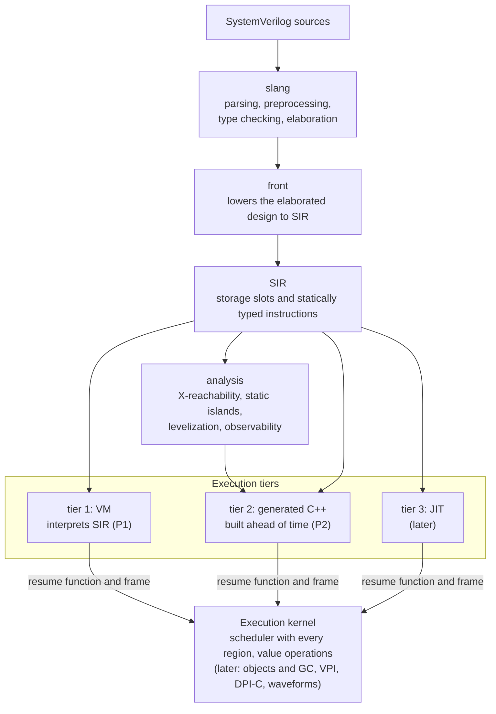

# kirimasim

[English](README.md)

kirimasim は、開発の初期にあるオープンソースの SystemVerilog シミュレータです。次のどれも諦めないシミュレータを目指しています。

- **4 値**（0、1、X、Z）を既定とし、4 値の意味を変える最適化をしない
- **IEEE 1800-2023 どおりのスケジューリング**。時刻スロットのすべての領域と、規格の参照アルゴリズムに従う
- **実用的な速さ**。X や Z が無いと証明できるとき、または実行時に確かめられるときは、2 値のコードで実行する

**コードの大半は AI（Claude Code）が生成し、人が仕様・テスト・レビューに責任を持ちます。** 詳しくは [docs/spec/AI_POLICY.ja.md](docs/spec/AI_POLICY.ja.md) と [CONTRIBUTING.ja.md](CONTRIBUTING.ja.md) を見てください。

## 状況（2026-10-18）

> **開発の初期です。実際のプロジェクトにはまだ使えません。** 最初の実行層（インタプリタ。今は SIR を直接解釈し、バイトコードへの変換は後で入れます）で、RTL と簡単なテストベンチに使う SystemVerilog の広い範囲をシミュレーションできます。クラス、動的配列、キュー、乱数化、並行アサーション、ファイルの入出力、VPI、DPI-C はまだ無く、速さのための作業もまだ始めていません。まだ対応していない構文に会うと、その位置を示して「未対応（unsupported）」のエラーで止まります。黙って読み飛ばすことはしません。

### 段階

| 段階 | 内容 | 状態 |
| --- | --- | --- |
| P0 | 土台：ビルド、CI、詳細仕様書、テストスイート | 完了 |
| P1 | 中間表現（SIR）への変換、IEEE 1800-2023 のスケジューラを持つ実行カーネル、RTL と簡単なテストベンチのための第 1 層（バイトコードのインタプリタ） | **進行中** |
| P2 | 第 2 層：速さのため、SIR を前もって C++ に変換する | 予定 |
| P3 | テストベンチの機能：クラス、動的なデータ、制約付き乱数、並行アサーションとカバレッジ、クロッキングブロックと program、VPI、DPI-C | 予定 |
| P4 | スイッチのレベルの素子、マルチスレッドでの実行、他のシミュレータに組み込むライブラリ | 予定 |

### P1 の合格条件

条件と測り方は [docs/spec/TEST_SUITE.ja.md](docs/spec/TEST_SUITE.ja.md) で決めています。

| 条件 | 今 | 達成 |
| --- | --- | --- |
| [sv-tests](https://github.com/chipsalliance/sv-tests) のシミュレーションのテスト（固定したコミット、手書きのテスト 344 本）で Icarus Verilog 以上 | kirimasim 186 本、Icarus Verilog 210 本（14.0 devel、04cc493。合格条件で使う版） | まだ |
| 自前の RTL のテストの母集団（1466 本、一覧を固定）の 90% が通る | 1451 本が通る（99.0%）。失敗は 0 本で、残りの 15 本は後で作る構文で止まる | 達成 |
| 必須のテストの一覧（P3 が要る 1 本を除く） | すべて通る | 達成 |
| 速い値の演算と参照実装（`valsem`）の食い違いが無い：回数を 100 倍にした夜間のファジングを 7 回続けて | ファジングのテストはどのビルドでも通る。夜間の 7 回はまだ | 未測定 |

sv-tests の差の大部分は 7、8、16、21 章にあります。動的配列、キュー、連想配列、クラス（P3）、並行アサーション（P3）、ファイルの入出力と `$random`（P1、まだ）です。自前のテストスイートは別のリポジトリにあり、まだ公開していません。

### テストの結果

2026-10-17 に測りました。Icarus Verilog と Verilator は、その日の main の最新の開発版をビルドして使いました。kirimasim の sv-tests と自前のテストの結果は、slang を新しいコミットに上げたあとの 2026-10-18 に測り直し、変わりませんでした。

| テストの集まり | 本数 | kirimasim | Icarus Verilog | Verilator |
| --- | --- | --- | --- | --- |
| このリポジトリのテスト（CTest） | 459 | 457、2 本は飛ばす | — | — |
| [sv-tests](https://github.com/chipsalliance/sv-tests) のシミュレーションのテスト | 344 | 186 | 213 | 321 |
| 自前のテストスイートの P1 の母集団 | 1,466 | 1,451 | 1,274 | 1,329 |

このリポジトリで飛ばしている 2 本は、クロッキングブロックが要るもの（P3）と、ネットの一部どうしのポートを通ってドライバが出会うもの（まだ対応していない）です。sv-tests では Verilator が大きく先を行っています。差の大部分は、kirimasim が P3 に回している動的配列、キュー、連想配列、クラス、UVM で、次がファイルの入出力と `randsequence` です。

自前のテストスイートは kirimasim と一緒に書いたもので、中立な比較ではありません。どのテストも、挙げた規格の節と照らし合わせてあり、期待する出力は Icarus Verilog 13.0（Icarus Verilog 13.0 がコンパイルできないテストは Verilator 5.052）の出力と一致します。どちらも規格に従わない少数のテストは、規格に従っています。kirimasim は P1 の合格条件の決まり（出力、終了コード、kirimasim 自身のメッセージ）で、ほかの 2 つは出力だけで、テストスイートの道具で判定しています。Verilator は 2 値のシミュレータなので、x や z を表示するテストは通りません。

**時間**（テストごとの時間の合計。6 本ずつ並べて実行。1 回の測定で、[PERFORMANCE.ja.md](docs/spec/PERFORMANCE.ja.md) がベンチマークに求める 5 回の中央値ではありません）。

> **Verilator をこの表に載せていない理由。** テストスイートの道具は、テストごとに別のディレクトリでビルドします。そのため Verilator は、自分の実行時ライブラリをテストのたびにコンパイルし直します（小さなテストでは、C++ のビルド 2.6 秒のうち約 2.2 秒）。プロジェクトならこのライブラリは 1 回作れば済むので、ここでの Verilator の時間はほとんどこの作り直しを測ることになり、Verilator 自体の時間ではありません。kirimasim の時間と並べると、速さの比較のように読めてしまいますが、そうではありません。また、テストが短すぎて、シミュレーションの速さの比較にもなりません。3 つのシミュレータの速さは「[シミュレーションの速さ](#シミュレーションの速さ)」で比べています。

| テストの集まり | シミュレータ | 準備 | 実行 | 合計 |
| --- | --- | --- | --- | --- |
| sv-tests、344 本 | kirimasim | 6.6 秒 | 0.1 秒 | 6.7 秒 |
| | Icarus Verilog | 5.0 秒 | 33.3 秒 | 38.3 秒 |
| | Verilator | — | — | 載せていない（理由は上） |
| 自前のテストスイート、1,466 本 | kirimasim | 14.1 秒 | 0.3 秒 | 14.4 秒 |
| | Icarus Verilog | 20.8 秒 | 8.9 秒 | 29.7 秒 |
| | Verilator | — | — | 載せていない（理由は上） |

同じ測定のうち、3 つのシミュレータがどれも通したテストだけ：sv-tests の 150 本（うち 38 本は拒否されるべきテストで、実行の段階がありません）と、自前のテストスイートの 1,133 本。

| テストの集まり | シミュレータ | 準備 | 実行 | 合計 |
| --- | --- | --- | --- | --- |
| sv-tests、150 本 | kirimasim | 1.4 秒 | 0.1 秒 | 1.5 秒 |
| | Icarus Verilog | 2.3 秒 | 20.9 秒 | 23.2 秒 |
| | Verilator | — | — | 載せていない（理由は上） |
| 自前のテストスイート、1,133 本 | kirimasim | 10.8 秒 | 0.2 秒 | 11.0 秒 |
| | Icarus Verilog | 16.1 秒 | 7.9 秒 | 24.0 秒 |
| | Verilator | — | — | 載せていない（理由は上） |

- 準備は、シミュレーションを始める前の作業です。kirimasim は設計を読み、エラボレーションし、SIR に変換するまで（`--dump-sir` で止めた実行の時間）、Icarus は `iverilog` です。実行はシミュレーションで、kirimasim は通しの時間から準備を引いたもの、Icarus は `vvp` です。
- テストは短いので、実行の時間はほとんどが起動の時間です。kirimasim の実行の時間は引き算で求めていて、誤差と区別できないほど小さい値です。`--dump-sir` は SIR の文字も出すので、引き算の結果は小さめに出ます。
- この機械では、ビルドしたばかりのプログラムを初めて起動すると約 0.2 秒かかり、同じファイルの 2 回目の起動は 0.01 秒未満でした（Icarus が作ったファイル 3 つで試しました。macOS がその時間を何に使うのかは未確認）。sv-tests の Icarus の実行は、道具がコンパイルしたファイルを直接起動するので、この初めての起動です。自前のテストスイートの道具は、`vvp` にファイルを渡して起動します。
- 最初の表では、ビルドできなかったテストは準備の時間だけを数えます。kirimasim は、未対応の構文に会うと早く止まります。
- 版と機械：kirimasim 8500bdc（release ビルド。時間はこの版。合格の本数は 15b76df で測り直した）、Icarus Verilog 14.0（devel）f190dbb、Verilator 5.053 devel 8668340。Apple M5 Max（18 コア）、メモリ 128 GB、macOS 27.0.1、Apple clang 21。

<details>
<summary>このリポジトリのテストの種類ごとの内訳</summary>

| 種類 | 本数 | 確かめていること |
| --- | --- | --- |
| ユニットテスト（GoogleTest） | 152 | SIR とその検証器（59）、参照モデルと突き合わせるスケジューラ（23）、`valsem`（14）、出力の書式（10）、強さ（9）、入力の読み取り（8）、時間の単位（7）、UDP の表（4）、カウンタ（4）、カーネルの速い演算と `valsem` の突き合わせ：1 語（5）と任意の幅（5）など |
| `tests/suite/` | 223 | 期待する出力を持つシミュレーションのテストと、期待する誤りを持つ違法な設計。大半は `tools/` の生成器が作る。値（67）、手続き（44）、違法な設計（35）、ネット（23）、階層（22）、スケジューリング（21）、連続代入（7）など |
| `tests/dump_sir/` | 29 | front が作る中間表現 |
| 道具 | 53 | 生成器がリポジトリのファイルを作り直せること、テストを判定する道具の陰性対照、ベンチマークの設計が動くこと |
| コマンドライン、事象の回数 | 2 | オプションとメッセージ、未対応の構文の行列（60 の設計。どの器でも位置つきで報告されること）、決まった実行の回数（PerfCount） |

</details>

<details>
<summary>sv-tests の、IEEE 1800-2023 の章ごとの内訳</summary>

sv-tests のコミット 15490e9 に固定し、種類にシミュレーションを含む手書きのテストを、sv-tests の決まりで判定します。`tools/svtests.py` で測りました。

| 章 | 本数 | kirimasim | Icarus | Verilator | kirimasim が止まる所 |
| --- | --- | --- | --- | --- | --- |
| 5 字句の決まり | 1 | 1 | 1 | 1 | |
| 6 データ型 | 16 | 16 | 11 | 14 | |
| 7 集合のデータ型 | 91 | 31 | 47 | 88 | 動的配列（23）、キュー（17）、連想配列（14）（どれも P3）、タグ付きの共用体 |
| 8 クラス | 15 | 9 | 12 | 12 | クラス（P3） |
| 9 プロセス | 6 | 4 | 4 | 6 | シーケンス（P3）。1 本は時刻 0 のプロセスの順に依存し、規格（4.7）はその順を決めていない |
| 10 代入文 | 3 | 3 | 3 | 3 | |
| 11 演算子と式 | 51 | 48 | 37 | 48 | タグ付きの共用体（2）、動的配列のストリーム（P3） |
| 12 手続きの文 | 2 | 2 | 2 | 2 | |
| 13 タスクと関数 | 14 | 14 | 13 | 14 | |
| 14 クロッキングブロック | 1 | 1 | 1 | 1 | |
| 15 プロセス間の同期と通信 | 2 | 0 | 0 | 2 | mailbox（P3） |
| 16 アサーション | 6 | 0 | 3 | 5 | 並行アサーション（P3） |
| 18 制約付き乱数 | 22 | 8 | 8 | 22 | `randsequence`（12）、`randcase`（2） |
| 20 ユーティリティのシステムタスクと関数 | 38 | 29 | 34 | 37 | `$random` と `$dist_` の関数、`$coverage_control` |
| 21 入出力のシステムタスクと関数 | 27 | 9 | 25 | 26 | ファイルの入出力（15）、`$fstrobe`、`$dumpfile`、`$dumpports` |
| 22 コンパイラ指示子 | 6 | 6 | 6 | 6 | |
| 23 モジュールと階層 | 1 | 1 | 1 | 1 | |
| 24 program | 1 | 0 | 1 | 1 | program（P3） |
| 26 パッケージ | 1 | 1 | 1 | 1 | |
| UVM | 37 | 0 | 0 | 28 | UVM のライブラリにはクラスが要る（P3） |
| UVM の乱数 | 3 | 3 | 3 | 3 | |
| **合計** | **344** | **186** | **213** | **321** | |

P1 の合格条件は、sv-tests が固定している Icarus の版（04cc493。210 本）と比べます。Icarus の最新版は 213 本です。

</details>

<details>
<summary>自前のテストスイートの、IEEE 1800-2023 の章ごとの内訳</summary>

TEST_SUITE.md の P1 の母集団です。テストスイートの 1466 本で、一覧は `tests/gates/p1_population.txt` にあります。テストスイート自体は、まだ公開していません。最後の列は kirimasim が止まる所です。kirimasim が失敗するテストはありません。

| 章 | 本数 | kirimasim | Icarus | Verilator | kirimasim が止まる所 |
| --- | --- | --- | --- | --- | --- |
| 3 設計と検証の構成要素 | 3 | 3 | 1 | 3 | |
| 4 スケジューリングの意味 | 13 | 13 | 13 | 9 | |
| 5 字句の決まり | 20 | 20 | 20 | 16 | |
| 6 データ型 | 226 | 226 | 187 | 200 | |
| 7 集合のデータ型 | 90 | 87 | 55 | 90 | 動的配列、連想配列、`sort`（3、P3） |
| 9 プロセス | 72 | 72 | 71 | 65 | |
| 10 代入文 | 84 | 84 | 77 | 81 | |
| 11 演算子と式 | 347 | 347 | 309 | 312 | |
| 12 手続きの文 | 106 | 106 | 96 | 102 | |
| 13 タスクと関数 | 76 | 76 | 50 | 76 | |
| 15 プロセス間の同期と通信 | 3 | 3 | 1 | 3 | |
| 16 アサーション | 21 | 18 | 16 | 19 | `$sampled`、`$stable`（3、P3） |
| 18 制約付き乱数 | 1 | 0 | 0 | 1 | `randsequence`（1） |
| 20 ユーティリティのシステムタスクと関数 | 149 | 149 | 144 | 117 | |
| 21 入出力のシステムタスクと関数 | 57 | 57 | 56 | 52 | |
| 22 コンパイラ指示子 | 14 | 14 | 14 | 14 | |
| 23 モジュールと階層 | 45 | 45 | 43 | 42 | |
| 25 インターフェース | 29 | 26 | 18 | 29 | virtual interface（3、P3） |
| 26 パッケージ | 20 | 20 | 16 | 20 | |
| 27 generate | 62 | 62 | 62 | 53 | |
| 28 ゲートとスイッチのレベルのモデル | 22 | 17 | 22 | 20 | MOS と双方向のスイッチ（5、P4） |
| 29 利用者定義のプリミティブ | 6 | 6 | 3 | 5 | |
| **合計** | **1,466** | **1,451** | **1,274** | **1,329** | |

</details>

### シミュレーションの速さ

2026-10-17 に、[bench/](bench/) の小さな設計 4 つを `tools/bench.py` で測りました。PERFORMANCE.md 5.2 が P1 で求める種類の設計です。どの設計も、`+n=` で決めた回数だけ同じ仕事を繰り返し、最後に検査用の値を出します。3 つのシミュレータが出す値は同じでした。

| 設計 | 内容 | `+n=` | kirimasim | Icarus Verilog | Verilator |
| --- | --- | --- | --- | --- | --- |
| `comb_chain` | 32 ビットの算術をする `always_comb` の 8 段。入力は時刻ごとに変わる | 3,000,000 | 4.53 秒 | 7.97 秒 | 0.16 秒 |
| `nba_shift` | `always_ff` の 64 段のシフトレジスタと 16 個の累算器。すべてノンブロッキング | 1,000,000 | 10.69 秒 | 18.69 秒 | 0.16 秒 |
| `proc_wait` | `#` で待つ 64 個のプロセスと、名前付きイベントを待つ 64 個のプロセス | 1,000,000 | 3.46 秒 | 4.93 秒 | 1.76 秒 |
| `fork_join` | 4 つの枝の fork と join を繰り返す。`#`、`->`、`@` を使う | 4,000,000 | 2.33 秒 | 4.14 秒 | 0.87 秒 |

- 時間はシミュレーションだけのものです。回数を決めた実行 5 回の中央値から、`+n=1` の実行 5 回の中央値を引きました。プログラムの起動、設計の読み込み、kirimasim のフロントエンドは両方の実行に入るので消えます（`+n=1` の実行は 3〜8 ミリ秒）。測る前にどのプログラムも 1 回起動したので、ビルドしたばかりのプログラムの初めての起動の時間も入りません。ビルドの時間も入りません（iverilog は設計ごとに 0.01 秒、Verilator は並列のビルドで 1.4 秒）。
- kirimasim と Icarus Verilog は設計を 4 値のままインタプリタで実行し、Verilator は C++ にコンパイルし、2 値で動きます。kirimasim で Verilator に当たるのは P2 の第 2 層（C++ の生成）で、kirimasim は速さのための作業をまだしていません。Verilator との差は、多くのプロセスが待つ設計（`proc_wait`、`fork_join`）でいちばん小さくなりました。
- メモリ：1 回の実行で使った量は、kirimasim が 10 MiB、Icarus が 6 MiB、Verilator が 2 MiB 以下でした。終わったプロセスの記録を解放するようにした 072d0c2（SCHEDULER_SPEC.md の 10.8 節）より前は、kirimasim が記録をすべて残していて、`fork_join` で 4,947 MiB を使っていました。
- 版と機械は、上のテストの結果と同じです。ただし kirimasim の列は、072d0c2 の後の 394717f で測り直しました。`tools/bench.py` で測り直せます。`--n` と `--runs` で短くできます。

### できること

以下はすべて第 1 層のインタプリタで動き、テストで確かめています。

- **設計の構造：** module、ポート（input、output、inout）、parameter と `defparam`、`generate`、インスタンスの配列、interface と modport、package とコンパイル単位（`$unit`）、階層名、specparam
- **データ型：** 任意の幅の 2 値と 4 値の整数型、`real`、`shortreal`、`realtime`、`string`、列挙型、packed と unpacked の構造体、packed の共用体、固定長の unpacked の配列（多次元、構造体の配列）、unpacked の配列のパラメータ、名前付きイベント、`chandle`（DPI-C までは null だけ）
- **ネット：** `wire`、`tri`、`wand`、`wor`、`tri0`、`tri1`、`supply0`、`supply1`、`uwire`。駆動の強さと、複数のドライバの解決。連続代入とネットの遅延（立ち上がり、立ち下がり、ターンオフ）。組み込みのゲートとプル。利用者定義のプリミティブ（組み合わせと順序）。`alias`
- **手続きと時間：** `initial`、`always`、`always_comb`、`always_latch`、`always_ff`、`final`。ブロッキングと NBA（代入の中の遅延を含む）。遅延とイベント制御（信号と式。`iff` を含む）。`wait (式)`。名前付きイベント（`->`、`->>`、`.triggered`）。`fork` と `join`、`join_any`、`join_none`。`wait fork`、`disable fork`。どのプロセスからでも働くブロックとタスクの `disable`。`assign`・`deassign` と `force`・`release`
- **関数とタスク：** static と automatic、再帰、`input`・`output`・`inout`・`ref` の引数、引数の既定値、unpacked の構造体と配列の引数、unpacked の構造体と配列を返す関数
- **文と式：** `if`、`case`、`casez`、`casex`、`case inside`。違反の報告を含む `unique`、`unique0`、`priority`。すべてのループ、`break`、`continue`、`return`。ストリーミング、`inside`、ワイルドカードの等価、代入の演算子と増減を含むすべての演算子。代入のパターン
- **アサーション：** 即時の `assert`、`assume`、`cover` と、遅延のもの（`#0`、`final`）
- **システムタスクと関数：** `$display` と `$write`（`b`・`o`・`h` の付いた形も）、`$strobe`、`$monitor`、`$monitoron`、`$monitoroff`、`$sformat`、`$sformatf`、`$swrite`、`$sscanf`、`$time`、`$realtime`、`$timeformat`、`$printtimescale`、`$finish`、`$stop`、`$fatal`、`$error`、`$warning`、`$info`、変換（`$rtoi`、`$itor`、`$realtobits` など、`$signed`、`$unsigned`）、`$bits`、`$typename`、配列の問い合わせ、`$clog2` と実数の数学関数、`$countbits`、`$countones`、`$onehot`、`$onehot0`、`$isunknown`、`$test$plusargs`、`$value$plusargs`
- **スケジューリング：** IEEE 1800-2023 の時刻スロットのすべての領域と参照アルゴリズム。Observed 領域での保留の報告の確定と、Postponed 領域での `$strobe`・`$monitor` を含む

### まだできないこと

| まだのもの | 予定 |
| --- | --- |
| ファイルの入出力（`$fopen` など）、`$readmemh`・`$writememh`、`$random`・`$urandom`、波形（`$dumpvars`、VCD と FST）、`%p` の書式、`$stime`、`$timeunit`、`$timeprecision`、`$stacktrace` | P1 |
| クラス、動的配列、キュー、連想配列、乱数化と制約、`randsequence`、カバーグループ、並行アサーションと `$sampled`・`$stable`、クロッキングブロック、virtual interface、`let`、checker | P3 |
| program ブロック。program のコードは reactive の領域の組で動くもの（24.3.1）なので、今は未対応として報告する | P3 |
| VPI、DPI-C | P3 |
| 第 2 層（C++ の生成）と、速さのための作業 | P2 |
| MOS と双方向のスイッチ | P4 |

## ビルド

必要なもの：CMake 3.28 以上、Ninja、Python 3、C++23 のコンパイラ（macOS arm64 の Apple clang 21 で開発。CI は x86-64 の Linux でビルドします）。最初の configure で slang と GoogleTest を取得します。

```sh
cmake --preset dev            # ほかに release、asan、ubsan
cmake --build --preset dev
ctest --preset dev
```

| プリセット | フラグ |
| --- | --- |
| `dev` | `-O1 -g` |
| `release` | `-O3` |
| `asan` | `-O1 -g -fsanitize=address -fno-omit-frame-pointer`。サニタイザがヒープを見られるように、slang を mimalloc なしで作る |
| `ubsan` | `-O1 -g -fsanitize=undefined -fno-sanitize-recover=all` |

ビルドの結果は `build/<プリセット名>/` に出ます。

## 使い方

```sh
kirimasim [オプション] <ファイル>... [+プラスアーグ]...   # エラボレーションしてシミュレーションする
kirimasim parse [オプション] <ファイル>...                # 読んでエラボレーションするだけ
kirimasim --version
```

例として、次の `counter.sv` を動かします。

```systemverilog
module counter(input logic clk, rst, output logic [3:0] q);
  always_ff @(posedge clk)
    if (rst) q <= '0;
    else q <= q + 1;
endmodule

module top;
  logic clk = 0, rst = 1;
  logic [3:0] q;
  counter dut(.clk, .rst, .q);
  always #5 clk = ~clk;
  initial begin
    $monitor("%0t: rst=%b q=%0d", $time, rst, q);
    #12 rst = 0;
    #40 $finish;
  end
endmodule
```

```text
$ build/dev/src/driver/kirimasim counter.sv
kirimasim: info: kirimasim 0.0.0 (commit ...) args: counter.sv
0: rst=1 q=x
5: rst=1 q=0
12: rst=0 q=0
15: rst=0 q=1
25: rst=0 q=2
35: rst=0 q=3
45: rst=0 q=4
kirimasim: info: finish at 52 ns
```

設計の出力は標準出力に、kirimasim 自身のメッセージと `$error` などのメッセージは標準エラーに出ます。

今使えるオプション：

| オプション | 意味 |
| --- | --- |
| `-f <ファイル>`、`+incdir+<ディレクトリ>`、`+define+<名前>[=<値>]`、`--top=<名前>` | ソース、インクルードのディレクトリ、マクロ、最上位のモジュール |
| `--timescale=<単位>/<精度>` | timescale を書いていない設計要素の時間の単位と精度（既定は `1ns/1ns`） |
| `--max-time=<時刻>`、`--max-time-ok` | シミュレーションの時刻で止める。終了コードを 4 でなく 0 にする |
| `--max-zero-delay=<n>`、`--max-steps=<n>`、`--max-scc-iter=<n>` | 時刻が進まない実行の上限 |
| `--dump-sir` | シミュレーションの代わりに中間表現を出す |
| `--stats=json` | 実行の回数のカウンタを JSON で出す |
| `+<名前>[=<値>]` | `$test$plusargs` と `$value$plusargs` のためのプラスアーグ |

終了コード：0 は `$finish`、`$stop`、事象が尽きた。1 は `$fatal`。2 は入力の誤り（未対応の構文を含む）。3 は内部エラー。4 は `--max-time` に達した。5 は時刻が進まない実行の上限に達した。コマンドラインのすべては [docs/spec/CLI.ja.md](docs/spec/CLI.ja.md) にあります。

## 仕組み



[slang](https://github.com/MikePopoloski/slang) は改変せず、1 つのコミットに固定して使います。どの実行層も、1 つの実行カーネルにプロセスを登録します。スケジューラと値の演算はカーネルが持つので、別の層のプロセスを 1 つのシミュレーションで一緒に動かせ、層の違いは出力の違いとして表に出ます。詳しくは [docs/ARCHITECTURE.ja.md](docs/ARCHITECTURE.ja.md) を見てください。

## テストのやり方

- **仕様が先。** 値の意味、スケジューリング、システムタスク、SIR を [docs/spec/](docs/spec/) に書き、人の承認を受けてから実装します。規格が決めていない所は、kirimasim がどう読むかを仕様書に書きます。
- **値の意味の参照は 1 つ。** `valsem` は、遅いが明らかに正しい演算の実装です。カーネルの速い演算は、それとファジングで突き合わせます（1 語の値と、複数の語の値の両方）。
- **機構の行列。** 1 つの機構を、それが現れうる所の組み合わせで確かめます（たとえば `disable` なら、ブロックの中、fork の枝、別のプロセス、タスクから、それぞれ手続き、タスク、fork の枝の中で）。テストは `tools/` の生成器が作り、期待値は書いた規則から決まります。生成器は 51 個、`tests/suite/` のテストは 223 本、CTest のテストは全部で 459 本です。
- **陰性対照。** `tools/mutants.py` は、知られた誤り 185 個を 1 つずつコードに入れます。どの誤りでも、どれかのテストが落ちなければなりません。
- **他のシミュレータは証拠であって正解ではない。** Icarus Verilog と Verilator でもテストを動かし、規格と違うところはテストのヘッダに書きます。
- **サニタイザと静的な検査：** AddressSanitizer、UndefinedBehaviorSanitizer、clang-format、clang-tidy を push の前に毎回走らせます。

## 貢献：今は仕様の提案と Issue だけを受け付けています

kirimasim は開発の初期にあるため、今は**仕様の提案と Issue だけ**を受け付けています。コードの PR は受け付けていません（PR を作れるのは協力者だけという設定にしています）。`docs/spec/` の仕様書への提案、不具合の報告、期待値の誤りの指摘には Issue のフォームを、質問（Q&A）とまだ形になっていない案（Ideas）には [Discussions](https://github.com/kurochan001/kirimasim/discussions) を使ってください。受け付けを広げるときは、この節と [CONTRIBUTING.ja.md](CONTRIBUTING.ja.md) でお知らせします。

## 文書

どの文書も英語版が正本で、日本語版（`X.md` の隣の `X.ja.md`）を並べて置いています（変更の記録、ライセンス、GitHub の Issue と PR のフォームは英語だけです）。食い違ったときは英語版に従います。下の表のリンクは日本語版を指します。

| 文書 | 内容 |
| --- | --- |
| [docs/ARCHITECTURE.ja.md](docs/ARCHITECTURE.ja.md) | ライブラリの分割と実行の仕組み |
| [docs/spec/VALUE_SEMANTICS.ja.md](docs/spec/VALUE_SEMANTICS.ja.md) | 値、演算、ネット、強さ、ゲート、UDP |
| [docs/spec/SCHEDULER_SPEC.ja.md](docs/spec/SCHEDULER_SPEC.ja.md) | 時刻スロット、領域、待ち、プロセス、disable、保留の報告 |
| [docs/spec/SIR_SPEC.ja.md](docs/spec/SIR_SPEC.ja.md) | 中間表現 |
| [docs/spec/SYSTEM_TASKS.ja.md](docs/spec/SYSTEM_TASKS.ja.md) | システムタスクと関数、メッセージの形 |
| [docs/spec/CLI.ja.md](docs/spec/CLI.ja.md) | コマンドライン、終了コード |
| [docs/spec/TEST_SUITE.ja.md](docs/spec/TEST_SUITE.ja.md) | テストの決まり、P1 の合格条件 |
| [docs/spec/RUNTIME_ABI.ja.md](docs/spec/RUNTIME_ABI.ja.md) | カーネルと実行層の境界 |
| [docs/spec/PERFORMANCE.ja.md](docs/spec/PERFORMANCE.ja.md) | 性能の目標と回数のカウンタ |
| [docs/spec/AI_POLICY.ja.md](docs/spec/AI_POLICY.ja.md) | このプロジェクトでの AI の使い方 |
| [CONTRIBUTING.ja.md](CONTRIBUTING.ja.md) | 貢献の方法 |
| [CHANGELOG.md](CHANGELOG.md) | 変更の記録（英語） |

## 用語集

この README と [docs/](docs/) で使う用語です。

**構成**

| 用語 | 意味 |
| --- | --- |
| slang | kirimasim が改変せずに、1 つのコミットに固定して使う SystemVerilog のフロントエンドのライブラリ（構文の解析、エラボレーション、型の検査） |
| エラボレーション | ソースから、設計のインスタンスの木、パラメータ、型を組み立てること。slang が行う |
| `front` | slang を呼び、その結果を SIR に変える kirimasim のライブラリ |
| 下ろす（lowering） | slang がエラボレーションした設計を、SIR の命令に変えること |
| SIR | kirimasim の中間表現。格納のスロットと、型の決まった命令でできていて、どの層が実行しても同じ（[SIR_SPEC.ja.md](docs/spec/SIR_SPEC.ja.md)） |
| `valsem` | 値の意味の参照実装。1 ビットずつ計算する、遅いが明らかに正しい実装。演算子、辺、case の一致の意味はここで決め、速い実装はすべてこれと突き合わせて確かめる |
| カーネル（kernel） | すべての層が共有する実行カーネル。スケジューラ、値の演算、後で VPI、DPI-C、波形。利用者の設計と一緒にリンクするので、slang にも LLVM にも依存しない |
| 第 1 層、VM | 第 1 層のインタプリタ（P1）。今は SIR を直接解釈する。SIR をレジスタ方式のバイトコードに変換して実行するのは後で |
| 第 2 層 | SIR から C++ を生成して前もってビルドし、速く実行する層（P2） |
| Context | 1 つのシミュレーションの実行時の状態をすべて持つオブジェクト。kirimasim は大域の状態を持たない |
| `analysis` | 第 2 層のための解析（P2）。X 到達解析（x が来ないところを見つけ、2 値のまま持てるようにする）、静的な島、レベル化（組合せ回路を依存の順に並べる）、可観測性（VPI や force から見えるので畳み込んではいけないもの） |
| 静的な島 | 第 2 層が、速さのために 1 つのまとまりとしてコンパイルする予定の、設計の一部（P2。CODEGEN_SPEC.md で定める予定で、まだ書いていない） |
| スロット | 静的な変数、ネット、その配列のための、カーネルの格納領域の場所 |
| フレーム、フレームの変数 | プロセスやサブルーチンの呼び出しの、automatic な変数の格納領域 |
| W4 | カーネルの 4 値の 64 ビットの語。a と b の 2 面で、0 は a=0 b=0、1 は a=1 b=0、z は a=0 b=1、x は a=1 b=1 |
| チャンク | 64 ビットを超える値を分けた、1 つずつの W4。下位から並べる |
| P0〜P4 | プロジェクトの段階（上の「段階」の節） |

**値**

| 用語 | 意味 |
| --- | --- |
| 4 値、2 値 | ビットが 0・1・x・z を取る型（`logic`、`integer`）と、0・1 だけの型（`bit`、`int`）。2 値の変数に入れると x と z は 0 になる |
| x、z | ビットの不明な値と、ハイインピーダンスの値 |
| 強さ（strength） | ドライバがネットをどれだけ強く駆動するか（supply、strong、pull、weak など）。複数のドライバが出会うときに使う |
| 解決（resolution） | ネットの値を、すべてのドライバとその強さから決めること（[VALUE_SEMANTICS.ja.md](docs/spec/VALUE_SEMANTICS.ja.md) の 5 節） |
| ワイヤード論理 | ドライバを AND か OR で合わせるネット（`wand`、`wor`） |
| サイドスロット | ゲートが出力の横に書く 2 値のスロット。出力のどのビットを 1 の側と 0 の側で駆動するかを持ち、解決に使う |
| UDP | 利用者定義のプリミティブ。真理値表で書くゲート（`primitive`） |
| 上書きのプロセス | 手続きの連続代入（`assign`、`force`）を保つプロセス |

**スケジューリング**

| 用語 | 意味 |
| --- | --- |
| 時刻スロット | 1 つのシミュレーション時刻に起きることのまとまり |
| 領域（region） | 時刻スロットの中の 17 の列。規格が決めた順に処理する（Active、Inactive、NBA、Observed、Reactive、Postponed など。[SCHEDULER_SPEC.ja.md](docs/spec/SCHEDULER_SPEC.ja.md) の 2 節） |
| active 側、reactive 側の領域の組 | 設計のコードを動かす領域（Active、Inactive、NBA）と、program と checker のコードを動かす領域（Reactive、Re-Inactive、Re-NBA） |
| NBA | ノンブロッキング代入（`<=`）。更新は後で、NBA 領域で起きる |
| 購読 | スロットのいくつかのビットの変化を、プロセスが待つこと |
| 監視レコード | 式が読むものが変わったときに、その式を評価し直すカーネルの記録（`wait (...)`、式のイベント制御） |
| 保留の報告、flush point | unique と priority の違反と遅延即時アサーションは、Observed 領域まで報告を保留する。それより先にプロセスがイベント制御から再開したら捨てる（その点が flush point） |
| 遅延即時アサーション | `assert #0` と `assert final`。時刻スロットが落ち着いてから動作を実行する |
| static-init のプロセス | 時刻 0 の手続きが始まる前に、static な変数の初期値を設定するプロセス |
| quiescent | 事象が無くなって実行が終わったこと |
| zero-time limit | 時刻が上限を超えて進まなかったので実行を止めたこと（`--max-steps`、`--max-zero-delay`） |
| 記録の回収 | 終わったプロセスの記憶を返すこと（[SCHEDULER_SPEC.ja.md](docs/spec/SCHEDULER_SPEC.ja.md) の 10.8 節） |

**テストと仕事の進め方**

| 用語 | 意味 |
| --- | --- |
| 未対応（unsupported） | kirimasim がまだ実装していない構文。位置を示して終了コード 2 で止まり、別の動き方で走らせることはしない |
| 機構の行列 | 1 つの機構の軸（置き場所、読み書きの仕方、名前の綴り、器）を組み合わせて、生成器が作るテスト。不具合を直すとき、その形だけでなく隣の形まで確かめるため |
| 生成器 | 機構の行列とその期待する出力を、書いた規則から作るスクリプト `tools/gen_*.py`。`--check` で、コミットしたファイルが最新かを確かめる |
| 器 | 文が実行される場所。モジュールの手続き、タスク、関数、fork の枝、interface、generate、package。同じ文はどの器でも同じ意味になる |
| 変異、陰性対照 | `tools/mutants.py` がコードにわざと入れる既知の誤り。どれかのテストが落ちることで、テストが誤りを見つけられることを示す |
| PerfCount | 時間ではなく事象の回数で測る回帰テスト。期待値は `tests/perf_counts/expected.json` |
| `--stats=json` | その回数を出すオプション |
| オラクル（oracle） | テストの期待する出力の出どころ（ヘッダの `:oracle:`。規格、または証拠として使ったシミュレータの名前） |
| `:spec_check:` | テストを規格と照らし合わせたのが誰か。`ai`（Claude Code）か `human`（人） |
| P1 の母集団 | P1 の合格条件で数える、自前のテストスイートの 1466 本の固定した一覧 |
| 必須テスト | 通過率とは別に、落としてはいけないテストの決まった一覧（TEST_SUITE.md）。P1 では、P3 が要る 1 本を除いてすべて通ることが合格条件 |
| sv-tests | CHIPS Alliance が公開している SystemVerilog のテスト集 |
| Icarus Verilog、Verilator | 比べるためと証拠として動かす、ほかのオープンソースのシミュレータ。正解としては扱わない |
| DPI-C、VPI | C のコードと、ツールにつなぐ規格のインターフェース（P3） |
| FST | 小さな波形のファイルの形式（後で） |
| 規格で確認、本書の決まり、解釈、未確認 | 仕様書の注記（英語版では checked、rule of this document、interpretation、not confirmed）。「規格で確認」は規格の節を読んで確かめたこと、「本書の決まり」は規格が実装に任せた点を kirimasim として決めたこと、「解釈」は規格の文面が 2 通りに読める点の読み方、「未確認」はまだ確かめていないこと（確かめ方を添える） |

## よくある質問（FAQ）

### 今すぐ自分の設計で使えますか？

まだです。開発の初期（P1）で、第 1 層のインタプリタで RTL と簡単なテストベンチを動かせる段階です。どこまで動くかは「できること」と「まだできないこと」の節に書いてあります。試すことはできます。まだ対応していないものがあれば、そのソースの位置を示すエラーで止まります。

### 対応していない構文を、飛ばさずに止まるのはなぜですか？

分からないものを飛ばして走ると、正しく見えて実は間違った結果が出るからです。kirimasim は、対応していない構文をすべて位置つきで報告し、シミュレーションを始める前に終了コード 2 で終わります（[CLI.ja.md](docs/spec/CLI.ja.md) の 5 節）。

### Icarus Verilog や Verilator と何が違いますか？

重点が 2 つ違います。4 値を既定とし、その意味を変える最適化をしないこと。IEEE 1800-2023 の時刻スロットのすべての領域でスケジューリングすることです。両方のシミュレータはテストの裏付けとして走らせますが、期待値は規格から決めます（「テストのやり方」の節）。Verilator は設計を C++ に変換する 2 値のシミュレータで、今は kirimasim よりずっと速いです（「シミュレーションの速さ」の節）。kirimasim も、第 2 層（P2）で C++ を生成します。

### UVM は動きますか？

まだです。UVM に要るクラス、動的配列、キュー、制約付きの乱数は、P3 で作ります。そのときも UVM のクラスを特別扱いせず、ふつうの SystemVerilog のソースとして実行します。

### 波形を出せますか？

まだです。`$dumpvars` と、VCD・FST の出力は P1 で作る予定です。

### どの環境で動きますか？

macOS（arm64）で開発し、CI で x86-64 の Linux でビルドとテストをしています。夜間の CI では、arm64 の Linux と GCC でもビルドします。Windows は試していません。

### slang に手を加えていますか？

いいえ。構文解析とエラボレーションには [slang](https://github.com/MikePopoloski/slang) を改変せずに使い、1 つのコミットに固定しています。slang で見つけた不具合は上流に報告し、固定したコミットに修正が入るまでは、kirimasim の側で回避します（[SIR_SPEC.ja.md](docs/spec/SIR_SPEC.ja.md) の 6 節）。

### コードは AI が書いているのですか？

大部分は Claude Code が生成しています。仕様、テスト、レビューには人が責任を持ちます。AI の使い方は [AI_POLICY.ja.md](docs/spec/AI_POLICY.ja.md) に書いてあります。

### どうすれば手伝えますか？

今は Issue で受け付けています。不具合の報告、期待値の誤りの指摘、`docs/spec/` の仕様の提案です。質問とアイデアは [Discussions](https://github.com/kurochan001/kirimasim/discussions) へどうぞ。コードのプルリクエストは、まだ受け付けていません（「貢献」の節）。

## ライセンス

kirimasim のライセンスは Apache License 2.0 with LLVM Exceptions（`Apache-2.0 WITH LLVM-exception`）です。[LICENSE](LICENSE) と [THIRD_PARTY_NOTICES.ja.md](THIRD_PARTY_NOTICES.ja.md) を見てください。
