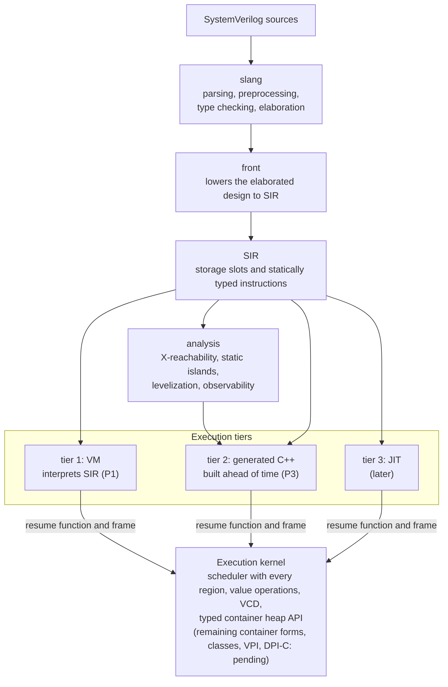

# kirimasim

[English](README.md)

**改訂（2026-10-24）：** 旧P2→P3・旧P3→P4・旧P4→P5と付け替え、新しいP2（SIR v1）を設けました（tier番号は不変）。[対応表](docs/notes/phase-renumbering.ja.md)。

2026-10-23承認の[P1の範囲変更](docs/spec/P1_SCOPE.ja.md)により、
Icarus Verilog 13.0以上の実行機能を目標とし、必要なP4・P5・対象外の仕組みを
P1へ前倒しします。目標はまだ未達成です。[実装済み一覧](docs/P1_SUPPORT.ja.md)と
[比較で残る差](docs/notes/p1-icarus-progress.ja.md)を参照してください。

kirimasim は、開発の初期にあるオープンソースの SystemVerilog シミュレータです。次のどれも諦めないシミュレータを目指しています。

- **4 値**（0、1、X、Z）を既定とし、4 値の意味を変える最適化をしない
- **IEEE 1800-2023 どおりのスケジューリング**。時刻スロットのすべての領域と、規格の参照アルゴリズムに従う
- **実用的な速さ**。X や Z が無いと証明できるとき、または実行時に確かめられるときは、2 値のコードで実行する

**コードの大半は AI（Claude Code）が生成し、人が仕様・テスト・レビューに責任を持ちます。** 詳しくは [docs/spec/AI_POLICY.ja.md](docs/spec/AI_POLICY.ja.md) と [CONTRIBUTING.ja.md](CONTRIBUTING.ja.md) を見てください。

## 状況（2026-10-24）

> **開発の初期です。実際のプロジェクトにはまだ使えません。** 最初の実行層（インタプリタ。今は SIR を直接解釈し、バイトコードへの変換は後で入れます）で、RTL と簡単なテストベンチに使う SystemVerilog の広い範囲をシミュレーションできます。クラス、制約付きの乱数化、並行アサーション、VPI、DPI-C はまだありません。第 1 層では速度とメモリの改善を進めており、C++ の生成は P3 で作ります。未対応の形は原則として位置付きの診断で止まります。ただし、クラスのstatic初期化には副作用を落とす既知の不具合があり、[クラスの調査](docs/notes/class-execution-investigation.ja.md)に記録しています。実行の成功だけでは対応を確認できません。

`4c69843`で型付きpatternのSIR・検証器・text・実行処理を共有表示APIへ接続しました。
frontの定数・runtime書式引数への接続は残っているため、ソース`%p`は引き続き未対応です。
既存queue要素を変更したときの`$monitor`の再表示も確認しています。
[現在の実装と検証範囲](docs/notes/pattern-sir-execution.ja.md)と
[実行例](docs/P1_FEATURES.ja.md#キュー要素の変更をmonitorで表示する)を参照してください。

共有カーネルのUDP評価を32入力超へ拡張しました。[独自106ソースと独立した値の検査](docs/notes/wide-udp-inputs.ja.md)で、
後方の端子、状態、X/Z、遅延、強さを確認しています。密な表では固定したslangの検査時間が
増える問題が残るため、広いUDPソース全体の対応は未確認です。診断は緩めていません。

動的配列・キューの実行仕様は2026-10-23に承認されました。共通カーネルには、
深いコピー、安定した要素参照、上限付きキュー、正確なトレース回収、確保失敗時の
巻き戻しを持つ型付きヒープを実装しました。カーネルの31テストで入れ子のコピー432組、
確保失敗時の状態保持、実際の型を保つスナップショットを検査し、252万操作の
モデル比較も通過しています。型付きSIRの記述子・参照・命令と
検証器・テキスト形式も追加しました。独自のSIR入力によるVMの24テストで、実際の
上限を保つref、待機をまたぐ切り離したセル、領域・スロット境界での自動回収を検査します。
型付きスロット、生存中のフレーム、セル参照、遅延報告、スケジューラの保留値を
ルートとして保持します。ヒープに依存する待機、依存先の付け直し、呼び出した関数の
私有コンテナの除外も接続しました。frontから構築、深いコピー、要素、キューのメソッド、
実際の上限を保つref、値全体の遅延代入、明示的なヒープ待機、動的foreach、第1次元クエリを
実行できるようにしました。独自のソース行列240件が8種類の実行場所を横断し、CLIでも
11件の位置付き診断を検査します。さらに256件で、実行時のunpacked連結とキューの読み取り
スライスを検査します。広い符号付き・符号なし境界、X/Z、副作用を含む評価順も対象です。
対応は一部で、スライスへの代入、追加の配列メソッド、暗黙のヒープ感度などは残作業です。
[実装状況](docs/P1_SUPPORT.ja.md#動的コンテナの共通基盤)と
[承認済みの契約](docs/notes/dynamic-containers-proposal.ja.md)を参照してください。

[共通の強さの解決処理](docs/notes/strength-range-foundation.ja.md)は、値への射影前の
完全な区間を保持できるようにし、全区間ペアで検査しました。ソースのMOS・スイッチ実行や
強さの書式への接続は残作業で、このカーネルAPIで差分を解消したとは扱いません。

広い三状態ゲートでも、語をまたぐL/Hマスクの両半分を保持します。新規73ソースは
Icarus 13.0・開発版とすべて一致しました。[対応範囲と検証](docs/notes/wide-gate-strength.ja.md)を
参照してください。sideだけが変わる遅延の時刻も、[意味の修正案](docs/notes/delayed-gate-side-proposal.ja.md)が2026-10-25承認済みです。

集約値の通常代入・NBAでは、代入先の副作用より前に右辺全体を保持するよう修正しました。
コンテナの値は後のメンバーの式より前に捕捉し、実行時に選ぶ固定の部分配列と
構造体配列のメンバーにも同じ経路を使います。[値の保持と検証](docs/notes/aggregate-value-capture.ja.md)を
参照してください。

固定配列・unpacked構造体全体のブロッキング代入内遅延・イベント・repeatにも対応しました。
型付きの非公開フレームで右辺を待機中も保持し、実際の対象は待機後に選びます。
別の独自74件で、これらの形と宣言範囲が異なる構造体配列のコピーを検査します。
[実装と期待値の別レビュー](docs/notes/blocking-aggregate-timing.ja.md)を参照してください。

ブロッキング代入内の`repeat(count) @(...)`は、右辺と完全な幅の回数を保持し、
待機後に代入先を選べるようになりました。0以下・X/Zなら待機を省きます。
独自ソース75件が実行場所8種類とスカラー・コンテナの値の保持を検査します。
イベント制御付きNBAは引き続き未対応です。[実行と検証](docs/notes/repeated-event-controls.ja.md)を
参照してください。

fork内の宣言は、親での初期化と共有static記憶域に対応し、子プロセスには数えません。
宣言だけなら待機も出しません。[対応範囲と独自72ソース](docs/notes/fork-local-declarations.ja.md)で
全join種類を検査します。子が捕捉するautomatic変数は未対応です。

固定配列ポートは宣言ごとの範囲を保って要素を共有・コピーし、ネット配列の強さを
要素ごとに解決します。定数要素のforce/release、遅延、未接続の既定値・pullも含め、
[独自358ケースと対応範囲](docs/notes/fixed-array-port-execution.ja.md)を記録しました。
既存87プローブのIcarus成功・native未成功は各参照版で24→22件になりました。
P1全体は引き続き未完了です。

### 段階

| 段階 | 内容 | 状態 |
| --- | --- | --- |
| P0 | 土台：ビルド、CI、詳細仕様書、テストスイート | 完了 |
| P1 | 中間表現（SIR）への変換、IEEE 1800-2023 のスケジューラを持つ実行カーネル、Icarus Verilog 13.0以上の実行機能を目指す第 1 層（SIR のインタプリタ） | **進行中** |
| P2 | SIR v1：SIRとカーネル境界をtier 2に渡せる形に確定する（[方針承認済み・詳細レビュー待ち](docs/notes/sir-v1-proposal.ja.md)） | Planned |
| P3 | 第 2 層：速さのため、SIR を前もって C++ に変換する | 予定 |
| P4 | テストベンチの機能：クラス、動的なデータ、制約付き乱数、並行アサーションとカバレッジ、クロッキングブロック、VPI、DPI-C | 予定。必要な部分はP1へ前倒し |
| P5 | スイッチのレベルの素子、マルチスレッドでの実行、他のシミュレータに組み込むライブラリ | 予定。必要な部分はP1へ前倒し |

P2は[承認済みの方針](docs/notes/sir-v1-proposal.ja.md)に従い、P1と並行準備し、
P1完了後にSIR v1を凍結します。完全なrecord形式・共通Op schema・サービス単位のC境界を
選択し、文法・API prototype/関数数・参照配置の詳細はレビュー待ちです。
P2は予定の段階で、formatVersionは0、ABIは0.3のまま、tier 2の実装はP3です。

### P1 の合格条件

**P1は未完了です。** 承認済みの[P1の範囲](docs/spec/P1_SCOPE.ja.md)により、
[TEST_SUITE](docs/spec/TEST_SUITE.ja.md)の既存条件に加え、
Icarus Verilog 13.0以上の実行機能が必要です。以下の表の条件だけを満たしても、
P1の完了にはなりません。

- Icarusが対応する規格上の仕組みを実行できること。動的コンテナ、クラス、program、
  VPI、スイッチレベルのモデル、specifyパス、タイミング機能の必要な部分を含みます。
  従来のP4・P5や対象外という分類を理由に、その部分をP1より後へ回しません。
- コンパイラとランタイムの版を記録し、独自のプローブで仕組みとその組み合わせを確認すること。
  拡張と外部インターフェースは別に棚卸しし、厳格な受理と衝突する拡張にはレビュー済みの
  互換方針を設けます。IEEEの値とスケジューリングの意味、4値の既定、共有カーネル、
  slangの厳格な診断、既存テストの期待値を維持します。
- 以下の既存の通過率と、参照実装とのファジングの条件をすべて満たすこと。

進捗は[実装済み一覧](docs/P1_SUPPORT.ja.md)と
[比較記録](docs/notes/p1-icarus-progress.ja.md)で管理します。
一覧は独自87プローブです。固定配列ポートの区切りでは、Icarus `13.0 (stable) (v13_0)`に
対する未対応が22本、参照結果の不一致が4本です。`14.0 (devel) (s20260301-411-gca6b8d376)`では
22本と7本です。比較対象の版を分け、[結果と条件](docs/notes/icarus-13-comparison.ja.md)を記録しました。
全面的な同等性は未確認です。プローブがすべて通っても全機能の対応を証明できず、
仕組みやインターフェースを確認するごとに棚卸しを広げます。
広いUDPの区切りでは以前の84件の状態を維持し、新たに棚卸しした広いUDPの2本が両参照とnativeで通りました。
追加した密な表の網羅性検査はnativeのsubprocess上限に達します。同じ拡張後の一覧では、
保持した旧baselineが27/33件、広いUDPの区切りが25/31件で、後の配列・入力の区切りでは24/24件、固定配列ポート対応後は22/22件です。
[automatic記憶域の共有・eventの修正案](docs/notes/automatic-capture-proposal.ja.md)に
独自32プログラムを記録し、2026-10-25承認済みで、実装は残作業です。
[配列ポート・解決の修正案](docs/notes/fixed-array-ports-proposal.ja.md)にも独自59本を記録し、
違法な接続を未対応機能と分けています。

[クラスの独自46プログラムによる調査](docs/notes/class-execution-investigation.ja.md)も別に記録しました。
static初期化の既知の不一致を含み、クラス実行は引き続きP1の残作業です。
[クラス実行の詳細契約案](docs/notes/class-runtime-proposal.ja.md)は独自14本の追加観測を含み、2026-10-25承認済みです。

直近の[MOS・スイッチの調査](docs/notes/mos-switch-investigation.ja.md)は、
独自28プログラム・参照での56観測をこの一覧と別に記録しました。スイッチ実行は未対応で、
強さだけの変更、循環、force、初期状態の詳細契約は承認済みで、実装は残作業です。

整数への`$fread`はstart・countの指定に対応し、値の引数を1回ずつ評価します。
選択したinoutの代入先は、承認済み規則どおりコピー入力時と、正のバイト数の書き戻し時に
評価します。先の1回捕捉の実装は[期待値・実装を分離した訂正](docs/notes/fread-copyback-correction.ja.md)で
修正しています。従来の同じ61プローブで差分が23本から22本へ減りました。
承認済みの[多次元メモリ入力](docs/notes/multidim-fread-execution.ja.md)を実装し、独自156件で
検査しています。配列の実行時の縮約・安定な整列・min/maxも[共通の型付き変換](docs/notes/runtime-array-methods.ja.md)
で動き、独自270件と直接テスト4件を追加しました。同値でもmin/maxは元の要素を最大1個返し、
Icarusが重複して返す観測は参照側の不一致として保ちます。副作用のある整列キー・純粋性未確認の
ユーザー関数キーと、未対応の複合型の入力表現には制限が残ります。

残る6件の[実行契約](docs/notes/p1-execution-contracts-2026-10-25.ja.md)は2026-10-25に承認済みです。
最初に[遅延付き三状態ゲートの完全な状態の伝播](docs/notes/delayed-gate-state-execution.ja.md)を実装し、
独自240ソースと直接3件で検査しました。具体的な期待値のみの移行も別に承認・統合済みです。
[ローカルCI全21項目が成功](docs/measurements/2026-10-25/delayed-side-integration-validation.json)し、
dev/ASan/UBSanは4,179件中4,177件、releaseは4,180件中4,178件成功、失敗0・既知2件のみ
スキップです。他の承認済みP1機構の実装は残作業です。

#### 既存の数値条件と測定結果

<!-- counts:begin -->
<!-- tools/readme_counts.py が docs/counts.json から書く。手で直さない。 -->

| 条件 | 今 | 達成 |
| --- | --- | --- |
| [sv-tests](https://github.com/chipsalliance/sv-tests) のシミュレーションのテスト（固定したコミット、手書きのテスト 344 本）で、Linux と macOS のそれぞれで Icarus Verilog 以上 | Linux：kirimasim 213 本、Icarus Verilog 211 本。macOS：kirimasim 244 本、Icarus Verilog 210 本（14.0 devel、04cc493。合格条件で使う版を、それぞれでビルドしたもの） | 達成 |
| 自前の RTL のテストの母集団（1,466 本、一覧を固定）の 90% が通る | 1,451 本が通る（99.0%）。失敗は 0 本で、15 本は後で作る構文で止まる | 達成 |
| 必須のテストの一覧（P4 が要る 1 本を除く） | すべて通る | 達成 |
| 速い値の演算と参照実装（`valsem`）の食い違いが無い：回数を 100 倍にした夜間のファジングを 7 回続けて | 夜間のファジングは 5 晩続けて通った（2026-10-21 まで） | まだ |

kirimasim の外部 sv-tests は Linux が 2026-10-22、macOS が 2026-10-25、母集団は 2026-10-25 に測ったもので、右の 2 列の Icarus Verilog と Verilator の数は 2026-10-17 に、その日の main からビルドして測ったものです。nightly の実行が sv-tests と母集団を測り直し、これと違えば失敗します。

| テストの集まり | 本数 | kirimasim | Icarus Verilog | Verilator |
| --- | --- | --- | --- | --- |
| このリポジトリのテスト（CTest、dev の構成） | 4,571 | 4,569、2 本は飛ばす | — | — |
| [sv-tests](https://github.com/chipsalliance/sv-tests) のシミュレーションのテスト | 344 | 213（Linux）、244（macOS） | 213 | 321 |
| 自前のテストスイートの P1 の母集団 | 1,466 | 1,451 | 1,274 | 1,329 |

このリポジトリのテストの種類ごとの本数：ユニットテスト（GoogleTest）370、`tests/suite/` 3,998（`tools/` の 135 個の生成器が作る）、道具 144、`tests/dump_sir/` 29、状態と Context 15、コマンドラインと事象の回数 15。
<!-- counts:end -->

sv-tests の差の大部分は 7、8、16 章にあります。動的配列、キュー、連想配列、クラスと、並行アサーションです。Icarusが対応する必要な部分はP1に前倒しし、それを超える対応は従来の後続段階で進めます。自前のテストスイートは別のリポジトリ [kirimasim-tests](https://github.com/kurochan001/kirimasim-tests) にあります。

### テストの結果

件数は、[P1 の合格条件](#p1-の合格条件)の表にあります。release の構成では、CTest のテストが 1 本増えます（`--max-slot-events` の既定の値まで走らせるテスト）。

2026-10-24、nativeソース`52652eb`と件数/誤実装登録の追従を含むローカルCIは全項目通過しました
（2026-10-24）。dev・ASan・UBSanは各3,317件中3,315件成功、既知の2件のみスキップです。
releaseは3,318件中3,316件成功、同じ2件のみスキップです。Tools 136件、新規106ソース、
ユニット5件が通り、releaseフラグ、禁止事項、SPDX、suiteファイル、大域状態、期待値保護、
README件数、clang-format・clang-tidyも成功しました。既存suiteの本体・期待値・性能回数・
SIR出力29件は変えていません。

同じ独自87プローブで、13.0 stableは差分25本・参照不一致4本、14.0 develは31本・7本でした。
[最新の検証と承認待ちの項目](docs/notes/p1-icarus-progress.ja.md#現在の実装とレビュー状況2026-10-25)と
[版ごとの個別記録](docs/notes/icarus-13-comparison.ja.md)を参照してください。
以下の外部sv-tests・母集団の件数と性能測定は、記載した
コミット・測定日の値を保っています。

このリポジトリで飛ばしている 2 本は、クロッキングブロックが要るものと、ネットの一部どうしのポートを通ってドライバが出会うもの（まだ対応していない）です。sv-tests では Verilator が大きく先を行っています。差の大部分は動的配列、キュー、連想配列、クラス、UVMで、Icarusが対応する必要な部分はP1に前倒しし、それを超える対応は後続段階の予定です。次が `randsequence` です。

自前のテストスイートは kirimasim と一緒に書いたもので、中立な比較ではありません。どのテストも、挙げた規格の節と照らし合わせてあり、期待する出力は Icarus Verilog 13.0（Icarus Verilog 13.0 がコンパイルできないテストは Verilator 5.052）の出力と一致します。どちらも規格に従わない少数のテストは、規格に従っています。kirimasim は P1 の合格条件の決まり（出力、終了コード、kirimasim 自身のメッセージ）で、ほかの 2 つは出力だけで、テストスイートの道具で判定しています。Verilator は 2 値のシミュレータなので、x や z を表示するテストは通りません。

**時間（2026-10-23 再計測）**：kirimasim `dec94ff` と Icarus Verilog
`b25510638` で、各テストを 1 回、同時に 6 本まで実行しました。下の値は
テストごとの時間の合計で、測定全体の経過時間や 5 回の中央値ではありません。
[測定条件と生データ](docs/BENCHMARKS.ja.md)を参照してください。

> 短いテストは起動と準備の影響が大きく、シミュレーション速度の比較には向きません。
> Verilator はテストごとに C++ の実行プログラムとランタイムを作り直すため、
> この表では測定していません。3 者の実行速度は「[シミュレーションの速さ](#シミュレーションの速さ)」で比較します。

| テストの集まり | シミュレータ | 準備 | 実行 | 合計 |
| --- | --- | --- | --- | --- |
| sv-tests, 344 本 | kirimasim | 7.06 秒 | 0.18 秒 | 7.24 秒 |
|  | Icarus Verilog | 4.79 秒 | 33.52 秒 | 38.31 秒 |
| 自前の P1 母集団, 1,466 本 | kirimasim | 11.65 秒 | 1.15 秒 | 12.80 秒 |
|  | Icarus Verilog | 21.54 秒 | 9.15 秒 | 30.70 秒 |

今回測定した **2 者がともに通したテスト**だけに限定した結果です。以前の
「3 者共通」の表とは選択条件が異なります。sv-tests の 184 本中 43 本は拒否を
期待するテストです。

| テストの集まり | シミュレータ | 準備 | 実行 | 合計 |
| --- | --- | --- | --- | --- |
| sv-tests, 184 本 | kirimasim | 1.70 秒 | 0.09 秒 | 1.79 秒 |
|  | Icarus Verilog | 2.51 秒 | 27.22 秒 | 29.73 秒 |
| 自前の P1 母集団, 1,269 本 | kirimasim | 10.06 秒 | 1.00 秒 | 11.06 秒 |
|  | Icarus Verilog | 18.75 秒 | 9.04 秒 | 27.79 秒 |

- 準備は、kirimasim では `--dump-sir` による読み込み・エラボレーション・SIR 変換、
  Icarus では `iverilog` です。実行は、kirimasim では通しの時間から準備を引き
  （負の差は 0）、Icarus ではコンパイルしたプログラムの起動です。
- kirimasim の小さい差分は測定の揺れや SIR 出力の影響を受けるため、純粋な実行時間
  としては解釈できません。ビルドに失敗したテストも準備の時間を含めます。
- sv-tests は固定コミット `15490e95fd97`、自前の 1,466 本は `179c55de9c83` の
  凍結リストです。共通テストは、今回の各ランナーの判定で選んでいます。
- 機械は Apple M5 Max（18 コア）、128 GiB、macOS 27.0.1。kirimasim は release
  ビルド（AppleClang 21.0.0.21000334）。合格条件の表の過去の比較値は、そこに
  記載した測定日とツールの版を保っています。

<details>
<summary>このリポジトリのテストの種類ごとの内訳</summary>

種類ごとの本数は、[P1 の合格条件](#p1-の合格条件)の下にあります。カーネルの検査には、安定したコンテナのセル、深いコピー、確保失敗時の巻き戻し、独立したモデルと照合する正確なトレース回収も含みます。

| 種類 | 確かめていること |
| --- | --- |
| ユニットテスト（GoogleTest） | SIR とその検証器、参照モデルと突き合わせるスケジューラ、`valsem`、出力の書式、強さ、入力の読み取り、時間の単位、UDP の表、カウンタ、Context、カーネルの速い演算と `valsem` の突き合わせ（1 語と任意の幅）など |
| `tests/suite/` | 期待する出力を持つシミュレーションのテストと、期待する誤りを持つ違法な設計。大半は `tools/` の生成器が作る。手続き、スケジューリング、値、階層、連続代入、ネット、違法な設計など |
| `tests/dump_sir/` | front が作る中間表現 |
| 状態と Context | 6 つの設計を、順に、別々のスレッドで同時に（front も含めて、また含めずに）、100 個の Context で代わる代わる動かし、どの実行も、その設計を単独で動かしたときと突き合わせる（RUNTIME_ABI.md の 9.8 節） |
| 道具 | 生成器がリポジトリのファイルを作り直せること、テストを判定する道具の陰性対照、`tools/mutants.py` の誤りがどれもまだ入れられること、ベンチマークの設計が動くこと |
| コマンドライン、事象の回数 | オプションとメッセージ、未対応の構文の行列（どの器でも位置つきで報告されること）、規格に無い書式の飾り、最初の引数が文字列のシステムの呼び出し、引数つきの `$finish` と `$stop`、入力のオプション（`-f`、`--top`、`+incdir+`、`+define+`）、時刻が進まないループ（`--max-slot-events` で止まること）、SIGINT（POSIX のシステムで）、終わった後に処理を予約する関数を 13.4.4 が許さない所から呼ぶこと、`--dump-sir` でのブロック文の位置、`always_comb`、`always_latch`、`always_ff` が書くものへの、タスクを通した書き込みと遅延アサーションの動作を通した書き込み、決まった実行の回数（PerfCount） |

</details>

<details>
<summary>sv-tests の、IEEE 1800-2023 の章ごとの内訳</summary>

章ごとの表は過去の測定結果です。programの実行など、その後に実装した機能もあります。
現在の実行対応は[P1_SUPPORT](docs/P1_SUPPORT.ja.md)を参照してください。

sv-tests のコミット 15490e9 に固定し、種類にシミュレーションを含む手書きのテストを、sv-tests の決まりで判定します。`tools/svtests.py` で測りました。kirimasim は 2026-10-22、比較用の Icarus と Verilator は 2026-10-17 の測定です。版は「テストの結果」の節にあります。

| 章 | 本数 | kirimasim | Icarus | Verilator | 測定した版で止まる所 |
| --- | --- | --- | --- | --- | --- |
| 5 字句の決まり | 1 | 1 | 1 | 1 | |
| 6 データ型 | 16 | 16 | 11 | 14 | |
| 7 集合のデータ型 | 91 | 31 | 47 | 88 | 動的配列（23）、キュー（17）、連想配列（14）、タグ付きの共用体 |
| 8 クラス | 15 | 9 | 12 | 12 | クラス |
| 9 プロセス | 6 | 4 | 4 | 6 | シーケンス。1 本は時刻 0 のプロセスの順に依存し、規格（4.7）はその順を決めていない |
| 10 代入文 | 3 | 3 | 3 | 3 | |
| 11 演算子と式 | 51 | 48 | 37 | 48 | タグ付きの共用体（2）、動的配列のストリーム |
| 12 手続きの文 | 2 | 2 | 2 | 2 | |
| 13 タスクと関数 | 14 | 14 | 13 | 14 | |
| 14 クロッキングブロック | 1 | 1 | 1 | 1 | |
| 15 プロセス間の同期と通信 | 2 | 0 | 0 | 2 | mailbox |
| 16 アサーション | 6 | 0 | 3 | 5 | 並行アサーション |
| 18 制約付き乱数 | 22 | 10 | 8 | 22 | `randsequence`（12） |
| 20 ユーティリティのシステムタスクと関数 | 38 | 37 | 34 | 37 | `$coverage_control` |
| 21 入出力のシステムタスクと関数 | 27 | 26 | 25 | 26 | `$dumpports` |
| 22 コンパイラ指示子 | 6 | 6 | 6 | 6 | |
| 23 モジュールと階層 | 1 | 1 | 1 | 1 | |
| 24 program | 1 | 0 | 1 | 1 | program |
| 26 パッケージ | 1 | 1 | 1 | 1 | |
| UVM | 37 | 0 | 0 | 28 | UVMのライブラリにはクラスが要る |
| UVM の乱数 | 3 | 3 | 3 | 3 | |
| **合計** | **344** | **213** | **213** | **321** | |

P1 の合格条件は、sv-tests が固定している Icarus の版（04cc493）と比べます。Linux では 211 本、macOS では 210 本で、kirimasim はどちらも 213 本です。上の Icarus の列は比較用の f190dbb で、2026-10-17 に 213 本が通りました。

</details>

<details>
<summary>自前のテストスイートの、IEEE 1800-2023 の章ごとの内訳</summary>

TEST_SUITE.md の P1 の母集団です。テストスイートの 1466 本で、一覧は `tests/gates/p1_population.txt` にあります。テストスイート自体は [kirimasim-tests](https://github.com/kurochan001/kirimasim-tests) にあります。最後の列は kirimasim が止まる所です。kirimasim が失敗するテストはありません。

| 章 | 本数 | kirimasim | Icarus | Verilator | 測定した版で止まる所 |
| --- | --- | --- | --- | --- | --- |
| 3 設計と検証の構成要素 | 3 | 3 | 1 | 3 | |
| 4 スケジューリングの意味 | 13 | 13 | 13 | 9 | |
| 5 字句の決まり | 20 | 20 | 20 | 16 | |
| 6 データ型 | 226 | 226 | 187 | 200 | |
| 7 集合のデータ型 | 90 | 87 | 55 | 90 | 動的配列、連想配列、`sort`（3） |
| 9 プロセス | 72 | 72 | 71 | 65 | |
| 10 代入文 | 84 | 84 | 77 | 81 | |
| 11 演算子と式 | 347 | 347 | 309 | 312 | |
| 12 手続きの文 | 106 | 106 | 96 | 102 | |
| 13 タスクと関数 | 76 | 76 | 50 | 76 | |
| 15 プロセス間の同期と通信 | 3 | 3 | 1 | 3 | |
| 16 アサーション | 21 | 18 | 16 | 19 | `$sampled`、`$stable`（3） |
| 18 制約付き乱数 | 1 | 0 | 0 | 1 | `randsequence`（1） |
| 20 ユーティリティのシステムタスクと関数 | 149 | 149 | 144 | 117 | |
| 21 入出力のシステムタスクと関数 | 57 | 57 | 56 | 52 | |
| 22 コンパイラ指示子 | 14 | 14 | 14 | 14 | |
| 23 モジュールと階層 | 45 | 45 | 43 | 42 | |
| 25 インターフェース | 29 | 26 | 18 | 29 | virtual interface（3） |
| 26 パッケージ | 20 | 20 | 16 | 20 | |
| 27 generate | 62 | 62 | 62 | 53 | |
| 28 ゲートとスイッチのレベルのモデル | 22 | 17 | 22 | 20 | MOS と双方向のスイッチ（5） |
| 29 利用者定義のプリミティブ | 6 | 6 | 3 | 5 | |
| **合計** | **1,466** | **1,451** | **1,274** | **1,329** | |

</details>

### シミュレーションの速さ

最新の比較は、[nvc と Lyra を含む 2026-10-24 の Linux（WSL2）の測定](#linux-でnvc-と-lyra-も含めて)です。
最初の表は、別に行った 2026-10-23 の macOS の測定記録です。

2026-10-23 に、[bench/](bench/) の 4 設計を、3 つのシミュレータすべてで
各 5 回測り直しました。kirimasim `dec94ff`（release）、Icarus Verilog
14.0 devel `b25510638`、Verilator 5.053 devel `2cb54975a` を使用しました。
各設計の `+n=` と期待値は変えず、すべての測定で検査用の出力が一致しました。

| 設計 | 内容 | `+n=` | kirimasim | Icarus Verilog | Verilator |
| --- | --- | --- | --- | --- | --- |
| `comb_chain` | 32 ビット演算の `always_comb` 8 段。入力は時刻ごとに変化 | 3,000,000 | 5.043 秒 | 7.968 秒 | 0.142 秒 |
| `nba_shift` | `always_ff` のシフトレジスタ 64 段と累算器 16 個。すべて NBA | 1,000,000 | 11.273 秒 | 18.739 秒 | 0.120 秒 |
| `proc_wait` | `#` を待つ 64 プロセスと名前付きイベントを待つ 64 プロセス | 1,000,000 | 3.966 秒 | 5.204 秒 | 1.817 秒 |
| `fork_join` | `#`・`->`・`@` を使い、4 枝の fork と join を反復 | 4,000,000 | 2.763 秒 | 4.084 秒 | 0.843 秒 |

- 値は、指定回数の実行 5 回の中央値から `+n=1` の実行 5 回の中央値を引いたものです。
  各プログラムは測る前に 1 回起動しています。`+n=1` の中央値は約 3〜8 ms でした。
- 設計のビルド時間は別です。今回の Icarus は 0.014〜0.023 秒、Verilator は
  並列ビルドで 1.528〜1.641 秒（各設計 1 回）。kirimasim は実行時に設計を読みます。
- 各実行の最大 RSS の中央値は、kirimasim が 9.19〜10.09 MiB、Icarus が
  5.33〜5.86 MiB、Verilator が 2.00〜2.16 MiB でした。
- この 4 設計では kirimasim は Icarus より約 1.31〜1.66 倍速く、Verilator は
  kirimasim より約 2.2〜93.9 倍速い結果でした。kirimasim と Icarus は 4 値の
  インタプリタ、Verilator は C++ 生成による 2 値の実行です。P3 で kirimasim の
  C++ 生成を実装する予定です。この小さい設計群だけで一般的な速度は判断できません。
- CPU・OS・負荷、各試行の値、設計別のビルド・起動・RSS と再現手順は
  [測定の詳細](docs/BENCHMARKS.ja.md)にあります。前の版との性能差をこの測定だけで
  判断することはできません。性能の Issue #28 は未解決です。
- 夜間の Linux の測定は別に行います。直前 7 晩の中央値より実行時間か RSS が
  15%、ビルド時間が 25% 以上悪化すると警告します（PERFORMANCE.md の 5.1 節）。

#### Linux で、nvc と Lyra も含めて

2026-10-24 に WSL2（AMD Ryzen 9 7950X）で別に測りました。kirimasim `31160083c77d` と、
Icarus Verilog 13.0 stable、Verilator 5.050、nvc 1.23.0、Lyra `a2313fd`（`bazel build -c opt`）です。
機械も Icarus と Verilator の版も上の表と違うので、2 つの表を列どうしで比べません。

| 設計 | `+n=` | kirimasim | Icarus Verilog 13.0 | Verilator 5.050 | nvc 1.23.0 | Lyra（C++ backend、既定） | Lyra（LLVM backend） |
| --- | --- | --- | --- | --- | --- | --- | --- |
| `comb_chain` | 3,000,000 | 8.167 s | 13.266 s | 0.172 s | 解析で失敗 | 30.139 s | 2.749 s |
| `nba_shift` | 1,000,000 | 20.190 s | 24.315 s | 0.151 s | 解析で失敗 | 143.256 s | 6.059 s |
| `proc_wait` | 1,000,000 | 6.135 s | 5.399 s | 2.182 s | 解析で失敗 | 70.412 s | 5.933 s |
| `fork_join` | 4,000,000 | 4.226 s | 6.129 s | 0.998 s | 解析で失敗 | 15.240 s | 4.689 s |

- 方法、設計、回数、期待する結果は上と同じで、測った本来の回数の実行はすべて期待する結果を出しました。
- nvc 1.23.0 は 4 つの設計すべてを `nvc -a` で受け付けず、その Verilog では、設計が回数を読むのに使う
  `$value$plusargs` も登録されていないので、測っていません。
- Lyra の既定の backend は C++ backend で、LLVM backend は別の列にしました。どちらも Lyra の既定の
  `-O 0` で、設計ごとに空のキャッシュへビルドしました。
- ここでは `proc_wait` で kirimasim が Icarus Verilog 13.0 より遅くなりました。ビルドの時間、起動、
  サンプリングした Linux の RSS と再実行コマンドは
  [測定の詳細](docs/BENCHMARKS.ja.md#linuxwsl2での-5-つのシミュレータ2026-10-24)にあります。

### できること

以下はすべて第 1 層のインタプリタで動き、テストで確かめています。
[P1 の対応機能一覧](docs/P1_SUPPORT.ja.md)に、対応する形と制限、システムタスク・関数、実装済みのコマンドラインオプションをまとめています。

- **設計の構造：** module、ポート（input、output、inout）、parameter と `defparam`、`generate`、インスタンスの配列、interface と modport、package とコンパイル単位（`$unit`）、階層名、specparam
- **データ型：** 任意の幅の 2 値と 4 値の整数型、`real`、`shortreal`、`realtime`、`string`、列挙型、packed と unpacked の構造体、packed の共用体、固定長の unpacked の配列（多次元、構造体の配列）、unpacked の配列のパラメータ、名前付きイベント、`chandle`（DPI-C までは null だけ）
- **列挙型のメソッド：** `first`、`last`、`num`、`name`、`next`、`prev`。`next(n)` と `prev(n)` は、実行時に決まる移動数にも対応。
- **ネット：** `wire`、`tri`、`wand`、`wor`、`tri0`、`tri1`、`supply0`、`supply1`、`uwire`。駆動の強さと、複数のドライバの解決。ネット宣言の代入を含む連続代入の遅延（立ち上がり、立ち下がり、ターンオフ）。組み込みのゲートとプル。利用者定義のプリミティブ（組み合わせと順序）。`alias`
- **手続きと時間：** `initial`、`always`、`always_comb`、`always_latch`、`always_ff`、`final`。ブロッキングと NBA（代入の中の遅延を含む）。遅延とイベント制御（信号と式。`iff` を含む）。`wait (式)`。名前付きイベント（`->`、`->>`、`.triggered`）。`fork` と `join`、`join_any`、`join_none`。`wait fork`、`disable fork`。どのプロセスからでも働くブロックとタスクの `disable`。`assign`・`deassign` と `force`・`release`
- **関数とタスク：** static と automatic、再帰、`input`・`output`・`inout`・`ref` の引数、引数の既定値、unpacked の構造体と配列の引数、unpacked の構造体と配列を返す関数
- **文と式：** `if`、`case`、`casez`、`casex`、`case inside`、`randcase`。違反の報告を含む `unique`、`unique0`、`priority`。ループ（`for (;;)` を含む）、`break`、`continue`、`return`。ストリーミング、`inside`、ワイルドカードの等価、代入の演算子と増減を含む演算子。代入のパターン
- **ストリーミング代入：** 64 ビットを超える変数・固定長配列・構造体への分解。`>>` と `<<` のブロック順、ブロッキング代入と NBA に対応。
- **アサーション：** 即時の `assert`、`assume`、`cover` と、遅延のもの（`#0`、`final`）
- **システムタスクと関数：** `$display` と `$write`（`b`・`o`・`h` の付いた形も）、`$strobe`、`$monitor`、`$monitoron`、`$monitoroff`、`$sformat`、`$sformatf`、`$swrite`、`$sscanf`、`$time`、`$realtime`、`$timeformat`、`$printtimescale`、`$finish`、`$stop`、`$fatal`、`$error`、`$warning`、`$info`、`$stime`、`$timeunit`、`$timeprecision`、`%m` と `%l` の書式、変換（`$rtoi`、`$itor`、`$realtobits` など、`$signed`、`$unsigned`）、`$bits`、`$typename`、配列の問い合わせ、`$clog2` と実数の数学関数、`$countbits`、`$countones`、`$onehot`、`$onehot0`、`$isunknown`、`$test$plusargs`、`$value$plusargs`、ファイルの出力（`$fopen`、`$fclose`、`$fflush`、`$fdisplay`、`$fwrite`、`$fstrobe`、`$fmonitor`。`b`・`o`・`h` の付いた形も）とファイルの読み込み（`$fgetc`、`$ungetc`、`$fgets`、`$fscanf`、`$fread`、`$ftell`、`$fseek`、`$rewind`、`$feof`、`$ferror`、STDIN）、`$readmemb`、`$readmemh`、`$writememb`、`$writememh`、附属書 N の値を出す `$random` と `$dist_*` の関数、`--seed` から種を受け取るプロセスごとの生成器による `$urandom` と `$urandom_range`、`$stacktrace`
- **実行時の入力書式：** `$sscanf` と `$fscanf` は、文字列や packed 値の書式を呼び出すたびに評価する。関数から返される書式にも対応。
- **実行時のプラスアーグの書式：** `$value$plusargs` は、文字列や packed 値の書式を呼び出すたびに評価する。最初の一致を選び、一致しなければ出力の値を保つ。
- **実行時の文字列への書式：** `$sformat` と `$sformatf` は、文字列や packed 値の書式を呼び出すたびに評価する。実数と整数の変換、`%t` の時刻単位の換算、`%m` と `%l` に対応し、引数の過不足は警告を出して実行を続ける。
- **program：** initialと連続代入はreactive側で動き、呼び出し・forkは領域と起源を継承する。
  program完了時は残る子孫を終了し、`$exit` は起源のprogramを終了する。
- **バイナリの出力書式：** `%u` と `%z` は任意の幅の整数を32ビット単位で出力する。ファイルと packed 変数ではゼロのバイトを保ち、文字列型では取り除く。
  `$sscanf`・`$fscanf` は同じ語形式を読み、空白・NULもデータとして保ち、完全な
  フィールドだけを代入する。幅0は幅の省略と同じ。
- **メモリファイルの参照引数：** readmem/writemem 系は固定メモリへの `ref`、参照の転送、配列の行への参照に対応。writemem は `const ref` にも対応する。
- **実行制御：** `--autoflush` で実行中の標準出力を反映する。`--stop=finish|ignore|error` で `$stop` の動作を選ぶ。`--max-wall-time` でシミュレーションの実時間に上限を設け、final を実行して終了する。
- **範囲の診断：** `--bounds-check=warn` で、packed 値の選択や固定長の unpacked 配列の不正な添字を、ソース位置ごとに 1 回警告し、最後に回数を出す。読み書きや NBA の値は変えない。
- **波形：** `$dumpfile`、`$dumpvars`、`$dumpoff`、`$dumpon`、`$dumpall`、`$dumplimit`、`$dumpflush`、またはコマンドラインの `--wave=<file>.vcd`（`--wave-scope` と `--wave-glitches` も）による 4 値の VCD
- **スケジューリング：** IEEE 1800-2023 の時刻スロットのすべての領域と参照アルゴリズム。Observed 領域での保留の報告の確定と、Postponed 領域での `$strobe`・`$monitor` を含む

### まだできないこと

| まだのもの | 対象と状況 |
| --- | --- |
| FST、`%p`、解決した強さを出す`%v`、P1_SUPPORTに記載した未対応の`$fread`の形 | P1の残りの作業 |
| 動的配列・キュー | P1で言語の一部を実行。構築・コピー・要素・メソッド・ref・遅延・明示的待機・動的foreach・第1次元クエリを検査済み。残作業はP1_SUPPORTを参照 |
| Icarusが対応するクラス・VPI・スイッチ・specify・タイミングなどの必要な部分と、比較で残る差分 | 承認済みの範囲によりP1。実測した一覧を参照 |
| より広いUVM、乱数化・制約、カバーグループ、並行アサーションとサンプル値の関数、クロッキング、virtual interface、`let`、DPI-C | 未実装。Icarus対応に必要な部分を超える範囲は従来の後続段階の予定 |
| 第2層のC++生成と、RTLのさらなる速度最適化 | P3 |

### その他の未対応と比較作業

凍結したRTLの母集団には従来の除外条件を保っています（TEST_SUITE.mdの「自前の
テストの90%」）。これはP1全体の対象を定めるものではなく、
[P1_SCOPE](docs/spec/P1_SCOPE.ja.md)によりIcarus対応に必要な部分をP1へ前倒しします。
次の形も引き続き未対応です。

- VHDL・言語混在・アナログ・混在信号の設計。現在の言語の対象外です。
- SDF注釈（`$sdf_annotate`）、ゲート遅延の注釈、暗号化したIP、古いPLI（`tf_`・
  `acc_`）、ライブラリ対応表のファイル（33.3）。外部インターフェースと拡張は、
  棚卸しと必要な互換方針を確認します。
- specifyのモジュールパスとタイミングチェック、利用者定義nettype、`interconnect`、
  `trireg`、checker、`randsequence`。必要な部分は実測したIcarusの対応範囲に従います。
  specparamだけのspecifyブロックと、トップを選ぶソース内のconfigは対応済みです。
- 対話的デバッガと独自のPython APIは今後の予定です。波形は外部ビューアで見ます
  （今はVCD、FSTは未実装）。cocotb連携は未実装のVPIに依存し、P1で必要な
  インターフェースも含みます。

## ビルド

必要なもの：CMake 3.28 以上、Ninja、Python 3.10 以上、C++23 のコンパイラ。コンパイラは、GCC 13 以上、Clang 18 以上と libc++ 18 以上の組、Clang 19 以上と libstdc++ 13 以上の組、Apple clang 17 以上（Xcode 26）のどれかです。libstdc++ と組み合わせると、Clang 17 と 18 では slang を C++23 としてビルドできません。CI は push のたびに、これらの最も古い版でビルドとテストをします。x86-64 の Linux の Clang 22 と、arm64 の macOS の Apple clang 21 でもします。開発は macOS arm64 の Apple clang 21 で行っています。最初の configure で slang と GoogleTest を取得します。

kirimasim は C++23 で書き、C++26 の機能は使いません。上のコンパイラがすべて C++26 に対応したら、C++26 に移ります。それまでは、夜間の CI が C++26 でもビルドとテストをします。

```sh
cmake --preset dev            # ほかに release、asan、ubsan
cmake --build --preset dev
ctest --preset dev
```

| プリセット | フラグ |
| --- | --- |
| `dev` | `-O1 -g` |
| `release` | `-O3` |
| `asan` | `-O1 -g -fsanitize=address -fno-omit-frame-pointer`。サニタイザがヒープを見られるように、slang を mimalloc なしで作る |
| `ubsan` | `-O1 -g -fsanitize=undefined -fno-sanitize-recover=all` |
| `tsan` | `-O1 -g -fsanitize=thread`。slang を mimalloc なしで作る。状態と Context のテストだけを作って走らせる |

ビルドの結果は `build/<プリセット名>/` に出ます。

## 使い方

```sh
kirimasim [オプション] <ファイル>... [+プラスアーグ]...   # エラボレーションしてシミュレーションする
kirimasim parse [オプション] <ファイル>...                # 読んでエラボレーションするだけ
kirimasim --version
```

例として、次の `counter.sv` を動かします。

```systemverilog
module counter(input logic clk, rst, output logic [3:0] q);
  always_ff @(posedge clk)
    if (rst) q <= '0;
    else q <= q + 1;
endmodule

module top;
  logic clk = 0, rst = 1;
  logic [3:0] q;
  counter dut(.clk, .rst, .q);
  always #5 clk = ~clk;
  initial begin
    $monitor("%0t: rst=%b q=%0d", $time, rst, q);
    #12 rst = 0;
    #40 $finish;
  end
endmodule
```

```text
$ build/dev/src/driver/kirimasim counter.sv
kirimasim: info: kirimasim 0.0.0 (commit ...) seed=0 args: counter.sv
0: rst=1 q=x
5: rst=1 q=0
12: rst=0 q=0
15: rst=0 q=1
25: rst=0 q=2
35: rst=0 q=3
45: rst=0 q=4
counter.sv:15: $finish at 52 ns
kirimasim: info: finish at 52 ns
```

設計の出力は標準出力に、kirimasim 自身のメッセージと `$error` などのメッセージは標準エラーに出ます。

実行時の列挙型の移動数、幅の広いストリーミング代入、実行時の読み取り・文字列への出力・プラスアーグの書式、
条件を省略した `for`、最小・標準・最大の遅延の実行例は、
[最近の P1 の機能](docs/P1_FEATURES.ja.md)を参照してください。

今使えるオプション：

| オプション | 意味 |
| --- | --- |
| `-f <ファイル>`、`+incdir+<ディレクトリ>`、`+define+<名前>[=<値>]`、`--top=<名前>` | ソース、インクルードのディレクトリ、マクロ、最上位のモジュール |
| `--timescale=<単位>/<精度>` | timescale を書いていない設計要素の時間の単位と精度（既定は `1ns/1ns`） |
| `--max-time=<時刻>`、`--max-time-ok` | シミュレーションの時刻で止める。終了コードを 4 でなく 0 にする |
| `--max-zero-delay=<n>`、`--max-slot-events=<n>`、`--max-steps=<n>` | 時刻が進まない実行の上限（`--max-scc-iter=<n>` も受け付けるが、P3 の第 2 層まで効果は無い） |
| `--max-wall-time=<秒数>` | 実行の実時間の上限（整数秒、0 で無効）。`--max-time-ok` があっても終了コード 4 |
| `--stop=finish\|ignore\|error` | `$stop` で通常終了・継続・終了コード 1 を選ぶ（既定 `finish`） |
| `--autoflush` | display・write・monitor 系の出力ごとに標準出力をフラッシュする。既定は無効 |
| `--max-call-depth=<n>` | 呼び出しの深さの上限（既定は 10000）。超えると終了コード 6 |
| `--seed=<n>` | `$urandom`、`$urandom_range`、`randcase` のシード（既定は 0） |
| `--mintypmax=min\|typ\|max` | `min:typ:max` の遅延で使う式を選ぶ（既定は `typ`） |
| `--wave=<file>.vcd`、`--wave-scope=<パターン>[,<パターン>...]`、`--wave-glitches` | VCD の出力、スコープの選択、時刻スロットの途中の変化の記録 |
| `--bounds-check=off\|warn` | 範囲外や X/Z を含む添字・packed 値の選択を、ソース位置ごとに 1 回警告する（既定 `off`） |
| `--dump-sir` | シミュレーションの代わりに中間表現を出す |
| `--stats=json` | 実行の回数のカウンタを JSON で出す |
| `+<名前>[=<値>]` | `$test$plusargs` と `$value$plusargs` のためのプラスアーグ |

終了コード：0 は `$finish`、既定の `$stop`、事象が尽きた。1 は `$fatal` または `--stop=error`。2 は入力の誤り（未対応の構文を含む）、または実行時の設計の誤り。3 は内部エラー。4 は `--max-time` または `--max-wall-time` に達した。5 は時刻が進まない実行の上限に達した。6 は呼び出しが深すぎるか、スタックの残量が足りない。130 は SIGINT（Ctrl-C）で止めた。コマンドラインのすべては [docs/spec/CLI.ja.md](docs/spec/CLI.ja.md) にあります。

## 仕組み



[slang](https://github.com/MikePopoloski/slang) は改変せず、1 つのコミットに固定して使います。どの実行層も、1 つの実行カーネルにプロセスを登録します。スケジューラと値の演算はカーネルが持つので、別の層のプロセスを 1 つのシミュレーションで一緒に動かせ、層の違いは出力の違いとして表に出ます。詳しくは [docs/ARCHITECTURE.ja.md](docs/ARCHITECTURE.ja.md) を見てください。

## テストのやり方

- **仕様が先。** 値の意味、スケジューリング、システムタスク、SIR を [docs/spec/](docs/spec/) に書き、人の承認を受けてから実装します。規格が決めていない所は、kirimasim がどう読むかを仕様書に書きます。
- **値の意味の参照は 1 つ。** `valsem` は、遅いが明らかに正しい演算の実装です。カーネルの速い演算は、それとファジングで突き合わせます（1 語の値と、複数の語の値の両方）。夜間は1語の演算、スケジューラ、コンテナのモデルとの突き合わせを通常の100倍で走らせ、1〜260ビットの値は同じ倍率の別ステップで検査します。従来の値の2ステップは2026-10-22にローカルで通過し、別のヒープの252万操作は2026-10-23に通過しました。どちらもP1の条件の連続した晩数には加えません。
- **機構の行列。** 1 つの機構を、それが現れうる所の組み合わせで確かめます（たとえば `disable` なら、ブロックの中、fork の枝、別のプロセス、タスクから、それぞれ手続き、タスク、fork の枝の中で）。テストは `tools/` の生成器が作り、期待値は書いた規則から決まります。件数は、[P1 の合格条件](#p1-の合格条件)の下にあります。
- **陰性対照。** `tools/mutants.py` は、知られた誤りを 1 つずつコードに入れます。どの誤りでも、どれかのテストが落ちなければなりません。
- **他のシミュレータは証拠であって正解ではない。** Icarus Verilog と Verilator でもテストを動かし、規格と違うところはテストのヘッダに書きます。
- **サニタイザと静的な検査：** AddressSanitizer、UndefinedBehaviorSanitizer、clang-format、clang-tidy を push の前に毎回走らせ、CI でも Linux（サニタイザは GCC でビルド）と macOS で走らせます。CI はさらに、状態と Context のテストを ThreadSanitizer の下で走らせ、`src/` が、一覧に載せた例外のほかに大域状態を持たないことを検査します（RUNTIME_ABI.md の 9 節）。

## 貢献：今は仕様の提案と Issue だけを受け付けています

kirimasim は開発の初期にあるため、今は**仕様の提案と Issue だけ**を受け付けています。PR は受け付けていません（このリポジトリでは PR の機能を止めているので、PR は作れません）。`docs/spec/` の仕様書への提案、不具合の報告、期待値の誤りの指摘には Issue のフォームを、質問（Q&A）とまだ形になっていない案（Ideas）には [Discussions](https://github.com/kurochan001/kirimasim/discussions) を使ってください。受け付けを広げるときは、この節と [CONTRIBUTING.ja.md](CONTRIBUTING.ja.md) でお知らせします。

## 文書

どの文書も英語版が正本で、日本語版（`X.md` の隣の `X.ja.md`）を並べて置いています（変更の記録、ライセンス、GitHub の Issue のフォームは英語だけです）。食い違ったときは英語版に従います。下の表のリンクは日本語版を指します。

| 文書 | 内容 |
| --- | --- |
| [docs/BENCHMARKS.ja.md](docs/BENCHMARKS.ja.md) | 測定日付きの性能結果、生データ、再現手順 |
| [docs/P1_SUPPORT.ja.md](docs/P1_SUPPORT.ja.md) | P1 の対応機能、制限、システムタスク・関数、コマンドラインオプション |
| [docs/P1_FEATURES.ja.md](docs/P1_FEATURES.ja.md) | 最近追加した P1 の機能の実行例 |
| [docs/ARCHITECTURE.ja.md](docs/ARCHITECTURE.ja.md) | ライブラリの分割と実行の仕組み |
| [docs/notes/phase-renumbering.ja.md](docs/notes/phase-renumbering.ja.md) | フェーズ対応表と保存した履歴・識別子 |
| [docs/notes/sir-v1-proposal.ja.md](docs/notes/sir-v1-proposal.ja.md) | P2の承認済み方針・棚卸し・詳細レビュー事項 |
| [docs/spec/VALUE_SEMANTICS.ja.md](docs/spec/VALUE_SEMANTICS.ja.md) | 値、演算、ネット、強さ、ゲート、UDP |
| [docs/spec/SCHEDULER_SPEC.ja.md](docs/spec/SCHEDULER_SPEC.ja.md) | 時刻スロット、領域、待ち、プロセス、disable、保留の報告 |
| [docs/spec/UNSPECIFIED_BEHAVIOR.ja.md](docs/spec/UNSPECIFIED_BEHAVIOR.ja.md) | 規格が結果を決めていない所での kirimasim の扱い |
| [docs/spec/SIR_SPEC.ja.md](docs/spec/SIR_SPEC.ja.md) | 中間表現 |
| [docs/spec/SYSTEM_TASKS.ja.md](docs/spec/SYSTEM_TASKS.ja.md) | システムタスクと関数、メッセージの形 |
| [docs/spec/WAVEFORM.ja.md](docs/spec/WAVEFORM.ja.md) | 波形：VCD のファイル、`$dump*`、`--wave` |
| [docs/spec/CLI.ja.md](docs/spec/CLI.ja.md) | コマンドライン、終了コード |
| [docs/spec/TEST_SUITE.ja.md](docs/spec/TEST_SUITE.ja.md) | テストの決まり、P1 の合格条件 |
| [docs/spec/RUNTIME_ABI.ja.md](docs/spec/RUNTIME_ABI.ja.md) | カーネルと実行層の境界 |
| [docs/spec/PERFORMANCE.ja.md](docs/spec/PERFORMANCE.ja.md) | 性能の目標と回数のカウンタ |
| [docs/spec/AI_POLICY.ja.md](docs/spec/AI_POLICY.ja.md) | このプロジェクトでの AI の使い方 |
| [docs/spec/CODEGEN_SPEC.ja.md](docs/spec/CODEGEN_SPEC.ja.md) | 第 2 層、C++ の生成（P3）。今は浮動小数点と最初の決まりだけ |
| [docs/spec/RANDOMIZE_SPEC.ja.md](docs/spec/RANDOMIZE_SPEC.ja.md)、[ASSERTION_COVERAGE_SPEC.ja.md](docs/spec/ASSERTION_COVERAGE_SPEC.ja.md)、[LIB_EXPORT_SPEC.ja.md](docs/spec/LIB_EXPORT_SPEC.ja.md)、[VPI_SPEC.ja.md](docs/spec/VPI_SPEC.ja.md) | 制約付き乱数、アサーションとカバレッジ、DPI ライブラリの出力、VPI。今は見出しだけ |
| [CONTRIBUTING.ja.md](CONTRIBUTING.ja.md) | 貢献の方法 |
| [CHANGELOG.md](CHANGELOG.md) | 変更の記録（英語） |

## 用語集

この README と [docs/](docs/) で使う用語です。

**構成**

| 用語 | 意味 |
| --- | --- |
| slang | kirimasim が改変せずに、1 つのコミットに固定して使う SystemVerilog のフロントエンドのライブラリ（構文の解析、エラボレーション、型の検査） |
| エラボレーション | ソースから、設計のインスタンスの木、パラメータ、型を組み立てること。slang が行う |
| `front` | slang を呼び、その結果を SIR に変える kirimasim のライブラリ |
| 下ろす（lowering） | slang がエラボレーションした設計を、SIR の命令に変えること |
| SIR | kirimasim の中間表現。格納のスロットと、型の決まった命令でできていて、どの層が実行しても同じ（[SIR_SPEC.ja.md](docs/spec/SIR_SPEC.ja.md)） |
| `valsem` | 値の意味の参照実装。整数のビットごとの演算と、独立したコンテナのセルのモデル。演算子、辺、case の一致の意味はここで決め、速い実装はすべてこれと突き合わせて確かめる |
| カーネル（kernel） | すべての層が共有する実行カーネル。スケジューラ、値の演算、VCD出力、型付きヒープAPI。型付きSIR・VMでのヒープ実行、自動回収、ヒープ依存の待機は実装済み。SystemVerilogのコンテナには未対応の形が残り、VPI、DPI-Cは未実装。利用者の設計と一緒にリンクするので、slang にも LLVM にも依存しない |
| 第 1 層、VM | 第 1 層のインタプリタ（P1）。今は SIR を直接解釈する。SIR をレジスタ方式のバイトコードに変換して実行するのは後で |
| 第 2 層 | SIR から C++ を生成して前もってビルドし、速く実行する層（P3） |
| Context | 1 つのシミュレーションの実行時の状態を持つオブジェクト。独立した Context を同時に動かせる |
| `analysis` | 第 2 層のための解析（P3）。X 到達解析（x が来ないところを見つけ、2 値のまま持てるようにする）、静的な島、レベル化（組合せ回路を依存の順に並べる）、可観測性（VPI や force から見えるので畳み込んではいけないもの） |
| 静的な島 | 第 2 層が、速さのために 1 つのまとまりとしてコンパイルする予定の、設計の一部（P3。CODEGEN_SPEC.md に最初の規則を書いている） |
| スロット | 静的な変数、ネット、その配列のための、カーネルの格納領域の場所 |
| フレーム、フレームの変数 | プロセスやサブルーチンの呼び出しの、automatic な変数の格納領域 |
| W4 | カーネルの 4 値の 64 ビットの語。a と b の 2 面で、0 は a=0 b=0、1 は a=1 b=0、z は a=0 b=1、x は a=1 b=1 |
| チャンク | 64 ビットを超える値を分けた、1 つずつの W4。下位から並べる |
| P0〜P5 | プロジェクトの段階（上の「段階」の節） |

**値**

| 用語 | 意味 |
| --- | --- |
| 4 値、2 値 | ビットが 0・1・x・z を取る型（`logic`、`integer`）と、0・1 だけの型（`bit`、`int`）。2 値の変数に入れると x と z は 0 になる |
| x、z | ビットの不明な値と、ハイインピーダンスの値 |
| 強さ（strength） | ドライバがネットをどれだけ強く駆動するか（supply、strong、pull、weak など）。複数のドライバが出会うときに使う |
| 解決（resolution） | ネットの値を、すべてのドライバとその強さから決めること（[VALUE_SEMANTICS.ja.md](docs/spec/VALUE_SEMANTICS.ja.md) の 5 節） |
| ワイヤード論理 | ドライバを AND か OR で合わせるネット（`wand`、`wor`） |
| サイドスロット | ゲートが出力の横に書く 2 値のスロット。出力のどのビットを 1 の側と 0 の側で駆動するかを持ち、解決に使う |
| UDP | 利用者定義のプリミティブ。真理値表で書くゲート（`primitive`） |
| 上書きのプロセス | 手続きの連続代入（`assign`、`force`）を保つプロセス |

**スケジューリング**

| 用語 | 意味 |
| --- | --- |
| 時刻スロット | 1 つのシミュレーション時刻に起きることのまとまり |
| 領域（region） | 時刻スロットの中の 17 の列。規格が決めた順に処理する（Active、Inactive、NBA、Observed、Reactive、Postponed など。[SCHEDULER_SPEC.ja.md](docs/spec/SCHEDULER_SPEC.ja.md) の 2 節） |
| active 側、reactive 側の領域の組 | 設計のコードを動かす領域（Active、Inactive、NBA）と、program と checker のコードを動かす領域（Reactive、Re-Inactive、Re-NBA） |
| NBA | ノンブロッキング代入（`<=`）。更新は後で、NBA 領域で起きる |
| 購読 | スロットのいくつかのビットの変化を、プロセスが待つこと |
| 監視レコード | 式が読むものが変わったときに、その式を評価し直すカーネルの記録（`wait (...)`、式のイベント制御） |
| 保留の報告、flush point | unique と priority の違反と遅延即時アサーションは、Observed 領域まで報告を保留する。それより先にプロセスがイベント制御から再開したら捨てる（その点が flush point） |
| 遅延即時アサーション | `assert #0` と `assert final`。時刻スロットが落ち着いてから動作を実行する |
| static-init のプロセス | 時刻 0 の手続きが始まる前に、static な変数の初期値を設定するプロセス |
| quiescent | 事象が無くなって実行が終わったこと |
| zero-time limit | 時刻が上限を超えて進まなかったので実行を止めたこと（`--max-steps`、`--max-zero-delay`、`--max-slot-events`） |
| 記録の回収 | 終わったプロセスの記憶を返すこと（[SCHEDULER_SPEC.ja.md](docs/spec/SCHEDULER_SPEC.ja.md) の 10.8 節） |

**テストと仕事の進め方**

| 用語 | 意味 |
| --- | --- |
| 未対応（unsupported） | kirimasim がまだ実装していない構文。位置を示して終了コード 2 で止まり、別の動き方で走らせることはしない |
| 機構の行列 | 1 つの機構の軸（置き場所、読み書きの仕方、名前の綴り、器）を組み合わせて、生成器が作るテスト。不具合を直すとき、その形だけでなく隣の形まで確かめるため |
| 生成器 | 機構の行列とその期待する出力を、書いた規則から作るスクリプト `tools/gen_*.py`。`--check` で、コミットしたファイルが最新かを確かめる |
| 器 | 文が実行される場所。モジュールの手続き、タスク、関数、fork の枝、interface、generate、package。同じ文はどの器でも同じ意味になる |
| 変異（mutant）、陰性対照 | `tools/mutants.py` がコードに 1 つずつわざと入れる既知の誤り。どれかのテストが落ちることで、テストが誤りを見つけられることを示す。入れるたびにビルドしてすべてのテストを走らせ、どれかが落ちれば「検出された（caught）」、どれも落ちなければ「生き残った（SURVIVED）」で、テストの穴があることになる。コードは毎回元に戻す。夜間のワークフローが毎晩すべてを走らせる |
| PerfCount | 時間ではなく事象の回数で測る回帰テスト。期待値は `tests/perf_counts/expected.json` |
| `--stats=json` | その回数を出すオプション |
| オラクル（oracle） | テストの期待する出力の出どころ（ヘッダの `:oracle:`。規格、または証拠として使ったシミュレータの名前） |
| `:spec_check:` | テストを規格と照らし合わせたのが誰か。`ai`（Claude Code）か `human`（人） |
| P1 の母集団 | P1 の合格条件で数える、自前のテストスイートの 1466 本の固定した一覧 |
| 必須テスト | 通過率とは別に、落としてはいけないテストの決まった一覧（TEST_SUITE.md）。P1 では、P4 が要る 1 本を除いてすべて通ることが合格条件 |
| sv-tests | CHIPS Alliance が公開している SystemVerilog のテスト集 |
| Icarus Verilog、Verilator | 比べるためと証拠として動かす、ほかのオープンソースのシミュレータ。正解としては扱わない |
| DPI-C、VPI | Cコード・ツールにつなぐ規格のインターフェース。未実装で、Icarus対応に必要な部分はP1へ前倒し |
| FST | 小さな波形のファイルの形式（後で） |
| 規格で確認、本書の決まり、解釈、未確認 | 仕様書の注記（英語版では checked、rule of this document、interpretation、not confirmed）。「規格で確認」は規格の節を読んで確かめたこと、「本書の決まり」は規格が実装に任せた点を kirimasim として決めたこと、「解釈」は規格の文面が 2 通りに読める点の読み方、「未確認」はまだ確かめていないこと（確かめ方を添える） |

## よくある質問（FAQ）

### 今すぐ自分の設計で使えますか？

まだです。開発の初期（P1）で、第 1 層のインタプリタで RTL と簡単なテストベンチを動かせる段階です。どこまで動くかは「できること」と「まだできないこと」の節に書いてあります。試すことはできます。まだ対応していないものがあれば、そのソースの位置を示すエラーで止まります。

### 対応していない構文を、飛ばさずに止まるのはなぜですか？

分からないものを飛ばして走ると、正しく見えて実は間違った結果が出るからです。kirimasim は、対応していない構文をすべて位置つきで報告し、シミュレーションを始める前に終了コード 2 で終わります（[CLI.ja.md](docs/spec/CLI.ja.md) の 5 節）。

### Icarus Verilog や Verilator と何が違いますか？

重点が 2 つ違います。4 値を既定とし、その意味を変える最適化をしないこと。IEEE 1800-2023 の時刻スロットのすべての領域でスケジューリングすることです。両方のシミュレータはテストの裏付けとして走らせますが、期待値は規格から決めます（「テストのやり方」の節）。Verilator は設計を C++ に変換する 2 値のシミュレータで、今は kirimasim よりずっと速いです（「シミュレーションの速さ」の節）。kirimasim も、第 2 層（P3）で C++ を生成します。

### UVM は動きますか？

まだです。Icarus対応に必要なクラス・コンテナの仕組みはP1で進め、より広いUVMと制約付き乱数は従来の後続段階の予定です。検証済みのSystemVerilogの動的配列・キューの一部は共通ヒープを使いますが、残るコンテナの形とクラスは未実装です。UVMのクラスを特別扱いせず、通常のSystemVerilogソースとして実行します。

### 波形を出せますか？

はい、4 値の VCD を出せます。設計の `$dumpvars` からでも、コマンドラインの `--wave=<file>.vcd` からでも出します（WAVEFORM.md）。FST は、新しい依存を入れるかの決定を待っています。

### どの環境で動きますか？

macOS（arm64）で開発し、CI で x86-64 の Linux と arm64 の macOS でビルドとテストをしています。対応する最も古いコンパイラでもしています（[ビルド](#ビルド)を見てください）。夜間の CI では、arm64 の Linux、GCC 16、Clang 23 でもビルドし、C++26 としてもビルドします。Windows は試していません。

### slang に手を加えていますか？

いいえ。構文解析とエラボレーションには [slang](https://github.com/MikePopoloski/slang) を改変せずに使い、1 つのコミットに固定しています。slang で見つけた不具合は上流に報告し、固定したコミットに修正が入るまでは、kirimasim の側で回避します（[SIR_SPEC.ja.md](docs/spec/SIR_SPEC.ja.md) の 6 節）。

### コードは AI が書いているのですか？

大部分は Claude Code が生成しています。仕様、テスト、レビューには人が責任を持ちます。AI の使い方は [AI_POLICY.ja.md](docs/spec/AI_POLICY.ja.md) に書いてあります。

### どうすれば手伝えますか？

今は Issue で受け付けています。不具合の報告、期待値の誤りの指摘、`docs/spec/` の仕様の提案です。質問とアイデアは [Discussions](https://github.com/kurochan001/kirimasim/discussions) へどうぞ。プルリクエストは受け付けていません。このリポジトリでは機能を止めています（「貢献」の節）。

## ライセンス

kirimasim のライセンスは Apache License 2.0 with LLVM Exceptions（`Apache-2.0 WITH LLVM-exception`）です。[LICENSE](LICENSE) と [THIRD_PARTY_NOTICES.ja.md](THIRD_PARTY_NOTICES.ja.md) を見てください。

このリポジトリのファイルは、別に書いたものを除き、すべてこのライセンスです。コードのファイルは、先頭の SPDX の行でそれを示します。それらのファイルが名前を挙げる「The kirimasim Authors」は、コミットの履歴に記録された、kirimasim に貢献した人たちです。
