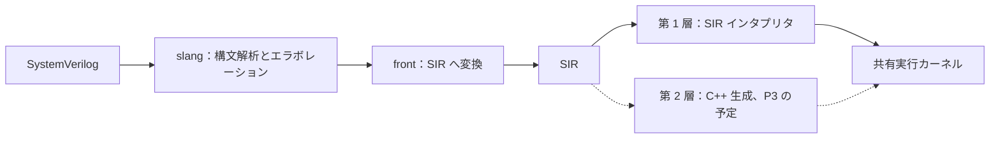

# kirimasim

[English](README.md)

[ユーザーマニュアル](docs/USER_MANUAL.ja.md) · [リファレンスマニュアル](docs/REFERENCE_MANUAL.ja.md) · [文書ガイド](docs/README.ja.md)

[](https://github.com/kurochan001/kirimasim/actions/workflows/ci.yml?query=branch%3Amain)
[](https://github.com/kurochan001/kirimasim/actions/workflows/nightly.yml?query=branch%3Amain)
[](#ビルド)
[](#ビルド)
[](#ビルド)
[](LICENSE)

kirimasim は、開発初期のオープンソース SystemVerilog シミュレータです。
既定の 4 値（0・1・X・Z）と IEEE 1800-2023 の時刻スロット全体のスケジューリングを保ち、
実用的な速さを目指します。実装に AI を使い、仕様・期待値・レビューは人が承認します。
[AI 方針](docs/spec/AI_POLICY.ja.md)を参照してください。

Xは不定、Zは高インピーダンスを表し、4値の`logic`と2値の`bit`の違いは[値の用語説明](docs/GLOSSARY.ja.md#four-state)で確認できます。

<a id="段階"></a>

## フェーズ

フェーズは開発目標の区分、実行の層（tier）は設計を動かす方式であり、P1が第1層、P3が第2層となる関係は[用語集](docs/GLOSSARY.ja.md#execution-tier)で確認できます。

| フェーズ | 目的 | 状態 |
| --- | --- | --- |
| P0 | ビルド・CI・仕様・テストの土台 | 完了 |
| P1 | front、共有 kernel、第 1 実行層。一覧の範囲を実行し、Icarus 13.0 と 188 プローブで比較 | 進行中 |
| P2 | SIR v1 と runtime 境界の確定 | 方向性は承認済み、詳細契約はレビュー中 |
| P3 | 第 2 層：事前の C++ 生成と高速化 | 予定 |
| P4 | より広いテストベンチ機能 | P1 の必須範囲を超える部分は予定 |
| P5 | より広い switch-level・並列実行・埋め込み | P1 の必須範囲を超える部分は予定 |

現行の SIR formatVersion は 0、C ABI は 0.3 です。P2 の準備は P1 と並行できますが、
凍結は P1 完了後です。[SIR v1 の提案](docs/notes/sir-v1-proposal.ja.md)を参照してください。
広い制約乱数・UVM、concurrent assertion、covergroup、virtual interface、DPI-C は未実装です。
VHDL とアナログ・混合信号の実行は現在の言語対象外です。

## 現在の状態

<a id="状況2026-11-01"></a>

**2026-11-07 時点で P1 は進行中、リリースはまだありません。** 第 1 実行層は SIR を直接解釈します。
文書化した class object の範囲も含む、広い RTL・単純なテストベンチの部分集合を実行できます。
本番プロジェクト向けの段階には達していません。C++ 生成は P3 の予定です。

フロントエンドは未改変の slang で、12.1 より後の開発コミット
[`8ffdcdd8ad237823fbfd72d495082d76e92d4015`](cmake/Dependencies.cmake) に固定しています。
構文を受理しても実行用の変換が未対応の場合があり、未対応の形は原則としてソース位置付きの診断で止まります。
[依存更新の記録](docs/notes/slang-8ffdcdd8-update.ja.md)に修正、互換性の確認と残る差分を記載しています。

**最新の変更（2026-11-07）：** P1 の完了条件を[閉じた一覧](docs/spec/P1_SCOPE.ja.md#閉じた完了一覧2026-11-07-に承認)にしました。class プロパティの bit、part、packed メンバーへのブロッキング書き込みが動くようになり、時刻 0 の手続きはソースの書き順によらず仕様の順序で始まります。詳しくは[変更履歴](CHANGELOG.ja.md)を参照してください。

**mainへの統合（2026-11-06）：** [型付きコンテナの暗黙監視](docs/notes/implicit-container-execution.ja.md)と[automatic引数のVPI宣言情報](docs/notes/vpi-argument-declarations.ja.md)を取り込みました。検証結果とP1の残る制限は[統合記録](docs/notes/main-integration-2026-11-06.ja.md)、以前の区切りは[状況の履歴](docs/STATUS_HISTORY.ja.md)を参照してください。

### 動くもの

正確な型・寿命・選択・実行文脈の制限は [P1 対応表](docs/P1_SUPPORT.ja.md)、
実行できる例は [P1 の機能例](docs/P1_FEATURES.ja.md)にあります。

- **RTL と値：** module、parameter、generate、interface/modport、package、任意幅の 2 値・4 値整数、
  real・string、固定配列・構造体、対応済みの動的配列・queue。
- **プロセス：** initial/always/final、comb/latch/ff、遅延、guard 付きの信号・式のイベント、
  [NBA](docs/GLOSSARY.ja.md#nba)・[event-NBA](docs/GLOSSARY.ja.md#event-nba)、automatic 捕捉、fork の join・名前付き fork の disable、call/ref、reactive 集合の program。
- **class：** [ソース対応範囲](docs/notes/class-source-execution.ja.md)内の段階的構築、型付き field、継承、
  直接・virtual method、待機する task、浅いコピー、cast。非 parameterized static プロパティは記憶域を共有します。
  [通常の信号・イベントの監視](docs/notes/class-independent-observers.ja.md)とも併用できます。
  [明示的なクロック処理の本体](docs/notes/class-clocked-execution.ja.md)でも、プロパティの読み書きや
  メソッドを実行できます。トリガー評価はobjectに依存しない範囲です。
  [task形式のclass cast](docs/notes/class-task-casts.ja.md)は失敗時に代入先を保持します。
  プロパティの bit、part、packed メンバーへのブロッキング書き込みも動きます。
- **ネット：** 強度、複数ドライバの解決、gate、広幅 UDP、alias、対応する静的端子の 6 種の有向 MOS・
  6 種の受動スイッチ、固定配列全体のポート。対応する静的な input/output の部分ポートは、物理的な強度と
  wired/pull/supply の実効的な net の種類を保ちます。整数の input/output で変換するときは、一方向に値を運ぶ
  [carrier](docs/GLOSSARY.ja.md#directed-carrier) を使います。対応する静的な部分 inout ポートは、carrier を作らず、
  [identity 接続](docs/GLOSSARY.ja.md#identity-edge)で同じ net のビットを共有します。
- **task と出力：** 対応済みの値の`%p`・`%0p`表示、即時・遅延 assertion、
  表示・実行時の書式と scan、file・memory I/O、乱数関数、
  plusargs、interface/program scope も含む VCD/FST、統計、資源上限。

### P1 の機能別進捗

現在の到達点について、実行できる範囲と残作業をまとめています。
**一部対応は、すべての形・組合せの実装完了を意味しません。** 検証した正確な境界はリンク先の対応表にあります。
slang が構文を受理するだけでは、実行への対応に数えません。

| 分野 | 実装・検証済みの範囲 | 残る作業 |
| --- | --- | --- |
| フロントエンドと RTL の値 | 固定した未改変 slang、[フロントエンドの上限](docs/notes/elaboration-limits-execution.ja.md)・[互換モード](docs/notes/compatibility-execution.ja.md)、module・階層・package・generate、整数・real・string、固定配列・構造体 | 未対応の変換形、ユーザー定義ネット型など、[P1 対応表](docs/P1_SUPPORT.ja.md)の境界 |
| スケジューリングとプロセス | 全時刻スロット領域、対応範囲内の手続き・automatic 捕捉・信号／式イベント・NBA/event-NBA・program・名前付き fork の disable | 残る [managed event](docs/GLOSSARY.ja.md#managed-event)／制御の形、object 依存の監視、より広い clocking |
| 動的コンテナ | 共有 heap、型付き SIR/VM、回収、動的配列・queue、対応済みの実行時配列メソッド、[実引数だけに反応するワイルドカード関数呼出し](docs/notes/wildcard-function-dependencies.ja.md)、[静的な整数コンテナの暗黙監視](docs/notes/implicit-container-execution.ja.md) | 連想配列、残るコンテナの暗黙感度、[コンテナ対応表](docs/P1_SUPPORT.ja.md#動的コンテナの共通基盤)にある残る要素型・格納の形 |
| class | 構築、型付き field、継承、直接／virtual call、待機する task、cast、[明示クロック本体の object 操作](docs/notes/class-clocked-execution.ja.md)、[comb/latch のclass操作](docs/notes/class-implicit-execution.ja.md)、プロパティへのブロッキングの選択書き込み、非 parameterized static プロパティ | プロパティの ref・NBA 代入先、object 依存の監視、parameterized static 記憶域などの[class の境界](docs/P1_SUPPORT.ja.md#クラスのstaticプロパティと残るオブジェクトの境界) |
| ポートと force/release | 固定配列・対応する静的部分 input/output/inout、実効 net kind、方向付き整数変換、登録 net の force/release | より広い部分接続・保持したポート identity、変換と force の組合せ、未対応の代入先 |
| net・gate・UDP・switch | 強度の解決、広幅 UDP、対応する静的端子の 6 種の有向 MOS・6 種の受動 switch | より広い switch／port の組合せ。`dense_udp_coverage` はフロントエンドの時間上限を超えるので、ソースのハッシュで対象外 |
| 書式と入出力 | ソースの `%p`・`%0p`、捕捉した強度の `%v`、対応済みの scan・file/memory I/O・多次元整数 `$fread` | [P1 対応表](docs/P1_SUPPORT.ja.md#書式と入力の制限)にある残るハンドル・格納の表示と、入力・選択の組合せ |
| specify と timing | [スカラー module path](docs/notes/specify-execution.ja.md)と[単純な `if`／`ifnone`](docs/notes/specify-state-execution.ja.md)：12 遷移遅延、入力時刻の選択、慣性除去、force 中の継続 | vector・条件付きエッジ依存・受動接続・複数 driver の path、明示的 pulse control、SDF、timing check |
| VPI | [最初の実行範囲](docs/notes/vpi-execution.ja.md)：明示的 library 読込み、登録 call、静的数値 reflection、変数の書込み・force/release、対応 callback、[net 全体の書込み](docs/notes/vpi-net-write-execution.ja.md)、[符号なしのpackedビットview](docs/notes/vpi-packed-bit-values.ja.md)、[次時刻の観測](docs/notes/vpi-next-time-callback.ja.md) | net の部分・遅延書込み、受動接続の deposit、追加の object/API/callback、cocotb 連携 |
| 波形 | interface/program scope、alias、filter、glitch 出力、dump 制御を含む VCD と [native FST](docs/notes/fst-execution.ja.md) | 拡張の強度 dump、class/動的データ。FST の viewer 互換性・性能は未確認 |

P1 の範囲は [P1_SCOPE](docs/spec/P1_SCOPE.ja.md) の閉じた完了一覧に従います。この表の残る作業のうち、
一覧に名前のないものは P4 か P5 に移します。

### まだ動かないもの

#### P1 の範囲と、P4・P5 へ移す機能

P1 は、**一覧の範囲を実行し、Icarus Verilog 13.0 と 188 プローブで比較します**。
その一覧を超えて Icarus との同等性は主張しません。テスト件数の割合で判定するものでもありません。

`98bcfea1` での最新の比較は**独自 188 プローブ**で、kirimasim は 176 件が成功し、Icarus 13.0 も動かない 10 件を拒否します。Icarus の `wire real` 拡張への依存を確認した `real_net` は対象外です。
もう 1 つの差である、比較の時間上限を超える dense UDP のフロントエンド処理は slang の側にあり、
slang は改変しないので、ソースのハッシュで対象外とします。
`wire real` の除外を適用する前の[参照側が通る不足](docs/GLOSSARY.ja.md#passing-reference-gap)（生の差）2 件は、記録に残しています。拡張のコンパイル拒否を、成功に書き換えてはいません。
**[参照側の不一致](docs/GLOSSARY.ja.md#reference-mismatch) 25 件**は別に記録し、kirimasim の不具合には数えません。
[測定](docs/measurements/2026-11-07/icarus13-closed-exit.json)と
[比較の読み方](docs/notes/p1-icarus-progress.ja.md)を参照してください。有限の一覧だけでは全機能の網羅を証明できません。

別の [VPI と queue の追跡調査](docs/notes/vpi-packed-bit-values.ja.md)では、packed のビットを符号なしで扱う修正をしました。
この一覧の外にある、queue の暗黙の感度で実行できない 2 件も記録しています。

[VPI の最初の実行範囲](docs/notes/vpi-execution.ja.md)は、第 1 層で動きます。`--vpi=<file>` による明示的な読み込み、
task と関数の登録、静的な数値の reflection、変数の書き込みと force/release、対応する callback が使えます。
[release の結果](docs/notes/vpi-release-results.ja.md)は、指定された形式で返します。
[値の形式の自動選択](docs/notes/vpi-object-value-formats.ja.md)では、読み取り、callback、release のいずれでも、
宣言された scalar、integer、real、packed vector を区別します。
[automatic の整数引数全体](docs/notes/vpi-argument-declarations.ja.md)は、宣言の範囲と scalar/vector の情報を保ったまま、
ビットの読み取りと即時の書き込みができます。保存した view は元の呼び出しに結び付いており、その呼び出しの終了後のアクセスは拒否します。
[VPI の net 全体への書き込み](docs/notes/vpi-net-write-execution.ja.md)は、point net への即時の deposit と、
登録済みの物理 net の force/release に対応します。HDL と所有を共有し、callback からの再入も扱います。
net の一部や遅延付きの書き込み、受動接続への deposit、VPI 全体、cocotb 連携は残作業です。

[specify の最初のスカラー範囲](docs/notes/specify-execution.ja.md)は、module path を実行します。12 種の遷移の遅延、入力時刻での選択、
既定の慣性除去、force 中の継続を含みます。
[単純な状態依存の `if`／`ifnone`](docs/notes/specify-state-execution.ja.md)も、機能上の到着時点の条件で選びます。
vector、条件付きのエッジ依存、受動接続の path、明示的な pulse control、timing check は残作業です。

P4 と P5 へ移す作業は、文書化した範囲を超える VPI、上記の残る specify の形、`%p` の残るハンドルと格納の形、
class の依存の監視やプロパティの参照などの型付きの境界、残るコンテナの暗黙の感度と container/event の形、
[P1 対応表](docs/P1_SUPPORT.ja.md)にある port/force、入力、選択の組み合わせです。
対応する静的な部分 inout ポートは、[物理的な identity](docs/notes/partial-inout-port-execution.ja.md)を使います。
[ソースのパターン表示](docs/notes/source-pattern-formatting.ja.md)は、[共有の renderer](docs/GLOSSARY.ja.md#shared-renderer)と SIR の経路につながっています。
[捕捉した強度の `%v` と登録 net の force/release](docs/notes/strength-format-execution.ja.md)は、完全な区間と、既存のビットごとの所有者を使います。
[native FST 出力](docs/notes/fst-execution.ja.md)を `--wave=<file>.fst` で実行でき、VCD と対象選択・時刻・dump 制御を共有します。圧縮 block 単位の緩い容量制限のため、最終ファイルのバイト数は指定値を超える場合があります。

比較では、必要な標準の部分集合、拡張、外部インターフェースを分けて対応付ける必要があります。
保留した拡張、広い `with`・文字列 streaming の代入先、event の代入は文書化した判断を保ちます。

<a id="p1-の合格条件"></a>

### P1 の完了条件

[TEST_SUITE](docs/spec/TEST_SUITE.ja.md) と [P1_SCOPE](docs/spec/P1_SCOPE.ja.md) が正本です。
**Icarus Verilog 拡張である `wire real` への対応は、P1 の必須条件に含めません。
この拡張への依存が確認されたケースは、未サポートであっても P1 の達成を妨げません。**
標準の`real`関連機能は既存の範囲を保ち、クラッシュ・ハング・内部エラーは引き続き失敗として扱います。
[分類と確認記録](docs/notes/p1-wire-real-exception.ja.md)を参照してください。
保存した合格率・必須一覧・7 晩の fuzz 条件には成功の証拠があります。
測定日・母集団・参照ビルドは[検証件数の記録](docs/VALIDATION_COUNTS.ja.md)に分けています。
最終の [M8](docs/GLOSSARY.ja.md#m8) 判定では、対象版の両 OS 比較、必須テスト、直近 7 回の正式 nightly fuzz、人による必要なレビューを
照合します。通常の CI に通るだけで P1 完了とは判定しません。

#### 完了条件ごとの進捗

**P1 は未完了です。** 下表の「記録した測定では達成」は証跡の測定日・母集団に対する状態であり、
現在の版について最終判定をやり直した結果ではありません。過去の条件の記録は
[counts.json](docs/counts.json) と[検証件数の記録](docs/VALIDATION_COUNTS.ja.md)にあります。
[M8 の報告の草稿](docs/notes/p1-m8-report.ja.md)に証拠をまとめています。

| 完了条件 | 最新の保存済み証跡 | 状態 |
| --- | --- | --- |
| sv-tests のシミュレーション成功数が、Linux・macOS 両方で固定版 Icarus 以上 | 344 件中、Linux は kirimasim 253 / Icarus 211、macOS は kirimasim 253 / Icarus 210（Linux は 2026-11-07、macOS は 2026-11-08 に測定。`docs/counts.json`）。条件用の参照は Icarus 14.0 devel `04cc493` | 記録した測定では達成 |
| 固定した独自 RTL 母集団 1,466 件の 90% 以上が成功 | `98bcfea1` で 2026-11-07 に 1,456 件成功（99.3%）、未対応 10 件。固定母集団は変更なし | 記録した測定では達成 |
| 規定の後続フェーズ除外を適用した P1 必須テストの全件成功 | [必須一覧](docs/spec/TEST_SUITE.ja.md#必須テストの一覧)は `98bcfea1` で全件成功。`cb/input_sample_1step` は今は成功し、`context_resume_thread` は P4 で書く | 記録した測定では達成 |
| 試行回数 100 倍の正式 nightly fuzz を 7 回連続で実施し、高速な値演算と参照実装に不一致がないこと | 2026-11-05 までの定時実行 10 夜で差なし | 記録した測定では達成。M8 では直近 7 回を再確認 |
| Icarus Verilog 13.0 と比べる固定した 188 プローブの一覧（`real_net` と `dense_udp_coverage` はソースのハッシュで対象外） | `98bcfea1` での [2026-11-07 の比較](docs/measurements/2026-11-07/icarus13-closed-exit.json)：一覧の検査を含めて exit 0。残る 186 件に必須範囲の差はなく、参照側の不一致は 25 件 | **未判定** |
| 閉じた一覧の機構が行列テストを通り、[P1 対応表](docs/P1_SUPPORT.ja.md)に説明がある | 行列テストは CI で成功。[証拠の一覧](docs/notes/p1-m8-report.ja.md#名前を挙げた機構) | **未判定** |
| 参照側の不一致 25 件それぞれの根拠の明記 | [文書にして](docs/notes/p1-reference-mismatch-grounds.ja.md) 2026-11-07 に承認 | **未判定** |
| 人の確認 145 件（[TEST_SUITE](docs/spec/TEST_SUITE.ja.md)） | 145 件中 0 件 | **未実施** |

各行は独立した条件であり、言語全体を等分したものではありません。P1 の完了率は算出できません。
最終 M8 の証跡・レビューの確認も残っています。sv-tests の行は
[2026-11-01 の Nightly 測定](docs/notes/nightly-repair-2026-11-02.ja.md)で更新しました。
固定母集団・fuzz・機能プローブは、それぞれの測定日を保ちます。この件数更新で
Icarus 14.0 の機能一覧を再測定したわけではありません。

### テスト結果

CTest・固定母集団・機能プローブは数える単位が異なるため、合計を比べる前に[件数のFAQ](docs/FAQ.ja.md#プローブctest固定母集団の件数が違うのはなぜですか)を確認してください。

<!-- counts:begin -->
<!-- tools/readme_counts.py が docs/counts.json から書く。手で直さない。 -->

記録した dev 全体は **13,857 件中 13,857 件成功**、スキップ 0 件、失敗 0 件です。内訳は単体 1,471、suite 12,025（生成器 230）、ツール 251、SIR 出力 29、Context 21、CLI・イベント回数 60 件です。
<!-- counts:end -->

releaseは既定のイベント上限の検査が1件多くなります。local_ciはcleanな候補の先頭を固定し、
dev・release・ASan・UBSan、静的規則、format、clang-tidyを検査します。
今回の範囲・再現方法・local CI全体の結果は[公開mainの統合記録](docs/notes/main-integration-2026-11-04.ja.md)を参照してください。
suiteにスキップはありません。これらは日付付きの外部比較とは別の結果です。
元seedと混合後seedの区別、corpusの引継ぎと現在のバイナリによる再評価も検証ガイドに記載しています。
再現方法・限界は[検証ガイド](docs/VALIDATION.ja.md)、日時・条件付きの速度・メモリ測定は
[ベンチマーク](docs/BENCHMARKS.ja.md)にあります。
コード・テスト・文書の行数は、日付つきのコミットについて[プロジェクトの規模](docs/PROJECT_SIZE.ja.md)に記録しています。

## ビルド

必要なものは CMake 3.28 以上、Ninja、Python 3.10 以上、C++23 compiler です。
GCC 13 以上、Clang 18 以上と libc++ 18 以上、Clang 19 以上と libstdc++ 13 以上、
または Apple clang 17 以上（Xcode 26）を使います。Clang 17/18 と libstdc++ の組では slang を C++23 として
ビルドできません。Linux・macOS に対応します。

最初の構成で固定版の slang、GoogleTest、standalone libfst を取得します。
FST の依存準備には zlib/bzip2 の開発用 library も必要です（Debian/Ubuntu は `zlib1g-dev libbz2-dev`、
macOS は Command Line Tools SDK）。Meson、GTKWave、GLib、別の LZ4 は不要です。
設定と preset は[ユーザーマニュアル](docs/USER_MANUAL.ja.md#ビルドとバージョンの確認)にあります。

```sh
cmake --preset dev
cmake --build --preset dev
ctest --preset dev
```

各 preset の出力先は `build/<preset>/` です。他に `release`、`asan`、`ubsan`、`tsan`、`fuzz` があり、
[開発ガイド](docs/DEVELOPMENT.ja.md)に検査内容と push 前に必要な `tools/local_ci.py` を記載しています。

## 使い方

```sh
build/dev/src/driver/kirimasim [options] <file>... [+plusarg]...
build/dev/src/driver/kirimasim parse [options] <file>...
build/dev/src/driver/kirimasim --version
```

リポジトリのルートから、付属の counter テストベンチを実行します。

```sh
build/dev/src/driver/kirimasim --top=tb \
  -Idocs/examples/user_manual/include -DCOUNTER_WIDTH=8 \
  -y docs/examples/user_manual docs/examples/user_manual/tb.sv +cycles=6
```

設計の stdout は `width=8 cycles=6` で始まり、`t=70 ns q=6` で終わります。
`-I` は include、`-y` は module library を探し、`-D` はコンパイル時の macro を設定します。
`+cycles=6` は設計が実行時に読む引数です。値なしの `-DNAME` は `1` を意味します。
シミュレータ自身のメッセージは stderr へ出します。

主な制御には `--top`、`--timescale`、`--seed`、`--max-time`、`--max-wall-time`、`--max-procs`、
`--init-values`、`--cond-x`、`--report-pulses`、`--bounds-check`、`--wave=<file>.vcd`、
`--dump-sir`、`--stats=json` があります。正確な既定値・対応する形・終了コードは
[リファレンスマニュアル](docs/REFERENCE_MANUAL.ja.md)、失敗の切り分けは[デバッグガイド](docs/DEBUGGING.ja.md)を参照してください。

## 仕組み



kernel がスケジューリングと値演算を持ち、全実行層で共有します。`valsem` は独立した値の参照意味を提供します。
機構の行列、コンパイルした誤実装、参照比較、fuzz、sanitizer、静的検査で実装を検証します。
[構成](docs/ARCHITECTURE.ja.md)と[検証](docs/VALIDATION.ja.md)を参照してください。

## 貢献

現在受け付けるのは**仕様提案と Issue**です。質問・初期の案は
[Discussions](https://github.com/kurochan001/kirimasim/discussions)へお願いします。PR は無効です。
[貢献方法](CONTRIBUTING.ja.md)、[行動規範](CODE_OF_CONDUCT.ja.md)、[セキュリティ](SECURITY.ja.md)を参照してください。
商用シミュレータの結果は使用・受け入れをしません。[比較方針](docs/FAQ.ja.md#商用シミュレータでも確認していますか)を参照してください。

## ドキュメント

公開する説明文書は、CHANGELOG、日付付き監査、公開済みの投稿草稿も含め、英語・日本語の全文を用意します。
食い違う場合は英語を正本とします。コード、生の診断、機械可読の証跡、正式なライセンスは元の識別子・文面を保ち、
日英のガイドから説明します。未追跡の非公開の引き継ぎ・草稿は公開文書の対象外です。

[文書ガイド](docs/README.ja.md)、[用語集](docs/GLOSSARY.ja.md)、[FAQ](docs/FAQ.ja.md)から利用できます。
[対応表](docs/P1_SUPPORT.ja.md)は現在の動作、[仕様](docs/spec/)は承認した契約、
[CHANGELOG](CHANGELOG.ja.md)と[状態の履歴](docs/STATUS_HISTORY.ja.md)は変更と過去の到達点を示します。
[整理前の README](docs/history/README_2026-11-01.ja.md)に、移動した経緯・比較表・性能の証跡を保存しています。

## ライセンス

Apache License 2.0 with LLVM Exceptions（`Apache-2.0 WITH LLVM-exception`）です。
[正式な LICENSE](LICENSE)、[日本語参照訳](LICENSE.ja.md)、[第三者ライブラリの表示](THIRD_PARTY_NOTICES.ja.md)を参照してください。
別の表示がないファイルはこのライセンスです。「The kirimasim Authors」はコミット履歴に記録した貢献者を指します。
