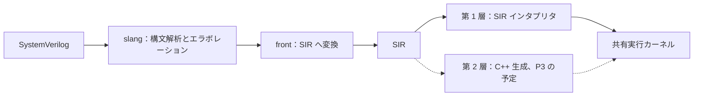

# kirimasim

[English](README.md)

[ユーザーマニュアル](docs/USER_MANUAL.ja.md) · [リファレンスマニュアル](docs/REFERENCE_MANUAL.ja.md) · [文書ガイド](docs/README.ja.md)

[](https://github.com/kurochan001/kirimasim/actions/workflows/ci.yml?query=branch%3Amain)
[](https://github.com/kurochan001/kirimasim/actions/workflows/nightly.yml?query=branch%3Amain)
[](#ビルド)
[](#ビルド)
[](#ビルド)
[](LICENSE)

kirimasim は、開発初期のオープンソース SystemVerilog シミュレータです。
既定の 4 値（0・1・X・Z）と IEEE 1800-2023 の時刻スロット全体のスケジューリングを保ち、
実用的な速さを目指します。実装に AI を使い、仕様・期待値・レビューは人が承認します。
[AI 方針](docs/spec/AI_POLICY.ja.md)を参照してください。

## 現在の状態

<a id="状態2026-11-01"></a>
<a id="状況2026-11-01"></a>

**2026-11-01 時点で P1 は進行中、リリースはまだありません。** 第 1 実行層は SIR を直接解釈します。
文書化した class object の範囲も含む、広い RTL・単純なテストベンチの部分集合を実行できます。
本番プロジェクト向けの段階には達していません。C++ 生成は P3 の予定です。

フロントエンドは未改変の slang で、12.1 より後の開発コミット
[`e2d1021661f78b3f17d1edf7ea17f9d6f95fb168`](cmake/Dependencies.cmake) に固定しています。
構文を受理しても実行用の変換が未対応の場合があり、未対応の形は原則としてソース位置付きの診断で止まります。

### 動くもの

正確な型・寿命・選択・実行文脈の制限は [P1 対応表](docs/P1_SUPPORT.ja.md)、
実行できる例は [P1 の機能例](docs/P1_FEATURES.ja.md)にあります。

- **RTL と値：** module、parameter、generate、interface/modport、package、任意幅の 2 値・4 値整数、
  real・string、固定配列・構造体、対応済みの動的配列・queue。
- **プロセス：** initial/always/final、comb/latch/ff、遅延、guard 付きの信号・式のイベント、
  NBA/event-NBA、automatic 捕捉、fork の join・名前付き fork の disable、call/ref、reactive 集合の program。
- **class：** [ソース対応範囲](docs/notes/class-source-execution.ja.md)内の段階的構築、型付き field、継承、
  直接・virtual method、待機する task、浅いコピー、cast。非 parameterized static プロパティは記憶域を共有します。
  [通常の信号・イベントの監視](docs/notes/class-independent-observers.ja.md)とも併用できます。
- **ネット：** 強度、複数ドライバの解決、gate、広幅 UDP、alias、対応する静的端子の 6 種の有向 MOS・
  6 種の受動スイッチ、固定配列全体のポート。対応する静的 input/output 部分ポートは物理強度と
  wired/pull/supply の実効 kind を保ち、整数input/outputの変換は方向付きの値carrierを使います。
  対応する静的な部分inoutポートは値carrierを作らずidentityを共有します。
- **task と出力：** 対応済みの値の`%p`・`%0p`表示、即時・遅延 assertion、
  表示・実行時の書式と scan、file・memory I/O、乱数関数、
  plusargs、interface/program scope も含む VCD、統計、資源上限。

### まだ動かないもの

<a id="残るp1機能2026-10-26"></a>
<a id="残るp1機能2026-10-29"></a>
<a id="残るp1機能2026-10-30"></a>
<a id="残るp1機能2026-11-01"></a>

#### 残る P1 機能

P1 で未達の範囲の条件は、**Icarus Verilog 13.0 以上の標準機能を実行できること**です。
後のフェーズから前倒しした必要な機構も含み、以下の任意の`wire real`例外を適用します。
テスト件数の割合で判定するものではありません。

最新の比較は**独自176プローブ：P1評価対象175件、対象外1件**です。
対象外はIcarusの`wire real`拡張への依存を確認した`real_net`です。
**必須範囲の差2件**はspecifyのmodule pathと、比較の時間上限を超えるdense UDPのフロントエンド処理です。
参照が通る生の差3件は記録に残し、拡張のコンパイル拒否を成功へ書き換えていません。
**参照の不一致25件**は別に記録し、kirimasimの不具合件数へは加えません。
[測定](docs/measurements/2026-11-01/icarus13-wire-real-optional.json)と
[比較の読み方](docs/notes/p1-icarus-progress.ja.md)を参照してください。有限の一覧だけでは全機能の網羅を証明できません。

[VPIの最初の実行範囲](docs/notes/vpi-execution.ja.md)は、明示的な`--vpi=<file>`読込み、
登録task/関数、静的な数値reflection、変数の書込み・force/release、対応callbackを第1層へ接続済みです。
VPI全体とcocotb連携は残作業です。

残る実装は、この範囲を超えるVPI、specify path・timing check、FST backend、`%p`の残るハンドル・格納の形、完全な強度 `%v`、
class の依存監視・プロパティ参照などの型付きの境界、コンテナの暗黙感度と残る container/event の形、
[P1 対応表](docs/P1_SUPPORT.ja.md)にある port/force・入力・選択の組合せです。
対応する静的な部分inoutポートは[物理identity](docs/notes/partial-inout-port-execution.ja.md)を使います。
[ソースのパターン表示](docs/notes/source-pattern-formatting.ja.md)は共有renderer/SIRへ接続済みです。
FSTのビルド依存だけでは、backendの機能は使えません。

比較では、必要な標準の部分集合、拡張、外部インターフェースを分けて対応付ける必要があります。
保留した拡張、広い `with`・文字列 streaming の代入先、event の代入は文書化した判断を保ちます。
後のフェーズという分類でも、[P1_SCOPE](docs/spec/P1_SCOPE.ja.md)で必要な範囲は先送りできません。

<a id="p1-の合格条件"></a>

### P1 の完了条件

[TEST_SUITE](docs/spec/TEST_SUITE.ja.md) と [P1_SCOPE](docs/spec/P1_SCOPE.ja.md) が正本です。
**Icarus Verilog 拡張である `wire real` への対応は、P1 の必須条件に含めません。
この拡張への依存が確認されたケースは、未サポートであっても P1 の達成を妨げません。**
標準の`real`関連機能は既存の範囲を保ち、クラッシュ・ハング・内部エラーは引き続き失敗として扱います。
[分類と確認記録](docs/notes/p1-wire-real-exception.ja.md)を参照してください。
保存した合格率・必須一覧・7 晩の fuzz 条件には成功の証拠があります。
測定日・母集団・参照ビルドは[検証件数の記録](docs/VALIDATION_COUNTS.ja.md)に分けています。
最終の M8 判定では、対象版の両 OS 比較、必須テスト、直近 7 回の正式 nightly fuzz、人による必要なレビューを
照合します。通常の CI に通るだけで P1 完了とは判定しません。

### テスト結果

<!-- counts:begin -->
<!-- tools/readme_counts.py が docs/counts.json から書く。手で直さない。 -->

記録した dev 全体は **11,364 件中 11,364 件成功**、スキップ 0 件、失敗 0 件です。内訳は単体 1,135、suite 9,948（生成器 175）、ツール 193、SIR 出力 29、Context 21、CLI・イベント回数 38 件です。
<!-- counts:end -->

releaseは既定のイベント上限の検査が1件多くなります。local_ciはcleanな候補の先頭を固定し、
dev・release・ASan・UBSan、静的規則、format、clang-tidyを検査します。
今回の範囲と再現方法は[承認後の統合記録](docs/notes/p1-approved-class-inout-integration.ja.md)を参照してください。
suiteにスキップはありません。これらは日付付きの外部比較とは別の結果です。
再現方法・限界は[検証ガイド](docs/VALIDATION.ja.md)、日時・条件付きの速度・メモリ測定は
[ベンチマーク](docs/BENCHMARKS.ja.md)にあります。

<a id="段階"></a>

### フェーズ

| フェーズ | 目的 | 状態 |
| --- | --- | --- |
| P0 | ビルド・CI・仕様・テストの土台 | 完了 |
| P1 | front、共有 kernel、第 1 実行層、Icarus 13.0 以上の必要な実行範囲（任意の`wire real`例外あり） | 進行中 |
| P2 | SIR v1 と runtime 境界の確定 | 方向性は承認済み、詳細契約はレビュー中 |
| P3 | 第 2 層：事前の C++ 生成と高速化 | 予定 |
| P4 | より広いテストベンチ機能 | P1 の必須範囲を超える部分は予定 |
| P5 | より広い switch-level・並列実行・埋め込み | P1 の必須範囲を超える部分は予定 |

現行の SIR formatVersion は 0、C ABI は 0.3 です。P2 の準備は P1 と並行できますが、
凍結は P1 完了後です。[SIR v1 の提案](docs/notes/sir-v1-proposal.ja.md)を参照してください。
広い制約乱数・UVM、concurrent assertion、covergroup、virtual interface、DPI-C は未実装です。
VHDL とアナログ・混合信号の実行は現在の言語対象外です。

## ビルド

必要なものは CMake 3.28 以上、Ninja、Python 3.10 以上、C++23 compiler です。
GCC 13 以上、Clang 18 以上と libc++ 18 以上、Clang 19 以上と libstdc++ 13 以上、
または Apple clang 17 以上（Xcode 26）を使います。Clang 17/18 と libstdc++ の組では slang を C++23 として
ビルドできません。Linux・macOS に対応します。

最初の構成で固定版の slang、GoogleTest、standalone libfst を取得します。
FST の依存準備には zlib/bzip2 の開発用 library も必要です（Debian/Ubuntu は `zlib1g-dev libbz2-dev`、
macOS は Command Line Tools SDK）。Meson、GTKWave、GLib、別の LZ4 は不要です。
設定と preset は[ユーザーマニュアル](docs/USER_MANUAL.ja.md#ビルドとバージョンの確認)にあります。

```sh
cmake --preset dev
cmake --build --preset dev
ctest --preset dev
```

各 preset の出力先は `build/<preset>/` です。他に `release`、`asan`、`ubsan`、`tsan`、`fuzz` があり、
[開発ガイド](docs/DEVELOPMENT.ja.md)に検査内容と push 前に必要な `tools/local_ci.py` を記載しています。

## 使い方

```sh
build/dev/src/driver/kirimasim [options] <file>... [+plusarg]...
build/dev/src/driver/kirimasim parse [options] <file>...
build/dev/src/driver/kirimasim --version
```

リポジトリのルートから、付属の counter テストベンチを実行します。

```sh
build/dev/src/driver/kirimasim --top=tb \
  -Idocs/examples/user_manual/include -DCOUNTER_WIDTH=8 \
  -y docs/examples/user_manual docs/examples/user_manual/tb.sv +cycles=6
```

設計の stdout は `width=8 cycles=6` で始まり、`t=70 ns q=6` で終わります。
`-I` は include、`-y` は module library を探し、`-D` はコンパイル時の macro を設定します。
`+cycles=6` は設計が実行時に読む引数です。値なしの `-DNAME` は `1` を意味します。
シミュレータ自身のメッセージは stderr へ出します。

主な制御には `--top`、`--timescale`、`--seed`、`--max-time`、`--max-wall-time`、`--max-procs`、
`--init-values`、`--cond-x`、`--report-pulses`、`--bounds-check`、`--wave=<file>.vcd`、
`--dump-sir`、`--stats=json` があります。正確な既定値・対応する形・終了コードは
[リファレンスマニュアル](docs/REFERENCE_MANUAL.ja.md)、失敗の切り分けは[デバッグガイド](docs/DEBUGGING.ja.md)を参照してください。

## 仕組み



kernel がスケジューリングと値演算を持ち、全実行層で共有します。`valsem` は独立した値の参照意味を提供します。
機構の行列、コンパイルした誤実装、参照比較、fuzz、sanitizer、静的検査で実装を検証します。
[構成](docs/ARCHITECTURE.ja.md)と[検証](docs/VALIDATION.ja.md)を参照してください。

## 貢献

現在受け付けるのは**仕様提案と Issue**です。質問・初期の案は
[Discussions](https://github.com/kurochan001/kirimasim/discussions)へお願いします。PR は無効です。
[貢献方法](CONTRIBUTING.ja.md)、[行動規範](CODE_OF_CONDUCT.ja.md)、[セキュリティ](SECURITY.ja.md)を参照してください。
商用シミュレータの結果は使用・受け入れをしません。[比較方針](docs/FAQ.ja.md#商用シミュレータでも確認していますか)を参照してください。

## ドキュメント

公開する説明文書は、CHANGELOG、日付付き監査、公開済みの投稿草稿も含め、英語・日本語の全文を用意します。
食い違う場合は英語を正本とします。コード、生の診断、機械可読の証跡、正式なライセンスは元の識別子・文面を保ち、
日英のガイドから説明します。未追跡の非公開の引き継ぎ・草稿は公開文書の対象外です。

[文書ガイド](docs/README.ja.md)、[用語集](docs/GLOSSARY.ja.md)、[FAQ](docs/FAQ.ja.md)から利用できます。
[対応表](docs/P1_SUPPORT.ja.md)は現在の動作、[仕様](docs/spec/)は承認した契約、
[CHANGELOG](CHANGELOG.ja.md)と[状態の履歴](docs/STATUS_HISTORY.ja.md)は変更と過去の到達点を示します。
[整理前の README](docs/history/README_2026-11-01.ja.md)に、移動した経緯・比較表・性能の証跡を保存しています。

## ライセンス

Apache License 2.0 with LLVM Exceptions（`Apache-2.0 WITH LLVM-exception`）です。
[正式な LICENSE](LICENSE)、[日本語参照訳](LICENSE.ja.md)、[第三者ライブラリの表示](THIRD_PARTY_NOTICES.ja.md)を参照してください。
別の表示がないファイルはこのライセンスです。「The kirimasim Authors」はコミット履歴に記録した貢献者を指します。
