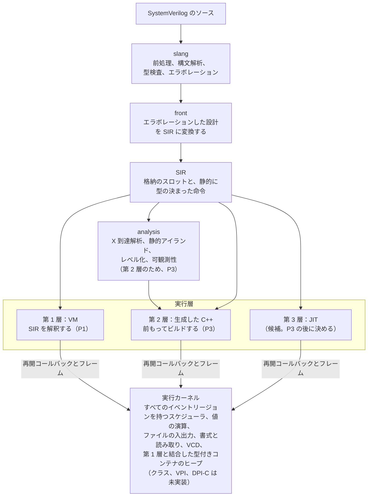

# kirimasim

[English](README.md) · [ユーザーマニュアル](docs/USER_MANUAL.ja.md) · [リファレンス](docs/REFERENCE_MANUAL.ja.md) · [資料案内](docs/README.ja.md)

[](https://github.com/kurochan001/kirimasim/actions/workflows/ci.yml?query=branch%3Amain)
[](https://github.com/kurochan001/kirimasim/actions/workflows/nightly.yml?query=branch%3Amain)
[](#ビルド)
[](#ビルド)
[](#ビルド)
[](LICENSE)

**ユーザーマニュアル：[日本語](docs/USER_MANUAL.ja.md) · [English](docs/USER_MANUAL.md)**

**リファレンスマニュアル：[日本語](docs/REFERENCE_MANUAL.ja.md) · [English](docs/REFERENCE_MANUAL.md)**

ユーザーマニュアルでは、ビルド、シミュレーション実行、VCD波形の取得、
トラブルシューティングを説明します。リファレンスマニュアルでは、コマンドの書式、
オプションの既定値、終了コード、対応する言語・タスク、制限事項を確認できます。

移行、開発、読む順序は[ドキュメント案内](docs/README.ja.md)を参照してください。

**改訂（2026-10-24）：** 旧P2→P3・旧P3→P4・旧P4→P5と付け替え、新しいP2（SIR v1）を設けました（tier番号は不変）。[対応表](docs/notes/phase-renumbering.ja.md)。

2026-10-23承認の[P1の範囲変更](docs/spec/P1_SCOPE.ja.md)により、
Icarus Verilog 13.0以上の実行機能を目標とし、必要なP4・P5・対象外の仕組みを
P1へ前倒しします。目標はまだ未達成です。[実装済み一覧](docs/P1_SUPPORT.ja.md)と
[比較で残る差](docs/notes/p1-icarus-progress.ja.md)を参照してください。

kirimasim は、開発の初期にあるオープンソースの SystemVerilog シミュレータです。次のどれも諦めないシミュレータを目指しています。

- **4 値**（0、1、X、Z）を既定とし、4 値の意味を変える最適化をしない
- **IEEE 1800-2023 どおりのスケジューリング**。タイムスロットのすべての領域と、規格の参照アルゴリズムに従う
- **実用的な速さ**。X や Z が無いと証明できるとき、または実行時に確かめられるときは、2 値のコードで実行する

**コードの大半は AI（Claude Code）が生成し、人が仕様・テスト・レビューに責任を持ちます。** 詳しくは [docs/spec/AI_POLICY.ja.md](docs/spec/AI_POLICY.ja.md) と [CONTRIBUTING.ja.md](CONTRIBUTING.ja.md) を見てください。

## 状況（2026-10-29）

`dd2c0188`から、インクルードパスの`-I`、マクロの`-D`、モジュールライブラリの
`-y`・`--libdir=`を使えます。短いオプションは引数の連結形・分離形を受理します。
探索規則、マクロ値、既存のプラス形式との対応は、
[実行例](docs/P1_FEATURES.ja.md#共通の入力オプション)と
[ユーザーマニュアル](docs/USER_MANUAL.ja.md#ファイルリストとインクルードパス)を参照してください。

既知スキップ2件は、既存の期待出力を変えずに実行できるようになりました。
`#1step`でサンプリングする入力専用のクロッキングブロックと、駆動強度を保持する静的な部分ポートに対応します。
[承認済みのクロッキング入力の範囲](docs/notes/clocking-input-1step-proposal.ja.md)と
[実装済み一覧の制限](docs/P1_SUPPORT.ja.md)を参照してください。クロッキングやポートの他の形は残作業で、
P1は未完了です。以下の過去の検証結果は、その時点の日付と件数を保ちます。

slangの固定先を、12.1後の開発コミット[`e2d1021`](docs/notes/slang-e2d1021-update.ja.md)へ更新します。
#2064のclass specifier回復の修正を含み、[local CI全21項目が成功](docs/measurements/2026-10-27/slang-e2d1021-main-validation.json)しました。
既存の期待値は維持しています。母集団の文字列変換4失敗は旧版でも発生し、残作業として記録しています。

[ソースevent-NBA変換](docs/notes/event-nba-source-execution.ja.md)`c4be8ade`を、
移植性/lint修正`9a81a55e`・`b91bd3d7`と合わせてmainへ取り込みます。独自1,018設計が成功し、
コンパイルした6故障をすべて検出しました。2版の固定95プローブは`event_controlled_nba`が新たに通り、
有限の一覧の残差は6件です。古い拒否期待は承認済みの別コミット`16c033a4`で移行しました。
[main統合の検証](docs/measurements/2026-10-27/nba-front-main-integration.json)にpush前の確認を記録します。
P1とソースの残る境界は未完です。

mainへコンテナ条件式`a8bb17cc`とNBA保持値`7bc5fa85`を取り込みました。
[取り込み記録](docs/measurements/2026-10-27/conditional-nba-main-integration.json)で、検証済みの
コード・テストの不変と各commitの期待値保護を確認します。この過去の区切りではソースevent-NBAは未対応でした。

mainに`624123b2`を取り込み、承認済みCLI 2.7の[`--max-procs`](docs/notes/process-limit-execution.ja.md)を
実装しました。共有kernelで実行時に生成された未終了の子プロセスを数え、記録の保持・再利用と区別して、
上限を超える子を登録する前に停止します。
[取り込み記録](docs/measurements/2026-10-27/process-limit-main-integration.json)で検証済みコード・テストの
不変とcommit単位の期待値保護を確認します。全local CIは21/21成功で、P1は未完です。

mainに`9e6a149d`を取り込み、未使用宣言の事前初期化を含む
[非パラメータ化クラスのstaticプロパティ](docs/notes/class-static-execution.ja.md)を追加しました。
[全local CI](docs/measurements/2026-10-27/class-static-validation.json)は21/21項目成功で、
新規CTest568件・コンパイルした7故障の検出も通りました。
[取り込み記録](docs/measurements/2026-10-27/class-static-main-integration.json)で、検証済みの実装・テストが不変であることを確認しています。
クラスオブジェクトとパラメータ付きstatic記憶域は残作業です。

以前のmainの区切りでは`dfddb94b`で[event宣言の初期化コピー](docs/notes/event-initializer-execution.ja.md)を追加し、
人が承認した期待値3件の移行を`2da32daa`に分けました。3コミットを
[`f100cd86`までmainへ取り込みました](docs/measurements/2026-10-27/event-initializer-main-integration.json)。
[全local CI](docs/measurements/2026-10-27/event-initializer-validation.json)は
21/21成功、dev/ASan/UBSanは各6,057/6,059、releaseは6,058/6,060で、
失敗0・既知skip各2件です。母集団・sv-tests・Icarus 13/14のprobeも再実行し、以前の成功を
維持しました。P1は未完了で、以前のmainの区切りは履歴に残します。
[日付付きの記録](docs/notes/p1-icarus-progress.ja.md)は
以前の承認・失敗・公開状態をその時点の履歴として保持します。

> **開発の初期です。実際のプロジェクトにはまだ使えません。** 最初の実行層（インタプリタ。今は SIR を直接解釈し、バイトコードへの変換は後で入れます）で、RTL と簡単なテストベンチに使う SystemVerilog の広い範囲をシミュレーションできます。クラスオブジェクト、制約付きランダム化、並行アサーション、VPI、DPI-C はまだありません。第 1 層では速度とメモリの改善を進めており、C++ の生成は P3 で作ります。未対応の形は原則として位置付きの診断で止まります。[非パラメータ化クラスのstaticプロパティ](docs/notes/class-static-execution.ja.md)は共有する型付き記憶域と事前初期化に対応しました。オブジェクト実行は残作業です。

`4c69843`で型付きpatternのSIR・検証器・text・実行処理を共有表示APIへ接続しました。
frontの定数・runtime書式引数への接続は残っているため、ソース`%p`は引き続き未対応です。
既存queue要素を変更したときの`$monitor`の再表示も確認しています。
[現在の実装と検証範囲](docs/notes/pattern-sir-execution.ja.md)と
[実行例](docs/P1_FEATURES.ja.md#キュー要素の変更をmonitorで表示する)を参照してください。

共有カーネルのUDP評価を32入力超へ拡張しました。[独自106ソースと独立した値の検査](docs/notes/wide-udp-inputs.ja.md)で、
後方の端子、状態、X/Z、遅延、強度を確認しています。密な表では固定したslangの検査時間が
増える問題が残るため、多入力UDPソース全体の対応は未確認です。診断は緩めていません。

動的配列・キューの実行仕様は2026-10-23に承認されました。共通カーネルには、
深いコピー、安定した要素参照、上限付きキュー、正確なトレース回収、確保失敗時の
巻き戻しを持つ型付きヒープを実装しました。カーネルの31テストで入れ子のコピー432組、
確保失敗時の状態保持、実際の型を保つスナップショットを検査し、252万操作の
モデル比較も通過しています。型付きSIRの記述子・参照・命令と
検証器・テキスト形式も追加しました。独自のSIR入力によるVMの24テストで、実際の
上限を保つref、待機をまたぐ切り離したセル、領域・スロット境界での自動回収を検査します。
型付きスロット、生存中のフレーム、セル参照、遅延報告、スケジューラの保留値を
ルートとして保持します。ヒープに依存する待機、依存先の付け直し、呼び出した関数の
関数ローカルのコンテナの除外も接続しました。frontから構築、深いコピー、要素、キューのメソッド、
実際の上限を保つref、値全体の遅延代入、明示的なヒープ待機、動的foreach、第1次元クエリを
実行できるようにしました。独自のソース行列240件が8種類の実行場所を横断し、CLIでも
11件の位置付き診断を検査します。さらに256件で、実行時のunpacked連結とキューの読み取り
スライスを検査します。広い符号付き・符号なし境界、X/Z、副作用を含む評価順も対象です。
対応は一部で、スライスへの代入、追加の配列メソッド、暗黙のヒープ感度などは残作業です。
[実装状況](docs/P1_SUPPORT.ja.md#動的コンテナの共通基盤)と
[承認済みの契約](docs/notes/dynamic-containers-proposal.ja.md)を参照してください。

mainへ[コンテナの条件式](docs/notes/container-conditional-execution.ja.md)を
追加しました。対応済みの動的配列・キューで`?:`を実行し、不定条件での要素全体の既定値、
snapshot、入れ子の内容比較を扱います。独自351設計が実行場所9種類を横断し、
[local CI](docs/measurements/2026-10-27/container-conditional-validation.json)は21項目すべて成功しました。全面対応ではありません。

mainの[具体的なイベント購読](docs/notes/event-nba-concrete-controls.ja.md)で、固定slot・名前付きイベントの
継続的な購読、全幅の回数、callback元の保持を実装しました。下記の式monitorの区切りは、
この中核を拡張します。SIR/front/VMのソース転送は残作業です。[ローカル検証](docs/measurements/2026-10-27/nba-events-validation.json)では
CI全21項目、新規kernel/SIR-nativeテスト33件とコンパイルした18故障の検出が成功しました。

[式monitorの区切り](docs/notes/event-nba-expression-monitors.ja.md)を`012af2ca`としてmainへ取り込み、
共通評価とheap/activation通知のまとめ方を追加しました。[統合の検証](docs/measurements/2026-10-27/nba-monitors-main-integration.json)に
この区切りのpush前の検査を記録します。その時点ではソースevent-NBAは未対応でした。

[型付きSIR/VMの区切り](docs/notes/event-nba-sir-execution.ja.md)`6f43e387`で、配置表、
verifier/text、新しい発行元callbackを追加し、独自SIRで検査しました。
ローカルの[ソース変換](docs/notes/event-nba-source-execution.ja.md)で値保持の順序とcallbackを検査し、local CI全21項目が成功しました。

mainの[NBA保持値の土台](docs/notes/event-nba-payload-foundation.ja.md)で、共有kernelに
値の所有と保留中の発行順を追加し、独立した単体24件で検査します。上の実装は
slot・名前付き購読とcallback元の保持を追加し、上記のmainの区切りで式monitorを追加しました。ソースの
`nba.event`転送は、これらの過去のkernelの区切りでは残作業でした。
[最終配置のlocal CI](docs/measurements/2026-10-27/nba-payload-validation.json)は21項目すべて成功しました。

[共通の強度の解決処理](docs/notes/strength-range-foundation.ja.md)は、値への射影前の
完全な区間を保持できるようにし、全区間ペアで検査しました。
[方向付きMOSのソース実行](docs/notes/source-mos-execution.ja.md)は通常driverを取り込み、
制御を別に捕捉します。部分対応であり、登録 net の force、部分・非結合ポート、完全な強度の
書式は残作業です。[ソースの受動実行](docs/notes/source-passive-execution.ja.md)では、静的な
bit・要素・連結の対応とプリミティブ配列を含む双方向 6 種を共有網へ接続しました。
独立した不定網でも公開は一括のままです。独自143設計が通り、古いtran拒否期待は
[別途承認した移行](docs/notes/passive-expectation-migration.ja.md)を`77c9d188`で適用しました。
全ソース入力は維持しています。

広い三状態ゲートでも、ワード境界をまたぐL/Hマスクの両半分を保持します。新規73ソースは
Icarus 13.0・開発版とすべて一致しました。[対応範囲と検証](docs/notes/wide-gate-strength.ja.md)を
参照してください。sideだけが変わる遅延の時刻も、[意味の修正案](docs/notes/delayed-gate-side-proposal.ja.md)が2026-10-25承認済みです。

集約値の通常代入・NBAでは、代入先の副作用より前に右辺全体を保持するよう修正しました。
コンテナの値は後のメンバーの式より前に捕捉し、実行時に選ぶ固定の部分配列と
構造体配列のメンバーにも同じ経路を使います。[値の保持と検証](docs/notes/aggregate-value-capture.ja.md)を
参照してください。

固定配列・unpacked構造体全体のブロッキング代入内遅延・イベント・repeatにも対応しました。
型付きの非公開フレームで右辺を待機中も保持し、実際の対象は待機後に選びます。
別の独自74件で、これらの形と宣言範囲が異なる構造体配列のコピーを検査します。
[実装と期待値の別レビュー](docs/notes/blocking-aggregate-timing.ja.md)を参照してください。

ブロッキング代入内の`repeat(count) @(...)`は、右辺と完全な幅の回数を保持し、
待機後に代入先を選べるようになりました。0以下・X/Zなら待機を省きます。
独自ソース75件が実行場所8種類とスカラー・コンテナの値の保持を検査します。
イベントNBAのソース変換は上記の別段階で検査します。[実行と検証](docs/notes/repeated-event-controls.ja.md)を
参照してください。

fork内の宣言は、親での初期化と共有static記憶域に対応し、子プロセスには数えません。
宣言だけなら待機も出しません。[対応範囲と独自72ソース](docs/notes/fork-local-declarations.ja.md)で
全join種類を検査します。[ソースからのautomatic共有捕捉](docs/notes/automatic-front-capture.ja.md)
は新規186設計で通り、過去の未対応3テストは承認済みの別コミット`11096dc3`で移行しました。
[型付きSIR event実行](docs/notes/event-vm-boundaries.ja.md)と既存のregion/slot境界での回収も
接続しました。承認済みの[automatic eventの命令境界回収](docs/notes/instruction-event-execution.ja.md)で、
物理行を増やす前に、native field、SSA領域、転送全体のpinを公開します。初期化子のない
automatic scalar/固定配列eventの宣言は、固有のobjectを生成し、子孫の保持も守ります。
新規ソース176件、検証済みSIR32設計、コンパイルした12故障の検出が通りました。
[過去の拒否期待値1件の移行](docs/notes/automatic-event-expectation-migration.ja.md)は承認後に`4ba6b63d`で適用しました。
eventの値・仮引数・structの対応はまだ部分的です。

[実行時indexでの固定配列event選択](docs/notes/indexed-event-execution.ja.md)を型付き値へ接続し、
名前付き/混合待機・遅延対象・`.triggered`を独自160ソースで検査しました。
旧CLI入力の未対応診断6行は[別途承認した移行](docs/notes/indexed-event-expectation-migration.ja.md)を
`28f5c972`で適用済みです。別件の[tran期待値移行](docs/notes/passive-expectation-migration.ja.md)も
承認後に`77c9d188`で適用しました。以前に失敗した2検査も
[main統合の検証](docs/notes/main-integration-2026-10-26.ja.md)に含めます。

固定配列ポートは宣言ごとの範囲を保って要素を共有・コピーし、ネット配列の強度を
要素ごとに解決します。定数要素のforce/release、遅延、未接続の既定値・pullも含め、
[独自358ケースと対応範囲](docs/notes/fixed-array-port-execution.ja.md)を記録しました。
既存87プローブのIcarus成功・native未成功は各参照版で24→22件になりました。
P1全体は引き続き未完了です。

### 段階

| 段階 | 内容 | 状態 |
| --- | --- | --- |
| P0 | 土台：ビルド、CI、詳細仕様書、テストスイート | 完了 |
| P1 | 中間表現（SIR）への変換、IEEE 1800-2023 のスケジューラを持つ実行カーネル、Icarus Verilog 13.0以上の実行機能を目指す第 1 層（SIR のインタプリタ） | **進行中** |
| P2 | SIR v1：SIRとカーネル境界をtier 2に渡せる形に確定する（[方針承認済み・詳細レビュー待ち](docs/notes/sir-v1-proposal.ja.md)） | 予定 |
| P3 | 第 2 層：速さのため、SIR を前もって C++ に変換する | 予定 |
| P4 | テストベンチの機能：クラス、動的なデータ、制約付きランダム化、並行アサーションとカバレッジ、クロッキングブロック、VPI、DPI-C | 予定。必要な部分はP1へ前倒し |
| P5 | スイッチのレベルの素子、マルチスレッドでの実行、他のシミュレータに組み込むライブラリ | 予定。必要な部分はP1へ前倒し |

P2は[承認済みの方針](docs/notes/sir-v1-proposal.ja.md)に従い、P1と並行準備し、
P1完了後にSIR v1を凍結します。完全なrecord形式・共通Op schema・サービス単位のC境界を
選択し、文法・API prototype/関数数・参照配置の詳細はレビュー待ちです。
P2は予定の段階で、formatVersionは0、ABIは0.3のまま、tier 2の実装はP3です。

### P1 の合格条件

**P1は未完了です。** 承認済みの[P1の範囲](docs/spec/P1_SCOPE.ja.md)により、
[TEST_SUITE](docs/spec/TEST_SUITE.ja.md)の既存条件に加え、
Icarus Verilog 13.0以上の実行機能が必要です。以下の表の条件だけを満たしても、
P1の完了にはなりません。

- Icarusが対応する規格上の仕組みを実行できること。動的コンテナ、クラス、program、
  VPI、スイッチレベルのモデル、specifyパス、タイミング機能の必要な部分を含みます。
  従来のP4・P5や対象外という分類を理由に、その部分をP1より後へ回しません。
- コンパイラとランタイムの版を記録し、独自のプローブで仕組みとその組み合わせを確認すること。
  拡張と外部インターフェースは別に棚卸しし、厳格な受理と衝突する拡張にはレビュー済みの
  互換方針を設けます。IEEEの値とスケジューリングの意味、4値の既定、共有カーネル、
  slangの厳格な診断、既存テストの期待値を維持します。
- 以下の既存の通過率と、参照実装とのファジングの条件をすべて満たすこと。

未実装の機能と部分対応の制限は、[P1に残る主な機能](#p1に残る主な機能2026-10-29)にまとめます。

進捗は[実装済み一覧](docs/P1_SUPPORT.ja.md)と
[比較記録](docs/notes/p1-icarus-progress.ja.md)で管理します。
一覧は独自87プローブです。固定配列ポートの区切りでは、Icarus `13.0 (stable) (v13_0)`に
対する未対応が22本、参照結果の不一致が4本です。`14.0 (devel) (s20260301-411-gca6b8d376)`では
22本と7本です。その後のautomatic捕捉で過去の13.0合格との差分は21本に減り、
新しい14.0実行も差分21本・不一致7本です。このevent VM段階で13.0は再実行していません。向きのあるMOSの実行が入った後、
2026-10-26に両方で測り直すと差分は14本、参照の不一致は13.0で4本、14.0で7本です。
その後、同日に測定した[ソース受動スイッチの区切り](docs/notes/source-passive-execution.ja.md)では、
差分は**両参照とも8本**へ減り、参照の不一致4/7本は不変です。この安定版のコンパイラと
ランタイムはいずれも`13.0 (stable) (v13_0-dirty)`を返し、実測は
[13.0の記録](docs/measurements/2026-10-26/icarus13-source-passive-probes.json)と
[開発版の記録](docs/measurements/2026-10-26/icarus14-source-passive-probes.json)に保ちます。
後続の[automatic eventの区切り](docs/notes/instruction-event-execution.ja.md)では、両方の実行ファイルで
全87件を再計測し、差分は**両参照とも7本**、参照の不一致は4/7本でした
（[13.0](docs/measurements/2026-10-26/icarus13-instruction-events-probes.json)、
[14.0](docs/measurements/2026-10-26/icarus14-instruction-events-probes.json)）。
比較対象の版を分け、[結果と条件](docs/notes/icarus-13-comparison.ja.md)を記録しました。
全面的な同等性は未確認です。プローブがすべて通っても全機能の対応を証明できず、
仕組みやインターフェースを確認するごとに棚卸しを広げます。
多入力UDPの区切りでは以前の84件の状態を維持し、新たに棚卸しした多入力UDPの2本が両参照とnativeで通りました。
追加した密な表の網羅性検査はnativeのsubprocess上限に達します。同じ拡張後の一覧では、
保持した旧baselineが27/33件、多入力UDPの区切りが25/31件で、後の配列・入力の区切りでは24/24件、固定配列ポート対応後は22/22件です。
[automatic記憶域の共有・eventの修正案](docs/notes/automatic-capture-proposal.ja.md)に
独自32プログラムを記録し、2026-10-25承認済みです。共有字句捕捉は実装済みで、
[automaticスカラー/固定配列eventの生成](docs/notes/instruction-event-execution.ja.md)も実装しました。
過去の拒否期待値1件の別移行は承認後に`4ba6b63d`で適用しました。
[配列ポート・解決の修正案](docs/notes/fixed-array-ports-proposal.ja.md)にも独自59本を記録し、
違法な接続を未対応機能と分けています。

[クラスの独自46プログラムによる調査](docs/notes/class-execution-investigation.ja.md)も別に記録しました。
過去のstatic初期化の不一致を含みます。[非パラメータ化クラスのstatic記憶域](docs/notes/class-static-execution.ja.md)でこの欠落を修正しました。オブジェクト実行は引き続きP1の残作業です。
[クラス実行の詳細契約案](docs/notes/class-runtime-proposal.ja.md)は独自14本の追加観測を含み、2026-10-25承認済みです。

[MOS・スイッチの調査](docs/notes/mos-switch-investigation.ja.md)には、
独自28プログラムと過去の参照実行56件の観測を、この一覧と別に記録しています。
[有向MOS](docs/notes/source-mos-execution.ja.md)と[受動スイッチ](docs/notes/source-passive-execution.ja.md)は、
記載した静的端子では実行できます。登録済みネットへのソースforce、部分ポートの同一性の拡張、
完全な強度書式は残作業です。

整数への`$fread`はstart・countの指定に対応し、値の引数を1回ずつ評価します。
選択したinoutの代入先は、承認済み規則どおりコピー入力時と、正のバイト数の書き戻し時に
評価します。先の1回捕捉の実装は[期待値・実装を分離した訂正](docs/notes/fread-copyback-correction.ja.md)で
修正しています。従来の同じ61プローブで差分が23本から22本へ減りました。
承認済みの[多次元メモリ入力](docs/notes/multidim-fread-execution.ja.md)を実装し、独自156件で
検査しています。配列の実行時の縮約・安定な整列・min/maxも[共通の型付き変換](docs/notes/runtime-array-methods.ja.md)
で動き、独自270件と直接テスト4件を追加しました。同値でもmin/maxは元の要素を最大1個返し、
Icarusが重複して返す観測は参照側の不一致として保ちます。副作用のある整列キー・純粋性未確認の
ユーザー関数キーと、未対応の複合型の入力表現には制限が残ります。

残る6件の[実行契約](docs/notes/p1-execution-contracts-2026-10-25.ja.md)は2026-10-25に承認済みです。
最初に[遅延付き三状態ゲートの完全な状態の伝播](docs/notes/delayed-gate-state-execution.ja.md)を実装し、
独自240ソースと直接3件で検査しました。具体的な期待値のみの移行も別に承認・統合済みです。
[ローカルCI全21項目が成功](docs/measurements/2026-10-25/delayed-side-integration-validation.json)し、
dev/ASan/UBSanは4,179件中4,177件、releaseは4,180件中4,178件成功、失敗0・既知2件のみ
スキップです。他の承認済みP1機構の実装は残作業です。

#### 既存の数値条件と測定結果

<!-- counts:begin -->
<!-- tools/readme_counts.py が docs/counts.json から書く。手で直さない。 -->

| 合格条件 | 現状 | 達成状況 |
| --- | --- | --- |
| [sv-tests](https://github.com/chipsalliance/sv-tests) のシミュレーションテスト（固定コミットの手書きテスト344件）のパス数が、Linux・macOSの両方でIcarus Verilog以上 | Linux：kirimasim 244件、Icarus Verilog 211件。macOS：kirimasim 244件、Icarus Verilog 210件（14.0 devel、04cc493。合格条件で指定されたバージョンを各OSでビルド） | 達成 |
| 独自RTLテスト群（1,466件、対象リスト固定）のパス率90%以上 | 1,456件パス（99.3%）、0件失敗、10件は未対応構文の診断で終了 | 達成 |
| 必須テスト（P4が必要な1件を除く）の全件パス | 全件パス | 達成 |
| 高速な値演算と参照実装（`valsem`）の比較で不一致がないこと：試行回数100倍のナイトリーファジングを7晩連続でパス | 7晩連続でパス（2026-10-27まで） | 達成 |
| 実行可能な機能範囲がIcarus Verilog 13.0以上（[P1_SCOPE](docs/spec/P1_SCOPE.ja.md)）：Icarusが対応する機能を実行できること | 独自プローブ95件のうち、Icarus Verilog 13.0 stableではパスするがkirimasimでは未パスのものが6件、参照側の不一致が4件（14.0 develとの比較では6件と7件）。このプローブ群だけでは機能範囲全体を網羅できない | 未達 |

kirimasim の外部 sv-tests は Linux が 2026-10-26、macOS が 2026-10-27、母集団は 2026-10-27、Icarus のプローブは 2026-10-27 に測ったもので、右の 2 列の Icarus Verilog と Verilator の数は 2026-10-17 に、その日の main からビルドして測ったものです。nightly の実行が sv-tests と母集団を測り直し、これと違えば失敗します。

| テスト群 | テスト数 | kirimasim | Icarus Verilog | Verilator |
| --- | --- | --- | --- | --- |
| このリポジトリのテスト（CTest、dev の構成） | 8,371 | 8,371件パス、0件スキップ | — | — |
| [sv-tests](https://github.com/chipsalliance/sv-tests) のシミュレーションのテスト | 344 | 244 | 213 | 321 |
| 独自テストスイートのP1評価対象テスト群 | 1,466 | 1,456 | 1,274 | 1,329 |

テスト種別ごとの件数：ユニットテスト（GoogleTest）932、`tests/suite/` 7,178（`tools/` の158個のテストジェネレータで生成）、ツール 177、`tests/dump_sir/` 29、状態とContext 21、コマンドラインとイベントカウント 34。
<!-- counts:end -->

sv-tests の差の大部分は 7、8、16 章にあります。動的配列、キュー、連想配列、クラスと、並行アサーションです。Icarusが対応する必要な部分はP1に前倒しし、それを超える対応は従来の後続段階で進めます。自前のテストスイートは別のリポジトリ [kirimasim-tests](https://github.com/kurochan001/kirimasim-tests) にあります。

### テストの結果

件数は、[P1 の合格条件](#p1-の合格条件)の表にあります。release の構成では、CTest のテストが 1 本増えます（`--max-slot-events` の既定の値まで実行するテスト）。

過去の`615afa0`（2026-10-25、macOS arm64）の全local CIは、次の件数でした。
21項目すべてが通り、dev・ASan・UBSanは各4,652件中4,650件成功、既知の2件のみスキップ、
releaseは4,653件中4,651件成功、同じ2件のみスキップです
（[記録](docs/measurements/2026-10-25/activation-environment-final-validation.json)）。

以前の[main取り込み](docs/measurements/2026-10-27/conditional-nba-main-integration.json)は、
コンテナ条件式`a8bb17cc`とNBA保持値`7bc5fa85`を含みます。README再生成後のdev再確認を含め、
local CI全21項目を確認しました。
dev/ASan/UBSanは各7,013/7,015、releaseは7,014/7,016、失敗0・既知skip各2件です。
拡張した独自95プローブの差は両参照とも7本、参照不一致は13.0 stableが4本・14.0 develが7本です。
[最新の検証と制限](docs/notes/p1-icarus-progress.ja.md#現在の実装とレビュー状況2026-10-27)と
[版ごとの個別記録](docs/notes/icarus-13-comparison.ja.md)を参照してください。
以下の外部sv-tests・母集団の件数と性能測定は、記載した
コミット・測定日の値を保っています。

以前のスキップ2件は成功し、現在のスキップ一覧は空です。記録済みのsv-tests比較ではVerilatorが大きく先を行っています。差の大部分は動的配列、キュー、連想配列、クラス、UVMで、Icarusが対応する必要な部分はP1に前倒しし、それを超える対応は後続段階の予定です。次が`randsequence`です。

自前のテストスイートは kirimasim と一緒に書いたもので、中立な比較ではありません。どのテストも、挙げた規格の節と照らし合わせてあり、期待する出力は Icarus Verilog 13.0（Icarus Verilog 13.0 がコンパイルできないテストは Verilator 5.052）の出力と一致します。どちらの出力も規格に従わない少数のテストでは、規格に従っています。kirimasim は P1 の合格条件の決まり（出力、終了コード、kirimasim 自身のメッセージ）で、ほかの 2 つは出力だけで、テストスイートの道具で判定しています。Verilator は 2 値のシミュレータなので、x や z を表示するテストは通りません。

**時間（2026-10-23 再計測）**：kirimasim `dec94ff` と Icarus Verilog
`b25510638` で、各テストを 1 回、同時に 6 本まで実行しました。下の値は
テストごとの時間の合計で、測定全体の経過時間や 5 回の中央値ではありません。
[測定条件と生データ](docs/BENCHMARKS.ja.md)を参照してください。

> 短いテストは起動と準備の影響が大きく、シミュレーション速度の比較には向きません。
> Verilator はテストごとに C++ の実行プログラムとランタイムを作り直すため、
> この表では測定していません。3 者の実行速度は「[シミュレーションの速さ](#シミュレーションの速さ)」で比較します。

| テストの集まり | シミュレータ | 準備 | 実行 | 合計 |
| --- | --- | --- | --- | --- |
| sv-tests, 344 本 | kirimasim | 7.06 秒 | 0.18 秒 | 7.24 秒 |
|  | Icarus Verilog | 4.79 秒 | 33.52 秒 | 38.31 秒 |
| 自前の P1 母集団, 1,466 本 | kirimasim | 11.65 秒 | 1.15 秒 | 12.80 秒 |
|  | Icarus Verilog | 21.54 秒 | 9.15 秒 | 30.70 秒 |

今回測定した **2 者がともに通したテスト**だけに限定した結果です。以前の
「3 者共通」の表とは選択条件が異なります。sv-tests の 184 本中 43 本は拒否を
期待するテストです。

| テストの集まり | シミュレータ | 準備 | 実行 | 合計 |
| --- | --- | --- | --- | --- |
| sv-tests, 184 本 | kirimasim | 1.70 秒 | 0.09 秒 | 1.79 秒 |
|  | Icarus Verilog | 2.51 秒 | 27.22 秒 | 29.73 秒 |
| 自前の P1 母集団, 1,269 本 | kirimasim | 10.06 秒 | 1.00 秒 | 11.06 秒 |
|  | Icarus Verilog | 18.75 秒 | 9.04 秒 | 27.79 秒 |

- 準備は、kirimasim では `--dump-sir` による読み込み・エラボレーション・SIR 変換、
  Icarus では `iverilog` です。実行は、kirimasim では通しの時間から準備を引き
  （負の差は 0）、Icarus ではコンパイルしたプログラムの起動です。
- kirimasim の小さい差分は測定の揺れや SIR 出力の影響を受けるため、純粋な実行時間
  としては解釈できません。ビルドに失敗したテストも準備の時間を含めます。
- sv-tests は固定コミット `15490e95fd97`、自前の 1,466 本は `179c55de9c83` の
  凍結リストです。共通テストは、今回の各ランナーの判定で選んでいます。
- 機械は Apple M5 Max（18 コア）、128 GiB、macOS 27.0.1。kirimasim は release
  ビルド（AppleClang 21.0.0.21000334）。合格条件の表の過去の比較値は、そこに
  記載した測定日とツールの版を保っています。

<details>
<summary>このリポジトリのテストの種類ごとの内訳</summary>

種類ごとの本数は、[P1 の合格条件](#p1-の合格条件)の下にあります。カーネルの検査には、安定したコンテナのセル、深いコピー、確保失敗時の巻き戻し、独立したモデルと照合する正確なトレース回収も含みます。

| 種類 | 確かめていること |
| --- | --- |
| ユニットテスト（GoogleTest） | SIR とその検証器、参照モデルと突き合わせるスケジューラ、`valsem`、出力の書式、強度、入力の読み取り、時間の単位、UDP の表、カウンタ、Context、カーネルの速い演算と `valsem` の突き合わせ（1 ワードと任意の幅）など |
| `tests/suite/` | 期待する出力を持つシミュレーションのテストと、期待する誤りを持つ違法な設計。大半は `tools/` のジェネレータが作る。手続き、スケジューリング、値、階層、連続代入、ネット、違法な設計など |
| `tests/dump_sir/` | front が作る中間表現 |
| 状態と Context | 6 つの設計を、順に、別々のスレッドで同時に（front も含めて、また含めずに）、100 個の Context で代わる代わる動かし、どの実行も、その設計を単独で動かしたときと突き合わせる（RUNTIME_ABI.md の 9.8 節） |
| 道具 | ジェネレータがリポジトリのファイルを作り直せること、テストを判定する道具のネガティブコントロール、`tools/mutants.py` の誤りがどれもまだ入れられること、ベンチマークの設計が動くこと |
| コマンドライン、イベントの回数 | オプションとメッセージ、未対応の構文の行列（どの実行コンテキストでも位置つきで報告されること）、規格に無い書式の飾り、最初の引数が文字列のシステムの呼び出し、引数つきの `$finish` と `$stop`、入力のオプション（`-f`、`--top`、`-I`、`-D`、`-y`、`--libdir=`、`+incdir+`、`+define+`、`+libext+`）、時刻が進まないループ（`--max-slot-events` で止まること）、SIGINT（POSIX のシステムで）、終わった後に処理を予約する関数を 13.4.4 が許さない所から呼ぶこと、`--dump-sir` でのブロック文の位置、`always_comb`、`always_latch`、`always_ff` が書くものへの、タスクを通した書き込みと遅延アサーションの動作を通した書き込み、決まった実行の回数（PerfCount） |

</details>

<details>
<summary>sv-tests の、IEEE 1800-2023 の章ごとの内訳</summary>

下のテストスイートの表は以前の測定で、その後に実装した機能が反映されていないことがあります。
現在の実行対応は[P1_SUPPORT](docs/P1_SUPPORT.ja.md)を参照してください。

sv-tests のコミット 15490e9 に固定し、種類にシミュレーションを含む手書きのテストを、sv-tests の決まりで判定します。`tools/svtests.py` で測りました。kirimasim は 2026-10-25 に `652159b`（release、macOS arm64）で、比較用の Icarus Verilog 14.0 (devel) `f190dbb` と Verilator 5.053 devel `8668340` は 2026-10-17 に測りました。

| 章 | 本数 | kirimasim | Icarus | Verilator | 測定した版で止まる所 |
| --- | --- | --- | --- | --- | --- |
| 5 字句の決まり | 1 | 1 | 1 | 1 | |
| 6 データ型 | 16 | 16 | 11 | 14 | |
| 7 集合のデータ型 | 91 | 61 | 47 | 88 | 連想配列（14）、配列の locator メソッドと `shuffle`（10）、非パック配列のスライス（3）、共用体（3） |
| 8 クラス | 15 | 9 | 12 | 12 | クラス |
| 9 プロセス | 6 | 4 | 4 | 6 | シーケンス。1 本は時刻 0 のプロセスの順に依存し、規格（4.7）はその順を決めていない |
| 10 代入文 | 3 | 3 | 3 | 3 | |
| 11 演算子と式 | 51 | 48 | 37 | 48 | タグ付きの共用体（2）、動的配列のストリーム |
| 12 手続きの文 | 2 | 2 | 2 | 2 | |
| 13 タスクと関数 | 14 | 14 | 13 | 14 | |
| 14 クロッキングブロック | 1 | 1 | 1 | 1 | |
| 15 プロセス間の同期と通信 | 2 | 0 | 0 | 2 | mailbox |
| 16 アサーション | 6 | 0 | 3 | 5 | 並行アサーション |
| 18 制約付きランダム化 | 22 | 10 | 8 | 22 | `randsequence`（12） |
| 20 ユーティリティのシステムタスクと関数 | 38 | 37 | 34 | 37 | `$coverage_control` |
| 21 入出力のシステムタスクと関数 | 27 | 26 | 25 | 26 | `$dumpports` |
| 22 コンパイラ指示子 | 6 | 6 | 6 | 6 | |
| 23 モジュールと階層 | 1 | 1 | 1 | 1 | |
| 24 program | 1 | 1 | 1 | 1 | |
| 26 パッケージ | 1 | 1 | 1 | 1 | |
| UVM | 37 | 0 | 0 | 28 | UVMのライブラリにはクラスが要る |
| UVM の乱数 | 3 | 3 | 3 | 3 | |
| **合計** | **344** | **244** | **213** | **321** | |

P1 の合格条件は、sv-tests が固定している Icarus の版（04cc493）と比べます。Linux では 211 本、macOS では 210 本です。kirimasim は macOS で 244 本（2026-10-25、`652159b`）、Linux では nightly が最後に測った 234 本（2026-10-24、`c507631`）です。上の Icarus の列は比較用の f190dbb で、2026-10-17 に 213 本が通りました。

</details>

<details>
<summary>自前のテストスイートの、IEEE 1800-2023 の章ごとの内訳</summary>

TEST_SUITE.md の P1 の母集団です。テストスイートの 1466 本で、一覧は `tests/gates/p1_population.txt` にあります。テストスイート自体は [kirimasim-tests](https://github.com/kurochan001/kirimasim-tests) にあります。最後の列は kirimasim が止まる所です。kirimasim が失敗するテストはありません。

この章別表は native の 2026-10-25 の記録を保っています。
[2026-10-26 の再計測](docs/measurements/2026-10-26/source-passive-population.json)では
1,466 本中 1,456 成功、失敗ゼロ、未対応 10 本で、28 章の部分集合は 22 本すべて通りました。
固定のパス一覧は変更せず、選択入力は tests 版 `a733b838` で未変更の状態です。
元の選択時からソース 3 ファイルが変わっています。他シミュレータの列は過去の計測を保持します。

| 章 | 本数 | kirimasim | Icarus | Verilator | kirimasim が止まる所 |
| --- | --- | --- | --- | --- | --- |
| 3 設計と検証の構成要素 | 3 | 3 | 1 | 3 | |
| 4 スケジューリングの意味 | 13 | 13 | 13 | 9 | |
| 5 字句の決まり | 20 | 20 | 20 | 16 | |
| 6 データ型 | 226 | 226 | 187 | 200 | |
| 7 集合のデータ型 | 90 | 87 | 55 | 90 | 動的配列、連想配列、`sort`（3） |
| 9 プロセス | 72 | 72 | 71 | 65 | |
| 10 代入文 | 84 | 84 | 77 | 81 | |
| 11 演算子と式 | 347 | 347 | 309 | 312 | |
| 12 手続きの文 | 106 | 106 | 96 | 102 | |
| 13 タスクと関数 | 76 | 76 | 50 | 76 | |
| 15 プロセス間の同期と通信 | 3 | 3 | 1 | 3 | |
| 16 アサーション | 21 | 18 | 16 | 19 | `$sampled`、`$stable`（3） |
| 18 制約付きランダム化 | 1 | 0 | 0 | 1 | `randsequence`（1） |
| 20 ユーティリティのシステムタスクと関数 | 149 | 149 | 144 | 117 | |
| 21 入出力のシステムタスクと関数 | 57 | 57 | 56 | 52 | |
| 22 コンパイラ指示子 | 14 | 14 | 14 | 14 | |
| 23 モジュールと階層 | 45 | 45 | 43 | 42 | |
| 25 インターフェース | 29 | 26 | 18 | 29 | virtual interface（3） |
| 26 パッケージ | 20 | 20 | 16 | 20 | |
| 27 generate | 62 | 62 | 62 | 53 | |
| 28 ゲートとスイッチのレベルのモデル | 22 | 17 | 22 | 20 | MOS と双方向のスイッチ（5） |
| 29 利用者定義のプリミティブ | 6 | 6 | 3 | 5 | |
| **合計** | **1,466** | **1,451** | **1,274** | **1,329** | |

</details>

### シミュレーションの速さ

直近の比較は、[Lyraを含む開発版で測った2026-10-25のLinux（WSL2）の測定](#linux-での開発版比較lyraを含む)です。
最初の表は、別に行った 2026-10-23 の macOS の測定記録です。

2026-10-23 に、[bench/](bench/) の 4 設計を、3 つのシミュレータすべてで
各 5 回測り直しました。kirimasim `dec94ff`（release）、Icarus Verilog
14.0 devel `b25510638`、Verilator 5.053 devel `2cb54975a` を使用しました。
各設計の `+n=` と期待値は変えず、すべての測定で検査用の出力が一致しました。

| 設計 | 内容 | `+n=` | kirimasim | Icarus Verilog | Verilator |
| --- | --- | --- | --- | --- | --- |
| `comb_chain` | 32 ビット演算の `always_comb` 8 段。入力は時刻ごとに変化 | 3,000,000 | 5.043 秒 | 7.968 秒 | 0.142 秒 |
| `nba_shift` | `always_ff` のシフトレジスタ 64 段と累算器 16 個。すべて NBA | 1,000,000 | 11.273 秒 | 18.739 秒 | 0.120 秒 |
| `proc_wait` | `#` を待つ 64 プロセスと名前付きイベントを待つ 64 プロセス | 1,000,000 | 3.966 秒 | 5.204 秒 | 1.817 秒 |
| `fork_join` | `#`・`->`・`@` を使い、4 枝の fork と join を反復 | 4,000,000 | 2.763 秒 | 4.084 秒 | 0.843 秒 |

- 値は、指定回数の実行 5 回の中央値から `+n=1` の実行 5 回の中央値を引いたものです。
  各プログラムは測る前に 1 回起動しています。`+n=1` の中央値は約 3〜8 ms でした。
- 設計のビルド時間は別です。今回の Icarus は 0.014〜0.023 秒、Verilator は
  並列ビルドで 1.528〜1.641 秒（各設計 1 回）。kirimasim は実行時に設計を読みます。
- 各実行の最大 RSS の中央値は、kirimasim が 9.19〜10.09 MiB、Icarus が
  5.33〜5.86 MiB、Verilator が 2.00〜2.16 MiB でした。
- この 4 設計では kirimasim は Icarus より約 1.31〜1.66 倍速く、Verilator は
  kirimasim より約 2.2〜93.9 倍速い結果でした。kirimasim と Icarus は 4 値の
  インタプリタ、Verilator は C++ 生成による 2 値の実行です。P3 で kirimasim の
  C++ 生成を実装する予定です。この小さい設計群だけで一般的な速度は判断できません。
- CPU・OS・負荷、各試行の値、設計別のビルド・起動・RSS と再現手順は
  [測定の詳細](docs/BENCHMARKS.ja.md)にあります。前の版との性能差をこの測定だけで
  判断することはできません。性能の Issue #28 は未解決です。
- 夜間の Linux の測定は別に行います。直前 7 晩の中央値より実行時間か RSS が
  15%、ビルド時間が 25% 以上悪化すると警告します（PERFORMANCE.md の 5.1 節）。

<a id="linux-で開発版の最新と-lyra"></a>

#### Linux での開発版比較（Lyraを含む）

2026-10-25 に WSL2（AMD Ryzen 9 7950X）で、各ツールを開発中の最新のコミットにして別に測りました。
kirimasim `b66834254c65`、Icarus Verilog 14.0 devel `2b8d42dc088f`、Verilator 5.053 devel `1838b6ed035c`、
Lyra `63922502ff0a`（`bazel build -c opt`）で、設計は上の 4 つに、別の仕組みを測る 7 つを足した 11 個です。
機械もツールの版も上の表と違うので、2 つの表を列どうしで比べません。

| 設計 | `+n=` | kirimasim | Icarus Verilog 14.0 devel | Verilator 5.053 devel | Lyra（LLVM backend） |
| --- | --- | --- | --- | --- | --- |
| `comb_chain` | 3,000,000 | 9.249 s | 9.796 s | 0.223 s | 2.878 s |
| `nba_shift` | 1,000,000 | 25.486 s | 26.585 s | 0.196 s | 5.900 s |
| `proc_wait` | 1,000,000 | 6.786 s | 5.688 s | 2.283 s | 6.164 s |
| `fork_join` | 4,000,000 | 4.837 s | 5.023 s | 1.190 s | 4.860 s |
| `wide_arith` | 1,500,000 | 4.944 s | 2.036 s | 0.086 s | 0.380 s |
| `mem_rw` | 4,000,000 | 4.937 s | 3.645 s | 0.696 s | 2.705 s |
| `func_call` | 1,500,000 | 4.917 s | 7.511 s | 0.005 s | 0.395 s |
| `string_fmt` | 500,000 | 5.003 s | 8.080 s | 0.135 s | 0.279 s |
| `dyn_queue` | 4,000,000 | 4.112 s | 6.686 s | 0.083 s | 0.412 s |
| `gate_udp` | 400,000 | 5.378 s | 3.517 s | 0.046 s | 未対応 |
| `casez_struct` | 5,000,000 | 3.976 s | 4.117 s | 0.018 s | 0.466 s |

- 新しい 7 つの設計：`wide_arith` は 256 ビットの値の演算（加算、128 ビットの積、シフト、比較）、
  `mem_rw` は 1024 ワードのメモリーをクロックごとに番地を変えて読み書き、`func_call` は `inout` と `output` の
  引数を持つタスクと 4 段再帰する関数の呼び出し、`string_fmt` は `$sformatf` で書式を作り文字をハッシュ、
  `dyn_queue` は動的配列のまわりでキューに入れて取り出し、`gate_udp` は 32 個の xor ゲートと組み合わせ回路の
  UDP 32 個、`casez_struct` は `casez` で packed 構造体へ振り分けます。
- 方法と確かめ方は上と同じで、測った本来の回数の実行はすべて期待する結果を出しました。Lyra はゲートと
  UDP にまだ対応していないので、`gate_udp` のプログラムを作れません。
- Lyra の列は、Lyra の README が主としている LLVM backend で、Lyra の既定の `-O 0` で、設計ごとに
  空のキャッシュへビルドしました。`--backend` を指定しないときに使われる既定の backend は C++ backend で、
  これらの設計では LLVM backend より 3.3〜67 倍遅くなりました。その時間は
  [測定の詳細](docs/BENCHMARKS.ja.md#linuxwsl2で開発版の最新2026-10-25)にあります。
- ここでは kirimasim は、Icarus Verilog より `proc_wait`、`wide_arith`（2.4 倍）、`mem_rw`、`gate_udp` で遅く、
  `func_call`、`string_fmt`、`dyn_queue` ではっきり速く、残りの 4 つは差が 6% ほどの範囲でした。
  `dyn_queue` では、kirimasim の最大メモリーが回数とともに増えます（4,000,000 回で 547 MiB）。
  ビルドの時間、起動、サンプリングした Linux の RSS と再実行コマンドは
  [測定の詳細](docs/BENCHMARKS.ja.md#linuxwsl2で開発版の最新2026-10-25)にあります。

### できること

以下はすべて第 1 層のインタプリタで動き、テストで確かめています。
[P1 の対応機能一覧](docs/P1_SUPPORT.ja.md)に、対応する形と制限、システムタスク・関数、実装済みのコマンドラインオプションをまとめています。

- **設計の構造：** module、ポート（input、output、inout）、parameter と `defparam`、`generate`、インスタンスの配列、interface と modport、package とコンパイル単位（`$unit`）、階層名、specparam
- **データ型：** 任意の幅の 2 値と 4 値の整数型、`real`、`shortreal`、`realtime`、`string`、列挙型、packed と unpacked の構造体、packed の共用体、固定長の unpacked の配列（多次元、構造体の配列）、unpacked の配列のパラメータ、名前付きイベント、`chandle`（DPI-C までは null だけ）
- **列挙型のメソッド：** `first`、`last`、`num`、`name`、`next`、`prev`。`next(n)` と `prev(n)` は、実行時に決まる移動数にも対応。
- **ネット：** `wire`、`tri`、`wand`、`wor`、`tri0`、`tri1`、`supply0`、`supply1`、`uwire`。駆動強度と、複数のドライバの解決。ネット宣言の代入を含む連続代入の遅延（立ち上がり、立ち下がり、ターンオフ）。組み込みのゲートとプル。利用者定義のプリミティブ（組み合わせと順序）。`alias`
- **手続きと時間：** `initial`、`always`、`always_comb`、`always_latch`、`always_ff`、`final`。ブロッキングと NBA（代入の中の遅延を含む）。遅延とイベント制御（信号と式。`iff` を含む）。`wait (式)`。名前付きイベント（`->`、`->>`、`.triggered`）。`fork` と `join`、`join_any`、`join_none`。`wait fork`、`disable fork`。どのプロセスからでも働くブロックとタスクの `disable`。`assign`・`deassign` と `force`・`release`
- **関数とタスク：** static と automatic、再帰、`input`・`output`・`inout`・`ref` の引数、引数の既定値、unpacked の構造体と配列の引数、unpacked の構造体と配列を返す関数
- **クラスのstaticプロパティ：** 非パラメータ化宣言、事前初期化、継承・別名による記憶域共有、staticメソッド。[対応する型と制限](docs/notes/class-static-execution.ja.md)。
- **文と式：** `if`、`case`、`casez`、`casex`、`case inside`、`randcase`。違反の報告を含む `unique`、`unique0`、`priority`。ループ（`for (;;)` を含む）、`break`、`continue`、`return`。ストリーミング、`inside`、ワイルドカードの等価、代入の演算子と増減を含む演算子。代入のパターン
- **ストリーミング代入：** 64 ビットを超える変数・固定長配列・構造体への分解。`>>` と `<<` のブロック順、ブロッキング代入と NBA に対応。
- **アサーション：** 即時の `assert`、`assume`、`cover` と、遅延のもの（`#0`、`final`）
- **システムタスクと関数：** `$display` と `$write`（`b`・`o`・`h` の付いた形も）、`$strobe`、`$monitor`、`$monitoron`、`$monitoroff`、`$sformat`、`$sformatf`、`$swrite`、`$sscanf`、`$time`、`$realtime`、`$timeformat`、`$printtimescale`、`$finish`、`$stop`、`$fatal`、`$error`、`$warning`、`$info`、`$stime`、`$timeunit`、`$timeprecision`、`%m` と `%l` の書式、変換（`$rtoi`、`$itor`、`$realtobits` など、`$signed`、`$unsigned`）、`$bits`、`$typename`、配列の問い合わせ、`$clog2` と実数の数学関数、`$countbits`、`$countones`、`$onehot`、`$onehot0`、`$isunknown`、`$test$plusargs`、`$value$plusargs`、ファイルの出力（`$fopen`、`$fclose`、`$fflush`、`$fdisplay`、`$fwrite`、`$fstrobe`、`$fmonitor`。`b`・`o`・`h` の付いた形も）とファイルの読み込み（`$fgetc`、`$ungetc`、`$fgets`、`$fscanf`、`$fread`、`$ftell`、`$fseek`、`$rewind`、`$feof`、`$ferror`、STDIN）、`$readmemb`、`$readmemh`、`$writememb`、`$writememh`、附属書 N の値を出す `$random` と `$dist_*` の関数、`--seed` からシードを受け取るプロセスごとのジェネレータによる `$urandom` と `$urandom_range`、`$stacktrace`
- **実行時の入力書式：** `$sscanf` と `$fscanf` は、文字列や packed 値の書式を呼び出すたびに評価する。関数から返される書式にも対応。
- **実行時のプラス引数の書式：** `$value$plusargs` は、文字列や packed 値の書式を呼び出すたびに評価する。最初の一致を選び、一致しなければ出力の値を保つ。
- **実行時の文字列への書式：** `$sformat` と `$sformatf` は、文字列や packed 値の書式を呼び出すたびに評価する。実数と整数の変換、`%t` の時刻単位の換算、`%m` と `%l` に対応し、引数の過不足は警告を出して実行を続ける。
- **program：** initialと連続代入はreactive側で動き、呼び出し・forkは領域と起源を継承する。
  program完了時は残る子孫を終了し、`$exit` は起源のprogramを終了する。
- **バイナリの出力書式：** `%u` と `%z` は任意の幅の整数を32ビット単位で出力する。ファイルと packed 変数ではゼロのバイトを保ち、文字列型では取り除く。
  `$sscanf`・`$fscanf` は同じワード形式を読み、空白・NULもデータとして保ち、完全な
  フィールドだけを代入する。幅0は幅の省略と同じ。
- **メモリファイルの参照引数：** readmem/writemem 系は固定メモリへの `ref`、参照の転送、配列の行への参照に対応。writemem は `const ref` にも対応する。
- **実行制御：** `--max-procs`で実行時に生成された未終了の子プロセスの上限を設ける。`--autoflush` で実行中の標準出力を反映する。`--stop=finish|ignore|error` で `$stop` の動作を選ぶ。`--max-wall-time` でシミュレーションの実時間に上限を設け、final を実行して終了する。
- **範囲の診断：** `--bounds-check=warn` で、packed 値の選択や固定長の unpacked 配列の不正な添字を、ソース位置ごとに 1 回警告し、最後に回数を出す。読み書きや NBA の値は変えない。
- **初期値と実行時診断：** `--init-values=x|zero|one|random`で、初期値のない4値整数変数と新規メモリ要素の既定値を選ぶ。明示初期値と不正な読み出しの既定値は保つ。`--cond-x`で条件内のX/Zを診断し、`--report-pulses`で対応する慣性遅延の経路が取り消した遷移を報告する。
- **波形：** `$dumpfile`、`$dumpvars`、`$dumpoff`、`$dumpon`、`$dumpall`、`$dumplimit`、`$dumpflush`、またはコマンドラインの `--wave=<file>.vcd`（`--wave-scope` と `--wave-glitches` も）による 4 値の VCD
- **スケジューリング：** IEEE 1800-2023 のタイムスロットのすべての領域と参照アルゴリズム。Observedリージョンでの保留中の報告の確定と、Postponedリージョンでの `$strobe`・`$monitor` を含む

### まだできないこと

<a id="p1に残る主な機能2026-10-26"></a>
<a id="p1に残る主な機能2026-10-29"></a>

#### P1に残る主な機能（2026-10-30）

大きな未実装機構と、部分対応のまま残る制限を以下にまとめます。P1で必要な範囲は
承認済みの[P1_SCOPE](docs/spec/P1_SCOPE.ja.md)に従います。残作業すべてを網羅する厳密な
Icarus 13.0対応表は**未確認**で、独自の比較プローブを追加して確かめます。
実装済みの形と細かな制限・証拠は
[機能一覧](docs/P1_SUPPORT.ja.md)と[最新の進捗](docs/notes/p1-icarus-progress.ja.md)を参照してください。

実装は`f86b940f`までを確認しています。[10月28日の完了条件監査](docs/P1_CRITERIA_GAPS_2026-10-28.md)では、
独自95プローブのうちIcarus 13.0が期待値どおり動かす標準側の5件が未成功でした。
クラス生成・コンストラクタ、specifyパス、部分ポート接続の4件は未対応診断、密なUDP表の
1件は15秒の比較実行上限に到達しています。この上限はP1の性能合格条件ではありません。
別の1件`real_net`はIcarus拡張です。
参照側の不一致4件（14.0では7件）は、kirimasimの未対応件数とは別に記録しています。
これらは監査時点の測定値であり、VPIなど95プローブに含まれない機構も残っています。

- **クラス実行：** オブジェクト生成、コンストラクタ、instanceプロパティ、メソッドdispatch、
  オブジェクトの継承・寿命・回収、パラメータ付きstatic記憶域。
  [非パラメータ化staticプロパティ](docs/notes/class-static-execution.ja.md)は事前初期化・
  継承した記憶域の共有・staticメソッドからの操作に対応しました。オブジェクト対応の認定ではありません。
- **eventの値と保持object：** scalar eventの戻り値/条件式とautomatic structのevent fieldは未対応で、再関連付け・比較・eventを含む動的コンテナも残っています。
  [scalar/固定配列の入力引数](docs/notes/event-input-execution.ja.md)、既定値生成と
  [宣言初期化によるコピー](docs/notes/event-initializer-execution.ja.md)、公開済み命令境界での
  回収は実装済みです。過去の拒否期待値の移行は承認を記録し、実装と別に保持します。
- **イベント制御付き更新と残る制御構文：** [ソースevent-NBA](docs/notes/event-nba-source-execution.ja.md)は
  mainへ統合済みで、独自1,018ソースを検証しました。残るのはref経由の配列要素・入れ子のpacked選択、
  managed eventを含む保持値の差し替え、活動の寿命・回収の全組み合わせなどです。イベント制御付きの
  ノンブロッキングイベントトリガ、名前付きforkのdisable、`wait_order`も未対応です。
- **動的データと配列メソッド：** 連想配列、キューのスライスへの代入、
  その他の検索/shuffle、省略した次元の後に動的次元のループ変数を指定する`foreach`、
  内側に可変長の次元を含む型への実行時次元クエリ、未対応の固定複合型・class・eventの要素表現。
  固定・動的次元を組み合わせた`foreach`と、記載した型への実行時次元クエリは対応済みです。
  [実行例と制限](docs/P1_FEATURES.ja.md#混在次元のforeach)を参照してください。
  コンテナに依存する暗黙の感度と、副作用を持つ、
  または純粋性未確認の整列キーも未対応です。構築・コピー・ref・明示待機・縮約・整列・min/maxは、
  記載した部分集合を実装済みです。
- **ネット・スイッチ・接続：** 残る部分ポート/aliasの物理的な同一性、登録済みstrength netや
  未対応のスカラーポートnetへのforce/release、完全な強度の書式、代入を伴わない遅延net宣言、
  残る電荷保持/スイッチの形。方向付きMOS全6種と受動スイッチ全6種は、記載した静的端子では
  実行できます。program由来の解決とMOS・遅延伝播の評価領域は、
  [10月29日の承認済み修正](docs/notes/p1-scheduling-corrections-proposal.md)を実装・検証済みです。
- **specify・タイミング：** モジュールパス、タイミングチェックと必要な組み合わせ。
  specparamと通常の手続き/ゲート遅延は対応済みです。SDFなどの注釈インターフェースは、
  後述の別の棚卸しも必要です。
- **VPI・連携：** 実行時のVPIオブジェクト・callback・値/時刻の橋渡しなど、Icarus対応に必要な
  外部連携インターフェース。対象範囲と未記述の詳細意味の確定も必要です。cocotbはこの基盤に
  依存しますが、cocotb全体への対応を独立したP1合格条件に追加するものではありません。
- **集約値・選択の残る形：** 未対応の構造体ref・配列引数/copybackスライス、位置が実行時に
  変わるpacked親範囲、ストリーミングの`with`・文字列の代入先・入れ子の代入。
  細部と合法性の境界はP1_SUPPORTに記載しています。
- **UDPの範囲と規模：** 未接続ポートのあるUDPと、密な表のソース処理。上記プローブの
  時間制限到達の原因は**未確認**で、処理段階を切り分けて調べます。多入力UDPの評価は実装済みです。
- **波形・書式・入力：** FST出力（依存設定済み、backendは残作業）、program/interfaceスコープのVCD、
  ソースの`%p`、解決した強度の`%v`、P1_SUPPORTに記載した`$fread`/scan・packed書式の未対応形。
  `%p`の[共通カーネルと型付きSIR/VM](docs/notes/pattern-sir-execution.ja.md)は実装済みですが、
  ソースの型情報と定数/実行時の書式引数を接続する処理が残っています。

P1完了には、さらに広い仕組みと組み合わせのIcarus比較、未解決Bugの整理、資源・寿命の検証も
必要です。全添字を省略した`foreach`やshortreal条件式のランタイム修正と、slangによる
定数評価の残課題は区別します。comb/latchの感度と最外側disable時のdeferred assertionの破棄は、
[直近の修正記録](docs/notes/p1-scheduling-corrections-proposal.md)を参照してください。
固定テスト母集団の合格率と95比較プローブは、全機能に対する完成率を表しません。
最終判定では対象版の両OS比較・必須テストと、直近7回の正式nightly fuzzの証跡を確認します。

#### 別フェーズの作業

P2はSIR v1の確定、P3はtier 2のC++生成とRTLのさらなる速度最適化です。
より広いUVM、乱数化・制約、カバーグループ、並行アサーションとサンプル値の関数、クロッキング、
virtual interface、`let`、DPI-Cは未実装です。Icarus対応に必要な部分を超える範囲は後続段階の
予定を保ち、P4/P5という分類を理由にP1_SCOPEで必要な部分を先送りしません。

### その他の未対応と比較作業

凍結したRTLの母集団には従来の除外条件を保っています（TEST_SUITE.mdの「自前の
テストの90%」）。これはP1全体の対象を定めるものではなく、
[P1_SCOPE](docs/spec/P1_SCOPE.ja.md)によりIcarus対応に必要な部分をP1へ前倒しします。
次の形も引き続き未対応です。

- VHDL・言語混在・アナログ・混在信号の設計。現在の言語の対象外です。
- SDF注釈（`$sdf_annotate`）、ゲート遅延の注釈、暗号化したIP、古いPLI（`tf_`・
  `acc_`）、ライブラリ対応表のファイル（33.3）。外部インターフェースと拡張は、
  棚卸しと必要な互換方針を確認します。
- specifyのモジュールパスとタイミングチェック、利用者定義nettype、`interconnect`、
  `trireg`、checker、`randsequence`。必要な部分は実測したIcarusの対応範囲に従います。
  specparamだけのspecifyブロックと、トップを選ぶソース内のconfigは対応済みです。
- 対話的デバッガと独自のPython APIは今後の予定です。波形は外部ビューアで見ます
  （今はVCD、FSTは未実装）。cocotb連携は未実装のVPIに依存し、P1で必要な
  インターフェースも含みます。

## ビルド

必要なもの：CMake 3.28 以上、Ninja、Python 3.10 以上、C++23 のコンパイラ。コンパイラは、GCC 13 以上、Clang 18 以上と libc++ 18 以上の組、Clang 19 以上と libstdc++ 13 以上の組、Apple clang 17 以上（Xcode 26）のどれかです。libstdc++ と組み合わせると、Clang 17 と 18 では slang を C++23 としてビルドできません。CI は push のたびに、これらの最も古い版でビルドとテストをします。x86-64 の Linux の Clang 22 と、arm64 の macOS の Apple clang 21 でもします。開発は macOS arm64 の Apple clang 21 で行っています。最初の configure で slang、GoogleTest、固定版の独立した libfst を取得します。
FST の依存ビルドには zlib・bzip2 の開発用ヘッダとライブラリも必要です。
Debian/Ubuntu では `zlib1g-dev libbz2-dev`、macOS では Command Line Tools の SDKを使います。
Meson・GTKWave・GLib・別の LZ4 パッケージは不要です。
[FST 依存設定](docs/notes/fst-dependency-setup.ja.md)を参照してください。

kirimasim は C++23 で書き、C++26 の機能は使いません。上のコンパイラがすべて C++26 に対応したら、C++26 に移ります。それまでは、夜間の CI が C++26 でもビルドとテストをします。

```sh
cmake --preset dev            # ほかに release、asan、ubsan
cmake --build --preset dev
ctest --preset dev
```

| プリセット | フラグ |
| --- | --- |
| `dev` | `-O1 -g` |
| `release` | `-O3 -DNDEBUG` |
| `asan` | `-O1 -g -fsanitize=address -fno-omit-frame-pointer`。サニタイザがヒープを見られるように、slang を mimalloc なしで作る |
| `ubsan` | `-O1 -g -fsanitize=undefined -fno-sanitize-recover=all` |
| `tsan` | `-O1 -g -fsanitize=thread`。slang を mimalloc なしで作る。状態と Context のテストと、スタックのテストを作って実行する |
| `fuzz` | `-O1 -g -fsanitize=fuzzer-no-link,address,undefined`。libFuzzer のターゲットだけを作る。libFuzzer のある clang が要る（CONTRIBUTING.ja.md） |

`dev`、`asan`、`ubsan`、`tsan`、`fuzz` は、C++ の標準ライブラリの範囲の検査（`-D_GLIBCXX_ASSERTIONS` と、libc++ の extensive の hardening モード）も有効にします。

ビルドの結果は `build/<プリセット名>/` に出ます。

## 使い方

```sh
kirimasim [オプション] <ファイル>... [+プラスアーグ]...   # エラボレーションしてシミュレーションする
kirimasim parse [オプション] <ファイル>...                # 読んでエラボレーションするだけ
kirimasim --version
```

例として、次の `counter.sv` を動かします。

```systemverilog
module counter(input logic clk, rst, output logic [3:0] q);
  always_ff @(posedge clk)
    if (rst) q <= '0;
    else q <= q + 1;
endmodule

module top;
  logic clk = 0, rst = 1;
  logic [3:0] q;
  counter dut(.clk, .rst, .q);
  always #5 clk = ~clk;
  initial begin
    $monitor("%0t: rst=%b q=%0d", $time, rst, q);
    #12 rst = 0;
    #40 $finish;
  end
endmodule
```

```text
$ build/dev/src/driver/kirimasim counter.sv
kirimasim: info: kirimasim 0.0.0 (commit ...) seed=0 args: counter.sv
0: rst=1 q=x
5: rst=1 q=0
12: rst=0 q=0
15: rst=0 q=1
25: rst=0 q=2
35: rst=0 q=3
45: rst=0 q=4
counter.sv:15: $finish at 52 ns
kirimasim: info: finish at 52 ns
```

設計の出力は標準出力に、kirimasim 自身のメッセージと `$error` などのメッセージは標準エラーに出ます。

[添付のカウンタ例](docs/USER_MANUAL.ja.md#最初のシミュレーション)でインクルードパス、マクロ、
ライブラリ探索を使うには、リポジトリのルートから次のように実行します。

```sh
build/dev/src/driver/kirimasim --top=tb \
  -Idocs/examples/user_manual/include -DCOUNTER_WIDTH=8 \
  -y docs/examples/user_manual docs/examples/user_manual/tb.sv +cycles=6
```

`-I`で`settings.svh`、`-y`で`counter.sv`を見つけ、`width=8 cycles=6`を表示し、
最後は`t=70 ns q=6`になります。`-D`はコンパイル時のマクロ、`+cycles=6`はデザインが
読み取る実行時引数です。`-I`はライブラリモジュールを探索せず、`-y`はインクルードパスを
追加しません。値なしの`-DNAME`は`1`です。既定値が異なるツールとコマンドを共有する場合は、
`-DNAME=1`のように明記してください。

実行時の列挙型の移動数、幅の広いストリーミング代入、実行時の読み取り・文字列への出力・プラス引数の書式、
条件を省略した `for`、最小・標準・最大の遅延の実行例は、
[最近の P1 の機能](docs/P1_FEATURES.ja.md)を参照してください。

今使えるオプション：

| オプション | 意味 |
| --- | --- |
| `-f <ファイル>`、`-I<dir>`、`-D<名前>[=<値>]`、`-y<dir>`、`--libdir=<dir>`、`+incdir+<ディレクトリ>`、`+define+<名前>[=<値>]`、`+libext+<拡張子>`、`--top=<名前>` | ソース、インクルードのディレクトリ、マクロ、ライブラリ探索と拡張子、トップモジュール。`-I`・`-D`・`-y`は引数の分離形も受理 |
| `--timescale=<単位>/<精度>` | timescale を書いていない設計要素の時間の単位と精度（既定は `1ns/1ns`） |
| `--max-time=<時刻>`、`--max-time-ok` | シミュレーションの時刻で止める。終了コードを 4 でなく 0 にする |
| `--max-zero-delay=<n>`、`--max-slot-events=<n>`、`--max-steps=<n>` | 時刻が進まない実行の上限（`--max-scc-iter=<n>` も受け付けるが、P3 の第 2 層まで効果は無い） |
| `--max-wall-time=<秒数>` | 実行の実時間の上限（整数秒、0 で無効）。`--max-time-ok` があっても終了コード 4 |
| `--stop=finish\|ignore\|error` | `$stop` で通常終了・継続・終了コード 1 を選ぶ（既定 `finish`） |
| `--autoflush` | display・write・monitor 系の出力ごとに標準出力をフラッシュする。既定は無効 |
| `--max-procs=<n>` | 実行時に生成された未終了の子プロセスの上限（既定1000000、0で無効）。静的プロセスと終了後の保持記録は除外。finalを実行して終了コード6 |
| `--max-call-depth=<n>` | 呼び出しの深さの上限（既定は 10000）。超えると終了コード 6 |
| `--seed=<n>` | `$urandom`、`$urandom_range`、`randcase` のシード（既定は 0） |
| `--init-values=x\|zero\|one\|random` | 初期値のない4値整数変数と新規メモリ要素の既定値（既定 `x`） |
| `--cond-x=off\|warn\|error` | 実行時の条件式・case選択式に含むX/Zを診断（既定 `off`） |
| `--report-pulses` | 慣性遅延で取り消された遷移を報告（既定は無効） |
| `--mintypmax=min\|typ\|max` | `min:typ:max` の遅延で使う式を選ぶ（既定は `typ`） |
| `--wave=<file>.vcd`、`--wave-scope=<パターン>[,<パターン>...]`、`--wave-glitches` | VCD の出力、スコープの選択、タイムスロットの途中の変化の記録 |
| `--bounds-check=off\|warn` | 範囲外や X/Z を含む添字・packed 値の選択を、ソース位置ごとに 1 回警告する（既定 `off`） |
| `--dump-sir` | シミュレーションの代わりに中間表現を出す |
| `--stats=json` | 実行の回数のカウンタを JSON で出す |
| `+<名前>[=<値>]` | `$test$plusargs` と `$value$plusargs` のためのプラス引数 |

終了コード：0 は `$finish`、既定の `$stop`、イベントが尽きた。1 は `$fatal` または `--stop=error`。2 は入力の誤り（未対応の構文を含む）、または実行時の設計の誤り。3 は内部エラー。4 は `--max-time` または `--max-wall-time` に達した。5 は時刻が進まない実行の上限に達した。6 は呼び出しが深すぎるか、スタックの残量が足りないか、実行時に生成された未終了の子プロセスの上限に達した。130 は SIGINT（Ctrl-C）で止めた。コマンドラインのすべては [docs/spec/CLI.ja.md](docs/spec/CLI.ja.md) にあります。

## 仕組み



[slang](https://github.com/MikePopoloski/slang) は改変せず、1 つのコミットに固定して使います。どの実行層も、1 つの実行カーネルにプロセスを登録します。スケジューラと値の演算はカーネルが持つので、別の層のプロセスを 1 つのシミュレーションで一緒に動かせ、層の違いは出力の違いとして表に出ます。詳しくは [docs/ARCHITECTURE.ja.md](docs/ARCHITECTURE.ja.md) を見てください。

## テストのやり方

- **仕様が先。** 値の意味論、スケジューリング、システムタスク、SIR を [docs/spec/](docs/spec/) に書き、人の承認を受けてから実装します。規格が決めていない所は、kirimasim がどう読むかを仕様書に書きます。
- **値の意味論の参照実装は 1 つ。** `valsem` は、遅いが明らかに正しい演算の実装です。カーネルの速い演算は、それとファジングで突き合わせます（1 ワードの値と、複数のワードの値の両方）。夜間は1ワードの演算、スケジューラ、コンテナのモデルとの突き合わせを通常の100倍で実行し、1〜260ビットの値は同じ倍率の別ステップで検査します。従来の値の2ステップは2026-10-22にローカルで通過し、別のヒープの252万操作は2026-10-23に通過しました。どちらもP1の条件の連続した晩数には加えません。
- **機能別テストマトリクス。** 1 つの機構を、それが現れうる所の組み合わせで確かめます（たとえば `disable` なら、ブロックの中、fork の枝、別のプロセス、タスクから、それぞれ手続き、タスク、fork の枝の中で）。テストは `tools/` のジェネレータが作り、期待値は書いた規則から決まります。件数は、[P1 の合格条件](#p1-の合格条件)の下にあります。
- **ネガティブコントロール。** `tools/mutants.py` は、知られた誤りを 1 つずつコードに入れます。どの誤りでも、どれかのテストが落ちなければなりません。
- **他のシミュレータは証拠であって正解ではない。** Icarus Verilog と Verilator でもテストを動かし、規格と違うところはテストのヘッダに書きます。
  商用シミュレータのライセンスは保有していません。設計・実装・テスト期待値の作成・比較検証において、商用シミュレータの実行結果は参照していません。
- **サニタイザと静的な検査：** AddressSanitizer、UndefinedBehaviorSanitizer、clang-format、clang-tidy を push の前に毎回実行し、CI でも Linux（サニタイザは GCC でビルド）と macOS で実行します。CI はさらに、状態と Context のテストを ThreadSanitizer の下で実行し、`src/` が、一覧に載せた例外のほかに大域状態を持たないことを検査します（RUNTIME_ABI.md の 9 節）。

## 貢献：今は仕様の提案と Issue だけを受け付けています

kirimasim は開発の初期にあるため、今は**仕様の提案と Issue だけ**を受け付けています。PR は受け付けていません（このリポジトリでは PR の機能を止めているので、PR は作れません）。`docs/spec/` の仕様書への提案、不具合の報告、期待値の誤りの指摘、機能の要望には Issue のフォームを、質問（Q&A）とまだ形になっていない案（Ideas）には [Discussions](https://github.com/kurochan001/kirimasim/discussions) を使ってください。受け付けを広げるときは、この節と [CONTRIBUTING.ja.md](CONTRIBUTING.ja.md) でお知らせします。

## 文書

どの文書も英語版が正本で、日本語版（`X.md` の隣の `X.ja.md`）を並べて置いています（変更の記録、ライセンス、GitHub の Issue のフォーム、ほかのプロジェクトへの報告の下書きは英語だけです）。食い違ったときは英語版に従います。下の表のリンクは日本語版を指します。

| 文書 | 内容 |
| --- | --- |
| [docs/README.ja.md](docs/README.ja.md) | 目的別の資料案内、読む順序、仕様書と検証記録の読み分け |
| [docs/USER_MANUAL.ja.md](docs/USER_MANUAL.ja.md) | ビルド、シミュレーション実行、コマンドライン、VCD波形、統計、トラブルシューティング |
| [docs/REFERENCE_MANUAL.ja.md](docs/REFERENCE_MANUAL.ja.md) | コマンドとオプションの書式・既定値、言語・タスク索引、診断、終了コード、制限 |
| [docs/PORTING.ja.md](docs/PORTING.ja.md) | Icarus Verilog・Verilator・Lyraからの移行、コマンドの対応と検証の範囲 |
| [docs/DEVELOPMENT.ja.md](docs/DEVELOPMENT.ja.md) | ソースからカーネルまでの実例、承認済み機能の実装、テストと検証の手順 |
| [docs/VALIDATION.ja.md](docs/VALIDATION.ja.md) | ローカルテスト・参照モデル・外部比較の再現、ゲート、シード、スキップ、根拠の読み方 |
| [docs/DEBUGGING.ja.md](docs/DEBUGGING.ja.md) | 段階ごとの失敗分析、SIRの確認、X/Z、タイミング、上限、最小の不具合報告 |
| [docs/BENCHMARKS.ja.md](docs/BENCHMARKS.ja.md) | 測定日付きの性能結果、生データ、再現手順 |
| [docs/P1_SUPPORT.ja.md](docs/P1_SUPPORT.ja.md) | P1 の対応機能、制限、システムタスク・関数、コマンドラインオプション |
| [docs/P1_FEATURES.ja.md](docs/P1_FEATURES.ja.md) | 最近追加した P1 の機能の実行例 |
| [docs/ARCHITECTURE.ja.md](docs/ARCHITECTURE.ja.md) | ライブラリの分割と実行の仕組み |
| [docs/notes/phase-renumbering.ja.md](docs/notes/phase-renumbering.ja.md) | フェーズ対応表と保存した履歴・識別子 |
| [docs/notes/sir-v1-proposal.ja.md](docs/notes/sir-v1-proposal.ja.md) | P2の承認済み方針・棚卸し・詳細レビュー事項 |
| [docs/spec/VALUE_SEMANTICS.ja.md](docs/spec/VALUE_SEMANTICS.ja.md) | 値、演算、ネット、強度、ゲート、UDP |
| [docs/spec/SCHEDULER_SPEC.ja.md](docs/spec/SCHEDULER_SPEC.ja.md) | タイムスロット、領域、待ち、プロセス、disable、保留中の報告 |
| [docs/spec/UNSPECIFIED_BEHAVIOR.ja.md](docs/spec/UNSPECIFIED_BEHAVIOR.ja.md) | 規格が結果を決めていない所での kirimasim の扱い |
| [docs/spec/SIR_SPEC.ja.md](docs/spec/SIR_SPEC.ja.md) | 中間表現 |
| [docs/spec/SYSTEM_TASKS.ja.md](docs/spec/SYSTEM_TASKS.ja.md) | システムタスクと関数、メッセージの形 |
| [docs/spec/WAVEFORM.ja.md](docs/spec/WAVEFORM.ja.md) | 波形：VCD のファイル、`$dump*`、`--wave` |
| [docs/spec/CLI.ja.md](docs/spec/CLI.ja.md) | コマンドライン、終了コード |
| [docs/spec/TEST_SUITE.ja.md](docs/spec/TEST_SUITE.ja.md) | テストの決まり、P1 の合格条件 |
| [docs/spec/P1_SCOPE.ja.md](docs/spec/P1_SCOPE.ja.md) | P1 が届くべき実行の範囲 |
| [docs/spec/RUNTIME_ABI.ja.md](docs/spec/RUNTIME_ABI.ja.md) | カーネルと実行層の境界 |
| [docs/spec/PERFORMANCE.ja.md](docs/spec/PERFORMANCE.ja.md) | 性能の目標と回数のカウンタ |
| [docs/spec/AI_POLICY.ja.md](docs/spec/AI_POLICY.ja.md) | このプロジェクトでの AI の使い方 |
| [docs/spec/CODEGEN_SPEC.ja.md](docs/spec/CODEGEN_SPEC.ja.md) | 第 2 層、C++ の生成（P3）。今は浮動小数点と最初の決まりだけ |
| [docs/spec/RANDOMIZE_SPEC.ja.md](docs/spec/RANDOMIZE_SPEC.ja.md)、[ASSERTION_COVERAGE_SPEC.ja.md](docs/spec/ASSERTION_COVERAGE_SPEC.ja.md)、[LIB_EXPORT_SPEC.ja.md](docs/spec/LIB_EXPORT_SPEC.ja.md)、[VPI_SPEC.ja.md](docs/spec/VPI_SPEC.ja.md) | 制約付きランダム化、アサーションとカバレッジ、DPI ライブラリの出力、VPI。今は見出しだけ |
| [CONTRIBUTING.ja.md](CONTRIBUTING.ja.md) | 貢献の方法 |
| [CHANGELOG.md](CHANGELOG.md) | 変更の記録（英語） |

## 用語集

この README と [docs/](docs/) で使う用語です。

**構成**

| 用語 | 意味 |
| --- | --- |
| slang | kirimasim が改変せずに、1 つのコミットに固定して使う SystemVerilog のフロントエンドのライブラリ（構文の解析、エラボレーション、型の検査） |
| エラボレーション | ソースコードからインスタンス階層を展開し、パラメータや型を確定する処理。slang が行う |
| `front` | slang を呼び、その結果を SIR に変える kirimasim のライブラリ |
| ローワリング（lowering） | slang がエラボレーションした設計を、SIR の命令に変えること |
| SIR | kirimasim の中間表現。ストレージスロットと型付き命令からなり、すべての実行層で共通の表現を使う（[SIR_SPEC.ja.md](docs/spec/SIR_SPEC.ja.md)） |
| `valsem` | 値の意味論の参照実装。整数のビットごとの演算と、独立したコンテナのセルのモデル。演算子、エッジ、case の一致の意味はここで決め、速い実装はすべてこれと突き合わせて確かめる |
| カーネル（kernel） | すべての層が共有する実行カーネル。スケジューラ、値の演算、VCD出力、型付きヒープAPI。型付きSIR・VMでのヒープ実行、自動回収、ヒープ依存の待機は実装済み。SystemVerilogのコンテナには未対応の形が残り、VPI、DPI-Cは未実装。利用者の設計と一緒にリンクするので、slang にも LLVM にも依存しない |
| 第 1 層、VM | 第 1 層のインタプリタ（P1）。今は SIR を直接解釈する。SIR をレジスタ方式のバイトコードに変換して実行するのは後で |
| 第 2 層 | SIR から C++ を生成して前もってビルドし、速く実行する層（P3） |
| Context | 1 つのシミュレーションの実行時の状態を持つオブジェクト。独立した Context を同時に動かせる |
| `analysis` | 第 2 層のための解析（P3）。X 到達解析（x が来ないところを見つけ、2 値のまま持てるようにする）、静的アイランド、レベル化（組合せ回路を依存の順に並べる）、可観測性（VPI や force から見えるので畳み込んではいけないもの） |
| 静的アイランド | 第 2 層が、速さのために 1 つのまとまりとしてコンパイルする予定の、設計の一部（P3。CODEGEN_SPEC.md に最初の規則を書いている） |
| スロット | 静的な変数、ネット、その配列のための、カーネルの格納領域の場所 |
| フレーム、フレームの変数 | プロセスやサブルーチンの呼び出しの、automatic な変数の格納領域 |
| W4 | カーネルの64ビット4値ワード。a と b の2つのビットプレーンで表現し、0 は a=0 b=0、1 は a=1 b=0、z は a=0 b=1、x は a=1 b=1 |
| チャンク | 64 ビットを超える値を分けた、1 つずつの W4。下位から並べる |
| P0〜P5 | プロジェクトの段階（上の「段階」の節） |

**値**

| 用語 | 意味 |
| --- | --- |
| 4 値、2 値 | ビットが 0・1・x・z を取る型（`logic`、`integer`）と、0・1 だけの型（`bit`、`int`）。2 値の変数に入れると x と z は 0 になる |
| x、z | それぞれ不定値とハイインピーダンスを表す論理値 |
| 信号強度（strength） | ネットを駆動するドライバの強度（supply、strong、pull、weak など）。複数のドライバが同じネットに接続される場合の値の解決に使う |
| ネットの解決（resolution） | すべてのドライバの駆動値と強度から、ネットの値を決定する処理（[VALUE_SEMANTICS.ja.md](docs/spec/VALUE_SEMANTICS.ja.md) の 5 節） |
| ワイヤード論理 | ドライバを AND か OR で合わせるネット（`wand`、`wor`） |
| サイドスロット | ゲート出力に付随する2値の補助スロット。各ビットの1側・0側の駆動情報を保持し、ネットの解決に使う |
| UDP | 利用者定義のプリミティブ。真理値表で書くゲート（`primitive`） |
| 上書きのプロセス | 手続き的連続代入（`assign`、`force`）を保つプロセス |

**スケジューリング**

| 用語 | 意味 |
| --- | --- |
| タイムスロット（time slot） | 同一シミュレーション時刻で処理するイベント全体 |
| イベントリージョン（region） | タイムスロット内の17の実行領域。規格のスケジューリング順序に従って処理する（Active、Inactive、NBA、Observed、Reactive、Postponedなど。[SCHEDULER_SPEC.ja.md](docs/spec/SCHEDULER_SPEC.ja.md) の 2 節） |
| Active側・Reactive側のリージョン群 | 設計コードを実行するリージョン群（Active、Inactive、NBA）と、program・checkerのコードを実行するリージョン群（Reactive、Re-Inactive、Re-NBA） |
| NBA | ノンブロッキング代入（`<=`）。更新は後で、NBAリージョンで起きる |
| イベント購読（subscription） | スロットの指定ビット範囲の変化を待機するための登録 |
| 監視レコード | 式が読むものが変わったときに、その式を評価し直すカーネルの記録（`wait (...)`、式のイベント制御） |
| 保留中の報告、flush point | unique と priority の違反と遅延即時アサーションは、Observedリージョンまで報告を保留する。それより先にプロセスがイベント制御から再開したら捨てる（その点が flush point） |
| 遅延即時アサーション | `assert #0` と `assert final`。タイムスロットが落ち着いてから動作を実行する |
| static-initプロセス | 時刻0のプロシージャ実行前に、static変数を初期化するプロセス |
| quiescent | イベントが無くなって実行が終わったこと |
| zero-time limit | シミュレーション時刻が進まないまま実行回数の上限に達したことによる停止（`--max-steps`、`--max-zero-delay`、`--max-slot-events`） |
| プロセスレコードの回収 | 終了したプロセスの管理レコードを解放する処理（[SCHEDULER_SPEC.ja.md](docs/spec/SCHEDULER_SPEC.ja.md) の 10.8 節） |

**テストと仕事の進め方**

| 用語 | 意味 |
| --- | --- |
| 未対応（unsupported） | kirimasimがまだ実装していない構文。ソース位置付きの診断と終了コード2で停止し、別のセマンティクスに置き換えて実行しないことを目指す |
| 機能別テストマトリクス | 対象機能の宣言位置、アクセス方法、識別子表記、実行コンテキストの組み合わせを網羅する生成テスト。不具合の再現条件だけでなく、関連する条件も検証する |
| テストジェネレータ | テストマトリクスと期待値を、定義した規則に従って生成するスクリプト `tools/gen_*.py`。`--check` でコミット済みファイルとの一致を確認する |
| 実行コンテキスト | 文の実行場所。モジュール内のプロシージャ、タスク、関数、fork分岐、interface、generate、packageなど。同じ文のセマンティクスは実行コンテキストによって変わらない |
| ミュータント（mutant）、ネガティブコントロール | `tools/mutants.py`で既知の誤りを1つずつ注入した実装。ビルド後に全テストを実行し、いずれかが失敗すれば「検出（caught）」、すべてパスすれば「未検出（SURVIVED）」としてテストの検出漏れを記録する。実装は毎回元に戻す。ナイトリーワークフローで全件を実行する |
| PerfCount | 時間ではなくイベントの回数で測る回帰テスト。期待値は `tests/perf_counts/expected.json` |
| `--stats=json` | その回数を出すオプション |
| オラクル（oracle） | テスト期待値の根拠（ヘッダの `:oracle:`）。規格、または比較検証に使ったシミュレータ名を示す |
| `:spec_check:` | テストを規格と照らし合わせたのが誰か。`ai`（Claude Code）か `human`（人） |
| P1 の母集団 | P1 の合格条件で数える、自前のテストスイートの 1466 本の固定した一覧 |
| 必須テスト | 通過率とは別に、落としてはいけないテストの決まった一覧（TEST_SUITE.md）。P1 では、P4 が要る 1 本を除いてすべて通ることが合格条件 |
| sv-tests | CHIPS Alliance が公開している SystemVerilog のテスト集 |
| Icarus Verilog、Verilator | 比べるためと証拠として動かす、ほかのオープンソースのシミュレータ。正解としては扱わない |
| DPI-C、VPI | Cコード・ツールにつなぐ規格のインターフェース。未実装で、Icarus対応に必要な部分はP1へ前倒し |
| FST | 波形データをコンパクトに保存するファイル形式（出力バックエンドは未実装） |
| 規格で確認、本書の決まり、解釈、未確認 | 仕様書の注記（英語版では checked、rule of this document、interpretation、not confirmed）。「規格で確認」は規格の節を読んで確かめたこと、「本書の決まり」は規格が実装に任せた点を kirimasim として決めたこと、「解釈」は規格の文面が 2 通りに読める点の読み方、「未確認」はまだ確かめていないこと（確かめ方を添える） |

## よくある質問（FAQ）

### 今すぐ自分の設計で使えますか？

まだです。開発の初期（P1）で、第 1 層のインタプリタで RTL と簡単なテストベンチを動かせる段階です。どこまで動くかは「できること」と「まだできないこと」の節に書いてあります。試すことはできます。まだ対応していないものは、そのソースの位置を示すエラーで止まるようにしています。

### 対応していない構文を、飛ばさずに止まるのはなぜですか？

分からないものを飛ばして走ると、正しく見えて実は間違った結果が出るからです。kirimasim は、対応していない構文をすべて位置つきで報告し、シミュレーションを始める前に終了コード 2 で終わることを目指しています（[CLI.ja.md](docs/spec/CLI.ja.md) の 5 節）。パラメータ付きクラスのstatic記憶域は現在、明示的な未対応診断を出します。

### Icarus Verilog や Verilator と何が違いますか？

重点が 2 つ違います。4 値を既定とし、その意味を変える最適化をしないこと。IEEE 1800-2023 のタイムスロットのすべての領域でスケジューリングすることです。両方のシミュレータはテストの裏付けとして実行しますが、期待値は規格から決めます（「テストのやり方」の節）。Verilator は設計を C++ に変換する 2 値のシミュレータで、今は kirimasim よりずっと速いです（「シミュレーションの速さ」の節）。kirimasim も、第 2 層（P3）で C++ を生成します。

### Lyra と何が違いますか？

[Lyra](https://github.com/hankhsu1996/lyra) は、slang の上に作られた、別のオープンソースの SystemVerilog のシミュレータです。その README によれば、モジュール、パッケージ、インターフェースを 1 つずつ別にコンパイルし、シミュレーションの最高の速さよりも、編集してすぐ実行できることを目指しています。主な backend は LLVM で機械語を作り、C++ backend は中間表現を人が読めるようにするためのものです。kirimasim は、まず IEEE 1800-2023 のとおりに、4 値とタイムスロットのすべての領域で設計を動かすことを目指し、今は中間表現を解釈して動かします（第 1 層）。C++ への変換は P3 です。「シミュレーションの速さ」の節のベンチマークの設計では、Lyra の LLVM backend は、ビルドできた 10 の設計のうち 9 つで kirimasim より速く、残りの 1 つでほぼ同じでした。測った版は、ゲートと UDP を使う設計をビルドできませんでした。Lyra の文書は対応する環境を Linux としていて、kirimasim は Linux と macOS で動きます。

参考として、測った版（`63922502ff0a`）の Lyra の設計文書には、さらに次のことが書かれています。4 値の値は「値」と「不定」の 2 つの面で持ち、2 値の値は不定の面を持たない（`docs/decisions/a-packed-value-is-its-words.md`）。プロセスはコルーチンとして、規格のタイムスロットの領域を持つ階層化されたイベントスケジューラで動く（`docs/architecture/scheduling.md`）。ビルドには、x86-64 で glibc 2.34 以上の Linux が要る（`CONTRIBUTING.md`）。どの構文に対応しているかは、Lyra の文書によれば、その適合テストとコードが示すもので、この README には挙げません。

### 規格のどの版に従っていますか？

IEEE 1800-2023 です。kirimasim は slang を常に `--std=1800-2023` で動かし、既定では slang の診断を緩めません（[CLI.ja.md](docs/spec/CLI.ja.md) の 2.1 節）。規格が処理系に任せている所は、kirimasim がどう読むかを仕様書に書き、[UNSPECIFIED_BEHAVIOR.ja.md](docs/spec/UNSPECIFIED_BEHAVIOR.ja.md) にまとめています。

### 自分の設計の出力が Icarus Verilog や Verilator と違います。どちらが正しいのですか？

まず規格を見てください。規格が結果を決めている所では、kirimasim の仕様書はそれに従い、テストはそれぞれが挙げた節と照らし合わせてあります。Icarus Verilog や Verilator が規格と違うときは、テストの見出しにそう書いています。規格が順序を決めていない所（たとえば同じ時刻に起きた複数のプロセスのどれが先に走るか）では、出力は 1 つに決まらず、どれも正しいことがあります。kirimasim はいつも同じ順序を取り（[SCHEDULER_SPEC.ja.md](docs/spec/SCHEDULER_SPEC.ja.md) の 4.3 節）、ほかのシミュレータは別の順序を取ることがあります。kirimasim が間違っていると思ったら、規格の節を挙げた不具合の報告がいちばん助かります。

### 速くするための 2 値のモードはありますか？

ありません。値はいつも 4 値で、初期値の無い 4 値の変数は、規格のとおり x から始まります。速さは第 2 層（P3）で出す予定で、その解析は、x が決して来ない所だけを 2 値のまま持ち、結果を変えないようにします（「仕組み」の節）。

### どのくらい速いですか？

第 1 層はインタプリタです。「シミュレーションの速さ」の節のベンチマークの設計では、Icarus Verilog とおおむね同じくらいの速さで、設計によって速いものも遅いものもあります。設計を C++ に変換する Verilator は、ずっと速いです。C++ への変換は第 2 層（P3）です。

### UVM は動きますか？

まだです。Icarus対応に必要なクラス・コンテナの仕組みはP1で進め、より広いUVMと制約付きランダム化は従来の後続段階の予定です。検証済みのSystemVerilogの動的配列・キューの一部は共通ヒープを使いますが、残るコンテナの形とクラスは未実装です。UVMのクラスを特別扱いせず、通常のSystemVerilogソースとして実行します。

### VPI、DPI-C、cocotb に対応していますか？

まだです。Icarus Verilog が対応している VPI の仕組みは、承認済みの範囲のもとで P1 に入っています。DPI-C と残りの VPI は後の段階です（「段階」の節）。cocotb は VPI を使うので、まだ動きません。

### 波形を出せますか？

はい、4 値の VCD を出せます。設計の `$dumpvars` からでも、コマンドラインの `--wave=<file>.vcd` からでも出します（WAVEFORM.md）。FST 用の依存は準備しましたが、波形バックエンドは未実装で、まだ `.fst` 出力は使えません。

### 終わらない実行を止めるには？

`--max-time=<time>` はシミュレーションの時刻で止め（終了コード 4。`--max-time-ok` なら 0）、`--max-wall-time=<seconds>` は実時間で止めます（終了コード 4）。時刻を進めずにループする設計は、既定の値を持つ時刻 0 の制限が止めます（終了コード 5）。Ctrl-C で止めると終了コードは 130 です。「使い方」の節も見てください。

### 複数のスレッドを使いますか？

1 つのシミュレーションは 1 つのスレッドで動きます。複数のスレッドでの実行は P5 の予定です。シミュレーションはそれぞれ自分の状態を自分の Context に持ち、大域状態を持たないようにしていて（[RUNTIME_ABI.ja.md](docs/spec/RUNTIME_ABI.ja.md) の 9 節）、CI が ThreadSanitizer で確かめています。

### どの環境で動きますか？

macOS（arm64）で開発し、CI で x86-64 の Linux と arm64 の macOS でビルドとテストをしています。対応する最も古いコンパイラでもしています（[ビルド](#ビルド)を見てください）。夜間の CI では、arm64 の Linux、GCC 16、Clang 23 でもビルドし、C++26 としてもビルドします。Windows は試していません。

### slang に手を加えていますか？

いいえ。構文解析とエラボレーションには [slang](https://github.com/MikePopoloski/slang) を改変せずに使い、`master`の開発コミット1つに固定しています。slang で見つけた不具合は上流に報告し、固定したコミットに修正が入るまでは、kirimasim の側で回避します（[SIR_SPEC.ja.md](docs/spec/SIR_SPEC.ja.md) の 6 節）。slang のメンテナが意図して保っている動きには、kirimasim も合わせます。slang の Issue #2040 がその例です（[SCHEDULER_SPEC.ja.md](docs/spec/SCHEDULER_SPEC.ja.md) の 6.4 節）。

### コードは AI が書いているのですか？

大部分は AI のツールが生成しています。主に Claude Code で、Codex と OpenCode も使っています。どのコミットも、`Assisted-by` のトレーラーでツールを示しています。仕様、テスト、レビューには人が責任を持ちます。AI の使い方は [AI_POLICY.ja.md](docs/spec/AI_POLICY.ja.md) に書いてあります。

### どうすれば手伝えますか？

今は Issue で受け付けています。不具合の報告、期待値の誤りの指摘、`docs/spec/` の仕様の提案です。質問とアイデアは [Discussions](https://github.com/kurochan001/kirimasim/discussions) へどうぞ。プルリクエストは受け付けていません。このリポジトリでは機能を止めています（「貢献」の節）。

## ライセンス

kirimasim のライセンスは Apache License 2.0 with LLVM Exceptions（`Apache-2.0 WITH LLVM-exception`）です。[LICENSE](LICENSE) と [THIRD_PARTY_NOTICES.ja.md](THIRD_PARTY_NOTICES.ja.md) を見てください。

このリポジトリのファイルは、別に書いたものを除き、すべてこのライセンスです。コードのファイルは、先頭の SPDX の行でそれを示します。それらのファイルが名前を挙げる「The kirimasim Authors」は、コミットの履歴に記録された、kirimasim に貢献した人たちです。
