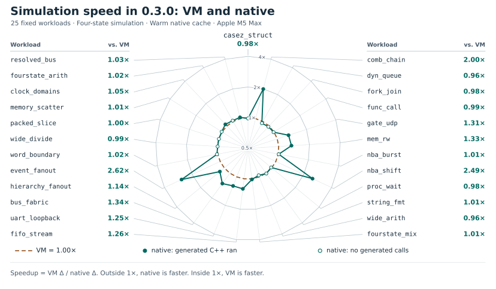
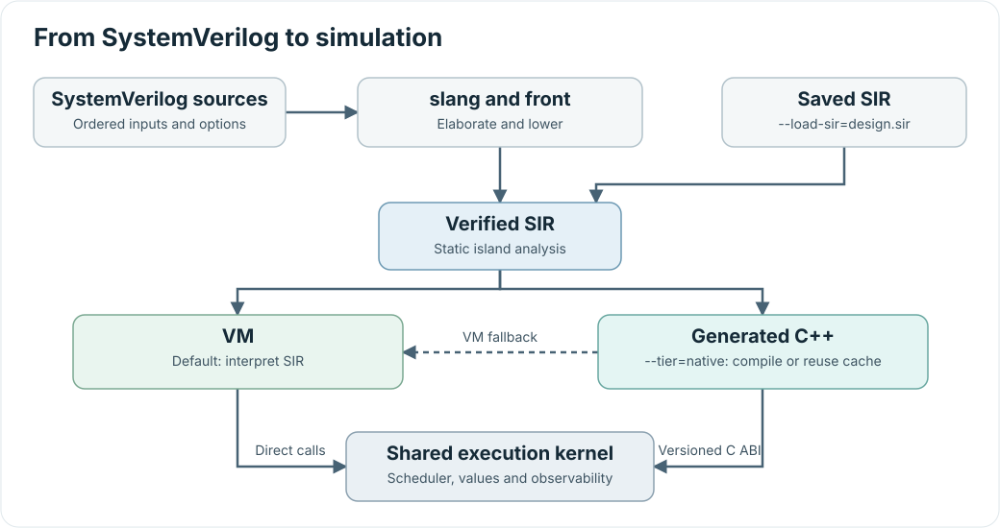

# kirimasim

[日本語](README.ja.md)

[User manual](docs/USER_MANUAL.md) · [Reference manual](docs/REFERENCE_MANUAL.md) · [Documentation guide](docs/README.md) · [Glossary](docs/GLOSSARY.md) · [FAQ](docs/FAQ.md)

[](https://github.com/kurochan001/kirimasim/actions/workflows/ci.yml?query=branch%3Amain)
[](https://github.com/kurochan001/kirimasim/actions/workflows/nightly.yml?query=branch%3Amain)
[](#building)
[](#building)
[](#building)
[](LICENSE)

kirimasim is an open-source SystemVerilog simulator in early development.
It aims to preserve four-state values (0, 1, X, Z) by default and the full
IEEE 1800-2023 time-slot scheduling algorithm, while pursuing practical speed.
AI assists implementation; people approve specifications, test expectations
and reviews under the [AI policy](docs/spec/AI_POLICY.md).

**P2 is complete on `main` (2026-11-22, commit `c8eb34ee`).**
You can save a verified design in SIR format 1 and simulate it again without reading the SystemVerilog source.
All 1,466 designs in the fixed test population met the same expectations when run from source and from saved SIR.
All 23 local CI checks passed at P2 exit.
[Save and run an example](#usage) · [P2 exit results](docs/notes/p2-runtime-review.md#p2-exit-checks)

**P3 is complete in 0.3.0.** Native Ibex/CoreMark reached **5.73×** Icarus speed in four-state mode and **1.018%** of single-threaded Verilator speed in two-state mode. Normal simulation uses the four-state VM with static islands enabled. Use `--tier=native` to compile eligible RTL to C++ or `--disable-pass=islands` to disable islands. [P3 exit measurements](docs/BENCHMARKS.md#p3-performance-targets)

The front end is the unmodified [slang](https://github.com/MikePopoloski/slang)
parser and elaborator, pinned to one commit; the [dependency update
record](docs/notes/slang-8970e0b1-update.md) covers the pinned revision.

X denotes an unknown value and Z denotes high impedance; the
[value glossary](docs/GLOSSARY.md#four-state) distinguishes four-state `logic`
from two-state `bit`.

Development began in October 2026 to support the UVM reference implementation,
achieve practical simulation speed, and verify language mechanisms systematically.
The [development background (Qiita, Japanese)](https://qiita.com/sukimaengineer/items/c7c3db97258b201fb169)
describes the motivation and approach to AI-assisted development.

For basic language tests, we use
[kirimasim-tests](https://github.com/kurochan001/kirimasim-tests), and for UVM tests,
[kirimasim-uvm-tests](https://github.com/kurochan001/kirimasim-uvm-tests).
More practical verification uses the samples in
[lsi-verification-method](https://github.com/kurochan001/lsi-verification-method).

The sister project [kirimaspice](https://github.com/kurochan001/kirimaspice),
an open-source SPICE circuit simulator, is also under development.

## Phases

A phase groups development goals, while an execution tier describes how a design runs;
the [glossary](docs/GLOSSARY.md#execution-tier) explains why P1 uses tier 1 and P3 implements
tier 2.

| Phase | Purpose | Status |
| --- | --- | --- |
| P0 | Build, CI, specifications and test groundwork | Complete |
| P1 | Front end, shared kernel and first execution tier; runs the listed scope and compares it with Icarus 13.0 on 188 probes | Complete (judged on 2026-11-15 at `241e6aaf`) |
| P2 | Finalize SIR v1 and the runtime boundary | Complete on 2026-11-22. [Exit results](docs/notes/p2-runtime-review.md#p2-exit-checks) |
| P3 | Tier 2 C++ generation and practical RTL performance targets | Complete in 0.3.0. [Exit measurements](docs/BENCHMARKS.md#p3-performance-targets) |
| P4 | Suspending VM/native calls, intermediate-signal observation, and fused static-island evaluation with direct slot access | Planned, with an Ibex/CoreMark speed gate ([roadmap](docs/notes/p3-p7-roadmap-revision.md)) |
| P5 | Testbench milestones from minimal UVM through DPI-C, constrained randomization, concurrent SVA, coverage and remaining VPI | Planned. Completion requires human review of the 145 checks in [TEST_SUITE](docs/spec/TEST_SUITE.md). |
| P6 | Broader switch-level, parallel execution and embedding work | Planned beyond the subset required by P1 |
| P7 | Practical UVM and testbench performance, with final tuning of RTL work begun in P4 | Planned |

The implemented virtual-interface subset is documented in [SIR_SPEC](docs/spec/SIR_SPEC.md).
Broader constrained randomization, UVM, concurrent assertions, covergroups and DPI-C remain open. VHDL and analog/mixed-signal
simulation are outside the current language targets.

## Current status

<a id="status-2026-11-01"></a>

Release 0.3.0 keeps eligible counted-loop variables in generated C++ during a combinational evaluation and speeds up rearming fixed sensitivity lists. [0.3.0 release notes](https://github.com/kurochan001/kirimasim/releases/tag/v0.3.0)

### Simulation speed

The same 0.3.0 executable ran each workload on the default VM and with `--tier=native`, using the same saved SIR in four-state mode and a warm native cache. With the VM at **1.00×**, the geometric mean native speedup was **1.17×** across the 25 fixed workloads. Generated C++ ran in **12 of 25** workloads. [Method and per-workload timings](docs/BENCHMARKS.md#v030-native-vm)

[](docs/BENCHMARKS.md#v030-native-vm)

Against Icarus Verilog 14.0 devel, the default VM had a geometric mean speedup of **2.25×** in 0.2.2 (faster on 23 of 25 workloads) and **2.37×** in 0.1.3 (25 of 25). [Both releases compared with Icarus](docs/diagrams/simulation-speed-0.1.3-0.2.2-daily25.svg) · [0.2.2 timings](docs/BENCHMARKS.md#v022-daily25) · [0.1.3 timings](docs/BENCHMARKS.md#v013-daily25)

**On 2026-11-15 P1 was judged complete at commit `241e6aaf`, and 0.1.0 is the
first release ([changelog](CHANGELOG.md)).** The measurements and the judgment are in the
[M8 report](docs/notes/p1-m8-report.md). The first
execution tier directly interprets SIR. It runs a broad RTL and simple-testbench
subset, including the documented class-object subset. It is not ready for
production projects.

The front end is unmodified slang, pinned at
[`8970e0b1e3a9a142817e62079ea3c3b22ac3def0`](cmake/Dependencies.cmake),
a development commit after 12.2. Accepted syntax can still lack executable
lowering; unsupported forms generally stop with a source-position diagnostic.
The [dependency update record](docs/notes/slang-8970e0b1-update.md) covers the
selected fixes, compatibility checks and remaining gaps.

**P1 completion and tooling changes (2026-11-13 to 2026-11-15):** P1 was judged complete at
`241e6aaf` on 2026-11-15; the review by people of 145 test
checks moved out of P1. The revision at which P1 is judged was
fixed and measured again on Linux and macOS; CI, the nightly run and local CI moved
to LLVM 23 (clang, clang-format and clang-tidy); the detailed specification of
static islands for P3 was approved; and `--error-limit` and `--single-unit` were
added. The [changelog](CHANGELOG.md) has the user-visible changes, and
[status history](docs/STATUS_HISTORY.md) keeps earlier checkpoints.

### What works

The [P1 support inventory](docs/P1_SUPPORT.md) gives exact type, lifetime,
selection and execution-context limits. [P1 Features](docs/P1_FEATURES.md)
provides runnable examples.

- **RTL and values:** modules, parameters, generate, interfaces/modports,
  packages, arbitrary-width two-/four-state integers, real/string values,
  fixed arrays and structures, and the supported dynamic-array/queue subset.
- **Processes:** initial/always/final, comb/latch/ff procedures, delays,
  guarded signal/expression events, [NBA](docs/GLOSSARY.md#nba)/[event-NBA](docs/GLOSSARY.md#event-nba), automatic captures,
  fork joins and named-fork disable, calls/refs and programs in the reactive set.
- **Classes:** staged construction, typed fields, inheritance, direct/virtual
  methods, waiting tasks, shallow copies and casts within the
  [source subset](docs/notes/class-source-execution.md); non-parameterized
  static properties use shared storage. Objects also coexist with
  [ordinary signal/event observers](docs/notes/class-independent-observers.md).
  [Explicitly clocked bodies](docs/notes/class-clocked-execution.md) can read/write
  properties and call methods while trigger evaluation remains object-free.
  [Task-form class casts](docs/notes/class-task-casts.md) preserve destinations on failure.
  Blocking writes to bits, parts and packed members of properties run.
- **Nets:** strengths, multiple-driver resolution, gates, wide UDPs, aliases,
  all six directed MOS and six passive switch kinds on supported static
  terminals, and whole fixed-array ports. Eligible static input/output
  partial ports preserve physical strength and effective wired/pull/supply
  kinds; integral input/output conversions use directed value
  [carriers](docs/GLOSSARY.md#directed-carrier). Eligible static partial inout ports share
  [identity](docs/GLOSSARY.md#identity-edge) without value carriers.
- **Tasks and output:** typed `%p`/`%0p` formatting for supported values,
  immediate/deferred assertions, display and runtime
  formatting/scanning, file and memory I/O, random functions, plusargs,
  VCD/FST including interface/program scopes, statistics and resource limits.

### P1 implementation progress

This table summarizes executable support and remaining work at the current
checkpoint. **Partial support does not mean that every form or interaction is
implemented.** The linked inventories define each tested boundary; syntax
accepted by slang alone does not count as execution support.

| Area | Implemented and verified | Remaining work |
| --- | --- | --- |
| Front end and RTL values | Pinned, unmodified slang; [frontend limits](docs/notes/elaboration-limits-execution.md) and [compatibility modes](docs/notes/compatibility-execution.md); modules, hierarchy, packages, generate, integral/real/string values and fixed aggregates | Unsupported lowering forms, user-defined net types and other boundaries in [P1 Support](docs/P1_SUPPORT.md) |
| Scheduling and processes | All time-slot regions; procedures, automatic captures, signal/expression events, NBA/event-NBA, program execution and named-fork disable within their supported subsets | Remaining [managed-event](docs/GLOSSARY.md#managed-event)/control forms, object-dependent observers and broader clocking support |
| Dynamic containers | Shared heap, typed SIR/VM, collection, dynamic arrays, queues, supported runtime array methods and [associative arrays with structure keys](docs/spec/SIR_SPEC.md#p2-associative-arrays-with-structure-keys); [argument-only wildcard function calls](docs/notes/wildcard-function-dependencies.md) and [static integral container observers](docs/notes/implicit-container-execution.md) | Other associative-array forms, remaining implicit sensitivity and element/storage forms in the [container inventory](docs/P1_SUPPORT.md#dynamic-container-foundation) |
| Classes | Construction, typed fields, inheritance, direct/virtual calls, waiting tasks, casts, [explicit clocked object bodies](docs/notes/class-clocked-execution.md), [comb/latch class bodies](docs/notes/class-implicit-execution.md), blocking selected property writes and non-parameterized static properties | Property references/NBA targets, object-dependent observation, parameterized static storage and the other [class boundaries](docs/P1_SUPPORT.md#class-static-properties-and-remaining-object-boundary) |
| Ports and force/release | Fixed-array and eligible static partial input/output/inout ports, effective net kinds, directed integral conversions and registered-net force/release | Broader partial/retained port identities, conversion/force combinations and unsupported targets |
| Nets, gates, UDPs and switches | Strength resolution, wide UDPs, six directed MOS and six passive switch kinds on eligible static terminals | Broader switch and port combinations |
| Formatting and input/output | Source `%p`/`%0p`, captured strength `%v`, supported scanning, file/memory I/O and multidimensional integral `$fread` | Remaining handle/storage formatting and input/selection combinations in [P1 Support](docs/P1_SUPPORT.md#formatting-and-input-limits) |
| Specify and timing | [Scalar module paths](docs/notes/specify-execution.md), including [simple `if`/`ifnone`](docs/notes/specify-state-execution.md): twelve-transition delays, source-time selection, inertial filtering and force continuation | Vector/conditional edge-sensitive/passive or multiple-driver paths, explicit pulse controls, SDF and timing checks |
| VPI | [First execution subset](docs/notes/vpi-execution.md): explicit library loading, registered calls, static numeric reflection, variable writes/force/release, supported callbacks and [whole-net writes](docs/notes/vpi-net-write-execution.md); [unsigned packed-bit views](docs/notes/vpi-packed-bit-values.md) and [next-time observers](docs/notes/vpi-next-time-callback.md) | Selected/delayed net writes, passive deposits, additional object/API/callback forms and cocotb integration |
| Waveforms | VCD and [native FST](docs/notes/fst-execution.md), including interface/program scopes, aliases, filtering, glitch output and dump controls | Extended strength dumps, class/dynamic data; FST viewer interoperability and performance remain unconfirmed |

P1's scope follows the closed exit list of [P1_SCOPE](docs/spec/P1_SCOPE.md). Remaining
work in this table that the list does not name moves to P5 or P6.

### What does not work yet

<a id="remaining-p1-functionality-2026-10-26"></a>

<a id="remaining-p1-functionality"></a>

#### P1 scope and work deferred to P5 and P6

P1 **runs the listed scope and compares it with Icarus Verilog 13.0 on 188 probes**.
It makes no claim of parity with Icarus beyond that list, and it is not a test-count
percentage.

At P1 exit (`241e6aaf`), 186 of the 188 fixed probes were evaluated. The two exclusions were the
`wire real` extension and a frontend timeout on `dense_udp_coverage`.
[Linux results](docs/measurements/2026-11-14-wsl2/icarus13-closed-exit-linux-241e6aaf.json) · [macOS results](docs/measurements/2026-11-14/icarus13-closed-exit-macos-241e6aaf.json)

The November 19 dev run with slang `e81bcd25` passed `dense_udp_coverage`. It evaluated **187 of 188**
probes against Icarus 13.0, with `real_net` excluded, zero required gaps and zero independent failures.
The 25 differences between Icarus output and the recorded expectations were unchanged.
[Pin comparison](docs/measurements/2026-11-19/slang-e81bcd25-probes.json) · [Grounds for the 25 differences](docs/notes/p1-reference-mismatch-grounds.md)

The separate [VPI/queue follow-up](docs/notes/vpi-packed-bit-values.md) fixes
unsigned packed-bit value handling and records two further queue-implicit
execution gaps outside this inventory.

The [first VPI execution subset](docs/notes/vpi-execution.md) now supports explicit
`--vpi=<file>` loading, registered tasks/functions, static numeric reflection,
variable writes/force/release and supported callbacks in tier 1.
[Release result values](docs/notes/vpi-release-results.md) are returned in the requested format.
[Automatic value formats](docs/notes/vpi-object-value-formats.md) now distinguish
declared scalars, integers, reals and packed vectors in reads, callbacks and release.
[Whole automatic integral arguments](docs/notes/vpi-argument-declarations.md) retain
declared bounds and scalar/vector metadata for bit reads and immediate writes;
saved views retain their original activation and reject access after it ends.
[Whole-net VPI writes](docs/notes/vpi-net-write-execution.md) now support immediate
point-net deposits and force/release on registered physical nets, with shared HDL
ownership and callback reentry. Selected/delayed net writes, passive deposits,
full VPI and cocotb integration remain work.

The [first scalar specify subset](docs/notes/specify-execution.md) executes module
paths with twelve-transition delays, input-time selection, default inertial filtering
and force continuation. [Simple state-dependent `if`/`ifnone` paths](docs/notes/specify-state-execution.md)
now select conditions at functional arrival. Vector, conditional edge-sensitive and
passive paths, explicit pulse controls and timing checks remain work.

Work that moves to P5 and P6 includes VPI beyond the documented subsets; those remaining
specify forms; remaining `%p` handle/storage forms; class dependency observation/property references and other typed
boundaries; remaining implicit sensitivity and container/event forms;
and remaining port/force, input and selection combinations documented in
[P1 Support](docs/P1_SUPPORT.md). Eligible static partial inout ports use [physical identity](docs/notes/partial-inout-port-execution.md). [Source pattern formatting](docs/notes/source-pattern-formatting.md) now connects
the [shared renderer](docs/GLOSSARY.md#shared-renderer)/SIR path. [Captured strength `%v` and registered-net force/release](docs/notes/strength-format-execution.md) now use the complete interval and existing per-bit owners. [Native FST output](docs/notes/fst-execution.md) now runs through `--wave=<file>.fst`, sharing VCD selection/timing and dump controls. Its soft compressed-block size limit can exceed the requested final byte size.

Comparison work must map the necessary standard subset, extensions and external
interfaces separately. Deferred extensions and broader `with`/string streaming
targets or event assignment retain their documented decisions.

### P1 exit criteria

[TEST_SUITE](docs/spec/TEST_SUITE.md) and [P1_SCOPE](docs/spec/P1_SCOPE.md)
are authoritative. **Support for Icarus Verilog's `wire real` extension is not a
mandatory P1 condition. Cases with a confirmed dependency on this extension do
not prevent P1 completion when unsupported.** Standard `real` features retain
their existing scope; crashes, hangs and internal errors remain failures. See
the [classification and evidence](docs/notes/p1-wire-real-exception.md).
Recorded pass-rate, mandatory-test and seven-night fuzz
gates have evidence of success. Their dates, populations and reference builds
are in [Recorded validation counts](docs/VALIDATION_COUNTS.md).
Final [M8](docs/GLOSSARY.md#m8) assessment must reconcile the target revision's comparisons on both
operating systems, mandatory tests and the latest seven formal nightly fuzz runs.
The 145 human checks are due at P5 exit. Passing ordinary CI alone
does not complete P1.

#### Progress against the exit criteria

**P1 is complete.** Every row was measured at `241e6aaf`, the revision the
maintainer chose, and on 2026-11-15 the maintainer judged the conditions met. Historical gates are recorded in
[counts.json](docs/counts.json) and [Recorded validation counts](docs/VALIDATION_COUNTS.md).
The [M8 report](docs/notes/p1-m8-report.md) gathers the evidence.

| Criterion | Latest recorded evidence | Status |
| --- | --- | --- |
| At least as many passes as the pinned Icarus build on sv-tests simulation tests, on both Linux and macOS | Of 344 tests: Linux kirimasim 253 / Icarus 211; macOS kirimasim 253 / Icarus 210 (the scheduled nightly of 2026-11-14 UTC at `241e6aaf`). Criterion reference: Icarus 14.0 devel `04cc493` | Met at `241e6aaf` |
| At least 90% of the fixed 1,466-entry own RTL population | 1,456 pass (99.3%); 10 unsupported, at `241e6aaf` on macOS and Linux and in its nightly. The frozen population is unchanged | Met at `241e6aaf` |
| All P1-mandatory tests pass, with the specified later-phase exclusion | The [required list](docs/spec/TEST_SUITE.md#list-of-required-tests) all passes among the 13,858 dev tests at `241e6aaf` on Linux and macOS, and its CI passed every job; `cb/input_sample_1step` now passes, and `context_resume_thread` is to be written in P5 | Met at `241e6aaf` |
| No fast-value/reference disagreement in seven consecutive formal nightly fuzz runs at 100 times the rounds | 19 scheduled nights through 2026-11-14 (UTC) without a difference, the last at `241e6aaf`; the latest seven read | Met at `241e6aaf` |
| The fixed list of 188 probes against Icarus Verilog 13.0, with `real_net` and `dense_udp_coverage` out of scope by source hash | Comparisons at `241e6aaf` on [Linux](docs/measurements/2026-11-14-wsl2/icarus13-closed-exit-linux-241e6aaf.json) and [macOS](docs/measurements/2026-11-14/icarus13-closed-exit-macos-241e6aaf.json), with the check of the list: exit 0 on both. The other 186 show no required-scope gap, with the same 25 reference mismatches | Met (judged 2026-11-15) |
| The mechanisms of the closed list pass their matrices and are described in [P1 Support](docs/P1_SUPPORT.md) | The matrices pass in CI; [the evidence is listed](docs/notes/p1-m8-report.md#named-mechanisms) | Met (judged 2026-11-15) |
| A stated ground for each of the 25 reference mismatches | [Written down](docs/notes/p1-reference-mismatch-grounds.md) and approved on 2026-11-07 | Met (judged 2026-11-15) |
| Human review of 145 checks ([TEST_SUITE](docs/spec/TEST_SUITE.md)) | 0 of 145 completed by people at P1 exit. An AI pre-review was prepared for the maintainer. | Due at P5 exit |

These rows are separate conditions, not equally weighted units of language
completion, and they define no P1 completion percentage.
The M8 judgment was made on 2026-11-15, from the measurements at `241e6aaf`
gathered in the [M8 report](docs/notes/p1-m8-report.md). This update does not remeasure the
Icarus 14.0 feature inventory.

### Test results

CTest entries, fixed populations and feature probes count different units, so read the
[counting FAQ](docs/FAQ.md#why-do-probe-ctest-and-population-counts-differ) before
comparing their totals.

<!-- counts:begin -->
<!-- Written by tools/readme_counts.py from docs/counts.json; do not edit by hand. -->

The recorded dev run has **14,045 / 14,045 tests passing**, 0 skipped and 0 failed. It contains 1,493 unit tests, 12,176 suite cases (235 generators), 257 tool tests, 29 SIR-dump tests, 23 Context tests and 67 CLI/event-count tests.
<!-- counts:end -->

Release has one additional default event-limit test. Full local CI checks
dev/release/ASan/UBSan plus static rules, formatting and clang-tidy (LLVM 23)
before every push; [Recorded validation counts](docs/VALIDATION_COUNTS.md) keeps
dated runs on each machine. The suite has no skip entries.
These results are distinct from dated external
comparisons. [Validation](docs/VALIDATION.md) explains reproduction and limits;
it also covers original/mixed fuzz seeds and corpus carry-over with current-binary replay.
[Benchmarks](docs/BENCHMARKS.md) holds dated speed/memory results and conditions.
[Project size](docs/PROJECT_SIZE.md) records the lines of code, tests and documents at a dated commit.

## Building

Requirements: CMake 3.28+, Ninja, Python 3.10+, and a C++23 compiler:
GCC 13+; Clang 18+ with libc++ 18+, or Clang 19+ with libstdc++ 13+;
or Apple clang 17+ (Xcode 26). Clang 17/18 with libstdc++ cannot build slang
as C++23. Linux and macOS are supported build platforms.

The first configure downloads pinned slang, GoogleTest and standalone libfst.
FST dependency preparation also requires zlib/bzip2 development libraries
(`zlib1g-dev libbz2-dev` on Debian/Ubuntu; the Command Line Tools SDK on macOS).
Meson, GTKWave, GLib and separate LZ4 are unnecessary.
See the [User Manual](docs/USER_MANUAL.md#build-and-version) for setup and presets.

```sh
cmake --preset dev
cmake --build --preset dev
ctest --preset dev
```

Each preset writes to `build/<preset>/`. Other presets are `release`, `asan`,
`ubsan`, `tsan` and `fuzz`; the [Development Guide](docs/DEVELOPMENT.md)
describes their checks and the required pre-push `tools/local_ci.py` run.

## Usage

```sh
build/dev/src/driver/kirimasim [options] <file>... [+plusarg]...
build/dev/src/driver/kirimasim parse [options] <file>...
build/dev/src/driver/kirimasim --version
```

Run the supplied counter testbench from the repository root:

```sh
build/dev/src/driver/kirimasim --top=tb \
  -Idocs/examples/user_manual/include -DCOUNTER_WIDTH=8 \
  -y docs/examples/user_manual docs/examples/user_manual/tb.sv +cycles=6
```

Design stdout starts with `width=8 cycles=6` and ends with `t=70 ns q=6`.
`-I` searches includes, `-y` searches module libraries, `-D` sets a compile-time
macro and `+cycles=6` is read by the design at runtime. Bare `-DNAME` means `1`.
The simulator's own messages go to stderr.

**Generate, compile, and run in one command.** `--tier=native` generates C++ for eligible RTL, compiles it with `c++`, and runs the simulation. Other processes run on the VM.

```sh
build/dev/src/driver/kirimasim --tier=native bench/comb_chain.sv
```

**Choose where to keep the generated files.** The cache location is optional. To keep the counter’s C++ and compiled modules under `build/native-cache`, run

```sh
build/dev/src/driver/kirimasim --tier=native --cache-dir=build/native-cache \
  --top=tb -DCOUNTER_WIDTH=8 -f docs/examples/user_manual/files.f +cycles=6
```

**Read the generated C++.** After the simulation, list its source files and open a `model.cpp` in your editor.

```sh
find build/native-cache -name model.cpp -print
```

For a quick, one-off test, start with the default VM. For longer or repeated simulations, compare native execution with the VM using your own workload. [Choosing an execution tier](docs/USER_MANUAL.md#native-workflow)

You can save the same counter in SIR format 1 and supply `+cycles` when you run it.

```sh
build/dev/src/driver/kirimasim --dump-sir=1 --top=tb -DCOUNTER_WIDTH=8 -f docs/examples/user_manual/files.f > build/counter.sir
build/dev/src/driver/kirimasim --load-sir=build/counter.sir +cycles=6
```

Bare `--dump-sir` prints diagnostic format 0 for inspecting the design.

Common controls include `--top`, `--timescale`, `--single-unit`, `--seed`,
`--max-time`, `--max-wall-time`, `--max-procs`, `--init-values`, `--cond-x`,
`--report-pulses`, `--bounds-check`, `--wave=<file>.vcd`, `--dump-sir` and
`--stats=json`.
For exact defaults, supported forms and exit codes, use the
[Reference Manual](docs/REFERENCE_MANUAL.md); for a failing design, use
[Debugging](docs/DEBUGGING.md).

## How it works

[](docs/ARCHITECTURE.md#pipeline)

The kernel owns scheduling and value operations; all tiers share it.
`valsem` supplies independent reference value semantics. Mechanism matrices,
compiled negative controls, reference comparisons, fuzzing, sanitizers and static
checks validate the implementation. See [Architecture](docs/ARCHITECTURE.md)
and [Validation](docs/VALIDATION.md).

## Contributions

The project currently accepts **specification proposals and issues**, with
questions/early ideas in [Discussions](https://github.com/kurochan001/kirimasim/discussions).
Pull requests are disabled. See [CONTRIBUTING](CONTRIBUTING.md),
[Code of Conduct](CODE_OF_CONDUCT.md) and [Security](SECURITY.md).
Commercial simulator results are not used or accepted; see the
[comparison policy](docs/FAQ.md#do-you-check-against-commercial-simulators).

## Documentation

Public prose documents have complete English/Japanese versions, including
CHANGELOG, dated audits and public report drafts. English is authoritative
where versions differ. Code, raw diagnostics, machine-readable evidence and
the canonical license retain their original identifiers/text; bilingual guides
explain them. Private untracked handoffs/drafts are outside the public set.

Start with the [Documentation Guide](docs/README.md),
[Glossary](docs/GLOSSARY.md) or [FAQ](docs/FAQ.md).
The [support inventory](docs/P1_SUPPORT.md) describes current behavior;
[specifications](docs/spec/) define approved contracts;
[CHANGELOG](CHANGELOG.md) and [Status History](docs/STATUS_HISTORY.md) retain
changes and older checkpoints. The [previous README](docs/history/README_2026-11-01.md)
keeps removed chronology, comparison tables and performance evidence.

## License

Apache License 2.0 with LLVM Exceptions (`Apache-2.0 WITH LLVM-exception`):
see [LICENSE](LICENSE), its [bilingual reading copies](LICENSE.md), and [Third-party notices](THIRD_PARTY_NOTICES.md).
Files use this license unless stated otherwise. “The kirimasim Authors” refers
to the contributors recorded in the commit history.
