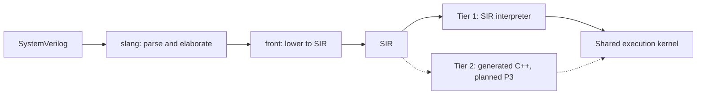

# kirimasim

[日本語](README.ja.md)

[User manual](docs/USER_MANUAL.md) · [Reference manual](docs/REFERENCE_MANUAL.md) · [Documentation guide](docs/README.md)

[](https://github.com/kurochan001/kirimasim/actions/workflows/ci.yml?query=branch%3Amain)
[](https://github.com/kurochan001/kirimasim/actions/workflows/nightly.yml?query=branch%3Amain)
[](#building)
[](#building)
[](#building)
[](LICENSE)

kirimasim is an open-source SystemVerilog simulator in early development.
It aims to preserve four-state values (0, 1, X, Z) by default and the full
IEEE 1800-2023 time-slot scheduling algorithm, while pursuing practical speed.
AI assists implementation; people approve specifications, test expectations
and reviews under the [AI policy](docs/spec/AI_POLICY.md).

## Phases

| Phase | Purpose | Status |
| --- | --- | --- |
| P0 | Build, CI, specifications and test groundwork | Complete |
| P1 | Front end, shared kernel and first execution tier; Icarus 13.0-or-broader required coverage with the optional `wire real` exception | In progress |
| P2 | Finalize SIR v1 and the runtime boundary | Direction approved; detailed contracts under review |
| P3 | Tier 2: ahead-of-time C++ generation and speed work | Planned |
| P4 | Broader testbench features | Planned beyond the subset required by P1 |
| P5 | Broader switch-level, parallel execution and embedding work | Planned beyond the subset required by P1 |

Current SIR formatVersion is 0 and C ABI is 0.3. P2 preparation can accompany
P1, but its freeze follows P1 completion; see the [SIR v1 proposal](docs/notes/sir-v1-proposal.md).
Broader constrained randomization/UVM, concurrent assertions, covergroups,
virtual interfaces and DPI-C remain unimplemented. VHDL and analog/mixed-signal
simulation are outside the current language targets.

## Current status

<a id="status-2026-11-01"></a>
<a id="status-2026-11-02"></a>
<a id="status-2026-11-03"></a>

**As of 2026-11-03, P1 is in progress; there is no release yet.** The first
execution tier directly interprets SIR. It runs a broad RTL and simple-testbench
subset, including the documented class-object subset. It is not ready for
production projects. C++ generation is planned for P3.

The front end is unmodified slang, pinned at
[`d02b7cda02d3183f35c6c4d4db2b2fc03f19f4ae`](cmake/Dependencies.cmake),
a development commit after 12.1. Accepted syntax can still lack executable
lowering; unsupported forms generally stop with a source-position diagnostic.
The [dependency update record](docs/notes/slang-d02b7cda-update.md) covers the
selected fixes, compatibility checks and remaining gaps.

The [inside-member integration record](docs/notes/inside-member-integration.md) reports the existing branch repair applied to local main on 2026-11-03, full local CI and unchanged external cross inputs. It separates two repaired failures from the [approved label-cancellation amendment](docs/notes/deferred-label-cancellation-proposal.md) and the [pinned-elaborator config gap](docs/notes/config-reset-dependency-gap.md). These working-tree checks do not update the formal Nightly or frozen-population gates.

The approved [deferred-label cancellation](docs/notes/deferred-label-cancellation.md) is implemented on latest upstream main `7654825d` plus local changes. The unchanged external 2,785-case selection now records **2,252 pass, 529 unsupported and four config failures**; all 31 deferred-disable cases pass. The [contract](docs/notes/deferred-label-cancellation-proposal.md) preserves siblings, evaluated side effects and settled reports. These local observations do not replace formal Nightly or its consecutive-run gate.

### What works

The [P1 support inventory](docs/P1_SUPPORT.md) gives exact type, lifetime,
selection and execution-context limits. [P1 Features](docs/P1_FEATURES.md)
provides runnable examples.

- **RTL and values:** modules, parameters, generate, interfaces/modports,
  packages, arbitrary-width two-/four-state integers, real/string values,
  fixed arrays and structures, and the supported dynamic-array/queue subset.
- **Processes:** initial/always/final, comb/latch/ff procedures, delays,
  guarded signal/expression events, NBA/event-NBA, automatic captures,
  fork joins and named-fork disable, calls/refs and programs in the reactive set.
- **Classes:** staged construction, typed fields, inheritance, direct/virtual
  methods, waiting tasks, shallow copies and casts within the
  [source subset](docs/notes/class-source-execution.md); non-parameterized
  static properties use shared storage. Objects also coexist with
  [ordinary signal/event observers](docs/notes/class-independent-observers.md).
  [Task-form class casts](docs/notes/class-task-casts.md) preserve destinations on failure.
- **Nets:** strengths, multiple-driver resolution, gates, wide UDPs, aliases,
  all six directed MOS and six passive switch kinds on supported static
  terminals, and whole fixed-array ports. Eligible static input/output
  partial ports preserve physical strength and effective wired/pull/supply
  kinds; integral input/output conversions use directed value carriers. Eligible
  static partial inout ports share identity without value carriers.
- **Tasks and output:** typed `%p`/`%0p` formatting for supported values,
  immediate/deferred assertions, display and runtime
  formatting/scanning, file and memory I/O, random functions, plusargs,
  VCD/FST including interface/program scopes, statistics and resource limits.

### P1 implementation progress

This table summarizes executable support and remaining work at the current
checkpoint. **Partial support does not mean that every form or interaction is
implemented.** The linked inventories define each tested boundary; syntax
accepted by slang alone does not count as execution support.

| Area | Implemented and verified | Remaining work |
| --- | --- | --- |
| Front end and RTL values | Pinned, unmodified slang; [frontend limits](docs/notes/elaboration-limits-execution.md) and [compatibility modes](docs/notes/compatibility-execution.md); modules, hierarchy, packages, generate, integral/real/string values and fixed aggregates | Unsupported lowering forms, user-defined net types and other boundaries in [P1 Support](docs/P1_SUPPORT.md) |
| Scheduling and processes | All time-slot regions; procedures, automatic captures, signal/expression events, NBA/event-NBA, program execution and named-fork disable within their supported subsets | Remaining managed-event/control forms, object-dependent observers and broader clocking support |
| Dynamic containers | Shared heap, typed SIR/VM, collection, dynamic arrays, queues and supported runtime array methods | Associative arrays, implicit container sensitivity and remaining element/storage forms in the [container inventory](docs/P1_SUPPORT.md#dynamic-container-foundation) |
| Classes | Construction, typed fields, inheritance, direct/virtual calls, waiting tasks, casts and non-parameterized static properties | Property references/bit/NBA targets, object-dependent observation, parameterized static storage and the other [class boundaries](docs/P1_SUPPORT.md#class-static-properties-and-remaining-object-boundary) |
| Ports and force/release | Fixed-array and eligible static partial input/output/inout ports, effective net kinds, directed integral conversions and registered-net force/release | Broader partial/retained port identities, conversion/force combinations and unsupported targets |
| Nets, gates, UDPs and switches | Strength resolution, wide UDPs, six directed MOS and six passive switch kinds on eligible static terminals | Broader switch/port combinations; `dense_udp_coverage` still exceeds the frontend comparison deadline |
| Formatting and input/output | Source `%p`/`%0p`, captured strength `%v`, supported scanning, file/memory I/O and multidimensional integral `$fread` | Remaining handle/storage formatting and input/selection combinations in [P1 Support](docs/P1_SUPPORT.md#formatting-and-input-limits) |
| Specify and timing | [First scalar module-path subset](docs/notes/specify-execution.md): twelve-transition delays, source-time selection, inertial filtering and force continuation | Vector/state-dependent/passive or multiple-driver paths, explicit pulse controls, SDF and timing checks |
| VPI | [First execution subset](docs/notes/vpi-execution.md): explicit library loading, registered calls, static numeric reflection, variable writes/force/release and supported callbacks | Net writes, additional object/API/callback forms and cocotb integration |
| Waveforms | VCD and [native FST](docs/notes/fst-execution.md), including interface/program scopes, aliases, filtering, glitch output and dump controls | Extended strength dumps, class/dynamic data; FST viewer interoperability and performance remain unconfirmed |

The required subset follows [P1_SCOPE](docs/spec/P1_SCOPE.md). A remaining
feature's older P4/P5 label does not defer required Icarus-supported functionality
beyond P1; broader support retains its later-phase plan.

### What does not work yet

<a id="remaining-p1-functionality-2026-10-26"></a>
<a id="remaining-p1-functionality-2026-10-29"></a>
<a id="remaining-p1-functionality-2026-10-30"></a>
<a id="remaining-p1-functionality-2026-11-01"></a>
<a id="remaining-p1-functionality-2026-11-02"></a>
<a id="remaining-p1-functionality-2026-11-03"></a>

#### Remaining P1 functionality

P1's outstanding coverage criterion is **standard execution functionality at
least as broad as Icarus Verilog 13.0**, including necessary mechanisms brought
forward from later phases, with the approved optional `wire real` exception below.
It is not a test-count percentage.

The latest comparison has **176 original probes: 175 evaluated for P1 and one
out of scope**, `real_net`, whose source depends on Icarus's `wire real` extension.
The **one required-scope gap** in this inventory is dense UDP front-end
compilation exceeding the comparison deadline. The two raw passing-reference
gaps remain recorded; the extension's compile rejection is not rewritten as a pass.
**25 reference mismatches** are tracked separately and are not counted as kirimasim
defects. See the [measurement](docs/measurements/2026-11-02/icarus13-scalar-specify.json) and
[comparison interpretation](docs/notes/p1-icarus-progress.md).
A finite inventory cannot establish complete functional coverage.

The [first VPI execution subset](docs/notes/vpi-execution.md) now supports explicit
`--vpi=<file>` loading, registered tasks/functions, static numeric reflection,
variable writes/force/release and supported callbacks in tier 1.
[Release result values](docs/notes/vpi-release-results.md) are returned in the requested format.
[Automatic value formats](docs/notes/vpi-object-value-formats.md) now distinguish
declared scalars, integers, reals and packed vectors in reads, callbacks and release.
Full VPI and cocotb integration remain work.

The [first scalar specify subset](docs/notes/specify-execution.md) executes module
paths with twelve-transition delays, input-time selection, default inertial filtering
and force continuation. Vector/state-dependent/passive paths, explicit pulse controls
and timing checks remain work.

Remaining implementation includes VPI beyond its first subset; those remaining
specify forms; remaining `%p` handle/storage forms; class dependency observation/property references and other typed
boundaries; implicit container sensitivity and remaining container/event forms;
and remaining port/force, input and selection combinations documented in
[P1 Support](docs/P1_SUPPORT.md). Eligible static partial inout ports use [physical identity](docs/notes/partial-inout-port-execution.md). [Source pattern formatting](docs/notes/source-pattern-formatting.md) now connects
the shared renderer/SIR path. [Captured strength `%v` and registered-net force/release](docs/notes/strength-format-execution.md) now use the complete interval and existing per-bit owners. [Native FST output](docs/notes/fst-execution.md) now runs through `--wave=<file>.fst`, sharing VCD selection/timing and dump controls. Its soft compressed-block size limit can exceed the requested final byte size.

Comparison work must map the necessary standard subset, extensions and external
interfaces separately. Deferred extensions and broader `with`/string streaming
targets or event assignment retain their documented decisions; a later-phase
label cannot defer anything required by [P1_SCOPE](docs/spec/P1_SCOPE.md).

### P1 exit criteria

[TEST_SUITE](docs/spec/TEST_SUITE.md) and [P1_SCOPE](docs/spec/P1_SCOPE.md)
are authoritative. **Support for Icarus Verilog's `wire real` extension is not a
mandatory P1 condition. Cases with a confirmed dependency on this extension do
not prevent P1 completion when unsupported.** Standard `real` features retain
their existing scope; crashes, hangs and internal errors remain failures. See
the [classification and evidence](docs/notes/p1-wire-real-exception.md).
Recorded pass-rate, mandatory-test and seven-night fuzz
gates have evidence of success. Their dates, populations and reference builds
are in [Recorded validation counts](docs/VALIDATION_COUNTS.md).
Final M8 assessment must reconcile the target revision's comparisons on both
operating systems, mandatory tests, the latest seven formal nightly fuzz runs
and required human reviews. Passing ordinary CI alone does not complete P1.

#### Progress against the exit criteria

**P1 remains incomplete.** “Met in the recorded measurement” below preserves
the dates and populations of the evidence; it is not a new final assessment of
the current revision. Historical gates are recorded in
[counts.json](docs/counts.json) and [Recorded validation counts](docs/VALIDATION_COUNTS.md).
The functional-coverage row uses the newer 2026-11-02 comparison rather than
the older 95-probe inventory.

| Criterion | Latest recorded evidence | Status |
| --- | --- | --- |
| At least as many passes as the pinned Icarus build on sv-tests simulation tests, on both Linux and macOS | Of 344 tests: Linux kirimasim 252 / Icarus 211; macOS kirimasim 252 / Icarus 210 (both measured on 2026-11-01 UTC). Criterion reference: Icarus 14.0 devel `04cc493` | Met in the recorded measurement |
| At least 90% of the fixed 1,466-entry own RTL population | 1,456 pass (99.3%); 10 unsupported, on 2026-10-27. The frozen population is unchanged | Met in the recorded measurement |
| All P1-mandatory tests pass, with the specified later-phase exclusion | The [required list](docs/spec/TEST_SUITE.md#list-of-required-tests) has a recorded all-pass result; `cb/input_sample_1step` retains its specified exclusion | Met in the recorded measurement |
| No fast-value/reference disagreement in seven consecutive formal nightly fuzz runs at 100 times the rounds | Seven successful nights through 2026-10-27 | Met in the recorded measurement; verify the latest seven runs for M8 |
| Standard execution coverage at least as broad as Icarus Verilog 13.0, with the approved optional `wire real` exception | [2026-11-02 comparison](docs/measurements/2026-11-02/icarus13-scalar-specify.json): 176 probes, 175 P1-evaluated, one exclusion (`real_net`), one required-scope gap (`dense_udp_coverage`), two raw gaps and 25 reference mismatches. Broader specify/VPI and other boundaries remain above | **Not yet met; complete coverage is unconfirmed** |

These rows are separate conditions, not five equally weighted units of language
completion. Neither four recorded successes nor one gap in a finite probe set
defines a P1 completion percentage or the total remaining implementation count.
The final M8 evidence/review assessment remains outstanding. The sv-tests row was
refreshed from the [2026-11-01 Nightly measurements](docs/notes/nightly-repair-2026-11-02.md).
The fixed population, fuzz and feature-probe records retain their own dates;
this count update does not remeasure the Icarus 14.0 feature inventory.

### Test results

<!-- counts:begin -->
<!-- Written by tools/readme_counts.py from docs/counts.json; do not edit by hand. -->

The recorded dev run has **11,829 / 11,829 tests passing**, 0 skipped and 0 failed. It contains 1,380 unit tests, 10,154 suite cases (183 generators), 200 tool tests, 29 SIR-dump tests, 21 Context tests and 45 CLI/event-count tests.
<!-- counts:end -->

Release has one additional default event-limit test. Full local CI checks
dev/release/ASan/UBSan plus static rules, formatting and clang-tidy at a clean,
frozen candidate. See the [compatibility execution record](docs/notes/compatibility-execution.md)
for this delivery’s scope, reproduction and complete local CI results. The suite has no skip entries.
These results are distinct from dated external
comparisons. [Validation](docs/VALIDATION.md) explains reproduction and limits;
it also covers original/mixed fuzz seeds and corpus carry-over with current-binary replay.
[Benchmarks](docs/BENCHMARKS.md) holds dated speed/memory results and conditions.

## Building

Requirements: CMake 3.28+, Ninja, Python 3.10+, and a C++23 compiler:
GCC 13+; Clang 18+ with libc++ 18+, or Clang 19+ with libstdc++ 13+;
or Apple clang 17+ (Xcode 26). Clang 17/18 with libstdc++ cannot build slang
as C++23. Linux and macOS are supported build platforms.

The first configure downloads pinned slang, GoogleTest and standalone libfst.
FST dependency preparation also requires zlib/bzip2 development libraries
(`zlib1g-dev libbz2-dev` on Debian/Ubuntu; the Command Line Tools SDK on macOS).
Meson, GTKWave, GLib and separate LZ4 are unnecessary.
See the [User Manual](docs/USER_MANUAL.md#build-and-version) for setup and presets.

```sh
cmake --preset dev
cmake --build --preset dev
ctest --preset dev
```

Each preset writes to `build/<preset>/`. Other presets are `release`, `asan`,
`ubsan`, `tsan` and `fuzz`; the [Development Guide](docs/DEVELOPMENT.md)
describes their checks and the required pre-push `tools/local_ci.py` run.

## Usage

```sh
build/dev/src/driver/kirimasim [options] <file>... [+plusarg]...
build/dev/src/driver/kirimasim parse [options] <file>...
build/dev/src/driver/kirimasim --version
```

Run the supplied counter testbench from the repository root:

```sh
build/dev/src/driver/kirimasim --top=tb \
  -Idocs/examples/user_manual/include -DCOUNTER_WIDTH=8 \
  -y docs/examples/user_manual docs/examples/user_manual/tb.sv +cycles=6
```

Design stdout starts with `width=8 cycles=6` and ends with `t=70 ns q=6`.
`-I` searches includes, `-y` searches module libraries, `-D` sets a compile-time
macro and `+cycles=6` is read by the design at runtime. Bare `-DNAME` means `1`.
The simulator's own messages go to stderr.

Common controls include `--top`, `--timescale`, `--seed`, `--max-time`,
`--max-wall-time`, `--max-procs`, `--init-values`, `--cond-x`, `--report-pulses`,
`--bounds-check`, `--wave=<file>.vcd`, `--dump-sir` and `--stats=json`.
For exact defaults, supported forms and exit codes, use the
[Reference Manual](docs/REFERENCE_MANUAL.md); for a failing design, use
[Debugging](docs/DEBUGGING.md).

## How it works



The kernel owns scheduling and value operations; all tiers share it.
`valsem` supplies independent reference value semantics. Mechanism matrices,
compiled negative controls, reference comparisons, fuzzing, sanitizers and static
checks validate the implementation. See [Architecture](docs/ARCHITECTURE.md)
and [Validation](docs/VALIDATION.md).

## Contributions

The project currently accepts **specification proposals and issues**, with
questions/early ideas in [Discussions](https://github.com/kurochan001/kirimasim/discussions).
Pull requests are disabled. See [CONTRIBUTING](CONTRIBUTING.md),
[Code of Conduct](CODE_OF_CONDUCT.md) and [Security](SECURITY.md).
Commercial simulator results are not used or accepted; see the
[comparison policy](docs/FAQ.md#do-you-check-against-commercial-simulators).

## Documentation

Public prose documents have complete English/Japanese versions, including
CHANGELOG, dated audits and public report drafts. English is authoritative
where versions differ. Code, raw diagnostics, machine-readable evidence and
the canonical license retain their original identifiers/text; bilingual guides
explain them. Private untracked handoffs/drafts are outside the public set.

Start with the [Documentation Guide](docs/README.md),
[Glossary](docs/GLOSSARY.md) or [FAQ](docs/FAQ.md).
The [support inventory](docs/P1_SUPPORT.md) describes current behavior;
[specifications](docs/spec/) define approved contracts;
[CHANGELOG](CHANGELOG.md) and [Status History](docs/STATUS_HISTORY.md) retain
changes and older checkpoints. The [previous README](docs/history/README_2026-11-01.md)
keeps removed chronology, comparison tables and performance evidence.

## License

Apache License 2.0 with LLVM Exceptions (`Apache-2.0 WITH LLVM-exception`):
see [LICENSE](LICENSE), its [bilingual reading copies](LICENSE.md), and [Third-party notices](THIRD_PARTY_NOTICES.md).
Files use this license unless stated otherwise. “The kirimasim Authors” refers
to the contributors recorded in the commit history.
