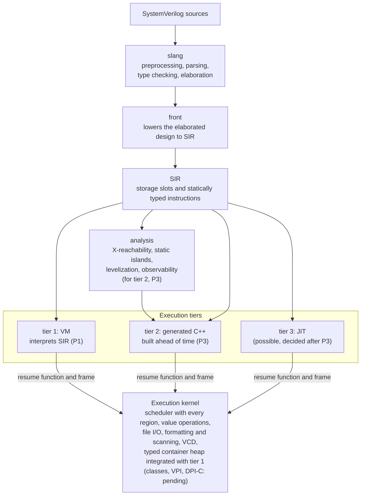

# kirimasim

[日本語](README.ja.md)

[](https://github.com/kurochan001/kirimasim/actions/workflows/ci.yml?query=branch%3Amain)
[](https://github.com/kurochan001/kirimasim/actions/workflows/nightly.yml?query=branch%3Amain)
[](#building)
[](#building)
[](#building)
[](LICENSE)

**Revision (2026-10-24):** old P2→P3, old P3→P4 and old P4→P5; new P2 (SIR v1) is inserted, with tier numbers unchanged ([mapping](docs/notes/phase-renumbering.md)).

The [P1 scope amendment](docs/spec/P1_SCOPE.md), approved 2026-10-23,
sets Icarus Verilog 13.0-or-broader execution support as the target and
advances the necessary P4/P5 and previously out-of-scope mechanisms into P1.
This target is not achieved yet. See the [implemented inventory](docs/P1_SUPPORT.md)
and [comparison gaps](docs/notes/p1-icarus-progress.md).

kirimasim is an open-source SystemVerilog simulator in early development.
Its goal is a simulator that does not give up any of the following:

- **Four-state values** (0, 1, X, Z) by default, with no optimization that
  changes four-state meaning.
- **Scheduling as IEEE 1800-2023 defines it**, with every region of the
  time slot and the standard's reference algorithm.
- **Practical speed**, by running two-state code whenever it can be shown
  or checked at run time that no X or Z is present.

**Most of the code is generated by AI (Claude Code); humans are responsible
for the specification, the tests, and review.** See
[docs/spec/AI_POLICY.md](docs/spec/AI_POLICY.md) and
[CONTRIBUTING.md](CONTRIBUTING.md).

## Status (2026-10-27)

Main includes [source event-NBA lowering](docs/notes/event-nba-source-execution.md)
from `c4be8ade`, alongside the portability/lint fixes `9a81a55e` and `b91bd3d7`. It runs
1,018 new original designs and detects all six compiled source faults. Both
95-probe inventories gain `event_controlled_nba`; six finite-inventory gaps remain.
The old rejection-oracle migration was approved and applied separately in `16c033a4`;
[Main-integration validation](docs/measurements/2026-10-27/nba-front-main-integration.json)
records the pre-push checks. P1 and the remaining source boundaries are unfinished.

Main now includes container conditionals (`a8bb17cc`) and captured NBA payloads
(`7bc5fa85`). The [integration record](docs/measurements/2026-10-27/conditional-nba-main-integration.json)
checks the validated code/tests and each commit's expectation guard. That earlier
checkpoint did not enable source event-NBA.

Main implements [`--max-procs`](docs/notes/process-limit-execution.md)
under the approved CLI 2.7 contract in `624123b2`. It counts unfinished runtime children in
the shared kernel, preserves capacity across record retention/reuse, and stops
before registering an over-limit child. The
[integration record](docs/measurements/2026-10-27/process-limit-main-integration.json)
confirms unchanged validated code/tests and commit-level expectation protection.
Full local CI passes 21/21 steps; P1 remains incomplete.

Main adds [non-parameterized static properties](docs/notes/class-static-execution.md),
including eager initialization of unused declarations, in `9e6a149d`. Its [full local CI](docs/measurements/2026-10-27/class-static-validation.json)
passes 21/21 steps, with 568 new CTest entries and seven caught compiled faults.
The [integration record](docs/measurements/2026-10-27/class-static-main-integration.json)
confirms unchanged validated implementation and tests. Class objects and
parameterized static storage remain work.

The earlier main checkpoint adds [event declaration initialization copies](docs/notes/event-initializer-execution.md)
in `dfddb94b`; the user's three-case oracle migration is separate in `2da32daa`.
The three commits are [integrated into main through `f100cd86`](docs/measurements/2026-10-27/event-initializer-main-integration.json). [Full local CI](docs/measurements/2026-10-27/event-initializer-validation.json)
passes 21/21 checks; dev/ASan/UBSan pass 6,057/6,059 and release 6,058/6,060,
with zero failures and two known skips each. Fresh population, sv-tests and
Icarus 13/14 probes preserve the earlier passes. P1 remains incomplete.
Earlier main checkpoints are retained in the history;
[dated checkpoint notes](docs/notes/p1-icarus-progress.md) preserve earlier
approval, failure and publication states.

> **Early development: not for real projects yet.** kirimasim simulates a
> broad subset of SystemVerilog for RTL and simple testbenches with its
> first execution tier, an interpreter that for now runs SIR directly
> (compiling SIR to bytecode comes later). Class objects,
> constrained randomization, concurrent assertions, VPI and DPI-C
> are not there yet. Tier 1 has had performance and memory fixes; C++
> generation is planned for P3. Unsupported forms generally stop with a
> positioned diagnostic. [Non-parameterized class static properties](docs/notes/class-static-execution.md)
> now use shared typed storage with eager initialization; object execution remains work.

At `4c69843`, typed pattern layouts, verification, text and execution are
connected to the shared renderer. Front's literal/runtime argument bridge
remains unfinished, so source `%p` is still unsupported. A display monitor
now observes a change in an existing queue cell. See the
[current implementation and verification scope](docs/notes/pattern-sir-execution.md)
and [runnable example](docs/P1_FEATURES.md#monitoring-an-existing-queue-cell).

UDP evaluation now accepts input counts beyond 32 through the shared kernel.
[106 original sources and independent value checks](docs/notes/wide-udp-inputs.md)
cover late terminals, state, X/Z, delays and strength. A dense-table compilation
scaling problem remains in pinned slang; complete wide UDP source coverage
is unconfirmed and strict diagnostics remain unchanged.

The dynamic-array/queue execution amendment was approved on 2026-10-23.
The shared kernel now has a typed heap with deep copying, stable element
references, bounded queues, exact tracing and allocation-failure rollback.
Its 31 kernel tests cover 432 nested-copy combinations, transactional failure
and actual-type snapshots, alongside 2,520,000 model-checked operations.
Typed container SIR descriptors, references, instructions, verification and
text are implemented. Twenty-four VM tests execute those instructions from original
SIR inputs, including actual-bound refs, detached cells across waits and automatic
collection at drained region/slot boundaries. Typed slots, live frames, cell refs,
deferred calls and pending scheduler values retain their reachable objects.
The scheduler now tracks heap-dependent waits, reattaches changed dependencies
and excludes called functions' private containers. Front lowering now executes
construction, deep copies, element access, queue methods, actual-bound refs,
whole-value delayed assignments, explicit heap waits, dynamic foreach and
first-dimension queries. An original 240-case source matrix spans eight execution
contexts, with 11 additional CLI diagnostic cases. Another 256 source cases
cover runtime unpacked concatenation and reading queue slices, including wide
signed/unsigned bounds, X/Z and operand side effects. Container support remains
partial: slice assignment targets, additional array methods and implicit heap
sensitivity are among the remaining forms. See the
[implementation status](docs/P1_SUPPORT.md#dynamic-container-foundation)
and [approved contract](docs/notes/dynamic-containers-proposal.md).

The [conditional-container implementation](docs/notes/container-conditional-execution.md)
adds `?:` for supported dynamic arrays/queues, including unknown-condition
whole-element defaults, snapshots and nested contents. Its 351 original designs
span nine execution homes; [local CI](docs/measurements/2026-10-27/container-conditional-validation.json)
passes all 21 steps. Existing feature coverage remains partial.

The [concrete event controls](docs/notes/event-nba-concrete-controls.md) now
cover persistent fixed-slot/named subscriptions, full-width counts and callback-origin
ownership. The expression-monitor checkpoint below extends this core.
The SIR/front/VM source path remains unfinished.
[Local validation](docs/measurements/2026-10-27/nba-events-validation.json) passes all
21 CI steps, with 33 new kernel/SIR-native tests and 18 caught compiled faults.

The [expression-monitor checkpoint](docs/notes/event-nba-expression-monitors.md)
is integrated into main as `012af2ca`, adding shared evaluation and grouped
heap/activation notices. [Integration validation](docs/measurements/2026-10-27/nba-monitors-main-integration.json)
records that checkpoint’s pre-push checks; source event-NBA was still unsupported there.

The [typed SIR/VM checkpoint](docs/notes/event-nba-sir-execution.md) `6f43e387` adds
layouts, verification/text and fresh origin callbacks, checked with original native
SIR. The local [source stage](docs/notes/event-nba-source-execution.md) now exercises
front capture order and detached callbacks, with all 21 local CI checks passing.

The [NBA payload foundation](docs/notes/event-nba-payload-foundation.md) adds
owned snapshots and pending issue order to the shared kernel, with 24 independent
unit tests. The concrete core above adds slot/named subscriptions and origin
retention; the main checkpoint above adds expression monitors. Source
`nba.event` transport was still unfinished at those kernel checkpoints.
[Final-layout local CI](docs/measurements/2026-10-27/nba-payload-validation.json) passes all 21 checks.

The [shared strength resolver](docs/notes/strength-range-foundation.md) now
retains complete intervals before value projection, with exhaustive interval
pair checks. [Directed MOS source execution](docs/notes/source-mos-execution.md)
now imports ordinary drivers and captures controls separately. This remains partial:
registered-net force, partial/retained ports and full strength formatting still need work.
[Source passive execution](docs/notes/source-passive-execution.md) now connects all six
bidirectional kinds, including static bit/element/concat mappings and primitive arrays,
to the shared graph. Independent uncertain graphs retain atomic publication.
Its 143 original source designs pass; the historical tran rejection expectations
were [separately approved and migrated](docs/notes/passive-expectation-migration.md)
in `77c9d188`, with every source input unchanged.

Wide three-state gates now retain both L/H side-mask halves across word
boundaries. All 73 new source cases match Icarus 13.0 and development builds.
See [scope and validation](docs/notes/wide-gate-strength.md). Delayed side-only
timing follows the [approved complete-state amendment](docs/notes/delayed-gate-side-proposal.md).

Aggregate blocking/NBA assignments now capture all RHS values before target
effects, including container snapshots before later field expressions.
Runtime-selected fixed subarrays and structure array members use the same
path. See the [capture and verification note](docs/notes/aggregate-value-capture.md).

Whole fixed arrays and unpacked structures now also support blocking
intra-assignment delay/event/repeat controls. Typed private frames retain
the RHS across waits, and the actual target is chosen afterwards. Another
74 original source cases cover these forms and differing-bound structure
copies. See [implementation and separate expectation review](docs/notes/blocking-aggregate-timing.md).

Blocking intra-assignment `repeat(count) @(...)` now retains the RHS and the
full count, then chooses the target after waiting. Nonpositive/X/Z counts
skip the wait. Seventy-five original source cases cover eight execution
contexts and scalar/container snapshots. The separate event-NBA source stage is
listed above. See the [execution and verification note](docs/notes/repeated-event-controls.md).

Fork-local declarations now use parent initialization and shared static
storage without becoming child processes. Declaration-only forks do not wait.
[Scope and 72 original source cases](docs/notes/fork-local-declarations.md)
include all join kinds. [Shared automatic capture from source](docs/notes/automatic-front-capture.md)
now passes 186 new designs; three historical rejection checks were separately
migrated with approval in `11096dc3`. [Typed SIR event execution](docs/notes/event-vm-boundaries.md)
and collection at region/slot boundaries are connected. The approved
[automatic-event instruction collector](docs/notes/instruction-event-execution.md)
now publishes native fields, SSA regions and complete transfer payloads before
physical event-row growth. Automatic scalar/fixed-array declarations without
initializers construct fresh objects and preserve retained descendants.
176 new source designs, 32 verified SIR designs and 12 compiled controls pass.
The [historical rejection-oracle migration](docs/notes/automatic-event-expectation-migration.md)
was approved and applied in `4ba6b63d`. Event value/formal/structure coverage remains partial.

[Runtime fixed-array event selections](docs/notes/indexed-event-execution.md)
now support named/mixed waits, delayed targets and `.triggered` through typed
values, with 160 original source designs. The historical CLI input's six old
unsupported diagnostics were [separately approved for migration](docs/notes/indexed-event-expectation-migration.md)
and migrated in `28f5c972`. The separate
[tran expectation migration](docs/notes/passive-expectation-migration.md) was
also approved and applied in `77c9d188`; its two historical failing checks
are included in the [main integration validation](docs/notes/main-integration-2026-10-26.md).

Fixed-array ports now share or copy corresponding elements while preserving
each declaration's bounds. Net arrays resolve strengths per element with
sparse private drivers. Constant-element force/release, delay and unconnected
defaults/pulls are covered by [358 original cases](docs/notes/fixed-array-port-execution.md).
On the unchanged 87 probes, Icarus-passing gaps fall 24 → 22 per reference;
P1 remains incomplete.

### Phases

| Phase | Content | Status |
| --- | --- | --- |
| P0 | Groundwork: build, CI, detailed specifications, test suite | Done |
| P1 | Front end to the intermediate representation (SIR), the execution kernel with the full IEEE 1800-2023 scheduler, and tier 1 (an interpreter of SIR) targeting Icarus Verilog 13.0-or-broader execution coverage | **In progress** |
| P2 | SIR v1: finalize SIR and the kernel boundary for tier 2 ([direction approved; details under review](docs/notes/sir-v1-proposal.md)) | Planned |
| P3 | Tier 2: SIR compiled ahead of time to C++, for speed | Planned |
| P4 | Testbench features: classes, dynamic data, constrained randomization, concurrent assertions and coverage, clocking blocks, VPI, DPI-C | Planned; required subset advanced to P1 |
| P5 | Switch-level primitives, multithreaded execution, a library to embed kirimasim in other simulators | Planned; required subset advanced to P1 |

P2's [approved direction](docs/notes/sir-v1-proposal.md) allows preparation
alongside P1, with SIR v1 frozen only after P1 completes. It selects a complete
record format, a shared Op schema and a service-based C boundary; exact grammar,
API prototypes/count and reference layout remain under review. P2 is planned,
formatVersion remains 0, ABI remains 0.3, and tier 2 implementation is P3.

### P1 exit criteria

**P1 is not complete.** The approved [P1 scope](docs/spec/P1_SCOPE.md)
requires functional execution coverage at least as broad as Icarus Verilog
13.0, in addition to the existing gates in
[TEST_SUITE](docs/spec/TEST_SUITE.md). Passing the tables below alone does
not complete P1.

- Cover the standard mechanisms supported by Icarus, including the required
  subset of dynamic containers, classes, programs, VPI, switch-level
  modeling, specify paths and timing facilities. Earlier P4/P5 labels and
  exclusions do not defer that subset beyond P1.
- Record compiler/runtime versions and test mechanisms and their
  interactions with original probes. Inventory extensions and external
  interfaces separately; conflicting extensions need a reviewed compatibility
  policy. Preserve IEEE value and scheduling semantics, four-state defaults,
  the shared kernel, strict slang diagnostics and existing test expectations.
- Meet all existing pass-rate and reference-value fuzzing gates below.

See [remaining P1 functionality](#remaining-p1-functionality-2026-10-26) for
missing features and limitations of partial support.

The [implemented inventory](docs/P1_SUPPORT.md) and
[comparison record](docs/notes/p1-icarus-progress.md) track progress. The
inventory has 87 original probes. At the fixed-array-port checkpoint,
Icarus `13.0 (stable) (v13_0)` has 22 passing gaps and four reference result
mismatches. With `14.0 (devel) (s20260301-411-gca6b8d376)`, the counts are
22 and seven. Subsequent automatic capture reduces the historical 13.0-passing
gaps to 21, and the fresh 14.0 run also leaves 21 gaps and seven mismatches;
there is no fresh 13.0 run at this event-VM checkpoint. With directed MOS
execution, a fresh run against both on 2026-10-26 leaves 14 gaps, with four
(13.0) and seven (14.0) reference mismatches.
The later [source-passive checkpoint](docs/notes/source-passive-execution.md),
measured on the same date, reduces the gaps to **eight against each reference**,
with four/seven reference mismatches unchanged. Its stable compiler and runtime
both report `13.0 (stable) (v13_0-dirty)`; the exact observations are retained in
[the Icarus 13.0 record](docs/measurements/2026-10-26/icarus13-source-passive-probes.json)
and [the development record](docs/measurements/2026-10-26/icarus14-source-passive-probes.json).
The later [automatic-event checkpoint](docs/notes/instruction-event-execution.md) reruns
all 87 probes against both binaries: **seven gaps against each**, with the same
four/seven reference mismatches ([13.0](docs/measurements/2026-10-26/icarus13-instruction-events-probes.json),
[14.0](docs/measurements/2026-10-26/icarus14-instruction-events-probes.json)).
These are separate reference baselines. See the
[versioned results and conditions](docs/notes/icarus-13-comparison.md).
Complete functional parity remains unconfirmed. A passing probe inventory
would not by itself establish complete coverage; the inventory must expand
as mechanisms and interfaces are checked.
At the earlier wide-UDP checkpoint, the prior 84 statuses were unchanged. The two newly inventoried wide UDP
examples now pass both references and native execution. A new dense-coverage
source still reaches the native subprocess bound. On the same expanded list,
the retained baseline had 27/33 gaps and the wide-UDP checkpoint 25/31; the
later array/input checkpoint had 24/24; fixed-array ports now reduce this to 22/22.
The [shared automatic-storage and event proposal](docs/notes/automatic-capture-proposal.md)
records 32 original programs and was approved on 2026-10-25. Shared lexical
capture and [automatic scalar/fixed-array event construction](docs/notes/instruction-event-execution.md)
are implemented; the separate historical rejection-oracle migration was approved and applied in `4ba6b63d`.
The [fixed-array port and resolution proposal](docs/notes/fixed-array-ports-proposal.md)
adds 59 original design observations, with legality boundaries kept separate.

A separate [46-program class investigation](docs/notes/class-execution-investigation.md)
records a historical static-initialization mismatch. The
[non-parameterized static-storage implementation](docs/notes/class-static-execution.md)
fixes that omission; object execution remains required P1 work.
A [detailed class runtime amendment](docs/notes/class-runtime-proposal.md)
adds fourteen original boundary observations and was approved on 2026-10-25.

The latest [MOS/switch investigation](docs/notes/mos-switch-investigation.md)
records 28 original programs and 56 reference observations separately from
that inventory. Switch execution remains unsupported; strength-only changes,
cycles, force and startup have approved detailed contracts; their implementation remains work.

Integral `$fread` now accepts optional start/count arguments, evaluates
supplied value arguments once and follows the approved copy-in/copyback
rules for selected destinations. An inout target is evaluated for its input
value and again when a positive-byte result is copied back. The earlier
capture-once implementation is corrected in the separate
[expectation/source review stack](docs/notes/fread-copyback-correction.md). On the
earlier 61-probe inventory, this reduced the measured gaps from 23 to 22.
The approved [multidimensional memory input](docs/notes/multidim-fread-execution.md)
now runs, with 156 original source cases. Runtime array reductions, stable
ordering and min/max also run through [one typed lowering path](docs/notes/runtime-array-methods.md),
with 270 original cases and four direct unit tests. Min/max return at most one
source element, including tied keys; measured Icarus duplicate results remain
reference mismatches. Effectful/unverified-pure ordering keys and unsupported
aggregate representations remain explicit limitations.

All six remaining detailed [execution contracts](docs/notes/p1-execution-contracts-2026-10-25.md)
were approved on 2026-10-25. The first implementation adds complete-state
[delayed three-state propagation](docs/notes/delayed-gate-state-execution.md),
with 240 original source cases and three direct tests. The exact expectation-only migration was separately approved and integrated.
[All 21 local-CI checks pass](docs/measurements/2026-10-25/delayed-side-integration-validation.json):
dev/ASan/UBSan pass 4,177/4,179 and release 4,178/4,180, with zero failures and
the same two known skips. Other approved P1 mechanisms remain work.

#### Existing quantitative gates and measured results

<!-- counts:begin -->
<!-- Written by tools/readme_counts.py from docs/counts.json; do not edit by hand. -->

| Criterion | Now | Met |
| --- | --- | --- |
| [sv-tests](https://github.com/chipsalliance/sv-tests) simulation tests (pinned commit, hand-written tests, 344): at least as many as Icarus Verilog, on Linux and on macOS | Linux: kirimasim 244, Icarus Verilog 211; macOS: kirimasim 244, Icarus Verilog 210 (14.0 devel, 04cc493, the build the criterion uses, built on each) | Yes |
| kirimasim's own RTL test population (1,466 tests, fixed list): 90% pass | 1,456 pass (99.3%), 0 fail; 10 stop at constructs of later work | Yes |
| The mandatory test list (except the one that needs P4) | All pass | Yes |
| No disagreement between the fast value operations and the reference implementation (`valsem`): seven nightly fuzz runs in a row with 100 times the rounds | The nightly fuzz runs passed on 5 nights in a row, through 2026-10-21 | Not yet |
| Functional execution coverage at least as broad as Icarus Verilog 13.0 ([P1_SCOPE](docs/spec/P1_SCOPE.md)): the mechanisms that Icarus supports run | Of 95 original probes, 6 that Icarus Verilog 13.0 stable runs do not pass in kirimasim yet, with 4 reference mismatches (6 and 7 against 14.0 devel); the probes alone do not show complete coverage | Not yet |

The external sv-tests counts for kirimasim were measured on 2026-10-26 (Linux) and 2026-10-27 (macOS); the population on 2026-10-27; the Icarus probes on 2026-10-27. Icarus Verilog's and Verilator's in the last two columns on 2026-10-17, from their main branches that day. The nightly run measures sv-tests and the population again, and fails when they differ from these.

| Test set | Tests | kirimasim | Icarus Verilog | Verilator |
| --- | --- | --- | --- | --- |
| This repository's tests (CTest, dev configuration) | 8,131 | 8,129, 2 skipped | — | — |
| [sv-tests](https://github.com/chipsalliance/sv-tests) simulation tests | 344 | 244 | 213 | 321 |
| Own test suite, P1 population | 1,466 | 1,456 | 1,274 | 1,329 |

This repository's tests by kind: unit tests (GoogleTest) 773, `tests/suite/` 7,125 (made by 149 generators under `tools/`), tools 167, `tests/dump_sir/` 29, state and Contexts 21, command line and event counts 16.
<!-- counts:end -->

Most of the sv-tests gap is in chapters 7, 8 and 16: dynamic arrays,
queues, associative arrays, classes and concurrent assertions. The required
Icarus-supported subset now belongs to P1; broader support retains its
later-phase plan. The own test suite is kept in a
separate repository, [kirimasim-tests](https://github.com/kurochan001/kirimasim-tests).

### Test results

The counts are in the tables under [P1 exit criteria](#p1-exit-criteria). In
the release configuration, CTest has one test more: the run to the default
of `--max-slot-events`.

The historical full local CI record for `615afa0` (2026-10-25, macOS arm64) has these results:
all 21 checks pass; dev, ASan and UBSan each run 4,652 tests, 4,650 pass and
the two known skips remain; release runs 4,653 and 4,651 pass, with the same
skips ([record](docs/measurements/2026-10-25/activation-environment-final-validation.json)).

The earlier [main integration](docs/measurements/2026-10-27/conditional-nba-main-integration.json)
includes container conditionals (`a8bb17cc`) and captured NBA payloads (`7bc5fa85`).
All 21 local CI checks are confirmed after README regeneration and a dev rerun:
dev/ASan/UBSan 7,013/7,015 and release
7,014/7,016, with zero failures and two known skips each. The expanded
95-probe inventory retains seven Icarus-passing gaps for each reference,
and four/seven reference mismatches for 13.0-stable/14.0-development.
See the [current validation and limits](docs/notes/p1-icarus-progress.md#current-implementation-and-review-status-2026-10-27)
and [portable per-probe records](docs/notes/icarus-13-comparison.md).
The external sv-tests/population counts and performance measurements below
retain their recorded revisions and dates.

The two skipped tests of this repository need clocking-block support, or
drivers that meet through a port between parts of nets (not supported
yet). Verilator leads sv-tests by far. Most of the gap is dynamic arrays,
queues, associative arrays, classes and UVM, followed by `randsequence`.
The P1 scope amendment advances the required Icarus-supported subset;
broader support retains its later-phase plan.

The own test suite was written together with kirimasim, so it is not a
neutral comparison. Each test was checked against the clauses of the
standard it cites, and its expected output matches Icarus Verilog 13.0, or
Verilator 5.052 for the tests that Icarus Verilog 13.0 cannot compile; a
few follow the standard where neither does. kirimasim is judged by the rule of the
P1 criterion (output, exit code and kirimasim's own messages), the others
by their output only, with the suite's runners. Verilator is a two-state
simulator, so tests that show x or z values fail with it.

**Time (remeasured 2026-10-23)**: kirimasim `dec94ff` and Icarus Verilog
`b25510638`, one run per test, up to six tests at a time. These are sums of
per-test durations, not elapsed suite time or medians of five runs. See
[conditions and raw data](docs/BENCHMARKS.md).

> Short tests mostly measure startup and preparation, so these tables do
> not compare simulation speed. Verilator rebuilds the C++ program and
> runtime for each test and was not timed here. The three-way run-speed
> comparison is under [Simulation speed](#simulation-speed).

| Test set | Simulator | Build step | Run step | Total |
| --- | --- | --- | --- | --- |
| sv-tests, 344 | kirimasim | 7.06 s | 0.18 s | 7.24 s |
|  | Icarus Verilog | 4.79 s | 33.52 s | 38.31 s |
| Own P1 population, 1,466 | kirimasim | 11.65 s | 1.15 s | 12.80 s |
|  | Icarus Verilog | 21.54 s | 9.15 s | 30.70 s |

Only the tests **both measured simulators passed** in these runs are shown
below. This selection differs from the previous three-way intersection.
Of the 184 sv-tests cases, 43 expect rejection.

| Test set | Simulator | Build step | Run step | Total |
| --- | --- | --- | --- | --- |
| sv-tests, 184 | kirimasim | 1.70 s | 0.09 s | 1.79 s |
|  | Icarus Verilog | 2.51 s | 27.22 s | 29.73 s |
| Own P1 population, 1,269 | kirimasim | 10.06 s | 1.00 s | 11.06 s |
|  | Icarus Verilog | 18.75 s | 9.04 s | 27.79 s |

- Preparation is reading, elaboration and lowering to SIR (`--dump-sir`)
  for kirimasim, and `iverilog` for Icarus. Running is kirimasim's whole
  duration less preparation (negative differences clamped to zero), or
  starting Icarus's compiled program.
- kirimasim's small differences include measurement noise and the effect
  of printing SIR; they cannot be read as pure execution time. Tests that
  fail to build still contribute their preparation time.
- sv-tests is pinned at `15490e95fd97`; the 1,466 own tests use the frozen
  list at `179c55de9c83`. The common subset uses the runners' verdicts in
  these new runs.
- Machine: Apple M5 Max (18 cores), 128 GiB, macOS 27.0.1. kirimasim is a
  release build with AppleClang 21.0.0.21000334. The historical comparison
  values in the exit-criteria tables retain their stated dates and tools.

<details>
<summary>This repository's tests by kind</summary>

The counts of each kind are under [P1 exit criteria](#p1-exit-criteria).
The kernel tests now also cover stable container cells, deep copying,
allocation-failure rollback and exact tracing against an independent model.

| Kind | What they check |
| --- | --- |
| Unit tests (GoogleTest) | SIR and its verifier, the scheduler against a reference model, `valsem`, output formats, strengths, input scanning, time scales, UDP tables, counters, the Context, the kernel's fast operations against `valsem` (one word and any width), and more |
| `tests/suite/` | Simulation tests with expected output and illegal designs with the expected error, most of them made by the generators under `tools/`: procedures, scheduling, values, hierarchy, continuous assignments, nets, illegal designs, and others |
| `tests/dump_sir/` | The intermediate representation that the front end makes |
| State and Contexts | Six designs run one after another, at the same time on separate threads (with and without the front end) and on 100 Contexts in turn, each run compared with the run of its design alone (RUNTIME_ABI.md 9.8) |
| Tools | Each generator still makes the files in the repository, negative controls for the tools that judge tests, every mistake of `tools/mutants.py` still applies, and the benchmark designs still run |
| Command line, event counts | Options and messages, the matrix of unsupported constructs (each one reported with its position in every container), the format flags that the standard does not define, system calls that take a string first, `$finish` and `$stop` with their arguments, and the input options (`-f`, `--top`, `+incdir+`, `+define+`), loops that never advance time (stopped by `--max-slot-events`), SIGINT (on POSIX systems), calls of functions that schedule work after they return where 13.4.4 does not allow them, the positions of block statements in `--dump-sir`, writes to what `always_comb`, `always_latch` and `always_ff` write through tasks and through the actions of deferred assertions; the counts of a fixed run (PerfCount) |

</details>

<details>
<summary>sv-tests by chapter of IEEE 1800-2023</summary>

The own-suite table below keeps an earlier measurement, and features
implemented since may not show in it. Use
[P1_SUPPORT](docs/P1_SUPPORT.md) for current execution support.

Pinned sv-tests commit 15490e9, hand-written tests whose type includes
simulation, judged by sv-tests' rules. Measured with `tools/svtests.py`:
kirimasim on 2026-10-25 at `652159b` (release, macOS arm64); the comparison
builds Icarus Verilog 14.0 (devel) `f190dbb` and Verilator 5.053 devel
`8668340` on 2026-10-17.

| Chapter | Tests | kirimasim | Icarus | Verilator | Where the measured build stops |
| --- | --- | --- | --- | --- | --- |
| 5 Lexical conventions | 1 | 1 | 1 | 1 | |
| 6 Data types | 16 | 16 | 11 | 14 | |
| 7 Aggregate data types | 91 | 61 | 47 | 88 | associative arrays (14), array locator methods and `shuffle` (10), unpacked array slices (3), unions (3) |
| 8 Classes | 15 | 9 | 12 | 12 | classes |
| 9 Processes | 6 | 4 | 4 | 6 | sequences; one test depends on the order of processes at time 0, which 4.7 leaves open |
| 10 Assignment statements | 3 | 3 | 3 | 3 | |
| 11 Operators and expressions | 51 | 48 | 37 | 48 | tagged unions (2), streaming a dynamic array |
| 12 Procedural programming statements | 2 | 2 | 2 | 2 | |
| 13 Tasks and functions | 14 | 14 | 13 | 14 | |
| 14 Clocking blocks | 1 | 1 | 1 | 1 | |
| 15 Interprocess synchronization | 2 | 0 | 0 | 2 | mailboxes |
| 16 Assertions | 6 | 0 | 3 | 5 | concurrent assertions |
| 18 Constrained random value generation | 22 | 10 | 8 | 22 | `randsequence` (12) |
| 20 Utility system tasks and functions | 38 | 37 | 34 | 37 | `$coverage_control` |
| 21 I/O system tasks and functions | 27 | 26 | 25 | 26 | `$dumpports` |
| 22 Compiler directives | 6 | 6 | 6 | 6 | |
| 23 Modules and hierarchy | 1 | 1 | 1 | 1 | |
| 24 Programs | 1 | 1 | 1 | 1 | |
| 26 Packages | 1 | 1 | 1 | 1 | |
| UVM | 37 | 0 | 0 | 28 | the UVM library needs classes |
| UVM random | 3 | 3 | 3 | 3 | |
| **Total** | **344** | **244** | **213** | **321** | |

The P1 criterion uses the Icarus build that sv-tests pins (04cc493):
211 passes on Linux and 210 on macOS. kirimasim passes 244 on macOS
(2026-10-25, `652159b`); the nightly run last measured 234 on Linux
(2026-10-24, `c507631`).
The Icarus column above uses the comparison build f190dbb, which passed
213 on 2026-10-17.

</details>

<details>
<summary>Own test suite by chapter of IEEE 1800-2023</summary>

The P1 population of TEST_SUITE.md: 1,466 tests of the test suite,
listed in `tests/gates/p1_population.txt`. The suite itself is in
[kirimasim-tests](https://github.com/kurochan001/kirimasim-tests). The last column is where
kirimasim stops; it fails no test.

This chapter table retains the 2026-10-25 native snapshot. The
[2026-10-26 remeasurement](docs/measurements/2026-10-26/source-passive-population.json)
passes 1,456/1,466 with zero failures and ten unsupported cases; its chapter-28
subset passes all 22. The fixed path list is unchanged; selected inputs are clean
at tests revision `a733b838`, with three source files changed since the original
selection. Other simulators' columns retain their historical measurements.

| Chapter | Tests | kirimasim | Icarus | Verilator | kirimasim stops at |
| --- | --- | --- | --- | --- | --- |
| 3 Design and verification building blocks | 3 | 3 | 1 | 3 | |
| 4 Scheduling semantics | 13 | 13 | 13 | 9 | |
| 5 Lexical conventions | 20 | 20 | 20 | 16 | |
| 6 Data types | 226 | 226 | 187 | 200 | |
| 7 Aggregate data types | 90 | 87 | 55 | 90 | dynamic arrays, associative arrays, `sort` (3) |
| 9 Processes | 72 | 72 | 71 | 65 | |
| 10 Assignment statements | 84 | 84 | 77 | 81 | |
| 11 Operators and expressions | 347 | 347 | 309 | 312 | |
| 12 Procedural programming statements | 106 | 106 | 96 | 102 | |
| 13 Tasks and functions | 76 | 76 | 50 | 76 | |
| 15 Interprocess synchronization | 3 | 3 | 1 | 3 | |
| 16 Assertions | 21 | 18 | 16 | 19 | `$sampled`, `$stable` (3) |
| 18 Constrained random value generation | 1 | 0 | 0 | 1 | `randsequence` (1) |
| 20 Utility system tasks and functions | 149 | 149 | 144 | 117 | |
| 21 I/O system tasks and functions | 57 | 57 | 56 | 52 | |
| 22 Compiler directives | 14 | 14 | 14 | 14 | |
| 23 Modules and hierarchy | 45 | 45 | 43 | 42 | |
| 25 Interfaces | 29 | 26 | 18 | 29 | virtual interfaces (3) |
| 26 Packages | 20 | 20 | 16 | 20 | |
| 27 Generate constructs | 62 | 62 | 62 | 53 | |
| 28 Gate-level and switch-level modeling | 22 | 17 | 22 | 20 | MOS and bidirectional switches (5) |
| 29 User-defined primitives | 6 | 6 | 3 | 5 | |
| **Total** | **1,466** | **1,451** | **1,274** | **1,329** | |

</details>

### Simulation speed

The latest comparison is the [2026-10-25 Linux (WSL2) run with the development versions and Lyra](#on-linux-development-versions-with-lyra).
The first table preserves the separate 2026-10-23 macOS measurement.

All three simulators were remeasured on 2026-10-23, five runs each, on the
four designs under [bench/](bench/): kirimasim `dec94ff` (release), Icarus
Verilog 14.0 devel `b25510638`, and Verilator 5.053 devel `2cb54975a`.
The counts and expected checksums were unchanged; every measured run
produced the expected result.

| Design | What it does | `+n=` | kirimasim | Icarus Verilog | Verilator |
| --- | --- | --- | --- | --- | --- |
| `comb_chain` | 8 `always_comb` stages of 32-bit arithmetic; changing inputs | 3,000,000 | 5.043 s | 7.968 s | 0.142 s |
| `nba_shift` | 64-stage shift register and 16 accumulators in `always_ff`, all NBA | 1,000,000 | 11.273 s | 18.739 s | 0.120 s |
| `proc_wait` | 64 processes waiting with `#` and 64 waiting for named events | 1,000,000 | 3.966 s | 5.204 s | 1.817 s |
| `fork_join` | Four branches forked and joined in a loop, with `#`, `->`, `@` | 4,000,000 | 2.763 s | 4.084 s | 0.843 s |

- Times are the median of five runs at the stated count less the median
  of five runs with `+n=1`, after one warm-up start per program. The
  `+n=1` medians were about 3–8 ms.
- Design builds are separate: Icarus took 0.014–0.023 s, Verilator
  1.528–1.641 s with parallel build jobs (one build per design).
  kirimasim reads the design at runtime.
- The median per-run peak RSS was 9.19–10.09 MiB for kirimasim,
  5.33–5.86 MiB for Icarus and 2.00–2.16 MiB for Verilator.
- On these four designs kirimasim was about 1.31–1.66 times faster than
  Icarus; Verilator was about 2.2–93.9 times faster than kirimasim.
  kirimasim and Icarus interpret four-state values; Verilator generates
  C++ and runs with two-state values. kirimasim's C++ generation is P3
  work. These small designs do not establish general performance.
- [Measurement details](docs/BENCHMARKS.md) include CPU, OS, load, every
  sample, design-specific build/startup/RSS values and reproduction steps.
  This run alone does not establish a change against earlier versions.
  Performance issue #28 remains open.
- The separate Linux nightly measurement warns when runtime or RSS is
  15% worse, or build time 25% worse, than the preceding seven nights'
  median (PERFORMANCE.md 5.1).

#### On Linux, development versions, with Lyra

Measured separately on 2026-10-25 under WSL2 (AMD Ryzen 9 7950X), with each
tool at its newest development commit: kirimasim `b66834254c65`, Icarus
Verilog 14.0 devel `2b8d42dc088f`, Verilator 5.053 devel `1838b6ed035c` and
Lyra `63922502ff0a` (`bazel build -c opt`), on eleven designs: the four above
and seven more for other mechanisms. The machine and the tool versions differ
from the table above, so the two tables are not compared column by column.

| Design | `+n=` | kirimasim | Icarus Verilog 14.0 devel | Verilator 5.053 devel | Lyra (LLVM backend) |
| --- | --- | --- | --- | --- | --- |
| `comb_chain` | 3,000,000 | 9.249 s | 9.796 s | 0.223 s | 2.878 s |
| `nba_shift` | 1,000,000 | 25.486 s | 26.585 s | 0.196 s | 5.900 s |
| `proc_wait` | 1,000,000 | 6.786 s | 5.688 s | 2.283 s | 6.164 s |
| `fork_join` | 4,000,000 | 4.837 s | 5.023 s | 1.190 s | 4.860 s |
| `wide_arith` | 1,500,000 | 4.944 s | 2.036 s | 0.086 s | 0.380 s |
| `mem_rw` | 4,000,000 | 4.937 s | 3.645 s | 0.696 s | 2.705 s |
| `func_call` | 1,500,000 | 4.917 s | 7.511 s | 0.005 s | 0.395 s |
| `string_fmt` | 500,000 | 5.003 s | 8.080 s | 0.135 s | 0.279 s |
| `dyn_queue` | 4,000,000 | 4.112 s | 6.686 s | 0.083 s | 0.412 s |
| `gate_udp` | 400,000 | 5.378 s | 3.517 s | 0.046 s | not supported |
| `casez_struct` | 5,000,000 | 3.976 s | 4.117 s | 0.018 s | 0.466 s |

- The seven new designs: `wide_arith` mixes 256-bit values (additions, a
  128-bit product, shifts, compares); `mem_rw` writes and reads a 1024-word
  memory at moving addresses on every clock edge; `func_call` calls a task
  with `inout` and `output` arguments and a function that recurses four deep;
  `string_fmt` formats with `$sformatf` and hashes the characters;
  `dyn_queue` feeds and drains a queue around a dynamic array; `gate_udp`
  drives 32 xor gates and 32 instances of a combinational UDP; and
  `casez_struct` decodes with `casez` into a packed struct.
- Same method and checks as above; every measured large run produced the
  expected result. Lyra does not support gates or UDPs yet, so it builds no
  program for `gate_udp`.
- The Lyra column is its LLVM backend, which Lyra's README calls its main
  one, at Lyra's default `-O 0`, each design built into an empty cache.
  Lyra's default backend, used when `--backend` is not given, is its C++
  backend: on these designs it was 3.3 to 67 times slower than the LLVM
  backend. Its times are in the
  [measurement details](docs/BENCHMARKS.md#development-versions-on-linux-wsl2-2026-10-25).
- Here kirimasim was slower than Icarus Verilog on `proc_wait`, `wide_arith`
  (2.4 times), `mem_rw` and `gate_udp`; clearly faster on `func_call`,
  `string_fmt` and `dyn_queue`; and within about 6% on the other four. On
  `dyn_queue`, its peak memory grows with the count (547 MiB at 4,000,000).
  Build times,
  startup, sampled Linux RSS and reproduction commands are in the
  [measurement details](docs/BENCHMARKS.md#development-versions-on-linux-wsl2-2026-10-25).

### What works

Everything below runs on the tier 1 interpreter and is covered by tests.
The [P1 support inventory](docs/P1_SUPPORT.md) lists the supported forms,
their limits, system tasks/functions and implemented command-line options.

- **Design structure:** modules, ports (input, output, inout), parameters
  and `defparam`, `generate`, arrays of instances, interfaces and modports,
  packages and the compilation unit (`$unit`), hierarchical names,
  specparams.
- **Data types:** two-state and four-state integral types of any width,
  `real`, `shortreal`, `realtime`, `string`, enumerations, packed and
  unpacked structures, packed unions, fixed-size unpacked arrays (several
  dimensions, arrays of structures), unpacked array parameters, named
  events, `chandle` (null only, until DPI-C).
- **Enumeration methods:** `first`, `last`, `num`, `name`, `next` and
  `prev`; `next(n)` and `prev(n)` also accept counts evaluated at run time.
- **Nets:** `wire`, `tri`, `wand`, `wor`, `tri0`, `tri1`, `supply0`,
  `supply1`, `uwire`; drive strengths and resolution of several drivers;
  continuous assignment delays (rise, fall, turn-off), including net declaration
  assignments; built-in gates
  and pulls; user-defined primitives (combinational and sequential);
  `alias`.
- **Procedures and timing:** `initial`, `always`, `always_comb`,
  `always_latch`, `always_ff`, `final`; blocking and nonblocking assignments
  with intra-assignment delays; delay and event controls on signals and on
  expressions, with `iff`; `wait (expr)`; named events (`->`, `->>`,
  `.triggered`); `fork` with `join`, `join_any` and `join_none`; `wait
  fork`, `disable fork`; `disable` of blocks and tasks in every process;
  `assign`/`deassign` and `force`/`release`.
- **Functions and tasks:** static and automatic, recursion, `input`,
  `output`, `inout` and `ref` arguments, default argument values, unpacked
  structures and arrays as arguments, functions returning unpacked
  structures and arrays.
- **Class static properties:** non-parameterized declarations, eager initialization,
  inherited/aliased storage and static methods; [supported types and limits](docs/notes/class-static-execution.md).
- **Statements and expressions:** `if`, `case`, `casez`, `casex`,
  `case inside`, `randcase`; `unique`, `unique0` and `priority` with their violation
  reports; loops (including `for (;;)`), `break`, `continue`, `return`; operators
  including streaming, `inside`, wildcard equality, assignment operators and
  increments; assignment patterns.
- **Streaming assignments:** unpacking into targets wider than 64 bits,
  including fixed-size arrays and structures, with `>>` and `<<` block
  ordering, blocking assignments and NBAs.
- **Assertions:** immediate `assert`, `assume` and `cover`, and deferred
  ones (`#0`, `final`).
- **System tasks and functions:** `$display` and `$write` (with the `b`,
  `o`, `h` forms), `$strobe`, `$monitor`, `$monitoron`, `$monitoroff`,
  `$sformat`, `$sformatf`, `$swrite`, `$sscanf`, `$time`, `$realtime`, `$timeformat`, `$printtimescale`, `$finish`, `$stop`,
  `$fatal`, `$error`, `$warning`, `$info`, `$stime`, `$timeunit`,
  `$timeprecision`, the `%m` and `%l` formats, conversions (`$rtoi`, `$itor`,
  `$realtobits` and the like, `$signed`, `$unsigned`), `$bits`, `$typename`,
  the array queries, `$clog2` and the real math functions, `$countbits`,
  `$countones`, `$onehot`, `$onehot0`, `$isunknown`, `$test$plusargs`,
  `$value$plusargs`; file output (`$fopen`, `$fclose`, `$fflush`,
  `$fdisplay`, `$fwrite`, `$fstrobe`, `$fmonitor`, with the `b`, `o`, `h`
  forms) and file input (`$fgetc`, `$ungetc`, `$fgets`, `$fscanf`,
  `$fread`, `$ftell`, `$fseek`, `$rewind`, `$feof`, `$ferror`, and STDIN);
  `$readmemb`, `$readmemh`, `$writememb` and `$writememh`; `$random` and
  the `$dist_*` functions, with the values of Annex N; `$urandom` and
  `$urandom_range`, with a generator of each process seeded from
  `--seed`; `$stacktrace`.
- **Runtime scan formats:** `$sscanf` and `$fscanf` take a string or packed
  format evaluated at each call, including formats returned by functions.
- **Runtime plusarg formats:** `$value$plusargs` takes a string or packed
  format evaluated at each call, preserving first-match selection and leaving
  the output unchanged when no argument matches.
- **Runtime string formats:** `$sformat` and `$sformatf` take string or packed
  formats evaluated at each call, with real/integer conversions, `%t` time-unit
  scaling and `%m`/`%l` scope information. Missing or extra values warn and continue.
- **Binary formats:** `%u` and `%z` output complete 32-bit words at any integral
  width. File and packed destinations retain zero bytes; SV strings omit them.
  `$sscanf`/`$fscanf` also read these native words, preserving raw whitespace
  and NUL and assigning only complete fields. Width zero means omitted width.
- **Programs:** initial procedures and continuous assignments run in the
  reactive set; calls and forks inherit that group and program origin.
  Program completion ends remaining descendants; `$exit` ends its originating
  program, with final procedures after global completion.
- **Memory-file references:** readmem/writemem tasks accept fixed memories
  through `ref`, including forwarded references and selected array rows;
  writemem also accepts `const ref`.
- **Waveforms:** 4-state VCD from `$dumpfile`, `$dumpvars`, `$dumpoff`,
  `$dumpon`, `$dumpall`, `$dumplimit` and `$dumpflush`, or from
  `--wave=<file>.vcd` with `--wave-scope` and `--wave-glitches`.
- **Scheduling:** every region of the IEEE 1800-2023 time slot with the
  reference algorithm, including pending reports confirmed in the Observed
  region and `$strobe`/`$monitor` in the Postponed region.
- **Execution controls:** `--autoflush` publishes stdout during a run;
  `--max-procs` limits unfinished runtime children;
  `--stop=finish|ignore|error` chooses what `$stop` does; `--max-wall-time`
  limits elapsed simulation seconds and runs final procedures before ending.
- **Bounds diagnostics:** `--bounds-check=warn` reports invalid packed
  selections and fixed unpacked-array indices once per source position,
  with a count at the end. Reads, writes and NBA updates keep their usual values.

### What does not work yet

#### Remaining P1 functionality (2026-10-26)

The following are major missing mechanisms and limitations of partial support.
The required subset follows the approved [P1 scope](docs/spec/P1_SCOPE.md);
a complete mapping of the remaining forms to Icarus 13.0 coverage is
**not confirmed**. Extend the original comparison probes to establish that mapping. The detailed
[feature inventory](docs/P1_SUPPORT.md) and [current progress](docs/notes/p1-icarus-progress.md)
record implemented forms, evidence and limitations.

- **Class execution:** object construction, constructors, instance properties,
  method dispatch, object inheritance/lifetime/collection, and parameterized
  static storage. [Non-parameterized static properties](docs/notes/class-static-execution.md)
  now initialize eagerly, share inherited storage and work through static methods.
  This does not establish object support.
- **Event values and retained objects:** scalar event-return/conditional expressions
  and automatic structure event fields remain unsupported;
  rebinding, comparisons and event-containing dynamic containers remain work.
  [Scalar/fixed-array input arguments](docs/notes/event-input-execution.md),
  default construction, [declaration initialization copies](docs/notes/event-initializer-execution.md)
  and published instruction collection are implemented. Historical rejection-oracle
  migrations are recorded separately with their approvals.
- **Event-controlled updates and remaining control forms:** integration and remaining
  ref/managed-value/lifetime boundaries of [source event-NBA](docs/notes/event-nba-source-execution.md);
  event-controlled nonblocking event triggers; named-fork disable and `wait_order`.
- **Dynamic data and array methods:** associative arrays; remaining dynamic
  array/queue forms such as queue-slice assignment, additional search/shuffle
  methods, mixed/omitted-index `foreach`,
  nested/runtime dimension queries and unsupported aggregate/class/event element
  representations. Container-dependent implicit sensitivity and effectful or
  unverified-pure ordering keys also remain unsupported. Existing construction,
  copies, refs, explicit waits, reductions, ordering and min/max remain partial
  implemented support.
- **Nets, switches and connectivity:** complete physical identity for remaining
  partial ports/aliases, force/release on registered strength nets and the
  unsupported scalar port-net forms, complete strength formatting, delayed net
  declarations without assignments, and remaining charge-storage/switch forms.
  All six directed MOS and all six passive switch kinds already execute for
  the documented static terminals; those kinds are not wholly unimplemented.
- **Specify and timing:** module paths, timing checks and their required
  interactions. Specparams and ordinary procedural/gate delays already work.
  SDF and other annotation interfaces still need the separate inventory below.
- **VPI and integration:** the runtime VPI interface and the Icarus-supported
  interfaces required for integration, including the foundation used by cocotb.
- **Remaining aggregate and selection forms:** unsupported structure refs and
  array arguments/copyback slices, runtime-position packed parents, streaming
  `with`, string targets and nested streaming assignments. Details and legal
  boundaries are listed in P1_SUPPORT.
- **UDP coverage and scaling:** unconnected UDP ports and the dense-table source
  compilation boundary in pinned slang. Wider UDP evaluation is implemented;
  passing the existing wide-input cases does not resolve dense-table compilation.
- **Waveforms, formatting and input:** FST output (dependencies prepared;
  backend pending), program-scope VCD output, source `%p`, resolved-strength
  `%v`, and the remaining `$fread`/scan and packed-format forms in P1_SUPPORT.
- **Remaining specified CLI behavior:** options such as `--cond-x`,
  `--init-values` are not currently implemented; the executable's
  `--help` is the authority for accepted options.

Completing P1 also requires wider mechanism/interaction validation against
Icarus, the existing regression/fuzzing gates and resource/lifetime checks.
The fixed test population's pass rate and the 87 comparison probes do not
measure a percentage of whole-feature completion. The two obsolete tran-rejection
checks were [separately approved for migration](docs/notes/passive-expectation-migration.md)
and migrated in `77c9d188`, preserving their source inputs. That migration does
not complete the missing features above.

#### Work in other phases

P2 finalizes SIR v1; P3 implements tier 2 C++ generation and further RTL speed
optimizations. Broader UVM, randomization/constraints, covergroups, concurrent
assertions and sampled-value functions, clocking, virtual interfaces, `let` and
DPI-C remain unimplemented. Their later-phase plans apply beyond the required
Icarus coverage; P4/P5 labels do not defer any subset required by P1_SCOPE.

### Other unsupported forms and comparison work

The frozen RTL population retains its historical exclusions (TEST_SUITE.md,
"90% of our own tests"). Those exclusions do not define the full P1 target:
[P1_SCOPE](docs/spec/P1_SCOPE.md) advances any required Icarus-supported
subset into P1. The following forms also remain unsupported:

- VHDL/mixed-language and analog/mixed-signal designs, outside the current
  language targets.
- SDF annotation (`$sdf_annotate`), gate-delay annotation, encrypted IP,
  legacy PLI (`tf_`/`acc_`) and library map files (33.3). External interfaces
  and extensions need inventory and any necessary compatibility policy.
- Specify module paths and timing checks; user-defined nettypes,
  `interconnect`, `trireg`, checkers and `randsequence`. The required subset
  follows measured Icarus coverage. Specparam-only specify blocks and
  source configs for top selection are supported.
- An interactive debugger and a standalone Python API remain planned.
  Waveforms use external viewers (VCD now, FST pending); cocotb integration
  depends on the unfinished VPI work, including the interfaces needed in P1.

## Building

Requirements: CMake 3.28 or later, Ninja, Python 3.10 or later, and a C++23
compiler: GCC 13 or later; Clang 18 or later with libc++ 18 or later, or
Clang 19 or later with libstdc++ 13 or later; or Apple clang 17 or later
(Xcode 26). With libstdc++, Clang 17 and 18 cannot build slang as C++23. On
every push CI builds and tests with each of these oldest versions, and with
Clang 22 on x86-64 Linux and Apple clang 21 on arm64 macOS; kirimasim is
developed with Apple clang 21 on macOS arm64.
The first configure downloads slang, GoogleTest and the pinned standalone libfst.
FST build preparation also needs zlib and bzip2 development headers/libraries.
On Debian/Ubuntu, install `zlib1g-dev libbz2-dev`; macOS uses the Command Line
Tools SDK. Meson, GTKWave, GLib and a separate LZ4 package are not required.
See [FST dependency setup](docs/notes/fst-dependency-setup.md).

kirimasim is written in C++23 and uses no C++26 feature. It moves to C++26
once the compilers above all support it; until then the nightly runs build
and test it as C++26 too.

```sh
cmake --preset dev            # also: release, asan, ubsan
cmake --build --preset dev
ctest --preset dev
```

| Preset | Flags |
| --- | --- |
| `dev` | `-O1 -g` |
| `release` | `-O3 -DNDEBUG` |
| `asan` | `-O1 -g -fsanitize=address -fno-omit-frame-pointer`; slang built without mimalloc, so that the sanitizer sees the heap |
| `ubsan` | `-O1 -g -fsanitize=undefined -fno-sanitize-recover=all` |
| `tsan` | `-O1 -g -fsanitize=thread`; slang built without mimalloc; builds and runs the tests of state and Contexts and of the stack |
| `fuzz` | `-O1 -g -fsanitize=fuzzer-no-link,address,undefined`; builds only the libFuzzer target and needs a clang with libFuzzer (CONTRIBUTING.md) |

`dev`, `asan`, `ubsan`, `tsan` and `fuzz` also turn on the range checks of
the C++ standard library (`-D_GLIBCXX_ASSERTIONS`, and libc++'s extensive
hardening mode).

Each preset builds into `build/<preset>/`.

## Usage

```sh
kirimasim [options] <file>... [+plusarg]...   # elaborate and simulate
kirimasim parse [options] <file>...            # parse and elaborate only
kirimasim --version
```

An example, `counter.sv`:

```systemverilog
module counter(input logic clk, rst, output logic [3:0] q);
  always_ff @(posedge clk)
    if (rst) q <= '0;
    else q <= q + 1;
endmodule

module top;
  logic clk = 0, rst = 1;
  logic [3:0] q;
  counter dut(.clk, .rst, .q);
  always #5 clk = ~clk;
  initial begin
    $monitor("%0t: rst=%b q=%0d", $time, rst, q);
    #12 rst = 0;
    #40 $finish;
  end
endmodule
```

```text
$ build/dev/src/driver/kirimasim counter.sv
kirimasim: info: kirimasim 0.0.0 (commit ...) seed=0 args: counter.sv
0: rst=1 q=x
5: rst=1 q=0
12: rst=0 q=0
15: rst=0 q=1
25: rst=0 q=2
35: rst=0 q=3
45: rst=0 q=4
counter.sv:15: $finish at 52 ns
kirimasim: info: finish at 52 ns
```

The design's output goes to standard output; kirimasim's own messages and
the messages of `$error` and its relatives go to standard error.

For runnable examples of runtime enum steps, wide streaming assignments,
runtime scan, string and plusarg formats, conditionless `for` loops and minimum/typical/maximum
delays, see [Recent P1 features](docs/P1_FEATURES.md).

Options available now:

| Option | Meaning |
| --- | --- |
| `-f <file>`, `+incdir+<dir>`, `+define+<name>[=<value>]`, `+libext+<ext>`, `--top=<name>` | Sources, include directories, macros, library file extensions, the top module |
| `--timescale=<unit>/<precision>` | The time scale of design elements that give none (default `1ns/1ns`) |
| `--max-time=<time>`, `--max-time-ok` | Stop at a simulation time; exit code 0 instead of 4 |
| `--max-zero-delay=<n>`, `--max-slot-events=<n>`, `--max-steps=<n>` | Limits on runs that do not advance time (`--max-scc-iter=<n>` is accepted, but has no effect until tier 2 in P3) |
| `--max-wall-time=<seconds>` | Limit simulation wall-clock time (whole seconds, 0 disables); exit code 4 even with `--max-time-ok` |
| `--stop=finish\|ignore\|error` | End normally, continue after `$stop`, or end with code 1 (default `finish`) |
| `--autoflush` | Flush stdout after every display/write/monitor task; off by default |
| `--max-procs=<n>` | Limit unfinished runtime children (default 1000000, 0 disables); static processes and retained ended records are excluded; exit code 6 with `final` execution |
| `--max-call-depth=<n>` | Limit nested calls (default 10000); exceeding the limit ends with exit code 6 |
| `--seed=<n>` | Seed for `$urandom`, `$urandom_range` and `randcase` (default 0) |
| `--mintypmax=min\|typ\|max` | Select the minimum, typical or maximum expression of `min:typ:max` delays (default `typ`) |
| `--bounds-check=off\|warn` | Warn about out-of-range and X/Z indices or packed selections, once per source position (default `off`) |
| `--wave=<file>.vcd`, `--wave-scope=<pattern>[,<pattern>...]`, `--wave-glitches` | Write VCD, choose scopes, and include changes within a time slot |
| `--dump-sir` | Print the intermediate representation instead of simulating |
| `--stats=json` | Print counters of the run as JSON |
| `+<name>[=<value>]` | Plusargs for `$test$plusargs` and `$value$plusargs` |

Exit codes: 0 for `$finish`, the default `$stop` or no more events; 1 for `$fatal`
or `--stop=error`; 2
for an error in the input, including an unsupported construct, or a
run-time error of the design; 3 for an internal error; 4 when `--max-time`
or `--max-wall-time` is reached; 5 when a zero-time limit is reached; 6 for excessive call
depth, insufficient stack space or the live runtime-process limit;
130 when SIGINT (Ctrl-C) stops the run. The full command line is
in [docs/spec/CLI.md](docs/spec/CLI.md).

## How it works



[slang](https://github.com/MikePopoloski/slang) is used unmodified, pinned
to one commit. Every tier registers its processes with one execution
kernel, which owns the scheduler and the value operations, so processes of
different tiers can run together and a difference between tiers shows up
as a difference in output. See [docs/ARCHITECTURE.md](docs/ARCHITECTURE.md).

## How it is tested

- **Specifications first.** The meaning of values, scheduling, system tasks
  and SIR is written down in [docs/spec/](docs/spec/) and approved by a
  human before it is implemented. Where the standard leaves something open,
  the specification says which reading kirimasim takes.
- **One reference for value semantics.** `valsem` is a slow but obviously
  correct implementation of the operators; the kernel's fast operations are
  fuzzed against it (one-word and multi-word values). The nightly workflow
  runs one-word, scheduler and container-model cross-checks at 100 times
  the normal rounds, with a separate step at the same scale for values of
  1 to 260 bits. Local runs of both steps passed on 2026-10-22; they do
  not add to the consecutive-night count of the P1 criterion. The separate
  heap run passed 2,520,000 operations on 2026-10-23; it also does not add
  a night to that count.
- **Mechanism matrices.** Each mechanism is tested across the places it can
  occur (for example, a `disable` from inside the block, a fork branch,
  another process or a task, in procedures, tasks and fork branches) by test
  generators under `tools/` whose expected output follows from the written
  rules. The counts are under [P1 exit criteria](#p1-exit-criteria).
- **Negative controls.** `tools/mutants.py` plants known mistakes in the
  code, one at a time; every one of them must make some test fail.
- **Other simulators as evidence, not as the truth.** Icarus Verilog and
  Verilator are run on the tests; where they differ from the standard, the
  test header says so.
- **Sanitizers and static checks:** AddressSanitizer, UndefinedBehavior
  Sanitizer, clang-format and clang-tidy run before every push, and CI runs
  them again on Linux (the sanitizers built with GCC) and on macOS. CI also
  runs the tests of state and Contexts under ThreadSanitizer, and checks
  that `src/` holds no global state but the listed exceptions
  (RUNTIME_ABI.md 9).

## Contributions: specification proposals and issues only, for now

kirimasim is in early development, so for now it accepts **specification
proposals and issues only**. It does not accept pull requests: they are
turned off for this repository, so none can be opened. Use the issue forms
to propose a change to a specification under `docs/spec/`, report a bug,
point out a wrong expected value or request a feature, and use
[Discussions](https://github.com/kurochan001/kirimasim/discussions) for
questions (Q&A) and early ideas (Ideas). When the project starts accepting
more, this section and [CONTRIBUTING.md](CONTRIBUTING.md) will say so.

## Documentation

Every document is written in English, with a Japanese version beside it
(`X.ja.md` next to `X.md`), except the changelog, the licence, the
GitHub issue forms and drafts of reports to other projects. Where the two
differ, the English text holds.

| Document | Content |
| --- | --- |
| [docs/BENCHMARKS.md](docs/BENCHMARKS.md) | Dated performance measurements, raw data and reproduction steps |
| [docs/P1_SUPPORT.md](docs/P1_SUPPORT.md) | Implemented P1 features, limits, system tasks/functions and command-line options |
| [docs/P1_FEATURES.md](docs/P1_FEATURES.md) | Runnable examples of recent P1 additions |
| [docs/ARCHITECTURE.md](docs/ARCHITECTURE.md) | Library layout and the execution model |
| [docs/notes/phase-renumbering.md](docs/notes/phase-renumbering.md) | Phase mapping and preserved history/identifiers |
| [docs/notes/sir-v1-proposal.md](docs/notes/sir-v1-proposal.md) | P2 approved direction, inventories and details awaiting review |
| [docs/spec/VALUE_SEMANTICS.md](docs/spec/VALUE_SEMANTICS.md) | Values, operators, nets, strengths, gates and UDPs |
| [docs/spec/SCHEDULER_SPEC.md](docs/spec/SCHEDULER_SPEC.md) | The time slot, regions, waits, processes, disable, pending reports |
| [docs/spec/UNSPECIFIED_BEHAVIOR.md](docs/spec/UNSPECIFIED_BEHAVIOR.md) | What kirimasim does where the standard leaves the result open |
| [docs/spec/SIR_SPEC.md](docs/spec/SIR_SPEC.md) | The intermediate representation |
| [docs/spec/SYSTEM_TASKS.md](docs/spec/SYSTEM_TASKS.md) | System tasks and functions, message formats |
| [docs/spec/WAVEFORM.md](docs/spec/WAVEFORM.md) | Waveforms: the VCD file, `$dump*` and `--wave` |
| [docs/spec/CLI.md](docs/spec/CLI.md) | Command line, exit codes |
| [docs/spec/TEST_SUITE.md](docs/spec/TEST_SUITE.md) | Test rules, the P1 exit criteria |
| [docs/spec/P1_SCOPE.md](docs/spec/P1_SCOPE.md) | The execution coverage P1 must reach |
| [docs/spec/RUNTIME_ABI.md](docs/spec/RUNTIME_ABI.md) | The boundary between the kernel and the tiers |
| [docs/spec/PERFORMANCE.md](docs/spec/PERFORMANCE.md) | Performance goals and counters |
| [docs/spec/AI_POLICY.md](docs/spec/AI_POLICY.md) | How AI is used in this project |
| [docs/spec/CODEGEN_SPEC.md](docs/spec/CODEGEN_SPEC.md) | Tier 2, C++ generation (P3): floating point and the first rules so far |
| [docs/spec/RANDOMIZE_SPEC.md](docs/spec/RANDOMIZE_SPEC.md), [ASSERTION_COVERAGE_SPEC.md](docs/spec/ASSERTION_COVERAGE_SPEC.md), [LIB_EXPORT_SPEC.md](docs/spec/LIB_EXPORT_SPEC.md), [VPI_SPEC.md](docs/spec/VPI_SPEC.md) | Constrained randomization, assertions and coverage, DPI library output, VPI: headings only so far |
| [CONTRIBUTING.md](CONTRIBUTING.md) | How to contribute |
| [CHANGELOG.md](CHANGELOG.md) | Changes |

## Glossary

Terms used in this README and in [docs/](docs/). The Japanese README has
the same table with the Japanese terms.

**Structure**

| Term | Meaning |
| --- | --- |
| slang | The SystemVerilog front end library (parsing, elaboration, type checks) that kirimasim uses unmodified, pinned to one commit |
| elaboration | Building the design's instance tree, parameters and types from the sources; slang does it |
| `front` | kirimasim's library that runs slang and lowers its result to SIR |
| lowering | Turning slang's elaborated design into SIR instructions |
| SIR | kirimasim's intermediate representation: storage slots and statically typed instructions, the same whichever tier runs it ([SIR_SPEC.md](docs/spec/SIR_SPEC.md)) |
| `valsem` | The reference implementation of value semantics: bit-by-bit integral operations and an independent container-cell model. It decides what the operators, edges and case matches mean; every fast version is tested against it |
| kernel | The execution kernel shared by every tier: scheduler, value operations, VCD output and the typed heap API; typed SIR/VM heap execution, collection and heap-dependent waits are implemented; additional SystemVerilog container forms, VPI and DPI-C remain pending. It is linked with the user's design, so it depends on neither slang nor LLVM |
| tier 1 / VM | The interpreter of tier 1 (P1). For now it runs SIR directly; compiling SIR to register-based bytecode comes later |
| tier 2 | C++ generated from SIR and built ahead of time, for speed (P3) |
| Context | The object that owns one simulation's run-time state; independent Contexts can run concurrently |
| `analysis` | Analyses for tier 2 (P3): X-reachability (where x can never arrive, so values can stay two-state), static islands, levelization (ordering combinational logic by dependence) and observability (what VPI or force can see, which must not be folded away) |
| static island | A part of the design that tier 2 is to compile as one block for speed (P3; the first rules are in CODEGEN_SPEC.md) |
| slot | A place in the kernel's store for a static variable, a net or an array of them |
| frame / frame variable | The storage of a process's or a subroutine call's automatic variables |
| W4 | The kernel's four-state 64-bit word: two planes a and b; 0 is a=0 b=0, 1 is a=1 b=0, z is a=0 b=1, x is a=1 b=1 |
| chunk | One W4 of a value wider than 64 bits, least significant first |
| P0 to P5 | The project's phases (see Phases above) |

**Values**

| Term | Meaning |
| --- | --- |
| four-state / two-state | Types whose bits can be 0, 1, x or z (`logic`, `integer`) or only 0 and 1 (`bit`, `int`); a two-state target turns x and z into 0 |
| x / z | The unknown value and the high-impedance value of a bit |
| strength | How strongly a driver drives a net (supply, strong, pull, weak, ...), used when several drivers meet |
| resolution | Working out a net's value from all its drivers and their strengths ([VALUE_SEMANTICS.md](docs/spec/VALUE_SEMANTICS.md) 5) |
| wired logic | Nets that combine their drivers with AND or OR (`wand`, `wor`) |
| side slot | A two-state slot that a gate writes beside its output: which output bits it drives on its 1 side and on its 0 side, for resolution |
| UDP | User-defined primitive: a gate described by a truth table (`primitive`) |
| override process | The process that holds a procedural continuous assignment (`assign`, `force`) |

**Scheduling**

| Term | Meaning |
| --- | --- |
| time slot | Everything that happens at one simulation time |
| region | One of the 17 queues of a time slot that the standard runs in a fixed order (Active, Inactive, NBA, Observed, Reactive, Postponed and others; [SCHEDULER_SPEC.md](docs/spec/SCHEDULER_SPEC.md) 2) |
| active / reactive region set | The regions that run design code (Active, Inactive, NBA) and those that run program and checker code (Reactive, Re-Inactive, Re-NBA) |
| NBA | Nonblocking assignment (`<=`): its update happens later, in the NBA region |
| subscription | A process waiting for changes of some bits of a slot |
| monitor record | A kernel record that re-evaluates an expression when what it reads changes (`wait (...)`, event controls on expressions) |
| held report / flush point | A unique or priority violation or a deferred assertion is held until the Observed region and dropped if its process resumes from an event control first (the flush point) |
| deferred immediate assertion | `assert #0` or `assert final`: its action runs only once the time slot settles |
| static-init process | The process that sets static variables' initial values before time 0's procedures start |
| quiescent | The end of a run because no event is left |
| zero-time limit | The end of a run because time stopped advancing past a limit (`--max-steps`, `--max-zero-delay`, `--max-slot-events`) |
| record release | Giving back the memory of finished processes ([SCHEDULER_SPEC.md](docs/spec/SCHEDULER_SPEC.md) 10.8) |

**Testing and the way of working**

| Term | Meaning |
| --- | --- |
| unsupported | A construct kirimasim does not implement yet: it is meant to stop with its position and exit code 2, not run some other way |
| mechanism matrix | A test that a generator makes over the axes of one mechanism (places, ways of reading and writing, spellings, containers), so that a fix covers the neighbors of a bug, not only its own shape |
| generator | A script `tools/gen_*.py` that writes a mechanism matrix and its expected output from the written rules; `--check` tells whether the committed files are up to date |
| container | Where a statement runs: a module procedure, a task, a function, a fork branch, an interface, a generate block, a package; a statement means the same in all of them |
| mutant / negative control | A known mistake that `tools/mutants.py` plants in the code, one at a time, to prove that some test catches it. After each one the code is built and every test runs: the mutant is *caught* when some test fails, and *survives* when none does, which shows a hole in the tests. The code is put back each time. The nightly workflow runs every mutant |
| PerfCount | Regression tests on event counters (not on time), against `tests/perf_counts/expected.json` |
| `--stats=json` | The option that prints those counters |
| oracle | Where a test's expected output comes from (`:oracle:` in its header: the standard, or a named simulator as evidence) |
| `:spec_check:` | Who checked a test against the standard: `ai` (Claude Code) or `human` |
| P1 population | The fixed list of 1,466 tests of the own test suite that the P1 criterion counts |
| mandatory tests | A fixed list of tests that must not fail, apart from any pass rate (TEST_SUITE.md); for P1, all but the one that needs P4 must pass |
| sv-tests | The CHIPS Alliance's public SystemVerilog test collection |
| Icarus Verilog, Verilator | Other open-source simulators, run for comparison and as evidence, not as the truth |
| DPI-C / VPI | The standard interfaces to C code and tools; unimplemented, with the required Icarus-supported subset advanced into P1 |
| FST | A compact waveform file format (later) |
| checked, rule of this document, interpretation, not confirmed | The notes the specifications put on their statements: "checked", read and confirmed in a clause of the standard; "rule of this document", kirimasim's own choice where the standard leaves it to the implementation; "interpretation", how kirimasim reads text that allows two readings; "not confirmed", not checked yet, with how to check it |

## FAQ

### Can I use kirimasim on my project now?

Not yet. It is in early development (P1): its first tier, an interpreter,
runs RTL and simple testbenches, and [What works](#what-works) and
[What does not work yet](#what-does-not-work-yet) say how far it goes. You
can try it on your design: what it does not support yet is meant to stop
the run with an error at its source position. The current
[class-static boundary](docs/notes/class-static-execution.md) is documented separately.

### Why does it stop at an unsupported construct instead of skipping it?

A simulator that skips what it does not understand prints results that
look right and are not. kirimasim is meant to report every unsupported
construct with its position and exit with code 2 before the simulation
starts ([CLI.md](docs/spec/CLI.md) 5). Parameterized class static storage
currently receives an explicit unsupported diagnostic.

### How does it differ from Icarus Verilog and Verilator?

In two points of focus: four-state values by default, with no optimization
that changes their meaning, and the scheduling of IEEE 1800-2023 with every
region of the time slot. Both simulators are run on kirimasim's tests as
evidence, but the expected results come from the standard
([How it is tested](#how-it-is-tested)). Verilator compiles the design to
C++ with two-state values and is far faster today
([Simulation speed](#simulation-speed)); kirimasim's tier 2 (P3) will
compile to C++ too.

### How does it differ from Lyra?

[Lyra](https://github.com/hankhsu1996/lyra) is another open-source
SystemVerilog simulator built on slang. By its README, it compiles each
module, package and interface on its own and aims at a fast edit-run loop
rather than peak simulation speed; its main backend makes machine code
through LLVM, and its C++ backend is there to make its intermediate
representation readable. kirimasim aims first at running designs as IEEE
1800-2023 says, with four-state values and every region of the time slot,
and today interprets its intermediate representation (tier 1); compiling to
C++ comes in P3. On the benchmark designs of
[Simulation speed](#simulation-speed), Lyra's LLVM backend was faster than
kirimasim on nine of the ten designs it built and about as fast on the
tenth; the version measured did not build the design with gates and UDPs.
Lyra's documents name Linux as its platform; kirimasim runs on Linux and
macOS.

For reference, Lyra's design documents at the measured commit
(`63922502ff0a`) say more: it keeps a four-state value as a value plane and
an unknown plane, and a two-state one without the unknown plane
(`docs/decisions/a-packed-value-is-its-words.md`); its processes run as
coroutines under a stratified event scheduler with the time-slot regions of
the standard (`docs/architecture/scheduling.md`); and building it needs an
x86-64 Linux with glibc 2.34 or newer (`CONTRIBUTING.md`). Which constructs
it supports is, by its documents, what its conformance tests and its code
show; this README does not list them.

### Which version of the standard does it follow?

IEEE 1800-2023. kirimasim always runs slang with `--std=1800-2023`, and
keeps slang's diagnostics strict by default ([CLI.md](docs/spec/CLI.md) 2.1). Where
the standard leaves a choice to the implementation, the specifications say
which reading kirimasim takes;
[UNSPECIFIED_BEHAVIOR.md](docs/spec/UNSPECIFIED_BEHAVIOR.md) collects those
points.

### My design prints something different from Icarus Verilog or Verilator. Which is right?

Look at the standard first. Where it fixes the result, kirimasim's
specifications follow it, and each test is checked against the clauses it
cites; where Icarus Verilog or Verilator differs from the standard, the
test's header says so. Where the standard leaves an order open, for example
which of several processes woken at the same time runs first, more than one
output is correct: kirimasim always takes the same order
([SCHEDULER_SPEC.md](docs/spec/SCHEDULER_SPEC.md) 4.3), and another
simulator may take another. If you think kirimasim is wrong, a bug report
that names the clause of the standard helps most.

### Is there a two-state mode for speed?

No. Values are always four-state, and four-state variables without an
initial value start at x, as the standard says. Speed is to come from tier
2 (P3), whose analysis is to keep values two-state only where an x can
never arrive, so that results do not change ([How it works](#how-it-works)).

### How fast is it?

Its first tier is an interpreter. On the benchmark designs of
[Simulation speed](#simulation-speed) it runs at about the speed of Icarus
Verilog, faster on some designs and slower on others. Verilator, which
compiles the design to C++, is much faster. Compiling to C++ is tier 2
(P3).

### Does it run UVM?

Not yet. The required Icarus-supported class and container mechanisms are
P1 work; broader UVM and constrained randomization retain their later-phase
plans. A tested SystemVerilog dynamic-array/queue subset uses the shared
heap; broader container forms and classes remain unfinished. UVM is to run as ordinary SystemVerilog source, with no special
handling of its classes.

### Does it support VPI, DPI-C or cocotb?

Not yet. The VPI mechanisms that Icarus Verilog supports are part of P1
under the approved scope; DPI-C and the rest of VPI belong to later phases
([Phases](#phases)). cocotb needs VPI, so it does not run yet.

### Can it write waveforms?

Yes, as 4-state VCD: from the design's `$dumpvars`, or from the command
line with `--wave=<file>.vcd` (WAVEFORM.md). FST dependencies are prepared,
but the waveform backend remains unimplemented; `.fst` output is not enabled yet.

### How do I stop a run that does not end?

`--max-time=<time>` stops it at a simulation time (exit code 4, or 0 with
`--max-time-ok`), and `--max-wall-time=<seconds>` after that much
wall-clock time (exit code 4). A design that loops without advancing time
is stopped by the zero-time limits, which have default values (exit code
5). Ctrl-C stops the run with exit code 130. See [Usage](#usage).

### Does it use more than one thread?

One simulation runs on one thread; multithreaded execution is planned for
P5. Each simulation keeps its state in its own Context, with no global
state ([RUNTIME_ABI.md](docs/spec/RUNTIME_ABI.md) 9), which CI checks under
ThreadSanitizer.

### Which platforms does it run on?

It is developed on macOS (arm64), and CI builds and tests it on x86-64
Linux and arm64 macOS, also with the oldest compilers it supports (see
[Building](#building)); the nightly runs also build it on arm64 Linux, with
GCC 16 and with Clang 23, and as C++26. Windows is not tested.

### Is slang modified?

No. kirimasim uses [slang](https://github.com/MikePopoloski/slang)
unmodified for parsing and elaboration, pinned to one commit of its main
branch. Bugs found in slang are reported upstream, and kirimasim works
around them until the pinned commit has the fix
([SIR_SPEC.md](docs/spec/SIR_SPEC.md) 6). Where slang's maintainer keeps a
behavior on purpose, kirimasim follows slang, as it did for slang issue
#2040 ([SCHEDULER_SPEC.md](docs/spec/SCHEDULER_SPEC.md) 6.4).

### Is the code written by AI?

Most of it, by AI tools: mostly Claude Code, and also Codex and OpenCode.
Each commit names the tool in its `Assisted-by` trailer. Humans are
responsible for the specifications, the tests and the review;
[AI_POLICY.md](docs/spec/AI_POLICY.md) explains how AI is used.

### How can I help?

For now, with issues: bug reports, wrong expected values, and proposals for
the specifications under `docs/spec/`. Questions and ideas go to
[Discussions](https://github.com/kurochan001/kirimasim/discussions). Pull
requests are not accepted: they are turned off for this repository
([Contributions](#contributions-specification-proposals-and-issues-only-for-now)).

## License

kirimasim is licensed under the Apache License 2.0 with LLVM Exceptions
(`Apache-2.0 WITH LLVM-exception`). See [LICENSE](LICENSE) and
[THIRD_PARTY_NOTICES.md](THIRD_PARTY_NOTICES.md).

Every file in this repository is under that licence unless it says
otherwise; each file of code says so in an SPDX line at its top. "The
kirimasim Authors", whom those files name, are the people who have
contributed to kirimasim, as its commit history records.
