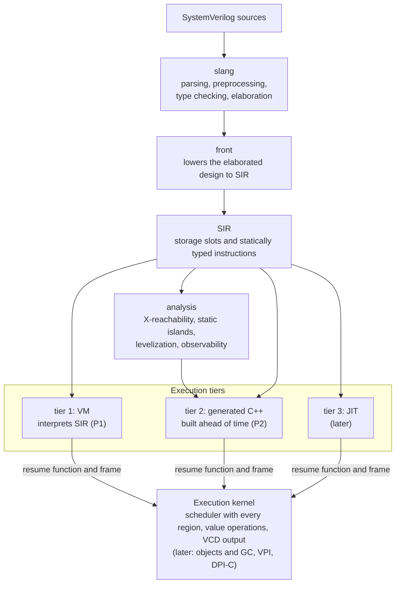

# kirimasim

[日本語](README.ja.md)

kirimasim is an open-source SystemVerilog simulator in early development.
Its goal is a simulator that does not give up any of the following:

- **Four-state values** (0, 1, X, Z) by default, with no optimization that
  changes four-state meaning.
- **Scheduling as IEEE 1800-2023 defines it**, with every region of the
  time slot and the standard's reference algorithm.
- **Practical speed**, by running two-state code whenever it can be shown
  or checked at run time that no X or Z is present.

**Most of the code is generated by AI (Claude Code); humans are responsible
for the specification, the tests, and review.** See
[docs/spec/AI_POLICY.md](docs/spec/AI_POLICY.md) and
[CONTRIBUTING.md](CONTRIBUTING.md).

## Status (2026-10-23)

> **Early development: not for real projects yet.** kirimasim simulates a
> broad subset of SystemVerilog for RTL and simple testbenches with its
> first execution tier, an interpreter that for now runs SIR directly
> (compiling SIR to bytecode comes later). Classes, dynamic arrays,
> queues, constrained randomization, concurrent assertions, VPI and DPI-C
> are not there yet. Tier 1 has had performance and memory fixes; C++
> generation is planned for P2. Anything kirimasim does not
> support yet stops the run with an "unsupported" error at its source
> position; it is never skipped silently.

### Phases

| Phase | Content | Status |
| --- | --- | --- |
| P0 | Groundwork: build, CI, detailed specifications, test suite | Done |
| P1 | Front end to the intermediate representation (SIR), the execution kernel with the full IEEE 1800-2023 scheduler, and tier 1 (an interpreter of SIR) for RTL and simple testbenches | **In progress** |
| P2 | Tier 2: SIR compiled ahead of time to C++, for speed | Planned |
| P3 | Testbench features: classes, dynamic data, constrained randomization, concurrent assertions and coverage, clocking blocks and programs, VPI, DPI-C | Planned |
| P4 | Switch-level primitives, multithreaded execution, a library to embed kirimasim in other simulators | Planned |

### P1 exit criteria

The criteria and how they are measured are fixed in
[docs/spec/TEST_SUITE.md](docs/spec/TEST_SUITE.md).

<!-- counts:begin -->
<!-- Written by tools/readme_counts.py from docs/counts.json; do not edit by hand. -->

| Criterion | Now | Met |
| --- | --- | --- |
| [sv-tests](https://github.com/chipsalliance/sv-tests) simulation tests (pinned commit, hand-written tests, 344): at least as many as Icarus Verilog, on Linux and on macOS | Linux: kirimasim 213, Icarus Verilog 211; macOS: kirimasim 213, Icarus Verilog 210 (14.0 devel, 04cc493, the build the criterion uses, built on each) | Yes |
| kirimasim's own RTL test population (1,466 tests, fixed list): 90% pass | 1,451 pass (99.0%), 0 fail; 15 stop at constructs of later work | Yes |
| The mandatory test list (except the one that needs P3) | All pass | Yes |
| No disagreement between the fast value operations and the reference implementation (`valsem`): seven nightly fuzz runs in a row with 100 times the rounds | The nightly fuzz runs passed on 5 nights in a row, through 2026-10-21 | Not yet |

kirimasim's numbers were measured on 2026-10-22; Icarus Verilog's and Verilator's in the last two columns on 2026-10-17, from their main branches that day. The nightly run measures sv-tests and the population again, and fails when they differ from these.

| Test set | Tests | kirimasim | Icarus Verilog | Verilator |
| --- | --- | --- | --- | --- |
| This repository's tests (CTest, dev configuration) | 1,322 | 1,320, 2 skipped | — | — |
| [sv-tests](https://github.com/chipsalliance/sv-tests) simulation tests | 344 | 213 | 213 | 321 |
| Own test suite, P1 population | 1,466 | 1,451 | 1,274 | 1,329 |

This repository's tests by kind: unit tests (GoogleTest) 176, `tests/suite/` 986 (made by 109 generators under `tools/`), tools 113, `tests/dump_sir/` 29, state and Contexts 15, command line and event counts 3.
<!-- counts:end -->

Most of the sv-tests gap is in chapters 7, 8 and 16: dynamic arrays,
queues, associative arrays and classes (P3), and concurrent assertions
(P3). The own test suite is kept in a
separate repository, [kirimasim-tests](https://github.com/kurochan001/kirimasim-tests).

### Test results

The counts are in the tables under [P1 exit criteria](#p1-exit-criteria). In
the release configuration, CTest has one test more: the run to the default
of `--max-slot-events`.

The two skipped tests of this repository need clocking blocks (P3), or
drivers that meet through a port between parts of nets (not supported
yet). Verilator leads sv-tests by far. Most of the gap is dynamic arrays,
queues, associative arrays, classes and UVM, which kirimasim leaves to P3;
`randsequence` comes next.

The own test suite was written together with kirimasim, so it is not a
neutral comparison. Each test was checked against the clauses of the
standard it cites, and its expected output matches Icarus Verilog 13.0, or
Verilator 5.052 for the tests that Icarus Verilog 13.0 cannot compile; a
few follow the standard where neither does. kirimasim is judged by the rule of the
P1 criterion (output, exit code and kirimasim's own messages), the others
by their output only, with the suite's runners. Verilator is a two-state
simulator, so tests that show x or z values fail with it.

**Time** (summed over the tests; 6 tests at a time; one run, not the
median of five that [PERFORMANCE.md](docs/spec/PERFORMANCE.md) asks for
benchmarks).

> **Why Verilator is not in these tables.** Each test suite's runner builds
> every test in a directory of its own, so Verilator compiles its own
> runtime library again for every test: about 2.2 s of the 2.6 s C++ build
> of a small test. A project builds that library once, so Verilator's times
> here would mostly measure the rebuilding, not Verilator, and next to
> kirimasim's they would read as a speed comparison that they are not. The
> tests are also too short to compare the speed of simulation;
> [Simulation speed](#simulation-speed) compares the three simulators.

| Test set | Simulator | Build step | Run step | Total |
| --- | --- | --- | --- | --- |
| sv-tests, 344 | kirimasim | 6.6 s | 0.1 s | 6.7 s |
| | Icarus Verilog | 5.0 s | 33.3 s | 38.3 s |
| | Verilator | — | — | not listed (see above) |
| Own test suite, 1,466 | kirimasim | 14.1 s | 0.3 s | 14.4 s |
| | Icarus Verilog | 20.8 s | 8.9 s | 29.7 s |
| | Verilator | — | — | not listed (see above) |

Only the tests that all three simulators pass, from the same runs: 150
tests of sv-tests (38 of them must be rejected, so they have no run step)
and 1,133 of the own test suite.

| Test set | Simulator | Build step | Run step | Total |
| --- | --- | --- | --- | --- |
| sv-tests, 150 | kirimasim | 1.4 s | 0.1 s | 1.5 s |
| | Icarus Verilog | 2.3 s | 20.9 s | 23.2 s |
| | Verilator | — | — | not listed (see above) |
| Own test suite, 1,133 | kirimasim | 10.8 s | 0.2 s | 11.0 s |
| | Icarus Verilog | 16.1 s | 7.9 s | 24.0 s |
| | Verilator | — | — | not listed (see above) |

- The build step is the work before the simulation starts: for kirimasim,
  reading, elaborating and lowering the design to SIR (timed as a run with
  `--dump-sir`); for Icarus, `iverilog`. The run step is the simulation:
  for kirimasim, its whole run less the build step; for Icarus, `vvp`.
- The tests are short, so the run steps mostly measure starting up.
  kirimasim's run step is found by subtraction and is too small to tell
  apart from noise; the run with `--dump-sir` also prints the SIR, so the
  subtraction errs on the small side.
- On this machine, the first start of a newly built program took about
  0.2 s, and the next start of the same file under 0.01 s (tried with three
  files that Icarus made; why macOS takes that time is not confirmed).
  Icarus's run step in sv-tests is such a first start, since its runner
  starts the compiled file itself; the own suite's runner starts `vvp` with
  the file instead.
- In the first table, a test that a simulator cannot build counts with its
  build step only; kirimasim stops early at an unsupported construct.
- Versions and machine: kirimasim 8500bdc (release build) for the times;
  Icarus Verilog 14.0 (devel) f190dbb, Verilator 5.053 devel
  8668340; Apple M5 Max (18 cores), 128 GB, macOS 27.0.1, Apple clang 21.

<details>
<summary>This repository's tests by kind</summary>

The counts of each kind are under [P1 exit criteria](#p1-exit-criteria).

| Kind | What they check |
| --- | --- |
| Unit tests (GoogleTest) | SIR and its verifier, the scheduler against a reference model, `valsem`, output formats, strengths, input scanning, time scales, UDP tables, counters, the Context, the kernel's fast operations against `valsem` (one word and any width), and more |
| `tests/suite/` | Simulation tests with expected output and illegal designs with the expected error, most of them made by the generators under `tools/`: procedures, scheduling, values, hierarchy, continuous assignments, nets, illegal designs, and others |
| `tests/dump_sir/` | The intermediate representation that the front end makes |
| State and Contexts | Six designs run one after another, at the same time on separate threads (with and without the front end) and on 100 Contexts in turn, each run compared with the run of its design alone (RUNTIME_ABI.md 9.8) |
| Tools | Each generator still makes the files in the repository, negative controls for the tools that judge tests, every mistake of `tools/mutants.py` still applies, and the benchmark designs still run |
| Command line, event counts | Options and messages, the matrix of unsupported constructs (each one reported with its position in every container), the format flags that the standard does not define, system calls that take a string first, `$finish` and `$stop` with their arguments, and the input options (`-f`, `--top`, `+incdir+`, `+define+`), loops that never advance time (stopped by `--max-slot-events`), SIGINT (on POSIX systems), calls of functions that schedule work after they return where 13.4.4 does not allow them, the positions of block statements in `--dump-sir`, writes to what `always_comb`, `always_latch` and `always_ff` write through tasks and through the actions of deferred assertions; the counts of a fixed run (PerfCount) |

</details>

<details>
<summary>sv-tests by chapter of IEEE 1800-2023</summary>

Pinned sv-tests commit 15490e9, hand-written tests whose type includes
simulation, judged by sv-tests' rules. Measured with `tools/svtests.py`:
kirimasim on 2026-10-22; the comparison builds of Icarus and Verilator on
2026-10-17, as named under Test results.

| Chapter | Tests | kirimasim | Icarus | Verilator | Where kirimasim stops |
| --- | --- | --- | --- | --- | --- |
| 5 Lexical conventions | 1 | 1 | 1 | 1 | |
| 6 Data types | 16 | 16 | 11 | 14 | |
| 7 Aggregate data types | 91 | 31 | 47 | 88 | dynamic arrays (23), queues (17) and associative arrays (14), all P3; tagged unions |
| 8 Classes | 15 | 9 | 12 | 12 | classes (P3) |
| 9 Processes | 6 | 4 | 4 | 6 | sequences (P3); one test depends on the order of processes at time 0, which 4.7 leaves open |
| 10 Assignment statements | 3 | 3 | 3 | 3 | |
| 11 Operators and expressions | 51 | 48 | 37 | 48 | tagged unions (2), streaming a dynamic array (P3) |
| 12 Procedural programming statements | 2 | 2 | 2 | 2 | |
| 13 Tasks and functions | 14 | 14 | 13 | 14 | |
| 14 Clocking blocks | 1 | 1 | 1 | 1 | |
| 15 Interprocess synchronization | 2 | 0 | 0 | 2 | mailboxes (P3) |
| 16 Assertions | 6 | 0 | 3 | 5 | concurrent assertions (P3) |
| 18 Constrained random value generation | 22 | 10 | 8 | 22 | `randsequence` (12) |
| 20 Utility system tasks and functions | 38 | 37 | 34 | 37 | `$coverage_control` |
| 21 I/O system tasks and functions | 27 | 26 | 25 | 26 | `$dumpports` |
| 22 Compiler directives | 6 | 6 | 6 | 6 | |
| 23 Modules and hierarchy | 1 | 1 | 1 | 1 | |
| 24 Programs | 1 | 0 | 1 | 1 | programs (P3) |
| 26 Packages | 1 | 1 | 1 | 1 | |
| UVM | 37 | 0 | 0 | 28 | the UVM library needs classes (P3) |
| UVM random | 3 | 3 | 3 | 3 | |
| **Total** | **344** | **213** | **213** | **321** | |

The P1 criterion uses the Icarus build that sv-tests pins (04cc493):
211 passes on Linux and 210 on macOS, against kirimasim's 213 on each.
The Icarus column above uses the comparison build f190dbb, which passed
213 on 2026-10-17.

</details>

<details>
<summary>Own test suite by chapter of IEEE 1800-2023</summary>

The P1 population of TEST_SUITE.md: 1,466 tests of the test suite,
listed in `tests/gates/p1_population.txt`. The suite itself is in
[kirimasim-tests](https://github.com/kurochan001/kirimasim-tests). The last column is where
kirimasim stops; it fails no test.

| Chapter | Tests | kirimasim | Icarus | Verilator | kirimasim stops at |
| --- | --- | --- | --- | --- | --- |
| 3 Design and verification building blocks | 3 | 3 | 1 | 3 | |
| 4 Scheduling semantics | 13 | 13 | 13 | 9 | |
| 5 Lexical conventions | 20 | 20 | 20 | 16 | |
| 6 Data types | 226 | 226 | 187 | 200 | |
| 7 Aggregate data types | 90 | 87 | 55 | 90 | dynamic arrays, associative arrays, `sort` (3, P3) |
| 9 Processes | 72 | 72 | 71 | 65 | |
| 10 Assignment statements | 84 | 84 | 77 | 81 | |
| 11 Operators and expressions | 347 | 347 | 309 | 312 | |
| 12 Procedural programming statements | 106 | 106 | 96 | 102 | |
| 13 Tasks and functions | 76 | 76 | 50 | 76 | |
| 15 Interprocess synchronization | 3 | 3 | 1 | 3 | |
| 16 Assertions | 21 | 18 | 16 | 19 | `$sampled`, `$stable` (3, P3) |
| 18 Constrained random value generation | 1 | 0 | 0 | 1 | `randsequence` (1) |
| 20 Utility system tasks and functions | 149 | 149 | 144 | 117 | |
| 21 I/O system tasks and functions | 57 | 57 | 56 | 52 | |
| 22 Compiler directives | 14 | 14 | 14 | 14 | |
| 23 Modules and hierarchy | 45 | 45 | 43 | 42 | |
| 25 Interfaces | 29 | 26 | 18 | 29 | virtual interfaces (3, P3) |
| 26 Packages | 20 | 20 | 16 | 20 | |
| 27 Generate constructs | 62 | 62 | 62 | 53 | |
| 28 Gate-level and switch-level modeling | 22 | 17 | 22 | 20 | MOS and bidirectional switches (5, P4) |
| 29 User-defined primitives | 6 | 6 | 3 | 5 | |
| **Total** | **1,466** | **1,451** | **1,274** | **1,329** | |

</details>

### Simulation speed

The comparison was measured on 2026-10-17 with `tools/bench.py` on the four
small designs under [bench/](bench/), the kinds that PERFORMANCE.md 5.2
asks for in P1.
Each design repeats its work the number of times given by `+n=` and prints
a checksum; all three simulators print the same. kirimasim's column was
measured again on 2026-10-20 at 08a0c3c.

| Design | What it does | `+n=` | kirimasim | Icarus Verilog | Verilator |
| --- | --- | --- | --- | --- | --- |
| `comb_chain` | 8 `always_comb` stages of 32-bit arithmetic; the inputs change every time step | 3,000,000 | 4.89 s | 7.97 s | 0.16 s |
| `nba_shift` | a 64-stage shift register and 16 accumulators in `always_ff`, all nonblocking | 1,000,000 | 11.23 s | 18.69 s | 0.16 s |
| `proc_wait` | 64 processes that wait with `#` and 64 that wait for a named event | 1,000,000 | 3.91 s | 4.93 s | 1.76 s |
| `fork_join` | four branches forked and joined in a loop, with `#`, `->` and `@` | 4,000,000 | 2.65 s | 4.14 s | 0.87 s |

- The times are of the simulation only: the median of five runs with the
  count, less the median of five runs with `+n=1`. Starting the program,
  reading the design and kirimasim's front end are in both runs and drop
  out; a run with `+n=1` took 3 to 8 ms. Each program started once before
  it was timed, so the first start of a newly built program is not in it.
  Building is not in it either: iverilog took 0.01 s per design, and
  Verilator 1.4 s with parallel build jobs.
- kirimasim and Icarus Verilog interpret the design with four-state
  values; Verilator compiles it to C++ and is two-state. kirimasim's
  counterpart to Verilator is tier 2, C++ generation, in P2. Tier 1 has had
  performance fixes. Verilator's lead is smallest where many processes
  wait (`proc_wait`, `fork_join`).
- Memory: a run used at most 11 MiB with kirimasim, 6 MiB with Icarus and
  2 MiB with Verilator. Before 072d0c2, which releases the records of
  finished processes (SCHEDULER_SPEC.md 10.8), kirimasim kept them all and
  used 4,947 MiB on `fork_join`.
- The versions and the machine are the same as in the test results above,
  but kirimasim's column was measured again on 2026-10-20 at 08a0c3c. It
  was 5 to 14% slower than at 394717f (4.53, 10.69, 3.46 and 2.33 s). At
  cd422c8 it was 20 to 31% slower; most of that came from a check of the
  width of every instruction's operands and from the layout of the check
  of the Postponed region, both fixed since. The rest is spread over
  later changes that made the run correct (#28).
  `tools/bench.py` repeats the measurement; `--n` and `--runs` make it
  quick.
- On 2026-10-22, the process-reclamation change e5e0d70 reduced
  `fork_join` from 2.802 s to 2.758 s (about 1.6%) in five interleaved
  before/after runs on the same machine. `comb_chain` and `nba_shift`
  changed by less than 1%. A comparison for `proc_wait` is not confirmed:
  both builds' times varied widely; repeat the runs with the machine idle.
  The performance issue #28 remains open. The table keeps the dated
  three-simulator comparison above.
- The nightly workflow measures kirimasim on Linux each night and puts a
  warning in its summary when a time or the memory is 15% worse, or the
  build 25% slower, than the median of the last seven nights
  (PERFORMANCE.md 5.1). It fails nothing: shared runners swing widely.

### What works

Everything below runs on the tier 1 interpreter and is covered by tests.

- **Design structure:** modules, ports (input, output, inout), parameters
  and `defparam`, `generate`, arrays of instances, interfaces and modports,
  packages and the compilation unit (`$unit`), hierarchical names,
  specparams.
- **Data types:** two-state and four-state integral types of any width,
  `real`, `shortreal`, `realtime`, `string`, enumerations, packed and
  unpacked structures, packed unions, fixed-size unpacked arrays (several
  dimensions, arrays of structures), unpacked array parameters, named
  events, `chandle` (null only, until DPI-C).
- **Enumeration methods:** `first`, `last`, `num`, `name`, `next` and
  `prev`; `next(n)` and `prev(n)` also accept counts evaluated at run time.
- **Nets:** `wire`, `tri`, `wand`, `wor`, `tri0`, `tri1`, `supply0`,
  `supply1`, `uwire`; drive strengths and resolution of several drivers;
  continuous assignment and net delays (rise, fall, turn-off); built-in gates
  and pulls; user-defined primitives (combinational and sequential);
  `alias`.
- **Procedures and timing:** `initial`, `always`, `always_comb`,
  `always_latch`, `always_ff`, `final`; blocking and nonblocking assignments
  with intra-assignment delays; delay and event controls on signals and on
  expressions, with `iff`; `wait (expr)`; named events (`->`, `->>`,
  `.triggered`); `fork` with `join`, `join_any` and `join_none`; `wait
  fork`, `disable fork`; `disable` of blocks and tasks in every process;
  `assign`/`deassign` and `force`/`release`.
- **Functions and tasks:** static and automatic, recursion, `input`,
  `output`, `inout` and `ref` arguments, default argument values, unpacked
  structures and arrays as arguments, functions returning unpacked
  structures and arrays.
- **Statements and expressions:** `if`, `case`, `casez`, `casex`,
  `case inside`, `randcase`; `unique`, `unique0` and `priority` with their violation
  reports; every loop (including `for (;;)`), `break`, `continue`, `return`; all operators
  including streaming, `inside`, wildcard equality, assignment operators and
  increments; assignment patterns.
- **Streaming assignments:** unpacking into targets wider than 64 bits,
  including fixed-size arrays and structures, with `>>` and `<<` block
  ordering, blocking assignments and NBAs.
- **Assertions:** immediate `assert`, `assume` and `cover`, and deferred
  ones (`#0`, `final`).
- **System tasks and functions:** `$display` and `$write` (with the `b`,
  `o`, `h` forms), `$strobe`, `$monitor`, `$monitoron`, `$monitoroff`,
  `$sformat`, `$sformatf`, `$swrite`, `$sscanf`, `$time`, `$realtime`, `$timeformat`, `$printtimescale`, `$finish`, `$stop`,
  `$fatal`, `$error`, `$warning`, `$info`, `$stime`, `$timeunit`,
  `$timeprecision`, the `%m` and `%l` formats, conversions (`$rtoi`, `$itor`,
  `$realtobits` and the like, `$signed`, `$unsigned`), `$bits`, `$typename`,
  the array queries, `$clog2` and the real math functions, `$countbits`,
  `$countones`, `$onehot`, `$onehot0`, `$isunknown`, `$test$plusargs`,
  `$value$plusargs`; file output (`$fopen`, `$fclose`, `$fflush`,
  `$fdisplay`, `$fwrite`, `$fstrobe`, `$fmonitor`, with the `b`, `o`, `h`
  forms) and file input (`$fgetc`, `$ungetc`, `$fgets`, `$fscanf`,
  `$fread`, `$ftell`, `$fseek`, `$rewind`, `$feof`, `$ferror`, and STDIN);
  `$readmemb`, `$readmemh`, `$writememb` and `$writememh`; `$random` and
  the `$dist_*` functions, with the values of Annex N; `$urandom` and
  `$urandom_range`, with a generator of each process seeded from
  `--seed`; `$stacktrace`.
- **Waveforms:** 4-state VCD from `$dumpfile`, `$dumpvars`, `$dumpoff`,
  `$dumpon`, `$dumpall`, `$dumplimit` and `$dumpflush`, or from
  `--wave=<file>.vcd` with `--wave-scope` and `--wave-glitches`.
- **Scheduling:** every region of the IEEE 1800-2023 time slot with the
  reference algorithm, including pending reports confirmed in the Observed
  region and `$strobe`/`$monitor` in the Postponed region.

### What does not work yet

| Not yet | Planned |
| --- | --- |
| FST waveforms, the `%p` format, `%v` with resolved strengths, formats known only at run time (`$sformat`, `$sformatf`, `$sscanf`, `$value$plusargs`), `$fread` into structures with array or real members | P1 |
| Classes, dynamic arrays, queues, associative arrays, randomization and constraints, covergroups, concurrent assertions and `$sampled`/`$stable`, clocking blocks, virtual interfaces, `let` | P3 |
| Program blocks: reported as unsupported, since their code belongs in the reactive region set (24.3.1) | P3 |
| VPI, DPI-C | P3 |
| Tier 2 (C++ generation) and further RTL speed optimizations | P2 |
| MOS and bidirectional switches | P4 |

### Not planned for now

The design leaves these out of its scope for now. kirimasim reports them
as unsupported where it meets them, and tests that use them are left out
of the P1 population (TEST_SUITE.md, "90% of our own tests").

- VHDL and designs in mixed languages; analog and mixed-signal designs
- SDF back-annotation (`$sdf_annotate`), annotation of gate delays, and
  encrypted IP
- specify blocks with module paths or timing checks (a specify block with
  only specparams works), user-defined nettypes and `interconnect`, and
  `trireg`
- the old PLI (`tf_` and `acc_` routines)
- library map files (33.3); a config in the sources gives the top
  (CLI.md 2.1)
- checkers and `randsequence`, to be considered later
- an interactive debugger and a Python API of its own: waveforms use
  external viewers (VCD now, FST planned), and Python access is planned
  through cocotb over VPI (P3)

## Building

Requirements: CMake 3.28 or later, Ninja, Python 3.10 or later, and a C++23
compiler: GCC 13 or later; Clang 18 or later with libc++ 18 or later, or
Clang 19 or later with libstdc++ 13 or later; or Apple clang 17 or later
(Xcode 26). With libstdc++, Clang 17 and 18 cannot build slang as C++23. On
every push CI builds and tests with each of these oldest versions, and with
Clang 22 on x86-64 Linux and Apple clang 21 on arm64 macOS; kirimasim is
developed with Apple clang 21 on macOS arm64.
The first configure downloads slang and GoogleTest.

kirimasim is written in C++23 and uses no C++26 feature. It moves to C++26
once the compilers above all support it; until then the nightly runs build
and test it as C++26 too.

```sh
cmake --preset dev            # also: release, asan, ubsan
cmake --build --preset dev
ctest --preset dev
```

| Preset | Flags |
| --- | --- |
| `dev` | `-O1 -g` |
| `release` | `-O3` |
| `asan` | `-O1 -g -fsanitize=address -fno-omit-frame-pointer`; slang built without mimalloc, so that the sanitizer sees the heap |
| `ubsan` | `-O1 -g -fsanitize=undefined -fno-sanitize-recover=all` |
| `tsan` | `-O1 -g -fsanitize=thread`; slang built without mimalloc; builds and runs only the tests of state and Contexts |

Each preset builds into `build/<preset>/`.

## Usage

```sh
kirimasim [options] <file>... [+plusarg]...   # elaborate and simulate
kirimasim parse [options] <file>...            # parse and elaborate only
kirimasim --version
```

An example, `counter.sv`:

```systemverilog
module counter(input logic clk, rst, output logic [3:0] q);
  always_ff @(posedge clk)
    if (rst) q <= '0;
    else q <= q + 1;
endmodule

module top;
  logic clk = 0, rst = 1;
  logic [3:0] q;
  counter dut(.clk, .rst, .q);
  always #5 clk = ~clk;
  initial begin
    $monitor("%0t: rst=%b q=%0d", $time, rst, q);
    #12 rst = 0;
    #40 $finish;
  end
endmodule
```

```text
$ build/dev/src/driver/kirimasim counter.sv
kirimasim: info: kirimasim 0.0.0 (commit ...) seed=0 args: counter.sv
0: rst=1 q=x
5: rst=1 q=0
12: rst=0 q=0
15: rst=0 q=1
25: rst=0 q=2
35: rst=0 q=3
45: rst=0 q=4
counter.sv:15: $finish at 52 ns
kirimasim: info: finish at 52 ns
```

The design's output goes to standard output; kirimasim's own messages and
the messages of `$error` and its relatives go to standard error.

Options available now:

| Option | Meaning |
| --- | --- |
| `-f <file>`, `+incdir+<dir>`, `+define+<name>[=<value>]`, `--top=<name>` | Sources, include directories, macros, the top module |
| `--timescale=<unit>/<precision>` | The time scale of design elements that give none (default `1ns/1ns`) |
| `--max-time=<time>`, `--max-time-ok` | Stop at a simulation time; exit code 0 instead of 4 |
| `--max-zero-delay=<n>`, `--max-slot-events=<n>`, `--max-steps=<n>` | Limits on runs that do not advance time (`--max-scc-iter=<n>` is accepted, but has no effect until tier 2 in P2) |
| `--max-call-depth=<n>` | Limit nested calls (default 10000); exceeding the limit ends with exit code 6 |
| `--seed=<n>` | Seed for `$urandom`, `$urandom_range` and `randcase` (default 0) |
| `--mintypmax=min\|typ\|max` | Select the minimum, typical or maximum expression of `min:typ:max` delays (default `typ`) |
| `--wave=<file>.vcd`, `--wave-scope=<pattern>[,<pattern>...]`, `--wave-glitches` | Write VCD, choose scopes, and include changes within a time slot |
| `--dump-sir` | Print the intermediate representation instead of simulating |
| `--stats=json` | Print counters of the run as JSON |
| `+<name>[=<value>]` | Plusargs for `$test$plusargs` and `$value$plusargs` |

Exit codes: 0 for `$finish`, `$stop` or no more events; 1 for `$fatal`; 2
for an error in the input, including an unsupported construct, or a
run-time error of the design; 3 for an internal error; 4 when `--max-time`
is reached; 5 when a zero-time limit is reached; 6 for excessive call
depth or insufficient stack space;
130 when SIGINT (Ctrl-C) stops the run. The full command line is
in [docs/spec/CLI.md](docs/spec/CLI.md).

## How it works



[slang](https://github.com/MikePopoloski/slang) is used unmodified, pinned
to one commit. Every tier registers its processes with one execution
kernel, which owns the scheduler and the value operations, so processes of
different tiers can run together and a difference between tiers shows up
as a difference in output. See [docs/ARCHITECTURE.md](docs/ARCHITECTURE.md).

## How it is tested

- **Specifications first.** The meaning of values, scheduling, system tasks
  and SIR is written down in [docs/spec/](docs/spec/) and approved by a
  human before it is implemented. Where the standard leaves something open,
  the specification says which reading kirimasim takes.
- **One reference for value semantics.** `valsem` is a slow but obviously
  correct implementation of the operators; the kernel's fast operations are
  fuzzed against it (one-word and multi-word values). The nightly workflow
  runs the one-word and scheduler cross-checks at 100 times the normal
  rounds, and now has a separate step at the same scale for values of
  1 to 260 bits. Local runs of both steps passed on 2026-10-22; they do
  not add to the consecutive-night count of the P1 criterion.
- **Mechanism matrices.** Each mechanism is tested across the places it can
  occur (for example, a `disable` from inside the block, a fork branch,
  another process or a task, in procedures, tasks and fork branches) by test
  generators under `tools/` whose expected output follows from the written
  rules. The counts are under [P1 exit criteria](#p1-exit-criteria).
- **Negative controls.** `tools/mutants.py` plants known mistakes in the
  code, one at a time; every one of them must make some test fail.
- **Other simulators as evidence, not as the truth.** Icarus Verilog and
  Verilator are run on the tests; where they differ from the standard, the
  test header says so.
- **Sanitizers and static checks:** AddressSanitizer, UndefinedBehavior
  Sanitizer, clang-format and clang-tidy run before every push, and CI runs
  them again on Linux (the sanitizers built with GCC) and on macOS. CI also
  runs the tests of state and Contexts under ThreadSanitizer, and checks
  that `src/` holds no global state but the listed exceptions
  (RUNTIME_ABI.md 9).

## Contributions: specification proposals and issues only, for now

kirimasim is in early development, so for now it accepts **specification
proposals and issues only**. It does not accept pull requests: they are
turned off for this repository, so none can be opened. Use the issue forms
to propose a change to a specification under `docs/spec/`, report a bug, or
point out a wrong expected value, and use
[Discussions](https://github.com/kurochan001/kirimasim/discussions) for
questions (Q&A) and early ideas (Ideas). When the project starts accepting
more, this section and [CONTRIBUTING.md](CONTRIBUTING.md) will say so.

## Documentation

Every document is written in English, with a Japanese version beside it
(`X.ja.md` next to `X.md`), except the changelog, the licence, and the
GitHub issue forms. Where the two differ, the English text
holds.

| Document | Content |
| --- | --- |
| [docs/ARCHITECTURE.md](docs/ARCHITECTURE.md) | Library layout and the execution model |
| [docs/spec/VALUE_SEMANTICS.md](docs/spec/VALUE_SEMANTICS.md) | Values, operators, nets, strengths, gates and UDPs |
| [docs/spec/SCHEDULER_SPEC.md](docs/spec/SCHEDULER_SPEC.md) | The time slot, regions, waits, processes, disable, pending reports |
| [docs/spec/UNSPECIFIED_BEHAVIOR.md](docs/spec/UNSPECIFIED_BEHAVIOR.md) | What kirimasim does where the standard leaves the result open |
| [docs/spec/SIR_SPEC.md](docs/spec/SIR_SPEC.md) | The intermediate representation |
| [docs/spec/SYSTEM_TASKS.md](docs/spec/SYSTEM_TASKS.md) | System tasks and functions, message formats |
| [docs/spec/WAVEFORM.md](docs/spec/WAVEFORM.md) | Waveforms: the VCD file, `$dump*` and `--wave` |
| [docs/spec/CLI.md](docs/spec/CLI.md) | Command line, exit codes |
| [docs/spec/TEST_SUITE.md](docs/spec/TEST_SUITE.md) | Test rules, the P1 exit criteria |
| [docs/spec/RUNTIME_ABI.md](docs/spec/RUNTIME_ABI.md) | The boundary between the kernel and the tiers |
| [docs/spec/PERFORMANCE.md](docs/spec/PERFORMANCE.md) | Performance goals and counters |
| [docs/spec/AI_POLICY.md](docs/spec/AI_POLICY.md) | How AI is used in this project |
| [docs/spec/CODEGEN_SPEC.md](docs/spec/CODEGEN_SPEC.md) | Tier 2, C++ generation (P2): floating point and the first rules so far |
| [docs/spec/RANDOMIZE_SPEC.md](docs/spec/RANDOMIZE_SPEC.md), [ASSERTION_COVERAGE_SPEC.md](docs/spec/ASSERTION_COVERAGE_SPEC.md), [LIB_EXPORT_SPEC.md](docs/spec/LIB_EXPORT_SPEC.md), [VPI_SPEC.md](docs/spec/VPI_SPEC.md) | Constrained randomization, assertions and coverage, DPI library output, VPI: headings only so far |
| [CONTRIBUTING.md](CONTRIBUTING.md) | How to contribute |
| [CHANGELOG.md](CHANGELOG.md) | Changes |

## Glossary

Terms used in this README and in [docs/](docs/). The Japanese README has
the same table with the Japanese terms.

**Structure**

| Term | Meaning |
| --- | --- |
| slang | The SystemVerilog front end library (parsing, elaboration, type checks) that kirimasim uses unmodified, pinned to one commit |
| elaboration | Building the design's instance tree, parameters and types from the sources; slang does it |
| `front` | kirimasim's library that runs slang and lowers its result to SIR |
| lowering | Turning slang's elaborated design into SIR instructions |
| SIR | kirimasim's intermediate representation: storage slots and statically typed instructions, the same whichever tier runs it ([SIR_SPEC.md](docs/spec/SIR_SPEC.md)) |
| `valsem` | The reference implementation of value semantics: slow, one bit at a time, and obviously correct. It decides what the operators, edges and case matches mean; every fast version is tested against it |
| kernel | The execution kernel shared by every tier: scheduler, value operations and VCD output; later VPI and DPI-C. It is linked with the user's design, so it depends on neither slang nor LLVM |
| tier 1 / VM | The interpreter of tier 1 (P1). For now it runs SIR directly; compiling SIR to register-based bytecode comes later |
| tier 2 | C++ generated from SIR and built ahead of time, for speed (P2) |
| Context | The object that owns one simulation's run-time state; independent Contexts can run concurrently |
| `analysis` | Analyses for tier 2 (P2): X-reachability (where x can never arrive, so values can stay two-state), static islands, levelization (ordering combinational logic by dependence) and observability (what VPI or force can see, which must not be folded away) |
| static island | A part of the design that tier 2 is to compile as one block for speed (P2; the first rules are in CODEGEN_SPEC.md) |
| slot | A place in the kernel's store for a static variable, a net or an array of them |
| frame / frame variable | The storage of a process's or a subroutine call's automatic variables |
| W4 | The kernel's four-state 64-bit word: two planes a and b; 0 is a=0 b=0, 1 is a=1 b=0, z is a=0 b=1, x is a=1 b=1 |
| chunk | One W4 of a value wider than 64 bits, least significant first |
| P0 to P4 | The project's phases (see Phases above) |

**Values**

| Term | Meaning |
| --- | --- |
| four-state / two-state | Types whose bits can be 0, 1, x or z (`logic`, `integer`) or only 0 and 1 (`bit`, `int`); a two-state target turns x and z into 0 |
| x / z | The unknown value and the high-impedance value of a bit |
| strength | How strongly a driver drives a net (supply, strong, pull, weak, ...), used when several drivers meet |
| resolution | Working out a net's value from all its drivers and their strengths ([VALUE_SEMANTICS.md](docs/spec/VALUE_SEMANTICS.md) 5) |
| wired logic | Nets that combine their drivers with AND or OR (`wand`, `wor`) |
| side slot | A two-state slot that a gate writes beside its output: which output bits it drives on its 1 side and on its 0 side, for resolution |
| UDP | User-defined primitive: a gate described by a truth table (`primitive`) |
| override process | The process that holds a procedural continuous assignment (`assign`, `force`) |

**Scheduling**

| Term | Meaning |
| --- | --- |
| time slot | Everything that happens at one simulation time |
| region | One of the 17 queues of a time slot that the standard runs in a fixed order (Active, Inactive, NBA, Observed, Reactive, Postponed and others; [SCHEDULER_SPEC.md](docs/spec/SCHEDULER_SPEC.md) 2) |
| active / reactive region set | The regions that run design code (Active, Inactive, NBA) and those that run program and checker code (Reactive, Re-Inactive, Re-NBA) |
| NBA | Nonblocking assignment (`<=`): its update happens later, in the NBA region |
| subscription | A process waiting for changes of some bits of a slot |
| monitor record | A kernel record that re-evaluates an expression when what it reads changes (`wait (...)`, event controls on expressions) |
| held report / flush point | A unique or priority violation or a deferred assertion is held until the Observed region and dropped if its process resumes from an event control first (the flush point) |
| deferred immediate assertion | `assert #0` or `assert final`: its action runs only once the time slot settles |
| static-init process | The process that sets static variables' initial values before time 0's procedures start |
| quiescent | The end of a run because no event is left |
| zero-time limit | The end of a run because time stopped advancing past a limit (`--max-steps`, `--max-zero-delay`, `--max-slot-events`) |
| record release | Giving back the memory of finished processes ([SCHEDULER_SPEC.md](docs/spec/SCHEDULER_SPEC.md) 10.8) |

**Testing and the way of working**

| Term | Meaning |
| --- | --- |
| unsupported | A construct kirimasim does not implement yet: it stops with its position and exit code 2, never runs it some other way |
| mechanism matrix | A test that a generator makes over the axes of one mechanism (places, ways of reading and writing, spellings, containers), so that a fix covers the neighbors of a bug, not only its own shape |
| generator | A script `tools/gen_*.py` that writes a mechanism matrix and its expected output from the written rules; `--check` tells whether the committed files are up to date |
| container | Where a statement runs: a module procedure, a task, a function, a fork branch, an interface, a generate block, a package; a statement means the same in all of them |
| mutant / negative control | A known mistake that `tools/mutants.py` plants in the code, one at a time, to prove that some test catches it. After each one the code is built and every test runs: the mutant is *caught* when some test fails, and *survives* when none does, which shows a hole in the tests. The code is put back each time. The nightly workflow runs every mutant |
| PerfCount | Regression tests on event counters (not on time), against `tests/perf_counts/expected.json` |
| `--stats=json` | The option that prints those counters |
| oracle | Where a test's expected output comes from (`:oracle:` in its header: the standard, or a named simulator as evidence) |
| `:spec_check:` | Who checked a test against the standard: `ai` (Claude Code) or `human` |
| P1 population | The fixed list of 1,466 tests of the own test suite that the P1 criterion counts |
| mandatory tests | A fixed list of tests that must not fail, apart from any pass rate (TEST_SUITE.md); for P1, all but the one that needs P3 must pass |
| sv-tests | The CHIPS Alliance's public SystemVerilog test collection |
| Icarus Verilog, Verilator | Other open-source simulators, run for comparison and as evidence, not as the truth |
| DPI-C / VPI | The standard interfaces to C code and to tools (P3) |
| FST | A compact waveform file format (later) |
| checked, rule of this document, interpretation, not confirmed | The notes the specifications put on their statements: "checked", read and confirmed in a clause of the standard; "rule of this document", kirimasim's own choice where the standard leaves it to the implementation; "interpretation", how kirimasim reads text that allows two readings; "not confirmed", not checked yet, with how to check it |

## FAQ

### Can I use kirimasim on my project now?

Not yet. It is in early development (P1): its first tier, an interpreter,
runs RTL and simple testbenches, and [What works](#what-works) and
[What does not work yet](#what-does-not-work-yet) say how far it goes. You
can try it on your design: anything it does not support yet stops the run
with an error at its source position.

### Why does it stop at an unsupported construct instead of skipping it?

A simulator that skips what it does not understand prints results that
look right and are not. kirimasim reports every unsupported construct with
its position and exits with code 2 before the simulation starts
([CLI.md](docs/spec/CLI.md) 5).

### How does it differ from Icarus Verilog and Verilator?

In two points of focus: four-state values by default, with no optimization
that changes their meaning, and the scheduling of IEEE 1800-2023 with every
region of the time slot. Both simulators are run on kirimasim's tests as
evidence, but the expected results come from the standard
([How it is tested](#how-it-is-tested)). Verilator compiles the design to
C++ with two-state values and is far faster today
([Simulation speed](#simulation-speed)); kirimasim's tier 2 (P2) will
compile to C++ too.

### Does it run UVM?

Not yet. UVM needs classes, dynamic arrays, queues and constrained
randomization, which are planned for P3. UVM is then to run as ordinary
SystemVerilog source, with no special handling of its classes.

### Can it write waveforms?

Yes, as 4-state VCD: from the design's `$dumpvars`, or from the command
line with `--wave=<file>.vcd` (WAVEFORM.md). FST waits for a decision on a
new dependency.

### Which platforms does it run on?

It is developed on macOS (arm64), and CI builds and tests it on x86-64
Linux and arm64 macOS, also with the oldest compilers it supports (see
[Building](#building)); the nightly runs also build it on arm64 Linux, with
GCC 16 and with Clang 23, and as C++26. Windows is not tested.

### Is slang modified?

No. kirimasim uses [slang](https://github.com/MikePopoloski/slang)
unmodified for parsing and elaboration, pinned to one commit. Bugs found in
slang are reported upstream, and kirimasim works around them until the
pinned commit has the fix ([SIR_SPEC.md](docs/spec/SIR_SPEC.md) 6).

### Is the code written by AI?

Most of it, by Claude Code. Humans are responsible for the specifications,
the tests and the review; [AI_POLICY.md](docs/spec/AI_POLICY.md) explains
how AI is used.

### How can I help?

For now, with issues: bug reports, wrong expected values, and proposals for
the specifications under `docs/spec/`. Questions and ideas go to
[Discussions](https://github.com/kurochan001/kirimasim/discussions). Pull
requests are not accepted: they are turned off for this repository
([Contributions](#contributions-specification-proposals-and-issues-only-for-now)).

## License

kirimasim is licensed under the Apache License 2.0 with LLVM Exceptions
(`Apache-2.0 WITH LLVM-exception`). See [LICENSE](LICENSE) and
[THIRD_PARTY_NOTICES.md](THIRD_PARTY_NOTICES.md).

Every file in this repository is under that licence unless it says
otherwise; each file of code says so in an SPDX line at its top. "The
kirimasim Authors", whom those files name, are the people who have
contributed to kirimasim, as its commit history records.
