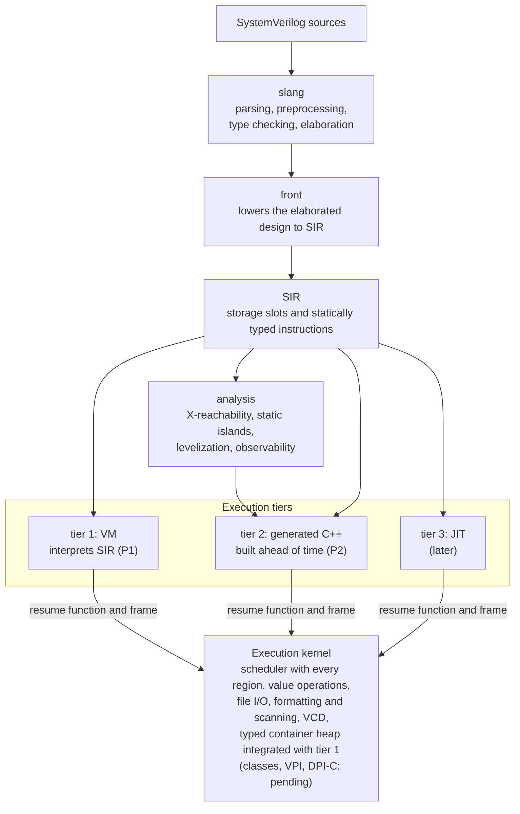
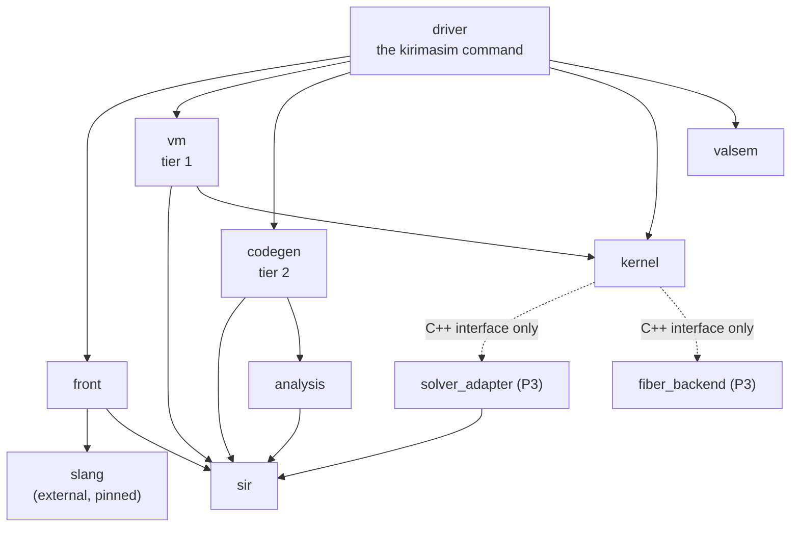

# kirimasim の構成

[English](ARCHITECTURE.md) · 英語版が正本で、これはその日本語版です。食い違ったときは英語版に従います。

これは短い概要です。詳細な仕様は [docs/spec/](spec/) にあります。

## 処理の流れ

処理は一方向に流れます。

slang は改変せず、1 つのコミットに固定したライブラリとして使います。修正は上流に送ります。

## 3 つの実行の層と、1 つのカーネル

2026-10-24時点では、第1層と共有カーネルが[P1の対応一覧](P1_SUPPORT.ja.md)の
範囲を実装しています。P1全体の機能範囲の目標は未達です。
第 2 層は P2 の予定で、第 3 層はその後です。以下の表と共通の実行の取り決めは、
将来の層を含めた設計全体を示します。

| 層 | 何か | 役割 |
| --- | --- | --- |
| 1：VM | SIR のインタプリタ。今は SIR を直接解釈し、SIR から作るレジスタ型のバイトコードは後で入れる | すべての機能を扱う、すぐに始まる、正しさの基準 |
| 2：C++ の生成 | SIR を前もって C++ にし、共有ライブラリとしてビルドする | RTL（静的な島と、合成できるプロセス）の速さ |
| 3：JIT | テストベンチの頻繁に動く関数を、実行時にコンパイルする | 後で。第 2 層の後に決める |

どの層も、プロセスを同じ形で**実行カーネル**に登録します。再開関数と、プロセスの状態（automatic な変数、再開の位置、待ちをまたいで生きる一時の値、保留している違反とアサーションの報告）を持つフレームです。待ちを含みうるタスクの呼び出しは、それにつながる呼び出しのフレームを足します。それ以外はすべてカーネルが持ちます。IEEE 1800-2023 のすべての領域を持つスケジューラ、値の演算、オブジェクトとガベージコレクション、VPI、DPI-C、波形、アサーション、カバレッジ、制約の解決です。カーネルからは層を見分けられないので、別々の層のプロセスを 1 つのシミュレーションの中で一緒に動かせます。層の間の違いは、同じテストの出力の違いとして現れます。

設計のもとにある考え：

- **名前ではなくスロット。** 信号と変数は平らな格納領域に置き、スロットの番号で指します。名前は、VPI、波形、診断のためだけに持ちます。
- **4 値の語。** 値は 64 ビットの `(a, b)` の語の組の配列で、ビットの意味は VPI の aval と bval と同じです（0 = (0,0)、1 = (1,0)、Z = (0,1)、X = (1,1)）。どの入力にも X と Z が無いときは、演算は 2 値の速い道を通ります。
- **静的な島ごとに 2 つの版。** X が無いことを静的に証明できないところでは、第 2 層は島の 4 値の版と 2 値の版を作り、実行時にどちらかを選びます。
- **意味の定義は 1 つ。** 各演算の意味は、`valsem`の遅い参照実装に定めます。整数演算は1ビットずつ計算し、コンテナの値は独立したセルのモデルを使います。速い版はそれと突き合わせてテストします。
- **大域の状態を持たない。** シミュレーションの状態はすべてコンテキストのオブジェクトに置くので、1 つのプロセスの中で複数のシミュレーションを動かせます。

## 型付きコンテナのヒープと第1層との接続

[承認済みの契約](notes/dynamic-containers-proposal.ja.md)は、SIR_SPEC 4.2.1と
RUNTIME_ABI 6に反映済みです。Contextはスロットと文字列に加えて、
[`Heap`](../src/kernel/include/kirimasim/kernel/heap.h)を持ちます。配置の記述子は語と
入れ子のコンテナへの辺を表し、slang・SIRに依存しません。空はトークン0、非空の
コンテナと安定した要素セルは世代付きトークンを使います。キューの移動は残るセルを
保ち、置換・削除で切り離したセルも参照から届く間は保ちます。値のコピーは独立した
要素を作り、入れ子のコンテナも深くコピーします。

確保はトランザクションを使い、失敗時は代入先を変える前に新しいオブジェクトを
巻き戻します。回収時は、先に確保した空き項目の格納域へ添字で戻します。コピーと
トレースは反復で行います。`Heap::collect`は明示したコンテナ・セルのルートをたどり、
到達不能な項目を世代を変えて再利用します。印付けに失敗すれば何も解放しません。
独立したモデル、確保失敗、深い入れ子、古いトークン、Context間の分離をテストします。

カーネルのAPIと型付きSIRの記述子・参照・命令、検証器・テキスト形式は実装済みです
（SIR_SPEC 5.8）。カーネルのコピーは入れ子の各段でコピー先の上限を適用し、
スナップショットは実際の元の型を保ちます。VMは型付きのオペランドをAPIへ写し、空でも
実際の対象型を保つ変数参照と、安定したトークンを持つセル参照を使います。
独自のSIRの24テストが実行・呼び出し・待機・エラーへの写像を検査します。
領域の処理完了後とスロットのarena解放後に、VMの実行中だけ登録するフックが
型付きスロット、生存中の実行フレーム、セル参照、遅延報告の引数、スケジューラの
保留値を公開します。通常の数値をハンドルとして解釈しません。
ヒープかルートの変化で回収し、マーキング失敗時は何も解放しません。
プロセス・guardの呼び出し中、終了要求後、final処理中は実行しません。
SSA一時値は待機をまたげません（SIR_SPEC 5.1）。クラス・DPI・VPIのルートは今後の実装です。
ヒープの読み取り・変更フックは要素列とセルの値を区別し、確定後に通知します。
スケジューラは読み取りを捕捉し、弱い型付きの依存先を付け直します。呼び出した関数の
私有コンテナは読み取り専用の到達性の問い合わせで除外します。共通の変更順序へ通知を
入れ、VMは次の命令へ進む前に変更を公開します。最後の待機解除で元のフックへ戻し、
インタプリタのフレーム破棄前にVMの待機を外します。
frontは[検証済みの言語範囲](P1_SUPPORT.ja.md#動的コンテナの共通基盤)で、型付きヒープ命令、
結び付きのref、値の捕捉・コピーを生成します。動的foreachの境界は待機をまたぐフレームへ置き、
次元クエリはコンテナの長さを使います。パターンの一時値は全要素を保持し、同値なref型を
通す場合も実際の変数へ代入するときに上限を適用します。残る言語の形と暗黙のヒープ感度は
位置付きで未対応と診断します。実行時の連結とキューの読み取りスライスは同じ型付きループを
使います。上限なしの一時キューへ要素を変換してから、実際の言語の代入先で上限を適用します。
スライスの正規化は広い符号なし添字を保ち、X/Zの範囲は通常の分岐規則で空になります。
コンテナ全体とIcarusの範囲への対応は未完了です。

## 代入値の保持と待機

frontは集約代入の右辺の全leafを保持してから、対象の実行時の添字を評価します。
コンテナのleafは捕捉時にスナップショットを作るので、後のフィールド式が先に保持した
値を変更しません。通常代入・即時NBA・遅延付きNBAは共通の変換を使い、実行時に
選ぶ固定の部分配列と構造体要素の配列メンバーにも対応します。既存のSIR命令で
承認済みの評価順を実現し、VM命令やカーネルのスケジューリング規則は追加していません。
[集約値の保持](notes/aggregate-value-capture.ja.md)を参照してください。

ブロッキング代入内の`repeat(count) @(...)`は、先に評価した右辺と型・幅を保った
回数をフレームに保持し、通常のSIRの待機をまたぎます。回数は1回だけ評価し、
非正数・X/Zなら待機を省きます。実際の代入先は待機後に選びます。SSA一時値自体は
待機をまたぎません。[繰り返しイベント制御](notes/repeated-event-controls.ja.md)を
参照してください。集約値全体も非公開の型付きフレームのスナップショットでブロッキングの
代入内制御をまたぎ、実際の添字を待機後に評価します。
[集約値の時間制御](notes/blocking-aggregate-timing.ja.md)も参照してください。
イベント制御付きNBAは未対応です。ブロッキングの繰り返し待機では、イベント制御付きNBAに必要な、発行元の
実行とは独立して保留される制御を実現していません。

[fork内の宣言](notes/fork-local-declarations.ja.md)は、実行する子を作る前に、親で既存の
寿命の処理を使います。static記憶域は共有し、捕捉のないautomatic宣言は親フレームで
初期化します。宣言をプロセスにせず、宣言だけなら待機も出しません。カーネルAPIやSIR命令は
追加しません。子が捕捉するautomatic記憶域には、なお共有する呼び出し/寿命の契約が必要です。

## 値への射影前の駆動強さの区間

共有カーネルはVALUE_SEMANTICS 5.2–5.4の完全な強さの区間を公開します。
`StrengthRange`が符号付きの両端点を保持し、`resolveStrengths`は任意の区間、
`resolveStrengthBit`は片側マスク付きドライバ語を解決します。`strengthValue`が
明示的な4値への射影です。既存の値の解決も同じ計算へ委譲し、メタデータの保持で
値の規則を分けません。

高速版の点状態集合は確保なしのC++20で、独立した`valsem::resolveSignals`は選択を
直接列挙します。全区間ペア、単一ドライバのマスク、順列、広い語の各ビットを照合します。
[APIと検証範囲](notes/strength-range-foundation.ja.md)を参照してください。VMは引き続き
射影後の値を消費し、解決したネット区間の格納・転送、強さだけの変更の伝播、MOS・スイッチ・書式への
接続は残作業です。

静的な強さのドライバは、L/Hの全幅の2値sideマスクを持ち、64ビット語の途中で始まる
半分も保持します。[広いマスクのfront/VM経路](notes/wide-gate-strength.ja.md)は同じ
カーネル解決器を使い、新しい強さ方針や解決済み区間の格納は追加しません。

[MOS・スイッチの調査](notes/mos-switch-investigation.ja.md)は、残る網のモデルに必要な
完全な強さの転送、内部の強さだけの依存、循環する経路での物理ドライバの所有権を記録します。
有向MOSのフィードバックと受動的な双方向経路では観測が異なり、ポートの同一性も強さが
減衰する経路とは異なります。force、wiredネットの組み合わせ、遅延付きの初期状態は、
実装前に契約のレビューが必要です。

## ライブラリ

依存は、ここに挙げた向きだけです。

| ライブラリ | 中身 | 依存してよいもの | 状態 |
| --- | --- | --- | --- |
| `front` | slang を呼び、その結果を SIR に変換する | slang、`sir` | P1 の範囲の構文を変換する。ほかは未対応として報告する |
| `sir` | SIR の定義、検証器、テキスト形式 | なし | 定義、型の表、検証器、テキスト形式 |
| `analysis` | X 到達解析、静的な島、レベル化、可観測性 | `sir` | 空 |
| `vm` | 第 1 層（バイトコードの生成と実行） | `sir`、`kernel` | SIR を直接解釈する。バイトコードは後で |
| `codegen` | 第 2 層（C++ の生成とビルド） | `sir`、`analysis` | 空 |
| `kernel` | 実行カーネル | libfstapi（後で）。任意の依存は `solver_adapter` と `fiber_backend` を通してだけ、C++ のインターフェースとして見る | すべての領域を持つスケジューラ、スロットの格納、4 値の語の演算、ネットの解決、UDP の表、ファイル入出力、書式と読み取り、文字列、VCDの出力、型付きコンテナのヒープAPI、事象の回数、コンテキスト |
| `solver_adapter` | 差し替えられる制約ソルバ | `sir`、選んだ外部のソルバ | P3 の予定 |
| `fiber_backend` | 時間を使う DPI-C のタスクのためのファイバー | 選んだファイバーのライブラリだけ | P3 の予定 |
| `valsem` | 値の意味の参照実装 | なし | 値の命令、辺、強さのあるネットの解決、UDPの表、整数コンテナのセルのモデル |
| `driver` | `kirimasim` のコマンドライン | すべて | コンパイルと実行、`parse`、`--version`、入力のオプション、`--dump-sir`、`--stats=json`、実行の上限、SIGINT での停止 |

同じ向きを図にしたもの（矢印は「依存する」。表と食い違ったときは表に従います）：

この配置から従う決まり：

- `kernel` は利用者の設計と一緒にリンクされるので、slang にも LLVM にも依存しません。公開ヘッダは、生成コードが読むので C++20 です。
- `solver_adapter` と `fiber_backend` はまだビルドしません（P3 で作ります）。依存の決まりをそろえるために、ここに載せています。

## 正しさと性能の確かめ方

- 速い値の演算は、乱数の入力で `valsem` と比べます。
- 第 1 層と第 2 層は同じテストを走らせ、出力と、観測できる事象を比べる予定です（`--tier-check`）。
- **事象の回数**（`--stats=json`、`PerfCount` のテスト）で、機械の負荷によらず処理量の変化を検出します。このテストの通過だけでは実行速度は分かりません。実時間と最大 RSS は `tools/bench.py` で別に測ります。[性能の仕様書](spec/PERFORMANCE.ja.md)を参照してください。
