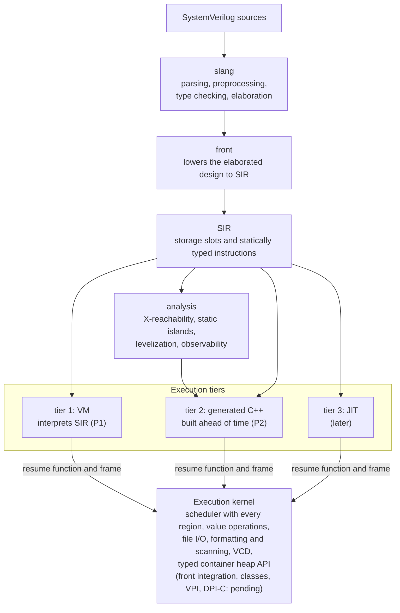
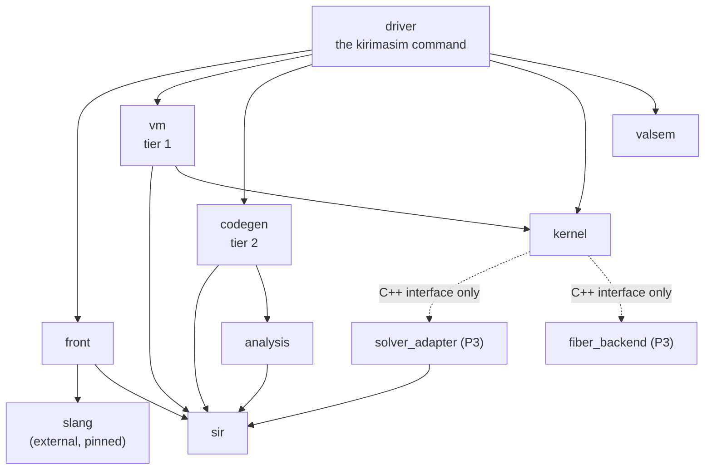

# kirimasim architecture

[日本語](ARCHITECTURE.ja.md) · This English text is the main version; the Japanese version follows it, and where they differ, this text holds.

This is a short overview. The detailed specifications live in
[docs/spec/](spec/).

## Pipeline

Processing flows one way:

slang is used unmodified, as a library pinned to one commit. Fixes go
upstream.

## Three execution tiers, one kernel

As of 2026-10-24, tier 1 and the shared kernel implement the subset listed
in [P1_SUPPORT](P1_SUPPORT.md). The full P1 coverage target is unfinished.
Tier 2 is planned for P2; tier 3 comes later. The table and shared execution
contract below describe the full design, including those future tiers.

| Tier | What it is | Role |
| --- | --- | --- |
| 1: VM | Interpreter of SIR: it runs SIR directly now; a register-based bytecode built from SIR comes later | Full feature coverage, instant start, the reference for correctness |
| 2: C++ generation | SIR compiled ahead of time to C++ and built as a shared library | Speed for RTL (static islands and synthesizable processes) |
| 3: JIT | Compiling hot testbench functions at run time | Later; decided after tier 2 |

Every tier registers its processes with the **execution kernel** in the
same form: a resume function plus a frame that holds the process state
(automatic variables, resume position, temporaries that live across a wait,
and pending violation and assertion reports; calls to tasks that can wait
add call frames chained to it). The kernel owns everything else:
the scheduler with all IEEE 1800-2023 regions, value operations, objects
and garbage collection, VPI, DPI-C, waveforms, assertions, coverage and
constraint solving. Because the kernel cannot tell the tiers apart,
processes from different tiers can run together in one simulation, and a
difference between tiers shows up as a difference in the output of the same
test.

Some ideas the design is built on:

- **Slots, not names.** Signals and variables live in a flat store and are
  addressed by slot number. Names are kept only for VPI, waveforms and
  diagnostics.
- **Four-state words.** Values are arrays of 64-bit `(a, b)` word pairs with
  the same bit meaning as VPI's aval/bval (0 = (0,0), 1 = (1,0),
  Z = (0,1), X = (1,1)). Operations take a two-state fast path when no input
  has X or Z.
- **Two versions per static island.** Where the absence of X cannot be
  proven statically, tier 2 generates a four-state and a two-state version
  of an island and picks one at run time.
- **One definition of meaning.** Each operation's meaning is defined once,
  in `valsem`, as a slow reference: integral operations work one bit at a
  time, and container values have an independent cell model. Fast versions
  are tested against it.
- **No global state.** All simulation state lives in a context object, so
  several simulations can run in one process.

## Typed container heap: VM collection implemented, front integration pending

The [approved container contract](notes/dynamic-containers-proposal.md) is
recorded in SIR_SPEC 4.2.1 and RUNTIME_ABI 6. Each Context owns a
[`Heap`](../src/kernel/include/kirimasim/kernel/heap.h) alongside its slot
store and strings. Layout descriptors describe words and nested-container
edges without importing slang or SIR. Empty containers use token zero;
nonempty containers and stable element cells use generation-checked tokens.
Queue movement retains surviving cells, while replacement and deletion can
detach cells still reachable through references. Value copying makes
independent elements and recursively copies nested container values.

Allocation uses transactions; failure rolls back new objects before the
destination changes. Reclamation writes to pre-sized free-entry storage.
Copying and tracing are iterative. `Heap::collect` traces explicit container
and cell roots and reuses unreachable entries with new generations; failed
marking performs no sweep. These mechanisms have independent-model,
allocation-failure, deep-nesting, stale-token and Context-isolation tests.

The kernel API and typed SIR descriptor/ref/instruction definitions, verifier
and text support are implemented (SIR_SPEC 5.8). Kernel copies apply destination
bounds at every nested queue level; snapshots retain the actual source type.
The VM mechanically maps typed operands to these APIs; references retain
actual variable types even when empty, and cell refs carry stable tokens.
Twenty-four original SIR tests exercise execution, calls, waits and error mapping.
After a region drains or the slot arena is cleared, a scoped scheduler hook
publishes typed slots, live activations, cell refs, deferred call arguments and
owned scheduler payloads. Ordinary numbers are not interpreted as handles.
Collection runs when the heap or root set changes; failed marking sweeps nothing.
No callback runs inside process/guard execution, after termination is requested
or during final cleanup. SSA temporaries cannot cross waits (SIR_SPEC 5.1).
Class, DPI and VPI root providers remain future work.
Heap read/change hooks distinguish structure and cell values after commit;
the scheduler captures these reads and reattaches weak typed dependencies.
Private containers of called functions are filtered with a read-only graph
query. Notices join the existing ordered change queue, and the VM publishes
mutations before continuing. Live wait ownership restores the prior hook;
VM waits are detached before interpreter frames expire.
Front lowering now emits typed heap instructions, binding refs and explicit
value snapshots/copies for the [tested language subset](P1_SUPPORT.md#dynamic-container-foundation).
Dynamic foreach bounds live in frames across waits; dimension queries reuse
container size. Pattern temporaries retain all elements before an actual
variable applies queue bounds, including through equivalent ref types.
Runtime concatenation and queue slices share a typed sequence-building loop.
An unbounded queue buffer receives converted elements before the actual
language destination applies bounds; slice normalization preserves wide
unsigned indices and rejects unknown ranges through the ordinary branch rules.
Unimplemented language forms and implicit heap sensitivity are diagnosed;
full container and Icarus coverage remain work.

## Libraries

Dependencies run only in the directions listed here.

| Library | Contents | May depend on | Status |
| --- | --- | --- | --- |
| `front` | Calls slang and lowers its result to SIR | slang, `sir` | Lowers the constructs of the P1 range; reports the others as unsupported |
| `sir` | SIR definitions, verifier, text format | nothing | Definitions, type table, verifier, text form |
| `analysis` | X-reachability, static islands, levelization, observability | `sir` | Empty |
| `vm` | Tier 1 (bytecode generation and execution) | `sir`, `kernel` | Interprets SIR directly; bytecode comes later |
| `codegen` | Tier 2 (C++ generation and build) | `sir`, `analysis` | Empty |
| `kernel` | The execution kernel | libfstapi (later); optional dependencies only through `solver_adapter` and `fiber_backend`, seen as C++ interfaces | Scheduler with every region, slot storage, four-state word operations, net resolution, UDP tables, file I/O, formatting and scanning, strings, VCD output, typed container heap API, event counters, context |
| `solver_adapter` | Pluggable constraint solver | `sir`, the chosen external solver | Planned for P3 |
| `fiber_backend` | Fibers for DPI-C tasks that consume time | the chosen fiber library only | Planned for P3 |
| `valsem` | Reference implementations of value semantics | nothing | Value instructions, edges, net resolution with strengths, UDP tables, integral-container cell model |
| `driver` | The `kirimasim` command line | everything | Compile and run, `parse`, `--version`, the input options, `--dump-sir`, `--stats=json`, the run limits, stopping on SIGINT |

The same directions as a picture (an arrow means "depends on"; where it
differs from the table, the table holds):

Rules that follow from this layout:

- `kernel` is linked together with users' designs, so it never depends on
  slang or LLVM. Its public headers are C++20 because generated code reads
  them.
- `solver_adapter` and `fiber_backend` are not built yet (they come in P3);
  they appear here so that the dependency rules are complete.

## Checking correctness and performance

- Fast value operations are compared with `valsem` on random inputs.
- Tier 1 and tier 2 will run the same tests and compare their output and
  observable events (`--tier-check`).
- **Event counts** (`--stats=json`, the `PerfCount` tests) detect changes in
  the amount of work without depending on machine load. Passing these tests
  does not establish execution speed. Wall-clock time and peak RSS are measured
  separately with `tools/bench.py`; see the [performance specification](spec/PERFORMANCE.md).
