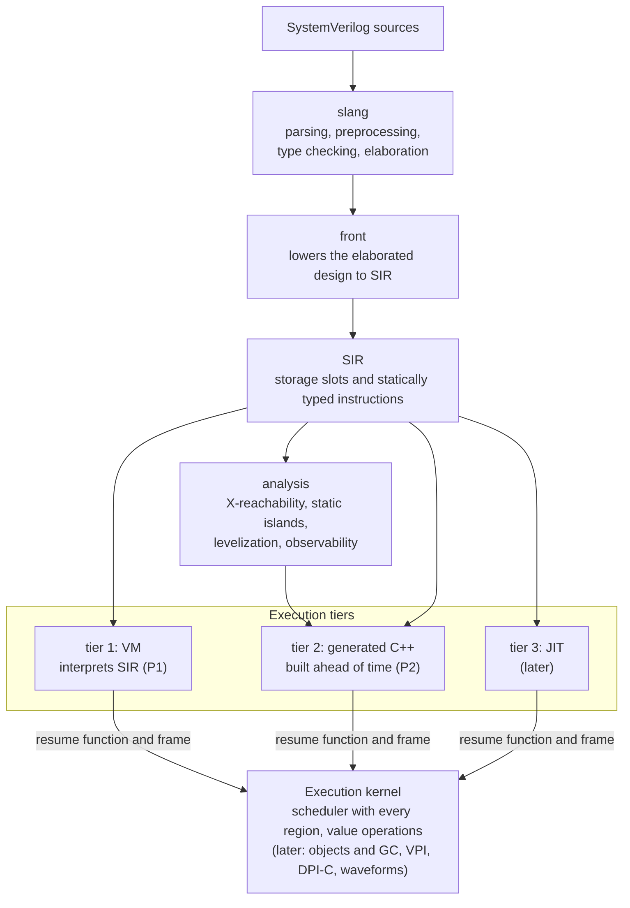
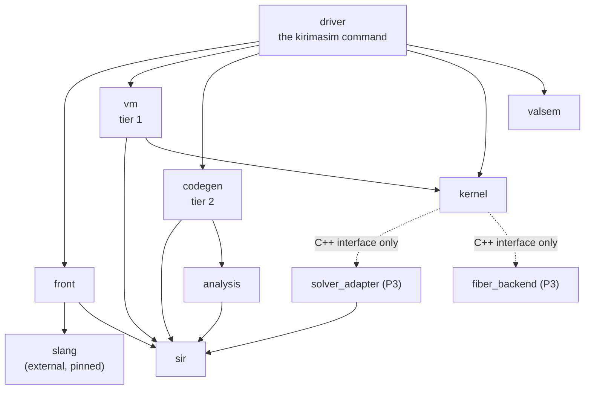

# kirimasim architecture

[日本語](ARCHITECTURE.ja.md) · This English text is the main version; the Japanese version follows it, and where they differ, this text holds.

This is a short overview. The detailed specifications live in
[docs/spec/](spec/).

## Pipeline

Processing flows one way:

slang is used unmodified, as a library pinned to one commit. Fixes go
upstream.

## Three execution tiers, one kernel

| Tier | What it is | Role |
| --- | --- | --- |
| 1: VM | Register-based bytecode interpreter built from SIR | Full feature coverage, instant start, the reference for correctness |
| 2: C++ generation | SIR compiled ahead of time to C++ and built as a shared library | Speed for RTL (static islands and synthesizable processes) |
| 3: JIT | Compiling hot testbench functions at run time | Later; decided after tier 2 |

Every tier registers its processes with the **execution kernel** in the
same form: a resume function plus a frame that holds the process state
(automatic variables, resume position, temporaries that live across a wait,
and pending violation and assertion reports; calls to tasks that can wait
add call frames chained to it). The kernel owns everything else:
the scheduler with all IEEE 1800-2023 regions, value operations, objects
and garbage collection, VPI, DPI-C, waveforms, assertions, coverage and
constraint solving. Because the kernel cannot tell the tiers apart,
processes from different tiers can run together in one simulation, and a
difference between tiers shows up as a difference in the output of the same
test.

Some ideas the design is built on:

- **Slots, not names.** Signals and variables live in a flat store and are
  addressed by slot number. Names are kept only for VPI, waveforms and
  diagnostics.
- **Four-state words.** Values are arrays of 64-bit `(a, b)` word pairs with
  the same bit meaning as VPI's aval/bval (0 = (0,0), 1 = (1,0),
  Z = (0,1), X = (1,1)). Operations take a two-state fast path when no input
  has X or Z.
- **Two versions per static island.** Where the absence of X cannot be
  proven statically, tier 2 generates a four-state and a two-state version
  of an island and picks one at run time.
- **One definition of meaning.** Each operation's meaning is defined once,
  in `valsem`, as a slow one-bit-at-a-time reference. Fast versions are
  tested against it.
- **No global state.** All simulation state lives in a context object, so
  several simulations can run in one process.

## Libraries

Dependencies run only in the directions listed here.

| Library | Contents | May depend on | Status |
| --- | --- | --- | --- |
| `front` | Calls slang and lowers its result to SIR | slang, `sir` | Lowers the constructs of the P1 range; reports the others as unsupported |
| `sir` | SIR definitions, verifier, text format | nothing | Definitions, type table, verifier, text form |
| `analysis` | X-reachability, static islands, levelization, observability | `sir` | Empty |
| `vm` | Tier 1 (bytecode generation and execution) | `sir`, `kernel` | Interprets SIR directly; bytecode comes later |
| `codegen` | Tier 2 (C++ generation and build) | `sir`, `analysis` | Empty |
| `kernel` | The execution kernel | libfstapi (later); optional dependencies only through `solver_adapter` and `fiber_backend`, seen as C++ interfaces | Scheduler with every region, slot storage, four-state word operations, net resolution, UDP tables, formatting, strings, event counters, context |
| `solver_adapter` | Pluggable constraint solver | `sir`, the chosen external solver | Planned for P3 |
| `fiber_backend` | Fibers for DPI-C tasks that consume time | the chosen fiber library only | Planned for P3 |
| `valsem` | Reference implementations of value semantics | nothing | Value instructions, edges, net resolution with strengths, UDP tables |
| `driver` | The `kirimasim` command line | everything | Compile and run, `parse`, `--version`, `--dump-sir`, `--stats=json`, the run limits |

The same directions as a picture (an arrow means "depends on"; where it
differs from the table, the table holds):

Rules that follow from this layout:

- `kernel` is linked together with users' designs, so it never depends on
  slang or LLVM. Its public headers are C++20 because generated code reads
  them.
- `solver_adapter` and `fiber_backend` are not built yet (they come in P3);
  they appear here so that the dependency rules are complete.

## Checking correctness and performance

- Fast value operations are compared with `valsem` on random inputs.
- Tier 1 and tier 2 will run the same tests and compare their output and
  observable events (`--tier-check`).
- Performance regressions are caught by **event counts** (`--stats=json`,
  the `PerfCount` tests) rather than wall-clock time, because counts do not
  depend on machine load or optimization level.
