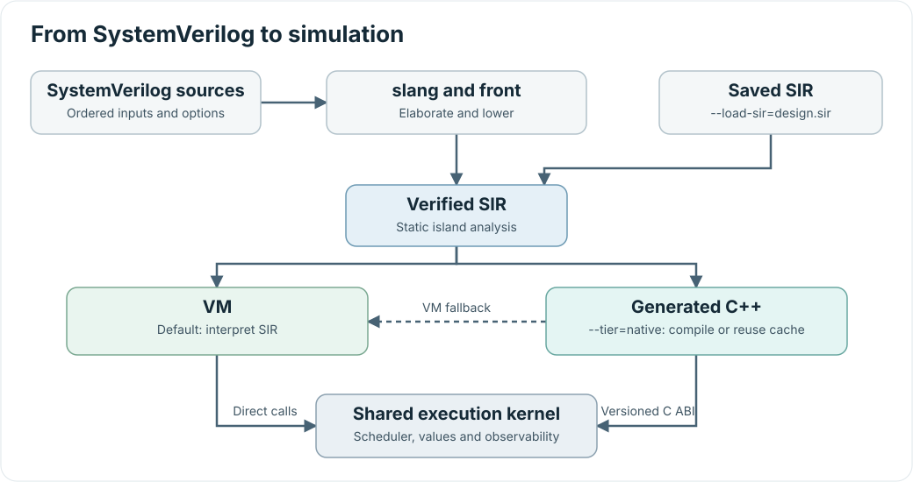
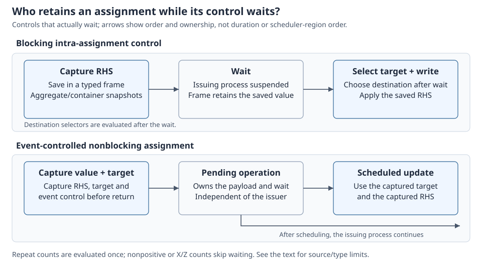
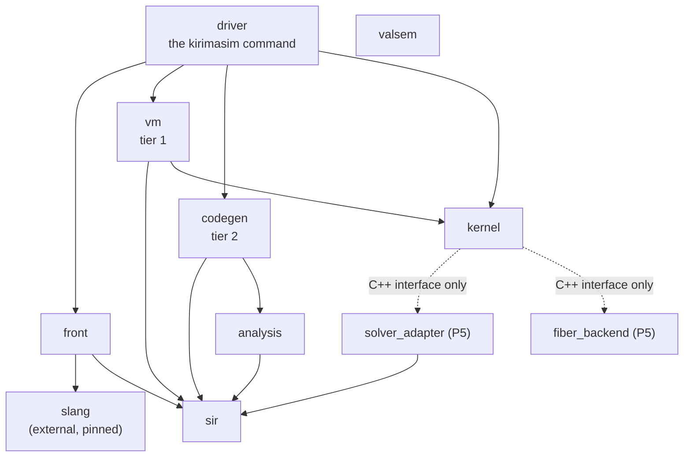
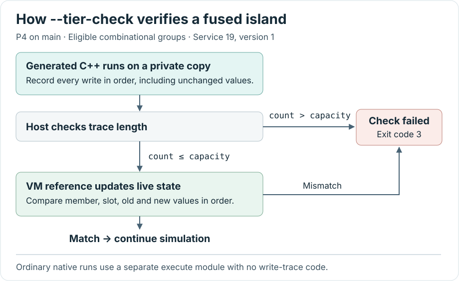

# kirimasim architecture

[日本語](ARCHITECTURE.ja.md) · This English text is the main version; the Japanese version follows it, and where they differ, this text holds.

**Revision (2026-10-24):** old P2→P3, old P3→P4 and old P4→P5; new P2 (SIR v1) is inserted, with tier numbers unchanged ([mapping](notes/phase-renumbering.md)).

This is a short overview. The detailed specifications live in
[docs/spec/](spec/).

The maintainer judged P1 complete at `241e6aaf`. The tier 1 interpreter and shared kernel run the documented P1 subset. P3 completed tier 2 C++ generation and its two Ibex/CoreMark targets in 0.3.0. [P1 exit report](notes/p1-m8-report.md) · [P3 exit measurements](BENCHMARKS.md#p3-performance-targets)

The P4 plan extends the shared runtime to calls that suspend across VM and native frames, and to combinational evaluation that respects intermediate-signal observers. [P4 milestones and acceptance cases](notes/p3-p7-roadmap-revision.md#new-p4-scope-and-acceptance-tests)

## Pipeline

Source and saved SIR enter at different points and share the same execution path after verification.

slang is used unmodified, as a library pinned to one commit. Fixes go
upstream.

## Phase P2: SIR v1 before tier 2

P2 fixed SIR format 1 and C ABI 0.5 against P1 baseline `241e6aaf`. The front end and reader both supply a verified Design. Execution tiers share slot and frame descriptors. Frames use 16-byte cells aligned to eight bytes. Optional analysis tables are keyed to the canonical Design and the analysis configuration. The VM calls the kernel directly, and separately built models use its versioned C table. Release 0.3.0 uses C ABI 0.5 and adds signal service 10 version 2 for counted-slot commits. [Boundary review](notes/p2-runtime-review.md) · [Runtime ABI](spec/RUNTIME_ABI.md#42-the-kernels-function-table)

## Three execution tiers, one kernel

Tier 1 and the shared kernel implement the current subset listed
in [P1_SUPPORT](P1_SUPPORT.md).
Tier 2 runs eligible generated C++ and uses the VM for other processes in the
same simulation. The native cache stores the generated source and shared
modules. Tier 3 remains a possible later addition. [Native workflow](USER_MANUAL.md#native-workflow)

| Tier | What it is | Role |
| --- | --- | --- |
| 1: VM | Interprets SIR directly. Pilot register-based bytecode before P5 and use P5 profiles to decide on general rollout | Quick startup and the correctness reference for supported forms |
| 2: C++ generation | SIR compiled ahead of time to C++ and built as a shared library | Speed for eligible RTL |
| 3: JIT | Compiling hot testbench functions at run time | Later; decided after tier 2 |

Every tier registers its processes with the **execution kernel** in the
same form: a resume function plus a frame that holds the process state
(automatic variables, resume position, temporaries that live across a wait,
and pending violation and assertion reports; calls to tasks that can wait
add call frames chained to it). The shared kernel owns scheduling, value
operations, object storage and collection, waveforms, and the implemented VPI
services. It keeps SystemVerilog event regions and effects consistent for VM and
native processes. Cross-tier calls that suspend are P4 work, and broader
assertion, coverage, constraint-solving and DPI-C support is planned for P5.

Some ideas the design is built on:

- **Slots, not names.** Signals and variables live in a flat store and are
  addressed by slot number. Names are kept only for VPI, waveforms and
  diagnostics.
- **Four-state words.** Values are arrays of 64-bit `(a, b)` word pairs with
  the same bit meaning as VPI's aval/bval (0 = (0,0), 1 = (1,0),
  Z = (0,1), X = (1,1)). Operations take a two-state fast path when no input
  has X or Z.
- **Known-input fast paths.** The generator can emit a specialized path for
  eligible islands. The four-state run uses it when the inputs checked by
  its guard contain neither X nor Z. `--state=2` selects the separate
  two-state approximation.
- **One definition of meaning.** Each operation's meaning is defined once,
  in `valsem`, as a slow reference: integral operations work one bit at a
  time, and container values have an independent cell model. Fast versions
  are tested against it.
- **No global state.** All simulation state lives in a context object, so
  several simulations can run in one process.

## Typed container heap and tier 1 integration

A [GC root](GLOSSARY.md#gc-root) keeps storage reachable across waits and callbacks, so
returning from a call need not end that storage’s lifetime.

The [approved container contract](notes/dynamic-containers-proposal.md) is
recorded in SIR_SPEC 4.2.1 and RUNTIME_ABI 6. Each Context owns a
[`Heap`](../src/kernel/include/kirimasim/kernel/heap.h) alongside its slot
store and strings. Layout descriptors describe words and nested-container
edges without importing slang or SIR. Empty containers use token zero;
nonempty containers and stable element cells use generation-checked tokens.
Queue movement retains surviving cells, while replacement and deletion can
detach cells still reachable through references. Value copying makes
independent elements and recursively copies nested container values.

Allocation uses transactions; failure rolls back new objects before the
destination changes. Reclamation writes to pre-sized free-entry storage.
Copying and tracing are iterative. `Heap::collect` traces explicit container
and cell roots and reuses unreachable entries with new generations; failed
marking performs no sweep. These mechanisms have independent-model,
allocation-failure, deep-nesting, stale-token and Context-isolation tests.

The kernel API and typed SIR descriptor/ref/instruction definitions, verifier
and text support are implemented (SIR_SPEC 5.8). Kernel copies apply destination
bounds at every nested queue level; snapshots retain the actual source type.
The VM mechanically maps typed operands to these APIs; references retain
actual variable types even when empty, and cell refs carry stable tokens.
Twenty-four original SIR tests exercise execution, calls, waits and error mapping.
After a region drains or the slot arena is cleared, a scoped scheduler hook
publishes typed slots, live activations, cell refs, deferred call arguments and
owned scheduler payloads. Ordinary numbers are not interpreted as handles.
Collection runs when the heap or root set changes; failed marking sweeps nothing.
No callback runs inside process/guard execution, after termination is requested
or during final cleanup. SSA temporaries cannot cross waits (SIR_SPEC 5.1).
Class objects now have their typed storage/root path described below.
VPI static numeric bindings are connected, including checked physical-net writes.
DPI and VPI root providers for object/container handles remain future work.
Heap read/change hooks distinguish structure and cell values after commit;
the scheduler captures these reads and reattaches weak typed dependencies.
Private containers of called functions are filtered with a read-only graph
query. Notices join the existing ordered change queue, and the VM publishes
mutations before continuing. Live wait ownership restores the prior hook;
VM waits are detached before interpreter frames expire.
Front lowering now emits typed heap instructions, binding refs and explicit
value snapshots/copies for the [tested language subset](P1_SUPPORT.md#dynamic-container-foundation).
Dynamic foreach bounds live in frames across waits; dimension queries reuse
container size. Pattern temporaries retain all elements before an actual
variable applies queue bounds, including through equivalent ref types.
Runtime concatenation and queue slices share a typed sequence-building loop.
An unbounded queue buffer receives converted elements before the actual
language destination applies bounds; slice normalization preserves wide
unsigned indices and rejects unknown ranges through the ordinary branch rules.
Unimplemented language forms and implicit heap sensitivity are diagnosed;
full container and Icarus coverage remain work.

## Typed pattern rendering and monitor dependencies

At `4c69843`, SIR has distinct PatternIds and immutable presentation layouts,
with verification, text and VM execution. The VM marshals typed payloads into
borrowed views; the shared kernel renderer applies the output rules. Packed
windows, enum metadata, fixed shapes and nested containers are explicit, with
no new runtime name lookup or source-type inference. Front now captures source
arguments once and connects literal/runtime `%p`/`%0p` for the
[documented typed subset](notes/source-pattern-formatting.md). Runtime transport
retains raw scalar values and both rendered presentations. Pattern monitors
compare detached raw values rather than rendered strings.

The scheduler captures heap dependencies during the actual Postponed monitor
body and observes cell changes. Dependencies are weak and detach with the
registration's lifetime. Kernel/VM file-monitor wiring is present, and
heap-backed file-monitor combinations are checked by the
[20 original source cases](notes/heap-file-monitor-lifetime.md) of 2026-10-25.
Callback-driven reentrant registration/reallocation and other source contexts
still need broader evidence.
See the [implementation and verification scope](notes/pattern-sir-execution.md).

## Assignment capture and suspension

A [snapshot](GLOSSARY.md#snapshot) retains the value selected earlier, which matters
when the source changes while an assignment is waiting.

The front end captures all RHS leaves of an aggregate assignment before
evaluating runtime target selectors. Container leaves are snapshotted when
captured, so later field expressions cannot change an earlier captured value.
Ordinary assignments, immediate NBAs and delayed NBAs share this lowering
path, including runtime-selected fixed subarrays and structure array members.
This implements the existing approved evaluation order through existing SIR
instructions; it adds no VM opcode or kernel scheduling rule. See
[aggregate value capture](notes/aggregate-value-capture.md).

Blocking intra-assignment `repeat(count) @(...)` holds the earlier RHS and
the full typed count in frames across ordinary SIR waits. The count is
evaluated once; nonpositive or X/Z counts skip waiting. The actual target is
chosen after the waits. SSA temporaries themselves do not cross a wait.
See [repeated event controls](notes/repeated-event-controls.md).
Whole aggregates also use private typed frame snapshots across blocking
intra-assignment controls; the actual selectors are evaluated after the wait.
See [aggregate blocking timing](notes/blocking-aggregate-timing.md).
Source event-controlled NBAs use a separate pending-operation path that retains
the captured payload, target and event control independently of the issuing
process. They do not suspend that process or expand into blocking repeated waits.
See [source event-NBA lowering and its remaining boundaries](notes/event-nba-source-execution.md).

The diagram contrasts state ownership across the two waiting mechanisms.
Each linked note above defines the supported source forms and types.

The table also includes the common aggregate-capture rule:

| Mechanism | Retained value/state | When the destination is selected | Issuing process |
| --- | --- | --- | --- |
| Aggregate assignment capture | All RHS leaves, with container snapshots | Runtime selectors are evaluated after RHS capture | Capture alone introduces no wait |
| Blocking intra-assignment control | Typed frame snapshot; a repeated event control also retains its evaluated count | After the waits | Suspends across the control |
| Event-controlled NBA | Pending operation owns payload, target and event control | Captured when the operation is scheduled | Continues; the pending operation owns the wait |

[Wide UDP execution](notes/wide-udp-inputs.md) uses shared-kernel matching
with stable input getters for large operand lists. A prefix state view keeps
terminal-order semantics without variable-size evaluator scratch. The VM
transports typed operands; dense source coverage checking remains a separate
slang compilation boundary.

[Fork declarations](notes/fork-local-declarations.md) use the parent's existing
lifetime path before executable children are created. Static storage is shared;
uncaptured automatic declarations initialize in the parent frame. Declarations
are not processes, and a declaration-only fork emits no wait. This adds no
kernel API or SIR instruction. Automatic storage captured by children follows
the approved [activation contract](notes/automatic-capture-proposal.md)
(2026-10-25). [Source capture lowering](notes/automatic-front-capture.md) now
constructs shared lexical environments for the supported typed subset;
retained descendants keep captured storage alive. See the
[automatic-storage execution boundary](P1_SUPPORT.md#automatic-storage-execution-boundary)
for the remaining type and event restrictions.

## Object identity, expression watches and retained scope activity

[Source class lowering](notes/class-source-execution.md) binds canonical type,
field and method identities into SIR. Context-owned typed object storage and
VM roots retain receivers/values across supported calls, waits and collection;
virtual dispatch follows numeric method metadata, not runtime name lookup.
[Explicitly clocked bodies](notes/class-clocked-execution.md) use these same
object/call paths; the trigger evaluators remain separate observer roots.
Object-dependent observation, managed fields and property targets retain explicit limits.

[Expression events](notes/always-ff-expression-execution.md) share one frontend
signal-operand producer with ordinary waits. Typed watch/iff helpers borrow
the verified process frame; the VM arms them before initial activity and uses
the existing kernel monitor, preserving ff writer/timing restrictions.

[Named-fork disable](notes/named-fork-disable-execution.md) retains numeric scope
activity through the parent/child lifetime links. A finished parent record can
remain necessary for surviving descendants without counting as a live child.
[Array-element port mappings](notes/array-element-port-execution.md) similarly
translate source alias bounds into physical ordinals before forming strength
identity edges. These paths extend the shared meanings rather than recognizing
particular source names. See the [Glossary](GLOSSARY.md) for these identities.

## Strength intervals before value projection

A [physical origin](GLOSSARY.md#physical-origin) identifies an independent driver
contribution, so aliases of one driver must not be counted as additional drivers.

The shared kernel exposes the complete strength hull defined by
VALUE_SEMANTICS 5.2–5.4. `StrengthRange` retains both signed endpoints;
`resolveStrengths` accepts arbitrary intervals and `resolveStrengthBit`
handles driver words with side masks. `strengthValue` is the explicit
four-state projection. Existing value resolution delegates to that same
calculation, so retaining metadata does not fork the value rules.

The fast point-state implementation is allocation-free and C++20. The
independent `valsem::resolveSignals` enumerates choices directly; all
interval pairs, single-driver masks, permutations and wide-word bits are
cross-checked. See the [API and verification scope](notes/strength-range-foundation.md).
Registered strength networks now retain complete intervals in Context-owned
storage and transport them through typed SIR/VM operations. Value observers
consume the four-state projection; internal strength dependencies also observe
changes that leave that projection unchanged. See
[complete net publication](notes/strength-store-publication.md) and
[declared-network execution](notes/strength-network-execution.md).

Static-strength driver operands can carry full-width two-state side masks for
L/H, including unaligned halves across 64-bit words. The
[wide-mask front/VM path](notes/wide-gate-strength.md) reaches the same kernel
resolver, without adding a strength policy or storing resolved intervals.

The [MOS/switch investigation](notes/mos-switch-investigation.md) records the
observations behind the approved [MOS/switch contract](notes/mos-switch-proposal.md).
[Directed MOS](notes/source-mos-execution.md) and
[passive switch source execution](notes/source-passive-execution.md) now use
physical driver ownership, complete strength transport and the shared scheduler
for the documented static terminals. The
[force foundation](notes/strength-force-foundation.md) supplies atomic node-level
updates in the kernel. [Source force/release](notes/strength-format-execution.md),
[captured-strength formatting](notes/strength-format-execution.md) and
[VPI whole-net writes](notes/vpi-net-write-execution.md) use the shared physical
driver model. Broader port shapes and selected/delayed VPI net writes remain work; see the
[current net and switch boundaries](P1_SUPPORT.md#strength-resolution-kernel).

## Libraries

Dependencies run only in the directions listed here.

| Library | Contents | May depend on | Status |
| --- | --- | --- | --- |
| `front` | Calls slang and lowers its result to SIR | slang, `sir` | Lowers the constructs of the P1 range; reports the others as unsupported |
| `sir` | SIR definitions, verifier, text format | nothing | Definitions, type table, verifier, text form |
| `analysis` | X-reachability, static islands, levelization, observability | `sir` | Selects static islands and computes dependency order and feedback components |
| `vm` | Tier 1 (direct SIR interpreter, with a bounded bytecode pilot) | `sir`, `kernel` | Preserve SIR semantics and measure bytecode separately |
| `codegen` | Tier 2 (C++ generation and build) | `sir`, `analysis` | Emits C++20 for eligible RTL bodies |
| `kernel` | The execution kernel | libfstapi (private native FST backend); optional dependencies only through `solver_adapter` and `fiber_backend`, seen as C++ interfaces | Scheduler with every region, slot storage, four-state word operations, net resolution, UDP tables, file I/O, formatting and scanning, strings, VCD/FST output, typed container heap API, event counters, context |
| `solver_adapter` | Pluggable constraint solver | `sir`, the chosen external solver | Planned for P5 |
| `fiber_backend` | Fibers for DPI-C tasks that consume time | the chosen fiber library only | Planned for P5 |
| `valsem` | Reference implementations of value semantics | nothing | Value instructions, edges, net resolution with strengths, UDP tables, integral-container cell model |
| `driver` | The `kirimasim` command line | everything | Compile and run, `parse`, `--version`, the input options, `--dump-sir`, `--stats=json`, the run limits, stopping on SIGINT |

The same directions as a picture (an arrow means "depends on"; where it
differs from the table, the table holds):

Rules that follow from this layout:

- `kernel` is linked together with users' designs, so it never depends on
  slang or LLVM. Its public headers are C++20 because generated code reads
  them.
- `solver_adapter` and `fiber_backend` are not built yet (they come in P5);
  they appear here so that the dependency rules are complete.

## Checking correctness and performance

- Fast value operations are compared with `valsem` on random inputs.
- `--tier-check` compares generated writes, queued NBAs and counted-slot effects with VM execution. Linux Release CI also checks suite output across three execution modes. [Reproduction](VALIDATION.md#compare-execution-modes)
- **Event counts** (`--stats=json`, the `PerfCount` tests) detect changes in
  the amount of work without depending on machine load. Passing these tests
  does not establish execution speed. Wall-clock time and peak RSS are measured
  separately with `tools/bench.py`; see the [performance specification](spec/PERFORMANCE.md).

The [approved VPI entry](notes/vpi-execution.md) uses one guarded current-Context
TLS pointer, restored across nested calls and returns. Registration, reflection,
callbacks, result buffers and library lifetimes remain owned by Context.
