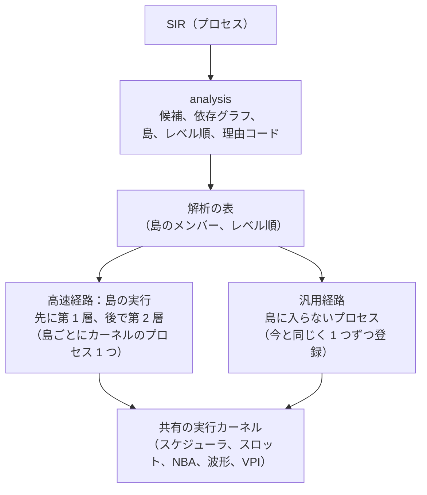

# 提案：合成可能 RTL の高速経路（静的アイランド）

[English](static-islands-proposal.md)。状態：**提案、未承認**（2026-11-14）。英語版が正です。
ここに書いたことは何も実装しておらず、「変更箇所」の修正案を人が承認するまで `docs/spec/` は変えません。

## 結論

この機能は、kirimasim の設計に「静的アイランド」として既に入っています（P3 の予定）。足すのは新しい機構ではなく、
まだ見出しだけの詳細仕様と、実装の順序です。

- 既に決まっていることは 3 つです。合成可能な範囲のプロセスを島にまとめてレベル順に評価すること。第 1 層と第 2 層が
  1 つの実行カーネルを共有し、層の違うプロセスが混ざって動くこと。第 1 層が正しさの基準であること。
- この提案が足すのは 4 点です。島の候補を狭い範囲から始め、除外理由を記録して計測で広げること。第 2 層より先に、
  第 1 層で島の実行を作ること。第 2 層は島だけを生成対象にし、生成できない島は第 1 層に戻すこと。層の照合を島の
  評価単位で行うこと。
- `docs/spec/` の変更が要るため、実装の前に人の承認が必要です。Claude Code の最初の作業は、この文書を提案メモとして
  リポジトリに置くことです。
- 着手は P3 です。P1 の終了条件と、P2 の範囲（静的アイランドの発見を含めない）は変えません。前倒しするかどうかは
  未決事項に挙げています。
- 4 つのベンチで、第 1 層は Icarus Verilog の 1.31〜1.66 倍速く、Verilator は kirimasim の 2.2〜93.9 倍速い状態でした
  （[BENCHMARKS](../BENCHMARKS.ja.md)、macOS、2026-10-23、コミット `dec94ff2`）。この差を詰める主な手段は第 2 層です。
  第 1 層の島実行だけで何倍になるかは未確認です。

対象はコミット `63aad8d8`（2026-11-14）です。仕様書とコードの読解だけで書いており、ビルドと実行はしていません。

## 現状と、既に決まっていること

島の概念と主な規則は承認済みで、実装と詳細仕様がまだありません。`docs/spec/CODEGEN_SPEC.md` の「Static islands」は
規則 1 つだけで、残りは P3 で書くことになっています。

| 項目 | 内容 | 出典 |
| --- | --- | --- |
| 現在の実行 | SIR のプロセスを 1 つずつ `Scheduler::addProcess` で登録する（`src/vm/vm.cpp` の `Interpreter::run()`）。値が変わると、待っているプロセスを待ち始めた順に起こす | SCHEDULER_SPEC 4.3 |
| `analysis` と `codegen` | 空の骨組み（各 27 行） | CLAUDE.md の依存表 |
| 島の候補 | `cont`・`comb`・`latch`・`ff`・`ff-plain` のうち、遅延、途中のイベント制御、副作用のある呼び出しがないもの。SIR には印を付けず、解析の結果として別に持つ | SIR_SPEC 7.1、1 |
| 島の中の順序 | 各プロセスをレベル順に 1 回評価する。第 1 層も同じ順序を使う | CODEGEN_SPEC「Static islands」、UNSPECIFIED_BEHAVIOR A8 |
| 外からの見え方 | 島は外から見て 1 つのプロセス | SCHEDULER_SPEC 11 |
| 強連結成分 | 上限まで反復し、超えたら zero_time_limit（終了コード 5）。上限は `--max-scc-iter` | UNSPECIFIED_BEHAVIOR A6、CLI 2.6 |
| 依存グラフ | ビット範囲の単位で作る | UNSPECIFIED_BEHAVIOR A7 |
| 読み書き | 島の中の計算はスロット格納を直接読み、島の出力への書き込みは関数表を通す | RUNTIME_ABI 4.2（草案） |
| 解析の表 | 形式は P2 で決め、P3 がアルゴリズムを選んで埋める。欠落は「不明」として扱う | [SIR v1 の提案](sir-v1-proposal.ja.md)の D6、6 章の 5 |
| 層の一致 | 第 2 層ができたら全テストを両層で実行し、出力の一致を CI の必須条件にする | TEST_SUITE「Bug tests, and checking that tests fail」 |
| 予約済みのオプション名 | `--tier`、`--tier-check`、`--disable-pass`、`--state`、`--report-state-opt`、`--max-scc-iter` | CLI 2.3、2.6 |
| カウンタ | `island.evals2`、`island.evals4`（P3） | PERFORMANCE 3.2 |
| 速度の目標（草案） | 4 値 RTL で Icarus の 10 倍以上、2 値 RTL で Verilator 単一スレッドの 0.5〜1 倍 | PERFORMANCE 2 |

信号の格納を層間で共有すること、汎用の実行経路を基準として残すことは、既に設計の前提です。この提案で新しく決める
必要はありません。

## 構成

高速経路は、汎用経路と同じ実行カーネルの上で動きます。`analysis` が SIR のプロセスを「島のメンバー」と「島に入らない
もの」に分け、島は 1 つのプロセスとしてカーネルに登録されます。

島に入らないプロセスは今と同じように動きます。島を作らない設定にすれば、全体が現在の動作に戻ります。

## 要求仕様

要求は 6 群です。区分が**既定**の行は承認済みの仕様をそのまま実装するもの、**提案**の行は人の承認が要るものです。
提案の行は、承認されるまで実装しません。

### 解析（`analysis`）

| ID | 要求 | 区分 |
| --- | --- | --- |
| ISL-A1 | 候補は SIR_SPEC 7.1 の定義どおりとする。種別が `cont`・`comb`・`latch`・`ff`・`ff-plain` で、遅延がなく、途中にイベント制御がなく、副作用のある呼び出しがないプロセス | 既定（SIR_SPEC 7.1、1） |
| ISL-A2 | 最初の版では、次のどれかに当たる候補を島から外す。`netResolver` の付いた `cont`。ヒープ上の値（文字列、動的配列、キュー、オブジェクト）の読み書き。システムタスクと DPI の呼び出し。unique・priority の違反報告や遅延即時アサーションを積む命令。手続き的な `assign`・`force` の対象になりうるスロットへの書き込み。program に属するプロセス | 提案 |
| ISL-A3 | 外した理由を、安定した名前の理由コードとしてプロセスごとに表へ記録する。理由コードの一覧は CODEGEN_SPEC に載せる | 提案 |
| ISL-A4 | 依存グラフの節は候補プロセス、辺は「同じタイムスロットの中で P が書くスロット範囲を、Q が感度として読む」とする。範囲はビット単位で比べる（UNSPECIFIED_BEHAVIOR A7）。NBA による書き込みは辺を作らない | 提案 |
| ISL-A5 | 島は依存グラフの連結成分ごとに作る。同じトリガー（スロット、ビット、エッジの組）で起きる `ff`・`ff-plain` は 1 つの島にまとめる | 提案 |
| ISL-A6 | 強連結成分に入る候補は、最初の版では島から外す。反復（UNSPECIFIED_BEHAVIOR A6）は段階 5 で実装する | 提案 |
| ISL-A7 | レベル順は依存グラフのトポロジカル順とし、同順位は SIR のプロセス番号順とする。同じ SIR と同じオプションからは、バイト単位で同じ表を作る | 提案 |
| ISL-A8 | 表の形式は P2 が決める形式に従う。欠落した項目や古い項目は「不明」とし、不明なプロセスは島に入れない | 既定（SIR v1 の提案の D6、6 章の 5） |
| ISL-A9 | 最初の版では、スロットの削除や畳み込みをしない。すべてのスロットが実体を持ち続ける | 提案 |

### 第 1 層での島の実行

| ID | 要求 | 区分 |
| --- | --- | --- |
| ISL-B1 | 島は実行カーネルに 1 つのプロセスとして登録する。メンバーのプロセスは個別には登録しない | 既定（SCHEDULER_SPEC 11） |
| ISL-B2 | 島は、メンバーが感度として読むスロット範囲のうち島の外から書かれるものが変化したとき、または `ff` メンバーのトリガーが起きたときに起床する | 提案 |
| ISL-B3 | 1 回の起床で、入力が変わったメンバーと、その書き込みで入力が変わった下流のメンバーだけを、レベル順に各 1 回評価する | 提案 |
| ISL-B4 | メンバーの本体は、第 1 層の既存のインタプリタで実行する。命令の意味は変えず、変えるのは評価の時点と順序だけとする | 提案 |
| ISL-B5 | 最初の版では、島の中の書き込みも実行カーネルの通常の書き込みを通す。島の外で待つプロセス、波形、VPI のコールバックは、島なしと同じ経路で変化を受け取る | 提案 |
| ISL-B6 | `ff` メンバーの NBA は通常どおり実行カーネルに積む。同じトリガーで起きるメンバーの評価順は SCHEDULER_SPEC 4.3 が定める起床順と同じにし、NBA の発行順を島の有無で変えない | 提案 |
| ISL-B7 | 時刻 0 の手順（SCHEDULER_SPEC 6.1）を変えない。`cont` メンバーは手順 4、`comb`・`latch` メンバーは手順 7 で最初の評価を受ける | 提案 |
| ISL-B8 | 実行中にプロセスを島から外す仕組みは作らない。外す必要のある形は ISL-A2 で静的に除外する | 提案 |
| ISL-B9 | `--race-check` は島の中の順序を乱さない | 既定（SCHEDULER_SPEC 11） |

### 第 2 層（島だけを生成する）

| ID | 要求 | 区分 |
| --- | --- | --- |
| ISL-C1 | 第 2 層の最初の版は、島のメンバーだけを C++ にする。島の外のプロセスは第 1 層で実行し、同じ実行カーネルの上で混ざって動く | 提案 |
| ISL-C2 | 生成コードは CODEGEN_SPEC の規則（同じ SIR から同じ C++、短絡評価の保持、副作用の回数、評価順）と CLAUDE.md の規則（C++20、例外と RTTI なし、`-ffp-contract=off`）に従う | 既定（CODEGEN_SPEC「Rules of C++ generation」「Floating point」、CLAUDE.md） |
| ISL-C3 | 生成できない命令を含む島は、島ごと第 1 層の島実行で動かし、理由コードを記録する。エラーにはしない | 提案 |
| ISL-C4 | 4 値版だけを先に作る。2 値版、X 到達解析、2 版の切り替えは後の段階とする | 提案 |
| ISL-C5 | 島の評価順とメンバーの評価回数は、第 1 層の島実行と同じにする | 既定（CODEGEN_SPEC「Static islands」） |
| ISL-C6 | 生成コードのビルド、読み込み、キャッシュ（`--cxx`、`--cache-dir`）はこの提案で決めない。CODEGEN_SPEC と RUNTIME_ABI の該当節を書く別の提案で決める | 対象外 |

### 照合

| ID | 要求 | 区分 |
| --- | --- | --- |
| ISL-D1 | 島を作らない実行と作る実行を、テストスイート全体で比べる。標準出力、終了コード、標準エラーの一致を確かめる | 提案 |
| ISL-D2 | 食い違うテストは一覧にし、規格が順序を定めない箇所（IEEE 1800-2023 4.7、UNSPECIFIED_BEHAVIOR D3）による差か、不具合かを、テストごとに根拠を付けて人に示す。期待値を書き換えて通さない | 既定（CLAUDE.md「Changes of expected values go in separate PRs」、UNSPECIFIED_BEHAVIOR D3） |
| ISL-D3 | `--tier-check` は、島の評価 1 回ごとに、第 2 層の結果と第 1 層の島実行の結果を比べる。比べるのは、書いたスロットと値の列、積んだ NBA の列とする。食い違ったら、島、メンバー、時刻、スロットを 1 行で報告し、kirimasim 自身の誤りとして終了コード 3 で終わる | 提案 |
| ISL-D4 | 生成コードの演算は、`valsem` と突き合わせるテストを持つ | 既定（CLAUDE.md「C++ versions and prohibitions」：高速版は `valsem` と突き合わせる） |
| ISL-D5 | 層に依存しないカウンタ（`sched.*`、`proc.*`、`slot.*`、`nba.*`、`wait.*`、`sim.*`）が、第 1 層の島実行と第 2 層で一致することをテストで確かめる | 提案（層をまたいで比べてよいのはこれらだけ、と PERFORMANCE 3.2 が言う） |

### 計測とカウンタ

| ID | 要求 | 区分 |
| --- | --- | --- |
| ISL-E1 | `island.evals4` を、4 値版の島の評価回数として数える | 既定（PERFORMANCE 3.2） |
| ISL-E2 | カウンタを 3 つ追加する。島の数、島に入ったプロセスの数、メンバーの評価回数。名前は PERFORMANCE 3.1 の形式に従い、同文書の 3.2 に追記する | 提案 |
| ISL-E3 | 島の導入で減る回数（`proc.wakeups`、`sched.events.active` など）の期待値は、実装とは別の PR で下げる | 既定（PERFORMANCE 4.3） |
| ISL-E4 | 実時間は `tools/bench.py` で測り、`docs/BENCHMARKS.md` に記録する。合否には使わない | 既定（PERFORMANCE 1） |

### コマンドライン

| ID | 要求 | 区分 |
| --- | --- | --- |
| ISL-F1 | 島の有無を切り替えるオプションを 1 つ定義する。新しいオプションにするか、予約済みの `--disable-pass` の値にするかは、承認時に決める | 提案 |
| ISL-F2 | 既定は、段階 3 の完了を人が承認するまで「島を作らない」、承認後は「島を作る」とする | 提案 |
| ISL-F3 | 島の数、メンバーの数、除外理由ごとの件数、プロセスごとの除外理由を出力する報告オプションを追加する。名前と出力先は承認時に決める | 提案 |
| ISL-F4 | `--max-scc-iter` の既定値は、強連結成分の反復を実装する段階で計測して決める | 既定（CLI 2.6：「Decided in P3」） |
| ISL-F5 | 新しいオプションはすべて CLI.md に載せる。環境変数や文書にない切り替えを作らない | 既定（CLAUDE.md「No hidden knobs」） |

## 変更箇所

変更は、人の承認が要る仕様書の修正と、その後に行うコードの変更に分かれます。文書はすべて英語版が正本なので、
英語版と日本語版（`.ja.md`）の両方を直します。

### 仕様書の修正案（承認コミットが必要）

| ファイル | 修正の内容 | 対応する要求 |
| --- | --- | --- |
| `docs/notes/static-islands-proposal.md` | 新規。この提案を英語で書いたもの。状態は「提案、未承認」 | 全体 |
| `docs/spec/CODEGEN_SPEC.md` | 「Static islands」に、除外条件と理由コード、依存グラフ、島の分け方、レベル順、第 1 層の島実行、島だけを生成する最初の版を書く | ISL-A2〜A7、B2〜B8、C1、C3、C4 |
| `docs/spec/SCHEDULER_SPEC.md` | 4.3 と 11 に島の起床と `ff` メンバーの評価順、6.1 に島と時刻 0 の関係を書く | ISL-B2、B6、B7 |
| `docs/spec/CLI.md` | 2.3 に島の切り替え、報告、`--tier-check` の動作を書く | ISL-D3、F1〜F3 |
| `docs/spec/PERFORMANCE.md` | 3.2 にカウンタ 3 つを追記する | ISL-E2 |
| `docs/spec/TEST_SUITE.md` | 島ありと島なしの比較、島の機能別テストマトリクスを書く | ISL-D1、D2、D5 |
| `docs/spec/UNSPECIFIED_BEHAVIOR.md` | A6〜A8 の状態を更新し、新しく決めた順序があれば行を足す | ISL-A6、B6 |
| `CLAUDE.md` の依存表 | 未決事項 2 の結論が「`vm` が `analysis` に依存する」の場合だけ変更する | — |

### コードの変更（承認の後）

| 場所 | 変更 |
| --- | --- |
| `src/analysis/` | 候補の判定、依存グラフ、強連結成分、レベル順、表の生成、報告を新規に実装する。依存してよいのは `sir` だけ |
| `src/vm/` | 島の登録と島実行を新規ファイルに置く。`vm.cpp` の `Interpreter::run()` にあるプロセス登録の部分に、島のメンバーを個別登録しない分岐を足す |
| `src/kernel/` | 原則として変更しない。不足する API があれば、公開ヘッダへの追加として人に提案する（C++20、`tests/unit/kernel_headers_cxx20.cpp` にも追加） |
| `src/driver/` | オプションの受け取り、解析の呼び出し、表の受け渡し。`main.cpp` には `--max-scc-iter` の受け取りが既にある |
| `src/codegen/` | 段階 4 で、島のメンバーの C++ 生成を実装する |
| `tools/` | 島の機能別テストマトリクスのジェネレータと、島あり・島なしを比べる実行を足す |
| `tests/` | `analysis` のユニットテスト、スイートの行列テスト、`tests/perf_counts/expected.json` への新規項目、CLI のテストを足す |
| `docs/` | `ARCHITECTURE.md`、`GLOSSARY.md`、README の状況、`CHANGELOG.md` を実装に合わせて更新する |

`bench/` の 12 設計は変更せず、そのまま計測に使います。

## テストと受け入れ条件

合否は、実行ごとに変わらない回数と、出力の一致で判定します。実時間は記録するだけで、合否には使いません（PERFORMANCE 1）。

### 追加するテスト

- 島の機能別テストマトリクスをジェネレータで作ります。軸は 4 つです。メンバーの種別（`cont`、`comb`、`latch`、`ff`、
  `ff-plain`）。依存の形（直列、分岐して再収束、ビット範囲で切れる見かけのループ、真のループ）。島の境界にあるもの
  （外で `@` を待つプロセス、`$monitor`、波形、`force`、VPI の読み書き）。器（module、generate、interface）。
- 除外理由コードごとに、候補にならないことを確かめる対照テストを 1 本以上置きます。
- 同じ入力から解析の表を 2 回作り、バイト単位で一致することを確かめます。
- 時刻 0 の手順 4〜7 の順序が、島の有無で変わらないことを確かめます。
- 同じクロックで起きる複数の `ff` が同じ変数に NBA を書く形で、結果が島の有無で変わらないことを確かめます。

テストの名前は規格の節と機構で付け、他のプロジェクトのテストや再現コードは写しません（CLAUDE.md）。

### 受け入れ条件

1. `tools/local_ci.py` が通ること。
2. 島を作らない実行で、既存の全テストの結果と PerfCount が変わらないこと。
3. 島を作る実行で、スイート全体の結果が島を作らない実行と一致すること。食い違いが残るのは、ISL-D2 の一覧で人が
   承認したテストだけであること。
4. `bench/comb_chain.sv` と `bench/nba_shift.sv` で、`proc.wakeups` と `sched.events.active` が島を作らない実行より
   減り、`vm.instrs` と `slot.changes` が増えないこと。
5. 第 2 層を入れた段階で、全テストの出力が両層で一致し、`--tier-check` の不一致が 0 件で、同じ SIR から 2 回生成した
   C++ が一致すること。
6. 12 設計の実時間を `tools/bench.py` で測り、`docs/BENCHMARKS.md` に記録していること。

条件 4 で回数が何割減るかは未確認です。段階 2 の報告で実測値を示し、目標値は人が決めます。

## 実装の段階

6 つの段階に分け、各段階の完了条件を人が確認してから次へ進みます。速度が大きく変わるのは段階 4 です。

| 段階 | 範囲 | 実行への影響 | 完了条件 |
| --- | --- | --- | --- |
| 0 | 提案メモを作り、未決事項を人が決め、`docs/spec/` の修正を入れる | なし | `Approved-by` の付いたコミットがある |
| 1 | 解析。候補の判定、依存グラフ、強連結成分、レベル順、表、報告オプション | なし（表を作るだけ） | 表の決定性テストが通る。`bench/` の 12 設計とスイートについて、候補になったプロセスの割合と除外理由ごとの件数を報告している |
| 2 | 第 1 層の島実行。対象は `cont` と `comb` | 既定は島なし。オプションで島あり | 受け入れ条件 1〜4（`comb_chain`） |
| 3 | `ff` と `ff-plain` を島に入れる | 同上 | 受け入れ条件 1〜4（`nba_shift`）。既定を「島を作る」に切り替えることを人が承認する |
| 4 | 第 2 層。島だけの C++ 生成（4 値）、`--tier`、`--tier-check` | `--tier` で第 2 層を選んだときだけ変わる | 受け入れ条件 5、6 |
| 5 | 拡大。強連結成分の反復、`latch`、除外理由の件数が多い順の対象拡大、2 値版と X 到達解析 | 項目ごと | 項目ごとに受け入れ条件 1〜6 |

段階 1 以降は P3 の作業です。P1 の終了と、P2 の SIR v1（解析の表の形式を含む）の確定の後に始めます。

段階 4 には、生成コードのビルドと読み込みを決める別の提案（ISL-C6）の承認が前提になります。

段階 1 で候補の割合が低いと分かったら、段階 2 へ進む前に ISL-A2 の除外条件を見直します。実装を始める前に効果の見込みを
数字で確かめるためです。

## 未決事項と対象外

### 人が決めること

段階 0 で次の 7 点を決めます。決まるまで、Claude Code は該当する行を実装しません。

| 番号 | 決めること | 推奨 | 理由 |
| --- | --- | --- | --- |
| 1 | 始める時期 | 計画どおり P3 から | P1 の終了条件と P2 の範囲を変えずに済む。段階 1 は実行を変えないので P2 と並べて進める案もあるが、フェーズ計画の修正が要る |
| 2 | `vm` が解析の表を受け取る方法 | `driver` が `analysis` を実行して表を渡す | `vm` は `sir` と `kernel` だけに依存する、という依存表を変えずに済む。表の型をどのライブラリに置くかは P2 の D6 の決定に従う（未確認） |
| 3 | オプションの名前 | 島の入り切りは `--disable-pass` の値、報告は新しいオプション 1 つ | 予約済みの名前を使い、追加を 1 つに抑える |
| 4 | 島の中の `ff` の評価順 | 待ち始めた順（SCHEDULER_SPEC 4.3 と同じ） | 島ありと島なしで出力の順序が変わらない |
| 5 | 最初の除外条件（ISL-A2） | 上の表のとおり、狭く始める | 対象を後から広げるのは安全。狭めるのは期待値の変更になる。VPI から書けるスロットの範囲は VPI_SPEC を読んで決める（未確認） |
| 6 | 追加する 3 つのカウンタの名前 | `island.` で始める | 既存の `island.evals2`、`island.evals4` と並ぶ |
| 7 | `--tier-check` が不一致を見つけたときの終了コード | 3（内部エラー） | 設計ではなくシミュレータの誤りを表す |

### 対象外

- 生成コードのビルド、読み込み、キャッシュ（`--cxx`、`--cache-dir`）。別の提案で決めます。
- 最初の版での 2 値版と X 到達解析。段階 5 で扱います。
- 並列実行（P5）と第 3 層の JIT。
- スロットの畳み込みと削除。
- 実行中に島を解除して汎用経路へ戻す仕組み。島に入れるかどうかは実行前に決めます。

## 承認の後の作業の決まり

いずれも CLAUDE.md にある決まりです。

- `docs/spec/` の変更は `Approved-by` の付いたコミットで入れます。「提案」の行は承認されるまで実装しません。
- 依存表を守ります。`vm` は `sir` と `kernel`、`analysis` は `sir`、`codegen` は `sir` と `analysis` だけに依存します。
- `src/kernel/` と `src/vm/` では `std::shared_ptr`、`dynamic_cast`、`std::function`、`getenv`、`typeid` を使いません。
- 環境変数や隠しスイッチを足しません。動作を変えるものは CLI.md にあるオプションだけです。グローバルな状態も持ちません。
- 意味は 1 か所で決めます。島の実行が変えるのは、メンバーを評価する時点と順序だけです。島に入れるかどうかの判定は
  `analysis` だけに置きます。
- 期待値の変更は、実装の変更とは別の PR にします。
- 確かめていないことは「未確認」と書きます。
- 非公開のプロジェクトの名前や内部情報、ホームディレクトリの絶対パス、ユーザー名、メールアドレスをリポジトリに入れません。
- GPL / LGPL のソースコードを読みません。参考にした考え方の出典は設計メモに記録します。
- push の前に `tools/local_ci.py` を通します。コミットメッセージは英語で書きます。

## リポジトリとの照合（2026-11-14）

「既定」の行と、「現状と、既に決まっていること」の各出典を、`63aad8d8` の記述と照らしました。どれも挙げた出典に根拠が
あります。言い回しや範囲の違いが次のとおり見つかりました。ここに挙げるだけで、直していません。

1. **`--max-scc-iter` は第 2 層のもの。** CLI 2.6 は、第 2 層の静的アイランドの反復（P3）と定めています。
   `src/driver/main.cpp` も、第 2 層が島を持つまで効果がないとしています。ISL-A6 と段階 5 は、強連結成分をどの層で
   反復するかを書いていません。第 1 層の島実行で反復するなら、CLI 2.6 の修正が要ります。
2. **`analysis` は第 2 層のためのものとされている。** ARCHITECTURE（図と依存表）と GLOSSARY は、`analysis` を第 2 層の
   ための解析（P3）としています。この提案では、第 1 層も解析の表を使います（ISL-B）。CODEGEN_SPEC の規則が既に第 1 層に
   島の順序を使わせているので、意図は合っていますが、それらの記述は実装に合わせて変わります（コードの変更の表の `docs/`）。
3. **D6 は一部が草案。** SIR v1 の提案は、表を分けることと、欠落や古い項目を「不明」とすることを原則として選んでいます
   （6 章の 5）。ISL-A8 はこれに依っています。表の正確な形は、まだレビュー待ちです。
4. **速度の数字は前の第 1 層のもの。** 結論の数字は、2026-10-23 に macOS で `dec94ff2` を 4 つの設計で測ったものです。
   `docs/BENCHMARKS.md` には、2026-10-25 に Linux（WSL2）で `b6683425` を 11 の設計で測ったものもあります。第 1 層はその後
   変わっており、今の速度は未確認です。
5. **依存グラフの実行時の添字。** UNSPECIFIED_BEHAVIOR A7 は、実行時にしか分からない添字は反復で評価するとしています。
   ISL-A4 はビット範囲で比べるとしますが、実行時の添字で書く範囲をどうグラフに入れるか（除外するか、範囲全体とするか）を
   書いていません。

この提案の外で見つかったこと：CODEGEN_SPEC の優先度の行は、まだ「C++ の生成は P2 の作業」と書いています。2026-10-24 の
番号の付け替えの後は P3 です。
