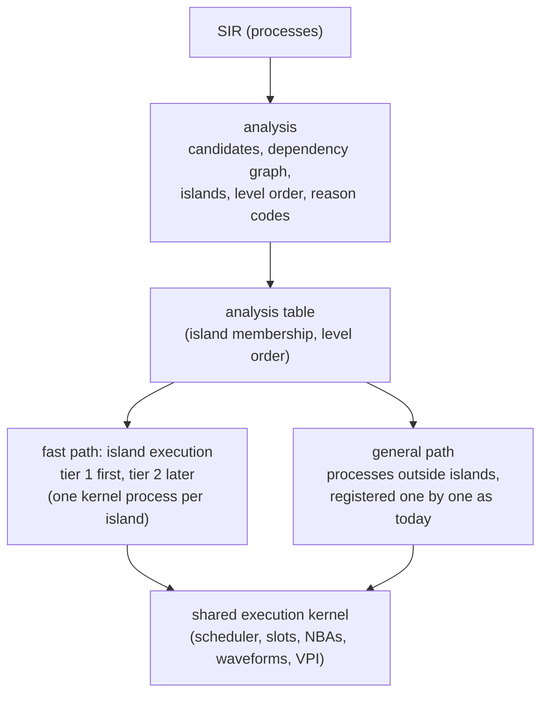

# Proposal: a fast path for synthesizable RTL (static islands)

[日本語](static-islands-proposal.ja.md). Status: **proposal, not approved** (2026-11-14). English is authoritative.
Nothing here is implemented, and `docs/spec/` is unchanged until a person approves the amendments in
"Changes".

## Summary

This feature is already in kirimasim's design as **static islands** (planned for P3). What this proposal adds
is not a new mechanism but the detailed specification, which so far is only a heading, and the order of the
work.

- Three things are already decided: processes in the synthesizable range are grouped into islands and
  evaluated in level order; tier 1 and tier 2 share one execution kernel, and processes of different tiers run
  mixed; tier 1 is the reference for correctness.
- This proposal adds four points: start the island candidates from a narrow range, record why each process is
  left out, and widen the range by measurement; build island execution in tier 1 before tier 2; make tier 2
  generate islands only, and give back to tier 1 any island it cannot generate; check the tiers against each
  other per island evaluation.
- It needs changes in `docs/spec/`, so a person's approval comes before any implementation. Claude Code's first
  task is to put this document in the repository as a proposal.
- The work starts in P3. P1's exit conditions and P2's scope (which does not include finding static islands)
  do not change. Whether to start earlier is an open point.
- On four benchmarks tier 1 was 1.31 to 1.66 times as fast as Icarus Verilog, and Verilator 2.2 to 93.9 times
  as fast as kirimasim ([BENCHMARKS](../BENCHMARKS.md), macOS, 2026-10-23, commit `dec94ff2`). Tier 2 is the
  main means of closing that gap. How much island execution in tier 1 alone gains is not confirmed.

Written against commit `63aad8d8` (2026-11-14), from the specifications and the code only; nothing was built
or run for it.

## What exists and what is already decided

The concept of islands and their main rules are approved; the implementation and the detailed specification
are not there yet. "Static islands" in `docs/spec/CODEGEN_SPEC.md` holds a single rule, and the rest is to be
written in P3.

| Item | Content | Source |
| --- | --- | --- |
| Present execution | Each SIR process is registered on its own with `Scheduler::addProcess` (`Interpreter::run()` in `src/vm/vm.cpp`). A change of a value wakes the processes waiting on it in the order they started to wait | SCHEDULER_SPEC 4.3 |
| `analysis` and `codegen` | Empty skeletons (27 lines each) | CLAUDE.md, the table of libraries |
| Island candidates | Among `cont`, `comb`, `latch`, `ff` and `ff-plain`, those with no delay, no event control in the middle and no call with side effects. SIR does not mark them; they are held separately as analysis results | SIR_SPEC 7.1 and 1 |
| Order inside an island | Each process is evaluated once in level order. Tier 1 uses the same order | CODEGEN_SPEC "Static islands"; UNSPECIFIED_BEHAVIOR A8 |
| Seen from outside | An island is one process from outside | SCHEDULER_SPEC 11 |
| Strongly connected components | Iterated up to a limit; beyond it, zero_time_limit (exit code 5). The limit is `--max-scc-iter` | UNSPECIFIED_BEHAVIOR A6; CLI 2.6 |
| Dependency graph | Built on bit ranges | UNSPECIFIED_BEHAVIOR A7 |
| Reads and writes | Computation inside an island reads the slot storage directly; writes to the island's outputs go through the function table | RUNTIME_ABI 4.2 (draft) |
| Analysis tables | Their form is fixed in P2, and P3 chooses the algorithms and fills them. A missing entry counts as unknown | [SIR v1 proposal](sir-v1-proposal.md) D6 and section 6 item 5 |
| Agreement of the tiers | Once tier 2 exists, every test runs on both tiers, and equal output is a required condition of CI | TEST_SUITE "Bug tests, and checking that tests fail" |
| Reserved option names | `--tier`, `--tier-check`, `--disable-pass`, `--state`, `--report-state-opt`, `--max-scc-iter` | CLI 2.3, 2.6 |
| Counters | `island.evals2`, `island.evals4` (P3) | PERFORMANCE 3.2 |
| Speed goals (draft) | 4-state RTL 10 times Icarus or more; 2-state RTL 0.5 to 1 times Verilator single-threaded | PERFORMANCE 2 |

Sharing signal storage between the tiers, and keeping the general execution path as the reference, are already
premises of the design; this proposal does not decide them again.

## Structure

The fast path runs on the same execution kernel as the general path. `analysis` divides the SIR processes into
island members and the rest, and each island is registered with the kernel as one process.

Processes outside islands run as they do now. With islands turned off, the whole run returns to the present
behaviour.

## Requirements

There are six groups. A row marked **existing** implements an approved specification as it stands; a row
marked **proposed** needs a person's approval and is not implemented until then.

### Analysis (`analysis`)

| ID | Requirement | Class |
| --- | --- | --- |
| ISL-A1 | Candidates are as SIR_SPEC 7.1 defines them: processes of the kinds `cont`, `comb`, `latch`, `ff` and `ff-plain`, with no delay, no event control in the middle and no call with side effects | Existing (SIR_SPEC 7.1, 1) |
| ISL-A2 | The first version leaves out candidates that have any of these: a `cont` carrying `netResolver`; reads or writes of values on the heap (strings, dynamic arrays, queues, objects); calls of system tasks and DPI; instructions that queue reports of unique and priority violations or deferred immediate assertions; writes to slots that a procedural `assign` or `force` may target; processes that belong to a program | Proposed |
| ISL-A3 | The reason for leaving a process out is recorded in a table, per process, as a reason code with a stable name. The list of reason codes is in CODEGEN_SPEC | Proposed |
| ISL-A4 | The nodes of the dependency graph are the candidates; there is an edge from P to Q when, in the same time slot, Q reads as sensitivity a slot range that P writes. Ranges are compared bit by bit (UNSPECIFIED_BEHAVIOR A7). Writes by NBA make no edge | Proposed |
| ISL-A5 | An island is made for each connected component of the dependency graph. `ff` and `ff-plain` processes woken by the same trigger (a slot, bits and an edge) go into one island | Proposed |
| ISL-A6 | The first version leaves out candidates that are in a strongly connected component. The iteration (UNSPECIFIED_BEHAVIOR A6) is implemented in stage 5 | Proposed |
| ISL-A7 | The level order is a topological order of the dependency graph, with ties broken by SIR process number. The same SIR and the same options make the same table, byte for byte | Proposed |
| ISL-A8 | The table follows the form P2 fixes. A missing or stale entry is unknown, and a process whose entry is unknown does not enter an island | Existing (SIR v1 proposal D6; section 6 item 5) |
| ISL-A9 | The first version neither removes nor merges slots; every slot keeps its storage | Proposed |

### Island execution in tier 1

| ID | Requirement | Class |
| --- | --- | --- |
| ISL-B1 | An island is registered with the execution kernel as one process. Its members are not registered on their own | Existing (SCHEDULER_SPEC 11) |
| ISL-B2 | An island wakes when a slot range that a member reads as sensitivity, and that is written from outside the island, changes, or when the trigger of an `ff` member happens | Proposed |
| ISL-B3 | One wake-up evaluates, once each and in level order, only the members whose inputs changed and the downstream members whose inputs those writes changed | Proposed |
| ISL-B4 | A member's body runs on tier 1's existing interpreter. The meaning of instructions does not change; only when and in what order members are evaluated changes | Proposed |
| ISL-B5 | In the first version, writes inside an island also go through the kernel's ordinary writes, so processes waiting outside the island, waveforms and VPI callbacks see changes on the same path as without islands | Proposed |
| ISL-B6 | NBAs of `ff` members are queued in the kernel as usual. Members woken by the same trigger are evaluated in the wake-up order of SCHEDULER_SPEC 4.3, so the order NBAs are issued in does not depend on islands | Proposed |
| ISL-B7 | The steps at time 0 (SCHEDULER_SPEC 6.1) do not change: `cont` members are first evaluated at step 4, `comb` and `latch` members at step 7 | Proposed |
| ISL-B8 | Nothing takes a process out of an island at run time. Forms that would need it are left out statically by ISL-A2 | Proposed |
| ISL-B9 | `--race-check` does not perturb the order inside an island | Existing (SCHEDULER_SPEC 11) |

### Tier 2 (islands only)

| ID | Requirement | Class |
| --- | --- | --- |
| ISL-C1 | The first version of tier 2 turns only island members into C++. Processes outside islands run on tier 1, mixed with them on the same execution kernel | Proposed |
| ISL-C2 | Generated code follows the rules of CODEGEN_SPEC (the same SIR gives the same C++, short-circuiting kept, side effects as many times as SIR says, order of evaluation) and of CLAUDE.md (C++20, no exceptions or RTTI, `-ffp-contract=off`) | Existing (CODEGEN_SPEC "Rules of C++ generation", "Floating point"; CLAUDE.md) |
| ISL-C3 | An island that holds an instruction tier 2 cannot generate runs, as a whole island, on tier 1's island execution, and its reason code is recorded. It is not an error | Proposed |
| ISL-C4 | Only the 4-state version is made first. The 2-state version, X-reachability analysis and switching between the two versions come in later stages | Proposed |
| ISL-C5 | The order of evaluation inside an island and the number of evaluations of each member are the same as in tier 1's island execution | Existing (CODEGEN_SPEC "Static islands") |
| ISL-C6 | Building, loading and caching generated code (`--cxx`, `--cache-dir`) are not decided here, but in a separate proposal that writes the sections of CODEGEN_SPEC and RUNTIME_ABI concerned | Out of scope |

### Checking

| ID | Requirement | Class |
| --- | --- | --- |
| ISL-D1 | Runs without islands and runs with islands are compared over the whole test suite: standard output, exit code and standard error must be equal | Proposed |
| ISL-D2 | Tests that differ are listed, and for each one a person is shown, with its grounds, whether the difference comes from an order the standard leaves open (IEEE 1800-2023 4.7; UNSPECIFIED_BEHAVIOR D3) or from a bug. Expected values are not rewritten to make a test pass | Existing (CLAUDE.md, "Changes of expected values go in separate PRs"; UNSPECIFIED_BEHAVIOR D3) |
| ISL-D3 | `--tier-check` compares, for every island evaluation, the result of tier 2 with that of tier 1's island execution: the sequence of slots written with their values, and the sequence of NBAs queued. A difference is reported in one line naming the island, the member, the time and the slot, and the run ends with exit code 3, as an error of kirimasim itself | Proposed |
| ISL-D4 | The operations of generated code have tests that cross-check them with `valsem` | Existing (CLAUDE.md, "C++ versions and prohibitions": fast versions are cross-checked with `valsem`) |
| ISL-D5 | Tests check that the counters that do not depend on the tier (`sched.*`, `proc.*`, `slot.*`, `nba.*`, `wait.*`, `sim.*`) are equal between tier 1's island execution and tier 2 | Proposed (PERFORMANCE 3.2 allows only these to be compared across tiers) |

### Measurement and counters

| ID | Requirement | Class |
| --- | --- | --- |
| ISL-E1 | `island.evals4` counts the evaluations of 4-state islands | Existing (PERFORMANCE 3.2) |
| ISL-E2 | Three counters are added: the number of islands, the number of processes in islands and the number of member evaluations. Their names follow PERFORMANCE 3.1 and are added to 3.2 | Proposed |
| ISL-E3 | Expected values of counts that islands lower (`proc.wakeups`, `sched.events.active` and the like) are lowered in a PR separate from the implementation | Existing (PERFORMANCE 4.3) |
| ISL-E4 | Wall-clock time is measured with `tools/bench.py` and recorded in `docs/BENCHMARKS.md`. It is not used to pass or fail | Existing (PERFORMANCE 1) |

### Command line

| ID | Requirement | Class |
| --- | --- | --- |
| ISL-F1 | One option turns islands on and off. Whether it is a new option or a value of the reserved `--disable-pass` is decided at approval | Proposed |
| ISL-F2 | The default is no islands until a person approves the completion of stage 3, and islands after that | Proposed |
| ISL-F3 | A report option is added that prints the number of islands, the number of members, the count per reason code and each process's reason. Its name and destination are decided at approval | Proposed |
| ISL-F4 | The default of `--max-scc-iter` is decided by measurement in the stage that implements the iteration of strongly connected components | Existing (CLI 2.6: "Decided in P3") |
| ISL-F5 | Every new option is listed in CLI.md. No environment variables and no switches that the documents do not list | Existing (CLAUDE.md, "No hidden knobs") |

## Changes

The changes are amendments of specifications, which need a person's approval, and code changes after them.
Every document has its English version as the authoritative one, so both the English and the Japanese
(`.ja.md`) versions are changed.

### Amendments of specifications (need an approval commit)

| File | What changes | Requirements |
| --- | --- | --- |
| `docs/notes/static-islands-proposal.md` | New: this proposal, in English. Status "proposal, not approved" | All |
| `docs/spec/CODEGEN_SPEC.md` | "Static islands": the exclusions and reason codes, the dependency graph, how islands are formed, the level order, tier 1's island execution, the first version that generates islands only | ISL-A2 to A7, B2 to B8, C1, C3, C4 |
| `docs/spec/SCHEDULER_SPEC.md` | 4.3 and 11: waking islands and the order of `ff` members; 6.1: islands and time 0 | ISL-B2, B6, B7 |
| `docs/spec/CLI.md` | 2.3: the island switch, the report and the behaviour of `--tier-check` | ISL-D3, F1 to F3 |
| `docs/spec/PERFORMANCE.md` | 3.2: the three counters | ISL-E2 |
| `docs/spec/TEST_SUITE.md` | The comparison with and without islands, and the mechanism matrices of islands | ISL-D1, D2, D5 |
| `docs/spec/UNSPECIFIED_BEHAVIOR.md` | The states of A6 to A8, and a row for any order newly decided | ISL-A6, B6 |
| `CLAUDE.md`, the table of libraries | Only if open point 2 ends with "`vm` depends on `analysis`" | — |

### Code changes (after approval)

| Place | Change |
| --- | --- |
| `src/analysis/` | New: deciding candidates, the dependency graph, strongly connected components, the level order, making the table, the report. It may depend on `sir` only |
| `src/vm/` | Registering islands and island execution, in new files. In `Interpreter::run()` of `vm.cpp`, where processes are registered, a branch that does not register island members on their own |
| `src/kernel/` | In principle unchanged. If an API is missing, it is proposed to a person as an addition to the public headers (C++20, and added to `tests/unit/kernel_headers_cxx20.cpp`) |
| `src/driver/` | Taking the options, calling the analysis, passing the table. `main.cpp` already takes `--max-scc-iter` |
| `src/codegen/` | In stage 4, generating C++ for island members |
| `tools/` | A generator of the island mechanism matrices, and a run that compares with and without islands |
| `tests/` | Unit tests of `analysis`, suite matrix tests, new items in `tests/perf_counts/expected.json`, CLI tests |
| `docs/` | `ARCHITECTURE.md`, `GLOSSARY.md`, the status in the READMEs and `CHANGELOG.md`, updated to the implementation |

The twelve designs of `bench/` do not change and are used for measurement as they are.

## Tests and acceptance

Pass or fail is decided by counts, which do not change from run to run, and by equal output. Wall-clock time is
recorded only (PERFORMANCE 1).

### Tests to add

- Mechanism matrices of islands, made by a generator, on four axes: the kind of member (`cont`, `comb`,
  `latch`, `ff`, `ff-plain`); the shape of the dependencies (a chain, a branch that joins again, an apparent
  loop cut by bit ranges, a real loop); what sits on an island's boundary (a process waiting with `@` outside,
  `$monitor`, waveforms, `force`, VPI reads and writes); the container (module, generate, interface).
- At least one control test per reason code, checking that such a process does not become a candidate.
- The analysis table made twice from the same input, checked equal byte for byte.
- The order of steps 4 to 7 at time 0, checked unchanged with and without islands.
- Several `ff` woken by the same clock writing one variable by NBA, checked to give the same result with and
  without islands.

Tests are named by the clause of the standard and the mechanism; other projects' tests and reproductions are not
copied (CLAUDE.md).

### Acceptance

1. `tools/local_ci.py` passes.
2. Without islands, the results of every existing test and PerfCount do not change.
3. With islands, the results of the whole suite equal those without islands; the only differences left are
   tests a person approved in the list of ISL-D2.
4. On `bench/comb_chain.sv` and `bench/nba_shift.sv`, `proc.wakeups` and `sched.events.active` are lower than
   without islands, and `vm.instrs` and `slot.changes` do not grow.
5. Once tier 2 is in, every test gives equal output on both tiers, `--tier-check` finds no difference, and the
   C++ generated twice from the same SIR is the same.
6. The wall-clock times of the twelve designs are measured with `tools/bench.py` and recorded in
   `docs/BENCHMARKS.md`.

How much condition 4 lowers the counts is not confirmed. The report of stage 2 gives the measured values, and a
person sets the target.

## Stages

Six stages; a person checks each stage's completion before the next. Speed changes most in stage 4.

| Stage | Scope | Effect on runs | Completion |
| --- | --- | --- | --- |
| 0 | Write this proposal, have a person decide the open points, put the amendments into `docs/spec/` | None | A commit with `Approved-by` |
| 1 | Analysis: candidates, the dependency graph, strongly connected components, the level order, the table, the report option | None (it only makes the table) | The table's determinism test passes. The report gives, for the twelve designs of `bench/` and the suite, the share of processes that became candidates and the count per reason |
| 2 | Tier 1 island execution, for `cont` and `comb` | Islands off by default; on with the option | Acceptance 1 to 4 (`comb_chain`) |
| 3 | `ff` and `ff-plain` in islands | The same | Acceptance 1 to 4 (`nba_shift`). A person approves switching the default to islands |
| 4 | Tier 2: C++ for islands only (4-state), `--tier`, `--tier-check` | Changes only when tier 2 is chosen with `--tier` | Acceptance 5 and 6 |
| 5 | Widening: iterating strongly connected components, `latch`, widening by the most frequent reasons, the 2-state version and X-reachability analysis | Per item | Acceptance 1 to 6, per item |

Stage 1 and later are P3 work. They start after P1 ends and P2's SIR v1 (including the form of the analysis
tables) is fixed.

Stage 4 needs the approval of the separate proposal on building and loading generated code (ISL-C6).

If stage 1 shows a low share of candidates, the exclusions of ISL-A2 are reviewed before stage 2, so that the
expected effect is checked in numbers before implementation starts.

## Open points and out of scope

### For a person to decide

These seven points are decided in stage 0. Until then, Claude Code implements none of the rows concerned.

| No. | To decide | Recommended | Why |
| --- | --- | --- | --- |
| 1 | When to start | P3, as planned | P1's exit conditions and P2's scope stay as they are. Stage 1 does not change runs, so running it alongside P2 is possible, but it needs an amendment of the phase plan |
| 2 | How `vm` receives the analysis table | `driver` runs `analysis` and passes the table | The table of libraries, where `vm` depends on `sir` and `kernel` only, stays as it is. Which library holds the table's type follows P2's decision on D6 (not confirmed) |
| 3 | Names of options | Islands on and off as a value of `--disable-pass`; the report as one new option | Uses a reserved name and keeps additions to one |
| 4 | Order of `ff` members inside an island | The order they started to wait (as SCHEDULER_SPEC 4.3) | The order of output does not change with or without islands |
| 5 | The first exclusions (ISL-A2) | As in the table above, starting narrow | Widening later is safe; narrowing later changes expected values. Which slots VPI can write is decided after reading VPI_SPEC (not confirmed) |
| 6 | Names of the three new counters | Starting with `island.` | Next to the existing `island.evals2` and `island.evals4` |
| 7 | Exit code when `--tier-check` finds a difference | 3 (internal error) | It is an error of the simulator, not of the design |

### Out of scope

- Building, loading and caching generated code (`--cxx`, `--cache-dir`): a separate proposal.
- The 2-state version and X-reachability analysis in the first version: stage 5.
- Parallel execution (P5) and tier 3's JIT.
- Merging and removing slots.
- Taking an island apart at run time to fall back to the general path. Whether a process is in an island is
  decided before the run.

## Rules for the work after approval

These rules all come from CLAUDE.md.

- Changes of `docs/spec/` go in with an `Approved-by` commit. Rows marked proposed are not implemented before
  approval.
- The table of libraries holds: `vm` depends on `sir` and `kernel`, `analysis` on `sir`, and `codegen` on `sir`
  and `analysis` only.
- `src/kernel/` and `src/vm/` use no `std::shared_ptr`, `dynamic_cast`, `std::function`, `getenv` or `typeid`.
- No environment variables and no hidden switches: behaviour changes only through options in CLI.md. No global
  state.
- Meaning is decided in one place: island execution changes only when and in what order members are evaluated,
  and whether a process enters an island is decided in `analysis` only.
- Changes of expected values go in PRs separate from implementation changes.
- What is not checked is written as not confirmed.
- No names or internal information of the private project, absolute paths of home directories, user names or
  email addresses in the repository.
- No GPL or LGPL source code is read. Where an idea comes from is recorded in the design note.
- `tools/local_ci.py` passes before a push. Commit messages are in English.

## Checked against the repository (2026-11-14)

Each existing row and each source in "What exists and what is already decided" was checked against the text at
`63aad8d8`. All of them have a source as cited. These differences in wording or range were found; they are
listed here and not corrected:

1. **`--max-scc-iter` is for tier 2.** CLI 2.6 defines it as the iterations of a static island of tier 2 (P3),
   and `src/driver/main.cpp` says that it has no effect until tier 2 has islands. ISL-A6 and stage 5 do not say
   on which tier strongly connected components are iterated. If tier 1's island execution iterates them, CLI 2.6
   needs an amendment.
2. **`analysis` is described as for tier 2.** ARCHITECTURE (the diagram and the table of libraries) and
   GLOSSARY describe `analysis` as analyses for tier 2 (P3). This proposal has tier 1 use the analysis table
   (ISL-B). CODEGEN_SPEC's rule already has tier 1 use the island order, so the intent agrees, but those
   descriptions would change with the implementation (listed under code changes, `docs/`).
3. **D6 is partly a draft.** The SIR v1 proposal has chosen the principles of separate tables and of
   missing or stale entries meaning unknown (section 6 item 5), which ISL-A8 relies on; the exact schema of the
   tables is still pending review.
4. **The benchmark figures are of an older tier 1.** The figures in the summary are the macOS measurement of
   2026-10-23 at `dec94ff2` on four designs. `docs/BENCHMARKS.md` also holds a Linux (WSL2) measurement of
   2026-10-25 at `b6683425` on eleven designs. Tier 1 has changed since; its present speed is not confirmed.
5. **Run-time indices in the dependency graph.** UNSPECIFIED_BEHAVIOR A7 says that an index known only at run
   time is evaluated by iteration. ISL-A4 compares bit ranges, and does not say how a write range with a
   run-time index enters the graph (left out, or the whole range).

Found on the way, outside this proposal: the priority line of CODEGEN_SPEC still says that C++ generation is
P2 work; since the renumbering of 2026-10-24 it is P3.
