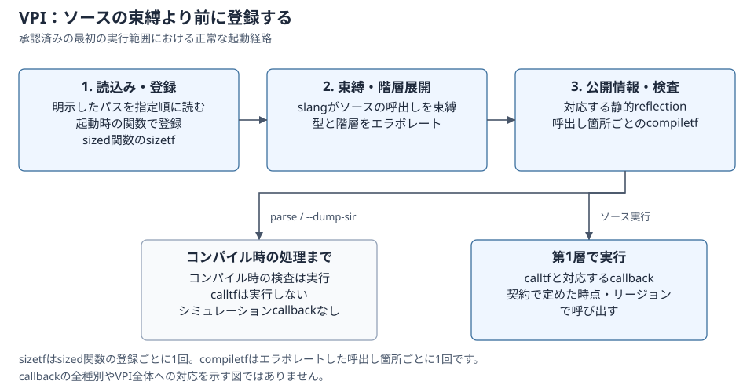

# P1 VPIの最初の実行範囲

[English](vpi-execution.md)

[承認済み契約](vpi-p1-proposal.ja.md)の1〜6節を、第1層のnative実行へ接続しました。
最初の範囲であり、VPI全体・Icarusとの同等性、cocotb連携、P1完了は未確認です。

## 読込みと呼出し

ライブラリをstartupの順に、パスで明示します。

```sh
build/dev/src/driver/kirimasim --vpi=./plugin.vpi design.sv +application_arg
build/dev/src/driver/kirimasim parse --vpi=./plugin.vpi design.sv
```

C pluginは`src/kernel/include/vpi_user.h`を使ってビルドします。Linuxでは共有ライブラリ用、
macOSではbundle/dynamic-lookup用のフラグを使います。
`tests/cli/run_vpi_tests.py`に両方の実行例があります。ライブラリは末尾がnullのstartup関数表
`vlog_startup_routines`を公開します。暗黙の検索や`-m`・`-M`の別名はありません。
読込み失敗、startup不在、不正な登録、名前の重複、組込名との衝突は入力エラーです。

taskと、整数・sized 4値・realを返す関数を、slangがソースを束縛する前に登録します。
`sizetf`は登録ごとに一度、`compiletf`はエラボレーションされた呼出し箇所ごとに一度です。
`parse`・`--dump-sir`もこのコンパイル時の検査を実行しますが、`calltf`、開始・終了callback、
ソースのシミュレーションは実行しません。登録関数の定数式での使用は未対応の診断に残します。

図は起動が成功する経路です。pluginのコンパイル時処理とソースのシミュレーションの境界を
示します。callbackのリージョンは承認済み契約に従います。



## オブジェクト・値・スケジューリング

静的な数値オブジェクト・scope、呼出し・引数handle、固定メモリ、宣言添字での選択を公開します。
reflectionに位置、単位、精度、階層、escapedな末尾名を保持します。1次元メモリ要素のiteratorは
宣言順です。多次元メモリは1次元ずつ選択できます。通常のソース実行は数値bindingを使います。
scalar・整数・vector、2/8/10/16進の文字列、packed文字列、realの変換はkernelの値の処理を使います。
VPI vectorは32ビットのaval/bvalの組で、paddingのマスクとX/Zを保ちます。

変数へのdeposit、payloadを所有するinertial/transport、変数のforce/releaseは、既存schedulerの
更新・保持の経路を使います。時刻callbackは契約どおりPre-Active・Post-NBA・Postponedへ置き、
値変更callbackは実効値の4値更新後に同期して呼びます。取り消し、再入、登録時のsnapshot、
next-timeの静止、final・終了の順は、既存の制限・終了規則を保ちます。

Contextがhostとライブラリを所有します。入口guardは元のContextを復元し、handleを使う前に
所有中のContextの表に所属するかを検査します。不正なhandleをC ABIで参照しません。
戻すbufferは関連APIの次の呼出し・再入までの借用です。遅延書込みはpayloadを所有し、callbackの
記述子はコピーします。`user_data`はpluginのポインタのままです。一時bindingは検査付きのVM
activation参照を持ち、VMの解体時に切り離します。寿命切れのアクセスは架空の値ではなくAPIエラーです。

## 明示する境界

- netへのdeposit・net全体のforce、解決した強度、未対応callback理由、未掲載APIの形は拒否します。
  後続のP1棚卸しの作業に残ります。
- 任意のclass・コンテナ・eventオブジェクトや動的SV stringをreflectionへ公開しません。
  未対応の引数型・格納先はソース位置付きの診断です。
- 集約refの最初以外のleafが独立のscalar bindingへ平坦化されていない形は拒否します。
  個別に平坦化したstructフィールドは検証しています。
- nativeのC stackを止めて時刻を進めることはできません。裏のcallbackスレッド、隠れたHDL process、
  暗黙の既定Contextは作りません。
- 公開ヘッダは対応するABIの宣言であり、IEEEの全VPI入口ではありません。存在しないシンボルを
  必要とするライブラリは読込みに失敗し、合格扱いにはしません。

エラーは`vpi_chk_error`で照会できます。未対応要求を成功のゼロにしません。読み取り専用領域の
書込み、時刻overflow、resource制限、内部エラーは既存の終了分類を保ちます。
`wire real`の新たな除外や、P1基準の縮小は行いません。

## 検証

不変の[独自参照一覧](vpi-reference-inventory.ja.md)は、日付付きの参照側の根拠として残します。
native CLI suiteは別に、元の23入力、生成した14文脈×5操作の行列、寿命・loader・エラーのケースを
実行します。kernel/frontend単体検査は、Contextの復元、所有、取り消し、force/release、宣言範囲、
型付きSIRの拒否、引数の一度だけの評価を扱います。
[検証記録](vpi-validation.ja.md)に構成ごとの実測とコンパイル変異を記録します。
この有限のケースや動くヘッダだけでVPI全体・cocotbへの対応を示すものではありません。
