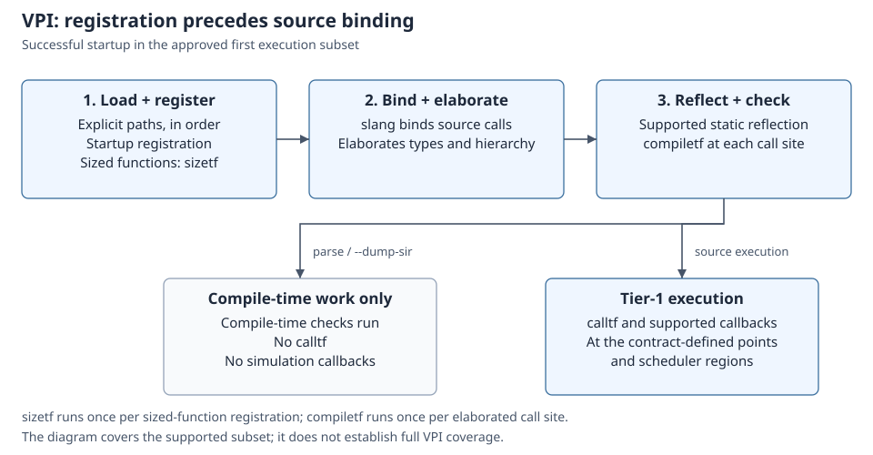

# First P1 VPI execution subset

[日本語](vpi-execution.ja.md)

Plugin compile-time checks and simulation callbacks run at different stages, so start
with the [VPI command workflow](../USER_MANUAL.md#use-a-c-plugin-through-vpi) before
testing a plugin.

The [approved contract](vpi-p1-proposal.md), sections 1–6, is connected to
native tier-1 execution. This is a first subset; full VPI/Icarus equivalence,
cocotb integration and P1 completion remain unconfirmed.

## Loading and calls

Pass each library explicitly, in startup order:

```sh
build/dev/src/driver/kirimasim --vpi=./plugin.vpi design.sv +application_arg
build/dev/src/driver/kirimasim parse --vpi=./plugin.vpi design.sv
```

Build a C plugin against `src/kernel/include/vpi_user.h`. On Linux, use the
platform shared-library flags; on macOS, use bundle/dynamic-lookup flags.
`tests/cli/run_vpi_tests.py` is an executable example of both. Libraries export
`vlog_startup_routines`, a null-terminated startup-function table. There is no
implicit plugin search or `-m`/`-M` alias. Library failures, missing startup,
invalid registrations, duplicate names and builtin collisions are input errors.

Tasks and integer, sized four-state and real functions register before slang
binds the source. `sizetf` runs once per registration and `compiletf` once per
elaborated call site. `parse` and `--dump-sir` execute these compile-time checks;
they do not run `calltf`, start/end callbacks or source simulation. Registered
functions in constant expressions remain diagnosed unsupported forms.

The diagram shows the successful startup path. The branch separates plugin
compile-time work from source simulation; callback regions remain those in
the approved contract.



## Objects, values and scheduling

The host exposes static numeric objects/scopes, call/argument handles, fixed
memories and declared-index selections. Reflection retains source locations,
units, precision, hierarchy and escaped leaf names. One-dimensional memory-word
iterators preserve declaration order; higher-dimensional memories can be selected
one dimension at a time. Ordinary source execution uses numeric bindings.
Scalar/integer/vector, binary/octal/decimal/hexadecimal strings, packed strings
and real conversions use the kernel's value helpers. VPI vector words are
32-bit aval/bval pairs, including padding masks and X/Z bits.

Variable deposits, owned inertial/transport payloads and variable force/release
share the scheduler's update/hold paths. Timing callbacks use Pre-Active,
Post-NBA or Postponed as specified in the contract; value-change callbacks run
synchronously after each effective four-state update. Cancellation, reentry,
registration snapshots, next-time quiescence and final/end ordering retain the
existing scheduler's limits and termination rules.

Context owns the host and libraries. Entry guards restore the previous Context;
handles are checked against the owning live Context's object table before use.
The C ABI does not dereference an unvalidated handle. Returned buffers are borrowed
until a related call or reentry. Delayed writes own their payloads; callback
descriptors are copied, while `user_data` remains the plugin's pointer. Transient
bindings carry checked VM activation references and are detached on VM teardown.
Expired accesses produce API errors rather than fabricated values.

## Explicit boundaries

- [Whole-net writes](vpi-net-write-execution.md) extend this initial subset with
  point-net deposits and registered-net force/release. Selected/delayed net writes,
  passive deposits, strength-format puts, unsupported callback reasons and unlisted
  APIs remain rejected follow-up P1 work.
- Reflection does not expose arbitrary class/container/event objects or dynamic
  SV strings. Unsupported source argument/storage types are positioned errors.
- A non-first aggregate-reference leaf that has not been flattened into its own
  scalar binding is rejected. Separately flattened struct fields are tested.
- Time cannot be advanced by suspending a native C stack. No background callback
  thread, hidden HDL process or implicit default Context is created.
- The public header declares the supported ABI, not every IEEE VPI entry point.
  A library requiring absent symbols fails to load; this is not a passing case.

Errors can be inspected with `vpi_chk_error`. Unsupported requests do not become
successful zero values. Read-only-region writes, time overflow, resource limits
and internal failures retain their existing termination classifications. No new
`wire real` exclusion or reduction of the P1 criterion is introduced.

## Verification

The immutable [original reference inventory](vpi-reference-inventory.md) remains
dated reference evidence. The native CLI suite separately runs those 23 inputs,
a generated 14-context × 5-operation matrix, and lifecycle/loader/error cases.
Kernel/frontend tests cover Context restoration, ownership, cancellation,
force/release, declared bounds, typed SIR rejection and argument evaluation once.
The [validation record](vpi-validation.md) records actual configuration results
and compiled controls. Neither these finite cases nor a working header establishes
full VPI or cocotb support.
