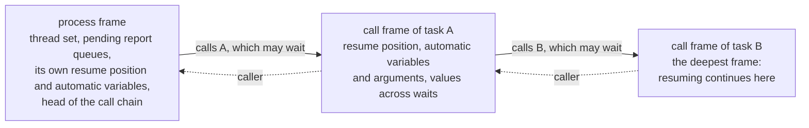

# RUNTIME_ABI：実行カーネルと生成コードの境界

[English](RUNTIME_ABI.md) · 英語版が正本で、これはその日本語版です。食い違ったときは英語版に従います。

優先度：P0。状態：**承認済み（2026-10-15 に改訂を承認）**。2026-10-14 に承認した版に、独立レビューの指摘を反映した。2026-10-18 に、4.3 節にフレームの連鎖の図を足した（承認済み）。同日、待ちのために kernel が呼ぶ関数の決まりを 5 節に、SIGINT を確かめる場所を 4.4 節に、シミュレーションのスレッドとそのスタックを 5 節に足した（承認済み）。2026-10-19 に、シミュレーションのスレッドのスタックを `--max-call-depth` に合わせる案を 5 節に足した（承認済み）。同日、`--max-wall-time` のために期限付きで待つメインスレッドの案を 5 節に足した（承認済み）。同日、8 節に 3 つの項目を足した（承認済み）。2026-10-20 に、9 節（状態と Context）を足し、1 節からそれを指した（承認済み）。同日、終了コードの対応表が driver に移ったのに合わせて 9.3 節の 9 を直し、slang の `Driver` が書く色のフラグと `front_parallel` を 9.7 節と 9.8 節に足した（承認済み）。2026-10-21 に、STDIN が読む先を 9.3 節の 10 に足した（承認済み）。同日、slang のスレッドと残りのスタックを 5 節に足した（承認済み）。2026-10-22 に、9.7 節を最新の状態にした：slang の色のフラグが atomic なので、front は複数のスレッドで動く（承認済み）。「案」の項目は、P1 と P2 で実装しながら確かめてから確定する。

この文書は、実行カーネル（`kernel`）と、第 1 層（VM）・第 2 層（生成した C++）・将来の第 3 層（JIT）との境界と、その版の管理を定める。「案」と書いた項目は、P1（第 1 層）と P2（第 2 層）で実装しながら確かめ、必要なら本書を直す（直すときは人の承認を受ける）。

## 1. 目的と原則

- **どの層も同じ形で登録する：** プロセスは「再開関数へのポインタとフレーム」として実行カーネルに登録する。カーネルからは、中身がインタプリタか生成コードかを区別できない。そのため、層をプロセスごとに混ぜられる（SCHEDULER_SPEC.md、SIR_SPEC.md の 7 節）。
- **境界は C の関数表にする：** 生成コードは共有ライブラリ（macOS は `.dylib`、Linux は `.so`）にビルドして、driver が読み込む。境界は、版番号付きの C の関数表と、C の構造体だけで表す。C++ の型（クラス、テンプレート、例外、RTTI）は境界を越えない。
- **大域の状態を持たない：** すべての状態は Context（`kernel::Context`）に置く。1 つのプロセスの中に、複数の Context と、版の違う複数の kirimasim のライブラリを置けるようにする（設計書の「分離」）。決まりは 9 節に書く。
- **例外を越えさせない：** エラーは戻り値で返す。生成コードは例外を使わない（設計書の C++ の規則）。
- **境界の名前の接頭辞：** 境界の C の型と関数の名前は `kirima_`、定数とマクロの名前は `KIRIMA_` で始める。利用者の設計や DPI-C のコードと同じ実行ファイルにリンクされるので、短い接頭辞は他のライブラリと重なりやすいため、プロジェクトの名前から取った長めの接頭辞にする（2026-10-16、人が決めた）。

## 2. 版

- **ABI の版**は、kirimasim 本体の版（セマンティックバージョニング）とは別に持つ。`(major, minor)` の 2 つの整数（案）。
  - major：互換性の無い変更（関数表の欄の削除と並べ替え、構造体の配置の変更、意味の変更）で上げる。
  - minor：互換性のある追加（関数表の末尾への欄の追加）で上げる。
- 生成コードは、作ったときの ABI の版を、読み込みの入口の関数で返す。driver は読み込むときに検査し、major が違えば読み込まない。minor は、生成コードの値がカーネルの値以下なら読み込む（案）。
- 生成コードのキャッシュの鍵には、次のものをすべて含める。どれか 1 つでも違えば作り直す（設計書の第 2 層の決まり）。
  - 生成した C++ の内容のハッシュ
  - コンパイラの名前と版
  - 対象（OS と CPU）
  - コンパイルのオプション
  - ABI の版
  - `kernel` の公開ヘッダの内容のハッシュ

## 3. 公開ヘッダ

- 生成コードが読むのは `src/kernel/include/kirimasim/kernel/` の公開ヘッダだけ。C++20 の保守的な範囲で書き、例外と RTTI を使わない（設計書の C++ の規則。`tests/unit/kernel_headers_cxx20.cpp` で C++20 としてコンパイルできることを確かめている）。
- 公開ヘッダに置くのは、次のものに限る。
  - 値の表現（`W4` など）と、インライン化してよい高速版の演算（`and4` など）。
  - 境界の C の構造体と関数表の宣言。
  - 生成コードの未定義動作を避けるための補助（幅のマスク、安全なシフトと除算）。
- 公開ヘッダの内容は、生成コードの意味に直接効くので、変えたら ABI の版を見直す。

## 4. 境界の形（案）

### 4.1 生成コードの入口

生成した共有ライブラリは、外に見せる記号を 1 つだけ持つ（案）。

```c
/* 生成コードが外に見せる唯一の記号（名前は案） */
const kirima_module_table* kirima_get_module_table(uint32_t kernel_abi_major,
                                                   uint32_t kernel_abi_minor);
```

- 戻り値の `kirima_module_table` は、ABI の版、プロセスとサブルーチンの再開関数の表、フレームの大きさと配置、生成コードが前提とするスロットの配置の識別子（SIR の内容のハッシュ）を持つ。
- ABI の版が合わなければ NULL を返す。
- ほかの記号はすべて隠す（`-fvisibility=hidden`）。複数のライブラリを 1 つのプロセスに読み込んでも衝突しないようにする。
- DPI-C の export（P3）では、C から呼ぶ関数の記号を外に見せる必要があり、「記号は 1 つ」の方針と両立しない。P3 で、export の記号だけを追加で見せる形に見直す。

### 4.2 カーネルの関数表

カーネルは、生成コードとインタプリタに、関数のポインタを並べた表（`kirima_kernel_api`）を渡す。生成コードは、カーネルの関数をこの表だけを通して呼ぶ（記号で直接リンクしない）。表に入れるもの（案）：

| 分類 | 内容 |
| --- | --- |
| 待ちと予定 | 時間の待ち、イベントの待ち（購読と監視レコード）、`wait` の条件、名前付きイベントのトリガ、NBA の予定、fork と join、disable |
| 値の書き込み | スロットへの書き込みと変化の通知（force の印のあるスロットの検査を含む） |
| 時刻と終了 | 今の時刻、`$finish`・`$stop`・`$fatal` の要求、停止の確認点 |
| システムタスク | 表示とファイル、`$readmem` など（重いものはカーネルに置き、生成コードからは呼ぶだけ） |
| オブジェクト | 確保、GC のセーフポイント（P3） |
| 報告 | unique・priority と遅延アサーションの保留の列への追加（SCHEDULER_SPEC.md の 15 節） |

- **混ぜた待ち（2026-10-18 に追記。承認済み）：** 1 つのイベント制御の待ちは、スロットの購読の項と、監視レコードの項を混ぜて 1 回の呼び出しで頼む（`wait_any`）。監視レコードの項も、購読の項と同じく `iff` の関数を持てる。既存の構造体の配置は変えず、関数表の末尾に足すので、ABI の minor を上げる（2 節）。
- **名前付きの混合待ちの項（2026-10-23の実装拡張）：** ABI 0.3は `wait_mixed` を末尾へ追加し、`kirima_named_wait_item` を定義する。既存の構造体やフィールドの位置は変えない。名前付きイベントIDと任意のguard/frameを、スロット・監視の項と同じカーネルの待ちの世代へ登録する。偽のguardは項を残し、最初に成立した項が残りを解除する。ABI 0.2の `wait_any` は変えない。既存のSCHEDULER_SPEC 9.5・SIR_SPEC 7.2を、2節の互換追加の規則で表す。
- 第 1 層（`vm`）は `kernel` と一緒にビルドされるので、この表を通さず、`kernel` の C++ の API を直接呼ぶ（本書の決まり。`vm` は `kernel` に依存してよい。ARCHITECTURE.md）。表を通すのは、別にビルドして読み込む生成コード（第 2 層と第 3 層）だけ。ただし、表の関数と C++ の API は同じ実装を呼び、意味を 2 つ持たない。
- 値の読み出しと、静的な島の中の計算は、表を通さず、スロットの格納領域を直接読む（速さのため）。格納領域の先頭のポインタと、スロットのオフセットの表を、Context から渡す。
- 静的な島の中の書き込みも、島の出力への書き込みは、まとめて確定するときに表の関数を通す（設計書の 2 版切り替えの決まり）。

### 4.3 再開関数とフレーム

```c
/* 再開関数の形（案） */
typedef kirima_status (*kirima_resume_fn)(kirima_context* ctx, void* frame);
```

- フレームは 2 段にする（案）。
  - **プロセスのフレーム：** スレッドの組（active か reactive）、保留の報告の列、呼び出しの連鎖の先頭、プロセス自身の再開の位置と automatic な変数を置く。
  - **呼び出しのフレーム：** 待ちを含むタスクを呼ぶたびに 1 つ確保し、連鎖でつなぐ。各フレームは、自分の再開の位置（基本ブロックの番号）、automatic な変数と引数、待ちをまたぐ一時の値、呼び出し元のフレームへの参照を持つ。automatic なタスクの再帰では、連鎖の長さが実行時に決まる（SIR_SPEC.md の 7.4 節）。
- 再開するときは、連鎖の最も深いフレームから続ける。タスクが戻ったら、そのフレームを外して呼び出し元の再開の位置へ戻る。

タスク A が呼んだタスク B の中にプロセスがいるときの、フレームの連鎖を図にしたもの（図と本文が食い違ったときは本文に従う）：



- 待ちを含まない関数の呼び出しは、ふつうの C の呼び出しにする（連鎖に積まない）。配置は SIR から決まり、層によらず同じにする。そのため、ある待ちまで第 1 層で動かしたプロセスを、次から第 2 層で動かすこともできる（P2 で使うかを決める）。
- 再開関数は、次の待ちに入るか終わるまで実行して戻る。戻り値（`kirima_status`）で、待ちに入った、正常に終わった、**kill か disable で終わった**（自分自身を `kill()` したときや、自分を含むブロックを `disable` したとき）、エラー、停止の要求を受けた、を区別する。
- C++20 のコルーチンは使わない（設計書の第 2 層の決まり）。

### 4.4 エラーと停止

- 境界の関数は、エラーを戻り値で返す。エラーの詳細（ID、メッセージ、ソースの位置）は Context に置き、driver が取り出す。
- 停止の要求（SIGINT と、時刻が進まない実行の上限）は、第 1 層ではループの戻りで、第 2 層ではループの戻りと一定の命令数ごとに、Context の旗を見て確かめる（SCHEDULER_SPEC.md の 16.2 節）。SIGINT の要求は、kernel も事象を 1 つ実行する前ごとに見て、第 1 層は分岐ごとに見る（2026-10-18 に承認）。SIGINT の旗は Context の外にあるただ 1 つの変数で（CLAUDE.md）、driver のシグナルのハンドラーが立て、Context はそれへのポインターを持つ。

## 5. スレッドと呼び出しの決まり

- シミュレーションは 1 つのスレッドで進める。VPI と DPI-C の呼び出しは、実行カーネルのスレッドから同期的に行う。ほかのスレッドからは呼べない（設計書の決まり）。
- **シミュレーションのスレッド（2026-10-18 に承認）：** driver は、512 MiB のスタックを持つ専用のスレッドで設計をコンパイルして走らせ、メインスレッドはその終わりを待つだけにする。第 1 層は待たない呼び出しを C++ のスタックの上で走らせ、1 つのプロセスの呼び出しの入れ子を 10000 段まで認める（SCHEDULER_SPEC.md の 16.2 節）。10000 段の入れ子は、release でおよそ 11 MiB、dev で 20 MiB、asan で 68 MiB のメモリを使った（2026-10-19 に測った）。メインスレッドがよく持つ 8 MiB より多い。
- **メインスレッドと `--max-wall-time`（2026-10-19 に承認）：** メインスレッドは、待つだけでなく、期限付きでシミュレーションのスレッドを待つ。期限が来たら、グローバル変数でない旗（Context が指す atomic）を立てて、また待つ。kernel と VM は時計を読まず、SIGINT の確認点でこの旗を見る（4.4 節。SCHEDULER_SPEC.md の 16.2 節）。
- **スタックの大きさ（2026-10-19 に承認）：** `--max-call-depth=<n>`（CLI.md の 2.7 節）のとき、スタックを 512 MiB × n / 10000 にして、既定のときの比を保つ。ただし、コンパイルも同じスレッドで走るので、512 MiB より小さくはしない。その大きさのスタックでスレッドを作れないときは、そのことを 1 行で標準エラーに書き、コード 2 で終わる。
- **slang のスレッド（2026-10-21 に追加、承認済み）：** front は、slang の仕事をすべて呼び出したスレッドでさせる（slang の `--threads=1`）。そうしないと、slang はコンパイルの一部をスレッドプールで行い、そのスレッドのスタックはシステムの既定の大きさ（macOS では 512 KiB）なので、slang が受け付ける 1000 段ほどの文や式の入れ子で、スタックが尽きる（#35）。2026-10-21 に、生成した 2000 モジュール（1.3 MB）の設計で測ったところ、コンパイルと実行の時間はどちらでも同じだった（0.73〜0.79 秒、dev）。Linux では、glibc が新しいスレッドに `ulimit -s` のスタック（確かめた機械では 8 MiB）を与えるので、それらの設計はプールを使っても通る。
- **残りのスタック（2026-10-21 に追加、承認済み）：** 入れ子の呼び出しの数（10000、SCHEDULER_SPEC.md の 16.2 節）は、設計の上限とする。それとは別に、kirimasim は、自分が走っているスレッドのスタックが尽きる前に止まる。どのスレッドでも、どのビルドでもそうする（#38）。Context が設計を走らせ始めるときと、front が始まるときに、今のスレッドのスタックの範囲を一度だけ読み（macOS は `pthread_get_stackaddr_np` と `pthread_get_stacksize_np`、Linux は `pthread_getattr_np`）、大域変数ではなく Context か front の状態に持つ。設計の呼び出し（VM の同期の呼び出し、カーネルが待ちのために呼ぶもの、遅らせた呼び出し）と、front の構文の再帰の 1 段ごとに、まず 1 MiB より多く残っているかを確かめる。残っていなければ、VM は resource_limit（コード 6）で実行を終え、SCHEDULER_SPEC.md の 16.2 節の行に `the stack of this thread is nearly used up` と書く。front は、診断 `<file>:<line>:<column>: error: nested too deeply for the stack of this thread`（コード 2）で止まる。スタックを読めない環境では、数の上限だけが効く。
- 生成コードのビルド（C++ のコンパイル）は、シミュレーションとは別のプロセスで行う。
- 将来のマルチスレッドでの実行（P4）は、静的な島の中の並列化に限り、境界の形は変えない方針にする（案）。
- **待ちのために kernel が呼ぶ関数（2026-10-18 に追加、承認済み）：** 待ちの eval と guard の関数（監視の記録の式と `iff`）は、元の SystemVerilog と同じく、呼んだサブルーチンの変数への書き込みと、事象の起動をしてよい。それ以外の書き込みは front が拒む（SCHEDULER_SPEC.md の 9.5 節）。kernel は、待ちの一覧と監視の記録の一覧をたどっている最中にこれらを呼ぶので、その間に起きた変化と起動は取っておき、一番外側の走査が終わったときに、起きた順に、同じ時刻スロットの中で知らせる。これらの関数は待たず、プロセスを動かす表の関数を呼ばない。

## 6. GC とセーフポイント（P3）

- GC は、決めたセーフポイント（時刻スロットの間や、領域の境界）でだけ走らせる。条件は、生成コードの一時の値がフレームの外に残っていないことと、DPI の呼び出しの最中でないこと。
- 時間を使う DPI-C の task をファイバーで止めている間も、「DPI の最中」として GC を走らせない。
- GC の根：プロセスのフレーム、クラスの static なメンバ、ハンドル型のスロット、未処理の事象と NBA の値、mailbox の中身、監視レコード。
- `weak_reference` の参照は、印付けでたどらず、印付けの後に参照先が生きていなければ null にする。
- 詳細は P3 で書く（設計書の「オブジェクトモデルと GC」）。

## 7. 他のシミュレータに組み込むライブラリ（P4）

`kirimasim lib-create` で作るライブラリは、本書の境界の上に、DPI-C の入口とラッパーを足したものにする。外に見せる記号は DPI の入口だけにし、ほかは隠す。詳細は LIB_EXPORT_SPEC.md（P2）で書く。

## 8. 未確認・後で書くこと

- 関数表の欄の確定と、C の構造体の配置（P1 の第 1 層と、P2 の第 2 層の実装で確かめる）。
- `kirima_status` の値の一覧と、エラーの ID の体系（CLI.md と一緒に）。
- フレームの配置を層の間で共有するときの、一時の値の割り当ての決め方。
- Windows（生成コードを MSVC でコンパイルするだけの範囲）での境界の扱い。
- GC、ファイバー、DPI-C の task の詳細（P3）。
- （2026-10-19 に承認。）子のプロセスが参照する親のフレームは、子が終わるまで GC の根として残す（P3。6 節）。
- （2026-10-19 に承認。）DPI-C の export の中で呼んだ `$finish` は、印を付けて C に戻し、SystemVerilog の文の終わりで終わる手順に入る。`svLogicVecVal` の引数と開いた配列の領域は、呼び出しの間だけ有効（P3）。
- （2026-10-19 に承認。）並列に走らせるのは副作用の無い静的な島だけにする。`$display`、DPI-C、乱数、`$finish` を含むプロセスは、主のスレッドで既定の順に実行し、スレッドの数で結果が変わらないようにする（P4）。

## 9. 状態と Context（2026-10-20 に承認）

### 9.1 目的

- 別々の Context を、1 つのプロセスの中で、順に、または別々のスレッドで同時に動かせる。
- 同じ入力からは同じ出力が出る。実行の順番、同じプロセスで前に何を動かしたか、ほかの Context が同時に動いているかによらない。
- 1 つのシミュレーションを複数のスレッドで動かすことは P4 で決め（5 節、8 節）、この節の対象外とする。ここに書くことは、その設計を縛らない。

### 9.2 用語

- **Context：** `kernel::Context`。1 つのシミュレーションの実行時の状態を持つもの（1 節）。今は、スケジューラ、スロットの記憶域、文字列、カウンタ（PerfCount）、出力を持つ。
- **大域状態：** 名前空間スコープの非 const の変数、非 const の static データメンバ、関数内の非 const の static 変数、`thread_local` の変数、そしてそれらを返す関数（`instance()`、`get()` など）。
- **不変な大域データ：** `constexpr` の表（と `constinit` の const の表）、文字列リテラル。`main` の前に決まり、その後は変わらない。

### 9.3 決まり

1. **大域状態を持たない：** `src/` の全体（front、sir、analysis、valsem、kernel、vm、codegen、driver）で持たない。例外は 9.4 に挙げるものだけ。
2. **状態は引数に現れる：** 状態を使う関数は、要る部分（スケジューラ、スロットの記憶域、文字列、カウンタ、乱数の状態など）を引数で受け取るか、それらへの参照を持つオブジェクトのメンバとする。Context の全体を受け取るのは、全体が要る所に限る。driver からの入口、実行を始める所、C の境界を越えて resume 関数を呼ぶ所（Context 全体のハンドルを渡す。4 節）、そのハンドルへの変換（`toC`）である。
3. **「今の Context」を大域変数や `thread_local` から取り出さない。** 例外は VPI と DPI-C の入口だけ（9.6）。
4. Context は**コピーもムーブもできない**ものとする。
5. **Context の間で共有するのは、不変なデータと const の入力**（誰も変えない間の、設計の SIR）**だけ**とする。Context は、別の Context の中を指す参照を持たない。例外は SIGINT の旗（9.4）で、プロセスのすべての Context が同じ旗を見る。シグナルはプロセス全体に届くからである。
6. 1 つの Context を、同時に使うのは**1 つのスレッドだけ**とする。
7. **静的記憶域とスレッド記憶域の変数：** 非 const のものは、9.4 に挙げるものを除いて禁じる。const だが、動的な初期化か自明でない破棄を持つもの（関数内の `static const std::set` など）も禁じる。そうした表は `constexpr` の表にするか、Context に移す。初期化と終了時の破棄の順番を考えずに済み、コンパイラの警告で検査できる（2026-10-20 に、2 つの案から人が決めた。もう 1 つの案は許すもので、C++11 からは関数内の static 変数の初期化がスレッドの間で安全で、その後は変わらないことを理由にしていた）。
8. **外からの入力**（環境変数、時刻、外から与える乱数のシード、ロケール）は driver だけが読み、Context を作るときか、実行の選択として渡す。カーネル、VM、front はどれも読まない（CLAUDE.md：実行中に環境変数を読まない）。
9. **終わり方：**
   - `$finish`、`$fatal`、上限に達したことなどは、Context の状態（スケジューラが持つ終わりの理由と段階）として返す。理由から終了コードへの対応表は driver が持ち（CLI.md の 5 節）、driver が終了コードにする。カーネルは理由を返すだけとする（2026-10-20 に人が決めた。対応表は #31 から driver の `exitCode`）。他のシミュレータに組み込むライブラリ（7 節）には終了コードが無い。
   - `exit`、`_Exit`、`quick_exit` は driver の中でだけ呼ぶ（今は、2 回目の SIGINT での `std::_Exit(130)` だけ。CLI.md の 5 節）。
   - `abort` と `std::terminate` は呼ばない。内部の不変条件が破れたこと（kirimasim の誤り）は、理由 internal として返す（`Scheduler::fail`）か、カーネルの境界の外で例外として投げて driver が受け止め、`internal error` を出して終了コード 3 にする（1 節：例外は境界を越えない）。
10. **出力**（設計の出力と診断）は、Context が指す先に出す。Context を作るときに出力先を渡す（既定は標準出力と標準エラー）。設計が STDIN（`32'h8000_0000`。SYSTEM_TASKS.md の 6.3 節）から読むものも、Context が指す所から読む。Context を作るときに、読む先のストリームを渡す。出力先を渡さずに作った Context は標準入力を読み、出力先だけを渡して作った Context は STDIN から何も読まず、読み込みは失敗する（2026-10-21 に追加、承認済み）。

### 9.4 例外

次のものだけを許す。可変な 2 つは、それぞれ `tools/global_state_allowlist.txt` に、ファイル、名前、この一覧の番号、理由を書いて登録する。不変な大域データ（9.2）は登録しない。

1. `constexpr` の表（と `constinit` の const の表）。
2. 文字列リテラル。
3. SIGINT の旗の `volatile std::sig_atomic_t` 1 つ。driver だけが持つ（CLAUDE.md）。
4. VPI と DPI-C の入口で使う「今の Context」。`thread_local` のポインタ 1 つ（9.6。P3）。

文字列をインターンする表は Context が持つ（今は `kernel::Strings`）。

### 9.5 規格の都合で大域になりやすいもの

- 次のものはすべて Context が持つ。`$random` の状態（シードを省いたときの暗黙のシードを含む）、`$urandom` の状態、制約付きランダムの乱数生成器の状態。重大度のタスクの数（数えるなら）。`$finish` と `$stop` の状態。PerfCount。plusargs（今は実行ごとに `vm::RunOptions` で渡しており、同じことである）。
- 上限（`--max-*`）は実行ごとに渡し（今は `vm::RunOptions` とスケジューラ）、大域には持たない。
- 初めのシードを、時刻やプロセス ID から作らない。

### 9.6 VPI と DPI-C（P3 の方針）

- ハンドル、コールバック、`systf` の登録、`svScope` は Context が持つ。
- 「今の Context」（9.4）は、カーネルが C のコードに入る直前と、中断していた import task を再開する直前に設定する。C のコードから戻るときと、task が中断するときに元に戻す。task を別のスレッドで再開しても（そこでファイバを再開する場合など）、正しい値になるようにする。
- 大域の既定の Context は作らない。
- `vlog_startup_routines` は Context ごとに 1 回ずつ呼ぶ。
- P3 では、VPI か DPI-C を使う Context は、1 つのプロセスの中で順に動かすことだけを保証し、同時に動かすことは保証しない。
- ユーザーの C のコードが持つ大域状態は、kirimasim の保証の外とする。

### 9.7 slang

- front は、実行ごとに slang の `Driver` を新しく作り、それと一緒に `SourceManager` と `Compilation` も作る。どれも共有しない（今は `src/front/front.cpp`、`src/front/lower.cpp`）。
- slang 自身は、プロセス全体の可変な状態を持つ（2026-10-20 に b7f11c1 で確かめた）。組み込み関数の表（`std::once_flag` の下で 1 回だけ作る）、既定の診断の整形、`OS` の出力の捕捉とコールバック、時間計測、既定の `SourceManager`、スレッドプールの `thread_local` の変数である。kirimasim は、`OS` の捕捉とコールバック、時間計測、既定の `SourceManager` を使わない。それらの状態のうち書き換えるのは 2 つのフラグだけである。slang の `Driver` は、作られるたびに `OS` の出力の色のフラグ（`OS::showColorsStdout`、`OS::showColorsStderr`）に書き、front は実行ごとに `Driver` を作る。このフラグは slang の 2026-10-21 の main から atomic なので、2 つの `Driver` が同時に書いてもデータ競合にならない。
- front は、複数のスレッドで同時に動かせる。2 つのフラグが atomic なので、同時に作った `Driver` どうしはもう競合しない（2026-10-20 に ThreadSanitizer の下で見つけ、2026-10-21 からの夜間の実行では出ない。#32）。`front_parallel`（9.8 節）が、CI と夜間でこれを確かめる。設計を先にコンパイルした Context も、複数のスレッドで同時に動く（`context_parallel`）。

### 9.8 テスト

この決まりを守らせるテストは、必ず通すテストとする（TEST_SUITE.md の「必須テストの一覧」）。1 つのプロセスで設計を順に動かすもの、別々のスレッドで ThreadSanitizer の下で同時に動かすもの、AddressSanitizer の下で作って壊すことを何度も繰り返すもの、そして単体テストを 1 つのプロセスで順番を入れ替えて流すものである。`front_parallel` は、front を複数のスレッドで同時に ThreadSanitizer の下で動かす（9.7 節）。一覧には載せるが、P1 の条件にはしない（2026-10-20 に決めた）。P3 では、中断した import task を別のスレッドで再開して「今の Context」を確かめるテストを足す。
