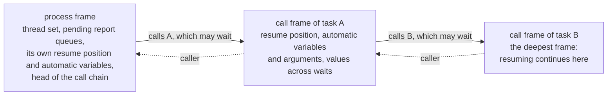

# RUNTIME_ABI：実行カーネルと生成コードの境界

[English](RUNTIME_ABI.md) · 英語版が正本で、これはその日本語版です。食い違ったときは英語版に従います。

**読み方：** [ABI](../GLOSSARY.ja.md#abi)はバイナリ境界の呼び出しとデータを定め、[SIR形式の版](../GLOSSARY.ja.md#format-version)はテキスト表現を識別するものです。

**改訂（2026-10-24）：** 旧P2→P3・旧P3→P4・旧P4→P5と付け替え、新しいP2（SIR v1）を設けました（tier番号は不変）。[対応表](../notes/phase-renumbering.ja.md)。

**P2境界方針の修正（2026-10-24承認）：**
[選択済みのP2方針](../notes/sir-v1-proposal.ja.md)に従い、SIR/kernel境界をP1と並行準備し、
P1の完了を判定したコミット（または保守者が指定するそれより前のP1のコミット。2026-11-07に修正）で、
P3のC++ジェネレータの前に確定します。完了したP1の全実行操作をサービスで扱い、
host/inline例外をレビューします。tier 1のC++直接呼び出しと公開ヘッダのC++20は保ちます。
現在のABIは0.5で、P2の間は0.xです。1.0は、第2層が関数表だけで小さなmodelを動かせた後、P3で宣言します（2026-11-07に修正）。entry/prototype/関数数・ref token配置・
例外の詳細は後続レビューで、182候補は公開関数一覧として承認したものではありません。

優先度：P0。状態：**承認済み（2026-10-15 に改訂を承認）**。2026-10-14 に承認した版に、独立レビューの指摘を反映した。2026-10-18 に、4.3 節にフレームの連鎖の図を足した（承認済み）。同日、待ちのために kernel が呼ぶ関数の決まりを 5 節に、SIGINT を確かめる場所を 4.4 節に、シミュレーションのスレッドとそのスタックを 5 節に足した（承認済み）。2026-10-19 に、シミュレーションのスレッドのスタックを `--max-call-depth` に合わせる案を 5 節に足した（承認済み）。同日、`--max-wall-time` のために期限付きで待つメインスレッドの案を 5 節に足した（承認済み）。同日、8 節に 3 つの項目を足した（承認済み）。2026-10-20 に、9 節（状態と Context）を足し、1 節からそれを指した（承認済み）。同日、終了コードの対応表が driver に移ったのに合わせて 9.3 節の 9 を直し、slang の `Driver` が書く色のフラグと `front_parallel` を 9.7 節と 9.8 節に足した（承認済み）。2026-10-21 に、STDIN が読む先を 9.3 節の 10 に足した（承認済み）。同日、slang のスレッドと残りのスタックを 5 節に足した（承認済み）。2026-10-22 に、9.7 節を最新の状態にした：slang の色のフラグが atomic なので、front は複数のスレッドで動く（承認済み）。P1で実行の意味を検査し、P3の前にP2で共通境界を確定する。上記の承認済み修正に従う。

この文書は、実行カーネル（`kernel`）と、第 1 層（VM）・第 2 層（生成した C++）・将来の第 3 層（JIT）との境界と、その版の管理を定める。P1で第1層の実行を検査し、P2でP1の完了を判定したコミットから共通境界を確定し（2026-11-07に修正）、P3で第2層を照合します。未確定の詳細契約と修正には人の承認が必要です。

## 1. 目的と原則

- **どの層も同じ形で登録する：** プロセスは「再開関数へのポインタとフレーム」として実行カーネルに登録する。カーネルからは、中身がインタプリタか生成コードかを区別できない。そのため、層をプロセスごとに混ぜられる（SCHEDULER_SPEC.md、SIR_SPEC.md の 7 節）。
- **境界は C の関数表にする：** 生成コードは共有ライブラリ（macOS は `.dylib`、Linux は `.so`）にビルドして、driver が読み込む。境界は、版番号付きの C の関数表と、C の構造体だけで表す。C++ の型（クラス、テンプレート、例外、RTTI）は境界を越えない。
- **大域の状態を持たない：** すべての状態は Context（`kernel::Context`）に置く。1 つのプロセスの中に、複数の Context と、版の違う複数の kirimasim のライブラリを置けるようにする（設計書の「分離」）。決まりは 9 節に書く。
- **例外を越えさせない：** エラーは戻り値で返す。生成コードは例外を使わない（設計書の C++ の規則）。
- **境界の名前の接頭辞：** 境界の C の型と関数の名前は `kirima_`、定数とマクロの名前は `KIRIMA_` で始める。利用者の設計や DPI-C のコードと同じ実行ファイルにリンクされるので、短い接頭辞は他のライブラリと重なりやすいため、プロジェクトの名前から取った長めの接頭辞にする（2026-10-16、人が決めた）。

## 2. 版

- **ABI の版**は、kirimasim 本体の版（セマンティックバージョニング）とは別に持つ。`(major, minor)` の 2 つの整数（案）。
  - major：互換性の無い変更（関数表の欄の削除と並べ替え、構造体の配置の変更、意味の変更）で上げる。
  - minor：互換性のある追加（関数表の末尾への欄の追加）で上げる。
- 生成コードは、作ったときの ABI の版を、読み込みの入口の関数で返す。driver は読み込むときに検査し、major が違えば読み込まない。minor は、生成コードの値がカーネルの値以下なら読み込む（案）。
- 生成コードのキャッシュの鍵には、次のものをすべて含める。どれか 1 つでも違えば作り直す（設計書の第 2 層の決まり）。
  - 生成した C++ の内容のハッシュ
  - コンパイラの名前と版
  - 対象（OS と CPU）
  - コンパイルのオプション
  - ABI の版
  - `kernel` の公開ヘッダの内容のハッシュ

## 3. 公開ヘッダ

- 生成コードが読むのは `src/kernel/include/kirimasim/kernel/` の公開ヘッダだけ。C++20 の保守的な範囲で書き、例外と RTTI を使わない（設計書の C++ の規則。`tests/unit/kernel_headers_cxx20.cpp` で C++20 としてコンパイルできることを確かめている）。
- 公開ヘッダに置くのは、次のものに限る。
  - 値の表現（`W4` など）と、インライン化してよい高速版の演算（`and4` など）。
  - 境界の C の構造体と関数表の宣言。
  - 生成コードの未定義動作を避けるための補助（幅のマスク、安全なシフトと除算）。
- 公開ヘッダの内容は、生成コードの意味に直接効くので、変えたら ABI の版を見直す。

## 4. 境界の形（案）

### 4.1 生成コードの入口

生成した共有ライブラリは、外に見せる記号を 1 つだけ持つ（案）。

```c
/* 生成コードが外に見せる唯一の記号（名前は案） */
const kirima_module_table* kirima_get_module_table(uint32_t kernel_abi_major,
                                                   uint32_t kernel_abi_minor);
```

- 戻り値の `kirima_module_table` は、ABI の版、プロセスとサブルーチンの再開関数の表、フレームの大きさと配置、生成コードが前提とするスロットの配置の識別子（SIR の内容のハッシュ）を持つ。
- ABI の版が合わなければ NULL を返す。
- ほかの記号はすべて隠す（`-fvisibility=hidden`）。複数のライブラリを 1 つのプロセスに読み込んでも衝突しないようにする。
- DPI-C の export（P4）では、C から呼ぶ関数の記号を外に見せる必要があり、「記号は 1 つ」の方針と両立しない。P4 で、export の記号だけを追加で見せる形に見直す。

### 4.2 カーネルの関数表

カーネルは、別にビルドした生成コード（tier 2・3）に、関数のポインタを並べた表（`kirima_kernel_api`）を渡す。tier 1は後述のとおりC++ APIを直接呼ぶ。生成コードは、カーネルの関数をこの表だけを通して呼ぶ（記号で直接リンクしない）。表に入れるもの（案）：

| 分類 | 内容 |
| --- | --- |
| 待ちと予定 | 時間の待ち、イベントの待ち（購読と監視レコード）、`wait` の条件、名前付きイベントのトリガ、NBA の予定、fork と join、disable |
| 値の書き込み | スロットへの書き込みと変化の通知（force の印のあるスロットの検査を含む） |
| 時刻と終了 | 今の時刻、`$finish`・`$stop`・`$fatal` の要求、停止の確認点 |
| システムタスク | 表示とファイル、`$readmem` など（重いものはカーネルに置き、生成コードからは呼ぶだけ） |
| オブジェクト | 確保、GC のセーフポイント（P4） |
| 報告 | unique・priority と遅延アサーションの保留の列への追加（SCHEDULER_SPEC.md の 15 節） |

- **混ぜた待ち（2026-10-18 に追記。承認済み）：** 1 つのイベント制御の待ちは、スロットの購読の項と、監視レコードの項を混ぜて 1 回の呼び出しで頼む（`wait_any`）。監視レコードの項も、購読の項と同じく `iff` の関数を持てる。既存の構造体の配置は変えず、関数表の末尾に足すので、ABI の minor を上げる（2 節）。
- **名前付きの混合待ちの項（2026-10-23の実装拡張）：** ABI 0.3は `wait_mixed` を末尾へ追加し、`kirima_named_wait_item` を定義する。既存の構造体やフィールドの位置は変えない。名前付きイベントIDと任意のguard/frameを、スロット・監視の項と同じカーネルの待ちの世代へ登録する。偽のguardは項を残し、最初に成立した項が残りを解除する。ABI 0.2の `wait_any` は変えない。既存のSCHEDULER_SPEC 9.5・SIR_SPEC 7.2を、2節の互換追加の規則で表す。
- 第 1 層（`vm`）は `kernel` と一緒にビルドされるので、この表を通さず、`kernel` の C++ の API を直接呼ぶ（本書の決まり。`vm` は `kernel` に依存してよい。ARCHITECTURE.md）。表を通すのは、別にビルドして読み込む生成コード（第 2 層と第 3 層）だけ。ただし、表の関数と C++ の API は同じ実装を呼び、意味を 2 つ持たない。
- 値の読み出しと、静的アイランドの中の計算は、表を通さず、スロットの格納領域を直接読む（速さのため）。格納領域の先頭のポインタと、スロットのオフセットの表を、Context から渡す。
- 静的アイランドの中の書き込みも、島の出力への書き込みは、まとめて確定するときに表の関数を通す（設計書の 2 版切り替えの決まり）。

承認されたP2方針では、不足する操作を型付きサービスへ整理し、VMの全API参照と対応を
検査します。[対応の棚卸し](../notes/sir-v1-proposal.ja.md)を起点にし、サービス名/prototype/
関数数・host/inline例外は詳細レビューで決めます。最初のストレージ照会を以下に示します。

ABI 0.5 は 0.4 の末尾に `query_service(id, version)` を加える。対応する番号と版の
組には、プロセス終了まで有効な読み取り専用の型付き C 関数表を返す。未知の組には
null を返す。サービス 1 の版 1 は `kernel/value_abi.h` の `kirima_value_api`。
呼び出し側が所有する 4 状態セル列は下位の 64 ビットから並び、各セルは符号なし
64 ビットの a、b の順。各スパンはポインタ、正のビット幅、幅を 64 で割り切り上げた
セル数を持つ。入力の未使用上位ビットはゼロ。入出力は重ねず、領域の大きさと生存期間は
呼び出し側が保証する。

値の関数表はビット、算術、比較、リダクションの演算を被演算子の形に沿ってまとめる。
シフト、幅変換、ビット選択と書き換え、条件選択、添字変換、文字列と実数の変換も
第 1 層と同じ実装を呼ぶ。戻り値で成功、不正な引数、出力容量不足、メモリ不足を区別する。
SystemVerilog の X は正常な結果。X/Z を含む添字と符号付き 64 ビットに収まらない
添字には、結果が既知かを示す別フィールドを使う。文字列はバイト数を問い合わせてから
出力できる。境界を通るのは C の型だけで、以前のスロット問い合わせも同じ位置で利用できる。

サービス 2 版 1（`io_abi.h`）は Context のファイル、出力、書式付き入力を扱う。
MCD・FD の open、出力先の取得、write、live、close、flush、flush-all、
get/unget、行・バイト列の読み取り、scan、tell、seek、EOF、error を提供する。
出力先のスナップショットは生成元の生存中の Context、標準出力・標準エラー・
無効の各フラグ、最大 30 件の（行、open の通番）を持つ。その Context 内で使用する。
同じ行を開き直しても延期した書き込みの宛先は変わらない。Context の破棄で失効する。
テキストは終端文字なしのバイト列と長さで渡す。行・バイト列・エラー文は呼び出し中に
受け取り関数へ一度渡す。関数は復帰までに消費またはコピーし、Context に再入しない。
サイズの確認のために入力を再読する必要はない。EOF、無効な open モード、未オープンなどの
SV の結果と、ABI 引数の誤り・資源不足を区別する。オフセット・バイト数・位置は 64 ビットとする。

ファイルと文字列の scan は共通の書式検査と出力先の記述子（幅付きの 2 値・4 値整数、
real、shortreal、string）を使う。出力先不足、書式エラー、代入数を報告する。
書式エラー時は入力を消費しない。代入した順に、受け取り関数へ出力先番号と変換済みセルを渡す。
負の十進値の拡張、2 値化、実数のビット表現、Context の文字列ハンドルも共通処理を使う。
セルは関数の復帰まで有効で、GC や Context への再入の前に保存する。
標準出力、標準エラー、メッセージ、flush、行頭の問い合わせは固定幅の引数を取り、出力順序をカーネルが管理する。

ABI 0.4 は関数表の末尾に二つの読み取り用の問い合わせを加える。
`slot_layout(ctx, slot, out)` はドメイン、幅、要素数、要素当たりのワード数、
ドメイン先頭からのワードオフセットを呼び出し側の記憶域にコピーする。
成功は 1、無効なスロットや引数の欠落は 0 を返す。
`domain_words(ctx, domain, count)` は借用する先頭ポインタとワード数を返す。
無効または空のドメインではヌルポインタと 0 ワードになる。
同じドメインの拡張または Context の破棄でポインタの有効期間が終わる。
値の変更はスケジューラの書き込みで通知する。強度付きネットの論理値は
通常のスロットに格納し、強度の情報はカーネルが管理する。

`kirima_query_kernel_api(major, minimum_minor)` は major が一致し、要求する
minor 以上を提供できるときに関数表を返す。他の場合はヌルポインタになる。
呼び出し側は版番号より後ろのフィールドを読む前にこれを確かめる。

サービス 3 版 1（`reference_abi.h`）は 64 ビットターゲットの実行時参照セルを定める。
バイト 0 に発行元を表す不透明な Context ポインタ、バイト 8 に符号なし 64 ビットの番号を置き、
サイズは 16、アラインメントは 8 とする。ポインタはフレームやセルを指さず、いずれのワードも
シリアライズしない。発行元 Context の生存中はコールバック間で受け渡せる。ゼロは無効。
同じ Context 内で番号を再発行しない。枯渇は資源エラーで、コピーした番号の二重解放や
別の生存中の Context での使用は失敗する。Context の破棄までにモデルが全参照を破棄する。

最初のエントリは型付きの字句スコープの配置作成・実体生成と、フィールドの結合・部分選択・
保持・解放・読み書きを提供する。配置は Context に属し、カーネルが型、パック幅、非パック次元、
クラスビューを検証する。ビューは宣言順のゼロ始まりの要素範囲とビット範囲を持つ。
部分選択は範囲を狭めるだけとし、読み取り専用権限を昇格できない。借用は最後の実体所有権の
解放で失効する。保持操作は元の権限を保つ独立した所有番号を返す。生存中の実体について、
既存のストアがヒープ・イベント・文字列の型付き GC ルートを列挙する。読み書きには呼び出し側の
W4 セルを使う。無効な範囲、失効した番号、割当失敗時は出力先に変更を加えず、番号も発行しない。
配置・ハンドル・範囲・権限・値の各エラーおよび資源不足を区別する。生成コードでもネイティブと
同じ実体領域の検査および変更フックが動く。その他の参照元と延期書き込みは v1 確定までに別途検証する。

サービス 4 版 1（`process_abi.h`）はプロセスの登録、延期レポート、終了を扱う。
ハンドルは生存中の Context、プロセス行、64 ビットの生成通番を持つ。解放後に行を再利用できる。
待機をまたいで同じプロセスを指し、解放、行の再利用、別の Context からの呼び出しは失敗する。
Active・Reactive の手続き、ネット解決、program initial、fork の子は、C の再開関数と
モデルのフレームを使って登録する。program の所属、子の実行グループの継承、資源制限には
第 1 層と同じスケジューラを使う。開始、待機の取消、kill、program の終了、完了と
保持中のコールバックの問い合わせができる。解放にはプロセスが完了し、再開関数の外にあり、
保留レポート・コールバック元の保持がないことを要する。busy では実体を保持する。
終了通知はレコードの解放まで同じプロセスを識別する。

延期テキストは登録時にコピーする。コールバックの登録が成功すれば、スケジューラが run または
drop で一度だけ関数に返すまでトークンを所有する。失敗時はモデルが所有を保つ。プロセスの
未確定アサーションの破棄と静的アサーション単位の取消はネイティブと同じ確定規則に従う。
モデルは配送までコールバックフレームを保持する。終了理由、レベル、時刻、GC 実行可否、
割り込み・オーバーフローの確認、エラー文・終了メモを取得できる。診断文字列は同期受け取り関数の
復帰まで有効とする。無効なハンドル、解放待ち、資源不足、取消中の終了を区別する。
C コールバックから例外を送出しない。

サービス 5 版 1（`scalar_task_abi.h`）は文字列ハンドル、型付き文字列ルートおよび乱数を扱う。
文字列は各 Context に属し、ゼロは空文字列とする。バイト列の登録、同期関数での文字列取得、
バイトの取得・置換、部分文字列、大小文字変換、比較、整数・実数への変換を提供する。
入力や書式化の結果を SV 文字列にする際は共通の代入規則で NUL を除く。
添字には既知かどうかを明示する。借用したバイト列は受け取り関数の復帰まで有効とする。
Context のホストが全ルートを渡して GC を開始し、追加のハンドルをマークした後で完了または
取消を行う。マーク失敗時は回収しない。統計は生存数、エントリ数、バイト数、回収の必要性を返す。
モデルは回収前に一時値のルートも提供する。

インスタンスの初期化、子の生成、取り出し、再シード、両端を含む範囲指定にはプロセス乱数の
64 ビット状態を使う。符号付き分布には解決済みの種別、32 ビットの入出力シードまたは Context の
既定シード、符号付き引数を渡す。結果と SV 引数の範囲外を返し、ABI 引数の誤りと区別する。
いずれもネイティブ呼び出しと同じ順序・回数で状態を更新する。

サービス 6 版 1（`presentation_abi.h`）は型付き引数の書式化とメモリファイルのテキスト解析を扱う。
カーネルの書式解析、時間倍率、時間書式を使い、整数セル、文字列・パターンのバイト列、
実数、必要な場合は強度範囲を渡す。受け取り関数は書式化したバイト列または診断を受け、
引数の過不足は別フラグで知る。メモリ読み込みには宣言の次元、幅、基数、省略可能な
アドレス範囲、許可した列挙値を渡す。ネイティブと同じ読み込み順のワードと範囲・個数・
入力の診断を返す。書き出し順の問い合わせは要素番号を返す。ポインタの借用は呼び出し中に
限り、モデルが保持する結果はコピーする。

サービス 7 版 1（`container_abi.h`）は Context の型付きヒープを使う。
レイアウトとコンテナ型の登録はワードごとのマスク、初期値、4 状態の有無、
文字列・入れ子のコンテナ・オブジェクトへの型付きの辺を保持する。
型とレイアウトの番号は登録した Context 内で使う。コンテナとセルの生存トークンは
発行した Context と世代を持ち、ゼロは空値を表す。トークンの所持だけでは GC のルートにならない。

生成、コピー、スナップショット、添字での読み書き、安定したセルの操作、
キューの編集、入れ子の値の格納、並べ替え時の交換、連想キーの検索には VM と同じ
トランザクション、既定値、警告、変更通知を使う。添字は不定値と符号付きの既知値を区別する。
生成時には割り当てに成功した後で、新規ワードの値を同期コールバックから取得できる。
モデルのバッファとコールバックは呼び出し中だけ有効である。
ABI の引数エラーと、ヒープ操作のエラーおよび警告を区別する。

収集可能な安全点でモデルは自身の型付きルートをすべて渡す。収集には保持中の字句
アクティベーションのルートとヒープ内のオブジェクトのピンも含める。文字列の
マークに任意の同期コールバックを使え、その失敗時はヒープを回収しない。
到達性の照会は値を書き換えない。

サービス 8 版 1（`object_abi.h`）は不変のクラス記述子を登録し、生成、
浅いコピー、フィールドの読み書き、動的ディスパッチ、キャスト、同一性、
弱参照にカーネルのヒープを使う。フィールド選択はレシーバ、宣言クラス、
自クラス内のフィールド番号、平坦化したワードまたはビットの範囲を保持する。
読み書きでは世代、レイアウト、権限を検証する。コンストラクタ段階の初期化権限は
対応する呼び出しだけに属し、完了または破棄で一度だけ失効する。
ピンは未公開のレシーバを保持する。チケットのコピーでピンは増えない。
ピンの取得と段階の開始は、ネイティブ操作で状態を変える前に返却用チケットを確保する。

サービス 9 版 1（`event_abi.h`）は永続的な名前付きイベントと管理対象イベント値の
生成、実行時ピンの保持・解放、イベント値での待機、triggered の照会、即時・遅延発火を扱う。
モデルが運ぶ値には発行した Context を、管理対象値には世代も含める。
表現可能な値とオーバーフローした遅延を区別し、既存カーネルの判定を使う。
待機の登録と発火予約は、モデル側のピンを解放しても対象を保持する。
収集可能な安全点ではモデルの全ルートと Context の保持するアクティベーションのルートを
列挙し、行の再利用はネイティブのバックエンドに任せる。統計で生存数、割当数、再利用可否を取得できる。

非ゼロのピンまたは段階のチケットは生存中の一つの Context と資源種別に属し、
その Context の生存中は再発行されない。解放または破棄で失効する。
モデルは Context を破棄する前にチケットを解放する。

サービス 10 版 1（`signal_abi.h`）は検証済みのスロット・要素・ビット範囲、
ドメインのワード、プロセスチケット、Context ごとのドライバ番号を使う。
手続き的な assign と force の保持・解放・保持中の書き込みはスケジューラで処理し、
下にある値の復元と観測者への通知も共通にする。遅延ドライバは立ち上がり・
立ち下がり・ターンオフの各遅延と、付随するスカラ出力の値を保持する。
サンプル入力、任意の直前値、クロッキングブロックは VM と同じタイムスロット開始前の
値を使い、同じ順序でイベントを配る。即時・遅延のスロット更新と文字列中の文字への
NBA は呼び出し中に入力をコピーする。モデルは保留中のスロット値を列挙し、検証済み
Design に従い型付きルートを公開できる。ワードバッファへのポインタは保持しない。

サービス 11 版 1（`task_abi.h`）は波形の初期設定・制御、ファイルの読み取り、
plusarg、表示先の選択を扱う。波形の記述子はスコープと変数の順序、宣言型と範囲、
物理スロットの同一性・別名、スコープの絞り込み、グリッチの設定、ファイル名による
波形形式の選択を保持する。初期設定は実行前に一度呼ぶ。ファイル名指定と dumpvars は
呼び出しが遅い場合とコマンドライン指定が優先される場合を区別して返す。
コンソールとファイルモニタの表示先はスケジューラが捕捉したものを使う。
plusarg はコマンドライン順に渡し、最初に接頭辞が一致した値を共通の走査計画と
型付き代入で扱う。ファイルを開けなかった場合と読み取り中のエラーを区別する。

サービス 12 版 1（`observation_abi.h`）は型付き式監視、混合待機、事前登録した
スロット待機、表示モニタ、捕捉済み NBA を扱う。監視は固定スロット範囲、永続または
管理対象のイベント値、字句的な感度範囲、実行時に読み取ったヒープや自動記憶域を
指定できる。コンテナの暗黙感度は宣言されたハンドルスロットとコンテナ型で識別する。
購読と世代の保持はカーネルが担う。評価・ガード・ヒープ読み取りフィルタの状態は
登録の終了まで保持する。準備済み待機は不変の無ガードスロット集合を Context の
チケットで識別する。NBA の捕捉時に値または文字更新を元の順序でコピーする。
別の登録で任意幅の符号付き・符号なしの繰り返し回数と、順序付きのスロット、
イベント値、式の選択肢を結び付ける。登録失敗時は呼び出し側が後始末を担い、
受理時は即時完了を含めてちょうど一度だけ解放コールバックを呼ぶ。ペイロードと
制御のチケットは別種で、消費後には再利用できない。配送、回数の減算、取り消し、
キュー内の順序、回収はネイティブスケジューラが決める。

サービス 13 版 1（`net_abi.h`）は強度ネットワーク、スカラーモジュールパス、
ユーザー定義プリミティブの表を登録・評価する。強度区間の符号付き両端、
スカラー駆動元、スイッチの導通状態を保持する。即時・慣性遅延による変更、
強度変化の待機、表示時の読み取り、選択されたパック範囲には共通カーネルを使う。
パスには表現可能な範囲を超えた遅延も含めて 12 遷移ごとの遅延を保持し、
宣言上の端点の同一性、グループ、条件、エッジを記録する。条件の評価状態は
切り離しまで借用する。モデルは UDP 表全体を Context のチケットに変換し、
呼び出し中に安定した入力を返すコールバックを使って評価できる。前回値と
今回値の処理順序および Z から X への正規化は VM と共通である。チケットを
解放した後の評価は拒否する。

サービス 14 版 1（`text_abi.h`）は解析した書式の各部分、静的なスカラー表示変換、
集約型のパターン表示、パック値による走査書式を扱う。浮動小数点表示に渡す前に、
カーネルが元の指定子を解析する。空の指定子は既定の表示変換を表す。静的な時刻値は
全体の精度の tick に換算済みとする。パターンは個数付きのノード配列、子とキーの範囲、
宣言順のフィールド名、列挙値、表示用の序数を保持する。循環や不正な形状では
部分的なテキストを返さず診断する。バイナリ出力中の NUL は SystemVerilog 文字列に
代入するまで保持する。結果のビューはコールバック中だけ有効である。時刻表示と
乱数分布の診断、分布名の検索も共通カーネルが提供する。

サービス 15 版 1（`foreign_abi.h`）は検証済み Design および生成モデルと Context の
VPI ホストを接続する。宣言、物理スロット、生成フレームのアクセサ、次元、呼び出し
ごとの引数を値レコードで記述する。一時アクセサは所有者の世代と選択範囲を保持し、
所有者を破棄する前に切り離す。ネット書き込み権限は検証済みの物理ネット全体を指す。
一部選択への書き込み権限を借用コールバックで付与することはできない。登録済みの
シグネチャ、コンパイル・実行の各段階、制御要求、診断は tier 1 と同じ VPI ホストが
扱う。プラグインのロードと初期化はドライバが担う。明示的に保持するバインディング
アダプタを除き、コールバックと結果の参照先は呼び出し中だけ有効である。

### 4.3 再開関数とフレーム

```c
/* 再開関数の形（案） */
typedef kirima_status (*kirima_resume_fn)(kirima_context* ctx, void* frame);
```

- フレームは 2 段にする（案）。
  - **プロセスのフレーム：** スレッドの組（active か reactive）、保留中の報告の列、呼び出しの連鎖の先頭、プロセス自身の再開の位置と automatic な変数を置く。
  - **呼び出しのフレーム：** 待ちを含むタスクを呼ぶたびに 1 つ確保し、連鎖でつなぐ。各フレームは、自分の再開の位置（基本ブロックの番号）、automatic な変数と引数、待ちをまたぐ一時の値、呼び出し元のフレームへの参照を持つ。automatic なタスクの再帰では、連鎖の長さが実行時に決まる（SIR_SPEC.md の 7.4 節）。
- 再開するときは、連鎖の最も深いフレームから続ける。タスクが戻ったら、そのフレームを外して呼び出し元の再開の位置へ戻る。

タスク A が呼んだタスク B の中にプロセスがいるときの、フレームの連鎖を図にしたもの（図と本文が食い違ったときは本文に従う）：



- 待ちを含まない関数の呼び出しは、ふつうの C の呼び出しにする（連鎖に積まない）。配置は SIR から決まり、層によらず同じにする。そのため、ある待ちまで第 1 層で動かしたプロセスを、次から第 2 層で動かすこともできる（P3 で使うかを決める）。
- 再開関数は、次の待ちに入るか終わるまで実行して戻る。戻り値（`kirima_status`）で、待ちに入った、正常に終わった、**kill か disable で終わった**（自分自身を `kill()` したときや、自分を含むブロックを `disable` したとき）、エラー、停止の要求を受けた、を区別する。
- C++20 のコルーチンは使わない（設計書の第 2 層の決まり）。

64 ビット対象の共通フレーム記述子は SIR のフレーム表から行順に計算する。
オフセットとサイズの単位はバイト、整列は 8、ペイロードのセルは 16 バイト。
整数要素は下位を先に ceil(幅/64) 個、その他のスカラーと参照束縛は 1 個のセルを使う。
SIR の行の型が符号化と GC ルートの種類を示す。先頭領域は行順にスカラーを配置し、
固定 unpacked 配列ごとに 1 セルを予約する。後続領域に同じ行順で配列を置き、
右端の次元が最速で変わる。配列への参照は一つの束縛を格納する。
通常行に物理オフセットを割り当て、スコープ行とキャプチャ行には起動の束縛を使う。
論理アドレスは全行を含み、起動に属する兄弟行を参照で特定できる。
サイズ演算を全件確認してから行を公開し、オーバーフローする設計は検証時に拒否する。
参照のセルサイズは必要な記憶域の大きさを定める。参照先の識別と権限の照会は
その参照を所有するランタイムが扱う。

### 4.4 エラーと停止

- 境界の関数は、エラーを戻り値で返す。エラーの詳細（ID、メッセージ、ソースの位置）は Context に置き、driver が取り出す。
- 停止の要求（SIGINT と、時刻が進まない実行の上限）は、第 1 層ではループの戻りで、第 2 層ではループの戻りと一定の命令数ごとに、Context の旗を見て確かめる（SCHEDULER_SPEC.md の 16.2 節）。SIGINT の要求は、kernel もイベントを 1 つ実行する前ごとに見て、第 1 層は分岐ごとに見る（2026-10-18 に承認）。SIGINT の旗は Context の外にあるただ 1 つの変数で（CLAUDE.md）、driver のシグナルのハンドラーが立て、Context はそれへのポインターを持つ。

## 5. スレッドと呼び出しの決まり

- シミュレーションは 1 つのスレッドで進める。VPI と DPI-C の呼び出しは、実行カーネルのスレッドから同期的に行う。ほかのスレッドからは呼べない（設計書の決まり）。
- **シミュレーションのスレッド（2026-10-18 に承認）：** driver は、512 MiB のスタックを持つ専用のスレッドで設計をコンパイルして実行し、メインスレッドはその終わりを待つだけにする。第 1 層は待たない呼び出しを C++ のスタックの上で実行し、1 つのプロセスの呼び出しの入れ子を 10000 段まで認める（SCHEDULER_SPEC.md の 16.2 節）。10000 段の入れ子は、release でおよそ 11 MiB、dev で 20 MiB、asan で 68 MiB のメモリを使った（2026-10-19 に測った）。メインスレッドがよく持つ 8 MiB より多い。
- **メインスレッドと `--max-wall-time`（2026-10-19 に承認）：** メインスレッドは、待つだけでなく、期限付きでシミュレーションのスレッドを待つ。期限が来たら、グローバル変数でない旗（Context が指す atomic）を立てて、また待つ。kernel と VM は時計を読まず、SIGINT の確認点でこの旗を見る（4.4 節。SCHEDULER_SPEC.md の 16.2 節）。
- **スタックの大きさ（2026-10-19 に承認）：** `--max-call-depth=<n>`（CLI.md の 2.7 節）のとき、スタックを 512 MiB × n / 10000 にして、既定のときの比を保つ。ただし、コンパイルも同じスレッドで走るので、512 MiB より小さくはしない。その大きさのスタックでスレッドを作れないときは、そのことを 1 行で標準エラーに書き、コード 2 で終わる。
- **slang のスレッド（2026-10-21 に追加、承認済み）：** front は、slang の仕事をすべて呼び出したスレッドでさせる（slang の `--threads=1`）。そうしないと、slang はコンパイルの一部をスレッドプールで行い、そのスレッドのスタックはシステムの既定の大きさ（macOS では 512 KiB）なので、slang が受け付ける 1000 段ほどの文や式の入れ子で、スタックが尽きる（#35）。2026-10-21 に、生成した 2000 モジュール（1.3 MB）の設計で測ったところ、コンパイルと実行の時間はどちらでも同じだった（0.73〜0.79 秒、dev）。Linux では、glibc が新しいスレッドに `ulimit -s` のスタック（確かめた機械では 8 MiB）を与えるので、それらの設計はプールを使っても通る。
- **残りのスタック（2026-10-21 に追加、承認済み）：** 入れ子の呼び出しの数（10000、SCHEDULER_SPEC.md の 16.2 節）は、設計の上限とする。それとは別に、kirimasim は、自分が走っているスレッドのスタックが尽きる前に止まる。どのスレッドでも、どのビルドでもそうする（#38）。Context が設計を走らせ始めるときと、front が始まるときに、今のスレッドのスタックの範囲を一度だけ読み（macOS は `pthread_get_stackaddr_np` と `pthread_get_stacksize_np`、Linux は `pthread_getattr_np`）、大域変数ではなく Context か front の状態に持つ。設計の呼び出し（VM の同期の呼び出し、カーネルが待ちのために呼ぶもの、遅らせた呼び出し）と、front の構文の再帰の 1 段ごとに、まず 1 MiB より多く残っているかを確かめる。残っていなければ、VM は resource_limit（コード 6）で実行を終え、SCHEDULER_SPEC.md の 16.2 節の行に `the stack of this thread is nearly used up` と書く。front は、診断 `<file>:<line>:<column>: error: nested too deeply for the stack of this thread`（コード 2）で止まる。スタックを読めない環境では、数の上限だけが効く。
- 生成コードのビルド（C++ のコンパイル）は、シミュレーションとは別のプロセスで行う。
- 将来のマルチスレッドでの実行（P5）は、静的アイランドの中の並列化に限り、境界の形は変えない方針にする（案）。
- **待ちのために kernel が呼ぶ関数（2026-10-18 に追加、承認済み）：** 待ちの eval と guard の関数（監視の記録の式と `iff`）は、元の SystemVerilog と同じく、呼んだサブルーチンの変数への書き込みと、イベントの起動をしてよい。それ以外の書き込みは front が拒む（SCHEDULER_SPEC.md の 9.5 節）。kernel は、待ちの一覧と監視の記録の一覧をたどっている最中にこれらを呼ぶので、その間に起きた変化と起動は取っておき、一番外側の走査が終わったときに、起きた順に、同じタイムスロットの中で知らせる。これらの関数は待たず、プロセスを動かす表の関数を呼ばない。

## 6. 型付きヒープ・GC・セーフポイント（2026-10-23 承認のP1改訂）

**整数コンテナの暗黙監視（2026-11-06承認）：**
[監視の契約](../notes/implicit-container-observers-proposal.ja.md)に従い、共有カーネルへ
静的な型付きの結び付きを渡す。スナップショットは長さと正規化した整数値のワード、
構造・セルへの弱い監視印であり、言語のコンテナのコピーやGC rootではない。
ヒープ観測用の読み取り・確保フックやソースの評価関数を呼ばない。同値のコピーも通常の
セルの同一性の規則を保ち、置換先へ監視を付け直す。取消し・破棄は確保せず通知を
無効化する。登録・スナップショットの置換はトランザクションとし、資源不足は終了コード6、
不正な記述子は既存の不具合分類で扱う。外部C ABIの版は変えない。

[承認済みのコンテナ修正案](../notes/dynamic-containers-proposal.ja.md)が動的配列・
キューの実行上の契約を定める（7.5・7.10・13.5.2）。Contextが型付きコンテナと安定した
要素セルを持つ。カーネルの配置記述子はslang・SIRの型に依存しない。ハンドル0は空。
コンテナは、伸びるvector内のアドレスでなくセルのトークンを持つ。挿入は残るセルを
保ち、削除・置換は旧セルを切り離す。実行中の参照は切り離したセルを生存させて読み書き
できる。入れ子を含む値のコピーは、代入先の置換前に独立したセルを確保する。
サイズ・バイト数のオーバーフローと確保失敗はresource_limit（終了コード6）として
返し、例外をカーネル境界の外へ投げない。失敗した操作は代入先を変更しない。

C++のヒープは、言語側の型を持たない不変の要素配置を登録する。同値な入れ子の
キューの配置は上限が違ってよい（6.22.2）。言語の型互換性は各層で検査する。
保持する各段の値はコピー先の型・上限でコピーし、どこかで切り詰めたら呼び出し元へ
BoundExceededを返す。配置の同値性は登録時に計算し、値の検査では確保もネイティブな
再帰も行わない。`Heap::snapshot`はSIRの`container.snapshot`に対応し、実際の元の
型・上限でコピーする。空はハンドル0のままとする。各層は、値が空の場合やrefの
仮引数の上限が違う場合にも、参照の結び付きに実際の対象変数の型を保つ。

VMの変数参照はスロット・フレームの識別子とともに実際の型を保持し、セル参照は
世代を検査するセルのトークンと登録した配置を保持する。読み取り専用の記述子の
問い合わせは、後の登録で無効になるアドレスでなくコピーを返す。`Heap::storeNested`は
所有する値を、再びコピーせずに単一コンテナのセルへ転送する。実際の対象の型と
完全に一致しなければならない。言語の代入は引き続き先に明示したコピーを行う。
Contextには、自分より長生きするヒープの確保元を渡せる。これで実行層の確保失敗を
決定的に検査する。

コンテナheapの回収は各層が公開した正確な型付きルートをたどる。スロット、プロセスと呼び出しの
フレーム、一時値、参照中のセル、保留の書き込みとイベント、報告、コールバックを含む。
入れ子と、参照が届く切り離したセルもたどる。全一時値が登録されDPIの呼び出し中でない
タイムスロット間か領域境界でのみ回収する。停止中のDPI taskも呼び出し中とする。
段階的な実装ではその境界まで回収を遅らせてよいが、ルートが欠けた状態で回収せず、
回収の延期だけで無制限の拡張性を主張しない。到達できない表の項目は再利用できるが、
古いトークンが別の値を指すことは許さない。回収と変更は確保失敗を途中の置換なしに返す。

**管理event専用の例外（2026-10-26承認）：** 管理eventの完全なルートが公開され、
実行中の各カーネル操作が具体的対象のpinを保持するなら、同期関数やguard評価中を含む
VM命令境界でも管理eventを回収できる。回収はソースcallbackを実行せず、シミュレーションの
イベント・領域・時刻を変えない。回収への再入と、eventの格納・引数/戻り値の転送・登録の
部分公開中の回収は禁止する。停止中taskを含むDPI呼び出し中の回収禁止は維持する。
必要なeventルート提供機構が不足・未対応なら、回収と、その機構を要するソース実行の有効化を
禁止し、失敗時に部分的なルート集合で回収してはならない。コンテナheapは上記の境界限定を
保つ。終了要求後と`final`はSCHEDULER_SPEC 16.2の遅延後始末を保ち、新たに回収しない。

例外やソースのautomatic event生成を有効にする前に、型付きslot、通常/scoped/capturedの
フィールド、input、入れ子・再入呼び出し/callbackを含む全活動中SSA領域、deferred引数、
未公開の転送値を公開する。待機・trigger・monitorのpinを保ち、整数・実数・文字列・refの
符号化ビットからevent handleを推測しない。`event.new`で物理行を増やす前に完全なルートで
回収できるようにし、まとめて回収する場合も余分な量は保持ルートと保留操作に比例した
有界な量にする。unwind・return・disable・完了・失敗の全経路で不要なルートを外し、
存続する子孫と保留操作を保ち、元のhookを復元する。ソースの副作用を再実行しない。
[承認したevent修正](../notes/managed-event-safepoints-proposal.ja.md)が、待機しないループ・
再進入・再帰・転送・配列・guard・キャンセル・遅延対象・確保失敗の検査行列、物理行数の
有界性、ルート欠落/早い再利用のコンパイル済み故障と通常経路の計測を定める。
実装状況（2026-10-26）：[命令境界eventの区切り](../notes/instruction-event-execution.ja.md)で、
型付きSSA領域・転送全体のpin・native活動の公開を、物理行増加前の回収とscalar/固定配列の
automatic宣言の既定値へ接続した。待機なしloop、再帰、callback、配列、遅延対象、
キャンセル、finalの除外、失敗/再利用を検査する。ソースのevent値・仮引数・structの対応は
部分的で、過去の拒否期待値1件の移行は別途承認後に`4ba6b63d`で適用済み。SSAは型付きbodyワード全体を保守的に
保持し、最終使用直後の生存解析ではない。実装ノートに検証と未確認の作業領域確保の監査を
記録する。承認だけでも有限のテストだけでもP1完了の証拠にはならない。
依存・C関数表のABI版・オプション・隠れた設定・性能予算・既存期待値の変更は含まない。

コンテナの実装状況（2026-10-24）：インタプリタはコンテナヒープの初回使用時に実行中だけ有効な
`SafePointHook`を登録し、どの終了経路でも元のフックへ戻す。スケジューラは外側の
領域の処理完了後と、タイムスロットのNBA arena解放後に呼び出す。プロセス・guardの
呼び出し中、終了要求後、`final`処理中は呼び出さず、残る確保領域はContextとともに
解放する。SCHEDULER_SPEC 16.2の終了方針を保ち、シミュレーションのイベントは追加しない。

インタプリタは、コンテナ型のスロット（static引数と固定配列の各要素も含む）、
生存中のプロセス・taskのフレーム変数、フレーム参照、保持するセル参照、遅延報告の
引数を公開する。カーネル側で終了した実行フレームは、生存中の参照から届く場合だけ
ルートになる。実行フレーム間の参照は反復でたどる。
`Scheduler::visitPendingValues`は所有する即時・遅延NBAの値、保留ドライバ、
保持中の元の値と上書き値を公開する。インタプリタは代入先スロットの型で絞ってから
ビットを解釈し、整数・実数などの値をハンドルと推測しない。
SSA一時値は待機をまたげず（SIR_SPEC 5.1）、ネイティブなプロセスや同期呼び出しの
実行中はコンテナheapを回収しない。

ヒープは確定したグラフの変更を記録する。インタプリタは型付きルートの集合も比較し、
追加のヒープ書き込みなしで最後の参照を捨てた場合や、同じハンドルを反復変更した場合も
回収する。ルートの公開・マーキングの確保失敗はResourceLimitを返す。
不完全なルート集合で回収せず、マーキング失敗では何も解放しない。
テストでは、旧代入先を保つ代入失敗と、代入確定後に両方の完全な値を保つ回収失敗を
区別する。これは現在のコンテナSIRのルートの実装であり、今後のクラス・DPI・VPIの
公開機構を含まない。frontは動的コンテナの検査済みの範囲を変換して実行する
（P1_SUPPORT.ja.mdの「動的コンテナの共通基盤」）。それ以外の形はまだ変換しない。

監視の土台は`Heap::setReadHook`・`setChangeHook`で実装する。フックは以前の
所有者と交換し、Contextの外では共有しない。読み取りは、空でないコンテナの
要素列・サイズか、特定のセルの値を記録する。コピー・スナップショット・構築も
読み取る元のセルを記録する。不定・範囲外の選択は要素列だけを記録し、
架空のセルを作らない。世代を検査する監視結果は対象の生存を延長しない。
値の通知は正規化後のワードを比較し、確定後にだけ行う。キューの挿入・削除は要素列の変更を
通知する。失敗・無変化の操作は通知しない。clear・置換は旧オブジェクトの内容でなく
変数の結び付きを変えるので、スロット・フレーム側でその依存を公開する。
コールバックは例外を投げず、ヒープを変更・回収しない。`MonitorSpec::heap`が毎回の
評価中だけフックを登録して読み取りを捕捉する。スケジューラは弱いオブジェクト・セルの
監視数を持ち、該当する監視IDと世代を共通の順序付き変更キューへ記録する。
各層は変更を公開した後、次の命令の前に`flushHeapChanges`を呼ぶ。ネイティブな
プロセスの復帰・待機境界でも排出する。guard・監視の走査中は最も外の走査が終わるまで
遅らせる。古い通知は再利用した記録に届かない。全読み取りの捕捉が成功してから
依存集合を入れ替え、確保失敗では不完全な集合を使わずResourceLimitを返す。
最後のヒープ監視を解除すると元のフックへ戻す。

VMはSIRの型と実際の参照を使い、呼び出し先の読み取りも捕捉する。反復で行う読み取り専用の
`Heap::reaches`が、呼び出した関数の現在の関数ローカルのコンテナのグラフを除外する（SCHEDULER_SPEC 9.5）。
グローバル・階層名の直接の読み取りは依存先に残す。問い合わせは読み取りの監視を通知せず、
GCのルートを作らない。監視のメタデータはヒープと同じContextごとの確保元を使い、
捕捉・通知の確保失敗を決定的に検査できる。VMは対象命令の位置付きで診断し、
コールバックのフレームを破棄する前に待機を外す。C++のメタデータを拡張し、C ABI 0.3は変えない。
frontによる言語側のコンテナ変換は、検査済みの範囲だけである（P1_SUPPORT.ja.md）。

クラス・mailbox・弱い参照の機構を実装するときにルート記述を拡張する。弱い参照は
印付けの辺でなく、参照先が到達不能ならnullにする。残る詳細は別の作業とする。

### 配列の値の交換（2026-10-25承認）

[承認した整列の契約](../notes/array-methods-proposal.ja.md)により、C++20の
`Heap::swapValues(type, actualContainer, first, second)`を追加します。
commit前に両添字・型・ハンドルを検証し、不正・同一添字なら何もしません。
正規化済みのcellの中身を交換し、各cellの識別・長さ・入れ子の所有値を保ち、
新しいheapオブジェクトを確保しません。変更したcellだけをcommit後に通知し、
入れ子の値のtracing情報を更新します。通知のための確保失敗は既存の位置付きResourceLimitとし、
不完全な通知を成功として扱いません。第1層は従来どおりC++ APIを直接使います。
関数表の新項目、C ABIの変更、新しい依存、境界を越える例外は加えません。

## 7. 他のシミュレータに組み込むライブラリ（P5）

`kirimasim lib-create` で作るライブラリは、本書の境界の上に、DPI-C の入口とラッパーを足したものにする。外に見せる記号は DPI の入口だけにし、ほかは隠す。詳細は LIB_EXPORT_SPEC.md（P3）で書く。

## 8. 未確認・後で書くこと

- 型付きサービスの全対応・レビュー済み例外・C関数表/構造体の配置・境界fixtureは、P2で、P1の完了を判定したコミットから、P3の前までに確定します（2026-11-07に修正）。現在のABI 0.5はdraftのままで、1.0はP3で宣言します（2026-11-07に修正）。
- `kirima_status` の値の一覧と、エラーの ID の体系（CLI.md と一緒に）。
- 共通frame配置と一時値/rootの寿命をP2で確定します。16byte cell・8byte整列を評価し、ref token表現と測定済み配置は詳細レビューします。
- Windows（生成コードを MSVC でコンパイルするだけの範囲）での境界の扱い。
- クラス・mailbox・弱い参照のGC拡張、ファイバー、DPI-Cのtaskの詳細。
  動的コンテナのヒープと回収の契約は6節に定める。
- （2026-10-19 に承認。）子のプロセスが参照する親のフレームは、子が終わるまで GC の根として残す（P4。6 節）。
- （2026-10-19 に承認。）DPI-C の export の中で呼んだ `$finish` は、印を付けて C に戻し、SystemVerilog の文の終わりで終わる手順に入る。`svLogicVecVal` の引数と開いた配列の領域は、呼び出しの間だけ有効（P4）。
- （2026-10-19 に承認。）並列に実行するのは副作用の無い静的アイランドだけにする。`$display`、DPI-C、乱数、`$finish` を含むプロセスは、主のスレッドで既定の順に実行し、スレッドの数で結果が変わらないようにする（P5）。

## 9. 状態と Context（2026-10-20 に承認）

### 9.1 目的

- 別々の Context を、1 つのプロセスの中で、順に、または別々のスレッドで同時に動かせる。
- 同じ入力からは同じ出力が出る。実行の順番、同じプロセスで前に何を動かしたか、ほかの Context が同時に動いているかによらない。
- 1 つのシミュレーションを複数のスレッドで動かすことは P5 で決め（5 節、8 節）、この節の対象外とする。ここに書くことは、その設計を縛らない。

### 9.2 用語

- **Context：** `kernel::Context`。1 つのシミュレーションの実行時の状態を持つもの（1 節）。今は、スケジューラ、スロットの記憶域、文字列、カウンタ（PerfCount）、出力、ファイル、波形の出力、ヒープ、アクティベーション、スタックの範囲を持つ。
- **大域状態：** 名前空間スコープの非 const の変数、非 const の static データメンバ、関数内の非 const の static 変数、`thread_local` の変数、そしてそれらを返す関数（`instance()`、`get()` など）。
- **不変な大域データ：** `constexpr` の表（と `constinit` の const の表）、文字列リテラル。`main` の前に決まり、その後は変わらない。

### 9.3 決まり

1. **大域状態を持たない：** `src/` の全体（front、sir、analysis、valsem、kernel、vm、codegen、driver）で持たない。例外は 9.4 に挙げるものだけ。
2. **状態は引数に現れる：** 状態を使う関数は、要る部分（スケジューラ、スロットの記憶域、文字列、カウンタ、乱数の状態など）を引数で受け取るか、それらへの参照を持つオブジェクトのメンバとする。Context の全体を受け取るのは、全体が要る所に限る。driver からの入口、実行を始める所、C の境界を越えて resume 関数を呼ぶ所（Context 全体のハンドルを渡す。4 節）、そのハンドルへの変換（`toC`）である。
3. **「今の Context」を大域変数や `thread_local` から取り出さない。** 例外は VPI と DPI-C の入口だけ（9.6）。
4. Context は**コピーもムーブもできない**ものとする。
5. **Context の間で共有するのは、不変なデータと const の入力**（誰も変えない間の、設計の SIR）**だけ**とする。Context は、別の Context の中を指す参照を持たない。例外は SIGINT の旗（9.4）で、プロセスのすべての Context が同じ旗を見る。シグナルはプロセス全体に届くからである。
6. 1 つの Context を、同時に使うのは**1 つのスレッドだけ**とする。
7. **静的記憶域とスレッド記憶域の変数：** 非 const のものは、9.4 に挙げるものを除いて禁じる。const だが、動的な初期化か自明でない破棄を持つもの（関数内の `static const std::set` など）も禁じる。そうした表は `constexpr` の表にするか、Context に移す。初期化と終了時の破棄の順番を考えずに済み、コンパイラの警告で検査できる（2026-10-20 に、2 つの案から人が決めた。もう 1 つの案は許すもので、C++11 からは関数内の static 変数の初期化がスレッドの間で安全で、その後は変わらないことを理由にしていた）。
8. **外からの入力**（環境変数、時刻、外から与える乱数のシード、ロケール）は driver だけが読み、Context を作るときか、実行の選択として渡す。カーネル、VM、front はどれも読まない（CLAUDE.md：実行中に環境変数を読まない）。
9. **終わり方：**
   - `$finish`、`$fatal`、上限に達したことなどは、Context の状態（スケジューラが持つ終わりの理由と段階）として返す。理由から終了コードへの対応表は driver が持ち（CLI.md の 5 節）、driver が終了コードにする。カーネルは理由を返すだけとする（2026-10-20 に人が決めた。対応表は #31 から driver の `exitCode`）。他のシミュレータに組み込むライブラリ（7 節）には終了コードが無い。
   - `exit`、`_Exit`、`quick_exit` は driver の中でだけ呼ぶ（今は、2 回目の SIGINT での `std::_Exit(130)` だけ。CLI.md の 5 節）。
   - `abort` と `std::terminate` は呼ばない。内部の不変条件が破れたこと（kirimasim の誤り）は、理由 internal として返す（`Scheduler::fail`）か、カーネルの境界の外で例外として投げて driver が受け止め、`internal error` を出して終了コード 3 にする（1 節：例外は境界を越えない）。
10. **出力**（設計の出力と診断）は、Context が指す先に出す。Context を作るときに出力先を渡す（既定は標準出力と標準エラー）。設計が STDIN（`32'h8000_0000`。SYSTEM_TASKS.md の 6.3 節）から読むものも、Context が指す所から読む。Context を作るときに、読む先のストリームを渡す。出力先を渡さずに作った Context は標準入力を読み、出力先だけを渡して作った Context は STDIN から何も読まず、読み込みは失敗する（2026-10-21 に追加、承認済み）。

### 9.4 例外

次のものだけを許す。可変な 2 つは、それぞれ `tools/global_state_allowlist.txt` に、ファイル、名前、この一覧の番号、理由を書いて登録する。不変な大域データ（9.2）は登録しない。

1. `constexpr` の表（と `constinit` の const の表）。
2. 文字列リテラル。
3. SIGINT の旗の `volatile std::sig_atomic_t` 1 つ。driver だけが持つ（CLAUDE.md）。
4. VPI と DPI-C の入口で使う「今の Context」。`thread_local` のポインタ 1 つ（9.6。P4）。

文字列をインターンする表は Context が持つ（今は `kernel::Strings`）。

### 9.5 規格の都合で大域になりやすいもの

- 次のものはすべて Context が持つ。`$random` の状態（シードを省いたときの暗黙のシードを含む）、`$urandom` の状態、制約付きランダムの乱数ジェネレータの状態。重大度のタスクの数（数えるなら）。`$finish` と `$stop` の状態。PerfCount。plusargs（今は実行ごとに `vm::RunOptions` で渡しており、同じことである）。
- 上限（`--max-*`）は実行ごとに渡し（今は `vm::RunOptions` とスケジューラ）、大域には持たない。
- 初めのシードを、時刻やプロセス ID から作らない。

### 9.6 VPI と DPI-C（P4 の方針）

- ハンドル、コールバック、`systf` の登録、`svScope` は Context が持つ。
- 「今の Context」（9.4）は、カーネルが C のコードに入る直前と、中断していた import task を再開する直前に設定する。C のコードから戻るときと、task が中断するときに元に戻す。task を別のスレッドで再開しても（そこでファイバを再開する場合など）、正しい値になるようにする。
- 大域の既定の Context は作らない。
- `vlog_startup_routines` は Context ごとに 1 回ずつ呼ぶ。
- P4 では、VPI か DPI-C を使う Context は、1 つのプロセスの中で順に動かすことだけを保証し、同時に動かすことは保証しない。
- ユーザーの C のコードが持つ大域状態は、kirimasim の保証の外とする。

### 9.7 slang

- front は、実行ごとに slang の `Driver` を新しく作り、それと一緒に `SourceManager` と `Compilation` も作る。どれも共有しない（今は `src/front/front.cpp`、`src/front/lower.cpp`）。
- slang 自身は、プロセス全体の可変な状態を持つ（2026-10-20 に b7f11c1 で確かめた）。組み込み関数の表（`std::once_flag` の下で 1 回だけ作る）、既定の診断の整形、`OS` の出力の捕捉とコールバック、時間計測、既定の `SourceManager`、スレッドプールの `thread_local` の変数である。kirimasim は、`OS` の捕捉とコールバック、時間計測、既定の `SourceManager` を使わない。それらの状態のうち書き換えるのは 2 つのフラグだけである。slang の `Driver` は、作られるたびに `OS` の出力の色のフラグ（`OS::showColorsStdout`、`OS::showColorsStderr`）に書き、front は実行ごとに `Driver` を作る。このフラグは slang の 2026-10-21 の main から atomic なので、2 つの `Driver` が同時に書いてもデータ競合にならない。
- front は、複数のスレッドで同時に動かせる。2 つのフラグが atomic なので、同時に作った `Driver` どうしはもう競合しない（2026-10-20 に ThreadSanitizer の下で見つけ、2026-10-21 からの夜間の実行では出ない。#32）。`front_parallel`（9.8 節）が、CI と夜間でこれを確かめる。設計を先にコンパイルした Context も、複数のスレッドで同時に動く（`context_parallel`）。

### 9.8 テスト

この決まりを守らせるテストは、必ず通すテストとする（TEST_SUITE.md の「必須テストの一覧」）。1 つのプロセスで設計を順に動かすもの、別々のスレッドで ThreadSanitizer の下で同時に動かすもの、AddressSanitizer の下で作って壊すことを何度も繰り返すもの、そして単体テストを 1 つのプロセスで順番を入れ替えて流すものである。`front_parallel` は、front を複数のスレッドで同時に ThreadSanitizer の下で動かす（9.7 節）。一覧には載せるが、P1 の条件にはしない（2026-10-20 に決めた）。P4 では、中断した import task を別のスレッドで再開して「今の Context」を確かめるテストを足す。

## 承認済みのP1実行契約（2026-10-25）

下記の実行契約を、各契約が列挙する節への規範的な修正とします。明示した範囲に限り、
古い未確定・除外の記述より優先します。根拠の節は過去の記録として残し、実装済みとは
扱いません。[承認記録](../notes/p1-execution-contracts-2026-10-25.ja.md)で範囲を固定し、
既存期待値と外部ABIの版を保ちます。

- [automatic活動の共有・捕捉・自動イベント、1–8節](../notes/automatic-capture-proposal.ja.md).
- [イベント制御付きNBA：スケジューラ・寿命・SIR/カーネル境界の契約](../notes/event-nba-proposal.ja.md).
- [遅延付き三状態ゲート：修正案の節](../notes/delayed-gate-side-proposal.ja.md).
- [クラスの識別・初期化・所有・実行、1–10節](../notes/class-runtime-proposal.ja.md).
