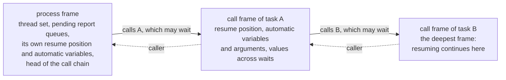

# RUNTIME_ABI: the boundary between the execution kernel and generated code

[日本語](RUNTIME_ABI.ja.md) · This English text is the main version; the Japanese version follows it, and where they differ, this text holds.

Priority: P0. Status: **approved (amendment approved 2026-10-15)**. The points of an independent review were applied to the version approved on 2026-10-14. On 2026-10-18 a diagram of the chain of frames was added to 4.3 (approved). The same day, the functions the kernel calls for waits were added to 5 (approved), where SIGINT is checked to 4.4 (approved), and the thread of the simulation and its stack to 5 (approved). On 2026-10-19, sizing the stack of the simulation thread by `--max-call-depth` was added to 5 (approved). The same day, a main thread that waits with a deadline for `--max-wall-time` was added to 5 (approved). The same day, three items were added to 8 (approved). Items marked "draft" are fixed after they are checked while implementing in P1 and P2.

This document sets the boundary between the execution kernel (`kernel`) and tier 1 (the VM), tier 2 (generated C++) and a future tier 3 (a JIT), and how its version is managed. Items marked "draft" are checked while implementing in P1 (tier 1) and P2 (tier 2), and this document is corrected if needed (a correction needs a human's approval).

## 1. Purpose and principles

- **Every tier registers in the same form:** a process is registered with the execution kernel as "a pointer to a resume function, and a frame". The kernel cannot tell whether what is inside is the interpreter or generated code. So tiers can be mixed process by process (SCHEDULER_SPEC.md; SIR_SPEC.md 7).
- **The boundary is a table of C functions:** generated code is built into a shared library (`.dylib` on macOS, `.so` on Linux) that the driver loads. The boundary is expressed only by a versioned table of C functions and C structures. No C++ type (classes, templates, exceptions, RTTI) crosses the boundary.
- **No global state:** all state is in the Context (`kernel::Context`). One process can hold several Contexts and several kirimasim libraries of different versions (the design specification's "isolation").
- **No exception crosses:** errors are returned as values. Generated code uses no exceptions (the design specification's C++ rules).
- **Prefix of the boundary's names:** the names of the boundary's C types and functions start with `kirima_`, and the names of its constants and macros with `KIRIMA_`. They are linked into the same executable as the user's design and DPI-C code, where a short prefix easily collides with other libraries, so the prefix is a longer one taken from the project's name (decided by a human, 2026-10-16).

## 2. Version

- The **ABI version** is kept separate from the version of kirimasim itself (semantic versioning). Two integers, `(major, minor)` (draft).
  - major: raised by incompatible changes (removing or reordering fields of the function table, changing the layout of a structure, changing a meaning).
  - minor: raised by compatible additions (adding fields at the end of the function table).
- Generated code returns the ABI version it was made with from its loading entry function. The driver checks it when loading, and does not load it if major differs. As for minor, it loads the code if the code's value is at most the kernel's (draft).
- The key of the cache of generated code contains all of the following. If any one differs, the code is made again (the design specification's rules for tier 2).
  - A hash of the content of the generated C++
  - The compiler's name and version
  - The target (OS and CPU)
  - The compile options
  - The ABI version
  - A hash of the content of `kernel`'s public headers

## 3. Public headers

- Generated code reads only the public headers in `src/kernel/include/kirimasim/kernel/`. They are written in a conservative part of C++20, without exceptions or RTTI (the design specification's C++ rules; `tests/unit/kernel_headers_cxx20.cpp` checks that they compile as C++20).
- The public headers hold only these:
  - The representation of values (`W4` and the like), and fast versions of operations that may be inlined (`and4` and the like).
  - Declarations of the boundary's C structures and function table.
  - Helpers that keep generated code from undefined behaviour (width masks, safe shifts and division).
- The content of the public headers bears directly on the meaning of generated code, so when it changes, the ABI version is reviewed.

## 4. Form of the boundary (draft)

### 4.1 Entry of generated code

A generated shared library makes only one symbol visible (draft).

```c
/* The only symbol generated code makes visible (the name is a draft) */
const kirima_module_table* kirima_get_module_table(uint32_t kernel_abi_major,
                                                   uint32_t kernel_abi_minor);
```

- The returned `kirima_module_table` holds the ABI version, the table of resume functions of processes and subroutines, the sizes and layouts of frames, and an identifier of the slot layout the generated code assumes (a hash of the content of the SIR).
- If the ABI version does not match, it returns NULL.
- All other symbols are hidden (`-fvisibility=hidden`), so that several libraries loaded into one process do not collide.
- DPI-C exports (P3) need symbols of functions called from C to be visible, which does not fit "one symbol". In P3 this is reviewed so that only the symbols of exports are made visible in addition.

### 4.2 The kernel's function table

The kernel gives generated code and the interpreter a table of function pointers (`kirima_kernel_api`). Generated code calls kernel functions only through this table (it does not link to them by symbol). What goes in the table (draft):

| Group | Content |
| --- | --- |
| Waits and scheduling | Waits for time, waits for events (subscriptions and monitor records), the condition of `wait`, triggering named events, scheduling NBAs, fork and join, disable |
| Writing values | Writing a slot and announcing its change (including the check of slots marked by force) |
| Time and ending | The current time, requests of `$finish`, `$stop` and `$fatal`, the check points for stopping |
| System tasks | Display and files, `$readmem` and so on (heavy ones live in the kernel; generated code only calls them) |
| Objects | Allocation, GC safepoints (P3) |
| Reports | Adding to the pending queues of unique, priority and deferred assertions (SCHEDULER_SPEC.md 15) |

- **Mixed waits (added 2026-10-18, approved):** the wait of one event control asks, in one call, for slot-subscription items and monitor-record items mixed (`wait_any`). A monitor-record item can have an `iff` function, as a subscription item can. The layout of existing structures does not change, and the function is added at the end of the table, so the ABI minor is raised (2).
- Tier 1 (`vm`) is built together with `kernel`, so it calls `kernel`'s C++ API directly, not through this table (rule of this document; `vm` may depend on `kernel`; ARCHITECTURE.md). Only generated code built separately and loaded (tiers 2 and 3) goes through the table. The table's functions and the C++ API call the same implementation, though; there are not two meanings.
- Reading values, and computing inside static islands, do not go through the table; they read the slot storage directly (for speed). The Context gives the pointer to the start of the storage and the table of slot offsets.
- Writes inside a static island to the island's outputs go through the table's functions when they are committed together (the design specification's rule of switching between two versions).

### 4.3 Resume functions and frames

```c
/* The form of a resume function (draft) */
typedef kirima_status (*kirima_resume_fn)(kirima_context* ctx, void* frame);
```

- Frames have two levels (draft).
  - **The process frame:** holds the thread set (active or reactive), the pending report queues, the head of the chain of calls, and the process's own resume position and automatic variables.
  - **The call frame:** one is allocated each time a task containing a wait is called, and they are chained. Each frame holds its own resume position (the number of a basic block), automatic variables and arguments, temporaries that live across waits, and a reference to the caller's frame. In recursion of automatic tasks, the length of the chain is decided at run time (SIR_SPEC.md 7.4).
- Resuming continues from the deepest frame of the chain. When a task returns, its frame is taken off and execution goes back to the caller's resume position.

The chain of frames while a process is inside task B, which task A called (where the diagram differs from the text, the text holds):



- A call of a function with no wait is an ordinary C call (not pushed on the chain). The layout is decided from the SIR and is the same whatever the tier. So a process that ran on tier 1 up to some wait can run on tier 2 from then on (whether to use this is decided in P2).
- A resume function runs until it enters the next wait or ends, and returns. Its return value (`kirima_status`) tells apart: it entered a wait; it ended normally; **it ended by kill or disable** (when it `kill()`ed itself, or `disable`d a block containing itself); an error; a request to stop was received.
- C++20 coroutines are not used (the design specification's rules for tier 2).

### 4.4 Errors and stopping

- The boundary's functions return errors as values. The details of an error (ID, message, source position) are put in the Context, where the driver takes them out.
- Requests to stop (SIGINT, and the limits on runs where time does not advance) are checked by looking at a flag in the Context: in tier 1 at the back edges of loops, in tier 2 at the back edges of loops and every so many instructions (SCHEDULER_SPEC.md 16.2). The kernel also looks at the SIGINT request before each event it runs, and tier 1 at each branch (approved 2026-10-18). The flag of SIGINT is the one variable outside the Context (CLAUDE.md): the driver's signal handler sets it, and the Context holds a pointer to it.

## 5. Rules of threads and calls

- Simulation proceeds on one thread. VPI and DPI-C calls are made synchronously from the execution kernel's thread. They cannot be called from other threads (a rule of the design specification).
- **The thread of the simulation (approved 2026-10-18):** the driver compiles and runs the design on one thread of its own, with a stack of 512 MiB, and the main thread only waits for it. Tier 1 runs a call that does not wait on the C++ stack, and lets the calls of one process nest 10000 deep (SCHEDULER_SPEC.md 16.2). Calls nested 10000 deep took about 11 MiB of memory in release, 20 in dev and 68 in asan (measured 2026-10-19), more than the 8 MiB a main thread often has.
- **The main thread and `--max-wall-time` (approved 2026-10-19):** instead of only waiting, the main thread waits for the simulation thread with a deadline. When the deadline passes, it sets a flag that is not a global variable (an atomic the Context points to) and waits again. The kernel and the VM read no clock; they look at the flag at the check points of SIGINT (4.4; SCHEDULER_SPEC.md 16.2).
- **Size of the stack (approved 2026-10-19):** with `--max-call-depth=<n>` (CLI.md 2.7), the stack is 512 MiB × n / 10000, keeping the ratio of the default, and never less than 512 MiB, as compiling runs on the same thread. If the thread cannot be made with that stack, kirimasim writes one line on standard error saying so and ends with code 2.
- Generated code is built (the C++ compiled) in a process separate from the simulation.
- Future multithreaded execution (P4) is limited to parallelism inside static islands, and the form of the boundary is meant not to change (draft).
- **Functions the kernel calls for waits (added 2026-10-18, approved):** the eval and guard functions of waits (the expressions of monitor records, and `iff`) may write the variables of the subroutines they call and trigger events, as the SystemVerilog they come from may; front rejects other writes (SCHEDULER_SPEC.md 9.5). The kernel calls them while it walks its lists of waiters and monitor records, so it keeps such a change or trigger and announces it, in the order made, when the outermost walk ends, in the same time slot. These functions do not wait, and do not call the table's functions that run processes.

## 6. GC and safepoints (P3)

- GC runs only at chosen safepoints (between time slots, or at the boundaries of regions). The conditions are that no temporary of generated code is left outside a frame, and that no DPI call is in progress.
- While a time-consuming DPI-C task is stopped on a fiber, it counts as "in a DPI call", and GC does not run.
- Roots of GC: process frames, static members of classes, slots of handle types, the values of pending events and NBAs, the contents of mailboxes, monitor records.
- References of `weak_reference` are not followed by marking; after marking, if the object referred to is not alive, the reference is made null.
- The details are written in P3 (the design specification's "object model and GC").

## 7. Libraries embedded in other simulators (P4)

A library made by `kirimasim lib-create` is the boundary of this document with DPI-C entries and wrappers added. Only the DPI entries are visible symbols; the rest are hidden. The details are written in LIB_EXPORT_SPEC.md (P2).

## 8. Not confirmed, to be written later

- Fixing the fields of the function table and the layout of the C structures (checked in the implementations of tier 1 in P1 and tier 2 in P2).
- The list of values of `kirima_status`, and the scheme of error IDs (together with CLI.md).
- How temporaries are allocated when the frame layout is shared between tiers.
- The boundary on Windows (to the extent of compiling generated code with MSVC).
- The details of GC, fibers and DPI-C tasks (P3).
- (Approved 2026-10-19.) The frame of a parent that a child process refers to is kept until the child ends, as a root of GC (P3; 6).
- (Approved 2026-10-19.) `$finish` called inside a DPI-C export is marked and returned to C, and the run starts to end at the end of the SystemVerilog statement; `svLogicVecVal` arguments and the storage of open arrays are valid only during the call (P3).
- (Approved 2026-10-19.) Only static islands with no side effects run in parallel; processes with `$display`, DPI-C, random numbers or `$finish` run on the main thread in the default order, so that results do not change with the number of threads (P4).
