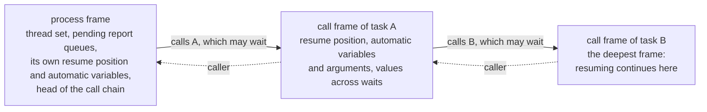

# RUNTIME_ABI: the boundary between the execution kernel and generated code

[日本語](RUNTIME_ABI.ja.md) · This English text is the main version; the Japanese version follows it, and where they differ, this text holds.

Priority: P0. Status: **approved (amendment approved 2026-10-15)**. The points of an independent review were applied to the version approved on 2026-10-14. On 2026-10-18 a diagram of the chain of frames was added to 4.3 (approved). The same day, the functions the kernel calls for waits were added to 5 (approved), where SIGINT is checked to 4.4 (approved), and the thread of the simulation and its stack to 5 (approved). On 2026-10-19, sizing the stack of the simulation thread by `--max-call-depth` was added to 5 (approved). The same day, a main thread that waits with a deadline for `--max-wall-time` was added to 5 (approved). The same day, three items were added to 8 (approved). On 2026-10-20, 9 (state and Contexts) was added, with 1 pointing to it (approved). The same day, 9.3.9 was brought up to date after the table of exit codes moved to the driver, and the colour flags that slang's `Driver` writes, with `front_parallel`, were added to 9.7 and 9.8 (approved). On 2026-10-21, where STDIN reads was added to item 10 of 9.3 (approved). The same day, slang's threads and the stack left were added to 5 (approved). On 2026-10-22, 9.7 was brought up to date: slang's colour flags are atomic, so front runs on several threads (approved). Items marked "draft" are fixed after they are checked while implementing in P1 and P2.

This document sets the boundary between the execution kernel (`kernel`) and tier 1 (the VM), tier 2 (generated C++) and a future tier 3 (a JIT), and how its version is managed. Items marked "draft" are checked while implementing in P1 (tier 1) and P2 (tier 2), and this document is corrected if needed (a correction needs a human's approval).

## 1. Purpose and principles

- **Every tier registers in the same form:** a process is registered with the execution kernel as "a pointer to a resume function, and a frame". The kernel cannot tell whether what is inside is the interpreter or generated code. So tiers can be mixed process by process (SCHEDULER_SPEC.md; SIR_SPEC.md 7).
- **The boundary is a table of C functions:** generated code is built into a shared library (`.dylib` on macOS, `.so` on Linux) that the driver loads. The boundary is expressed only by a versioned table of C functions and C structures. No C++ type (classes, templates, exceptions, RTTI) crosses the boundary.
- **No global state:** all state is in the Context (`kernel::Context`). One process can hold several Contexts and several kirimasim libraries of different versions (the design specification's "isolation"). The rules are in 9.
- **No exception crosses:** errors are returned as values. Generated code uses no exceptions (the design specification's C++ rules).
- **Prefix of the boundary's names:** the names of the boundary's C types and functions start with `kirima_`, and the names of its constants and macros with `KIRIMA_`. They are linked into the same executable as the user's design and DPI-C code, where a short prefix easily collides with other libraries, so the prefix is a longer one taken from the project's name (decided by a human, 2026-10-16).

## 2. Version

- The **ABI version** is kept separate from the version of kirimasim itself (semantic versioning). Two integers, `(major, minor)` (draft).
  - major: raised by incompatible changes (removing or reordering fields of the function table, changing the layout of a structure, changing a meaning).
  - minor: raised by compatible additions (adding fields at the end of the function table).
- Generated code returns the ABI version it was made with from its loading entry function. The driver checks it when loading, and does not load it if major differs. As for minor, it loads the code if the code's value is at most the kernel's (draft).
- The key of the cache of generated code contains all of the following. If any one differs, the code is made again (the design specification's rules for tier 2).
  - A hash of the content of the generated C++
  - The compiler's name and version
  - The target (OS and CPU)
  - The compile options
  - The ABI version
  - A hash of the content of `kernel`'s public headers

## 3. Public headers

- Generated code reads only the public headers in `src/kernel/include/kirimasim/kernel/`. They are written in a conservative part of C++20, without exceptions or RTTI (the design specification's C++ rules; `tests/unit/kernel_headers_cxx20.cpp` checks that they compile as C++20).
- The public headers hold only these:
  - The representation of values (`W4` and the like), and fast versions of operations that may be inlined (`and4` and the like).
  - Declarations of the boundary's C structures and function table.
  - Helpers that keep generated code from undefined behaviour (width masks, safe shifts and division).
- The content of the public headers bears directly on the meaning of generated code, so when it changes, the ABI version is reviewed.

## 4. Form of the boundary (draft)

### 4.1 Entry of generated code

A generated shared library makes only one symbol visible (draft).

```c
/* The only symbol generated code makes visible (the name is a draft) */
const kirima_module_table* kirima_get_module_table(uint32_t kernel_abi_major,
                                                   uint32_t kernel_abi_minor);
```

- The returned `kirima_module_table` holds the ABI version, the table of resume functions of processes and subroutines, the sizes and layouts of frames, and an identifier of the slot layout the generated code assumes (a hash of the content of the SIR).
- If the ABI version does not match, it returns NULL.
- All other symbols are hidden (`-fvisibility=hidden`), so that several libraries loaded into one process do not collide.
- DPI-C exports (P3) need symbols of functions called from C to be visible, which does not fit "one symbol". In P3 this is reviewed so that only the symbols of exports are made visible in addition.

### 4.2 The kernel's function table

The kernel gives generated code and the interpreter a table of function pointers (`kirima_kernel_api`). Generated code calls kernel functions only through this table (it does not link to them by symbol). What goes in the table (draft):

| Group | Content |
| --- | --- |
| Waits and scheduling | Waits for time, waits for events (subscriptions and monitor records), the condition of `wait`, triggering named events, scheduling NBAs, fork and join, disable |
| Writing values | Writing a slot and announcing its change (including the check of slots marked by force) |
| Time and ending | The current time, requests of `$finish`, `$stop` and `$fatal`, the check points for stopping |
| System tasks | Display and files, `$readmem` and so on (heavy ones live in the kernel; generated code only calls them) |
| Objects | Allocation, GC safepoints (P3) |
| Reports | Adding to the pending queues of unique, priority and deferred assertions (SCHEDULER_SPEC.md 15) |

- **Mixed waits (added 2026-10-18, approved):** the wait of one event control asks, in one call, for slot-subscription items and monitor-record items mixed (`wait_any`). A monitor-record item can have an `iff` function, as a subscription item can. The layout of existing structures does not change, and the function is added at the end of the table, so the ABI minor is raised (2).
- **Named mixed-wait items (implementation extension, 2026-10-23):** ABI 0.3 appends `wait_mixed` and introduces `kirima_named_wait_item` without changing existing field offsets or structures. It registers named event IDs with their optional guard/frame alongside slot and monitor items in one kernel wait generation. False guards retain their items; the first satisfied item cancels the rest. The old ABI 0.2 `wait_any` entry remains unchanged. This implements existing SCHEDULER_SPEC 9.5 and SIR_SPEC 7.2 semantics through the compatible-addition rule of section 2.
- Tier 1 (`vm`) is built together with `kernel`, so it calls `kernel`'s C++ API directly, not through this table (rule of this document; `vm` may depend on `kernel`; ARCHITECTURE.md). Only generated code built separately and loaded (tiers 2 and 3) goes through the table. The table's functions and the C++ API call the same implementation, though; there are not two meanings.
- Reading values, and computing inside static islands, do not go through the table; they read the slot storage directly (for speed). The Context gives the pointer to the start of the storage and the table of slot offsets.
- Writes inside a static island to the island's outputs go through the table's functions when they are committed together (the design specification's rule of switching between two versions).

### 4.3 Resume functions and frames

```c
/* The form of a resume function (draft) */
typedef kirima_status (*kirima_resume_fn)(kirima_context* ctx, void* frame);
```

- Frames have two levels (draft).
  - **The process frame:** holds the thread set (active or reactive), the pending report queues, the head of the chain of calls, and the process's own resume position and automatic variables.
  - **The call frame:** one is allocated each time a task containing a wait is called, and they are chained. Each frame holds its own resume position (the number of a basic block), automatic variables and arguments, temporaries that live across waits, and a reference to the caller's frame. In recursion of automatic tasks, the length of the chain is decided at run time (SIR_SPEC.md 7.4).
- Resuming continues from the deepest frame of the chain. When a task returns, its frame is taken off and execution goes back to the caller's resume position.

The chain of frames while a process is inside task B, which task A called (where the diagram differs from the text, the text holds):



- A call of a function with no wait is an ordinary C call (not pushed on the chain). The layout is decided from the SIR and is the same whatever the tier. So a process that ran on tier 1 up to some wait can run on tier 2 from then on (whether to use this is decided in P2).
- A resume function runs until it enters the next wait or ends, and returns. Its return value (`kirima_status`) tells apart: it entered a wait; it ended normally; **it ended by kill or disable** (when it `kill()`ed itself, or `disable`d a block containing itself); an error; a request to stop was received.
- C++20 coroutines are not used (the design specification's rules for tier 2).

### 4.4 Errors and stopping

- The boundary's functions return errors as values. The details of an error (ID, message, source position) are put in the Context, where the driver takes them out.
- Requests to stop (SIGINT, and the limits on runs where time does not advance) are checked by looking at a flag in the Context: in tier 1 at the back edges of loops, in tier 2 at the back edges of loops and every so many instructions (SCHEDULER_SPEC.md 16.2). The kernel also looks at the SIGINT request before each event it runs, and tier 1 at each branch (approved 2026-10-18). The flag of SIGINT is the one variable outside the Context (CLAUDE.md): the driver's signal handler sets it, and the Context holds a pointer to it.

## 5. Rules of threads and calls

- Simulation proceeds on one thread. VPI and DPI-C calls are made synchronously from the execution kernel's thread. They cannot be called from other threads (a rule of the design specification).
- **The thread of the simulation (approved 2026-10-18):** the driver compiles and runs the design on one thread of its own, with a stack of 512 MiB, and the main thread only waits for it. Tier 1 runs a call that does not wait on the C++ stack, and lets the calls of one process nest 10000 deep (SCHEDULER_SPEC.md 16.2). Calls nested 10000 deep took about 11 MiB of memory in release, 20 in dev and 68 in asan (measured 2026-10-19), more than the 8 MiB a main thread often has.
- **The main thread and `--max-wall-time` (approved 2026-10-19):** instead of only waiting, the main thread waits for the simulation thread with a deadline. When the deadline passes, it sets a flag that is not a global variable (an atomic the Context points to) and waits again. The kernel and the VM read no clock; they look at the flag at the check points of SIGINT (4.4; SCHEDULER_SPEC.md 16.2).
- **Size of the stack (approved 2026-10-19):** with `--max-call-depth=<n>` (CLI.md 2.7), the stack is 512 MiB × n / 10000, keeping the ratio of the default, and never less than 512 MiB, as compiling runs on the same thread. If the thread cannot be made with that stack, kirimasim writes one line on standard error saying so and ends with code 2.
- **slang's threads (added 2026-10-21, approved):** front has slang do all its work on the calling thread (slang's `--threads=1`). Otherwise slang does part of the compilation on a thread pool whose threads have the system's default stack, 512 KiB on macOS, and statements or expressions nested about 1000 deep, which slang accepts, run out of stack there (#35). Measured on 2026-10-21 on a generated design of 2000 modules (1.3 MB), compiling and running took the same time either way (0.73 to 0.79 s, dev). On Linux, glibc gives a new thread the stack of `ulimit -s` (8 MiB on the machine checked), and those designs pass there with the pool too.
- **The stack left (added 2026-10-21, approved):** the count of nested calls (10000, SCHEDULER_SPEC.md 16.2) is the limit of the design; besides it, kirimasim stops before the stack of the thread it runs on runs out, on whatever thread that is and in every build (#38). When a Context starts running a design, and when front starts, the range of the current thread's stack is read once (on macOS with `pthread_get_stackaddr_np` and `pthread_get_stacksize_np`, on Linux with `pthread_getattr_np`) and kept in the Context or in front's state, not in a global. Each call of the design (the VM's synchronous calls, the calls the kernel makes for waits, and deferred calls) and each step of front's recursion over the syntax first checks that more than 1 MiB is left. If not, the VM ends the run with resource_limit (code 6), with the line of SCHEDULER_SPEC.md 16.2 saying `the stack of this thread is nearly used up`, and front stops with the diagnostic `<file>:<line>:<column>: error: nested too deeply for the stack of this thread` (code 2). Where the stack cannot be read, only the count applies.
- Generated code is built (the C++ compiled) in a process separate from the simulation.
- Future multithreaded execution (P4) is limited to parallelism inside static islands, and the form of the boundary is meant not to change (draft).
- **Functions the kernel calls for waits (added 2026-10-18, approved):** the eval and guard functions of waits (the expressions of monitor records, and `iff`) may write the variables of the subroutines they call and trigger events, as the SystemVerilog they come from may; front rejects other writes (SCHEDULER_SPEC.md 9.5). The kernel calls them while it walks its lists of waiters and monitor records, so it keeps such a change or trigger and announces it, in the order made, when the outermost walk ends, in the same time slot. These functions do not wait, and do not call the table's functions that run processes.

## 6. Typed heap, GC and safepoints (P1 amendment approved 2026-10-23)

The [approved container amendment](../notes/dynamic-containers-proposal.md)
defines the execution contract for dynamic arrays and queues (7.5, 7.10,
13.5.2). The Context owns typed containers and stable element cells. Kernel
layout descriptors contain no slang or SIR types. Handle 0 denotes empty.
A container holds cell tokens, rather than addresses into a growing vector.
Insertion preserves retained cells; deletion and replacement detach old cells.
Active references keep detached cells alive and writable. Whole-value copies,
including nested containers, allocate independent cells before replacing the
destination. Size/byte overflow and allocation failure return `resource_limit`
(exit code 6); no allocation exception crosses the kernel boundary and a
failed operation leaves the destination unchanged.

Collection traces exact typed roots supplied by each tier: slots, process and
call frames, temporaries, retained reference cells, pending writes and events,
reports and callbacks. It follows nested containers and reachable detached
cells. Collection runs only between time slots or at region boundaries with
all temporaries registered and no DPI call in progress. A suspended DPI task
still counts as a call in progress. An incremental implementation may defer
collection to such a boundary; it must not collect with missing roots or claim
unbounded scalability from deferred collection. Unreachable table entries may
be reused, but stale tokens must never name a different value. Collection and
mutation report allocation failure without a partial replacement.

Class, mailbox and weak-reference semantics extend the root descriptors when
those mechanisms are implemented. Weak references are not marking edges;
unreachable referents become null. Their remaining details are separate work.

## 7. Libraries embedded in other simulators (P4)

A library made by `kirimasim lib-create` is the boundary of this document with DPI-C entries and wrappers added. Only the DPI entries are visible symbols; the rest are hidden. The details are written in LIB_EXPORT_SPEC.md (P2).

## 8. Not confirmed, to be written later

- Fixing the fields of the function table and the layout of the C structures (checked in the implementations of tier 1 in P1 and tier 2 in P2).
- The list of values of `kirima_status`, and the scheme of error IDs (together with CLI.md).
- How temporaries are allocated when the frame layout is shared between tiers.
- The boundary on Windows (to the extent of compiling generated code with MSVC).
- Class/mailbox/weak-reference GC extensions, fibers and DPI-C tasks;
  the dynamic-container heap and collection contract is specified in section 6.
- (Approved 2026-10-19.) The frame of a parent that a child process refers to is kept until the child ends, as a root of GC (P3; 6).
- (Approved 2026-10-19.) `$finish` called inside a DPI-C export is marked and returned to C, and the run starts to end at the end of the SystemVerilog statement; `svLogicVecVal` arguments and the storage of open arrays are valid only during the call (P3).
- (Approved 2026-10-19.) Only static islands with no side effects run in parallel; processes with `$display`, DPI-C, random numbers or `$finish` run on the main thread in the default order, so that results do not change with the number of threads (P4).

## 9. State and Contexts (approved 2026-10-20)

### 9.1 Purpose

- Separate Contexts can run in one process, one after another, or at the same time on separate threads.
- The same input gives the same output, whatever the order of the runs, whatever ran before in the same process, and whatever other Contexts run at the same time.
- Running one simulation on several threads is decided in P4 (5, 8) and is outside this section; nothing here constrains it.

### 9.2 Terms

- **Context:** `kernel::Context`, the owner of the run-time state of one simulation (1). Today it holds the scheduler, the slot store, the strings, the counters (PerfCount) and the output.
- **Global state:** a non-const variable at namespace scope, a non-const static data member, a non-const static variable in a function, a `thread_local` variable, and a function (`instance()`, `get()` and the like) that returns one of them.
- **Immutable global data:** `constexpr` (and `constinit` const) tables and string literals. They are set before `main` and never change.

### 9.3 Rules

1. **No global state** in all of `src/` (front, sir, analysis, valsem, kernel, vm, codegen, driver), except what 9.4 lists.
2. **State in arguments:** a function that uses state takes the parts it needs (the scheduler, the slot store, the strings, the counters, the state of random numbers and the like) as arguments, or is a member of an object that holds references to them. It takes the whole Context only where the whole is needed: the entries from the driver, the start of a run, the calls of resume functions across the C boundary, which get the handle of the whole Context (4), and the conversion to that handle (`toC`).
3. **No "current Context"** is taken from a global or `thread_local` variable, except at the entries of VPI and DPI-C (9.6).
4. A Context can be **neither copied nor moved**.
5. **Nothing is shared between Contexts** but immutable data and the const input (the SIR of a design while no one changes it). A Context holds no reference into another Context. The exception is the flag of SIGINT (9.4), which every Context of the process sees, as a signal reaches the whole process.
6. **One thread at a time** uses a Context.
7. **Variables of static or thread storage duration:** non-const ones are banned, except what 9.4 lists. Const ones with dynamic initialization or a destructor that is not trivial (a `static const std::set` in a function, for example) are banned too: such a table becomes a `constexpr` one, or moves into the Context. This leaves no order of initialization or of destruction at exit to think about, and a compiler warning can check it (decided by a human on 2026-10-20, of two choices; the other allowed them, as a static variable in a function is initialized safely between threads since C++11 and does not change afterwards).
8. **Outside inputs** (environment variables, the time of day, random seeds from outside, the locale) are read by the driver only and given to the Context when it is made, or to the run as options. The kernel, the VM and front read none of them (CLAUDE.md: no environment variables during execution).
9. **Ending:**
   - `$finish`, `$fatal`, reaching a limit and the like are returned as the state of the Context (the reason and level of the end that the scheduler holds). The driver holds the table from reason to exit code (CLI.md 5) and turns them into the exit code; the kernel returns the reason only (decided by a human on 2026-10-20; the table is the driver's `exitCode` since #31). A library embedded in another simulator (7) has no exit code.
   - `exit`, `_Exit` and `quick_exit` are called only in the driver (now only `std::_Exit(130)` for the second SIGINT; CLI.md 5).
   - `abort` and `std::terminate` are not called. A broken internal invariant (a bug of kirimasim) is returned as the reason internal (`Scheduler::fail`), or, outside the kernel's boundary, thrown and caught by the driver, which reports `internal error` with exit code 3 (1: no exception crosses the boundary).
10. **The output** (the design's output and the diagnostics) goes where the Context says: the Context is given its output destinations when it is made (standard output and standard error by default). What a design reads from STDIN (`32'h8000_0000`; SYSTEM_TASKS.md 6.3) comes from where the Context says too: the Context is given the stream when it is made. A Context made with no destinations reads standard input; one made with its output destinations and no stream reads nothing from STDIN, and a read of it fails (added 2026-10-21, approved).

### 9.4 Exceptions

Only the following are allowed. The two mutable ones are each listed in `tools/global_state_allowlist.txt` with the file, the name, the item of this list and the reason; immutable global data (9.2) needs no entry.

1. `constexpr` tables (and `constinit` const ones).
2. String literals.
3. The one `volatile std::sig_atomic_t` flag of SIGINT, which only the driver holds (CLAUDE.md).
4. The "current Context" at the entries of VPI and DPI-C: one `thread_local` pointer (9.6; P3).

A table that interns strings belongs to the Context (now `kernel::Strings`).

### 9.5 What the standard tends to make global

- All of these belong to the Context: the state of `$random` (with the implicit seed when no seed is given), of `$urandom` and of the random generator of constrained randomization; the counts of severity tasks if they are kept; the state of `$finish` and `$stop`; PerfCount; the plusargs (now given with each run in `vm::RunOptions`, which is the same).
- The limits (`--max-*`) are given with each run (now `vm::RunOptions` and the scheduler), not held globally.
- No initial seed is made from the time of day or the process ID.

### 9.6 VPI and DPI-C (the policy for P3)

- Handles, callbacks, the registrations of `systf` and `svScope` belong to the Context.
- The "current Context" (9.4) is set just before the kernel enters C code, and just before it resumes a suspended import task; it is put back when the C code returns, and when the task is suspended. It must be right even if a task is resumed on another thread (a fiber resumed there, for example).
- There is no global default Context.
- `vlog_startup_routines` are called once for each Context.
- In P3, Contexts that use VPI or DPI-C are guaranteed to run one after another in a process, not at the same time.
- Global state in the user's C code is outside what kirimasim guarantees.

### 9.7 slang

- front makes slang's `Driver`, and with it the `SourceManager` and the `Compilation`, anew for each run, and shares none of them (now `src/front/front.cpp`, `src/front/lower.cpp`).
- slang itself holds process-wide mutable state (checked at b7f11c1 on 2026-10-20): the table of built-in functions (made once under a `std::once_flag`), the default diagnostic formatters, the capture and callback of its `OS` output, the time-trace profiler, a default `SourceManager`, and `thread_local` variables of its thread pool. kirimasim uses neither the `OS` capture and callback, nor the time trace, nor the default `SourceManager`. Of that state it changes only two flags: slang's `Driver` writes the colour flags of its `OS` output (`OS::showColorsStdout`, `OS::showColorsStderr`) each time it is made, and front makes one for each run. They are atomic since slang's main of 2026-10-21, so two `Driver`s writing them at once are not a data race.
- front can run on several threads at once: with those two flags atomic, `Driver`s made at the same time no longer race (found at ThreadSanitizer on 2026-10-20, gone from the nightly runs of 2026-10-21 on; #32). `front_parallel` (9.8) checks it in CI and in the nightly. Contexts whose designs were compiled before also run on several threads at once (`context_parallel`).

### 9.8 Tests

The tests that keep these rules are required tests (TEST_SUITE.md, "List of required tests"): running designs one after another in one process, at the same time on separate threads under ThreadSanitizer, and made and destroyed many times under AddressSanitizer, and the unit tests in a shuffled order in one process. `front_parallel` runs front on several threads at once under ThreadSanitizer (9.7); it is in the list but not a P1 condition (decided 2026-10-20). In P3 a test is added that resumes a suspended import task on another thread and checks the "current Context".
