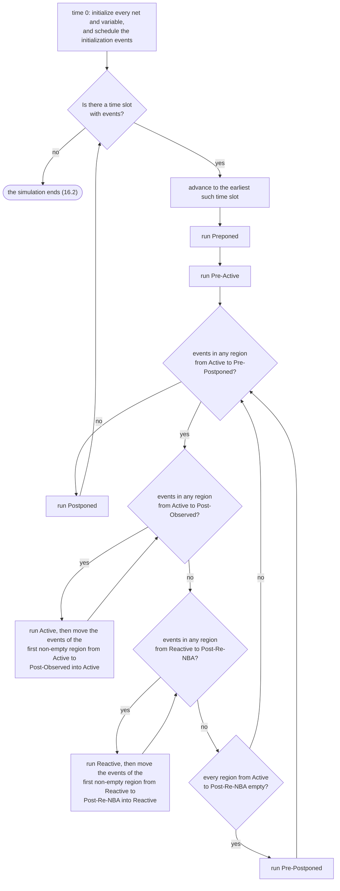
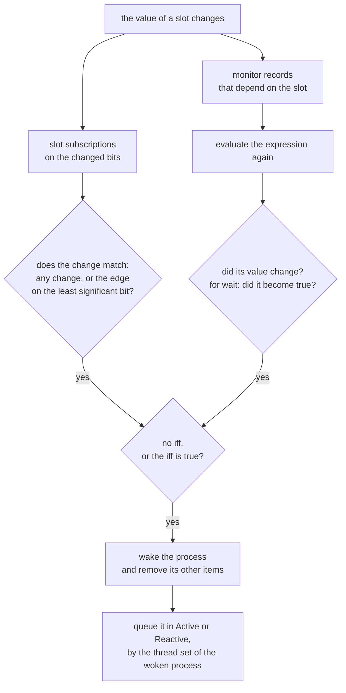

# SCHEDULER_SPEC：スケジューラの仕様

[English](SCHEDULER_SPEC.md) · 英語版が正本で、これはその日本語版です。食い違ったときは英語版に従います。

優先度：P0。状態：**承認済み（2026-10-15 に改訂を承認）**。2026-10-14 に承認した版に、独立レビューの指摘を反映した。同日、静的変数の初期値の評価の順序（3 節）を追記した（承認済み）。同日、`$finish(0)` と `$stop(0)` のときに終了の理由を標準エラーに出さないことを 16.2 節に追記した（承認済み）。2026-10-16 に、timescale の既定値と設計全体の精度を 1 節に足した（承認済み）。同日、`final` の中の `$finish` の扱いを 16.2 節に足した（承認済み）。同日、6.4 節と 12 節の書き込みとドライバの検査を slang の解析の段に任せることを足した（承認済み）。同日、12 節と 19 節の駆動の強さの記述を、VALUE_SEMANTICS.md の 5 節への参照に改めた（承認済み）。2026-10-17 に、終わったプロセスの記録の回収を 10.8 節に足した（承認済み）。同日、10.8 節の 3 番目の条件を、確定した報告の呼び出しまで含むように改めた（承認済み）。2026-10-18 に、15.4 節を 15.3 節の flush point に合わせた（承認済み）。同日、設計が起こす実行時の誤りを、理由 error、コード 2 にした（16.2 節、8 節。承認済み）。2026-10-18 に、3 節の手順と 9.5 節の起こし方の図を足した（承認済み）。同日、Postponed で書いてよいものを 2.2 節に足した（解釈。承認済み）。同日、静的な初期化の保留の列（15.3 節）と、その間の実行時の誤り（16.2 節）を書いた（承認済み）。2026-10-19 に、1 つの時刻スロットの事象の上限を 16.2 節に足し（承認済み）、2026-10-18 に承認した SIGINT の確認点と呼び出しの入れ子の上限を 16.2 節に書いた。2026-10-19 に、時刻 0 の順序（6.1 節）を kirimasim が選んだ手順に置き換えた（承認済み）。同日、理由 resource_limit とコード 6、生きているプロセスの数と呼び出しの深さの上限を 16.2 節に足した（承認済み）。同日、理由 wall_time_limit と壁時計の上限を 16.2 節に足した（承認済み）。同日、`$stop` での終わり方の段落に `--stop` を足した（16.2 節。承認済み）。同日、競合探索モードが乱すものを 11 節に挙げ、4.3 節、6.1 節、13 節をそれに合わせた（承認済み）。同日、値の変化が待つプロセスを起こす順（4.3 節）と、遅延付きの NBA がその時刻になったときに入る位置（13 節）を足した（承認済み）。同日、12 節から `--mintypmax` と `--report-pulses` を指した（承認済み）。同日、UNSPECIFIED_BEHAVIOR.md が決めていない点を 2.2 節、6.1 節、6.2 節に記した（承認済み）。同日、static の初期化子の宣言の順を保つことにした（6.1 節。承認済み）。同日、待つことの無い `always` への lint の警告を 6.2 節に足した（承認済み）。同日、2.2 節の解釈を保つことにした（承認済み）。同日、3 節（手順の 1）の警告が対象にする読み方を決めた（承認済み）。同日、13.4.4 の当てはめ方を 6.5 節として足し、15.3 節からそれを指した（承認済み）。2026-10-20 に、手続き的な `assign` と `force` の右辺を 6.5 節の許さない呼び出し元に足し、Postponed の呼び出し元を 2.2 節に任せた（承認済み）。同日、定数か実行時に決まるかによらない、実数の遅延の 1 つの丸めを 1 節に定めた（承認済み）。同日、連続代入が呼ぶ関数の書き込みは効いている連続代入にならないことを 14.3 節に書いた（承認済み）。同日、6.4 節のために、ほかのプロセスがタスクを通して書くものを front が調べることにした（承認済み）。同日、6.4 節の制限から遅延アサーションの動作を外し、ほかのプロセスがそれを通して書くものを front が調べることにした（承認済み）。第 4 部の後半（P3 の機能）は未記入。

この文書は、kirimasim の実行カーネルが時刻と事象をどう進めるかを定める。規格（IEEE 1800-2023）の本文は写さず、本書の言葉で要約し、根拠の節番号を示す。「規格で確認」と書いた項目は、規格の該当節を読んで確かめたもの。「本書の決まり」と書いた項目は、規格が実装に任せている点を kirimasim として決めたもの。

分量が多いので、次の順に分けて書く。

| 部 | 内容 | 状態 |
| --- | --- | --- |
| 第 1 部 | 時刻スロットと領域、参照アルゴリズム、決まっている順序、代入と事象、手続きの起動、PLI コールバックの領域（1〜7 節） | 承認済み |
| 第 2 部 | 待ちと通知（遅延、イベント制御、`wait`、名前付きイベント、監視レコード）、プロセス制御（fork、disable、process クラス）（8〜11 節） | 承認済み |
| 第 3 部 | 連続代入とその遅延、NBA の詳細、手続きの連続代入（assign、force など）（12〜14 節。手続きの遅延と代入内の遅延は 8 節） | 承認済み |
| 第 4 部 | unique・priority の違反と遅延即時アサーション（15 節。承認済み）。並行アサーションの領域、クロッキングブロック、program（P3 で書く。未記入） | 前半は承認済み |
| 第 5 部 | 終了の条件と上限、VPI の時刻のコールバック（16〜17 節） | 承認済み |

## 1. 時刻と時刻スロット

- 事象はどれも、ちょうど 1 つの実行時刻を持つ。同じ時刻に予定された事象の集まりを時刻スロットと呼ぶ。シミュレーションは、今の時刻スロットの事象をすべて実行して取り除いてから、事象のある次の時刻スロットへ進む。時刻は戻らない（規格で確認：4.4）。
- 時刻は、設計全体の最小の精度を単位とした符号なし 64 ビット整数で持つ。整数の遅延の `timeunit` からの換算は整数で計算し、実数の遅延は下の丸めの項のとおりに換算し、桁あふれはエラーにする（本書の決まり。設計書の決まりを引き継ぐ）。
- 遅延の値は、その遅延を書いた設計要素（モジュール、program、インターフェースなど）の時間の精度に丸めてから使う。精度が時間の単位と同じなら整数に、1 桁細かければ小数 1 桁に丸める（規格で確認：3.14.1。例：単位 1ns、精度 100ps なら、2.75ns は 2.8ns）。時間の単位と精度は、`` `timescale `` か `timeunit`・`timeprecision` で決まり、指定が無ければ既定の値を使う（規格で確認：3.14.2。どの指定が効くかは slang の結果を使う）。
- 丸めた値を、設計全体の最小の精度の刻みに換算する。この換算は、精度が細かくなる向きなので割り切れ、丸めは起きない。
- 実数の遅延は、定数でも実行時にだけ決まる値でも、double としての値から換算する（実数のリテラルは double：5.7.2）。値に 10^(単位 − 精度) を double の演算で掛け、その積を、実数から整数への変換（VALUE_SEMANTICS.md の 1.5 節）と同じく、ちょうど中間なら 0 から遠い方へ丸める（本書の決まり。2026-10-20 に追記。承認済み。ちょうど中間の値の丸めの向きは、規格の文面からは決まらない）。積は double の正確な値と違うことがある。1ns/10ps の 2.675 は、double が 2.675 のわずかに下でも 268 刻みになる。実行時にだけ決まる遅延は double の演算を使うほかないので、決まりはそれに従う。Icarus Verilog 13.0、14.0（devel）、Verilator 5.052 は、定数でも変数でも同じ結果を出す（2026-10-20 に、1ns/1ns の 0.5、1.5、2.5 と、1ns/10ps の 0.145、0.285、1.005、1.15、1.255、2.675 で確かめた）。
- `#1step` は、設計全体の最小の精度の 1 刻み。標本化の意味は第 4 部（P3）で書く。
- **timescale の既定値（2026-10-16 に承認）：** `` `timescale `` も `timeunit`・`timeprecision` も効いていない設計要素の時間の単位と精度は、`--timescale` で指定が無ければ 1ns / 1ns とする（本書の決まり）。規格は既定値を処理系に任せている（規格で確認：3.14.2.3）。実際に走らせて確かめたところ、Icarus 13.0 は 1s / 1s、Verilator 5.052 は 1ps / 1ps で、どちらに合わせてももう一方とは違う。テストスイートは、時刻の単位で出力が変わるテストに timescale を書く決まり（TEST_SUITE.md）なので、この既定値はテストの期待値に影響しない。
- **混在：** timescale を指定した設計要素と、しない設計要素が混ざっていたら誤り（規格で確認：3.14.2.3）。slang がこれをエラーにし、kirimasim はコード 2 で終わる（2026-10-16 に確かめた）。`--timescale` を付けると、指定の無い設計要素にその値が入るので、誤りにならない（slang の動作。同日に確かめた）。
- **設計全体の精度（2026-10-16 に承認）：** すべての設計要素の精度の最小を、設計全体の精度（時刻の 1 刻み）にする（規格で確認：3.14.3）。どの設計要素も指定しないときは、既定値（`--timescale` か 1ns / 1ns）の精度になる。`front` が求めて SIR に持たせる。

## 2. 領域

### 2.1 17 の領域と順序

1 つの時刻スロットは、次の 17 の領域に、この順で分かれる（規格で確認：4.4）。

| # | 領域 | 種類 | 組 | 主に置くもの |
| --- | --- | --- | --- | --- |
| 1 | Preponed | シミュレーションと PLI | — | `#1step` の標本化（前の時刻スロットの Postponed で標本化するのと同じ） |
| 2 | Pre-Active | PLI | — | PLI のコールバック |
| 3 | Active | シミュレーション | active | 設計のプロセスの評価と、値の更新 |
| 4 | Inactive | シミュレーション | active | active の組で `#0` で止まったプロセスの再開 |
| 5 | Pre-NBA | PLI | active | PLI のコールバック |
| 6 | NBA | シミュレーション | active | active の組で実行した非ブロッキング代入の更新 |
| 7 | Post-NBA | PLI | active | PLI のコールバック |
| 8 | Pre-Observed | PLI | — | PLI のコールバック（読み出しだけ） |
| 9 | Observed | シミュレーション | — | 並行アサーションの評価 |
| 10 | Post-Observed | PLI | — | PLI のコールバック |
| 11 | Reactive | シミュレーション | reactive | program と checker の中の代入、並行アサーションの動作ブロック |
| 12 | Re-Inactive | シミュレーション | reactive | reactive の組で `#0` で止まったプロセスの再開 |
| 13 | Pre-Re-NBA | PLI | reactive | PLI のコールバック |
| 14 | Re-NBA | シミュレーション | reactive | reactive の組で実行した非ブロッキング代入の更新 |
| 15 | Post-Re-NBA | PLI | reactive | PLI のコールバック |
| 16 | Pre-Postponed | PLI | — | PLI のコールバック |
| 17 | Postponed | シミュレーションと PLI | — | `$monitor`、`$strobe`、読み出しだけのコールバック |

- active の組は Active、Inactive、Pre-NBA、NBA、Post-NBA。reactive の組は Reactive、Re-Inactive、Pre-Re-NBA、Re-NBA、Post-Re-NBA（規格で確認：4.4.1）。
- 繰り返しの対象になる領域は、Active から Pre-Postponed までの 14 個（規格で確認：4.4.1、4.5）。Preponed、Pre-Active、Postponed は、時刻スロットごとに 1 回だけ実行する。
- Observed では PLI のコールバックを呼ばない。Observed で評価したアサーションの成否のコードは、同じ時刻スロットの Reactive に入れる（規格で確認：4.4.2.5）。

### 2.2 領域ごとの禁止事項

- Preponed（PLI）：ネットや変数への書き込みと、今の時刻スロットへの事象の追加は禁止（規格で確認：4.4.3.1）。
- Pre-Observed（PLI）：同じく、書き込みと、今の時刻スロットへの事象の追加は禁止（規格で確認：4.4.3.5）。
- Postponed：書き込みと、今の時刻スロットの前の領域への事象の追加は禁止。値の変化はもう起きない（規格で確認：4.4.2.9）。
- kirimasim は、これらの領域での禁止された書き込みや事象の追加を、実行時のエラーとして報告する（本書の決まり）。
- **Postponed で書いてよいもの（解釈。2026-10-18 に追記、承認済み）：** `$strobe` や `$monitor` の引数、`final` の遅延アサーションの動作が Postponed で呼ぶ関数は、その関数自身の変数（引数、automatic の変数、static の変数）に書いてよい。それらを指す `ref` を通した書き込みも同じ。これらは関数自身の作業のためだけの変数で、SIR_SPEC.md 10 節の 6 も同じように書き込みの制限から外している。それ以外の変数やネットへの書き込み、ノンブロッキング代入、事象の起動、`fork`、`disable`、手続き的連続代入は、実行時のエラー（16.2 節）。遅延アサーションの動作である呼び出しの引数は、アサーションを評価するときに評価し、Postponed では評価しない（規格で確認：16.4）。そうした関数のどの書き込みもエラーにする提案は採らない（2026-10-19 に決定。UNSPECIFIED_BEHAVIOR.md の 9 節）。

## 3. 時刻スロットの進め方（参照アルゴリズム）

規格は、準拠するシミュレータが実装すべき参照アルゴリズムを示している。利用者から見える結果がそれと同じなら、別のアルゴリズムを使ってよい（規格で確認：4.3、4.5）。kirimasim は、次の手順をそのまま実装する。

1. 時刻 0 に、すべてのネットと変数の値を初期化し、初期化の事象を時刻 0 の時刻スロットに入れる。
   - 静的変数の宣言の初期値は、initial と always を始める前に評価する（規格で確認：6.8、10.5）。静的変数どうしの評価の順序は、規格に記述が見当たらない（未確認）。kirimasim は、1 つのスコープの中では宣言の順に評価する（本書の決まり）。初期値を入れる前の静的変数を読むおそれのある初期値には、警告 `kirima-static-init-order` を出す（本書の決まり。細目は 2026-10-19 に承認）。それは、別のインスタンスの静的変数を読む初期値（インスタンスの間の順序は決まらないため）と、同じインスタンス、パッケージ、コンパイル単位の静的変数のうち、自分より後に初期値を入れるものを読む初期値である。ここでは、generate ブロック、名前付きブロック、サブルーチンは、それを含むインスタンスの一部として扱う。インスタンスからパッケージとコンパイル単位の静的変数を読むときは、警告を出さない（それらを先に入れるため。SIR_SPEC.md の 7.1 節）。数えるのは式が名前で読む変数だけで、式が呼ぶ関数の中で読む変数は数えない（P1）。警告は初期値ごとに 1 回、その位置に出し、読んだ変数の名前を示す。
2. 事象のある時刻スロットがある間、最も早いものに進み、その時刻スロットを実行する。
3. 時刻スロットの実行：
   1. Preponed を実行する。
   2. Pre-Active を実行する。
   3. Active から Pre-Postponed までのどれかに事象がある間、次を繰り返す。
      1. **active 側：** Active から Post-Observed までのどれかに事象がある間、次を繰り返す：Active を実行し、そのあと Active から Post-Observed までで最初に事象のある領域の事象を、すべて Active へ移す。
      2. **reactive 側：** Reactive から Post-Re-NBA までのどれかに事象がある間、次を繰り返す：Reactive を実行し、そのあと Reactive から Post-Re-NBA までで最初に事象のある領域の事象を、すべて Reactive へ移す。
      3. Active から Post-Re-NBA までがすべて空なら、Pre-Postponed を実行する。
   4. Postponed を実行する。
4. 領域の実行：領域が空になるまで事象を 1 つずつ取り出す。値の更新の事象なら、値を更新して、その値に反応するプロセスの評価の事象を予定する。評価の事象なら、そのプロセスを評価する（評価の中で、さらに事象を予定することがある）。

（規格で確認：4.5）

同じ手順を図にしたもの（図と手順が食い違ったときは手順に従う）：

注意点：

- **reactive 側の処理を始めたら、reactive の組の 5 つの領域が空になるまで、active 側には戻らない。** reactive 側の処理中に Active に事象ができても、その事象を実行するのは reactive の組が空になってからである（規格で確認：4.5 の後の説明）。
- Observed と Post-Observed は、active 側の繰り返しに含まれる（規格で確認：4.5）。
- 上の図は、この節の手順を本書の形で描いたもの。規格の図 4-1 は写さない。

## 4. 決まっている順序と、決まっていない順序

### 4.1 規格が保証する順序

- 1 つの begin-end の中の文は、書かれた順に実行する。途中でほかのプロセスに実行を譲ることはあっても、順序は入れ替えない（規格で確認：4.6）。
- 非ブロッキング代入（NBA）の更新は、その代入文を実行した順に行う。同じプロセスの `q <= 1; q <= 2;` の後、q は 2 になる（規格で確認：4.6。テスト `sched/nba_order_same_proc`）。

### 4.2 規格が決めていない順序

- Active と Reactive の領域から事象を取り出す順序（規格で確認：4.4.2.2、4.4.2.6、4.7）。
- 時間の待ちを含まない文の並びを、1 つの事象として実行し切るかどうか。規格は、評価の途中でプロセスを止めて、ほかのプロセスと交互に実行することを許している（規格で確認：4.7）。
- 値の更新と、その値に反応するプロセスの評価が交互に起こるため、競合が起こりうる（規格で確認：4.8）。

### 4.3 kirimasim の決まった順序

- 各領域は、事象を積んだ順（連番の順）に取り出す。同じ入力なら、何度走らせても同じ順になる（本書の決まり。NFR-2）。
- 値の変化は、それを待つプロセスを、待ち始めた順に起こす（本書の決まり。2026-10-19 に承認）。再開はその順に領域へ入る。
- プロセスは、時間の待ち（`#`、`@`、`wait` など）に入るか終わるまで、途中で止めずに実行する（本書の決まり）。
- 競合探索モード（`--race-check`。P2）は、ここで選んだ順序のいくつかを、シードに従って乱す。乱すものと乱さないものは 11 節に挙げる（2026-10-19 に承認）。

## 5. 代入と事象

| 代入 | 事象の扱い | 根拠 |
| --- | --- | --- |
| 連続代入（`assign`、ポートの暗黙の連続代入を含む） | 右辺の要素に反応するプロセスとして扱う。右辺の値が変わったら、Active に値の更新を予定する。代入先は、その時点の値で決める。**時刻 0 にも 1 回評価する**（定数を伝えるため） | 規格で確認：4.9.1 |
| 手続きの連続代入（`assign`、`force`） | 右辺の要素に反応するプロセスとして扱う。`deassign` と `release` で止める | 規格で確認：4.9.2 |
| ブロッキング代入で、代入内の遅延があるもの（`a = #d b`） | 右辺を今の値で計算してからプロセスを止め、未来の事象として予定する。遅延が 0 なら、active の組からは Inactive、reactive の組からは Re-Inactive に予定する。**代入先は、再開した時点の値で決める** | 規格で確認：4.9.3 |
| 非ブロッキング代入（`a <= b`、`a <= #d b`） | 更新の値を計算し、遅延が 0 なら今の時刻スロットの NBA（reactive の組からは Re-NBA）に、0 でなければ未来の事象として予定する。**右辺の値も代入先も、文を実行した時点の値で決める**（`a[i] <= #d v` の i も実行した時点の値） | 規格で確認：4.9.4、4.4.2.4、4.4.2.8 |
| 双方向のスイッチ | 接続されたスイッチ全体を考えてから値を決める。いつ処理してもよい | 規格で確認：4.9.5（P4） |
| ポートの接続 | input と output は暗黙の連続代入、inout は強さを弱めない双方向の接続とみなす | 規格で確認：4.9.6 |
| サブルーチンの引数 | 値渡し。呼び出しのときに写し、戻るときに写し戻す。写し戻しはブロッキング代入と同じ | 規格で確認：4.9.7 |

- ポートの畳み込み（設計書の「ポートの畳み込み」）は、4.9.6 の暗黙の連続代入と、利用者から見える結果が同じになる場合に限って行う（本書の決まり）。条件と、force と release での見え方は、第 3 部で書く。
- 遅延付きの NBA の値と更新先は、未来の事象の記録に持たせ、その事象を実行してから解放する。遅延の無い NBA の値は時刻スロットごとのアリーナに置き、時刻スロットの終わりにまとめて解放する（本書の決まり。設計書のデータ構造を引き継ぐ）。

## 6. 手続きの起動

### 6.1 時刻 0 の順序

2026-10-19 に承認（2026-10-14 に承認した順序を置き換える）。規格が決めているのは、static の初期値が先であることと、`always_comb` と `always_latch` が `initial` と `always` の手続きの後に始まることで、そのほかの間の順は決めていない（4.2、4.7）。kirimasim は次の手順をとる（「規格で確認」と書いたもの以外は本書の決まり）。

1. static な変数の宣言にある初期値を入れる。どの `initial` や `always` を始めるよりも前に行う。クラスの static なメンバも含む（規格で確認：6.8、10.5）。これは 1364-2005 とは違う点である（1364-2005 では、宣言の初期値は `initial` からの代入と同じ扱いだった）。まだだれも待っていないので、事象を作らず、何も起こさない（SIR_SPEC.md の 7.1 節）。static な変数の間の順は、スコープの中の宣言の順（3 節）。依存の順にはしない（2026-10-19 に決定。UNSPECIFIED_BEHAVIOR.md の 9 節）。
2. ネットは VALUE_SEMANTICS.md の 5.3 節と 5.4 節の値から始まる。駆動の無いビットはネットの既定の初期値で、駆動のあるビットは、その駆動が最初に書くまで x。
3. 最初の文がイベント制御である `always` の手続き（`always_ff` と `always @*` を含む）は、そのイベント制御で待ち始める。起きるまで、その文は時刻 0 に 1 つも実行しない。
4. 連続代入、ネットの宣言の代入、ポートの暗黙の連続代入、ゲート、UDP のインスタンス（SIR_SPEC.md の 7.1 節のプロセスの種類 `cont`）を、1 回評価するために Active に入れる（規格で確認：4.9.1）。
5. そのほかの `always` の手続き（最初の文がイベント制御でないもの）を Active に入れる。
6. `initial` の手続きを Active に入れる。program の `initial` は時刻 0 から Reactive に入れる（規格で確認：24.3.1。P3 で扱う）。
7. `always_comb` と `always_latch` を、1 回実行するために Active に入れる（規格で確認：9.2.2.2、9.2.2.3）。`always @*` は時刻 0 に実行しない（6.2 節）。

- 各手順の中では、SIR のプロセス番号の順（インスタンスの木の深さ優先、各インスタンスの中はソースに現れた順。SIR_SPEC.md の 1 節）にする。プロセスの番号の付け方は変えない。
- Active は入れた順に事象を取り出す（4.3 節）ので、手順 4〜7 はこの順に実行され、その間にそれらが作る事象が入る。
- 競合探索モード（11 節）は、手順 4〜7 の順を乱す。
- プロセスの種類 `override`、`postponed`、`final`（SIR_SPEC.md の 7.1 節）は、それぞれの決まりで始まる（14 節、SYSTEM_TASKS.md の 4 節、6.2 節）。
- この順にする理由：`initial` が時刻 0 にリセットを x から 0 に下げても、その負の辺を待つ `always` が取りこぼさない。`initial` が時刻 0 に連続代入の値を読める。手続きを書いた順で結果が変わらない。どれも規格が許す選択である（4.7）。手順 3 のプロセスは何かが走る前から待つので、時刻 0 のすべての値の変化が辺やイベントの待ちに届く。これは、4 値では x からの変化も辺であること（VALUE_SEMANTICS.md の 4.3 節）と揃う。

### 6.2 手続きの種類ごとの起動の規則

| 手続き | 起動の規則 | 根拠 |
| --- | --- | --- |
| `initial` | 1 回だけ実行し、文が終わったら止まる | 規格で確認：9.2.1 |
| `always` | 終わったら最初から繰り返す。時間を進める制御が無いと、ゼロ時間の無限ループになる（kirimasim は第 5 部の上限で止める）（どの経路にも時間制御の無い `always` には、エラボレーションの時点で lint の警告も出す。2026-10-19 に決定：UNSPECIFIED_BEHAVIOR.md の 6.1 節の A2） | 規格で確認：9.2.2.1 |
| `always_comb` | 時刻 0 に 1 回起動し、以後は暗黙の感度のどれかが変わったときに起動する。ブロックの中で、ブロックを止める制御（時間の待ち、イベントの待ち、fork-join）は使えない | 規格で確認：9.2.2.2、9.2.2.2.2 |
| `always_latch` | 起動の規則は `always_comb` と同じ（違いは、ツールが行う警告の検査だけ） | 規格で確認：9.2.2.3 |
| `always_ff` | イベントの制御をちょうど 1 つだけ持ち、時間を止める制御は持たない | 規格で確認：9.2.2.4 |
| `always @*` | 時刻 0 には起動せず、感度のどれかが変わるまで待つ | 規格で確認：9.2.2.2.2 |
| `final` | シミュレーションの終わりに、遅延なしで実行する。独立したプロセスではなく、1 つのプロセスからの関数呼び出しの並びとして実行する。複数の `final` の順序は規格では決まっていない（kirimasim はソースに現れた順）。すべての `final` を実行した後は、残った事象を実行しない。`final` はシミュレーションの終わりを示す PLI のコールバック（`cbEndOfSimulation`）より前に実行する。`final` の中の `$finish` と `vpi_control(vpiFinish)` は、その場でシミュレーションを終わらせる。`final` は 1 回しか起動しない。規格は、`final` の順序を決めないが、実行ごとに同じ順にすることを求めている（kirimasim のソースの順はこれに合う） | 規格で確認：9.2.3 |

### 6.3 `always_comb` の暗黙の感度

`always_comb`（と `always_latch`）の感度は、ブロックの中と、ブロックから呼ぶ関数の中で読む、ネットと変数（と選択の式）の最長の静的な接頭辞からなる。ただし、次のものは除く（規格で確認：9.2.2.2.1）。

- ブロックの中か、呼ぶ関数の中で宣言した変数。
- ブロックの中か、呼ぶ関数の中で**書き込む**式。
- 時間の制御（`wait`、イベント、遅延）の式の中にだけ現れる識別子。

そのほかの規則（規格で確認：9.2.2.2.1）：

- 階層をまたぐ関数、パッケージの関数、クラスの static な関数の呼び出しも、ふつうの関数と同じく中身を調べる。
- クラスのオブジェクトの参照とメソッドの呼び出しは、引数の式の分だけを感度に足す。
- タスクの呼び出しは、引数を感度に足すが、中身は調べない。
- ブロックの中（と呼ぶ関数の中）の即時アサーションの式は、`if` の条件と同じく感度に足す。アサーションの動作ブロックの中の式は足さない。

`always @*` との違い：`always @*` は、呼ぶ関数の中で読む変数には反応せず、関数の引数にだけ反応する。即時アサーションの式も、ブロックの中のものだけに反応する（規格で確認：9.2.2.2.2）。

確かめる例（テストスイートに入れる）：`always_comb` の中で `c = b; b = a;` と書くと、b はブロックの中で書き込むので感度から除かれる。a を変えると b が変わるが、c はその実行で b に代入する前の値になり、ブロックは起き直さない（設計書の `comb_order.sv`。iverilog 12.0 で確認済み）。

### 6.4 書き込みの制限

この制限は、`always_comb`、`always_latch`、`always_ff` のキーワードで書いた手続きだけに当てる。ふつうの `always`（`always @(posedge clk)` など）には無い（規格で確認：9.2.2.1、9.2.2.4）。`initial q = 0; always @(posedge clk) q <= d;` のように、ふつうの `always` と別のプロセスが同じ変数に書くのは正しい。

`always_comb`、`always_latch`、`always_ff` の左辺の変数は、ほかのプロセスから書き込んではいけない。呼ぶ関数の中で書く変数も含む（タスクの中で書くものは含まない）。最長の静的な接頭辞が重ならない、変数の別々の要素への書き込みは許される（規格で確認：9.2.2.2、9.2.2.4）。この検査は slang の解析の段が行う。kirimasim は、`kirimasim parse` でも設計の実行でも解析の段を走らせ、違反を誤り（終了コード 2）として報告する。同じ検査を kirimasim の側には持たない（2026-10-16 に、`always_comb` とほかのプロセス、`always_ff` どうしの違反を slang が報告することを確かめた）（2026-10-16 に承認）。ただし、ほかのプロセスが呼ぶタスクの中の書き込みを、slang の解析の段は見ない（2026-10-20 に確かめた。直接の書き込みと関数を通した書き込みは報告する）。その違反は front が報告する。誤りをタスクの中の書き込みの位置に出し、呼び出しの位置を note で示す。終了コードは 2（2026-10-20 に追記。承認済み）。

**遅延アサーションの動作（2026-10-20 に追記。承認済み）：** これらのブロック、またはそれが呼ぶ関数やタスクの中の遅延アサーションの動作は、タスクと同じく、この制限ではブロックの一部に数えない。動作が書くものは、動作が呼ぶ関数やタスクが書くものも含めて制限に当たらず、6.3 節の感度でもブロックが書くものに数えない。動作はブロックの後に、`#0` なら Reactive、`final` なら Postponed で動き（15.2 節。規格で確認：16.4.1）、slang の解析の段もこれを意図して外している（2026-10-20 に slang のソースで読んだ）。規格がこれをブロックの一部と数えるかは未確認（解釈）。ほかのプロセスが、自分で、または呼ぶ関数の中で実行した遅延アサーションの動作を通して、`always_comb`、`always_latch`、`always_ff` が書くものに書いたときは、タスクのときと同じく front が報告する。誤りを書き込みの位置に出し、アサーションの位置を note で示す。終了コードは 2。ブロック自身のアサーションの動作は、ブロック自身のタスクと同じく、ブロックが書くものに書いてよい。`final` の動作が、その関数自身のもの以外の変数に書くのは、いずれにせよ実行時の誤りである（2.2 節）。

### 6.5 戻った後に動くものを予定する関数（本書の決まり。2026-10-19 に承認）

関数が、戻った後でなければ動けない事象を予定してよいのは、その関数を呼ぶスレッドが `initial` か `always` の手続き、またはそれらの中の `fork` で作られたときだけである。それ以外は、コンパイルの時点か実行時に誤りにするよう規格は求める（規格で確認：13.4.4）。kirimasim は、front が呼び出し元と関数の本体の両方を見られるので、コンパイルの時点で誤り（終了コード 2）にする。slang にこの検査は無い（2026-10-19 に確かめた。slang の警告 `nonblocking-final` は、`final` に直接書いたノンブロッキング代入だけが対象）。

- **許さない呼び出し元：** 静的変数の初期値（モジュール、パッケージ、コンパイル単位の変数と、サブルーチンやブロックの静的変数）、連続代入（`assign`、ネットの宣言の代入、ポートの接続）、`final` の手続き、手続き的な `assign` と `force` の右辺（2026-10-20 に追記。承認済み）。この右辺は、読むものが変わるたびに、その文が持つ `override` のプロセス（SIR_SPEC.md 7.1 節）が評価し直すもので、その文を実行したスレッドが評価するのではない（解釈。10.6.1、10.6.2、13.4.4 はこの呼び出し元を挙げていない）。`always_comb`、`always_latch`、`always_ff` は `always` の手続きなので許す（規格で確認：9.2.2）。
- **数える文：** ノンブロッキング代入、ノンブロッキングのトリガ `->>`、`fork ... join_none`、クロッキングブロックの駆動（P3）。ブロッキングのトリガ `->` は数えない。待っているプロセスを起こすだけで、変数への書き込みがそれを待つプロセスを起こすのと同じだからである。`$strobe`、`$monitor`、遅延アサーションの動作も数えない。
- **呼び出しをたどる：** そうした文を含む関数を呼ぶ関数も数える。クラスのハンドルや virtual なメソッドを通す、front が決められない呼び出しは、P3 で実行時に調べ、設計が起こす実行時の誤り（16.2 節）にする。
- **Postponed の呼び出し元（2026-10-20 に追記。承認済み）：** `$strobe` と `$monitor` の引数、`final` の遅延アサーションの動作は Postponed で動き、そこではこれらの文はどれも既に実行時の誤りになる（2.2 節）。そのため front は重ねて調べない。`final` から呼ぶタスクは slang の誤り（`TaskFromFinal`）になる。`#0` の遅延アサーションの動作は Reactive で動き（16.4）、調べない。13.4.4 がそれを、アサーションを実行したスレッドの一部と数えるかは未確認。
- **メッセージ：** 誤りは呼び出しの位置に出し、関数の中の文の位置を note で示す。

## 7. PLI コールバックの領域

規格は、主な VPI コールバックをどの領域で呼ぶかを次のように定めている（規格で確認：4.10、表 4-1）。詳細と、cocotb が使うコールバックの時点は、第 5 部で書く。

| コールバック | 領域 |
| --- | --- |
| `cbAfterDelay`、`cbNextSimTime`、`cbAtStartOfSimTime` | Pre-Active |
| `cbNBASynch` | Pre-NBA |
| `cbReadWriteSynch` | Pre-NBA か Post-NBA |
| `cbAtEndOfSimTime` | Pre-Postponed |
| `cbReadOnlySynch` | Postponed |

`cbReadWriteSynch` を Pre-NBA と Post-NBA のどちらで呼ぶかは、規格では決まっていない。kirimasim の選択は第 5 部で決める。

## 8. 時間の待ち（遅延）

- `#d` の後の文は、その直前の文から d だけ遅れて実行する（規格で確認：9.4.1）。
- 遅延の式が x か z を含むときは、遅延 0 とみなす（規格で確認：9.4.1）。
- 遅延の式が負のときは、`time` と同じ幅の符号なし整数（2 の補数）として読む。つまり、非常に大きな遅延になる（規格で確認：9.4.1）。時刻を最大の時刻（精度の 2^64 − 1 刻み）より先に進める遅延は、実行時の誤りにする（16.2 節。本書の決まり。2026-10-18 に追記。承認済み）。
- 遅延 0（`#0`）は、active の組なら Inactive、reactive の組なら Re-Inactive で再開する（規格で確認：4.4.2.3、4.4.2.7）。
- 代入内の遅延とイベント制御（`a = #d b`、`a = @(e) b`、`a <= #d b`）は、右辺を待つ前に評価し、左辺への代入だけを遅らせる（規格で確認：9.4.5）。代入先を決める時点は 5 節のとおり（ブロッキングは再開した時点、NBA は文を実行した時点）。
- `repeat (n) @(e)` の n は、予定するときに 1 回だけ評価する。n が 0 以下、x、z のときは、`repeat` が無いのと同じに扱う（規格で確認：9.4.5）。
- 未来の事象は、近い時刻用のタイミングホイールと、遠い時刻用の 4 分ヒープに置き、（時刻、領域、連番）の順に並べる（本書の決まり。設計書のデータ構造を引き継ぐ）。

## 9. 待ちの種類と起こし方

### 9.1 イベント制御（`@`）

- 辺を指定しない `@(式)` は、式の**値**が変わったときに起きる。被演算子が変わっても、式の値が変わらなければ起きない（規格で確認：9.4.2）。
- 辺の待ち（`posedge`、`negedge`、`edge`）は、式の最下位ビットの変化だけで判定する。判定の表は VALUE_SEMANTICS.md の 4.3 節のとおり（規格で確認：9.4.2）。
- `or` とコンマは同じ意味で、どれか 1 つの事象で起きる（規格で確認：9.4.2.1）。
- `iff` 付きの待ちは、イベントの式が変わったときに `iff` の式を評価し、真（12.4 の意味）のときだけ起きる。`iff` の式だけが変わっても起きない。`iff` は `or` より強く結び付く（規格で確認：9.4.2.3）。
- クラスのハンドルや chandle の変数そのものへの待ちは、書き込まれた値が前の値と違うときに起きる（規格で確認：9.4.2）。
- 式の中で、オブジェクトのフィールド、集合データの要素、動的な配列の大きさを参照しているときは、それらが変わったら式を評価し直す。参照していないものの変化で評価し直してもよい（規格で確認：9.4.2）。

### 9.2 `@*` の暗黙の感度

`@*` は、続く文の中に現れるネットと変数の識別子をすべて感度に加える。除くのは、次の 2 つだけ（規格で確認：9.4.2.2）。

- 時間の制御（`wait`、イベント、遅延）の式の中にだけ現れるもの。
- 代入の左辺の変数としてだけ現れるもの。

`always_comb`（6.3 節）と違い、ブロックの中で書き込む変数でも、右辺で読めば感度に入る。左辺の添字に使う変数、case の項の変数、サブルーチンの呼び出しの引数も感度に入る（規格で確認：9.4.2.2）。関数の中身は調べない（規格で確認：9.2.2.2.2）。

### 9.3 条件の待ち（`wait`）

- `wait (式)` は、式を評価して真（12.4 の意味）ならすぐに進む。真でなければ、真になるまで止まる（規格で確認：9.4.3）。
- 待ちの式は、式の被演算子が変わったときだけ評価し直す（規格で確認：15.5.3 の後半）。

### 9.4 名前付きイベント

- `->` は、そのイベントを今待っているすべてのプロセスを起こす。トリガそのものは一瞬で、状態として観測できない（規格で確認：15.5.1）。
- `@ev` で起きるには、待つ側が `@` を、トリガする側の `->` より**先に**実行している必要がある。トリガが先なら、待つ側は止まったまま（規格で確認：15.5.2）。
- `->>` は止まらずに進み、遅延か制御が満ちた時刻の **NBA 領域**でトリガする（規格で確認：15.5.1）。
- `ev.triggered` は、そのイベントが今の時刻スロットでトリガされていれば真。時刻が進むまで真のまま。null のイベントでは偽（規格で確認：15.5.3）。`wait (ev.triggered)` は、**同じ時刻スロットの中で**あれば、`wait` とトリガのどちらが先に実行されても起きる。前の時刻スロットのトリガでは起きない。
- `triggered` が時刻の終わりで 1 から 0 に戻っても、その変化で待ちを評価し直すことはない（規格で確認：15.5.3）。
- イベントの配列の添字を変えても、トリガは起きない（規格で確認：15.5.1）。
- `wait_order`、イベントの併合、比較は、P3 で書く（規格の 15.5.4〜15.5.5）。

### 9.5 kirimasim での表し方（本書の決まり）

設計書の「待ちの 2 段」を引き継ぐ。

| 待ち | 表し方 | 起こす条件 |
| --- | --- | --- |
| 固定した信号の値の変化と辺（`iff` を含む） | スロットの購読（プロセス番号、ビット範囲、辺の種類、`iff` の式） | スロットの、購読するビット範囲の値が変わったとき。辺は、イベントの式の値の最下位ビットで判定する（`@(posedge v[3])` なら v のビット 3） |
| 複合式（`@(a == b)`、`@(posedge (clk & en))`）と `wait` | 監視レコード（依存するスロット、式、前回の値、辺、`iff`） | 依存するスロットが変わったら式を評価し直し、式の値が変わったとき（`wait` は真になったとき） |
| オブジェクトのフィールド、キューの大きさ、動的配列の要素（P3） | 監視レコードと、オブジェクトと容器の「監視中」のビット | 内容か大きさが変わったとき。ハンドルの差し替えや添字の変化では、依存先を付け替えて評価し直す |
| 名前付きイベント | イベントのオブジェクトの待ち行列 | `->` のとき、そのとき待ち行列にいるプロセスだけを起こす |
| `ev.triggered` を含む式（`wait (ev.triggered)` など） | 監視レコード。依存先にイベントのオブジェクトを含める | `->` と `->>` のトリガで、そのイベントに依存する監視レコードにも通知して、式を評価し直す。`triggered` の状態は時刻が進むときに 0 に戻すが、この戻りでは評価し直さない（規格で確認：15.5.3） |
| 時間 | 未来の事象 | 時刻に達したとき |

スロットの値の変化で、待っているプロセスが起きるまでを図にしたもの（図が表と下の項目と食い違ったときは、表と項目に従う）：

- 起こしたプロセスを入れる領域は、**起こされるプロセスのスレッドがどちらの組に属するか**で決める。起こした事象を実行している領域では決めない（規格で確認：24.3.1）。
  - 設計のスレッド（モジュール、インターフェースの `initial`、`always`、連続代入と、それらから fork したもの）は Active に入れる。
  - program の `initial` から始まったスレッド（と、そこから fork したもの）は Reactive に入れる（P3）。
  - サブルーチンは、呼び出したスレッドの組を引き継ぐ。モジュールやパッケージで宣言したタスクでも、program のスレッドから呼べば reactive の組で動く（規格で確認：24.3.1）。
  - 例：Reactive で動く program のコードの書き込みで、モジュールの `always` が起きたとき、その `always` は Reactive では動かず、次の繰り返しの Active で動く（規格で確認：24.3.1）。
- スレッドの組は、スレッドを作るときに決めてフレームに持たせる。`#0` の再開先（Inactive か Re-Inactive）と NBA の行き先（NBA か Re-NBA）も、この組で決める。
- 待ちが kill や disable で解かれたときは、購読と監視レコードも外す。
- 1 つのイベント制御の待ちは、スロットの購読と、複数の監視レコードを混ぜて持てる（`@(posedge clk or (a == b))` など）。どの項にも `iff` を付けられ、`iff` は、その項の事象が起きたときだけ評価する。どれか 1 つの項で起きたら、残りの項は外す（2026-10-18 に追記。承認済み）。

## 10. プロセスの生成と終了

### 10.1 プロセスになるもの

次のものが、それぞれ 1 つのプロセス（実行の流れ）になる（規格で確認：9.5）。`initial`、`final`、各種の `always`、fork-join の中の並列の文 1 つずつ、動的なプロセス。連続代入も、それぞれ 1 つのプロセスとみなせる。

### 10.2 fork と join

- fork の中の文は、それぞれ別のプロセスとして並行に実行する。各文の遅延は、fork に入った時刻からの相対で数える（規格で確認：9.3.2）。
- 親が再開する時点（規格で確認：9.3.2、表 9-1）：
  - `join`：作ったプロセスがすべて終わったら。
  - `join_any`：作ったプロセスのどれか 1 つが終わったら。
  - `join_none`：親はすぐに続きを実行する。
- **fork で作ったプロセスは、どの種類の join でも、親が止まるか終わるまで実行を始めない**（規格で確認：9.3.2）。kirimasim は、作ったプロセスを、親のスレッドの組の評価の領域（設計なら Active、program なら Reactive）に作った順に積み、親が止まるか終わった後に実行する（本書の決まり）。子のスレッドの組は親と同じ。
- fork のブロック項目（`fork` の直後に宣言した変数）の初期化式は、スコープに入ったときに、子を作る**前に**評価する（規格で確認：9.3.2）。`for` の中の `fork automatic int k = j; ... join_none` は、この規則で各子が自分の `j` の値を持つ。kirimasim では、親がこの初期化を行ってから子を作る。
- fork-join_any と fork-join_none の中では、参照渡し（`ref`）の形式引数を参照できるのは、ブロック項目の初期化式の中だけ（`ref static` を除く。規格で確認：9.3.2）。
- fork の中の文全体を begin-end で包むと、全体が 1 つのプロセスになる（規格で確認：9.3.2）。

### 10.3 `wait fork`

今のプロセスが直接作った子プロセス（孫以下は含まない）がすべて終わるまで止まる（規格で確認：9.6.1）。

### 10.4 `disable`

- `disable 名前` は、名前の付いたブロックかタスクの実行を終わらせ、そのブロックの次の文か、タスクを呼んだ文の次から続ける。その中で始めたすべての活動も終わらせる（規格で確認：9.6.2）。
- 親子関係に関係なく働く。子が親を、あるいは無関係なプロセスを終わらせることもできる（規格で確認：9.6）。
- タスクを入れ子に呼んでいるときは、途中のタスクを disable すると、そこから下の呼び出しもすべて終わる。同じタスクを複数回呼んでいるときは、すべての呼び出しを終わらせる。automatic のタスクも同じ（規格で確認：9.6.2）。
- disable したタスクの output と inout の引数、まだ実行していない NBA、手続きの連続代入の結果は、規格では決まっていない（規格で確認：9.6.2）。kirimasim は、output と inout を写し戻さず、すでに予定した NBA はそのまま実行する（本書の決まり）。
- 関数は disable できない。関数の中から、その関数を呼んだブロックやタスクを disable したときの動作は、規格では決まっていない（規格で確認：9.6.2）。kirimasim はこれを実行時のエラーにする（本書の決まり）。

### 10.5 `disable fork`

今のプロセスのすべての子孫（直接の子だけでなく、すでに終わった子が作ったものも含む）を終わらせる（規格で確認：9.6.3）。

### 10.6 process クラス

- process のオブジェクトはプロセスを作るときに内部で作る。利用者は `new` で作れず、継承もできない（規格で確認：9.7）。
- `self()` は今のプロセスのハンドルを返す。`status()` は、FINISHED、RUNNING、WAITING、SUSPENDED、KILLED のどれかを返す。KILLED は、`kill()` だけでなく `disable` で終わったときも返す（規格で確認：9.7）。
- `kill()` は、そのプロセスとすべての子孫を、`kill()` から戻る前に終わらせる。FINISHED か KILLED のプロセスに対して呼んでも、終わっていない子孫は終わらせる（規格で確認：9.7）。
- `await()` は、そのプロセスが（正常にでも強制的にでも）終わるまで待つ。自分自身を待つのはエラー（規格で確認：9.7）。
- `suspend()` は、自分か別のプロセスを止める。SUSPENDED、FINISHED、KILLED のプロセスに対しては何もしない。WAITING のプロセスを止めると、待っていたイベント、条件、遅延に反応しなくなる。関数の中で自分自身を止めるのはエラー（規格で確認：9.7）。
- `resume()`（規格で確認：9.7）：
  - RUNNING の状態で止められていたプロセスは、今の時刻の Active か Reactive に入れて続きを実行する。
  - WAITING の状態で止められていたプロセスは、再び待ちに反応するようにする。条件がすでに真か、元の遅延がすでに過ぎていれば、今の時刻の Active か Reactive に入れる。
  - SUSPENDED でないプロセスに対しては何もしない。
- `kill()`、`await()`、`suspend()`、`resume()` は、`initial`、`always`、およびそれらの中の fork で作ったプロセスに対してだけ使える（規格で確認：9.7）。

### 10.7 kill と disable の後始末（本書の決まり）

プロセスが kill、disable、disable fork で終わったときは、次のものをすべて外す。

- スロットの購読と監視レコード。
- 名前付きイベントの待ち行列への登録。
- semaphore と mailbox の待ち行列への登録（P3）。外さないと、後で鍵や値を受け取ってしまうため。
- まだ来ていない時間の待ちの事象。

そのプロセスが予定した NBA は、10.4 の決まりどおり、そのまま実行する。

### 10.8 終わったプロセスの記録の回収（本書の決まり。2026-10-17 に承認）

- **プロセスの記録：** カーネルの記録（状態、待ちの番号、保留の報告の列）と、第 1 層のフレーム（フレームの変数、タスクの呼び出しと名前付きブロックの活動、子の一覧、join の待ちに使うイベント）をいう。第 2 層（P2）も同じ決まりに従う。
- **解放の条件：** プロセスの記録は、次のすべてが成り立ったときに解放する。
  1. そのプロセスが終わっている（正常に、または kill、disable、disable fork で）。
  2. そのプロセスが作った子の記録が、すべて解放されている。終わった子の子孫にも disable fork（10.5）と `kill()`（10.6）が届くように、子孫が残っている間は途中の記録をつないでおく。
  3. 保留の報告の列（15.4）が空で、確定した報告の呼び出しも実行し終えている。確定した呼び出しは、列を出た後に Reactive（final の報告は Postponed）で実行し、そのときにフレームを使う。
  4. （P3）process のハンドルが指していない。ハンドルが残っている間は、状態と子孫へのつながりだけを残し、フレームの変数は解放してよい。
- **解放の時点：** 条件がそろったら、すぐに解放する。調べるのは、プロセスが終わったとき、子の記録を解放したとき、保留の列が空になったとき。親の条件もそろえば、続けて親も解放する。
- **子の見分け方：** 解放した子は、親の子の一覧から外す。子は、親が作った順の番号を持つ。タスクの呼び出しや名前付きブロックの活動の中で作った子を、disable のときに見分けるには、この番号を使う（10.4）。一覧の中の位置は使わない。
- **位置の使い回し：**
  - カーネルのプロセスの表の位置とフレームの場所は、解放した後に使い回してよい。
  - 使い回した位置の待ちの番号は、前のプロセスの続きから数え、0 に戻さない。前のプロセスの待ちの事象、購読、イベントの待ちが後から来ても、番号が合わないので捨てられる（10.7 と同じ仕組み）。待ちの番号が上限に達した位置は使い回さない。
  - 15.4 の「連番」は、プロセスを作った順の通し番号（64 ビット）とする。表の位置を使い回しても変わらない。
  - join の待ちに使うイベントの位置も、フレームと一緒に解放して使い回す。
- **振る舞いは変えない：** 解放は、観測できる振る舞いを変えない。出力、終了の理由と時刻、PERFORMANCE.md の回数（`proc.kept_peak` を除く）は、解放しない実行と同じにする。
- **保証：** fork を繰り返す設計の記憶の量と、`disable` の手間は、残っている記録の数（生きているプロセスと、子孫の残る終わったプロセス）に比例する。fork を繰り返した回数には比例しない。
- **後で足す形：** fork の外で宣言した automatic な変数を子が参照する形は、今は未対応（SIR_SPEC.md の 7.5 節は、fork のブロック項目だけを子のフレームに写す）。これを足すときは、その変数を持つ活動を、参照する子がすべて終わるまで残す決まりを、そのときに本節に足す。

## 11. 競合探索モード（`--race-check`）

- 規格が順序を決めていない箇所のうち、次のものをシード（`--race-seed`）に従って乱して、指定した回数だけ実行し直す（本書の決まり。この一覧は 2026-10-19 に承認）。
  - 同じ領域の中の事象を取り出す順。
  - 値の変化が、それを待つプロセスを起こす順。
  - 時刻 0 の 6.1 節の手順 4〜7 の順。
- 次のものは乱さない：規格が保証する順序（4.1 節。1 つのプロセスの文と、そのプロセスの NBA を実行した順）、領域の進め方（3 節）、fork で作ったプロセスが親の止まった後に始まること（10.2 節）、静的な島の中の順（島は外から見て 1 つのプロセス。P2）。
- 異なるプロセスの NBA は、発行した順を保つ（13 節）。`--race-nba`（P2。CLI.md の 2.3 節）のときだけ、その順も乱す（2026-10-19 に承認）。
- 実行ごとの出力と観測対象の事象の列を比べ、最初に違いが出た時刻と、関わったプロセスとソースの位置を報告する。何度実行して違いが無くても、競合が無いことの証明にはならない（設計書の決まり）。
- 乱数のシード（`--seed`）と、競合探索のシードは分ける（設計書の決まり）。

## 12. 連続代入とその遅延

- 連続代入は、右辺の被演算子のどれかの値が変わると右辺全体を評価し、新しい値が前の値と違うときだけ左辺に代入する（規格で確認：10.3.2）。
- ネットには、複数の連続代入、プリミティブの出力、モジュールの出力から駆動してよい（解決は VALUE_SEMANTICS.md の 5 節）。変数は、1 つの連続代入か、1 つのプリミティブの出力かモジュールの出力からしか駆動できない。連続代入か出力で駆動する変数に、宣言の初期値や手続きの代入があれば誤り（規格で確認：10.3.2）。この検査は、6.4 節と同じく slang の解析の段が行う（2026-10-16 に、変数への 2 つの連続代入、連続代入と手続きの代入の混在、宣言の初期値と連続代入、2 つの出力ポートからの駆動を、slang が報告することを確かめた）（2026-10-16 に承認）。
- 遅延付きの連続代入（規格で確認：10.3.3）：
  - 遅延は、右辺の被演算子が変わってから左辺に代入するまでの時間。
  - ベクタのネットには最大 3 つの遅延を付けられる。右辺が 0 でない値から 0 に変わるときは下がりの遅延、z に変わるときは切れの遅延、それ以外は上がりの遅延を使う。スカラのネットは、ゲートの遅延と同じ規則（規格の 28.16）。
  - 前の変化が左辺に伝わる前に右辺がまた変わったときは、次の手順をとる。
    1. 右辺を評価する。
    2. その値が、すでに予定している伝搬の値と違えば、予定を取り消す。
    3. その値が今の左辺の値と同じなら、何も予定しない。
    4. 違えば、今の左辺の値と新しい右辺の値から遅延を計算し、新しい伝搬を予定する。

    つまり、遅延より短いパルスは消える（慣性遅延）。
  - ネットの宣言に付けた遅延（`wire #10 w;`）は、そのネットへの**すべての**変化を遅らせる。宣言と一緒に書いた連続代入（`wire #10 w = a;`）の遅延は、その連続代入だけの遅延で、ほかのドライバには足さない。ベクタのネットの宣言と一緒に書いた連続代入では、上がりと下がりの遅延をビットごとには当てない（規格で確認：10.3.3）。
- 遅延の選び方の細目（2026-10-17 に承認）：
  - ベクタのネットの連続代入で「z に変わる」は、全ビットが z になることと読む（解釈。10.3.3 はベクタの一部のビットだけが z になる場合を書いていない）。
  - スカラのネットの連続代入と、ゲートと UDP の出力は、1 になれば上がり、0 なら下がり、z なら切れ、x（と L、H）なら指定した遅延のうち最も小さいものを使う（規格で確認：28.16、表 28-9。L と H は 28.6）。
  - 遅延を 1 つだけ指定したら、それをすべてに使う。2 つなら、切れの遅延と x への遅延は 2 つの小さい方とする（規格で確認：28.16）。
- 遅延が 0（`#0`）の連続代入とゲートの更新は、今の時刻の Inactive 領域に予定する（本書の決まり。手続きの `#0` と同じ領域。2026-10-17 に承認）。
- ネットの宣言だけに付けた遅延（`wire #10 w;`）は、当面は未対応として報告する（2026-10-17 に承認）。
- `min:typ:max` の遅延は、`--mintypmax` で min か max を選ばない限り typ を使う。`--report-pulses` は、慣性の遅延が消したパルスを情報として知らせる（CLI.md の 2.2 節。2026-10-19 に承認）。
- SIR では `drive.delay` で表す（SIR_SPEC.md の 5.4 節）。
- 連続代入の駆動の強さ（10.3.4）は、VALUE_SEMANTICS.md の 5 節による（2026-10-16 に承認）。

## 13. 非ブロッキング代入（NBA）の詳細

- 自動変数（automatic）と、大きさの変わる配列の要素への NBA は誤り（規格で確認：10.4.2）。エラボレーションで検出する。
- 左辺に評価が要るもの（添字、クラスのハンドル、virtual interface の参照）は、右辺と同じ時点（文を実行した時点）で評価する。左辺と右辺のどちらを先に評価するかは、規格では決まっていない（規格で確認：10.4.2、4.9.4）。kirimasim は、右辺を先に、左辺を後に評価する（本書の決まり）。
- NBA の更新は時刻スロットの最後の代入になるが、例外がある。NBA の更新で起きたプロセスがブロッキング代入を行うことがあり、それは NBA の後に処理する（規格で確認：10.4.2）。これは参照アルゴリズム（3 節）で、NBA の後に Active に戻ることから自然に従う。
- 実行の順序がはっきりしている NBA どうしは、その順序のとおりに更新する（4.1 節）。2 つの並行なプロセスが同じ変数に NBA で書くとき、最終的な値は規格では決まっていない（規格で確認：10.4.2）。kirimasim は、連番の順（4.3 節）で決まった結果を出す。競合探索モードはこの順序を保ち、`--race-nba` のときだけ乱す（11 節。2026-10-19 に承認）。
- 遅延付きの NBA は、遅延の後の時刻の NBA 領域に更新を予定する（規格で確認：4.9.4）。値と更新先は、文を実行した時点で決めて記録に持たせる（5 節）。
- その時刻になると、遅延付きの NBA の更新は、その時刻スロットの中で発行された NBA より前に、（満期の時刻、発行した順）の順でその NBA 領域に入る（本書の決まり。2026-10-19 に承認）。時刻スロットが始まる前に予定されたものなので、先になる。

## 14. 手続きの連続代入（`assign`、`deassign`、`force`、`release`）

### 14.1 共通

- `assign` と `force` の右辺は、効いている間ずっと連続代入と同じに扱う。右辺の変数が変わるたびに評価し直す（規格で確認：10.6）。

### 14.2 `assign` と `deassign`

- `assign` は、変数への手続きの代入をすべて上書きする。`deassign` で終わり、変数は次に代入されるまで今の値を保つ（規格で確認：10.6.1）。
- 左辺は、変数そのものか、変数の連結だけ。ビットや部分の選択は使えない（規格で確認：10.6.1）。
- `assign` 中の変数にもう一度 `assign` すると、前のものを `deassign` してから新しいものを始める（規格で確認：10.6.1）。
- 規格は、`assign` と `deassign` を将来廃止する候補としている（規格で確認：10.6.1 の注記、C.4.2）。設計書は P3 で force と一緒に扱うとしていたが、テストスイートの母集団が使うので、force と一緒に P1 に前倒しした（2026-10-17 に承認）。

### 14.3 `force` と `release`

- 左辺にできるもの：変数そのもの、ネット、ベクタのネットの**定数の**ビットの選択と部分の選択、それらの連結（規格で確認：10.6.2）。
- 左辺にできないもの：変数のビットの選択と部分の選択、利用者定義の nettype のネットのビットの選択と部分の選択（規格で確認：10.6.2）。
- 連続代入と手続きの代入の両方で書かれている変数には、`force` も `release` も使えない（規格で確認：10.6.2）。
- 変数への `force` は、手続きの代入、連続代入、`assign` をすべて上書きする（規格で確認：10.6.2）。
- 変数を `release` したとき（規格で確認：10.6.2）：
  - 連続代入も、効いている `assign` も無ければ、値はすぐには変わらず、次の手続きの代入まで今の値を保つ。
  - 連続代入か効いている `assign` があれば、それを戻し、その連続代入が予定される領域で評価し直す。
  - 変数に連続代入が効いているとは、その変数が連続代入の左辺であることをいう。連続代入が呼ぶ関数の中の書き込みは手続きの文で（規格で確認：6.5）、連続代入を効かせない（2026-10-20 に追記。承認済み。SIR_SPEC.md の 3.4 節）。
- ネットへの `force` は、そのネットのすべてのドライバ（ゲートの出力、モジュールの出力、連続代入）を上書きする。`release` したら、ネットはすぐにドライバで決まる値になる（規格で確認：10.6.2）。

### 14.4 kirimasim での扱い（本書の決まり）

- `force` の対象になりうるスロットには、エラボレーションのときに印を付ける（設計書のスロット表の「force の対象」）。VPI と `uvm_hdl_*` から force されうるものは、`--public` の範囲に含める。
- 印の付いたスロットへの書き込みは、force 中かどうかを確かめてから行う。印の無いスロットの書き込みには、この確かめを入れない。
- 畳み込んだポート（5 節）で force と release をしたときの見え方は、畳み込まない場合と同じにする。同じにできない接続は畳み込まない。
- SIR での表し方は、SIR_SPEC.md の 5.6 節と 7.1 節（プロセスの種類 `override`）による（2026-10-17 に承認）。

## 15. 保留される報告：unique・priority の違反と、遅延即時アサーション

`unique`、`unique0`、`priority` の if と case の違反と、遅延即時アサーション（`assert #0`、`assert final` など）は、どちらも「その場で判定し、報告は後でまとめて行う」仕組みで扱う。active の組の中のゼロ遅延のグリッチ（途中の値）で、誤った報告をしないためである（規格で確認：12.4.2.1、16.4）。

### 15.1 unique・unique0・priority の判定

- `unique` と `priority`：どの条件にも当たらず、明示的な else（case なら default）も無ければ違反（規格で確認：12.4.2）。
- `unique0`：どれにも当たらなくても違反にはしない（規格で確認：12.4.2）。
- `unique` と `unique0`：2 つ以上の条件が真なら違反。条件はどの順で評価してもよいが、真の条件が見つかった後も評価を続ける。違反のときも、**最初に書かれた**真の条件の文だけを実行する。違反を見つけた後は評価をやめてよく、評価の順を何通りも試す必要はない（規格で確認：12.4.2）。kirimasim は、書かれた順にすべての条件を評価する（本書の決まり。条件に副作用がある場合の結果を決めるため）。
- `priority`：書かれた順に評価する（規格で確認：12.4.2）。
- case の場合（規格で確認：12.5.3、12.5.3.1、12.5.3.2）：
  - 式は、項より先に 1 回だけ評価する。`unique` と `unique0` では、項はどの順で評価して比べてもよく、一致を見つけた後も続ける。2 つ以上の項が一致したら違反で、最初に書かれた一致した項の文だけを実行する。
  - 1 つの項の中の複数の式が一致しても、違反ではない。項の中の 1 つの式が一致したら、同じ項の残りの式は評価しなくてよい。
  - `unique` と `priority` は、どの項にも一致しなければ違反（`unique0` は違反にしない）。コンパイル時に決まる違反は、コンパイル時に報告してもよい。
  - `priority` は最初の一致だけに作用する。
  - グリッチの扱い（保留と flush point）は if と同じ（15.3）。
  - kirimasim は、書かれた順にすべての項と式を評価する（本書の決まり。if と同じ）。

### 15.2 遅延即時アサーション

- `assert #0`（Observed の遅延アサーション）と `assert final`（final の遅延アサーション）がある。`assume` と `cover` にも同じ形がある（規格で確認：16.4）。
- 式は文を実行した時点で評価する。動作ブロックは、1 つのサブルーチン呼び出しだけに限られる。値渡しの引数は、式を評価した時点で評価し切る（規格で確認：16.4）。
- 成否の報告の行き先（規格で確認：16.4.1）：
  - `#0` の報告は、Observed で確定し、サブルーチンを Reactive で実行する。
  - `final` の報告は、Postponed で確定し、サブルーチンを同じ Postponed で実行する。
  - else の無い assert と assume が失敗したときは、サブルーチンの代わりに `$error` を呼ぶ。

### 15.3 保留の列と flush point

- 違反や報告を見つけたら、**今実行しているプロセス**の保留の列に入れる。関数やタスクの中で見つけたものも、呼び出したプロセスの列に入る。プロセスごとに独立している（規格で確認：12.4.2.1、12.4.2.2、16.4.1、16.4.5）。
- プロセスが flush point に達したら、そのプロセスの保留の列を**すべて捨てる**（規格で確認：12.4.2.1、16.4.2）。flush point は次のとき。
  - イベント制御か `wait` で止まっていたプロセスが、再開するとき。
  - `always_comb` か `always_latch` のプロセスが、依存する信号の変化で再び起動するとき。
  - （遅延即時アサーションだけ）プロセスの最も外側のスコープが `disable` されたとき。
- 保留の報告は、Observed の事象として扱う（規格で確認：12.4.2.1。違反を見つけた時点で、保留の報告を今の時刻スロットの Observed に予定する）。そのため、空でない保留の列を持つプロセスが 1 つでもあれば、Observed は空でない領域とみなす。3 節の手順で Observed に達したとき（Active から Pre-Observed までが空になったとき）に、捨てられずに残っている保留の報告を確定する。`final` の遅延アサーションは Postponed で確定する。確定した報告はもう捨てない（規格で確認：12.4.2.1、16.4.1）。
- 確定した後の行き先は、種類で違う。unique・priority の違反は、確定したときに報告する。`#0` の遅延アサーションは、サブルーチン（か `$error`）を Reactive に予定する。`final` の遅延アサーションは、同じ Postponed で実行する（規格で確認：12.4.2.1、16.4.1）。
- **静的な初期化（2026-10-18 に承認）：** static-init のプロセス（6.1 節の手順 1）も、ほかのプロセスと同じく保留の列を持つ。待たずに終わりまで走るので flush point に来ない。初期値の式が呼ぶ関数が見つけた unique・priority の違反は、時刻 0 の Observed で確定し、文のあるスコープの階層名と時刻 0 で報告する（本書の決まり。静的変数を初期化している間に見つかった違反をどこで報告するかを、規格は書いていない）。そうした関数が、戻った後に動くものを予定してよいかは 13.4.4 の決まりに当たり、6.5 節のとおりに当てはめる（2026-10-19 に承認）。初期値から届くノンブロッキング代入、`->>`、`fork ... join_none` はコンパイルの時点の誤りにし、遅延アサーションの動作と `$strobe` は数えない。
- 確定した後でも、Reactive からの書き込みで active 側がもう一度回れば、同じ文が再び実行されて新しい報告が生まれうる。`#0` の遅延アサーションは、この種のグリッチまでは防がない（規格で確認：16.4.1）。
- unique・priority の違反の報告は、アサーションの制御のシステムタスクで止められる（規格で確認：12.4.2.1。20.11 の詳細は P3）。

### 15.4 kirimasim での表し方（本書の決まり）

- 保留の列はプロセスのフレームに持たせる。列の要素は、報告の種類、ソースの位置、確定のときに呼ぶサブルーチンと評価済みの引数。
- 列を空にするのは、15.3 節の flush point のときだけにする。イベント制御（`->` による名前付きイベントのトリガを含む）か `wait (式)` から再開するときと、`always_comb`・`always_latch` が依存するものの変化で再び起動するとき。遅延の後、`fork` の `join` か `join_any` の子が終わった後、`wait fork` の後、disable されたブロックの終わりから再開するときは flush point ではない。`wait fork` は、値ではなく子が終わったことで再開するので、`join` と同じに扱う（本書の決まり。2026-10-18 に改め、承認済み）。プロセスの最も外のスコープが disable されたときは、遅延アサーションの報告だけを捨てる（15.3 節）。
- 空でない保留の列を持つプロセスの数を Context が数え、0 でなければ Observed を空でないとみなす。
- Observed（と Postponed）に達したら、列が空でないプロセスを順に（連番の順に）確定する。1 つのプロセスの中では、報告が保留された順にする。

## 16. シミュレーションの終了

### 16.1 規格の決まり

- `$finish` はシミュレータを終わらせ、制御を OS に戻す。`$stop` はシミュレーションを一時停止する。`$exit` は、すべての program ブロックが終わるのを待ってから、暗黙に `$finish` を呼ぶ（規格で確認：20.2）。
- `$finish` と `$stop` は、0、1、2 の引数で診断の量を選ぶ。0 は何も出さず、1（既定）は時刻と位置を、2 はそれに加えてメモリと CPU 時間の統計を出す（規格で確認：20.2、表 20-1）。
- `$fatal` は実行時の致命的なエラーを出し、暗黙に `$finish` を呼ぶ。最初の引数は `$finish` の引数と同じ意味（規格で確認：20.10）。
- `$fatal`、`$error`、`$warning`、`$info` のメッセージには、呼んだ場所のファイル名と行番号、呼んだスコープの階層名、シミュレーション時刻を含める（規格で確認：20.10）。
- 事象がまったく無くなったとき、シミュレーションは自動的に終わる（規格で確認：9.6.1）。
- program ブロックが 1 つ以上あり、そのすべての `initial` が終わったときは、各 program が自分の子孫のスレッドを終わらせたうえで、暗黙の `$finish` で終わる（規格で確認：24.3、24.7 の詳細は P3）。
- `cbEndOfSimulation` は、事象が尽きたときと `$finish` のときに呼ぶ（規格で確認：38.36.3）。
- `final` は、明示的か暗黙の `$finish` で終わるときに実行する。すべての `final` を実行した後は、残った事象を実行しない（規格で確認：9.2.3）。

### 16.2 kirimasim の決まり

設計書の「終了の条件と理由」と終了コードを引き継ぐ。

| 理由 | きっかけ | 既定の終了コード | `final` を実行するか |
| --- | --- | --- | --- |
| finish | `$finish`、`$exit`、すべての program の終わり（暗黙の `$finish`） | 0 | する |
| quiescent | 事象が尽きた（未来の事象も無い） | 0 | する（解釈。下を参照） |
| stop | `$stop`（対話的なデバッガが無いので、メッセージを出して終わる。`--stop` でほかを選べる。下を参照） | 0 | する（本書の決まり。下を参照） |
| fatal | `$fatal`。`$error` を数えるオプションが有効なら、`$error` が 1 件以上 | 1 | する |
| error | 設計が起こす実行時の誤り：領域で禁じられた書き込みや事象（2.2 節）、関数の中からの、その外のブロックやタスクの disable（10.4 節）、時刻を最大の時刻より先に進める遅延（8 節）（2026-10-18 に追記。承認済み） | 2 | する |
| time_limit | `--max-time` の時刻に達した（`--max-time-ok` で 0） | 4 | する |
| wall_time_limit | `--max-wall-time`（CLI.md の 2.7 節）の壁時計の時間が過ぎた（2026-10-19 に承認） | 4 | する |
| zero_time_limit | 時刻が進まないまま、CLI.md の 2.6 節の上限のどれかに達した | 5 | する |
| resource_limit | CLI.md の 2.7 節の資源の上限のどれかに達した：実行時に作られて生きているプロセスの数（`--max-procs`）、または 1 つのプロセスの呼び出しの入れ子の深さ（`--max-call-depth`）（2026-10-19 に承認） | 6 | する |
| interrupted | SIGINT の 1 回目（2 回目は即時に終わり、`final` を実行しない） | 130 | する（1 回目） |

- **設計が起こす実行時の誤り（2026-10-18 に追記。承認済み）：** 重大度のタスクと同じ形（SYSTEM_TASKS.md の 10.1 節）の 1 行、`<ファイル>:<行>: error: <内容> [<階層名> @ <時刻>]` を標準エラーに出す。位置はその文のもの、階層名はインスタンスのもの。実行は `$fatal` と同じく、`final` を実行して終わる（本書の決まり）。kirimasim 自身の不具合は、今までどおり internal（コード 3）にする。静的な初期化の間（6.1 節の手順 1）も同じで、ほかのプロセスは始まらず、`final` は実行する（2026-10-18 に承認）。
- **事象が尽きたときにも `final` を実行するか：** 規格は「明示的か暗黙の `$finish` で終わるとき」と書いている。事象が尽きたときの終了を、暗黙の `$finish` とみなすかは文面からは決まらない。kirimasim はこれも暗黙の `$finish` とみなし、`final` を実行する（解釈。2026-10-14 に承認）。38.36.3 が `cbEndOfSimulation` を「事象が尽きたか `$finish`」の両方で呼ぶとしていることも、この解釈の支えになる。
- **`$stop` での終わり方：** 規格は `$stop` を一時停止としており（20.2）、`final` を実行する場合として挙げるのは `$finish` だけ（9.2.3）。kirimasim は対話的なデバッガを持たないので、`$stop` で終わり、そのときも `final` を実行し、終了コードは 0 にする（本書の決まり）。**`--stop=finish|ignore|error`（2026-10-19 に承認。CLI.md の 2.2 節）：** 既定の `finish` は、いま述べたとおりに終わる。`ignore` は SYSTEM_TASKS.md の 10.2 節の行を書いて、`$stop` がすぐ戻ったものとして続ける。`error` は `finish` と同じように終わり、終了コードを 1 にする。`--max-time-ok` が time_limit の理由を変えずにコードだけを変えるのと同じく、理由は stop のまま。
- **`final` の中の `$finish`（2026-10-16 に承認）：** 残りの `final` を実行せずに終わる（規格で確認：9.2.3）。終了の理由と終了コードは、`final` を始める前に決まったもの（事象が尽きたなら quiescent、`--max-time` なら time_limit）のまま変えない（本書の決まり）。シミュレーションは `final` を始める前にすでに終わっているためである。`final` の中で内部エラーが起きたときだけ、理由を internal にする。
- **時刻が進まない実行の上限：** 設計書の 3 つの上限（`--max-scc-iter`、`--max-zero-delay`、`--max-steps`）と、1 つの時刻スロットの中で実行した事象を数える `--max-slot-events`（2026-10-19 に追加。承認済み）を使う。1 つの領域の中で起こし合うプロセスは、領域の間で事象を移さないので、`--max-zero-delay` では止まらない。`--max-slot-events` は事象を実行する前に確かめ、上限を越えることになる事象は実行しない。停止の確認は、第 1 層ではループの戻りで、第 2 層の生成コードではループの戻りと一定の命令数ごとに行う。
- **資源の上限（2026-10-19 に承認）：** `--max-procs` はプロセスを作る時点で、`--max-call-depth` は呼び出す時点で確かめる。上限を越えることになるプロセスや呼び出しは作らず、理由 resource_limit で終わる。深さは、待つ task の呼び出しとそれ以外を合わせて数え、既定は 10000 のまま（2026-10-18 に、設計が起こす実行時の誤り、コード 2 として承認した。2026-10-19 に、それを resource_limit に移し、`--max-call-depth` で変えられるようにした。RUNTIME_ABI.md の 5 節）。
- **壁時計の上限（2026-10-19 に承認）：** `--max-wall-time` は SIGINT の確認点（次の項）で見る。過ぎていたら、1 回目の SIGINT と同じようにそこで止め、`final` を実行し、理由 wall_time_limit で終わる。`--max-time-ok` はこれをコード 0 にしない。そのオプションは、頼まれた時刻まで走った実行のためのもので、壁時計の上限は実行を途中で打ち切るものだからである。
- **SIGINT：** 1 回目は時刻スロットの境界か停止の確認点で止め、`final` を実行して波形とカバレッジを書き出してから終わる。確認点（2026-10-18 に承認）：kernel は事象を 1 つ実行する前ごとに要求を見る（したがって時刻スロットの境界ごとにも見る）。第 1 層は分岐ごとに見る。分岐にはループの戻りが含まれるので、待たないループも止まり、静的な初期化の間も止まる（RUNTIME_ABI.md の 4.4 節）。要求は 1 度だけ受け取るので、その後の `final` は終わりまで走る。ハンドラーはシミュレーションを始めるときに設ける。それより前、コンパイルの間の SIGINT は、まだ何も走っていないので、システムの既定のとおり kirimasim を終える（本書の決まり）。戻ってこない DPI-C の呼び出しの最中は止められないので、2 回目で即時に終わる。
- 終了の理由は、標準エラーの 1 行と `--stats=json` の項目の両方に出す。ただし `$finish(0)` と `$stop(0)` で終わるときは、標準エラーの行を出さない（20.2 の引数 0 は何も出さないため。SYSTEM_TASKS.md の 10.2 節。2026-10-15 に承認）。

## 17. VPI の時刻のコールバック

### 17.1 規格の決まり

時刻にかかわるコールバックの意味（規格で確認：38.36.2）と、呼ぶ領域（規格で確認：4.10、表 4-1）：

| コールバック | 意味 | 領域 |
| --- | --- | --- |
| `cbAtStartOfSimTime` | 指定した時刻の事象を実行する前。事象が無い時刻にも設定できる | Pre-Active |
| `cbAfterDelay` | 指定した遅延の後、その時刻の事象を実行する前。事象が無い時刻にも設定できる | Pre-Active |
| `cbNextSimTime` | 次の時刻の事象を実行する前（時刻の指定は無視） | Pre-Active |
| `cbNBASynch` | NBA の事象を処理する直前 | Pre-NBA |
| `cbReadWriteSynch` | 指定した時刻の事象を実行した後。NBA の前でも後でもよい | Pre-NBA か Post-NBA |
| `cbAtEndOfSimTime` | NBA の後、読み出しだけの段階に入る前 | Pre-Postponed |
| `cbReadOnlySynch` | `cbReadWriteSynch` と同じ時点だが、書き込みと事象の予定はできない | Postponed |

- 時刻の型には `vpiScaledRealTime` か `vpiSimTime` を指定する。`vpiSuppressTime` か NULL はエラー（規格で確認：38.36.2）。
- 次の場合はエラーで、コールバックを作らない（規格で確認：38.36.2）。
  - 時刻スロットの途中で、`cbAtStartOfSimTime` のコールバックの中でもないのに、遅延 0 の `cbAtStartOfSimTime` を置こうとした。
  - 読み出しだけの段階で、遅延 0 の `cbReadWriteSynch` を置こうとした。
- `cbAtStartOfSimTime` のコールバックの中で、遅延 0 の `cbAtStartOfSimTime` を置くと、同じ時刻スロットの中でもう一度呼ぶ（規格で確認：38.36.2）。
- `cbStartOfSimulation` は時刻 0 のサイクルの始め、`cbEndOfSimulation` はシミュレーションの終わりに呼ぶ（規格で確認：38.36.3）。`cbEndOfSimulation` は、すべての `final` を実行した後に呼ぶ（規格で確認：9.2.3）。

### 17.2 kirimasim の決まり

- **`cbReadWriteSynch` は Post-NBA で呼ぶ**（本書の決まり）。NBA の更新を見たうえで値を読み書きでき、書き込みはもう一度 active 側の繰り返しを起こす。cocotb のテスト（設計書の合格条件）で確かめ、問題があれば見直す。
- 同じ領域に複数のコールバックがあるときは、登録した順に呼ぶ（本書の決まり。NFR-2）。
- VPI と DPI の呼び出しは、実行カーネルのスレッドから同期的に行う（設計書の決まり）。
- `cbValueChange` などの値の変化のコールバック（38.36.1）と、cocotb が使う 17 の関数の細部は、VPI_SPEC.md（P3）で書く。

## 18. 規格で確かめた結果、設計書と違っていた点

次の点は、人の承認を受けて設計書（v0.6）に反映した。

1. **reactive 側から active 側へ戻る時点**（4.5）。設計書の図は「Active 側に事象ができたら戻る」と読めるが、規格では、reactive の組の 5 つの領域が空になるまで active 側へは戻らない。
2. **連続代入の時刻 0 での評価**（4.9.1）。設計書は「規格で確かめる」としていた。規格は時刻 0 に 1 回評価することを求めているが、評価の時点は決めていない。本書は Active に入れることにした（6.1）。
3. **`always_latch` の起動の規則**（9.2.2.3）。設計書は「規格で確かめる」としていた。`always_comb` と同じであることを確かめた。
4. **`@*` の感度**（9.4.2.2）。`always_comb` と違い、ブロックの中で書き込む変数でも、右辺で読めば感度に入る。設計書の「comb-at」の種類の説明に、この違いを足すことを提案する。
5. **fork で作ったプロセスが始まる時点**（9.3.2）。親が止まるか終わるまで、どの join の種類でも子は始まらない。設計書には記述が無い。
6. **force の左辺**（10.6.2）。変数のビットや部分の選択は force できない（ネットの定数の選択はできる）。設計書の FR-20 は「部分選択」の force を挙げているが、対象はネットに限られる。VPI からの force（`vpiForceFlag`）の範囲は第 5 部で確かめる。
7. **unique・priority の違反の flush point**（12.4.2.1）。設計書は、flush point を「そのプロセスが次の待ちに入るとき」とし、保留を捨てるのは「同じプロセスが flush point の前に同じ文をもう一度実行したときだけ」としていた。規格では、flush point は「待ちから**再開する**とき」と「`always_comb`・`always_latch` が再び起動するとき」で、そのとき、そのプロセスの保留を**すべて**捨てる。別のプロセスの実行で捨てないことは、設計書と同じ。
8. **`$exit`**（20.2）。program ブロックの終わりを待ってから `$finish` を呼ぶシステムタスクで、設計書のシステムタスクの一覧に無い。P3（program と一緒に）で足すことを提案する。
9. **事象が尽きたときの `final` の実行**（9.2.3）。設計書は「即時の終了を除き、どの終了でも final ブロックを実行する」としている。規格の文面からは決まらないので、16.2 で解釈として記録した。

## 19. 未確認・後で書くこと

- 第 4 部の後半（並行アサーションの領域、クロッキングブロック、program。P3 で書く）。
- 17.2 の `cbReadWriteSynch` の時点を、cocotb のテストで確かめる。
- `case ... inside` での unique・priority の扱い。
- 10.4 と 10.7 の本書の決まり（disable したときの NBA と引数）を、Icarus 13.0 の結果と比べる。
- 6.1 の手順（2026-10-19 に承認）のテスト。手順ごとに、また手続きの種類の組をどちらの順にも書いて、本書の決まりから期待値を決める。参考として Icarus 13.0 と Verilator 5.052 でも走らせ、違うところは節番号とともにテストのコメントに書く。
- 6.4 の書き込みの制限を、slang がどこまで検査するか。
- 6.3 の「書き込む式」の除外が、ビット範囲の一部だけを書く場合にどう働くか（11.5.3 の最長の静的な接頭辞との関係）。
