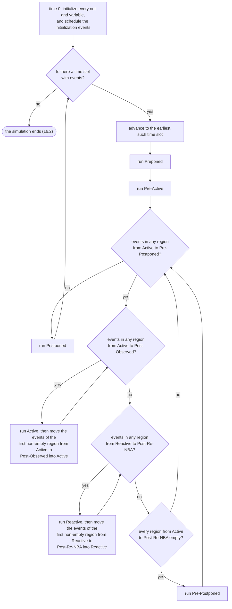
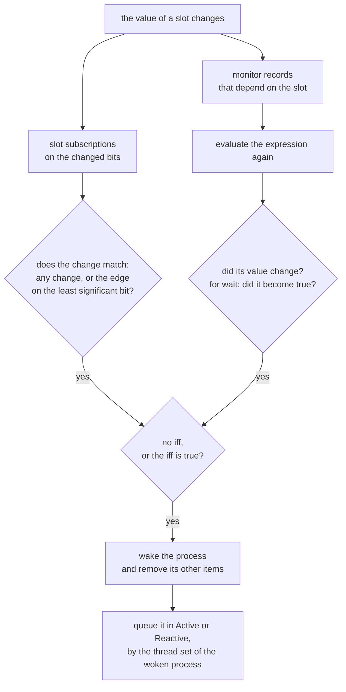

# SCHEDULER_SPEC: specification of the scheduler

[日本語](SCHEDULER_SPEC.ja.md) · This English text is the main version; the Japanese version follows it, and where they differ, this text holds.

**Revision (2026-10-24):** old P2→P3, old P3→P4 and old P4→P5; new P2 (SIR v1) is inserted, with tier numbers unchanged ([mapping](../notes/phase-renumbering.md)).

**Program execution amendment (approved 2026-10-23):**
[The approved program rules](../notes/program-execution-proposal.md) apply
to instance identity, reactive scheduling, inherited execution origin and
program completion. Implementation status is tracked separately.

**Phase scope amendment (approved 2026-10-23):** [P1_SCOPE](P1_SCOPE.md)
advances the Icarus-required subset of later-phase or out-of-scope work into
P1. Existing semantic rules remain; missing details need review before code.
Phase labels below describe the original plan, subject to this amendment.

Priority: P0. Status: **approved (amendment approved 2026-10-15)**. The points of an independent review were applied to the version approved on 2026-10-14. The same day, the order of evaluating initial values of static variables (3) was added (approved). The same day, not writing the reason for ending to standard error for `$finish(0)` and `$stop(0)` was added to 16.2 (approved). On 2026-10-16, the default timescale and the design's precision were added to 1 (approved). The same day, `$finish` inside `final` was added to 16.2 (approved). The same day, leaving the checks of writes and drivers in 6.4 and 12 to slang's analysis stage was added (approved). The same day, the descriptions of drive strength in 12 and 19 were changed to references to VALUE_SEMANTICS.md 5 (approved). On 2026-10-17, reclaiming the records of ended processes was added to 10.8 (approved). The same day, the third condition of 10.8 was changed to include the calls of settled reports (approved). On 2026-10-18, 15.4 was aligned with the flush points of 15.3 (approved). The same day, run-time errors of the design were given the reason error and code 2 (16.2, 8; approved). On 2026-10-18, diagrams of the steps of 3 and of waking in 9.5 were added (approved). The same day, what the Postponed region may write was added to 2.2 (interpretation; approved). The same day, the pending queue of static initialization (15.3) and its run-time errors (16.2) were written down (approved). On 2026-10-19, the limit on the events of one time slot was added to 16.2 (approved), and the check points of SIGINT and the limit on nested calls, approved on 2026-10-18, were written in 16.2. On 2026-10-19, the order at time 0 (6.1) was replaced by the steps of kirimasim's choice (approved). The same day, the reason resource_limit and its code 6, with the limits on live processes and on the depth of calls, were added to 16.2 (approved). The same day, the reason wall_time_limit, with the limit on wall-clock time, was added to 16.2 (approved). The same day, `--stop` was added to the paragraph on how `$stop` ends (16.2; approved). The same day, what race exploration mode perturbs was listed in 11, and 4.3, 6.1 and 13 were aligned with it (approved). The same day, the order of waking the waiters of a change (4.3) and the place of a delayed NBA when its time comes (13) were added (approved). The same day, `--mintypmax` and `--report-pulses` were referred to from 12 (approved). The same day, the points UNSPECIFIED_BEHAVIOR.md leaves not decided were marked in 2.2, 6.1 and 6.2 (approved). The same day, declaration order of static initializers was kept (6.1; approved). The same day, a lint warning for an `always` that never waits was added to 6.2 (approved). The same day, the interpretation of 2.2 was kept (approved). The same day, which reads the warning of 3 (step 1) covers was set (approved). The same day, how kirimasim applies 13.4.4 was added as 6.5, and 15.3 was made to point to it (approved). On 2026-10-20, the right side of a procedural `assign` or `force` was added to the callers 6.5 does not allow, and the callers in the Postponed region were left to 2.2 (approved). The same day, one rounding of real delays, constant or known at run time, was set in 1 (approved). The same day, 14.3 was made to say that the writes of a function a continuous assignment calls do not make a continuous assignment in effect (approved). The same day, front was made to check, for 6.4, the writes another process makes through a task (approved). The same day, the actions of deferred assertions were left out of the restrictions of 6.4, and front was made to check the writes another process makes through them (approved). On 2026-10-21, the stack of the thread running out was added to resource_limit in 16.2 (approved). The second half of part 4 (P4 features) is not written yet.

This document sets how kirimasim's execution kernel advances time and events. The text of the standard (IEEE 1800-2023) is not copied; it is summarized in this document's own words, with the clause numbers it rests on. Items marked "checked" were checked by reading the relevant clause of the standard. Items marked "rule of this document" are points the standard leaves to the implementation, decided for kirimasim.

It is long, so it is written in these parts.

| Part | Content | State |
| --- | --- | --- |
| Part 1 | Time slots and regions, the reference algorithm, orders that are set, assignments and events, starting procedures, the regions of PLI callbacks (1 to 7) | Approved |
| Part 2 | Waits and notification (delays, event controls, `wait`, named events, monitor records), process control (fork, disable, the process class) (8 to 11) | Approved |
| Part 3 | Continuous assignments and their delays, details of NBA, procedural continuous assignments (assign, force and so on) (12 to 14; procedural delays and intra-assignment delays are in 8) | Approved |
| Part 4 | Violations of unique and priority, and deferred immediate assertions (15; approved). The regions of concurrent assertions, clocking blocks, program (written in P4; not written yet) | First half approved |
| Part 5 | Conditions and limits of ending, VPI time callbacks (16 to 17) | Approved |

## 1. Time and time slots

- Every event has exactly one execution time. The set of events scheduled for the same time is called a time slot. Simulation runs and removes every event of the present time slot before moving to the next time slot with events. Time does not go back (checked: 4.4).
- Time is held as an unsigned 64-bit integer whose unit is the smallest precision of the whole design. Conversion of an integral delay from `timeunit` is computed with integers, a real delay is converted as the bullet on rounding below says, and overflow is an error (rule of this document; carried over from the design specification's rules).
- A delay value is rounded to the time precision of the design element (module, program, interface and so on) where the delay is written before it is used. If the precision equals the time unit it is rounded to an integer; if one digit finer, to one decimal place (checked: 3.14.1; for example, with unit 1ns and precision 100ps, 2.75ns becomes 2.8ns). The time unit and precision are decided by `` `timescale `` or `timeunit` and `timeprecision`; without them the defaults are used (checked: 3.14.2; which specification takes effect is taken from slang's result).
- The rounded value is converted to steps of the smallest precision of the whole design. This conversion goes toward a finer precision, so it divides exactly and no rounding happens.
- A real delay, constant or known only at run time, is converted from its value as a double (a real literal is a double: 5.7.2): the value is multiplied by 10^(unit − precision) in double arithmetic, and the product is rounded half away from zero, as in conversion from real to integer (VALUE_SEMANTICS.md 1.5) (rule of this document, added 2026-10-20, approved; the direction of a value exactly halfway is not settled by the wording of the standard). The product can differ from the exact value of the double: 2.675 at 1ns/10ps gives 268 steps, although the double is just below 2.675. The rule follows the double arithmetic, which a delay known only at run time has to use. Icarus Verilog 13.0, 14.0 (devel) and Verilator 5.052 give the same results for constants and variables (checked 2026-10-20 with 0.5, 1.5 and 2.5 at 1ns/1ns, and 0.145, 0.285, 1.005, 1.15, 1.255 and 2.675 at 1ns/10ps).
- `#1step` is one step of the smallest precision of the whole design. The meaning of sampling is written in part 4 (P4).
- **Default timescale (approved 2026-10-16):** the time unit and precision of a design element on which neither `` `timescale `` nor `timeunit` and `timeprecision` take effect are 1ns / 1ns unless `--timescale` gives them (rule of this document). The standard leaves the default to the implementation (checked: 3.14.2.3). Running them showed Icarus 13.0 uses 1s / 1s and Verilator 5.052 1ps / 1ps, so matching either differs from the other. The test suite's rule is that tests whose output changes with the unit of time write a timescale (TEST_SUITE.md), so this default does not affect the tests' expected values.
- **Mixing:** mixing design elements with a timescale and design elements without one is an error (checked: 3.14.2.3). slang makes this an error, and kirimasim ends with code 2 (checked 2026-10-16). With `--timescale`, design elements with no specification get that value, so it is not an error (slang's behaviour; checked the same day).
- **Precision of the whole design (approved 2026-10-16):** the smallest precision of all design elements is the precision of the whole design (one step of time) (checked: 3.14.3). When no design element specifies one, it is the precision of the default (`--timescale` or 1ns / 1ns). `front` computes it and puts it in SIR.

## 2. Regions

### 2.1 The 17 regions and their order

One time slot is divided into these 17 regions, in this order (checked: 4.4).

| # | Region | Kind | Set | Mainly holds |
| --- | --- | --- | --- | --- |
| 1 | Preponed | Simulation and PLI | — | Sampling of `#1step` (the same as sampling in the Postponed region of the previous time slot) |
| 2 | Pre-Active | PLI | — | PLI callbacks |
| 3 | Active | Simulation | active | Evaluation of the design's processes, and updates of values |
| 4 | Inactive | Simulation | active | Resumption of processes of the active set stopped by `#0` |
| 5 | Pre-NBA | PLI | active | PLI callbacks |
| 6 | NBA | Simulation | active | Updates of nonblocking assignments run in the active set |
| 7 | Post-NBA | PLI | active | PLI callbacks |
| 8 | Pre-Observed | PLI | — | PLI callbacks (read only) |
| 9 | Observed | Simulation | — | Evaluation of concurrent assertions |
| 10 | Post-Observed | PLI | — | PLI callbacks |
| 11 | Reactive | Simulation | reactive | Assignments in programs and checkers, action blocks of concurrent assertions |
| 12 | Re-Inactive | Simulation | reactive | Resumption of processes of the reactive set stopped by `#0` |
| 13 | Pre-Re-NBA | PLI | reactive | PLI callbacks |
| 14 | Re-NBA | Simulation | reactive | Updates of nonblocking assignments run in the reactive set |
| 15 | Post-Re-NBA | PLI | reactive | PLI callbacks |
| 16 | Pre-Postponed | PLI | — | PLI callbacks |
| 17 | Postponed | Simulation and PLI | — | `$monitor`, `$strobe`, read-only callbacks |

- The active set is Active, Inactive, Pre-NBA, NBA and Post-NBA. The reactive set is Reactive, Re-Inactive, Pre-Re-NBA, Re-NBA and Post-Re-NBA (checked: 4.4.1).
- The regions that are iterated are the 14 from Active to Pre-Postponed (checked: 4.4.1, 4.5). Preponed, Pre-Active and Postponed run only once per time slot.
- No PLI callbacks are called in Observed. The pass/fail code of assertions evaluated in Observed is put in the Reactive region of the same time slot (checked: 4.4.2.5).

### 2.2 What is forbidden in each region

- Preponed (PLI): writing nets or variables, and adding events to the present time slot, are forbidden (checked: 4.4.3.1).
- Pre-Observed (PLI): likewise, writing and adding events to the present time slot are forbidden (checked: 4.4.3.5).
- Postponed: writing, and adding events to earlier regions of the present time slot, are forbidden. No more value changes happen (checked: 4.4.2.9).
- kirimasim reports forbidden writes and additions of events in these regions as run-time errors (rule of this document).
- **What the Postponed region may write (interpretation; added 2026-10-18, approved):** a function that the arguments of `$strobe` or `$monitor`, or the action of a `final` deferred assertion, call in the Postponed region may write its own variables: its arguments, its automatic variables and its static variables, also through a `ref` to them. They hold only the function's own work, and SIR_SPEC.md 10 (item 6) leaves them out of the write restrictions in the same way. Writing any other variable or net, a nonblocking assignment, a trigger, a `fork`, a `disable` and a procedural continuous assignment are run-time errors (16.2). The arguments of the call that is a deferred assertion's action are evaluated with the assertion, not in Postponed (checked: 16.4). A proposal to make every write of such a function an error is not taken (decided 2026-10-19; UNSPECIFIED_BEHAVIOR.md 9).

## 3. How a time slot proceeds (the reference algorithm)

The standard gives a reference algorithm that a conforming simulator should implement. Another algorithm may be used if the results the user sees are the same (checked: 4.3, 4.5). kirimasim implements the following steps as they are.

1. At time 0, every net and variable gets its initial value, and the events that initialization makes go into the time slot of time 0.
   - Initial values in declarations of static variables are evaluated before initial and always start (checked: 6.8, 10.5). No text was found in the standard on the order of evaluation among static variables (not confirmed). kirimasim evaluates them in declaration order within one scope (rule of this document). An initial value that may read a static variable before that variable's initial value is set gets the warning `kirima-static-init-order` (rule of this document; the details approved 2026-10-19). That is an initial value that reads a static variable of another instance, as the order between instances is not set, or one of its own instance, package or compilation unit whose initial value is set after its own; generate blocks, named blocks and subroutines count as part of their instance here. Reading a static variable of a package or a compilation unit from an instance gets no warning, as those are set first (SIR_SPEC.md 7.1). Only the variables the expression names count, not those read inside the functions it calls (P1). The warning is given once per initial value, at its position, and names the variables read.
2. While there is a time slot with events, move to the earliest and run that time slot.
3. Running a time slot:
   1. Run Preponed.
   2. Run Pre-Active.
   3. While any region from Active to Pre-Postponed has events, repeat:
      1. **Active side:** while any region from Active to Post-Observed has events, repeat: run Active, then move all events of the first region from Active to Post-Observed that has events into Active.
      2. **Reactive side:** while any region from Reactive to Post-Re-NBA has events, repeat: run Reactive, then move all events of the first region from Reactive to Post-Re-NBA that has events into Reactive.
      3. If every region from Active to Post-Re-NBA is empty, run Pre-Postponed.
   4. Run Postponed.
4. Running a region: take events out one at a time until the region is empty. An update event updates the value and schedules evaluation events for the processes sensitive to that value. An evaluation event evaluates the process (which may schedule more events).

(checked: 4.5)

The same steps as a diagram (where it differs from the steps, the steps hold):

Notes:

- **Once the reactive side starts, it does not go back to the active side until the five regions of the reactive set are empty.** Even if events appear in Active while the reactive side is running, they run only after the reactive set is empty (checked: the explanation after 4.5).
- Observed and Post-Observed are part of the active side's iteration (checked: 4.5).
- The diagram above draws the steps of this section in this document's own form; Figure 4-1 of the standard is not copied.

## 4. Orders that are set, and orders that are not

### 4.1 Orders the standard guarantees

- Statements within one begin-end run in the order written. Execution may yield to other processes in between, but the order is not changed (checked: 4.6).
- Updates of nonblocking assignments (NBAs) happen in the order the assignment statements ran. After `q <= 1; q <= 2;` in the same process, q is 2 (checked: 4.6; test `sched/nba_order_same_proc`).

### 4.2 Orders the standard does not set

- The order in which events are taken from the Active and Reactive regions (checked: 4.4.2.2, 4.4.2.6, 4.7).
- Whether a sequence of statements with no time wait is run through as one event. The standard allows stopping a process in the middle of evaluation and interleaving it with other processes (checked: 4.7).
- Updates of values and evaluations of processes sensitive to them alternate, so races can occur (checked: 4.8).

### 4.3 kirimasim's fixed order

- Each region takes events out in the order they were added (sequence-number order). For the same input, the order is the same however many times it runs (rule of this document; NFR-2).
- A change of a value wakes the processes waiting on it in the order they started to wait (rule of this document; approved 2026-10-19). Their resumptions go into the region in that order.
- A process runs without being stopped until it enters a time wait (`#`, `@`, `wait` and so on) or ends (rule of this document).
- Race exploration mode (`--race-check`, P3) perturbs, according to a seed, some of the orders chosen here. What it perturbs and what it keeps are listed in 11 (approved 2026-10-19).

## 5. Assignments and events

| Assignment | How events are handled | Grounds |
| --- | --- | --- |
| Continuous assignments (`assign`, including the implicit continuous assignments of ports) | Treated as a process sensitive to the elements of the right side. When the value of the right side changes, an update is scheduled in Active. The target is decided by the values at that time. **Also evaluated once at time 0** (to propagate constants) | Checked: 4.9.1 |
| Procedural continuous assignments (`assign`, `force`) | Treated as a process sensitive to the elements of the right side. Stopped by `deassign` and `release` | Checked: 4.9.2 |
| Blocking assignments with an intra-assignment delay (`a = #d b`) | The right side is computed with the present values, then the process is stopped and a future event scheduled. With a delay of 0, it is scheduled in Inactive from the active set and in Re-Inactive from the reactive set. **The target is decided by the values at the time it resumes** | Checked: 4.9.3 |
| Nonblocking assignments (`a <= b`, `a <= #d b`) | The update value is computed and, with a delay of 0, scheduled in the NBA region of the present time slot (Re-NBA from the reactive set), otherwise as a future event. **Both the value of the right side and the target are decided by the values when the statement runs** (the i of `a[i] <= #d v` too is the value when it runs) | Checked: 4.9.4, 4.4.2.4, 4.4.2.8 |
| Bidirectional switches | The value is decided after considering all connected switches. May be processed at any time | Checked: 4.9.5 (P5) |
| Port connections | input and output are taken as implicit continuous assignments, and inout as a bidirectional connection that does not weaken strength | Checked: 4.9.6 |
| Subroutine arguments | By value. Copied at the call and copied back on return. Copying back is the same as a blocking assignment | Checked: 4.9.7 |

- Collapsing ports (the design specification's "port collapsing") is done only when the results the user sees are the same as the implicit continuous assignments of 4.9.6 (rule of this document). The conditions, and how force and release look, are written in part 3.
- The value and target of an NBA with a delay are kept in the record of the future event, and freed after that event runs. Values of NBAs with no delay are placed in an arena per time slot, and freed together at the end of the time slot (rule of this document; carried over from the design specification's data structures).

## 6. Starting procedures

### 6.1 Order at time 0

Approved 2026-10-19 (it replaces the order approved on 2026-10-14). The standard sets that static initial values come first and that `always_comb` and `always_latch` start after the `initial` and `always` procedures; the order among the rest is not set (4.2, 4.7). kirimasim takes these steps (rule of this document, except where marked checked):

1. Initial values in declarations of static variables are set, before any `initial` or `always` starts. Static members of classes are included (checked: 6.8, 10.5). This differs from 1364-2005 (where declaration initial values were treated the same as assignments from an `initial`). They make no events and wake nothing, as nothing waits yet (SIR_SPEC.md 7.1). Among static variables, the order is declaration order within a scope (3); the order of their dependencies is not taken (decided 2026-10-19; UNSPECIFIED_BEHAVIOR.md 9).
2. Nets start from the values of VALUE_SEMANTICS.md 5.3 and 5.4: bits with no driver have the default initial value of the net, and bits a driver writes are x until it first writes.
3. Every `always` procedure whose first statement is an event control, `always_ff` and `always @*` included, starts to wait on that event control. None of its statements runs at time 0 before it wakes.
4. Continuous assignments, net declaration assignments, the implicit continuous assignments of ports, gates and UDP instances (the process kind `cont` of SIR_SPEC.md 7.1) are put in Active, to be evaluated once (checked: 4.9.1).
5. The other `always` procedures (those whose first statement is not an event control) are put in Active.
6. `initial` procedures are put in Active. An `initial` of a program goes into Reactive from time 0 (checked: 24.3.1; handled in P4).
7. `always_comb` and `always_latch` are put in Active, to run once (checked: 9.2.2.2, 9.2.2.3). `always @*` does not run at time 0 (6.2).

- Within each step, processes go in the order of SIR's process numbers (depth-first over the instance tree, and within each instance the order of appearance in the source; SIR_SPEC.md 1). How processes are numbered does not change.
- Active takes events out in the order they were put in (4.3), so steps 4 to 7 run in that order, with the events they make in between.
- Race exploration mode (11) perturbs the order of steps 4 to 7.
- Processes of the kinds `override`, `postponed` and `final` (SIR_SPEC.md 7.1) start by their own rules (14, SYSTEM_TASKS.md 4, 6.2).
- Why this order: an `always` waiting on the falling edge of a reset does not miss it when an `initial` lowers the reset from x to 0 at time 0; an `initial` reads at time 0 the values continuous assignments give; and the result does not depend on the order in which procedures are written. Each is a choice the standard allows (4.7). Since the processes of step 3 wait before anything runs, every change of value at time 0 reaches the edge and event waits, in line with a change from x being an edge in 4 states (VALUE_SEMANTICS.md 4.3).

### 6.2 Starting rules by kind of procedure

| Procedure | Starting rule | Grounds |
| --- | --- | --- |
| `initial` | Runs only once and stops when its statement ends | Checked: 9.2.1 |
| `always` | Repeats from the start when it ends. With no control that advances time it becomes an infinite loop in zero time (kirimasim stops it at the limits of part 5) (an `always` with no timing control on any path also gets a lint warning at elaboration, decided 2026-10-19: UNSPECIFIED_BEHAVIOR.md 6.1, A2) | Checked: 9.2.2.1 |
| `always_comb` | Starts once at time 0, and afterwards whenever any of its implicit sensitivity changes. Controls that block the block (time waits, event waits, fork-join) cannot be used inside | Checked: 9.2.2.2, 9.2.2.2.2 |
| `always_latch` | The same starting rule as `always_comb` (the only difference is the warning checks tools do) | Checked: 9.2.2.3 |
| `always_ff` | Has exactly one event control, and no control that blocks for time | Checked: 9.2.2.4 |
| `always @*` | Not started at time 0; waits until any of its sensitivity changes | Checked: 9.2.2.2.2 |
| `final` | Runs at the end of simulation, with no delays. It runs not as an independent process but as a sequence of function calls from one process. The order of several `final`s is not set by the standard (kirimasim uses the order of appearance in the source). After every `final` has run, remaining events are not run. `final` runs before the PLI callback marking the end of simulation (`cbEndOfSimulation`). `$finish` and `vpi_control(vpiFinish)` inside a `final` end the simulation on the spot. `final` is started only once. The standard does not set the order of `final`s but requires the same order on every run (kirimasim's source order satisfies this) | Checked: 9.2.3 |

### 6.3 The implicit sensitivity of `always_comb`

`always_comb` (and `always_latch`) is sensitive to what the block reads and what the functions it calls read: nets, variables and select expressions, each taken by its longest static prefix (checked: 9.2.2.2.1). Three kinds of read do not count:

- A read of a variable that the block, or a function it calls, declares itself.
- A read of something that the block, or a function it calls, also **writes**.
- A name used only inside timing controls (`wait`, event controls, delays).

Other rules (checked: 9.2.2.2.1):

- Calls of functions across hierarchy, package functions and static functions of classes are looked into like ordinary functions.
- References to class objects and calls of methods add only their argument expressions to the sensitivity.
- Task calls add their arguments to the sensitivity, but their bodies are not looked into.
- Expressions of immediate assertions within the block (and within the functions called) are added to the sensitivity, like `if` conditions. Expressions within action blocks of assertions are not.

The difference from `always @*`: `always @*` does not react to variables read inside called functions, only to the functions' arguments. For immediate assertions too, it reacts only to those within the block (checked: 9.2.2.2.2).

An example to check (put in the test suite): writing `c = b; b = a;` in an `always_comb`, b is written within the block and so excluded from the sensitivity. Changing a changes b, but c gets b's value before the assignment in that run, and the block does not wake again (the design specification's `comb_order.sv`; checked with iverilog 12.0).

### 6.4 Write restrictions

These restrictions apply only to procedures written with the keywords `always_comb`, `always_latch` and `always_ff`. Ordinary `always` (`always @(posedge clk)` and the like) has none (checked: 9.2.2.1, 9.2.2.4). It is correct for an ordinary `always` and another process to write the same variable, as in `initial q = 0; always @(posedge clk) q <= d;`.

Variables on the left side of `always_comb`, `always_latch` and `always_ff` must not be written by other processes, including variables written inside the functions they call (not those written inside tasks). Writes to separate elements of a variable whose longest static prefixes do not overlap are allowed (checked: 9.2.2.2, 9.2.2.4). This check is done by slang's analysis stage. kirimasim runs the analysis stage both for `kirimasim parse` and for running a design, and reports violations as errors (exit code 2). kirimasim does not keep the same check on its own side (checked on 2026-10-16 that slang reports violations between `always_comb` and other processes, and between `always_ff`s) (approved 2026-10-16). slang's analysis stage does not look at a write inside a task that another process calls (checked 2026-10-20; it reports a direct write and one through a function), and slang keeps it so on purpose: the standard is not clear on this, tools read it both ways, and slang takes the reading that accepts more existing code (slang issue #2040, answered 2026-10-23). kirimasim follows slang and does not report such a write either; the design runs, and each write takes effect as an ordinary write of the variable (changed 2026-10-25, approved). Until this change is implemented, front still reports the write, as decided on 2026-10-20: an error at the write in the task, with a note at the call, and exit code 2.

**Actions of deferred assertions (added 2026-10-20, approved):** the action of a deferred assertion in these blocks, or in a function or task they call, is not part of the block for these restrictions, as a task is not. What it writes, with the functions and tasks it calls, is not under them, and the sensitivity of 6.3 does not take it as written by the block. It runs after the block, in the Reactive region for `#0` and in the Postponed region for `final` (15.2; checked: 16.4.1), and slang's analysis stage leaves it out on purpose (read in slang's source on 2026-10-20). Whether the standard counts it as part of the block is not confirmed (interpretation). A write to what an `always_comb`, `always_latch` or `always_ff` writes, made through the action of a deferred assertion that another process runs, itself or in a function it calls, is not reported either, as one through a task is not (changed 2026-10-25, approved). Until this change is implemented, front still reports it: an error at the write, with a note at the assertion, and exit code 2. The action of the block's own assertion may write what the block writes, as the block's own task may. A `final` action that writes a variable other than its function's own is a run-time error anyway (2.2).

### 6.5 Functions that schedule work after they return (rule of this document; approved 2026-10-19)

A function may schedule an event that can become active only after it returns only when the thread that calls it was made by an `initial` or `always` procedure, or by a `fork` within one. Otherwise the standard asks for an error, at compile time or at run time (checked: 13.4.4). kirimasim gives the error at compile time, with exit code 2, as front sees both the caller and the body of the function. slang has no such check (checked on 2026-10-19; its `nonblocking-final` warning covers only a nonblocking assignment written directly in `final`).

- **Callers that are not allowed:** the initial value of a static variable (of a module, a package or the compilation unit, or a static variable of a subroutine or a block), a continuous assignment (`assign`, a net declaration assignment, a port connection), a `final` procedure, and the right side of a procedural `assign` or `force` (added 2026-10-20, approved). That right side is evaluated again whenever what it reads changes, by the statement's own `override` process (SIR_SPEC.md 7.1), not by the thread that ran the statement (interpretation: 10.6.1, 10.6.2 and 13.4.4 do not name this caller). `always_comb`, `always_latch` and `always_ff` are `always` procedures (checked: 9.2.2) and are allowed.
- **Statements that count:** a nonblocking assignment, a nonblocking trigger `->>`, `fork ... join_none`, and a clocking drive (P4). A blocking trigger `->` does not count: it only wakes the processes waiting on the event, as any write to a variable wakes those waiting on it. `$strobe`, `$monitor` and the action of a deferred assertion do not count either.
- **Calls are followed:** a function that calls a function containing such a statement counts too. A call front cannot resolve, through a class handle or a virtual method, is checked at run time in P4, as a run-time error of the design (16.2).
- **Callers in the Postponed region (added 2026-10-20, approved):** the arguments of `$strobe` and `$monitor` and the action of a `final` deferred assertion run in the Postponed region, where each of these statements is already a run-time error (2.2), so front does not check them again. A task called from `final` is an error of slang (`TaskFromFinal`). The action of a `#0` deferred assertion runs in the Reactive region (16.4) and is not checked: whether 13.4.4 counts it as part of the thread that ran the assertion is not confirmed.
- **The message:** the error is at the call, and a note gives the position of the statement in the function.

## 7. Regions of PLI callbacks

The standard sets in which region the main VPI callbacks are called, as follows (checked: 4.10, Table 4-1). The details, and when the callbacks cocotb uses are called, are written in part 5.

| Callback | Region |
| --- | --- |
| `cbAfterDelay`, `cbNextSimTime`, `cbAtStartOfSimTime` | Pre-Active |
| `cbNBASynch` | Pre-NBA |
| `cbReadWriteSynch` | Pre-NBA or Post-NBA |
| `cbAtEndOfSimTime` | Pre-Postponed |
| `cbReadOnlySynch` | Postponed |

Whether `cbReadWriteSynch` is called in Pre-NBA or Post-NBA is not set by the standard. kirimasim's choice is made in part 5.

## 8. Waits for time (delays)

- The statement after `#d` runs d later than the statement just before it (checked: 9.4.1).
- If the delay expression contains x or z, the delay is taken as 0 (checked: 9.4.1).
- If the delay expression is negative, it is read as an unsigned integer (two's complement) of the same width as `time`, that is, a very large delay (checked: 9.4.1). A delay that takes the time past the largest time (2^64 − 1 steps of the precision) is a run-time error (16.2; rule of this document; added 2026-10-18, approved).
- A delay of 0 (`#0`) resumes in Inactive for the active set and in Re-Inactive for the reactive set (checked: 4.4.2.3, 4.4.2.7).
- Intra-assignment delays and event controls (`a = #d b`, `a = @(e) b`, `a <= #d b`) evaluate the right side before waiting and delay only the assignment to the left side (checked: 9.4.5). When the target is decided is as in 5 (blocking: when it resumes; NBA: when the statement runs).
- The n of `repeat (n) @(e)` is evaluated only once, when scheduling. If n is 0 or less, x or z, it is treated as if there were no `repeat` (checked: 9.4.5).
- Future events are placed in a timing wheel for near times and a 4-ary heap for far times, ordered by (time, region, sequence number) (rule of this document; carried over from the design specification's data structures).

## 9. Kinds of wait and how they wake

### 9.1 Event controls (`@`)

- `@(expr)` with no edge wakes when the **value** of the expression changes. It does not wake if operands change but the expression's value does not (checked: 9.4.2).
- Edge waits (`posedge`, `negedge`, `edge`) are decided only by changes of the least significant bit of the expression. The table of decisions is as in VALUE_SEMANTICS.md 4.3 (checked: 9.4.2).
- `or` and comma mean the same, and any one of the events wakes it (checked: 9.4.2.1).
- A wait with `iff` evaluates the `iff` expression when the event expression changes, and wakes only if it is true (in the sense of 12.4). It does not wake when only the `iff` expression changes. `iff` binds more tightly than `or` (checked: 9.4.2.3).
- A wait on a variable of class handle or chandle itself wakes when the value written differs from the previous value (checked: 9.4.2).
- When an expression refers to fields of objects, elements of aggregate data or sizes of dynamic arrays, the expression is evaluated again when they change. It may also be evaluated again on changes of things it does not refer to (checked: 9.4.2).

### 9.2 The implicit sensitivity of `@*`

`@*` adds to the sensitivity every identifier of a net or variable that appears in the statement that follows. Only these two are excluded (checked: 9.4.2.2):

- Those that appear only in expressions of timing controls (`wait`, events, delays).
- Those that appear only as variables on the left side of assignments.

Unlike `always_comb` (6.3), a variable written within the block is in the sensitivity if it is read on a right side. Variables used in indices of left sides, variables in case items, and arguments of subroutine calls are in the sensitivity too (checked: 9.4.2.2). The bodies of functions are not looked into (checked: 9.2.2.2.2).

### 9.3 Condition waits (`wait`)

- `wait (expr)` evaluates the expression and proceeds at once if it is true (in the sense of 12.4). Otherwise it stops until it becomes true (checked: 9.4.3).
- The expression of the wait is evaluated again only when its operands change (checked: the second half of 15.5.3).

### 9.4 Named events

- `->` wakes every process waiting on the event at that moment. The trigger itself is instantaneous and cannot be observed as a state (checked: 15.5.1).
- To wake on `@ev`, the waiting side must have run the `@` **before** the triggering side's `->`. If the trigger comes first, the waiting side stays stopped (checked: 15.5.2).
- `->>` proceeds without stopping, and triggers in the **NBA region** of the time when the delay or control is satisfied (checked: 15.5.1).
- `ev.triggered` is true if the event was triggered in the present time slot, and stays true until time advances. It is false for a null event (checked: 15.5.3). `wait (ev.triggered)` wakes **within the same time slot** whether the `wait` or the trigger ran first. A trigger of an earlier time slot does not wake it.
- When `triggered` goes back from 1 to 0 at the end of the time, that change does not cause waits to be evaluated again (checked: 15.5.3).
- Changing the index into an array of events does not trigger anything (checked: 15.5.1).
- `wait_order`, merging of events and comparison are written in P4 (15.5.4 to 15.5.5 of the standard).

### 9.5 Representation in kirimasim (rule of this document)

The design specification's "two levels of waits" are carried over.

| Wait | Representation | Wakes when |
| --- | --- | --- |
| Changes and edges of fixed signals (`iff` included) | Slot subscriptions (process number, bit range, kind of edge, `iff` expression) | The value of the subscribed bit range of the slot changes. Edges are decided on the least significant bit of the value of the event expression (bit 3 of v for `@(posedge v[3])`) |
| Compound expressions (`@(a == b)`, `@(posedge (clk & en))`) and `wait` | Monitor records (slots depended on, expression, previous value, edge, `iff`) | When a slot depended on changes, the expression is evaluated again, and it wakes when the expression's value changed (for `wait`, when it became true) |
| Fields of objects, sizes of queues, elements of dynamic arrays (P4) | Monitor records, with "being watched" bits on objects and containers | When content or size changes. When a handle is replaced or an index changes, the dependencies are re-attached and evaluated again |
| Named events | Wait queues of event objects | On `->`, only the processes in the wait queue at that moment are woken |
| Expressions containing `ev.triggered` (`wait (ev.triggered)` and so on) | Monitor records whose dependencies include the event object | Triggers by `->` and `->>` also notify the monitor records depending on the event, and the expressions are evaluated again. The `triggered` state goes back to 0 when time advances, but that does not cause evaluation (checked: 15.5.3) |
| Time | Future events | When the time is reached |

Implementation status (2026-10-24): typed container SIR monitors capture
container-structure and cell-value reads on each evaluation. Weak watch markers
skip unrelated objects; a successful evaluation replaces the dependency set,
so handle/index changes reattach it. Monitor IDs and serials join the existing
ordered late-change queue. The tier drains committed heap notifications before
its next instruction; guards defer them to the outermost walk's end. Cancellation
invalidates queued notices and releases hook ownership. Read/notice allocation
failure ends with ResourceLimit rather than using partial dependencies.

Called functions' private container graphs are excluded like their private
slots (VM dependency analysis); global and direct hierarchical reads remain.
The graph query is read-only and adds no GC roots. The VM detaches its waits
before destroying callback frames. These kernel/VM checks use independent SIR
and do not alone establish language coverage. Front lowering now executes the
[tested container subset](../P1_SUPPORT.md#dynamic-container-foundation);
remaining forms are recorded there. This status update changes no wait rule.

How a change of a slot's value wakes the processes waiting on it (where the diagram differs from the table and the items below, they hold):

- The region a woken process is put in is decided by **which set the woken process's thread belongs to**, not by the region running the event that woke it (checked: 24.3.1).
  - Design threads (`initial`, `always` and continuous assignments of modules and interfaces, and those forked from them) go into Active.
  - Threads started from an `initial` of a program (and those forked from them) go into Reactive (P4).
  - Subroutines take over the set of the calling thread. Even a task declared in a module or package runs in the reactive set when called from a program thread (checked: 24.3.1).
  - Example: when a write by program code running in Reactive wakes an `always` of a module, that `always` does not run in Reactive but in Active of the next iteration (checked: 24.3.1).
- A thread's set is decided when the thread is made and kept in its frame. Where `#0` resumes (Inactive or Re-Inactive) and where NBAs go (NBA or Re-NBA) are decided by this set too.
- When a wait is undone by kill or disable, its subscriptions and monitor records are removed too.
- The wait of one event control can mix slot subscriptions and several monitor records (`@(posedge clk or (a == b))` and so on). Any item can have `iff`, and `iff` is evaluated only when that item's event occurs. When it wakes on any one item, the other items are removed (added 2026-10-18, approved).

## 10. Making and ending processes

### 10.1 What becomes a process

Each of the following is one process (flow of execution) (checked: 9.5): `initial`, `final`, each kind of `always`, each parallel statement within a fork-join, and dynamic processes. Each continuous assignment can be taken as a process too.

### 10.2 fork and join

- Each statement in a fork runs concurrently as a separate process. Delays in each statement are counted relative to the time the fork was entered (checked: 9.3.2).
- When the parent resumes (checked: 9.3.2, Table 9-1):
  - `join`: when every process it made has ended.
  - `join_any`: when any one of the processes it made has ended.
  - `join_none`: the parent continues at once.
- **Processes made by fork do not start running until the parent stops or ends, whatever the kind of join** (checked: 9.3.2). kirimasim puts the processes it made, in the order made, in the evaluation region of the parent's thread set (Active for the design, Reactive for programs), and runs them after the parent stops or ends (rule of this document). A child's thread set is the same as its parent's.
- Initializers of fork block items (variables declared right after `fork`) are evaluated when the scope is entered, **before** the children are made (checked: 9.3.2). With `fork automatic int k = j; ... join_none` inside a `for`, by this rule each child has its own value of `j`. In kirimasim, the parent does this initialization, then makes the children.
- Inside fork-join_any and fork-join_none, formal arguments passed by reference (`ref`) can be referred to only in initializers of block items (except `ref static`; checked: 9.3.2).
- Wrapping all the statements of a fork in a begin-end makes the whole one process (checked: 9.3.2).

### 10.3 `wait fork`

Stops until all child processes made directly by the present process (not grandchildren and below) have ended (checked: 9.6.1).

### 10.4 `disable`

- `disable name` ends the execution of a named block or task, and continues after the block, or after the statement that called the task. All activity started within it is ended too (checked: 9.6.2).
- It works regardless of parent and child. A child can end its parent, or an unrelated process (checked: 9.6).
- With nested task calls, disabling a task in the middle ends every call below it too. When the same task is called several times, every call is ended. The same for automatic tasks (checked: 9.6.2).
- The output and inout arguments of a disabled task, NBAs not yet run, and the results of procedural continuous assignments are not set by the standard (checked: 9.6.2). kirimasim does not copy back output and inout, and runs NBAs already scheduled as they are (rule of this document).
- Functions cannot be disabled. What happens when, from inside a function, the block or task that called the function is disabled is not set by the standard (checked: 9.6.2). kirimasim makes it a run-time error (rule of this document).

### 10.5 `disable fork`

Ends every descendant of the present process (not only direct children, but also those made by children that have already ended) (checked: 9.6.3).

### 10.6 The process class

- Process objects are made internally when processes are made. Users cannot make them with `new`, and cannot extend the class (checked: 9.7).
- `self()` returns the handle of the present process. `status()` returns one of FINISHED, RUNNING, WAITING, SUSPENDED and KILLED. KILLED is returned not only after `kill()` but also when ended by `disable` (checked: 9.7).
- `kill()` ends the process and all its descendants before `kill()` returns. Called on a FINISHED or KILLED process, it still ends descendants that have not ended (checked: 9.7).
- `await()` waits until the process ends (normally or by force). Waiting on oneself is an error (checked: 9.7).
- `suspend()` stops oneself or another process. It does nothing to SUSPENDED, FINISHED or KILLED processes. Stopping a WAITING process makes it stop reacting to the event, condition or delay it waited on. Stopping oneself inside a function is an error (checked: 9.7).
- `resume()` (checked: 9.7):
  - A process stopped while RUNNING is put in Active or Reactive of the present time and continues.
  - A process stopped while WAITING reacts to its wait again. If the condition is already true, or the original delay has already passed, it is put in Active or Reactive of the present time.
  - It does nothing to a process that is not SUSPENDED.
- `kill()`, `await()`, `suspend()` and `resume()` can be used only on processes made by `initial`, `always`, and forks within them (checked: 9.7).

### 10.7 Cleaning up after kill and disable (rule of this document)

When a process ends by kill, disable or disable fork, all of the following are removed:

- Slot subscriptions and monitor records.
- Registrations in wait queues of named events.
- Registrations in wait queues of semaphores and mailboxes (P4). Otherwise it would receive keys or values later.
- Events of time waits not yet reached.

NBAs the process scheduled are run as they are, by the rule of 10.4.

### 10.8 Reclaiming records of ended processes (rule of this document; approved 2026-10-17)

- **Records of a process:** the kernel's record (state, wait number, pending report queues) and tier 1's frame (frame variables, activities of task calls and named blocks, the list of children, events used for waits of join). Tier 2 (P3) follows the same rules.
- **Conditions for freeing:** a process's records are freed when all of the following hold.
  1. The process has ended (normally, or by kill, disable or disable fork).
  2. The records of every child it made have been freed. So that disable fork (10.5) and `kill()` (10.6) reach the descendants of ended children too, intermediate records stay linked while descendants remain.
  3. Its pending report queue (15.4) is empty, and the calls of settled reports have also finished running. A settled call runs, after leaving the queue, in Reactive (Postponed for final reports), and uses the frame then.
  4. (P4) No process handle points to it. While a handle remains, only the state and the link to descendants are kept, and frame variables may be freed.
- **When freed:** as soon as the conditions hold. They are checked when the process ends, when a child's records are freed, and when the pending queue becomes empty. If the parent's conditions hold too, the parent is freed next.
- **Telling children apart:** a freed child is removed from its parent's list of children. Children carry numbers in the order the parent made them. To tell, at a disable, which children were made within an activity of a task call or named block, these numbers are used (10.4), not positions in the list.
- **Reusing positions:**
  - Positions in the kernel's process table and places of frames may be reused after they are freed.
  - The wait number of a reused position continues from the previous process's and does not go back to 0. If a wait event, subscription or event wait of the previous process arrives later, the number does not match and it is discarded (the same mechanism as 10.7). A position whose wait number has reached its limit is not reused.
  - The "sequence number" of 15.4 is a running number (64 bits) in the order processes were made. It does not change when table positions are reused.
  - Positions of events used for waits of join are freed with the frame and reused too.
- **Behaviour does not change:** freeing does not change observable behaviour. Output, the reason and time of ending, and the counts of PERFORMANCE.md (except `proc.kept_peak`) are the same as a run that does not free.
- **Guarantee:** the memory of a design that forks repeatedly, and the work of `disable`, are proportional to the number of records remaining (live processes, and ended processes whose descendants remain), not to the number of times it forked.
- **A form to add later:** children referring to automatic variables declared outside the fork is unsupported now (SIR_SPEC.md 7.5 copies only fork block items into children's frames). When it is added, a rule that keeps the activity holding such a variable until every child referring to it has ended is added to this section then.

## 11. Race exploration mode (`--race-check`)

- Among the places where the standard does not set the order, these are perturbed according to a seed (`--race-seed`), and the run is repeated a given number of times (rule of this document; the list approved 2026-10-19):
  - the order of taking events out within the same region;
  - the order in which a change wakes the processes waiting on it;
  - the order of steps 4 to 7 of 6.1 at time 0.
- These are not perturbed: the orders the standard guarantees (4.1: the statements of one process, and its NBAs in the order they ran); the way the regions proceed (3); processes made by fork starting after the parent stops (10.2); the order inside a static island, which is one process seen from outside (P3).
- The NBAs of different processes keep the order they were issued in (13). Only with `--race-nba` (P3; CLI.md 2.3) is that order perturbed too (approved 2026-10-19).
- The output and sequence of observed events of each run are compared, and the first time a difference appeared, with the processes and source positions involved, is reported. No difference after any number of runs is not a proof that there is no race (a rule of the design specification).
- The random seed (`--seed`) and the seed of race exploration are separate (a rule of the design specification).

## 12. Continuous assignments and their delays

- A continuous assignment evaluates the whole right side when the value of any operand of the right side changes, and assigns to the left side only when the new value differs from the previous one (checked: 10.3.2).
- Nets may be driven by several continuous assignments, primitive outputs and module outputs (resolution is VALUE_SEMANTICS.md 5). A variable has at most one such driver: a single continuous assignment, or a single primitive or module output. Once a variable has that driver, giving it an initial value in its declaration or assigning it procedurally is an error (checked: 10.3.2). This check, as in 6.4, is done by slang's analysis stage (checked on 2026-10-16 that slang reports two continuous assignments to a variable, a mix of continuous and procedural assignments, a declaration initial value with a continuous assignment, and driving from two output ports) (approved 2026-10-16).
- Continuous assignments with delays (checked: 10.3.3):
  - The delay is the time from a change of an operand of the right side to the assignment to the left side.
  - Vector nets can have up to 3 delays. When the right side changes from a nonzero value to 0 the fall delay is used, when it changes to z the turn-off delay, and otherwise the rise delay. Scalar nets follow the same rules as gate delays (28.16 of the standard).
  - When the right side changes again before the previous change has reached the left side, these steps are taken.
    1. Evaluate the right side.
    2. If that value differs from the value of the propagation already scheduled, cancel the scheduled one.
    3. If that value equals the present value of the left side, schedule nothing.
    4. Otherwise, compute the delay from the present value of the left side and the new value of the right side, and schedule a new propagation.

    So pulses shorter than the delay disappear (inertial delay).
  - A delay given in a net declaration (`wire #10 w;`) delays **every** change to that net. The delay of a continuous assignment written with the declaration (`wire #10 w = a;`) is the delay of that continuous assignment only, and is not added to other drivers. For a continuous assignment written with the declaration of a vector net, the rise and fall delays are not applied bit by bit (checked: 10.3.3).
- Details of choosing delays (approved 2026-10-17):
  - "Changes to z" for a continuous assignment of a vector net is read as every bit becoming z (interpretation; 10.3.3 does not describe the case where only some bits of the vector become z).
  - Continuous assignments of scalar nets, and outputs of gates and UDPs, use the rise delay on becoming 1, the fall delay on 0, the turn-off delay on z, and the smallest of the given delays on x (and L, H) (checked: 28.16, Table 28-9; L and H are 28.6).
  - With one delay given, it is used for everything. With two, the turn-off delay and the delay to x are the smaller of the two (checked: 28.16).
- Updates of continuous assignments and gates with a delay of 0 (`#0`) are scheduled in the Inactive region of the present time (rule of this document; the same region as procedural `#0`; approved 2026-10-17).
- A delay given only in a net declaration (`wire #10 w;`) is reported as unsupported for now (approved 2026-10-17).
- Of a `min:typ:max` delay, typ is used unless `--mintypmax` chooses min or max, and `--report-pulses` reports, as notes, the pulses that inertial delays remove (CLI.md 2.2; approved 2026-10-19).
- In SIR it is expressed with `drive.delay` (SIR_SPEC.md 5.4).
- The drive strength of continuous assignments (10.3.4) follows VALUE_SEMANTICS.md 5 (approved 2026-10-16).

## 13. Details of nonblocking assignments (NBAs)

- NBAs to automatic variables and to elements of arrays whose size changes are errors (checked: 10.4.2). They are detected at elaboration.
- Any part of the left side that has to be computed (an index, a class handle, a virtual interface reference) is computed when the statement runs, together with the right side. Whether the left or the right side is evaluated first is not set by the standard (checked: 10.4.2, 4.9.4). kirimasim evaluates the right side first and the left side after (rule of this document).
- An NBA update is the last assignment of the time slot, with an exception: a process woken by an NBA update may do blocking assignments, which are processed after the NBA (checked: 10.4.2). This follows naturally from the reference algorithm (3) returning to Active after NBA.
- NBAs whose order of execution is clear are updated in that order (4.1). When two concurrent processes write the same variable by NBA, the final value is not set by the standard (checked: 10.4.2). kirimasim gives the result decided by sequence-number order (4.3). Race exploration mode keeps this order, and perturbs it only with `--race-nba` (11; approved 2026-10-19).
- An NBA with a delay schedules its update in the NBA region of the time after the delay (checked: 4.9.4). The value and target are decided when the statement runs and kept in the record (5).
- When that time comes, the updates of NBAs with delays go into its NBA region ahead of the NBAs issued during that time slot, in the order of (the time they fall due, the order they were issued) (rule of this document; approved 2026-10-19). They were scheduled before the time slot began, so they come first.

## 14. Procedural continuous assignments (`assign`, `deassign`, `force`, `release`)

### 14.1 Common

- The right side of `assign` and `force` is treated like a continuous assignment for as long as it is in effect. It is evaluated again each time a variable of the right side changes (checked: 10.6).

### 14.2 `assign` and `deassign`

- `assign` overrides every procedural assignment to the variable. It ends with `deassign`, and the variable keeps its present value until it is next assigned (checked: 10.6.1).
- The left side can only be a variable itself, or a concatenation of variables. Bit- and part-selects cannot be used (checked: 10.6.1).
- `assign` again to a variable under `assign` deassigns the previous one before starting the new one (checked: 10.6.1).
- The standard lists `assign` and `deassign` as candidates for future removal (checked: the note of 10.6.1, C.4.2). The design specification planned to handle them in P3 together with force, but the test suite's population uses them, so they were brought forward to P1 together with force (approved 2026-10-17).

### 14.3 `force` and `release`

- What can be a left side: a variable itself, a net, **constant** bit- and part-selects of a vector net, and concatenations of these (checked: 10.6.2).
- What cannot: bit- and part-selects of variables, and bit- and part-selects of nets of user-defined nettypes (checked: 10.6.2).
- Neither `force` nor `release` can be used on a variable written by both continuous and procedural assignments (checked: 10.6.2).
- `force` on a variable overrides all procedural assignments, continuous assignments and `assign` (checked: 10.6.2).
- When a variable is `release`d (checked: 10.6.2):
  - If there is neither a continuous assignment nor an `assign` in effect, the value does not change at once, and it keeps its present value until the next procedural assignment.
  - If there is a continuous assignment or an `assign` in effect, it is restored and evaluated again in the region where that continuous assignment is scheduled.
  - A continuous assignment is in effect on a variable when the variable is its left side. A write inside a function that a continuous assignment calls is a procedural statement (checked: 6.5) and does not make one (added 2026-10-20, approved; SIR_SPEC.md 3.4).
- While a net is forced, the forced value replaces what its drivers give, whether gates, module outputs or continuous assignments. When `release`d, the net takes at once the value decided by its drivers (checked: 10.6.2).

### 14.4 Handling in kirimasim (rule of this document)

- Slots that may be targets of `force` are flagged at elaboration (the "force target" of the design specification's slot table). What may be forced from VPI and `uvm_hdl_*` is included in the scope of `--public`.
- A write to a flagged slot checks whether it is under force before writing. Writes to unflagged slots have no such check.
- How force and release look on collapsed ports (5) is the same as when not collapsed. Connections where this cannot be made the same are not collapsed.
- The representation in SIR follows SIR_SPEC.md 5.6 and 7.1 (process kind `override`) (approved 2026-10-17).

## 15. Pending reports: violations of unique and priority, and deferred immediate assertions

Violations of `unique`, `unique0` and `priority` if and case, and deferred immediate assertions (`assert #0`, `assert final` and so on), are both handled by a mechanism that "decides on the spot and reports together later". This avoids false reports on zero-delay glitches (intermediate values) within the active set (checked: 12.4.2.1, 16.4).

### 15.1 Deciding unique, unique0 and priority

- `unique` and `priority`: a violation if no condition matches and there is no explicit else (default for case) (checked: 12.4.2).
- `unique0`: no violation even if none matches (checked: 12.4.2).
- `unique` and `unique0`: a violation if two or more conditions are true. Their order of evaluation is free, and finding one true condition does not end the evaluation of the others. Even on a violation, only the statement of the **first written** true condition runs. After finding a violation, evaluation may stop, and there is no need to try many evaluation orders (checked: 12.4.2). kirimasim evaluates every condition in the order written (rule of this document; to fix the result when conditions have side effects).
- `priority`: evaluated in the order written (checked: 12.4.2).
- For case (checked: 12.5.3, 12.5.3.1, 12.5.3.2):
  - The expression is evaluated once, before the items. For `unique` and `unique0`, the items may be taken in any order, and a match does not end the comparison with the other items. If two or more items match it is a violation, and only the statement of the first written matching item runs.
  - Several expressions within one item matching is not a violation. Once one expression of an item matches, the rest of the same item need not be evaluated.
  - `unique` and `priority` are violated if no item matches (`unique0` is not). Violations decided at compile time may be reported at compile time.
  - `priority` acts only on the first match.
  - Glitches (pending and the flush point) are handled as for if (15.3).
  - kirimasim evaluates every item and expression in the order written (rule of this document; as for if).

### 15.2 Deferred immediate assertions

- There are `assert #0` (observed deferred assertions) and `assert final` (final deferred assertions). `assume` and `cover` have the same forms (checked: 16.4).
- The expression is evaluated when the statement runs. The action block is limited to a single subroutine call. By-value arguments are fully evaluated when the expression is evaluated (checked: 16.4).
- Where the pass/fail reports go (checked: 16.4.1):
  - A `#0` report is settled in Observed, and the subroutine runs in Reactive.
  - A `final` report is settled in Postponed, and the subroutine runs in the same Postponed.
  - When an assert or assume with no else fails, `$error` is called instead of the subroutine.

### 15.3 The pending queue and the flush point

- A violation or report found is put on the pending queue of **the process now running**. Those found inside functions and tasks also go on the calling process's queue. Each process is independent (checked: 12.4.2.1, 12.4.2.2, 16.4.1, 16.4.5).
- When a process reaches a flush point, **everything** on its pending queue is discarded (checked: 12.4.2.1, 16.4.2). Flush points are:
  - When a process stopped on an event control or `wait` resumes.
  - When an `always_comb` or `always_latch` process starts again on a change of a signal it depends on.
  - (Deferred immediate assertions only) when a `disable` ends the outermost scope of the process.
- Pending reports are treated as events of Observed (checked: 12.4.2.1; when a violation is found, the pending report is scheduled in Observed of the present time slot). So if any process has a non-empty pending queue, Observed is taken as a non-empty region. When Observed is reached by the steps of 3 (when everything from Active to Pre-Observed is empty), the pending reports left undiscarded are settled. Deferred assertions of `final` are settled in Postponed. Settled reports are no longer discarded (checked: 12.4.2.1, 16.4.1).
- Where they go after being settled depends on the kind. Violations of unique and priority are reported when settled. Deferred assertions of `#0` schedule the subroutine (or `$error`) in Reactive. Deferred assertions of `final` run in the same Postponed (checked: 12.4.2.1, 16.4.1).
- **Static initialization (approved 2026-10-18):** a static-init process (step 1 of 6.1) has a pending queue like any process. It runs to its end without waiting and so reaches no flush point: a unique or priority violation that its initializers' functions find is settled in the Observed region of time 0 and reported with the hierarchical name of the statement's scope and time 0 (rule of this document; the standard does not say where a violation found while static variables are initialized is reported). Whether such a function may schedule what runs after it returns falls under 13.4.4, applied as 6.5 says (approved 2026-10-19): a nonblocking assignment, a `->>` or a `fork ... join_none` reached from an initial value is an error at compile time, while a deferred assertion's action and `$strobe` do not count.
- Even after settling, if writes from Reactive make the active side run once more, the same statement can run again and produce new reports. `#0` deferred assertions do not prevent glitches of this kind (checked: 16.4.1).
- Reports of unique and priority violations can be stopped by the assertion-control system tasks (checked: 12.4.2.1; details of 20.11 in P4).

### 15.4 Representation in kirimasim (rule of this document)

- The pending queue is kept in the process's frame. An element of the queue is the kind of report, the source position, and the subroutine to call when settled with its evaluated arguments.
- The queue is emptied at the flush points of 15.3 only: when the process resumes from an event control (a trigger of a named event by `->` included) or from `wait (expression)`, and when `always_comb` or `always_latch` starts again on a change of what it depends on. Resuming after a delay, after the children of a `fork`'s `join` or `join_any` end, after `wait fork`, or at the end of a block that is disabled is not a flush point: `wait fork` resumes when children end, not on a value, so it is treated like `join` (rule of this document; changed 2026-10-18, approved). When the outermost scope of a process is disabled, only the reports of its deferred assertions are discarded (15.3).
- The Context counts the processes with non-empty pending queues, and if it is not 0, Observed is taken as non-empty.
- When Observed (or Postponed) is reached, the processes with non-empty queues are settled in turn (in sequence-number order). Within one process, in the order the reports were made pending.

## 16. End of simulation

### 16.1 Rules of the standard

- `$finish` ends the simulator and returns control to the OS. `$stop` suspends the simulation. `$exit` terminates the initial procedures and descendants of the originating program; global finish follows when all programs with initial procedures have ended (24.7, 24.3; corrected and approved 2026-10-23). Outside a program-initial thread, ignore `$exit` without a warning (project choice).
- `$finish` and `$stop` choose the amount of diagnostics with the argument 0, 1 or 2. 0 prints nothing, 1 (the default) the time and position, and 2 also statistics of memory and CPU time (checked: 20.2, Table 20-1).
- `$fatal` gives a fatal run-time error and implicitly calls `$finish`. Its first argument means the same as `$finish`'s (checked: 20.10).
- A message of `$fatal`, `$error`, `$warning` or `$info` tells where the call is (file and line), in which scope (hierarchical name), and when (simulation time) (checked: 20.10).
- When there are no events at all, the simulation ends automatically (checked: 9.6.1).
- When there are one or more program blocks and all their `initial`s have ended, each program ends its descendant threads and the simulation ends by an implicit `$finish` (checked: 24.3; details of 24.7 in P4).
- `cbEndOfSimulation` is called when events run out and on `$finish` (checked: 38.36.3).
- `final` runs when ending by an explicit or implicit `$finish`. After every `final` has run, remaining events are not run (checked: 9.2.3).

### 16.2 kirimasim's rules

The design specification's "conditions and reasons of ending" and exit codes are carried over.

| Reason | Trigger | Default exit code | Runs `final` |
| --- | --- | --- | --- |
| finish | `$finish`, `$exit`, the end of every program (an implicit `$finish`) | 0 | Yes |
| quiescent | Events ran out (no future events either) | 0 | Yes (interpretation; see below) |
| stop | `$stop` (there is no interactive debugger, so it prints a message and ends; `--stop` chooses otherwise, below) | 0 | Yes (rule of this document; see below) |
| fatal | `$fatal`. With the option that counts `$error` enabled, one or more `$error` | 1 | Yes |
| error | A run-time error of the design: a forbidden write or event in a region (2.2), a disable from a function of a block or task outside it (10.4), a delay that takes the time past the largest time (8) (added 2026-10-18, approved) | 2 | Yes |
| time_limit | The time of `--max-time` was reached (0 with `--max-time-ok`) | 4 | Yes |
| wall_time_limit | The wall-clock time of `--max-wall-time` (CLI.md 2.7) passed (approved 2026-10-19) | 4 | Yes |
| zero_time_limit | One of the limits of CLI.md 2.6 was reached without time advancing | 5 | Yes |
| resource_limit | One of the limits on resources of CLI.md 2.7 was reached: live processes made at run time (`--max-procs`), or the depth of nested calls of one process (`--max-call-depth`) (approved 2026-10-19), or the stack of the thread running out first (RUNTIME_ABI.md 5; added 2026-10-21, approved) | 6 | Yes |
| interrupted | The first SIGINT (the second ends at once without running `final`) | 130 | Yes (the first) |

- **Run-time errors of the design (added 2026-10-18, approved):** kirimasim writes one line on standard error in the form of the severity tasks (SYSTEM_TASKS.md 10.1), `<file>:<line>: error: <text> [<hierarchical name> @ <time>]`, where the position is the statement's and the hierarchical name the instance's, and the run ends as for `$fatal`, with `final` (rule of this document). Faults of kirimasim itself stay internal (code 3). The same holds during static initialization (step 1 of 6.1): no other process starts, and `final` runs (approved 2026-10-18).
- **Whether `final` runs when events run out:** the standard says "when ending by an explicit or implicit `$finish`". Whether ending because events ran out counts as an implicit `$finish` is not settled by the wording. kirimasim takes this as an implicit `$finish` too, and runs `final` (interpretation; approved 2026-10-14). That 38.36.3 calls `cbEndOfSimulation` both "when events run out and on `$finish`" supports this interpretation too.
- **How `$stop` ends:** the standard makes `$stop` a suspension (20.2), and names only `$finish` as a case that runs `final` (9.2.3). kirimasim has no interactive debugger, so it ends on `$stop`, runs `final` then too, and the exit code is 0 (rule of this document). **`--stop=finish|ignore|error` (approved 2026-10-19; CLI.md 2.2):** `finish`, the default, ends as just said. `ignore` writes the line of SYSTEM_TASKS.md 10.2 and goes on, as if `$stop` returned at once. `error` ends as `finish` does with exit code 1; the reason stays stop, as `--max-time-ok` changes the code of time_limit without changing its reason.
- **`$finish` inside `final` (approved 2026-10-16):** it ends without running the remaining `final`s (checked: 9.2.3). The reason for ending and the exit code stay as they were decided before `final` started (quiescent if events ran out, time_limit for `--max-time`) (rule of this document), since the simulation has already ended before `final` starts. Only when an internal error occurs inside `final` does the reason become internal.
- **Limits on runs where time does not advance:** the design specification's 3 limits (`--max-scc-iter`, `--max-zero-delay`, `--max-steps`) are used, and `--max-slot-events` (added 2026-10-19, approved), which counts the events run in one time slot: processes that wake each other inside one region move no events between regions, so `--max-zero-delay` does not stop them. It is checked before each event runs, and the event that would pass the limit does not run. Stopping is checked at the back edges of loops in tier 1, and at the back edges of loops and every so many instructions in tier 2's generated code.
- **Limits on resources (approved 2026-10-19):** `--max-procs` is checked when a process is made, and `--max-call-depth` when a call is made; the process or the call that would pass the limit is not made, and the run ends with reason resource_limit. The depth counts the calls of tasks that wait and the others together, and its default stays 10000 (approved 2026-10-18 as a run-time error of the design with code 2; on 2026-10-19 it was moved to resource_limit, and `--max-call-depth` changes it; RUNTIME_ABI.md 5).
- **Limit on wall-clock time (approved 2026-10-19):** `--max-wall-time` is looked at at the check points of SIGINT (the next item). When it has passed, the run stops there as for the first SIGINT, runs `final`, and ends with reason wall_time_limit. `--max-time-ok` does not make it code 0: that option is for a run that reached the time it was asked to run to, while a wall-clock limit cuts a run short.
- **SIGINT:** the first stops at a time-slot boundary or a stop check point, runs `final`, writes out waveforms and coverage, then ends. The check points (approved 2026-10-18): the kernel looks at the request before each event it runs, so also at every time-slot boundary, and tier 1 at each branch, which includes the back edges of loops and so stops a loop that does not wait, also during static initialization (RUNTIME_ABI.md 4.4). The request is taken once: `final` then runs to its end. The handler is installed when the simulation starts; a SIGINT before that, while compiling, ends kirimasim as the system does by default, as nothing has run (rule of this document). It cannot stop in the middle of a DPI-C call that does not return, so the second ends at once.
- The reason for ending is given both as one line on standard error and as an item of `--stats=json`. But when ending by `$finish(0)` or `$stop(0)`, the line on standard error is not written (argument 0 of 20.2 prints nothing; SYSTEM_TASKS.md 10.2; approved 2026-10-15).

## 17. VPI time callbacks

### 17.1 Rules of the standard

The meaning of the time-related callbacks (checked: 38.36.2), and the regions in which they are called (checked: 4.10, Table 4-1):

| Callback | Meaning | Region |
| --- | --- | --- |
| `cbAtStartOfSimTime` | Before the events of the given time run. Can be set for times with no events | Pre-Active |
| `cbAfterDelay` | After the given delay, before the events of that time run. Can be set for times with no events | Pre-Active |
| `cbNextSimTime` | Before the events of the next time run (the time given is ignored) | Pre-Active |
| `cbNBASynch` | Just before the NBA events are processed | Pre-NBA |
| `cbReadWriteSynch` | After the events of the given time have run, on either side of the NBA region | Pre-NBA or Post-NBA |
| `cbAtEndOfSimTime` | After the NBAs, still ahead of the read-only part of the time slot | Pre-Postponed |
| `cbReadOnlySynch` | The same point as `cbReadWriteSynch`, but no writes or scheduling of events are possible | Postponed |

- The time type given is `vpiScaledRealTime` or `vpiSimTime`. `vpiSuppressTime` or NULL is an error (checked: 38.36.2).
- The following are errors, and no callback is made (checked: 38.36.2):
  - Placing a `cbAtStartOfSimTime` with delay 0 in the middle of a time slot, other than inside a `cbAtStartOfSimTime` callback.
  - Placing a `cbReadWriteSynch` with delay 0 in the read-only phase.
- Placing a `cbAtStartOfSimTime` with delay 0 inside a `cbAtStartOfSimTime` callback calls it once more within the same time slot (checked: 38.36.2).
- `cbStartOfSimulation` is called at the start of the cycle of time 0, and `cbEndOfSimulation` at the end of simulation (checked: 38.36.3). `cbEndOfSimulation` is called after every `final` has run (checked: 9.2.3).

### 17.2 kirimasim's rules

- **`cbReadWriteSynch` is called in Post-NBA** (rule of this document). It can read and write values having seen the NBA updates, and writes cause another iteration of the active side. This is checked with cocotb's tests (a passing condition of the design specification), and reviewed if there is a problem.
- When several callbacks are in the same region, they are called in the order registered (rule of this document; NFR-2).
- VPI and DPI calls are made synchronously from the execution kernel's thread (a rule of the design specification).
- Value-change callbacks such as `cbValueChange` (38.36.1), and the details of the 17 functions cocotb uses, are written in VPI_SPEC.md (P4).

## 18. Points where checking the standard showed the design specification was different

The following points were applied to the design specification (v0.6) with a human's approval.

1. **When the reactive side returns to the active side** (4.5). The design specification's figure reads as "return when events appear on the Active side", but in the standard the active side is not returned to until the five regions of the reactive set are empty.
2. **Evaluation of continuous assignments at time 0** (4.9.1). The design specification said "check in the standard". The standard requires one evaluation at time 0 but does not set when. This document puts it in Active (6.1).
3. **The starting rule of `always_latch`** (9.2.2.3). The design specification said "check in the standard". It was checked to be the same as `always_comb`.
4. **The sensitivity of `@*`** (9.4.2.2). Unlike `always_comb`, a variable written within the block is in the sensitivity if it is read on a right side. It is proposed to add this difference to the description of the kind "comb-at" in the design specification.
5. **When processes made by fork start** (9.3.2). For every kind of join, children do not start until the parent stops or ends. The design specification had no description.
6. **The left side of force** (10.6.2). Bit- and part-selects of variables cannot be forced (constant selects of nets can). The design specification's FR-20 lists force of "part-selects", but the targets are limited to nets. The scope of force from VPI (`vpiForceFlag`) is checked in part 5.
7. **The flush point of unique and priority violations** (12.4.2.1). The design specification took the flush point as "when the process enters its next wait", and discarded pending reports "only when the same process ran the same statement again before the flush point". In the standard, the flush points are "when resuming from a wait" and "when `always_comb` or `always_latch` starts again", and then **all** of that process's pending reports are discarded. Not discarding them on the execution of another process is the same as the design specification.
8. **`$exit`** (20.2, 24.7). Ends the originating program; the details are incorporated into 16.1 and the amendment approved on 2026-10-23.
9. **Running `final` when events run out** (9.2.3). The design specification says "final blocks run on every ending except an immediate one". The wording of the standard does not settle it, so it was recorded in 16.2 as an interpretation.

## 19. Not confirmed, to be written later

- The second half of part 4 (the regions of concurrent assertions, clocking blocks, program; written in P4).
- Check when `cbReadWriteSynch` of 17.2 is called, with cocotb's tests.
- unique and priority with `case ... inside`.
- Compare this document's rules of 10.4 and 10.7 (NBAs and arguments on disable) with Icarus 13.0's results.
- Tests of the steps of 6.1 (approved 2026-10-19): each step, and each pair of kinds of procedure written in either order, with expected values from this document's rule. They also run on Icarus 13.0 and Verilator 5.052 for reference; where those differ, the difference is written in the test's comments with clause numbers.
- How far slang checks the write restrictions of 6.4.
- How the exclusion of "expressions written" in 6.3 works when only part of a bit range is written (its relation to the longest static prefix of 11.5.3).

## Approved P1 execution amendments (2026-10-25)

The following operative contracts are normative amendments to the sections
identified in each contract. They supersede earlier incomplete or excluded
forms only as explicitly specified. Evidence sections retain their original
provenance and do not claim implementation. The
[approval record](../notes/p1-execution-contracts-2026-10-25.md) fixes scope and
preserves existing expectations and external ABI versions.

- [Fixed array ports and element-wise resolution, sections 1–6](../notes/fixed-array-ports-proposal.md).
- [Shared automatic activations, captures and automatic events, sections 1–8](../notes/automatic-capture-proposal.md).
- [Event-controlled NBA: scheduler, lifetime and SIR/kernel boundary contracts](../notes/event-nba-proposal.md).
- [Delayed three-state side propagation: the Proposed amendments section](../notes/delayed-gate-side-proposal.md).
- [Full-strength MOS and passive networks, sections 1–9](../notes/mos-switch-proposal.md).
- [Class identity, initialization, ownership and execution, sections 1–10](../notes/class-runtime-proposal.md).
