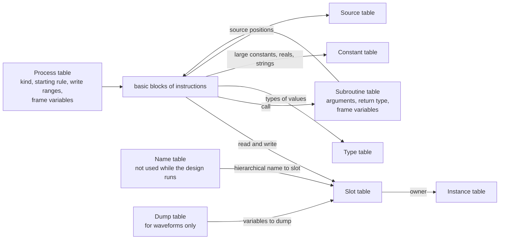
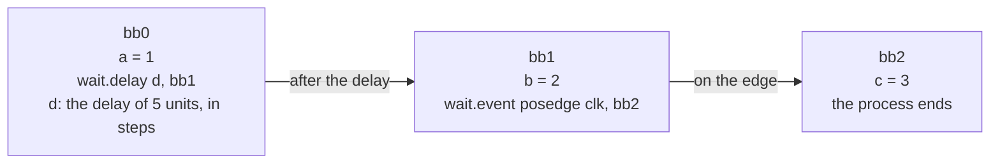

# SIR_SPEC: specification of the intermediate representation SIR

[日本語](SIR_SPEC.ja.md) · This English text is the main version; the Japanese version follows it, and where they differ, this text holds.

**Revision (2026-10-24):** old P2→P3, old P3→P4 and old P4→P5; new P2 (SIR v1) is inserted, with tier numbers unchanged ([mapping](../notes/phase-renumbering.md)).

**SIR v1 direction amendment (approved 2026-10-24):**
[The approved P2 direction](../notes/sir-v1-proposal.md) moves the final text
and kernel-boundary freeze to P2 after P1 completion. P2 preparation may run
alongside P1. A complete record format, generated common Op metadata and
separate analysis tables are selected; exact EBNF/schema, API prototypes/count
and reference layout remain under review. Current execution coverage stays in
P1, formatVersion remains 0, and tier 2 C++ generation remains P3.

**Program execution amendment (approved 2026-10-23):**
[The approved program rules](../notes/program-execution-proposal.md) apply
to instance identity, reactive scheduling, inherited execution origin and
program completion. Implementation status is tracked separately.

**Phase scope amendment (approved 2026-10-23):** [P1_SCOPE](P1_SCOPE.md)
advances the Icarus-required subset of later-phase or out-of-scope work into
P1. Existing semantic rules remain; missing details need review before code.
Phase labels below describe the original plan, subject to this amendment.

Priority: P0. Status: **approved (amendment approved 2026-10-15)**. The points of an independent review were applied to the version approved on 2026-10-14. P1 implementation checks draft language semantics; final SIR v1 interchange details are settled under the approved P2 amendment above. On 2026-10-18, what of 7.5 is not implemented yet was noted (approved). The same day, delay operands of any width were allowed (1, 7.2; approved). On 2026-10-19, the instruction `cond.x` for `--cond-x` was added to 5.2 (approved). The same day, 8 was made to point to how kirimasim applies 13.4.4 (approved). On 2026-10-20, what a `cont` process drives was set apart from what it writes (3.4, 5.6, 9, 10; approved). The same day, the write ranges were made to leave out what the tasks a process calls write (3.4; approved). The same day, they were made to leave out what the action of a deferred assertion writes too (3.4; approved). The same day, the slot that puts out the initial value of a delayed sequential UDP, and the names of the elements of arrays of UDPs, were added to 5.5 (approved). The same day, the descriptor of `$fstrobe` and `$fmonitor` was added to `strobe` and `monitor` (5.2, 7.1, 7.2; approved). On 2026-10-21, how `$readmemb`, `$readmemh`, `$writememb` and `$writememh` take their memory was added to 8 (approved). The same day, the dump table was added to 2 (WAVEFORM.md; approved). The same day, the operands of `$dumpfile` and `$dumpvars` were added to 8 (approved). The same day, the row of an enumerated type that `$readmem` takes was added to 8 (approved).

**Amendment of M3b (approved 2026-10-15):** in stage M3b of the P1 plan, instructions for merging values, values across waits, unpacked arrays, the type table, subroutines and process control were added, and the text form was changed to refer to things by number. The sections changed say "amendment of M3b".

**Addition on static initialization (approved 2026-10-16):** the process kind `static-init` was added to 7.1.

**Addition on where meaning is decided (approved 2026-10-16):** the principle that meaning is decided when SIR is made, and does not change with tier or container, was added to 1.

**Exceptions to slang's constant evaluation (approved 2026-10-16):** 6 gained the rule that expressions containing system functions with known errors in slang are computed at run time. On 2026-10-17, the conditional operator with patterns was added to the exceptions (approved). On 2026-10-18, the numbers of those slang issues were recorded (approved). The same day, it was recorded that both were fixed upstream, slang was raised, and they were removed from the list (approved).

**Addition of the instruction for pending reports (approved 2026-10-16):** `report.defer` was added to the table of 5.2.

**Addition of the design's precision (approved 2026-10-16):** that SIR holds the time precision of the whole design was added to the table of 2, the text form of 9 and rule 10 of 10.

**How nets that need resolution are represented (approved 2026-10-16):** the last paragraph of 3.5 was changed to represent them with driver slots and the `resolve` instruction.

**Collapsing ports, the scope of reports, package variables (approved 2026-10-16):** 3.5 was changed to collapse connections between nets whatever their direction (the same day, an error in the description of slang's warnings was corrected). `report.defer` in 5.2 gained a scope operand. 2, 3.3 and 7.1 gained where variables of packages and compilation units are placed and how they are initialized.

**Exception to the write restriction (approved 2026-10-18):** the slots of variables and arguments of static subroutines were excluded from rule 6 of 10.

**Expression items of event controls (approved 2026-10-18):** 7.2 gained, as events of `wait.event`, expression items represented by a function that returns the expression's value (kind `watch`).

**Constants where this document's reading differs from slang (approved 2026-10-18):** 6 gained, as things computed without slang's constants, conversion from real to integer and unary `+` of 4-state values. On 2026-10-28, the string conversions `atoi`, `atohex`, `atooct` and `atobin` were added (approved).

**When the copy back of an argument finds its target (approved 2026-10-18):** 8 says that the indices of an output or inout actual are evaluated on return, and those of an inout actual also at the call.

**Marking the conditions `--cond-x` reports (approved 2026-10-19):** 5.2 gains `cond.x`. Which conditions `--cond-x` reports (those of `if` and `?:`, and the expressions of `case`; CLI.md 2.2) is a decision about constructs, so `front` marks them when it makes SIR; a tier cannot tell them from the same instructions made for loops and waits, and a 1-bit condition has no `truth` instruction at all.

SIR (slot-indexed IR) is kirimasim's intermediate representation, made from the result of slang's elaboration. It is a form in which everything needed for execution is decided statically, and both tier 1 (the VM) and tier 2 (C++ generation) are made from the same SIR. The meaning of values follows VALUE_SEMANTICS.md, and events and time follow SCHEDULER_SPEC.md. The text of the standard (IEEE 1800-2023) is not copied; grounds are given by clause number.

Draft language semantics are checked during P1; P2 finalizes the SIR v1 interchange contract after P1 completes. Corrections and outstanding detailed contracts need human approval.

## 1. Design principles

- Nothing is looked up by name during execution. Signals and variables are referred to by slot number, functions by function number, and virtual methods of classes by table index. The name table is kept separately, only for VPI, waveforms, `$dumpvars`, `uvm_hdl_*` and diagnostics.
- The type of an expression (width, signedness, 2-state or 4-state) is decided statically. Width and signedness are slang's typing as it is, not computed again in SIR (VALUE_SEMANTICS.md 2).
- Every instruction carries a source position (file number, line, column).
- SIR made from the same input is the same every time, numbering included (NFR-6). Numbers are given by walking the tree slang elaborated in a fixed order (depth-first over the instance tree, in order of appearance in the source).
- **Meaning is decided when SIR is made (approved 2026-10-16):** decisions about the meaning of constructs are made by `front` when it makes SIR, and the meaning of SIR's instructions is set by this document, VALUE_SEMANTICS.md and SCHEDULER_SPEC.md. Tiers 1 and 2 only execute and translate SIR's instructions mechanically, and do not vary behaviour by anything but the kind of instruction and the types of operands. The same statement becomes the same sequence of instructions in whatever container it is (module procedures, class methods, automatic tasks, fork branches, interfaces, generate, packages); only the place (slot or frame) differs.
- System tasks, system functions and built-in methods (methods of strings and enumerated types and so on) are written by name in SIR. Each tier resolves names to numbers when it loads SIR, and does not compare names during execution (amendment of M3b).
- Results of analysis (that X never arrives, static islands and so on) are not written in SIR. `analysis` keeps them as separate tables indexed by SIR's numbers (amendment of M3b). This keeps SIR a form decided uniquely by slang's result, so that fixing an analysis does not change the text of SIR.
- Delay values are held in steps of the whole design's time precision. `front` converts from the module's time unit (7.2; amendment of M3b). **A delay operand (of `wait.delay`, `nba.delay`, `trigger.nb` and `drive.delay`) is an integral value of any width (approved 2026-10-18):** `front` counts the steps in as many bits as they need, and a value of 2^64 steps or more takes the time past the largest time, a run-time error of the design when it runs (SCHEDULER_SPEC.md 8). A constant delay that does not fit in 64 bits is such a value, not an unsupported construct.
- `sir::formatVersion()` stays 0 during P1 and P2 preparation. It becomes 1 only after P1 completes and the P2 grammar, parser, verifier/roundtrip and consistency gates pass. Later-version rules are part of the detailed contract still awaiting review.

## 2. Overall structure

The SIR of one design consists of the following.

| Element | Content |
| --- | --- |
| Time precision of the whole design | The smallest precision of all design elements (held as a power of 10 seconds). Delay values and times are counted in these steps (SCHEDULER_SPEC.md 1; added 2026-10-16) |
| Slot table | Where every signal and variable is placed, and its attributes (3) |
| Name table | Hierarchical name → slot (and aliases). Not used during execution |
| Instance table | Instance number, parent, definition (module × set of parameters), scope name. Packages and compilation units (`$unit`) that have variables or static subroutines also have one row each (kinds `package`, `unit`; approved 2026-10-16) |
| Type table | Layouts of packed and unpacked aggregate types, enumerated types and classes (4.3) |
| Process table | Each process's kind, starting condition, write ranges, table of frame variables, and sequence of basic blocks (7) |
| Subroutine table | Arguments of functions and tasks, return type, table of frame variables, sequence of basic blocks (8) |
| Constant table | Values of large constants, reals and strings (4-state included; 6) |
| Source table | File number → file path |
| Dump table (added 2026-10-21, approved) | For WAVEFORM.md only: the scopes a dump can name, each with its hierarchical name, its kind (module, begin, fork, task, function) and the scope around it; and the variables, each with its scope, its name, its VCD type, width and reference range, and the slot (and the leaf of an unpacked structure) that holds it. front makes it from slang's model (WAVEFORM.md 2). It is read when dumping starts, to choose what to dump; nothing is looked up by name while the design runs (1). The arguments of `$dumpvars` that name scopes or variables are given to `syscall` as numbers of its rows. The current format-0 dump (9) leaves it out; the selected complete format 1 must preserve it |

How the tables refer to each other:



## 3. Storage and slots

### 3.1 Slots

- A slot number (SlotId) is a 32-bit unsigned integer, the index into the slot table.
- Each row of the slot table holds:

| Item | Content |
| --- | --- |
| Area | 2-state, 4-state, real, handle (3.2) |
| Offset | The word offset within that area |
| Width and signedness | Bit width, whether signed |
| Kind | Variable, or net (kind of net: wire, tri, wand, triand, wor, trior, tri0, tri1, supply0, supply1, uwire) |
| Array shape | For a fixed-size unpacked array, the range (left and right index) of each dimension. The whole array is one slot, with its elements placed contiguously in the slot (amendment of M3b; 4.2) |
| Flags | Observable, force target, multiple drivers, needs drive strength |
| Owner | Instance number (and the subroutine number for a variable of a static subroutine) |
| Name | A row of the name table. Used only for diagnostics and `--dump-sir` |

- There is no flag "proved never to receive X" (amendment of M3b; how results of analysis are treated in 1).

### 3.2 Areas

| Area | What it holds | How one value is represented |
| --- | --- | --- |
| 2-state | Values of 2-state types | A sequence of 64-bit words (1 word for widths up to 64) |
| 4-state | Values of 4-state types | A sequence of `(a, b)` pairs per 64 bits, a and b placed next to each other (VALUE_SEMANTICS.md 1.3) |
| Real | `real`, `realtime`, `shortreal` | `double` (`float` for `shortreal`) |
| Handle | Classes, strings, dynamic arrays, queues, associative arrays, events, chandles, virtual interfaces | An execution-kernel handle; dynamic containers use Context-local generation-checked tokens (RUNTIME_ABI 6). null is 0. Defaults in 3.2.1 |

- The area is decided by the declared type alone (amendment of M3b). Holding slots that analysis showed never receive X in 2-state form is something tier 2 does as its own layout (P3).

### 3.2.1 Defaults of the handle area

- Slots of type `event` each get one event object of the kernel, made at elaboration. The default is not null (checked: 6.8, Table 6-7). They become null only when reading an element of an array that does not exist (Table 7-1) and when null is assigned (15.5.5; P4).
- The default of type `string` is the empty string. A handle of 0 is taken as the empty string (rule of this document), so that no object is allocated each time a string of length 0 is made. `len()`, concatenation and comparison treat 0 as a string of length 0.
- The default of classes, interface classes, chandles and virtual interfaces is null (0).
- The default of dynamic arrays, queues and associative arrays is empty (0 elements). A handle of 0 is taken as empty (rule of this document; dynamic arrays and queues are P1 under the amendment approved 2026-10-23).

### 3.2.2 Extra bits

- Extra bits above the width are always 0 (both a and b). The verifier and run-time checks check this.
- Packed structures and unions, and packed multidimensional arrays, are placed in one slot as a bit vector of the same width. The position of each field and element is held in the type table (6.11.1 of the standard makes these equivalent to simple bit vectors).

### 3.3 Lifetimes and placement of variables

Rules of the standard (checked: 6.21, 13.3.1, 13.3.2, 13.4.2):

- Variables declared in a module, interface, program or checker, outside subroutines and processes, are static.
- Tasks and functions in a module, interface, program or package are static by default. Those marked `automatic`, or inside a module or the like declared `automatic`, are automatic. Tasks and functions in a class are always automatic.
- Variables in a static subroutine or block are static by default; variables in an automatic one are automatic by default. In either, an individual variable can be changed by marking it `automatic` or `static`.
- The variables of a static task, **arguments (input, output, inout) included**, are shared by all calls of the same task in progress at once, and keep their values between calls. They are held separately for each module instance, though.
- The variables of an automatic subroutine are allocated for each call, and initialized to their default initial values (output arguments included) each time the scope is entered. input and inout arguments are initialized with the values of the call's expressions.
- A fork-join block lives until every process it started has finished.

Placement in SIR (rule of this document):

| Lifetime | Place |
| --- | --- |
| static (module variables, variables and arguments of static subroutines, variables declared static) | Slots. Variables of a static subroutine get one per instance. Variables of subroutines of packages and compilation units get one for the whole design |
| Variables and nets of packages and compilation units (approved 2026-10-16) | Slots belonging to the row of that package or compilation unit. One for the whole design (checked: 26.2, 3.12.1). Their names in the name table are `<package name>::<name>` and `$unit::<name>` |
| automatic (variables and arguments of automatic subroutines, automatic variables of blocks within processes) | The frame of the call or process (7.4) |

NBAs to automatic variables and to elements of arrays whose size changes are forbidden by the standard (checked: 10.4.2). For variables of automatic tasks, procedural continuous assignments, references in event controls within NBA assignments, and tracing by `$monitor` and `$dumpvars` are also forbidden (checked: 13.3.2). They are reported as errors when SIR is made (how much slang detects is checked in P1).

### 3.4 Write ranges and sensitivity ranges

- Different processes may write different bit ranges of one slot. What counts as one target of a write is decided by the longest static prefix (checked: 11.5.3; the longest static prefix is the longest part of a select whose value is decided after elaboration).
- For each process and continuous assignment, SIR holds the set of ranges it writes (its write ranges). A range is a triple of slot, element range and bit range (amendment of M3b). With constant indices and selects it is the exact range; otherwise the whole of that dimension. Checks of multiple drivers (the restrictions of `always_comb` and `always_ff`, `uwire`, several continuous assignments to a variable) are done on these bit ranges.
- **Writes through calls (added 2026-10-20, approved):** a process's write ranges hold what its own instructions write and what the functions it calls write, and the functions they call; not what the tasks it calls write. The restrictions of `always_comb`, `always_latch` and `always_ff` cover what the block and its functions write, not its tasks (checked: 9.2.2.2, 9.2.2.4; SCHEDULER_SPEC.md 6.4), and the sensitivity of `always_comb` leaves out the same (SCHEDULER_SPEC.md 6.3). A write that another process makes through a task is not checked, as slang does not check it (SCHEDULER_SPEC.md 6.4, changed 2026-10-25).
- **Actions of deferred assertions (added 2026-10-20, approved):** what the function S of a deferred assertion's action (5.7) writes, with what it calls, is not in the write ranges of the process that runs the assertion, as what a task writes is not. S runs after the process, in the Reactive or Postponed region (checked: 16.4.1). So the restrictions of `always_comb`, `always_latch` and `always_ff` do not cover it, and the sensitivity of `always_comb` does not leave out what it writes as written by the block (SCHEDULER_SPEC.md 6.3, 6.4). A write that another process makes through the action of a deferred assertion it runs is not checked either, as one through a task is not (SCHEDULER_SPEC.md 6.4, changed 2026-10-25).
- **What a `cont` process drives (added 2026-10-20, approved):** a process of kind `cont` also holds the ranges it drives: what its own instructions write (the left side of its continuous assignment, the output of a gate or UDP, the inside of a port connection, the net of a resolution process). Its write ranges also hold what the functions it calls write, as any process's do, but those writes are procedural statements (checked: 6.5), not continuous assignments, and are not in what it drives. Several continuous assignments to a variable (10, rule 6) and a continuous assignment in effect on a variable (5.6) are decided on what `cont` processes drive.
- Sensitivity is held as the same triple (slot, element range, bit range) too. A process is woken only when a bit range it subscribes to changes (SCHEDULER_SPEC.md 9.5).

### 3.5 Collapsing ports

The standard takes a connection between a parent's and a child's ports as an implicit continuous assignment (input and output) or as a bidirectional connection that does not weaken strength (inout) (checked: 4.9.6). For ports connecting nets to nets, the two sides may be merged into one net (checked: 23.3.3.7).

- **Connections collapsed (approved 2026-10-16):** a connection where both sides are whole nets with the same width, signedness and 4-stateness shares the same slot between parent and child, whatever the direction (input, output, inout). The drivers of both sides are resolved in that slot (VALUE_SEMANTICS.md 5.3, 5.5). input and output with drivers on both sides may be changed to inout by the standard (23.3.3.1; slang warns), and by this rule they are treated the same as inout.
- **Kind of a collapsed net:** the outer (parent's) or inner (child's) kind of net, by the rules of Table 23-1 (checked: 23.3.3.7). For combinations where the table asks for a warning, slang warns (`-Wnet-inconsistent`; the 56 cases of 8 kinds of net were checked on input and output ports; slang v12). Connecting a `uwire` to an inout port is an error in slang. The standard only asks for a warning when a port connected to a uwire is not collapsed (23.3.3.6), and does not call it an error. slang's diagnostics are not loosened (CLAUDE.md), so it is an error in kirimasim too (correction approved 2026-10-16).
- Collapsing input and output is optional in the standard (23.3.3.7). With implementations that do not collapse (Icarus 13.0 does not collapse input ports), values of nets of different kinds can differ. In that case the test suite allows both results (`:nondeterministic: yes`).
- **When not to collapse (used in P4):** when an observable flag is set (made visible to VPI by `--public`, or a target of force, release or deposit by `uvm_hdl_*`), and when collapsing would change how force and release are seen (SCHEDULER_SPEC.md 14.4).
- **Connections not collapsed:** input and output connections not covered above (those connected to variables or expressions, to parts of nets or concatenations, or to nets of different width or signedness) are placed in SIR as processes of continuous assignment. Their strength is (strong1, strong0) (VALUE_SEMANTICS.md 5.3). However, when such a net is resolved with other drivers and the other side of the port is a net, the strength cannot be carried, so for now it is reported as unsupported. inout connections not covered above are also reported as unsupported for now.
- Collapsing removes the process of the port's continuous assignment, and the child's net changes in the same evaluation as the parent's net. Only the order within the Active region of the same time changes, and the standard does not set that order (4.7).

Nets that need resolution (VALUE_SEMANTICS.md 5.5) are laid out as follows (approved 2026-10-16).

- For each driver of the net (continuous assignments, net declaration assignments, ports, gates, `pullup` and `pulldown`), one 4-state slot of the same width as the net (a driver slot) is placed. The driver's process writes the driver slot instead of the net.
- A driver slot holds the driver's strength (s1, s0) as a static attribute.
- A driver for which one side of the strength becomes highz depending on the value (L and H of three-state gates; VALUE_SEMANTICS.md 5.8) has, besides its driver slot, one 2-state slot of width 2w (a side slot; approved 2026-10-17). Each of the low w bits means "drive the 1 side", and each of the high w bits "drive the 0 side". The gate's process writes both value and side in one run.
  - Splitting into two slots, "a driver that drives only 1" and "a driver that drives only 0", is not taken: for an x with s1 and s0 different (for example an x of (strong1, weak0)), the result of resolution would differ from that of one driver.
- Instances of built-in gates and UDPs are processes of kind cont, like continuous assignments (7.1; approved 2026-10-17). When the output net does not need resolution (VALUE_SEMANTICS.md 5.5), they write the net directly, writing L and H as x.
- Only the resolution process (kind cont) writes the net's slot. The resolution process has the driver slots as its sensitivity, computes the value with the `resolve` instruction and writes the net.
- `resolve type, kind of net, (driver value, s1, s0)...`: returns a 4-state value by the rules of VALUE_SEMANTICS.md 5.4. For a driver with a side slot the tuple is (driver value, s1, s0, side), and the strength of each bit is that with the side whose side bit is 0 made highz (approved 2026-10-17). Implicit drivers (the pull and supply of `tri0` and the like) follow from the kind of net and are not written as operands. The meaning is set by the reference implementation in `valsem`.
- **Initial value of nets (approved 2026-10-17):** net slots and driver slots start the bits within the write ranges (3.4) of cont processes as x, and the other bits as the default value of the kind of net (VALUE_SEMANTICS.md 1.4, 5.4; z for driver slots) ("initial value of drivers" in VALUE_SEMANTICS.md 5.3).
  - Tiers find this initial value from SIR's write ranges. No separate item is added to SIR. How it is found is set by one function of `sir`, which the tiers use.
  - The resolution process writes the whole net, so a net that needs resolution starts all x. When the resolution process runs at time 0, the net takes the value resolved from its drivers.

When collapsed, the name table keeps both the parent's and the child's names as aliases of the same slot.

- **`alias` statements (approved 2026-10-17):** if both sides are whole nets of the same type, they are merged into one slot as when collapsing ports, and the name table keeps both names. Aliases of selects or concatenations, and aliases with different kinds of net, are reported as unsupported for now. In the standard, alias connects named nets (or their bits) bidirectionally, both sides must have the same kind of net, and variables and hierarchical names cannot be used (checked: 10.11). Illegal combinations are reported by slang.

## 4. Types

### 4.1 Value types

| Notation (text form) | Meaning |
| --- | --- |
| `i2<w>`, `s2<w>` | 2-state, w bits (`s` is signed) |
| `i4<w>`, `s4<w>` | 4-state, w bits (`s` is signed) |
| `real`, `shortreal` | Reals |
| `string` | String (a handle) |
| `handle<class number>` | Class handle |
| `chandle`, `event` | chandle, named event |
| `dynarray<!T>`, `queue<!T>` | Typed container handles; !T is the descriptor row (5.8) |
| `ref`, `ref<!T>` | Variable references; !T qualifies a container target (5.8) |
| `assoc<key type, element type>` | Planned associative-array handles, under P1_SCOPE |

- A signed `i4<w>` in the design specification's notation is written `s4<w>` (draft).
- Enumerated types are handled as values of the base integral type, with the table of names and values in the type table (methods such as `name()` look up the table).
- The type of an instruction is only a value type; enumerated types, packed structures and unpacked arrays are held separately as type-table numbers (4.3). For example, the result type of a `load` that reads a value of an enumerated type is the base type `i4<w>`, and the instruction that calls `name()` has the type-table number as an operand (amendment of M3b).

### 4.2 Aggregate types

Amendment of M3b:

- **Packed aggregate types:** placed in one slot as a bit vector, with the bit positions of fields and elements in the type table (3.2.2).
- **Fixed-size unpacked arrays:** the whole array is one slot, with the range of each dimension in the slot table. Elements are placed contiguously in the slot, the rightmost dimension changing fastest. The size of one element is the size of one value in the area of the element type (3.2). The element type is a packed type, a real or a handle. Elements are read and written with `load.elem` and the like (5.3).
  - Before the amendment, the draft placed consecutive slots per element. That was dropped so that reads and writes with indices decided at run time can be expressed by one slot and a position computation, and so that the slot table of large memories is smaller.
- **Unpacked structures:** a slot per member, gathered by the type table. Assignment and comparison of whole structures are unfolded by `front` into instructions per member.
- Details of unpacked structures (approved 2026-10-17):
  - The name of a member's slot is `<variable name>.<member name>`. Nested structures join names with `.`, with a slot for each innermost member.
  - An automatic variable gets a frame variable per member (as the rule of 3.3 says, only the place differs). If a member is an unpacked array, it is reported as unsupported for now, like other automatic arrays.
  - A member's default (7.2.2) is put in only when the variable's declaration has no initial value (checked: 7.2.2). static variables get it in static-init, and automatic variables when the declaration runs. Members with no default start from the default initial value of their type (Table 6-7).
  - What treats a whole structure as a value (subroutine arguments and return values, ports, nets of unpacked structures, `%p`, unpacked unions) is decided in the stage that implements each. Until then they are reported as unsupported.
- **Fixed-size arrays whose elements are unpacked structures (approved 2026-10-17):** one slot with the array's dimensions for each innermost member (held as an array per member). `a[i].x` is element `i` of member `x`'s slot, and the index computation is the same as for arrays whose elements are not structures. If a member is an unpacked array, the slot is multidimensional, with the member's dimensions after the array's (`a[i].b[j]` is element `(i, j)`). Assignments of whole elements and whole arrays are unfolded into assignments per member and per element (VALUE_SEMANTICS.md 3.13). An assignment of a whole element with an index decided at run time (`a[i] = s`) evaluates the index expression once and does `store.elem` per member with that value. The slot's name is `<array name>.<member name>`.
- **Unpacked unions:** their layout is decided later (11). In P1 they are reported as unsupported constructs.
- **Classes:** the layout of fields and the table of virtual methods (indexed by number) are held in the type table. A parameterized class becomes a separate class for each specialization slang made (P4).

### 4.2.1 Dynamic containers (approved 2026-10-23)

The [approved amendment](../notes/dynamic-containers-proposal.md) governs
construction, deep copying, methods, invalid indices, bounds, argument
evaluation and stable element references. `dynarray<T>` and `queue<T>` are
typed handles into the Context heap (RUNTIME_ABI 6). Their type descriptions
retain the element layout and queue bound. Typed construction, copying,
length, element read/write/reference, mutation and traversal operations must
be checked by the verifier and represented in the text form. The front end
selects the type and target; execution tiers pass operands and roots to the
shared kernel. An implementation may report an unfinished form as unsupported;
that is a remaining P1 gap, rather than a change to this contract. Negative or
unknown construction sizes give design runtime error (code 2); allocation or
size/byte overflow gives resource_limit (code 6), without partial replacement.

### 4.3 Type table

Amendment of M3b. Each row of the type table is referred to by its number (TypeId).

| Kind | What it holds |
| --- | --- |
| Enumerated type | Name, base value type, sequence of members (name and value, in declaration order) |
| Packed structures and unions | Name, value type of the whole, sequence of fields (name, position of the least significant bit, width, type number of the field). For unions every field starts at position 0 |
| Unpacked structure | Name, sequence of members (name, type number) |
| Unpacked array | Type number of the element, range of each dimension |
| Dynamic array or queue | Element value type; queue capacity (0 means unbounded); nested descriptors precede parents (5.8) |
| UDP (approved 2026-10-17) | Name, number of inputs, whether sequential, sequence of table rows (each row: the symbol for each input, the symbol of the present state if sequential, the symbol of the output), initial value (sequential UDPs) |
| Class | P4 |

- The slot table and the tables of frame variables hold the type number of the declaration (not for those where the value type suffices).
- The values of members of an enumerated type are held as constants matching the width and signedness of the base type.

## 5. Expressions and instructions

### 5.1 Form

- Inside a basic block is a sequence of typed SSA (static single assignment) instructions. Values go into temporary names (`%t0` and so on).
- A basic block ends with a branch, a wait or a return. Wait instructions are placed only at the end of a block (7.2).
- Each instruction has the type of its result and of its operands. Types are not examined at run time.
- **Merging values (amendment of M3b):** basic blocks can have typed arguments (block arguments). Values where control flow merges are passed as arguments to the destination block by branch instructions (`br`, `br.if`). No φ functions are placed.
- **Temporaries do not cross waits (amendment of M3b):** temporaries and block arguments cannot be used across wait instructions (7.2) or `call.task` (8). The continuation block of a wait instruction has no arguments. Values that live across a wait are written to a frame variable (`%f0` and so on; 7.4) with `fstore`, and read after the wait with `fload`. `front` makes this form.
  - This way, the layout of frames is decided by SIR alone and is the same whatever the tier (RUNTIME_ABI.md 4.3). Where temporaries that do not cross waits are placed is left to each tier's implementation.

### 5.2 Kinds of instruction

| Group | Instructions (examples) | Grounds of meaning |
| --- | --- | --- |
| Reads and writes | `load`, `store` (blocking assignment), `nba`, `nba.delay`, `load.elem`, `store.elem`, `nba.elem`, `store.bits`, `nba.bits` (5.3), `fload`, `fstore` (7.4) | SCHEDULER_SPEC.md 5, 13 |
| Arithmetic | `add`, `sub`, `mul`, `div`, `mod`, `pow`, `neg` | VALUE_SEMANTICS.md 3.2 |
| Relational | `lt`, `le`, `gt`, `ge` (signed and unsigned) | 3.3 |
| Equality | `eq`, `ne`, `ceq` (`===`), `cne`, `weq` (`==?`), `wne` | 3.4 |
| Logical | `lnot`, `land`, `lor`, `limp`, `leqv`, `truth` (conversion to a truth value) | 3.5 |
| Bitwise | `and`, `or`, `xor`, `xnor`, `not` | 3.6 |
| Reduction | `rand`, `ror`, `rxor` (and negations) | 3.7 |
| Shifts | `shl`, `shr`, `ashr` | 3.8 |
| Conditional | `select` (the conditional operator; combines both sides when the condition is unknown) | 3.9 |
| Membership and matching | `inside`, `match.mask` (masked comparison of `casez`, `casex`, `==?`) | 3.10, 4.2 |
| Selects | `bitsel`, `partsel`, `idxpartsel` (including out-of-range and x/z indices) | 3.11 |
| Concatenation | `concat` (one or more operands), `repl` (the multiplier is a constant written in the instruction; an operand for string replication) | 7.1 to 7.3 |
| Conversion | `zext`, `sext`, `trunc`, `to2` (x and z to 0), `to4`, `itor`, `rtoi`, `rconv` (between `real` and `shortreal`), `itos`, `stoi` (between integers and strings) | 1.2, 1.5, 2, 7.4 |
| Reals | The arithmetic and relational instructions used with real types (bitwise and reduction cannot be used) | 7.5 |
| Strings | The equality and relational instructions used with string types. `str.get` (`s[i]`) | 7.6 |
| Events | `trigger` (`->`), `trigger.nb` (`->>`; may have a delay operand) | SCHEDULER_SPEC.md 9.4 |
| Process control | `fork`, `wait.fork` (a wait; 7.2), `disable`, `disable.fork` | SCHEDULER_SPEC.md 10 |
| Calls | `call` (functions, and tasks with no wait), `call.task` (tasks that may wait; a terminator), `syscall` (system functions and tasks), `builtin` (built-in methods) | 8 |
| Delayed writes (approved 2026-10-17) | `drive.delay` (5.4) | SCHEDULER_SPEC.md 12 |
| UDPs (approved 2026-10-17) | `udp`, `udp.seq` (5.5) | VALUE_SEMANTICS.md 5.9 |
| Procedural continuous assignments (approved 2026-10-17) | `override.start`, `override.stop`, `store.override` (5.6) | SCHEDULER_SPEC.md 14 |
| References (approved 2026-10-17) | `ref.make`, `load.ref`, `store.ref`, `nba.ref`, `load.ref.elem`, `store.ref.elem`, `store.ref.bits` (8) | 8 |
| Delayed display and monitoring (approved 2026-10-17) | `strobe @P`, `monitor @P`, and `strobe @P, d`, `monitor @P, d` with a descriptor (`postponed` of 7.1; the descriptor added 2026-10-20, approved) | SYSTEM_TASKS.md 4, 6.2 |
| Blocks that are targets of disable (approved 2026-10-17) | `scope.enter #n, exit`, `scope.leave #n`, `disable.scope #n`, `disable.task @T` (7.2) | SCHEDULER_SPEC.md 10.4, 10.7 |
| Pending calls (approved 2026-10-17) | `report.call "#0"\|"final", @S, args...` (5.7) | SCHEDULER_SPEC.md 15.2 to 15.4 |
| Pending reports (approved 2026-10-16; the scope operand added the same day) | `report.defer "<construct>", "<content>", "<scope>"`: puts a violation of unique, unique0 or priority on the pending queue of the running process. The position of the report is the instruction's source position, and the hierarchical name is `<scope>` (the hierarchical name of the scope containing the statement, including named blocks and subroutines). `<construct>` and `<content>` are the strings of SYSTEM_TASKS.md 10.4 | SCHEDULER_SPEC.md 15 |
| Checks of conditions (approved 2026-10-19) | `cond.x "<construct>", <value>`: placed by `front` right after the condition of an `if` or a `?:`, or the expression of a `case`, is evaluated; `<construct>` is `if`, `?:` or `case`, and the value is integral. It has no result and changes nothing. When `--cond-x` is not `off`, a tier reports it if the value has x or z bits, once per instruction (its source position is the place); otherwise it does nothing, and tier 2 may leave it out | VALUE_SEMANTICS.md 3.9, 4.1, 4.2; CLI.md 2.2 |

- **There are no short-circuit instructions.** The short-circuit evaluation of `&&`, `||`, `->` and `?:` is expressed with branches between basic blocks (VALUE_SEMANTICS.md 3.1). This way, the form of SIR guarantees that the side effects of the side not evaluated do not happen.
- **Instructions that can make x** (`div`, `mod`, `pow`, selects and `load.elem` that may read out of range, reads of associative arrays with keys that do not exist, taking from an empty queue) are flagged. Analysis (X-reachability analysis) and tier 2's switching between two versions use this flag.
- **Comparison masks:** x, z and ? in the constant items of `casez`, `casex`, `==?` and `inside` are held not as values but as comparison masks. `casez` and `casex` also ignore z on the expression's side (and x too for `casex`), so the 4-state version's masks are made from both the expression and the item (VALUE_SEMANTICS.md 4.2).
- The 4-state meaning of each instruction is set by the reference implementation in `valsem`. The 2-state version gives the same result as the 4-state version when its inputs have no x or z.
- **Reals and strings (amendment of M3b):** operations on reals and strings use the same instruction names as integers, told apart by the types of the operands. An operation mixing integers and reals is placed after `front` converts to real with `itor` (VALUE_SEMANTICS.md 7.5). String concatenation is expressed by a `concat` whose result type is `string`.

### 5.3 Array elements, and writes of parts decided at run time

Amendment of M3b.

| Instruction | Meaning |
| --- | --- |
| `load.elem type, slot, index...` | Reads an element of an unpacked array. One index per dimension. With an invalid index (out of range, containing x or z), the default value of the element type (VALUE_SEMANTICS.md 3.11). Flagged as an instruction that can make x |
| `store.elem slot, index..., value` | Writes an element. Does nothing with an invalid index (likewise) |
| `nba.elem slot, index..., value` | NBA to an element. The indices are decided by their values when the instruction runs (7.3) |
| `store.bits slot, [index...,] position, value` | Writes, in the slot (or the element of an array), as many bits as the value's width starting at bit `position`. `position` is a run-time value. Out of range and x/z are handled as in VALUE_SEMANTICS.md 3.11 |
| `nba.bits slot, [index...,] position, value` | The NBA version of `store.bits` |
| `nba.elem.delay slot, index..., value, delay` | `nba.elem` with an integral delay in design-precision ticks (7.3). Capture indices and value when issued |
| `nba.bits.delay slot, [index...,] position, value, delay` | `nba.bits` with the same delay. Capture and clip the target range when issued |

- A write with constant indices and position is expressed by an ordinary `store` or `nba` with the slot's bit range (`%s3[7:4]` and the like) and constant element indices.
- A read of a part decided at run time reads the whole with `load` or `load.elem`, then selects with `idxpartsel`.
- The first operand can be, instead of a slot, a frame variable that is an array (7.4) (approved 2026-10-17).
- The delayed forms lower the existing delayed-NBA rule of SCHEDULER_SPEC 5 and 13 for runtime targets; they add no value or scheduling choice. Like the other NBA forms, they require static storage. Invalid indices write nothing and partially valid bit ranges update only their valid bits (VALUE_SEMANTICS 3.11). The shared kernel keeps the captured range/value until its NBA or Re-NBA update; returning from the issuing task or fork does not re-evaluate or discard it.

For bit-write instructions, the first operand's bit range can bound a
statically selected packed parent. This applies to slot and frame operands,
including `store.ref.bits` on a ref frame variable. The position is relative
to that parent; clip inside it before adding the storage offset. Width 0
retains the whole-element form. Reads for a compound assignment select the
same parent before applying the runtime child position. This lowers the
existing 7.4.5/11.5.1 and VALUE_SEMANTICS 3.11 rules, with no new value choice.
The verifier checks bounds and write sets, and text prints parent ranges on
frame operands too. Runtime-position parents and out-of-storage constant
parents are not enabled by this implementation.

### 5.4 Writes of continuous assignments with delays

Approved 2026-10-17.

- `drive.delay target, value, rise, fall, turn-off`: a write of a continuous assignment, gate or UDP output with a delay. Used only by processes of kind cont. The kernel carries out the procedure of SCHEDULER_SPEC.md 12 (cancelling the scheduled event and scheduling a new one), keeping one scheduled event per instruction. How the delay is chosen follows the same section.
- A write with no delay is expressed by `store` as before.

### 5.5 UDP instructions

Approved 2026-10-17.

- `%r = udp !table, input...`: a combinational UDP. Returns the output of the row matching the input values (VALUE_SEMANTICS.md 5.9).
- `%r = udp.seq !table, state, previous input..., present input...`: a sequential UDP. Returns the state after applying, one at a time, the changes from the previous inputs to the present inputs by the rules of VALUE_SEMANTICS.md 5.9.
- `!table` is the UDP row of the type table (4.3; the number `!N` of a row of the type table in the text form; changed from `@table` on 2026-10-17, since `@N` is used for numbers of processes and subroutines). An instance of a sequential UDP keeps its state and previous inputs in slots per instance (`<instance>.$state`, `<instance>.$prev`). The initial value of the state slot is put in by static-init (the initial value of VALUE_SEMANTICS.md 5.9). An instance with an initial value and a delay has a third slot, `<instance>.$started` (two-state, 0 at the start): the first time its process runs, it writes the state to the output with `store`, without the delay, and sets the slot, so that only the later changes take the delay (VALUE_SEMANTICS.md 5.9; added 2026-10-20, approved). `<instance>` of an element of an array of instances is the array's name with the element's indices, `<array>[i]` (added 2026-10-20, approved).

Implementation status (2026-10-24): the former 32-input lowering/verifier and
transport limits are removed. `udp.seq` operand counts are checked in 64-bit
arithmetic; the kernel evaluates wide input/state views without allocating a
fixed input array. The [source and independent SIR evidence](../notes/wide-udp-inputs.md)
retains the existing UDP meaning. Dense edge-coverage source compilation still
has a pinned-slang scaling boundary; strict diagnostics are unchanged.

### 5.6 Instructions of procedural continuous assignments

Approved 2026-10-17.

- `override.start "assign"|"force", @P, target...`: applies to the targets (ranges of slots of the left side; several for a concatenation), at that level (assign or force), the value of process P (kind `override`; 7.1), and runs P once. If another process of the same level is applied to the same target, that one is stopped first (checked: 10.6.1, 10.6.2).
- `override.stop "assign"|"force", target...`: removes the application at that level and restores the value by the rules of SCHEDULER_SPEC.md 14 (a variable keeps its present value until the next procedural assignment if neither a continuous assignment, that is a `cont` process that drives it (3.4), nor an active assign applies; if one does, it is evaluated again. A net takes the value decided by its drivers).
- `store.override "assign"|"force", target, value`: used only by override processes. It wins over writes at lower levels.
- Slots that may be overridden get the force-target flag (3.1) (SCHEDULER_SPEC.md 14.4). For flagged slots, the kernel keeps a mask of bits per level (which bits are overridden now). Ordinary writes (`store`, `nba`, cont writes, resolution processes) do not change masked bits. The force mask is stronger than the assign mask.
- When a net that may be overridden is involved in a collapsed port connection, it is reported as unsupported for now ("the same view as when not collapsed" of SCHEDULER_SPEC.md 14.4 is implemented then).

### 5.7 Pending calls

Approved 2026-10-17.

- `report.call "#0"|"final", @S, args...`: the action of a deferred immediate assertion (SCHEDULER_SPEC.md 15.2). front wraps the one call of the action block (`$error` for the failure of an assert or assume with no else) in a function S that only takes the arguments and makes the call. By-value arguments pass their values at the time the expression is evaluated (checked: 16.4). The kernel puts it on the pending queue of the running process, and once it is settled calls S in Reactive for `#0` and in Postponed for `final`.
- ref actual arguments (static variables only; checked: 16.4) use their values at the time S is called.
- When the action block is a task that may wait, and deferred assertions written as module items (16.4.3), are reported as unsupported for now.

### 5.8 Typed container encoding (approved contract of 2026-10-23)

This encoding implements the [approved amendment](../notes/dynamic-containers-proposal.md).
A value of `dynarray<!T>` or `queue<!T>` has width zero and refers to its
container descriptor row `!T`; that row holds the element value type and,
for queues, `capacity` (maximum element count, zero meaning unbounded).
Nested descriptors precede their parents. Producers canonicalize identical
element/bound descriptors. The current encoding admits integral, real,
shortreal, string, chandle and nested-container elements. Fixed aggregate,
event and class element representations remain implementation work.

A `ref<!T>` names one variable of that container type, including a selected
element of a fixed array of containers. Referring to the whole fixed array
uses the existing unqualified ref form; it cannot be used as a single
container receiver. Other scalar/aggregate refs retain their existing form.
The verifier checks descriptor kind, target, operand count, element and
result types, index types and argument bindings. Ref arguments use equivalent
value types (6.22.2, 13.5.2): differing queue capacities, including nested ones,
do not make the types inequivalent. A callee's logical ref descriptor may
therefore differ from the actual variable's descriptor. Transport must retain
the actual binding and capacity, even when the variable's handle is zero.

| Instruction | Operands and result |
| --- | --- |
| `container.new` | Result is a dynamic-array value; operands are a signed four-state 64-bit size and a container initializer of the same element type |
| `container.copy` | Result is the destination container type; source has an equivalent element type; copying applies destination bounds and makes independent cells |
| `container.snapshot` | One container value; preserves its logical result type and copies the actual source value/bounds without conversion |
| `container.assign` | `!T`, captured `ref<!T>` and a source container with an equivalent element type; copies into the actual target variable, applying its bounds; no result |
| `container.pack` | Result is the container type; operands are zero or more values of its element type |
| `container.size` | One container value; result is `i2<64>` (front converts to the language query's type) |
| `container.read` | Container value and integral index; result is the element type |
| `container.cell` | `!T`, captured `ref<!T>`, integral index; result is an element ref, qualified by the element descriptor when it is itself a container |
| `container.write` | `!T`, captured `ref<!T>`, integral index and element value; no result |
| `container.clear` | `!T` and captured `ref<!T>`; no result |
| `queue.insert` | Queue `!T`, captured `ref<!T>`, integral index and element value; no result |
| `queue.push.front`, `queue.push.back` | Queue `!T`, captured `ref<!T>` and element value; no result |
| `queue.pop.front`, `queue.pop.back` | Queue `!T` and captured `ref<!T>`; result is the element type |
| `queue.erase` | Queue `!T`, captured `ref<!T>` and integral index; no result |

Changing operations read the receiver variable's then-current handle through
the captured reference, after all argument operands have been computed. This
keeps receiver binding separate from value evaluation. For method calls,
front captures the receiver binding before evaluating arguments under the
approved rule; for assignments it captures the RHS before target selectors
under 7.3. Operand position does not replace this explicit SSA evaluation
order. Raw load/store, frame and call/block-argument
transport moves handles. Front uses `container.snapshot` to capture a value
before later side effects, `container.copy` for a fresh value of a specified
destination type, and `container.assign` for language assignments to variables.
Assignment and queue mutations must use the actual target's capacity, not a
possibly different ref formal's capacity. An empty container constant has handle zero
and is printed `empty`. Nonempty container constants are invalid.

The VM's dispatch and reference transport are exercised by independent SIR
inputs. Typed root publication and automatic collection for the currently
implemented container SIR are described in RUNTIME_ABI 6. This does not
alone establish language support. As of 2026-10-24, front lowering and
240 core source cases, 256 sequence cases and 11 CLI diagnostic cases cover the
[tested language subset](../P1_SUPPORT.md#dynamic-container-foundation);
remaining forms and complete coverage still require implementation under P1_SCOPE. C ABI 0.3 is
unchanged by this internal SIR encoding. As section 3.3 already requires,
nonblocking assignment to a dynamic-array/queue element is illegal (6.21,
10.4.2), including through a cell ref. This is not a missing execution feature.
Slang rejects direct source forms; the VM diagnoses a hand-built cell-ref NBA
as an illegal operation. This does not prohibit whole-value NBAs to eligible
static container variables.

#### Array-method encoding amendment (approved 2026-10-25)

VALUE_SEMANTICS 7.9 and the [approved method contract](../notes/array-methods-proposal.md)
add `container.swap.values !T, ref<!T>, first, second`: no result; integral
indices retain their widths. Exchange values in existing actual-receiver
cells without resizing, copying nested owned values or changing cell identity.
Invalid/equal indices are no-ops. The verifier checks descriptor/ref
equivalence and integral indices. VM forwards to `Heap::swapValues` using
existing wide-index decoding. Front emits reduction/ordering/locator loops
and shared comparisons; [min/max](../notes/array-extrema-proposal.md) need no
new opcode. FormatVersion stays 0; C ABI 0.3 is unchanged.

### 5.9 Typed assignment-pattern execution encoding (2026-10-24)

This encodes the existing value/output rules of SYSTEM_TASKS 3.9; it selects
no new formatting policy. `Design::patterns` has PatternIds distinct from
TypeIds. Layouts describe integral/real/string/enum values, records, packed
records, fixed arrays, first-member unions, selected tags and typed dynamic
arrays/queues. Names, escaping, packed offsets, enum constants, child layouts,
counts and value types are explicit. The graph must be acyclic, with checked
references, types and size arithmetic; tiers do not infer source types.

`%r = pattern.format !pN, "named" | "positional", <value>...` returns string.
Unpacked records/fixed arrays consume scalar payloads in declaration order;
packed shapes consume one vector, and containers one typed handle. The
verifier checks mode, count and types. The VM builds borrowed views for the
shared renderer, using Context resources and existing failure rules. This
neither provides display identities nor enables an unimplemented source type.
Front's literal/runtime argument bridge remains unfinished, so source `%p`
is still unsupported. See the [implementation/checkpoint](../notes/pattern-sir-execution.md).

## 6. Constants

**Array reduction exception (approved 2026-10-25):** VALUE_SEMANTICS 7.9's
empty-input identities also apply when a method expression could be folded
by slang. Front lowers reduction call expressions through its runtime rules
rather than accepting slang's conflicting empty product/and result. Parameter
forms not yet lowered through this exception remain an explicit limitation.

A container constant is only the empty handle zero, printed `empty`. A chandle
constant is null, printed `null`. Nonempty container values are made by the
typed instructions of 5.8 rather than embedded heap objects.

- Small constants are written directly as operands of instructions; large ones are placed in the constant table.
- Constants are the results of slang's constant evaluation. They are not computed again in SIR.
- **Known errors of slang's constant evaluation (approved 2026-10-16; a second added and approved 2026-10-17):** expressions containing the following do not use the constants slang folded; they are placed as instructions and computed at run time. When slang fixes one, it is removed from the list when raising to that version. Parameter values are decided by slang, so this exception does not fix them.
  - None now. On 2026-10-18 slang was raised to main commit b7f11c1, and the two, negative values of `$rtoi` (slang issue #2023) and folding of the conditional operator with patterns (likewise #2029), were removed.
- **Constants where this document's reading differs from slang (added 2026-10-18, approved):** where the wording of the standard can be read two ways, and this document's reading (VALUE_SEMANTICS.md) differs from slang's constant evaluation, the constants slang folded are not used either; they are placed as instructions and computed. Parameter values are decided by slang, so this exception does not fix them.
  - Conversion from real to integer (VALUE_SEMANTICS.md 7.4: NaN and infinities).
  - Unary `+` of 4-state values (3.2 of the same: any x or z bit makes every bit x; slang returns the value as it is).
  - The string conversions `atoi`, `atohex`, `atooct` and `atobin` (7.6 of the same: an underscore before the first digit is read like the others; slang needs a digit first) (added 2026-10-28, approved).
- When an unpacked-array parameter (`parameter`, `localparam`) is read with a run-time index, front places a slot holding its value (named `<scope>.<name>`, a variable) and fills it in static-init. Nothing else writes it. Elements with constant indices use slang's constants as they are (approved 2026-10-17).
- specparams are read as constants, like parameters (checked: 6.20.5). specify blocks are out of scope for now (a rule of the design specification). However, a specify block holding only specparam declarations does nothing, so it is skipped. One with module path delays or timing checks is reported as unsupported (skipping it would change delays) (approved 2026-10-17).
- Constants of reals (`real` is a 64-bit and `shortreal` a 32-bit IEEE 754 value) and strings (sequences of bytes) can be placed too (amendment of M3b).
- Constants containing x and z (`'x`, `8'b1z0x` and so on) can be represented. x and z used as values are distinguished from x, z and ? as comparison masks (5.2).

## 7. Processes

### 7.1 Kinds

| Kind | Source construct | Starting rule (SCHEDULER_SPEC.md) |
| --- | --- | --- |
| `cont` | Continuous assignments (including the implicit ones of ports), built-in gates, UDP instances (approved 2026-10-17) | When an operand of the right side changes. Once at time 0 (5, 6.1, 12) |
| `comb` | `always_comb` | Once at time 0, and on changes of the implicit sensitivity (6.2, 6.3) |
| `latch` | `always_latch` | The same as `comb`; distinguished as a latch |
| `comb-at` | `always @*` | Not started at time 0. Sensitivity by the rules of 9.2 |
| `ff` | `always_ff` | Waits for an edge. The restrictions of 9.2.2.4 (no other process writes, exactly one event control) apply |
| `ff-plain` | An ordinary `always` that starts with only an edge wait and has no other wait. Excluded if it calls a task that may wait (then `general`) | Waits for an edge. The restrictions of 9.2.2.4 do not apply (ordinary `always` has none; 9.2.2.1) |
| `initial`, `final` | `initial`, `final` | 6.2 |
| `general` | Other `always`, statements in fork | General processes |
| `postponed` (approved 2026-10-17) | One per `$strobe`, `$monitor`, `$fstrobe` or `$fmonitor` statement. Its body evaluates the arguments and prints (the same syscall as `$display`). Contains no wait | Runs only in the Postponed region (SCHEDULER_SPEC.md 2.1). `strobe @P` schedules P to run once in the Postponed region of the present time slot. However many times it runs at one time, it prints that many times (checked: 21.2.2). `monitor @P` replaces the active monitor with P (checked: 21.2.3); P runs once in the Postponed region of the time it was called, then once in the Postponed region of each time slot in which a slot read by its arguments changed. **With a descriptor (`$fstrobe`, `$fmonitor`; added 2026-10-20, approved):** `strobe @P, d` and `monitor @P, d` take the value of d when they run, and what P prints goes to the files d names then, not to standard output. `monitor @P, d` adds a file monitor and replaces none; `$fclose` takes the files it closes out of the pending runs and the file monitors (SYSTEM_TASKS.md 6.2) |
| `override` (approved 2026-10-17) | One per procedural `assign` or `force` statement. Computes the right side and writes the left side with `store.override` | Starts with `override.start` and stops with `override.stop`. In between, like cont, it starts on changes of what the right side reads (SCHEDULER_SPEC.md 14; 5.6) |
| `static-init` (approved 2026-10-16) | Initial values in declarations of static variables (module variables, static variables inside procedural blocks and subroutines; static members of classes are P4) | Runs exactly once at time 0, before any other process starts (step 1 of SCHEDULER_SPEC.md 6.1) |

- **Form of `static-init` (approved 2026-10-16):** one per instance, named `<hierarchical name of the instance>.$static`. Its body is a sequence of instructions that evaluate initial-value expressions and write slots, covering the static variables with initial values in declaration order within the scope (SCHEDULER_SPEC.md 3). It contains no wait instruction. Tiers run every `static-init` in the order of SIR's process numbers, on the spot without scheduling them as events, and start the other processes after they finish. Nothing is waiting yet, so no process is woken by these writes. static variables with no initial value keep the default value of their area (VALUE_SEMANTICS.md 1.4).
- **`static-init` of packages and compilation units (approved 2026-10-16):** packages and compilation units also get one `static-init` each if they have variables with initial values, named `<package name>::$static` and `$unit::$static`. They are placed in source order, before the `static-init` of instances (rule of this document). The standard only says that initial values of static variables are set "before any initial or always starts" (checked: 6.8, 10.5), and does not set the order between variables. A package must be compiled before the scopes that import it (checked: 26.3), so in source order, variables of another package read by a package's initial-value expressions already have their initial values.
  - Compilation units are one per file, as slang's default (slang splits by file when `--single-unit` is not given; whether to add an option to CLI.md is decided together with an amendment of CLI.md). When there are two or more compilation units, from the second on they are numbered, as `$unit#2` (the names are only for diagnostics and the name table).
  - A package cannot contain nets with implicit continuous assignments (checked: 26.2). Package nets start from the default initial value (VALUE_SEMANTICS.md 1.4) and, like other nets, are driven by continuous assignments of modules and the like.
- Sensitivity information (slot, bit range, kind of edge, `iff` expression) is held in the process table. The implicit sensitivity of `comb`, `latch` and `comb-at` is computed by the rules of the standard when SIR is made.
- To implement SCHEDULER_SPEC.md 15.3 and 15.4, a procedure or fork process whose outermost named block is a disable target also has an optional numeric `outermostScope` association. Leading timing controls do not introduce another scope. This association persists after a block activation ends: applying `disable.scope` to that number discards only the process's unconfirmed deferred assertion calls, including final calls, even when no activation remains to unwind. It preserves unique and priority reports and already confirmed calls. An inner named block is not associated this way. The verifier requires an in-range scope number and a matching `scope.enter` in the process body.
- Telling `ff` from `ff-plain` by whether `always_ff` was written is to apply the restrictions of the standard to exactly the right range. Optimization (static islands) may treat `ff-plain` the same as `ff`.
- Whether a called task's body has a wait is decided when SIR is made, by examining the task's body. Functions contain no waits, so function calls do not affect the kind.
- Candidates for static islands (among `cont`, `comb`, `latch`, `ff` and `ff-plain`, those with no delays, no event controls in the middle and no calls with side effects) are decided by analysis. SIR does not flag them (they are held separately as results of analysis).

### 7.2 Wait instructions and basic blocks

- A sequence of procedural statements becomes a sequence of basic blocks cut at the points of waits. A wait instruction ends a basic block and points to the basic block that continues after the wait (the continuation block). Continuation blocks have no arguments (5.1).
- Wait instructions (the amendment of M3b made the destinations and `iff` clear):

| Instruction | Meaning |
| --- | --- |
| `wait.delay d, cont` | A wait for time. d is a value in steps of the whole design's time precision (SCHEDULER_SPEC.md 1), of any width (1). If d has x or z bits, 0; if negative, a large unsigned value (8 of the same); 2^64 or more, past the largest time |
| `wait.event events, cont` | An event control (with edges, `iff` and `or`). Fixed signals are slot subscriptions; compound expressions are monitor records |
| `wait.cond condition function, cont` | `wait (expr)`. The expression is represented by a function that receives the frame of the waiting process. If true, it proceeds without waiting |
| `wait.named slot, cont` | Waits for a named event (`@ev`) |
| `fork children, kind of join, cont` | Makes child processes (7.5). Acts as a wait for `join` and `join_any`, and proceeds to the continuation at once for `join_none` |
| `wait.fork cont` | Waits until all direct children have ended |
| `call.task subroutine, args..., cont` | Calls a task that may wait (8). When the task returns, proceeds to the continuation |

For example, this procedure becomes three basic blocks, cut at its two waits:

```systemverilog
initial begin
  a = 1;
  #5;
  b = 2;
  @(posedge clk);
  c = 3;
end
```



- **`iff`:** each event of `wait.event` can have an `iff` condition. The condition is represented by a function with no waits (placed in the subroutine table) that receives the frame of the waiting process, and it is evaluated **only when that event occurs** (checked: 9.4.2.3). Rewriting it as a loop that "waits, then checks the condition and waits again if false" would check the condition also when another event listed with `or` occurs, which is wrong.
- **Named event items:** a `wait.event` slot operand of event type denotes one named-event object and may have its own `iff` guard. It has no edge or packed range. Slot subscriptions, expression watches and named-event items register in one kernel generation. A false guard retains its item; the first satisfied item invalidates all other items. Preserve the compact `wait.named` spelling for a single unguarded named event. Guard-local writes and event triggers follow the existing callback rules in RUNTIME_ABI 5.
- **Expression items (added 2026-10-18, approved):** an event of `wait.event` is either a slot range or an expression item. An expression item is represented by a function returning the value of the event's expression (placed in the subroutine table, kind `watch`). This function receives the frame of the waiting process, contains no waits, and writes no variables or nets (as `iff` conditions). It takes an edge as an operand and can be followed by `iff`. In text it is written `wait.event posedge @E iff @G, bb2`. Tiers make it a monitor record whose dependencies are the slots and events the function reads. The previous value compared against is the value when the wait started, and edges are decided on the least significant bit of the value (SCHEDULER_SPEC.md 9.1, 9.5). Fixed signals (including elements, bits, ranges and members at constant positions) are expressed as slot ranges as before.
- **Converting delays:** constant delays are converted by `front` from the time unit of where they are written to steps of the precision, with rounding (SCHEDULER_SPEC.md 1). For delays that are not constant, `front` places conversion instructions (real multiplication and rounding, or integer multiplication) before the wait.
- `disable name`, `disable fork` and event triggers (`->`, `->>`) are ordinary instructions, not waits.
- **Blocks that are targets of disable (approved 2026-10-17):** named blocks that are targets of disable are numbered, with `scope.enter #n, exit block` at the entry and `scope.leave #n` at the exit. front also places `scope.leave` on the other ways out of the block (break, continue, return, a disable of an outer block).
  - `disable.scope #n`: ends the present activity of every process in the block with that number. Each process discards the task calls made within the activity (without copying back output and inout), ends the child processes forked within the activity, drops its wait, and continues from the exit block (SCHEDULER_SPEC.md 10.4, 10.7). If the process that ran the disable is within the activity, it goes to the exit on the spot.
  - `disable.task @T`: ends every call of task T in the same way, each continuing after the statement that called it.
  - Disabling, from inside a function, a block or task outside that function is a run-time error (SCHEDULER_SPEC.md 10.4).
  - A block that is not inside a subroutine or fork, is not disabled from outside the block, and within which no process can start (no fork, no task call, no call of a function that forks) may be expressed by a `br` to the exit as before (it means the same). Processes started within a block have to be ended by the disable (checked: 9.6.2) (condition added 2026-10-17, approved).
- **Monitor processes (approved 2026-10-17):** the body of the `postponed` process of a `monitor` compares the argument values with their previous values (frame variables of P), and prints if any differs or on the first round. Arguments `$time`, `$stime` and `$realtime` are not compared (SYSTEM_TASKS.md 4). `$monitoron` and `$monitoroff` stay syscalls, and do not affect file monitors (SYSTEM_TASKS.md 6.2). The order within Postponed is as in SYSTEM_TASKS.md 4 (monitors first, `$strobe` in the order called). When an argument of `$strobe` reads an automatic variable, it is reported as unsupported for now (P cannot read the calling process's frame). An automatic variable in `$monitor` is an error (checked: 13.3.2).

### 7.3 NBA

- `nba target, value` holds the target of the update (slot and bit range, with indices at their values when it runs) and the value. With a delay it is `nba.delay target, value, delay` (SCHEDULER_SPEC.md 5, 13).
- The right side is evaluated first and the left side's indices after (the rule of SCHEDULER_SPEC.md 13). The order of SIR's instructions follows this too.

### Aggregate delayed-NBA lowering

Implementation of the existing 7.3 and VALUE_SEMANTICS 3.13 rules: fixed
arrays and unpacked structures capture every leaf value before emitting
any delayed update. Ordinary aggregate assignment and delayed NBA use the
same typed storage traversal. Runtime prefixes of array members of
structures are retained once; remaining dimensions are copied from each
side's own left bound. Each captured leaf then uses the scalar/element
NBA delay instructions of 5.3/7.3. This introduces no new scheduling or
value choice. Blocking aggregate intra-assignment timing and aggregate
event-controlled NBAs remain unimplemented.

### 7.4 Frames

- The state of a process (automatic variables, values across waits, the resume position, the pending queues of unique, priority and deferred assertions) is placed in its frame. The layout of frames is the same whatever the tier (RUNTIME_ABI.md 4.3).
- **Table of frame variables (amendment of M3b):** each process and subroutine has a table of frame variables. Each row holds a number (`%f0` and so on), a type, and a name (the declared name for an automatic variable; empty for a value across waits made by `front`). The position within the frame is decided in table order by the rules of size and alignment of types (the rules are set in RUNTIME_ABI.md). Reads and writes are done with `fload` and `fstore`.
- Automatic variables get, with `fstore`, their default initial value or the value of their initializer each time the scope is entered (3.3). `front` places these instructions.
- A frame variable may be a fixed-size unpacked array (approved 2026-10-17). Its row holds the range of each dimension like a slot, and its elements are ordered with the rightmost dimension changing fastest (4.2). Elements are read and written by writing the frame variable as the first operand of `load.elem`, `store.elem` and `store.bits` (5.3; NBA to automatic variables is an error, checked: 10.4.2). Each time the scope is entered, every element is set to its default initial value (3.3).
- Calling a task that may wait pushes a frame per call on top of the process's frame. If that task calls another task, another is pushed. In recursion of automatic tasks, the depth is decided at run time (checked: 13.3.1, 13.3.2). The process's frame holds the head of this chain of calls (RUNTIME_ABI.md 4.3).
- Temporaries do not cross waits (5.1), so temporaries are not placed in frames.

### 7.5 fork and child processes

Amendment of M3b.

- Each executable statement of a fork is a separate row of the process table (kind `general`), holding the number of its parent process (or subroutine). The `fork` instruction holds the sequence of the child processes' numbers. Declarations are handled by the parent, not included in that sequence.
- Block item initializations of a fork are done by the parent before the `fork` instruction (checked: 9.3.2). Automatic variables of the fork block that children refer to are frame variables of the children, initialized by the `fork` instruction with the parent's values.
- A child inherits its parent's thread set (active or reactive).
- **Implementation status (2026-10-24):** fork declarations now use the existing parent/lifetime rules: shared static slots initialize before time zero and uncaptured automatic declarations initialize in the parent on entry. A declaration-only fork emits no wait or child. [Original execution evidence](../notes/fork-local-declarations.md) covers the source path. Automatic variables of the fork block or enclosing activation read/written by children remain unsupported (CLI.md 5); the planned capture form above is not enabled. Shared identity and retention beyond the parent's return still need the detailed frame contract (6.21). P1_SCOPE advances that required work without defining its missing details.

### 7.6 Program execution (approved 2026-10-23)

A named program has instance kind `program`; packages and compilation units
still contain anonymous-program declarations without an additional instance.
Program initial procedures and continuous assignments use the reactive set.
Dynamic subroutine calls and forks inherit their caller's thread set and
originating program. Static initialization remains before process execution.
The kernel counts each program's root initial procedures and owns completion,
descendant termination and `$exit`; tier adapters supply instance/process
metadata. See the approved amendment for 24.3, 24.3.1, 24.3.2, 24.6 and 24.7.


Implementation status (2026-10-23): `program` instance rows select reactive
root execution. The kernel registers root initials separately from fork
children and owns dynamic origin, completion and `$exit`. The
[program matrix](../../tools/gen_program_execution_matrix.py) checks these
rules across scopes, placements, entries and widths.

## 8. Subroutines

- **Subroutine table (amendment of M3b):** each row holds a number, a name, a kind (function or task), a lifetime (static or automatic), whether it may wait, a sequence of arguments (direction, type, place: a slot if static, a frame variable if automatic), the return type (functions; `void` included), a table of frame variables, and a sequence of basic blocks.
- **Call instructions:** functions and tasks with no wait are called with `call` (an ordinary instruction placed in the middle of a basic block). Tasks that may wait are called with `call.task` (a terminator; 7.2). Whether it may wait is decided by `front` by examining the body and the tasks it calls (7.1).
- **System functions with output arguments (approved 2026-10-17):** for the output arguments of `$sscanf`, `$fscanf`, `$fgets`, `$value$plusargs`, `$ferror` and so on, front provides a frame variable of the argument's type and passes it as an operand of `syscall` (a frame-variable operand of a syscall denotes an output). The syscall writes a value there and says by its return value what it wrote. After the syscall, front copies the written frame variables to the targets the user wrote, as blocking assignments (the same form as copying back output arguments of subroutines; checked: 4.9.7 on output arguments; when outputs of system functions are assigned is not written in the standard, so it is a rule of this document).
  - `$sscanf` and `$fscanf` return the number of items matched and assigned, in the order of the format. What they assign is, among the conversions without `*`, the leading ones up to the return value, and front copies only those. The other targets are not changed (checked: 21.3.4.3; that the targets of items not read do not change is not written in the standard, so it is a rule of this document).
  - Among combinations of conversion and target type, reading into an integral type with `%f`, `%e` or `%g` is reported as unsupported for now (the standard does not say how a real is put into an integral type). `%t`, `%v` and `%m` are also reported as unsupported for now. Binary `%u`/`%z` scanning is approved by SYSTEM_TASKS.md 6.3 (2026-10-23); implementation uses shared kernel scanning with output widths supplied by SIR.
- **Memories of `$readmem` and `$writemem` (added 2026-10-21, approved):** `$readmemb`, `$readmemh`, `$writememb` and `$writememh` take the memory as an operand of `syscall`: its slot, or its frame variable with dimensions (including a ref frame variable; implementation status updated 2026-10-23). The kernel reads the file, its words and addresses, and decides which elements get which words, in one place (SYSTEM_TASKS.md 7). The `$readmem` syscall writes those elements as `store.elem` writes an element, so that what waits on them wakes; front counts the whole memory as written (3.4). The `$writemem` syscall only reads it. For a memory of an enumerated type, the type-table row of the enumeration (4.3) follows the memory in the `$readmem` syscall, and the kernel takes only its items' values (SYSTEM_TASKS.md 7.1; added 2026-10-21, approved).
- **Operands of the dump tasks (added 2026-10-21, approved):** `$dumpvars` takes its levels, then, for each scope or variable it names, the word `"scope"` or `"var"` and a constant: the row of the dump table (2), or `0xffffffff` for what the table leaves out (an unpacked array, for example), which adds nothing (WAVEFORM.md 4). front makes the table after the design is lowered and fills these constants in then. `$dumpfile` takes the call as written in the source, for the `$version` of the VCD (WAVEFORM.md 3), then the name, if given.
- **Functions:** contain no waits. Variables of static functions are placed in slots, those of automatic functions in frames (3.3). Functions may do `fork-join_none`, NBAs and event triggers. But those that schedule events after the function returns are allowed only when called from threads made by `initial`, `always` or a fork within them (checked: 13.4.4). front reports a call from anywhere else at compile time (SCHEDULER_SPEC.md 6.5; approved 2026-10-19).
- **Tasks:** may wait, so a frame is allocated per call. Variables and arguments of static tasks are placed in shared slots and shared by calls at the same time (3.3).
- **Passing arguments:** by-value arguments are copied at the call, and output and inout are copied back on return. Copying back is the same as a blocking assignment (checked: 4.9.7). Like a blocking assignment, the copy back finds its target when it runs: the indices and part-select positions of an output or inout actual are evaluated on return, and those of an inout actual also at the call, to read its value, so a function called in them runs each time (added 2026-10-18, approved; interpretation: 4.9.7 gives the copy back as a blocking assignment and says no more of when its target is found; for reference, checked 2026-10-18, Icarus 14.0 devel does the same, and Verilator 5.053 devel finds the target on return but evaluated a function in an inout actual's index once). `ref` and `const ref` pass a reference (the next item).
- **ref arguments (approved 2026-10-17):** a ref or const ref formal argument is a frame variable of the callee whose type is a reference (`ref`; the handle area). The caller makes the reference with `%r = ref.make source, [index...]` and passes it as an operand of `call` or `call.task`. The source is a slot (a static variable) or a frame variable (an automatic variable). The indices select an element of an array or of an array of structures, and are evaluated when the reference is made. A reference to a structure points to its first leaf (the leaves follow; 4.2).
  - Reads and writes through a reference are `load.ref %r, +k`, `store.ref %r, +k, value`, `nba.ref %r, +k, value` (k is the number of the leaf within the structure; omitted if 0), and `load.ref.elem`, `store.ref.elem`, `store.ref.bits` for array elements and bits. A write is the same as a write to the source, and wakes waiting processes (checked: 13.5.2 says a write through a reference is seen by the caller at once).
  - A reference is valid until the call that received it returns. A reference to a frame variable of the caller is valid too, since the caller's frame lives for the whole call (the same for tasks that wait; 7.4). Inside fork-join_any and fork-join_none, ref formal arguments can be referred to only in block item initializers (checked: 9.3.2), so no child process uses a reference longer than the call.
  - Write ranges (for computing sensitivity, and the check of writers of always_comb; 3.4): a call that may write a ref argument is treated as the caller writing the range of the actual argument (except for const ref).
  - In the standard, ref can be used only for automatic subroutines, and what can be passed is variables, class properties, members of unpacked structures and elements of unpacked arrays, not nets or selects (checked: 13.5.2). `ref static` (13.5.2) and references to class properties are P4.
- **Fixed-size unpacked array arguments (approved 2026-10-17):** a by-value array argument is written as an operand of `call` and `call.task` as the whole array (a slot or frame variable with dimensions). At the call it is copied element by element, and on return output and inout are copied back element by element (as 4.9.7). If the actual argument is an expression such as an assignment pattern, front computes it into an array in the caller's frame before passing it.
- **Structure arguments, and aggregate return values (approved 2026-10-17):**
  - An unpacked structure argument is split into an argument per leaf (named `<argument>.<member>`, in the leaf order of 4.2).
  - A function whose return value is an unpacked array or structure returns it in a hidden output argument (named `$return`; per leaf for a structure, as the array for an array), and the function's return type becomes void.
  - The caller writes the receiving place (a frame variable) as an operand, and after the call copies it to the user's target as an aggregate assignment (VALUE_SEMANTICS.md 3.13).
  - Arguments that are arrays of structures, and ref structure arguments, are reported as unsupported for now.
- **disable:** disabling tasks and blocks follows SCHEDULER_SPEC.md 10.4.

Implementation note (2026-10-23): a runtime `$sformat`/`$sformatf` uses the
`$sformatf.runtime` syscall. Its operands after the name are scope text, cell
text, the caller-to-global tick scale, the format value, then raw typed values.
An empty text operand among those values denotes an empty argument. The kernel
interprets the format and conversions; the VM marshals the values and reports
the returned error or count-mismatch warning. The result type is that of
`$sformat`'s destination, or string for `$sformatf`. Integral destinations
retain raw zero bytes; string results remove them (VALUE_SEMANTICS.md 7.6).
This needs no new SIR opcode.

## 9. Text form (current format 0; format 1 direction approved)

- `--dump-sir` currently prints format 0; no SIR readback parser is implemented. Lowering tests use this output as their protected expected values. The notation and example below describe format 0.
- P2 selects a complete canonical record format 1 preserving semantic tables, dump metadata, constant identity and declared counts. Its exact EBNF/schema and public CLI mode remain under review in the [P2 design note](../notes/sir-v1-proposal.md). Existing format-0 goldens remain protected during migration; the new format must pass print → parse → print equality and immediate verifier checks for every dump_sir and frozen P1-population design before version 1 freezes.
- It is written in a fixed order (number order), and the same SIR gives the same text.
- **Referring by number (amendment of M3b):** slots are referred to as `%s<number>`, temporaries `%t<number>`, frame variables `%f<number>`, processes and subroutines `@<number>`, the type table `!<number>`, and basic blocks `bb<number>`. Names are written only on declaration lines, in quotes. This is because SystemVerilog names include ones that, as they are, would be confused with separators, such as escaped identifiers (`\a+b `).
- **Block arguments:** declared like `bb3(%t5: i4<8>):` and passed like `br bb3(%t9)`.
- **What a `cont` process drives (added 2026-10-20, approved):** written as `drives=` after `writes=`, only when it is not the same list as the write ranges (3.4).
- The current partial format-0 dump omits the optional `outermostScope` association (7.1), preserving existing goldens. A complete interchange format must preserve this numeric association.
- **The precision line (added 2026-10-16):** the line after the leading `; sir format 0` gives the time precision of the whole design in the form `precision 1ns` (the unit is a combination of `1`, `10` or `100` with `s`, `ms`, `us`, `ns`, `ps` or `fs`).
- Example of the notation (not fixed):

```text
; module counter: always @(posedge clk) if (!rst_n) q <= '0; else q <= q + 1;
slot %s0 "counter.clk"   : i4<1> var inst=0 flags(observable)
slot %s1 "counter.rst_n" : i4<1> var inst=0 flags(observable)
slot %s2 "counter.q"     : i4<8> var inst=0 flags(observable)

process @0 "counter.always0" kind=ff-plain inst=0 trigger=posedge(%s0) writes=%s2 {
bb0:
  %t0 = load i4<1> %s1
  %t1 = lnot i4<1> %t0            ; !rst_n (x if rst_n is x)
  %t2 = truth i4<1> %t1           ; truth value of 1 bit (1 / 0 / x)
  br.if %t2, bb1, bb2             ; bb1 if true, bb2 if false or unknown (the rule of if)
bb1:
  nba %s2, const i4<8> 8'h00
  ret
bb2:
  %t3 = load i4<8> %s2
  %t4 = add i4<8> %t3, const i4<8> 8'h01
  nba %s2, %t4
  ret
}
```

- An example of merging values, and of values across waits:

```text
; initial for (int i = 0; i < 3; i++) #5 q = i;   (i is automatic; 12.7.1)
process @1 "counter.initial0" kind=initial inst=0 writes=%s2 {
  frame %f0 "i" : s2<32>
bb0:
  fstore %f0, const s2<32> 32'h00000000
  br bb1
bb1:
  %t0 = fload s2<32> %f0
  %t1 = lt i2<1> %t0, const s2<32> 32'h00000003
  br.if %t1, bb2, bb4
bb2:
  wait.delay const i2<64> 64'd5, bb3   ; the value converted to steps of the precision
bb3:
  %t2 = fload s2<32> %f0              ; read again after the wait (%t0 cannot be used)
  %t3 = trunc i2<8> %t2             ; conversion of the assignment (to the left side's width and sign)
  %t4 = to4 i4<8> %t3
  store %s2, %t4
  %t5 = add s2<32> %t2, const s2<32> 32'h00000001
  fstore %f0, %t5
  br bb1
bb4:
  ret
}

; a loop with no wait (inside a function and so on) merges values with block arguments
bb0:
  br bb1(const s2<32> 32'h00000000)
bb1(%t0: s2<32>):
  %t1 = lt i2<1> %t0, const s2<32> 32'h00000004
  br.if %t1, bb2, bb3
bb2:
  %t2 = add s2<32> %t0, const s2<32> 32'h00000001
  br bb1(%t2)
bb3:
  ret
```

- `br.xfalse` (branch taking x as false) in the design specification's example was split into converting to a truth value with `truth`, then branching with `br.if` (draft). This gathers in one place (`br.if`) the rule that conditions of `if` and of loops such as `while` take unknown as false. The truth of the conditions of `for`, `while` and `do...while` too is decided by the same rule as `if` (checked: 12.7.1, 12.7.4, 12.7.5). The n of `repeat (n)` is evaluated once before the loop, and is 0 times if negative, x or z (checked: 12.7.2).
- Changing the text form to refer by number changes how the expected values of `tests/dump_sir/` are written. Changes of expected values go in a commit separate from the implementation (the rules on expected values in CLAUDE.md).

## 10. Verifier

The SIR verifier always runs in debug builds and CI. It checks the following.

1. **Type consistency:** the types of each instruction's operands and result fit the instruction's definition. Mixing 2-state and 4-state goes through explicit conversion instructions.
2. **Slot ranges:** referenced slot numbers are within the slot table, and bit ranges within the slot's width.
3. **Shape of control flow:** each basic block ends with exactly one of a branch, a wait or a return. The destinations of branches and waits are blocks within the same process or subroutine. The number and types of arguments a branch passes match the destination block's arguments. Continuation blocks of waits have no arguments (amendment of M3b). There are no unreachable blocks (unreachable code left in slang's result, such as statements after `return`, `disable` or `forever`, or the branch of `if (0)`, is dropped by `front` when making SIR).
4. **SSA:** each temporary is defined exactly once, and its definition comes before its uses (dominance). From a use of a temporary or block argument back to its definition, no wait instruction is crossed (amendment of M3b; 5.1).
5. **Position of waits:** wait instructions (everything in the table of 7.2, `call.task` and a `fork` with `join` or `join_any` included) are not in `cont`, `comb`, `latch`, `ff`, `ff-plain`, `final`, functions, or tasks taken to have no wait (except the leading edge wait of `ff` and `ff-plain`). An `ff` has exactly one event control.
6. **Write restrictions:** the bit ranges written by `comb`, `latch` and `ff` (`always_ff`) are not written by any other process (SCHEDULER_SPEC.md 6.4). Not applied to `ff-plain` (ordinary `always`). The same for `uwire` and for several continuous assignments to a variable, which are decided on what `cont` processes drive, not on what the functions they call write (3.4; added 2026-10-20, approved). Only `cont` processes drive, and each range a process drives is one of its write ranges. Slots of variables and arguments of static subroutines are excluded (added 2026-10-18, approved). The write that copies values into arguments at a call is not the left side of an assignment in the procedure or the functions it calls, so it is not under the restriction of the standard. Overlaps among what assignments in functions write are reported as errors by slang's analysis stage (SCHEDULER_SPEC.md 6.4).
7. **Restrictions on automatic variables:** no reference falls under the prohibitions of 3.3.
8. **Extra bits:** values in the constant table have 0 above their width.
9. **Source positions:** every instruction has a source position.
10. **Consistency of tables (amendment of M3b):** type-table numbers, frame-variable numbers, and numbers of subroutines and processes are within their tables. A frame variable is used only within the process or subroutine that has it. Values of members of enumerated types fit the base type, and fields of packed types are within the whole width. The number and types of arguments of `call` and `call.task` match the subroutine's arguments. The time precision of the whole design is between 1fs and 100s (added 2026-10-16).
11. **Array indices:** the number of indices of `load.elem`, `store.elem` and `nba.elem` equals the number of dimensions of the slot (amendment of M3b).

6 and 7 are implemented in M3b (until then only 1 to 5, 8 and 9).

## 11. Not confirmed, to be written later

- Instructions for streaming and assignment patterns (P1; together with VALUE_SEMANTICS.md 8).
- Layout of unpacked unions (4.2).
- Frame size/alignment and reference/activation layout: P2, before P3 (RUNTIME_ABI.md). Evaluate 16-byte cells aligned to 8 bytes; measured layout and reference-token details require later review.
- Instructions for classes, dynamic data, constrained random, assertions and coverage (P4).
- How hierarchical references (upward, downward, `$root`, generate scopes) are resolved to slots at elaboration, and what happens when they cannot be (P1).
- Finalize format-1 grammar/schema, parser and roundtrip gates in P2 after P1 completion; then set `formatVersion` to 1 (approved direction, 2026-10-24; 9).
- The table of correspondence for making each element from slang's API (written in P1 together with the implementation of `front`).

## Approved P1 execution amendments (2026-10-25)

The following operative contracts are normative amendments to the sections
identified in each contract. They supersede earlier incomplete or excluded
forms only as explicitly specified. Evidence sections retain their original
provenance and do not claim implementation. The
[approval record](../notes/p1-execution-contracts-2026-10-25.md) fixes scope and
preserves existing expectations and external ABI versions.

- [Fixed array ports and element-wise resolution, sections 1–6](../notes/fixed-array-ports-proposal.md).
- [Shared automatic activations, captures and automatic events, sections 1–8](../notes/automatic-capture-proposal.md).
- [Event-controlled NBA: scheduler, lifetime and SIR/kernel boundary contracts](../notes/event-nba-proposal.md).
- [Delayed three-state side propagation: the Proposed amendments section](../notes/delayed-gate-side-proposal.md).
- [Full-strength MOS and passive networks, sections 1–9](../notes/mos-switch-proposal.md).
- [Class identity, initialization, ownership and execution, sections 1–10](../notes/class-runtime-proposal.md).

Implementation checkpoint (2026-10-26): the approved MOS/switch contract's
static edge/control binding is represented by `strength-edge !eN` rows,
per-process `strength-edge-write` declarations and `strength.edge` /
`strength.edge.delay` instructions. Their exact operand/ownership checks,
format-0 text and shared-kernel execution are recorded in
[passive SIR execution](../notes/passive-sir-execution.md). This connects the
existing approved contract; it does not enable source switch lowering or
freeze the P2 text grammar.

Source integration checkpoint (2026-10-26): [passive source execution](../notes/source-passive-execution.md)
connects the approved scalar edges to static terminals, arrays, controls and
conduction delays. Independent potential graphs are solved separately before
the existing complete component publication. This is implementation of the
approved MOS/switch contract, with source force/retained ports/formatting still
incomplete; no format-1 or C ABI change is selected.
