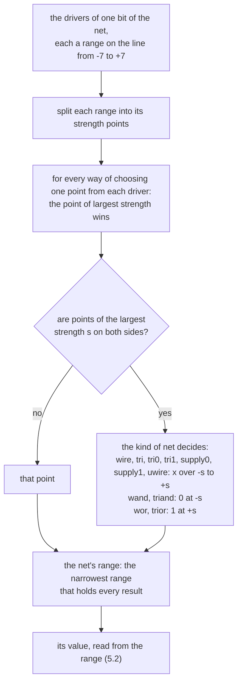

# VALUE_SEMANTICS：値の意味論

[English](VALUE_SEMANTICS.md) · 英語版が正本で、これはその日本語版です。食い違ったときは英語版に従います。

**改訂（2026-10-24）：** 旧P2→P3・旧P3→P4・旧P4→P5と付け替え、新しいP2（SIR v1）を設けました（tier番号は不変）。[対応表](../notes/phase-renumbering.ja.md)。

優先度：P0。状態：**承認済み（2026-10-15 に改訂を承認）**。2026-10-14 に承認した版に、独立レビューの指摘を反映した。7 節（連結、変換、実数、文字列、列挙型）は P1 で書き、2026-10-15 に承認した。2026-10-16 に、5 節（ネットの解決と駆動の強さ）を書き直し、3.12 節（代入演算子と、増減の演算子）を足した（承認済み）。同日、3.9 節に整数型でない値の条件演算子を書いた（承認済み）。2026-10-17 に、3.13 節（集合の代入）と 3.14 節（集合の比較）を足し、8 節のストリーミング演算子の項を書き直した（承認済み）。同日、7.4 節の実数から整数への変換を、大きさによらない切り詰めと、NaN と無限大の扱いに改めた（承認済み）。2026-10-18 に、7.6 節に x と z を持つ整数から文字列への変換を足した（承認済み）。同日、7.4 節が `$rtoi` について示す節を、SYSTEM_TASKS.md の 9 節から 8 節に直した（承認済み）。同日、5.2 節に強さの数直線の表を、5.4 節に規則の図と例を足した（承認済み）。同日、7.6 節の Verilator の参考の結果を直した（承認済み）。同日、実数がちょうどは持てない整数の丸め（1.5 節）、式の中で使う代入演算子と `++`・`--` の値（3.12 節）、`s[i]` の符号（7.6 節）を書いた（承認済み）。同日、実数や文字列の `case` の比べ方（4.2 節）を書いた（承認済み）。2026-10-19 に、1.4 節、3.9 節、3.11 節、4.1 節、4.2 節から `--init-values`、`--cond-x`、`--bounds-check` を指した（承認済み）。同日、オペランドと引数を左から右に評価することを 3.1 節に足した（承認済み）。同日、ブロッキング代入の両辺の順を 3.1 節に足した（承認済み）。同日、`` `unconnected_drive `` の下の未接続の入力ポートを 5.3 節に足した（承認済み）。

この文書は、kirimasim が値をどう表し、演算をどう計算するかを定める。規格（IEEE 1800-2023）の本文は写さず、本書の言葉で要約し、根拠の節番号を示す。「規格で確認」と書いた項目は、規格の該当節を読んで確かめたもの。「解釈」と書いた項目は、規格の文面だけでは決まらず、本書で決めたもの。

意味の定義は `valsem` の参照実装 1 か所に置く。実行カーネルや生成コードの高速版は、`valsem` と突き合わせるテストを必ず持つ。

## 1. 値の集合と表現

### 1.1 4 つの値

1 ビットは 0、1、x（不明）、z（高インピーダンス）のどれかを取る。ゲートの入力や式の中に z が来たときは、ほとんどの場合 x と同じに扱う。規格が z をそのまま通す例外として挙げるのは、MOS のプリミティブである（規格で確認：6.3.1）。このほか、ネットの解決（5 節）と条件演算子で両側が同じ値のとき（3.9）にも、z が結果に残る（本書の補足。それぞれの節の規則から従う）。

### 1.2 4 値の型と 2 値の型

- 4 値の型：`logic`（= `reg`）、`integer`、`time`、およびそれらからなる packed の型。
- 2 値の型：`bit`、`byte`、`shortint`、`int`、`longint`、およびそれらからなる packed の型。
- 既定の符号：`byte`、`shortint`、`int`、`integer`、`longint` は符号付き。`bit`、`logic`、`reg`、`time` は符号なし（規格で確認：6.11、6.11.2、6.11.3）。
- 4 値から 2 値へ暗黙に変換するときは、x と z のビットを 0 にする（規格で確認：6.11.2）。

### 1.3 内部の表現

64 ビットの語の組 `(a, b)` を、幅に応じて並べて持つ。1 ビットの符号は次のとおり（規格で確認：38.15 の `s_vpi_vecval` の注記と、H.10.1.2 の `svLogicVecVal`。VPI と DPI は同じ符号を使う）。

| 値 | a | b |
| --- | --- | --- |
| 0 | 0 | 0 |
| 1 | 1 | 0 |
| z | 0 | 1 |
| x | 1 | 1 |

- VPI と DPI は 32 ビットごとの組で、最下位ビットは添字 0 の要素の最下位ビットに置く（規格で確認：38.15、H.10.1.2）。kirimasim の内部は 64 ビットごとなので、境界では並べ替えだけをする。ビットの意味は同じなので、1 ビットずつの変換は要らない。
- ただし、DPI の正規の表現では、最後の要素の幅より上の未使用のビットの内容は決まっておらず、マスクや符号拡張は受け取る側の責任とされている（規格で確認：H.7.7）。そのため、DPI と VPI から値を**取り込む**とき（import 関数の output と戻り値、open array、`vpi_put_value`）は、並べ替えた後に a も b も幅でマスクして、余ったビットを 0 にする。渡すときは、余ったビットを 0 にしたまま渡す。境界の突き合わせのテスト（幅 1、31、32、33、63、64、65、127、128、129）には、未使用のビットにでたらめな値を入れた入力も加える。
- 幅より上の余ったビットは、a も b も常に 0 にする（本書の決まり。検証器で確かめる）。
- 2 値の型と、X が来ないと証明できたスロットは、a だけを持つ。

### 1.4 既定の初期値

初期値の指定の無い変数は、4 値の整数型なら全ビット x、2 値の整数型なら 0、実数は 0.0、文字列は空、クラス・interface class・chandle・virtual interface は null で始まる。**`event` は null ではなく、新しいイベント（同期のオブジェクト）で始まる**。列挙型は基底の型の既定値に従う（規格で確認：6.8、表 6-7）。

- `--init-values`（CLI.md の 2.2 節。2026-10-19 に承認）は、x が隠すリセットの漏れを見つけるために、初期値の無い 4 値の変数とメモリを、x の代わりに 0、1、乱数のビットで始められる。規格の決まりではないので、使った実行は冒頭でそう知らせる（CLI.md の 4 節）。ネットと 2 値の変数には効かない。

### 1.5 実数

- `real` は C の `double`、`shortreal` は C の `float` と同じ。`realtime` は `real` と同じ（規格で確認：6.12）。
- 実数から整数への変換は、最も近い整数への丸め。小数部がちょうど 0.5 のときは 0 から遠い方へ丸める（規格で確認：6.12.1。Icarus 13.0 で、-1.5 は -2、2.5 は 3 になることも確かめた）。
- 整数から実数への変換では、x と z のビットを 0 とみなす（規格で確認：6.12.1。Icarus 13.0 で、`...1x` が 2.0 になることを確かめた）。
- `real` や `shortreal` がちょうどは持てない整数は、持てる値のうち最も近いものになる。ちょうど中間の値は、最後のビットが 0 の方へ行く（解釈。6.12.1 は書いていない。これは IEEE 754 の既定の丸めで、C の変換もこれを使う）。参考（2026-10-18 に確かめた）：Icarus 13.0 も同じで、たとえば 2\*\*53 + 1 は 2\*\*53 に、100 ビットの 2\*\*64 + 2\*\*11 は 2\*\*64 になる。
- 実数に使えない演算と構文（辺の待ち、ビットや部分の選択など）は、エラボレーションのエラーにする。これは slang が判定する（規格で確認：6.12、11.3.1）。

## 2. 式の型と幅

- 式の幅と符号は、slang の型付けの結果に従い、kirimasim では計算し直さない（規格の 11.6、11.7、11.8.1、11.8.2）。
- 符号付きの値を広げるときは、符号のビットで埋める。符号のビットが x なら x で、z なら z で埋める（規格で確認：11.8.4。Icarus 13.0 で、`4'sbz111` を 8 ビットに広げると `zzzzz111` になることを確かめた）。
- ビットや部分の選択、連結、比較、縮約の結果は、常に符号なし（規格で確認：11.8.1）。

## 3. 演算

### 3.1 共通の規則

- 2 値と 4 値が混ざった演算は、すべてを 4 値とみなして計算する。入力がすべて 2 値なら、結果もふつうは 2 値の範囲に収まる。例外は、0 での除算のように 2 値の入力から x を作る演算である（規格で確認：11.3.4）。結果を 2 値の型に入れるときは、1.2 の変換で x が 0 になる。
- 短絡評価をするのは `&&`、`||`、`->`、`?:` だけ。ほかの演算子は、すべての被演算子を必ず評価する。短絡で評価しなかった被演算子の副作用（関数呼び出しなど）と実行時のエラーは起きない（規格で確認：11.3.5）。`<->` は短絡せず、両辺をちょうど 1 回ずつ評価する（規格で確認：11.4.7）。
- 呼び出しの回数や順序が変わる最適化は、副作用が無いと証明できるときだけ行う（規格は、結果と副作用が規則どおりなら評価を省いてよいとしている。11.3.5）。
- **評価の順（本書の決まり。2026-10-19 に承認）：** 規格が順序を決めていない所（11.3.5、11.4.2）では、演算子のオペランド、呼び出し（サブルーチン、システムタスク、システム関数）の引数、連結と繰り返しの要素を左から右に評価し、副作用もその順に起きる。短絡評価で評価しないオペランドは、そのまま評価しない。代入の両辺の間の順は、ノンブロッキング代入では SCHEDULER_SPEC.md の 13 節による。`=` のブロッキング代入は、右辺を先に評価し、その後で左辺の添字などを評価する。代入内のタイミング制御が無ければ規格はこの順を決めておらず、あれば左辺はその制御の後で評価する（規格で確認：10.4.1）ので、どちらも同じ順にする（本書の決まり。2026-10-19 に承認）。`+=` などの代入演算子は左辺をオペランドとして読むので、左辺を先に 1 回だけ評価する（1 回だけであることは規格で確認：11.4.1）。Icarus Verilog 14.0 (devel) と Verilator 5.052 も、どちらも同じ順である。

### 3.2 算術（`+ - * / % **`、単項の `+ -`）

- 被演算子のどれかのビットに x か z があれば、結果の全ビットを x にする（規格で確認：11.4.3）。
- 整数の除算は 0 の方向に切り捨てる。`/` と `%` で除数が 0 なら、結果の全ビットを x にする。`%` の結果の符号は、被除数（左の被演算子）の符号に従う（規格で確認：11.4.3）。
- 整数のべき乗の規則（規格で確認：11.4.3、表 11-4）：
  - 指数が 0 なら、底によらず結果は 1（0 の 0 乗も 1）。
  - 底が 0 で指数が負なら、結果の全ビットを x にする。
  - 底が 1 なら、結果は 1。底が -1 なら、指数が偶数で 1、奇数で -1。
  - 底の絶対値が 2 以上で指数が負なら、結果は 0。
  - 指数は自己決定の文脈で評価し、結果の型には影響しない。
- 実数のべき乗で、底が 0 で指数が負の場合と、底が負で指数が整数でない場合は、規格が結果を定めていない（規格で確認：11.4.3）。kirimasim は C の `pow` の結果を返す（解釈。NFR-2 の数学関数の例外と同じ扱い）。
- 符号付きの演算は 2 の補数で計算する。符号付きと符号なしの間の変換は、ビットの並びを変えず、解釈だけを変える（規格で確認：11.4.3.1）。
- 生成コードの 64 ビットの高速経路では、C++ の未定義動作を起こさない。符号付きの加減乗は符号なしで計算してから戻し、`INT64_MIN / -1` と 0 での除算は条件で分ける（本書の決まり）。

### 3.3 比較（`< > <= >=`）

- 結果は 1 ビット。どちらかの被演算子に x か z が 1 ビットでもあれば、結果は x にする。既知のビットだけで大小が決まる場合でも x にする（規格で確認：11.4.4。Icarus 13.0 で、`2'b1x > 2'b00` が x になることを確かめた）。
- どちらかが符号なしなら符号なしの比較、両方が符号付きなら符号付きの比較。どちらかが実数なら実数の比較（規格で確認：11.4.4）。

### 3.4 等価（`== != === !==`）と、ワイルドカードの等価（`==? !=?`）

- `==` と `!=` はビットごとに比べる。x か z のせいで結果が決まらないときだけ x にする。既知のビットで食い違いがあれば、ほかのビットに x があっても結果は 0（`!=` なら 1）（規格で確認：11.4.5。Icarus 13.0 で、`2'b1x == 2'b0x` が 0 になることを確かめた）。
- `===` と `!==` は、x と z も値として比べる。結果は必ず 0 か 1（規格で確認：11.4.5）。
- `==?` と `!=?` は、**右の被演算子**の x と z のビットだけを「どの値とも一致する」ビットとして扱う。左の被演算子の x と z は、ワイルドカードではなく値として比べる。そのほかのビットは `==` と同じ規則で比べ、決まらなければ x（規格で確認：11.4.6）。
- クラスのハンドル、chandle、null の比較は、ハンドルの値の比較（規格で確認：11.4.5、11.4.6）。

### 3.5 論理演算（`! && || -> <->`）

- 被演算子の真偽を次のように決める（解釈。根拠は下のとおり）：
  - 1 のビットが 1 つでもあれば、真。
  - すべてのビットが 0 なら、偽。
  - 1 のビットが無く、x か z のビットがあれば、不定。
  - 根拠：12.4 は、偽を「0 の値、または x か z の値」とし、`if (式)` と `if (式 != 0)` を同じ意味としている。12.7.1 も、`for` の条件の真偽を 12.4 の意味で決め、条件の値が不明か高インピーダンスなら 0 とみなすとしている（ここでも「不明な値」の範囲は文面からは決まらない）。`!= 0` の結果は、3.4 の規則のとおり、1 のビットがあれば 1、すべて 0 なら 0、それ以外は x になる。11.4.7 は、真なら 1、偽なら 0、決まらなければ x としている。Icarus 13.0 の結果（`!(2'b0x)` は x）も、この解釈と一致する。
- `!` は、真を 0、偽を 1、不定を x にする（規格で確認：11.4.7）。
- `&&` と `||` は、3 値（真・偽・不定）の論理積と論理和。`a -> b` は `!a || b` と、`a <-> b` は `(a -> b) && (b -> a)` と同じ意味（規格で確認：11.4.7）。
- 短絡評価：`&&` と `->` は、左が偽なら右を評価しない。`||` は、左が真なら右を評価しない。左が不定なら右を評価する（規格で確認：11.4.7）。

### 3.6 ビット演算（`& | ^ ~^ ~`）

ビットごとに次の規則で計算する（規格で確認：11.4.8、表 11-11〜11-15）。z は入力では x と同じに扱い、出力に z は出ない。

| 演算 | 規則 |
| --- | --- |
| `&` | どちらかが 0 なら 0。両方が 1 なら 1。それ以外は x |
| `\|` | どちらかが 1 なら 1。両方が 0 なら 0。それ以外は x |
| `^` | 両方が既知（0 か 1）なら排他的論理和。それ以外は x |
| `~^`、`^~` | 両方が既知なら排他的論理和の否定。それ以外は x |
| `~` | 0 と 1 を入れ替える。x と z は x |

- 幅が違うときは、どちらかが符号なしならゼロで、両方が符号付きなら符号で広げる（規格で確認：11.4.8）。
- 符号付きの値に x か z があるときの扱い：11.8.4 は、符号付きの値に x か z のビットがあれば、「論理的でない演算」の結果の全ビットを x にするとしている。この「論理的でない演算」にビット演算が入るかは、文面からは決まらない。kirimasim は、ビット演算と縮約はビットごとに計算し、算術と比較は全ビットを x にする（解釈。2026-10-14 に承認。Icarus 13.0 も、`4'sb10x1 & 4'sb1111` を `10x1` とビットごとに計算した）。
- 参照実装：`valsem::logicAnd`（`&` の 1 ビット）。高速版：`kernel::and4`（64 ビット）。全 16 通りと乱数の語で突き合わせ済み（`tests/unit/and4_test.cpp`）。ほかの演算子も同じ形で足す。

### 3.7 縮約（`& ~& | ~| ^ ~^`）

最初の 2 ビットに 3.6 の規則を当て、その結果と次のビットに同じ規則を当てることを繰り返す。`~&`、`~|`、`~^` は、それぞれ `&`、`|`、`^` の結果を反転する（規格で確認：11.4.9）。結果は 1 ビットで符号なし。

### 3.8 シフト（`<< >> <<< >>>`）

- 左シフトは、どちらの種類も下を 0 で埋める。`>>` は上を 0 で埋める。`>>>` は、結果の型が符号付きなら左の被演算子の最上位ビットを上に繰り返し、符号なしなら上に 0 を入れる（規格で確認：11.4.10）。
- シフト量（右の被演算子）は、型によらず符号なしの数として読み、結果が符号付きかどうかには関わらない（規格で確認：11.4.10）。
- シフト量に x か z があれば、結果は不明とする。kirimasim は全ビットを x にする（規格で確認：11.4.10。「不明」を全ビット x と読むのは解釈。Icarus 13.0 も全ビット x を出した）。
- 幅以上のシフトは、左シフトと `>>` では全ビット 0。符号付きの `>>>` では全ビットが符号のビットになる（本書の決まり。生成コードではこれを条件で分けて、C++ の未定義動作を避ける）。

### 3.9 条件演算子（`?:`）

- 条件が真なら 1 つ目の式だけを、偽なら 2 つ目の式だけを評価して返す（規格で確認：11.4.11）。
- 条件が不定（x か z）なら、両方の式を評価する。2 つが `==` で等しい（結果が 1）なら、その値を返す。そうでなければ、整数型の場合は両者を同じ幅に広げ、ビットごとに合わせる：両方 0 なら 0、両方 1 なら 1、それ以外は x。**両方が z のビットも x になる**（規格で確認：11.4.11、表 11-20）。
- 整数型でない場合（規格で確認：11.4.11）。2026-10-16 に承認：
  - 結果の型：real と、real・shortreal・整数型の組は real で、real でない側を real に変換する。shortreal と整数型の組は shortreal で、整数型の側を shortreal に変換する。整数型と、整数型へ暗黙に変換できる型の組は整数型になる。クラスとインターフェースクラスは 11.4.11 の a〜e（P4）。それ以外は、2 つの型が同値（6.22.2）でなければならない（slang が検査する）。
  - 条件が不定で、2 つの値が `==`（11.4.5）で等しくないとき：要素の数が同じ配列（連想配列を除く）は要素ごとに合わせ、等しい要素はその値、違う要素は表 7-1 の値にする。それ以外の型は、結果の型の表 7-1 の値にする。実数は 0.0、文字列は空の文字列、クラスのハンドルなどは null。
  - 実数と文字列は P1 で実装する。配列とハンドルは、それらを実装する段で実装する。
  - Icarus 13.0 は、条件が x の文字列の `?:` で内部エラーになる（確かめた）。期待値は規格に従う。
- Icarus 13.0 との差：`1'bx ? 2'bz1 : 2'bz0` に対し、Icarus 13.0 は `zx` を出した。規格の表 11-20 では z と z は x なので、規格どおりの結果は `xx` である。期待値は規格に従う（`oracle: spec`）。
- `--cond-x`（CLI.md の 2.2 節。2026-10-19 に承認）は、x か z のビットを含んだ条件を知らせる。結果は変えない。

### 3.10 集合の所属（`inside`）

- 左の式を、右の並びの各要素と比べ、どれかと一致すれば 1 を返す。整数型の要素は `==?` で比べるので、要素の側の x と z は「どの値とも一致する」ビットになる。左の式の x と z はワイルドカードにならない。整数型でない要素は `==` で比べる（規格で確認：11.4.13）。
- 一致が無く、比べた結果のどれかが x なら x を返す。全体は、すべての比較の結果の論理和と同じ（規格で確認：11.4.13）。
- 範囲 `[lo:hi]` は、`>=` と `<=` で比べる。`$` は左の式の型の最小か最大の値。lo が hi より大きい範囲は空（規格で確認：11.4.13）。範囲の比較には 3.3 の規則が当たるので、左の式に x か z があれば、その範囲の比較は x になる（解釈）。
- 許容範囲の書き方 `[A +/- B]`（絶対の許容幅）と `[A +%- B]`（A に対する割合の許容幅）がある。2 つの境界は、A と B の符号によらず、必要なら入れ替えて [下限:上限] にする。範囲の型は A の型。整数の A のときは、許容幅を丸めずに切り捨てる（規格で確認：11.4.13。1800-2017 にあったかどうかは未確認）。
- 並びの中の unpacked の配列は、単一の値まで下りたその要素すべてを表し、それぞれと比べる（規格で確認：11.4.13。動的な配列は P4）。
- 要素の評価の順序は規格で決まっていない（規格で確認：11.4.13）。kirimasim は書かれた順に評価する（本書の決まり）。
- Icarus 13.0 は `inside` に対応していない（実行して確認した）。

### 3.11 ビットと部分の選択

- packed の値のビットの選択で、添字が範囲の外か、x か z のビットを含むときは、読み出しは x（2 値の値なら 0）になる（規格で確認：11.5.1）。
- 部分の選択が全部範囲の外か、位置に x か z があるときは、読み出しの値を x にする（2 値の型では、1.2 の変換で 0 になる）。書き込みは何もしない（規格で確認：11.5.1）。
- 部分の選択が一部だけ範囲の外のときは、範囲の外のビットを x として読み、書き込みは範囲の中のビットだけに行う（規格で確認：11.5.1。Icarus 13.0 で、`8'hA5` の `[6 +: 4]` が `xx10` になることを確かめた）。
- unpacked の配列を無効な添字（範囲の外、または x か z を含む添字）で読むと、要素の型の既定の値を返す。4 値の整数型なら x、2 値なら 0、実数は 0.0、文字列は空、ハンドルは null（規格で確認：7.4.5、表 7-1）。無効な添字を通した書き込みは何も変えない。キューの `[$+1]` への書き込み（末尾に足す）と、連想配列に新しい要素を作る書き込みは、これに当たらない（規格で確認：7.4.5）。
- `--bounds-check`（CLI.md の 2.2 節。2026-10-19 に承認）は、実行時に範囲の外か、x か z のビットを含んだ添字や位置を、箇所ごとに 1 回知らせる。読み書きする値は変えない。

実装状況（2026-10-23）：第 1 層は、packed 値の選択と固定長の unpacked 配列に
`--bounds-check=off|warn` を使える。幅の広い値、フレーム、ref、NBA の書き込みも
含む。`kernel::fullyInside` は値の演算と同じ切り取りの規則を使う。VM はソース
位置ごとに 1 回報告し、最後に不正な読み書きの回数を出す。複合的な更新では、
読み取りと書き込みの両方を数えることがある。値・添字の評価・イベント回数は
変えない。[使い方](../P1_FEATURES.ja.md)と
[CLI の行列](../../tools/gen_bounds_check_matrix.py)を参照。

### 3.12 代入演算子と、増減の演算子

2026-10-16 に承認。

- `a op= b` は `a = a op (b)` と同じ。ただし、`a` の添字の式は 1 回だけ評価する（規格で確認：11.4.1）。
- 評価の順は、`a` の添字と位置、`a` の今の値、`b`、演算、書き込みとする（本書の決まり。規格は式の中の代入の順を決めていない：11.4.2）。
- `++` と `--` も、オペランドを 1 つの代入先として、添字の式を 1 回だけ評価する（解釈。11.4.2 は「blocking assignment のようにふるまう」とだけ書き、添字の評価の回数を書かない。ソースに 1 回だけ書かれた式を 2 回評価する読み方はとらない）。実数は 1.0 だけ増減する（規格で確認：11.4.2）。
  - 対照：Icarus 13.0 は `a[f()]++` で f を 1 回呼ぶ。Verilator 5.052 は `y = a[f()]--` で 3 回、`m[f()-1][7:4] -= 1` で 2 回呼ぶ（後者は 11.4.1 にも反する）。
- 文字列を変えるメソッド（`putc`、`itoa`、`hextoa`、`octtoa`、`bintoa`、`realtoa`）と `s[i] = c` も、文字列を 1 つの代入先として扱い、その添字を 1 回だけ評価する。
- 式の中で使う代入演算子と `++`・`--` の値は、書き込む値とする。演算の結果を代入先の型にしたもので、11.3.6 が式の中の代入について決めているのと同じ。前置の `++`・`--` はその値を、後置は前の値を返す（11.4.2 がとる C の意味）。書き込みが何も変えないとき、たとえば文字列の末尾より後の文字でも、その値とし、`++s[i]` は 1 を返す（解釈。値が変わらない代入先について、規格は書いていない）。参考（2026-10-18 に確かめた）：Icarus 13.0 と Verilator 5.052 は、文字列の文字への `++` を受け付けない。

### 3.13 集合の代入（unpacked の配列と構造体）

2026-10-17 に承認。

- 右辺の値をすべて求めてから、左辺の要素とメンバに書く。右辺が左辺の要素やメンバを読んでも、代入の前の値を読む。根拠：規格は代入の右辺を「左辺に代入する値」とし（規格で確認：10.4.1）、unpacked の配列と構造体の代入パターンを、値を組み立てる式（集合の式）として扱う（規格で確認：11.2.2、10.9.1、10.9.2）。packed の代入パターンと連結も、値を求めてから書く。
- 要素とメンバの式は、要素の順に評価する。配列は左の境界から、多次元なら最も右の次元が最も速く変わる順。構造体は宣言の順（本書の決まり。規格は決めていない）。
- `default:`、型のキー、繰り返しの式は、それが埋める要素とメンバごとに 1 回評価する（本書の決まり。規格は、副作用のある式の評価の回数を決めないとしている：10.9.1）。
- 非ブロッキングの代入（`<=`）も、値は文を実行したときに求める（規格で確認：10.4.2）。
- 規格の 10.9 の冒頭は「代入パターンは、構造体のフィールドと配列の要素への代入の型を表す」とも書いていて、要素ごとの代入と読む余地がある。本書は 10.4.1 と 11.2.2 を根拠に「値を作ってから代入する」と読む。参考（2026-10-17 に確かめた）：Icarus 13.0、Icarus の開発版、Verilator 5.052 は、`a` が `'{10, 11, 12}` のとき `a = '{a[1], a[2], a[0]}` で `11 12 11` を出す（要素を 1 つずつ書いている）。本書では `11 12 10` になる。

### 3.14 集合の比較

2026-10-17 に承認。

unpacked の配列と構造体の `==`、`!=`、`===`、`!==`（規格で確認：11.2.2、7.4.6。2 つの型は同値でなければならない：6.22.2。slang が検査する）：

- 対応する要素どうし、メンバどうしを、その型の同じ演算子で比べる。入れ子の集合には同じ規則を使う。
- `==`：どれかが 0 なら 0。そうでなく、どれかが x なら x。すべて 1 なら 1。`!=` はその否定（x は x のまま）。
- `===`：すべて 1 なら 1、そうでなければ 0。`!==` はその否定。
- 根拠：規格は、x と z のために関係が決まらないときだけ `==` を x にする（規格で確認：11.4.5）。packed のベクタでは、どこかのビットが確かに違えば 0 になる。集合も、どれかの要素かメンバが確かに違えば関係は決まる（本書の決まり。規格は集合の比較での x の扱いを書いていない）。
- 参考（2026-10-17 に確かめた）：Icarus 13.0 と開発版は unpacked の構造体を受け付けない。Verilator 5.052 は 2 値で、x を含まない比較ではこの規則と同じ結果を出した。

## 4. 制御の構文での値

### 4.1 `if` の条件

- 条件が真のときだけ 1 つ目の文を実行する。偽と不定は、どちらも「真でない」とみなして else の側を実行する（規格で確認：12.4。真偽の決め方は 3.5 の解釈による）。
- 例：`if (2'b1x)` は真（1 のビットがある）、`if (2'b0x)` は偽（不定なので）。Icarus 13.0 でも同じ結果を確かめた。
- 12.4 は、0 でない既知の値を真、0・x・z を偽としている。厳密に読むと、`2'b1x` は x を含むので既知の値ではなく、偽とする解釈もありうる。kirimasim は、12.4 自身が示す `if (式 != 0)` との同値性を優先する（解釈）。
- `--cond-x`（CLI.md の 2.2 節。2026-10-19 に承認）は、x か z のビットを含んだ条件を知らせる。結果は変えない。

### 4.2 `case`、`casez`、`casex`

- `case` は、式と各項を、0・1・x・z を値として完全に一致するかで比べる（`===` と同じ）。すべての式は、最も長いものの幅にそろえる。どれかが符号なしなら、すべて符号なしとして扱う（規格で確認：12.5）。
- 式は 1 回だけ、項より先に評価する。項は書かれた最初のものから順に試し、最初の一致で実行する文が決まる（規格で確認：12.5）。
- **実数や文字列の `case`（2026-10-18 に承認）：** 式と項は、比較と同じく 1 つの共通の型をとる。どれかが `real` か `realtime` なら `real`、どれかが `shortreal` でどれも `real` でなければ `shortreal`、式が文字列なら `string`（規格で確認：整数の共通の幅と符号は 12.5、実数の決まりは 11.3.1。slang もこの型を与える）。その型が `real`、`shortreal`、`string` のときは、その型の `==` で式と等しい項が一致する。実数を整数に丸めない。`-0.0` は `0.0` と等しい。整数の項は先に実数にする（x と z は 0。1.5 節）。`shortreal` と `real` を比べるときは先に広げるので、`shortreal` の 1.1 は `real` の 1.1 と一致しない（解釈。12.5 は整数の値のビットごとの一致しか書いていない）。参考（2026-10-18 に確かめた）：Icarus 13.0 と Verilator 5.052 も同じ結果だが、最後の場合だけ違う（`shortreal` を `real` として持つため）。`casez` と `casex` は整数の値だけをとる（slang が確かめる）。
- `casez` は z のビットを、`casex` は x と z のビットを、比べないビットとして扱う。**式の側と項の側のどちらにあっても無視する**（規格で確認：12.5.1）。この点が `==?` と違う。`==?` は右の被演算子の x と z だけを無視する。
- 数値の中の `?` は z と同じ（規格で確認：12.5.1）。
- `case ... inside` は、各項を `inside` で比べる。結果が 1 なら一致、0 か x なら不一致（規格で確認：12.5.4）。
- `unique`、`unique0`、`priority` の違反の報告の時点は、SCHEDULER_SPEC で定める。
- `--cond-x`（CLI.md の 2.2 節。2026-10-19 に承認）は、x か z のビットを含んだ `case` の式を知らせる。結果は変えない。

### 4.3 辺（`posedge`、`negedge`、`edge`）

- posedge になる変化：0 から 1・x・z へ、x か z から 1 へ。
- negedge になる変化：1 から 0・x・z へ、x か z から 0 へ。
- edge：posedge か negedge のどちらか。
- 上のどれにも当たらない変化（x と z の間の変化を含む）は、辺にならない。
- 辺の判定は、式の最下位ビットだけで行う。辺を指定しない待ちは、式の値が変わったときに起きる。被演算子が変わっても式の値が変わらなければ起きない（規格で確認：9.4.2、表 9-2）。
- 辺の判定は `valsem` の 1 つの関数だけで行い、ほかの実装はそれと突き合わせる。

## 5. ネットの解決

2026-10-16 に書き直し、承認。

### 5.1 P1 で扱う範囲

- 扱う：連続代入とネット宣言の代入の駆動の強さ（10.3.4）、組み込みのゲートと利用者定義のプリミティブの出力の強さ（28.3.2、29 章。5.8 節、5.9 節）、`pullup` と `pulldown`（28.10）、`tri0`・`tri1`・`supply0`・`supply1` の強さ（28.15）、`wand`・`triand`・`wor`・`trior` の解決（6.6.3、28.12.4）。
- 扱わない（使われていたら未対応として報告する）：MOS スイッチと双方向のスイッチ、それらによる強さの低下（28.7〜28.9、28.13、28.14。P5。2026-10-24 の番号の振り直しの前は設計書のフェーズ 4）、`trireg`（5.7）、利用者定義の nettype（6.6.7）。
- `%v` の表示は、SYSTEM_TASKS.md の 3.10 節による（P5。それまでは暫定の表示）。

### 5.2 強さの尺度と信号

- 強さは 0（highz）から 7（supply）までの 8 段で、0 の側と 1 の側がある（規格で確認：28.11、表 28-7、図 28-2）。
- ネットの 1 ビットの信号は、尺度の上の連続した範囲で表す。本書では、0 の側の強さ s を −s、1 の側の強さ s を +s、highz を 0 とする −7〜+7 の数直線の上の両端 [lo, hi] とする（規格で確認：28.11、28.12）。
- 範囲から値を決める（規格で確認：28.11、28.12.2）：

| 範囲 | 値 |
| --- | --- |
| lo = hi = 0 | z |
| hi < 0 | 0 |
| hi = 0 かつ lo < 0 | L |
| lo > 0 | 1 |
| lo = 0 かつ hi > 0 | H |
| lo < 0 < hi | x |

- 4 値の値として読むときは、L と H を x とする（解釈。L と H は強さの範囲として定められ（28.12.2）、4 値の値には無い。Icarus 13.0 も x として読む）。
- ベクタのネットは、ビットごとに解決する。

強さの数直線と、各点を `%v` で表す名前（21.2.1.4）：

| 点 | −7 | −6 | −5 | −4 | −3 | −2 | −1 | 0 | +1 | +2 | +3 | +4 | +5 | +6 | +7 |
| --- | --- | --- | --- | --- | --- | --- | --- | --- | --- | --- | --- | --- | --- | --- | --- |
| 名前 | Su0 | St0 | Pu0 | La0 | We0 | Me0 | Sm0 | HiZ | Sm1 | Me1 | We1 | La1 | Pu1 | St1 | Su1 |
| 強さ | supply | strong | pull | large | weak | medium | small | highz | small | medium | weak | large | pull | strong | supply |

### 5.3 ドライバの信号

1 つのドライバの 1 ビットの出力は、値と、0 の強さ s0 と、1 の強さ s1 で決まる（規格で確認：10.3.4、28.12.2、図 28-6）：0 は [−s0, −s0]、1 は [+s1, +s1]、x は [−s0, +s1]、z は [0, 0]。s0 が highz（0）なら、0 は z に、x は H になる。s1 も同様。

| ドライバ | (s1, s0) | 根拠 |
| --- | --- | --- |
| 連続代入、ネット宣言の代入 | 指定のとおり。無指定なら (strong1, strong0)。(highz1, highz0) と (highz0, highz1) は誤り（slang が報告する） | 10.3.4 |
| 組み込みのゲート | 指定のとおり。無指定なら (strong1, strong0) | 28.3.2 |
| `pullup`、`pulldown` | 指定のとおり。無指定なら pull。`pullup` の strength0 と `pulldown` の strength1 の指定は無視する | 28.10 |
| `tri0`、`tri1` | ネットに pull0、pull1 のドライバが 1 つ加わったものとみなす | 28.15.1 |
| `supply0`、`supply1` | ネットに supply0、supply1 のドライバが 1 つ加わったものとみなす | 28.15.3 |
| 変数につながるポートと、式につながるポート | 暗黙の連続代入なので (strong1, strong0) | 4.9.6 |
| `` `unconnected_drive `` の下の未接続の入力ポート | ポートのネットに、`pull1` なら `pullup`、`pull0` なら `pulldown` が全ビットに 1 つ加わったものとみなす | 22.9、28.10 |

- 強さの指定は、ベクタのネットのすべてのビットに効く（解釈。10.3.4 は強さをスカラのネットへの代入に限っているが、slang はベクタへの指定を受け付け、Icarus 13.0 もビットごとに効かせる）。
- ネットとネットをつなぐポートは、両側を 1 つのネットとして畳み込み、両側のドライバをまとめて解決する（規格で確認：23.3.3.7。4.9.6 の inout は強さを変えない接続）。両側にドライバがある output と input は、slang が inout に変える（23.3.3.1）。畳み込めない接続（SIR_SPEC.md の 3.5 節）は、上の表の暗黙の連続代入とする。
- **`` `unconnected_drive `` の下の未接続の入力ポート（2026-10-19 に承認）：** `` `unconnected_drive pull1``（または `pull0`）が効いている所で宣言したモジュール、インターフェース、プログラムの入力ポートを、インスタンスで未接続のままにすると、そのネットにドライバが 1 つ加わる。全ビットに、pull の強さの 1（または 0）を出す。そのネットに `pullup`（または `pulldown`）を置いたのと同じである。ネットのほかのドライバとは 5.4 節で解決する。inout と output のポートは変わらない。向きは宣言した向きで、slang がポートを inout に変えたと報告する場合（23.3.3.1）も同じである。
  - 解釈：22.9 は、そのようなポートを pull up または pull down するとだけ言い、強さを書いていない。pull の強さは `pullup` と `pulldown` の強さであり（28.10）、VPI でこの指示を記録するモジュールの定義の属性（`vpiUnconnDrive`、37.10）は、pull のドライブの名前の値をとる（Annex K）。Icarus 13.0 も全ビットに Pu1 を出す（2026-10-19 に確かめた）。
  - 変数の入力ポートは pull しない（UNSPECIFIED_BEHAVIOR.md の N10）。
  - 指示が効く所で、ポートの並びの項が式であるポート（`.a({x, y})`）や、ネットが unpacked 配列であるポートを未接続のままにすると、接続したときと同じく未対応と報告する。
- **ドライバの初めの値（2026-10-17 に承認）：** 連続代入、ネット宣言の代入、ポート、ゲート、UDP、`pullup`・`pulldown` の各ドライバは、最初に書くまで、自分が書くビットに x を出す。強さは、そのドライバの (s1, s0)。書かないビットには何も出さない（z。6.6）。
  - 解釈：6.6 と 6.7.1 は、ドライバのあるネットの値をドライバの出力で決めるとするが、まだ評価していないドライバの出力の値は書いていない。Icarus 13.0 も x を出す（2026-10-17 に確かめた）。古い版（IEEE 1364）に「ドライバの出力の既定は x」という文があったかは未確認。
  - これが見えるのは、遅延のあるドライバが最初に書くまでの間と、時刻 0 にドライバが初めて評価される前に読んだときである。後者は時刻 0 のプロセスの順に依存し、規格はその順を決めていない（4.7。SCHEDULER_SPEC.md の 6.1 節）。
  - 5.4 節の最後の項（ドライバが 1 つも無いネット）は変えない。ドライバが書かないビットも、ドライバが無いのと同じに扱う。

### 5.4 解決の規則

ネットの 1 ビットの範囲は、そのネットのすべてのドライバ（5.3 の暗黙のドライバを含む）から次のように決める。

1. 各ドライバの範囲を、そこに含まれる強さの点（−7〜+7 の整数）に分ける。
2. 各ドライバから点を 1 つずつ選ぶ、すべての選び方について、選んだ点を組み合わせる。強さ（絶対値）が最大の点が勝つ。最大の強さ s の点が両方の側にあるときは、ネットの種類で決める：
   - `wire`、`tri`、`tri0`、`tri1`、`supply0`、`supply1`、`uwire`：x。範囲は [−s, +s]（規格で確認：28.12.2。同じ強さの逆の値は、両方の強さとそれより弱いすべての強さを持つ x になる）。
   - `wand`、`triand`：0。範囲は [−s, −s]（規格で確認：28.12.4）。
   - `wor`、`trior`：1。範囲は [+s, +s]（同）。
3. 2 の結果をすべて含む、最も狭い範囲を、ネットの範囲とする。

同じ手順を図にしたもの（図と手順が食い違ったときは手順に従う）：

- この規則は、規格の次の規則と例を再現し、ドライバの順によらない：強さの違う信号は強いほうが勝つ（28.12.1）、あいまいな強さの信号と、あいまいでない信号の組み合わせの規則 a〜c（28.12.3）、あいまいな強さの信号の wired logic（28.12.4、図 28-25 の表）。
- あいまいな強さの信号どうしの組み合わせについて、規格は「両方の強さを含む範囲になる」と書く（28.12.2）。この規則は、文字どおりの「両方の範囲を含む最も狭い範囲」ではなく、「組み合わせで起こりうる結果を含む最も狭い範囲」をとる（解釈）。規格の例（図 28-9〜図 28-19）では両者が一致する。一致しないのは、片方がもう片方より常に強い場合（例：[St0, Su0] の範囲と [Pu1, We1] の範囲。文字どおりなら x、この規則なら 0）で、28.12.1 の「強いほうが勝つ」に合うのはこの規則である。
- 28.12.3 の規則 b は「あいまいでない信号の強さ以下の点は消える」と書くが、逆の値で同じ強さの点は、28.12.2 の「同じ強さの逆の値は x」の規則で x の範囲になる（解釈。Icarus 13.0 も、StL と St1 から StX を出した）。この読みで、規則 a〜c と、この節の規則は、無作為の 20000 通りで一致した。
- wired logic は、最大の強さが等しいときだけ働く（規格で確認：28.12.4 の本文と、図 28-25 の表の「St0 と Pu1 の or は St0」）。**Icarus 13.0 との差：** Icarus 13.0 は、強さが違っても wired logic を当てはめる（`wand` で We0 と St1 から St0、`wor` で Pu1 と St0 から St1 を出した）。期待値は規格に従う（`:oracle: spec`）。
- ドライバが 1 つも無いネットは、1.4 節の既定の初期値（`wire` は z など）を持つ。

規則を当てはめた例（例と上の規則が食い違ったときは規則に従う）：

| # | ネット | ドライバ（範囲） | 結果の範囲 | 値 | 理由 |
| --- | --- | --- | --- | --- | --- |
| 1 | `wire` | St0 [−6, −6]、Pu1 [+5, +5] | [−6, −6] | 0（St0） | 強い点が勝つ |
| 2 | `wire` | St0 [−6, −6]、St1 [+6, +6] | [−6, +6] | x（StX） | 同じ強さの逆の値は、両方を含む x になる |
| 3 | `wand` | St0 [−6, −6]、St1 [+6, +6] | [−6, −6] | 0（St0） | 同じ強さでの wired AND |
| 4 | `wand` | We0 [−3, −3]、St1 [+6, +6] | [+6, +6] | 1（St1） | wired logic は強さが等しいときだけ働く |
| 5 | `wire` | データが 1 で制御が x の、強さ strong の `bufif1` の H [0, +6]、St1 [+6, +6] | [+6, +6] | 1（St1） | どの選び方でも +6 になる |
| 6 | `wire` | H [0, +6]、We0 [−3, −3] | [−3, +6] | x | H の 0〜+2 は −3 に負け、+3 は [−3, +3] の x、+4〜+6 は勝つ |
| 7 | `wire` | [−7, −6]（Su0〜St0）、[+3, +5]（We1〜Pu1） | [−7, −6] | 0 | 0 の側が常に強い（上の 28.12.2 の読み） |

例 6 と例 7 を強さの数直線に描いたもの（■ が範囲に含まれる点）：

| 範囲 | −7 | −6 | −5 | −4 | −3 | −2 | −1 | 0 | +1 | +2 | +3 | +4 | +5 | +6 | +7 |
| --- | --- | --- | --- | --- | --- | --- | --- | --- | --- | --- | --- | --- | --- | --- | --- |
| 6: H |   |   |   |   |   |   |   | ■ | ■ | ■ | ■ | ■ | ■ | ■ |   |
| 6: We0 |   |   |   |   | ■ |   |   |   |   |   |   |   |   |   |   |
| 6: 結果、x |   |   |   |   | ■ | ■ | ■ | ■ | ■ | ■ | ■ | ■ | ■ | ■ |   |
| 7: Su0〜St0 | ■ | ■ |   |   |   |   |   |   |   |   |   |   |   |   |   |
| 7: We1〜Pu1 |   |   |   |   |   |   |   |   |   |   | ■ | ■ | ■ |   |   |
| 7: 結果、0 | ■ | ■ |   |   |   |   |   |   |   |   |   |   |   |   |   |

### 5.5 解決が要るネット

次のネットだけ、ドライバごとの値を持ち、5.4 の規則で解決する。それ以外のネットの値は、ただ 1 つのドライバの値（無ければ既定の初期値）であり、強さを持たない。

- ドライバが 2 つ以上あるネット（5.3 のポートの畳み込みで集まったものを含む）。
- ドライバが 1 つ以上ある `tri0`、`tri1`、`supply0`、`supply1`。

`uwire` に 2 つ以上のドライバをつなぐのは誤り（slang の解析の段が報告する。規格で確認：6.6.2）。

### 5.6 解決の時点

ドライバの値が変わったら、同じ時刻の Active 領域で、ネットの値を求め直して更新する（連続代入と同じ。SCHEDULER_SPEC.md の 5 節と 12 節）。ネットの値が変わったときだけ、そのネットを待つプロセスを起こす。

### 5.7 `trireg`

電荷の保持と減衰は 4 値の解決とは別の仕組みなので、当面の対象外とし、使われていたら未対応の構文として報告する（設計書の決まり）。

### 5.8 組み込みのゲート

2026-10-17 に承認。

- P1 で扱うのは `and`、`nand`、`or`、`nor`、`xor`、`xnor`、`buf`、`not`、`bufif0`、`bufif1`、`notif0`、`notif1`、`pullup`、`pulldown`。MOS とスイッチは P5（5.1）。
- 論理ゲートの出力は、入力を順に 3.6 節のビットごとの演算（`&`、`|`、`^` と、その否定）でまとめた値と同じ。z の入力は x と同じに扱う（規格で確認：28.4）。`buf` と `not` は、最後の端子を入力とし、ほかの端子すべてに同じ値を出す（規格で確認：28.5）。
- 3 状態ゲートの出力（規格で確認：28.6）：制御が出力を許すときはデータ（`notif` はその否定。データの x と z は x）、禁じるときは z。制御が x か z のときは、データが 0 なら L、1 なら H（`notif` は逆）、x か z なら x。
- L と H は、ドライバの片側の強さを highz にした x として表す。L は (s1, s0) を (highz, s0) にした x、H は (s1, highz) にした x（5.3 で、x は [−s0, +s1]）。ほかのドライバと解決するときはこの範囲で解決し（5.4）、4 値の値として読むときは x とする（5.2）。
  - 2026-10-17 に確かめた：Icarus 13.0 で、H（データ 1、制御 x の `bufif1`）と強い 1 を解決すると 1、H だけなら x（`%v` は `StH`）、H と弱い 0 は x。この規則と同じ。L と H を単に x として扱うと、強い 1 と解決したときに 1 にならず x になる。
- `pullup` は 1 を、`pulldown` は 0 を、その端子のすべてのネットに出す。強さは 5.3 の表のとおり（規格で確認：28.10）。
- ゲートの端子は 1 ビット。ゲートの配列（28.3.6）は、インスタンスの配列と同じく、要素ごとに 1 つのゲートとし、接続の切り分けは slang の結果に従う。
- ゲートの遅延は SCHEDULER_SPEC.md の 12 節による。

### 5.9 利用者定義のプリミティブ（UDP）

2026-10-17 に承認。

- 出力は 0、1、x のどれか。入力の z は x として扱う（規格で確認：29.2、29.3.5）。
- 組み合わせの UDP：入力の値に合う行の出力。合う行が無ければ x（規格で確認：29.4）。
- 順序の UDP：内部の状態（出力と同じ値）を持つ。入力が変わったとき、その入力の変化（辺）と、ほかの入力の値と、今の状態に合う行の次の状態にする。`-` は変えない。合う行が無ければ x（規格で確認：29.5、29.6）。辺の行とレベルの行の両方が合い、結果が違うときは、レベルの行が決める（規格で確認：29.9）。
- 記号（`0`、`1`、`x`、`?`、`b`、`-`、`(vw)`、`r`、`f`、`p`、`n`、`*`）の意味は表 29-1 のとおり（規格で確認：29.3.6）。
- 初期値：`initial` 文があればその値、無ければ x から始まる。この初期値は、インスタンスの遅延によらず時刻 0 の初めに入る（規格で確認：29.7）。
- 同じ時刻に、1 回の起動の中で 2 つ以上の入力が変わっていたときは、変わった入力を UDP の端子の順に 1 つずつ処理し、それぞれは、それより前に処理した変化を反映した値で評価する（本書の決まり。29 章に記述が見つからない。2026-10-17 に「simultaneous」「at the same time」「more than one input」を検索して確かめた）。
  - **Icarus 13.0 との差：** データとクロックの端子の順の UDP（立ち上がりで取り込む D フリップフロップ）で、1 つの代入でデータとクロックを同時に 1 にすると、Icarus 13.0 はクロックの辺をデータの前の値で評価した（2026-10-17 に確かめた）。この決まりでは、データを先に処理するので、新しい値を取り込む。同時の変化に依存するテストは `:nondeterministic: yes` にする。
- 出力の駆動の強さと解決は、ゲートと同じ（5.3、5.8）。遅延は SCHEDULER_SPEC.md の 12 節による。
- 表の照合の意味は `valsem` の参照実装 1 か所で定め、カーネルの実装はそれと突き合わせる。

## 6. 規格で確かめた結果、設計書と違っていた点

次の点は、人の承認を受けて設計書（v0.6）に反映した。

1. **`casez` と `casex` は、式の側の z や x も無視する**（12.5.1）。設計書の表は、パターンの側だけを無視するように読める。2 値版は式の側に x と z が無いので影響しないが、4 値版のマスクは、式と項の両方から作る必要がある。
2. **条件演算子で、両側が z のビットは x になる**（11.4.11、表 11-20）。設計書の「一致しないビットを X にする」だけでは、z と z の場合が決まらない。
3. **短絡評価は `->` も行い、`<->` は行わない**（11.3.5、11.4.7）。設計書は、論理演算をまとめて扱っている。
4. **比較（`<` など）は、既知のビットで決まる場合でも、x か z があれば x になる**（11.4.4）。`==` とは規則が違う。
5. **`if` の条件の真偽**（12.4）：設計書の説明は、本書の解釈（3.5）と同じだが、規格の文面には別の読み方の余地がある。解釈として記録した。

## 7. 連結、変換、実数、文字列、列挙型

この節は P1 で書いた（2026-10-15 に承認）。

### 7.1 連結（`{a, b, ...}`）

- 結果は、被演算子のビットを左から順に上位に並べた packed のベクタで、符号なし。幅は被演算子の幅の和（規格で確認：11.4.12、11.8.1）。
- 各被演算子は自己決定の文脈で評価する。大きさの無い定数は連結に書けない（規格で確認：11.4.12。slang が判定する）。
- どれかの被演算子が 4 値なら結果は 4 値。x と z のビットはそのまま並ぶ（本書の補足。連結はビットを並べるだけなので、値を変えない）。
- 連結の結果からビットや部分を選んで読むこと（`{a, b}[3:0]` など）はできるが、それを書き込み先にはできない（規格で確認：11.4.12）。
- 連結を代入の左辺に書いたときは、右辺の値を左辺の幅にそろえてから（10.7）、上位のビットから順に左の要素へ割り当てる（規格で確認：11.4.12 の例）。

### 7.2 繰り返し（`{n{...}}`）

- 掛ける数は、負でなく x でも z でもない定数式（規格で確認：11.4.12.1。slang が判定する）。結果は、中の連結を掛ける数だけ並べたもの。
- 掛ける数 0 は、幅 0 として無視する。ただし、正の幅を持つ被演算子のある連結の中でだけ書ける（規格で確認：11.4.12.1）。
- 繰り返しを含む式は、代入の左辺と、output・inout のポートにつなげない（規格で確認：11.4.12.1）。

### 7.3 文字列の連結と繰り返し

- 文字列型の被演算子が 1 つあれば、連結全体が文字列の連結になり、被演算子の文字列リテラルは先に文字列型になる。すべてが文字列リテラルなら、整数の連結と同じ（規格で確認：11.4.12.2、6.16 の表 6-9）。
- 文字列の繰り返しでは、掛ける数は定数でなくてよい。0 なら空の文字列（規格で確認：表 6-9）。掛ける数が負か、x か z を含むときの結果は、規格の文面からは決まらない（表 6-9 は「負でなく、x・z でない式」を求めるだけ）。kirimasim は空の文字列にし、実行時の警告を 1 回出す（本書の決まり）。
- 結果の文字列は切り詰めない（規格で確認：11.4.12.2）。

### 7.4 型の変換

- **静的なキャスト（`T'(e)`）：** 代入の互換があるなら、型 T の変数に e を代入したときの値と同じ（規格で確認：6.24.1）。列挙型への互換の無いキャストは 6.19.4、ビットストリーム型へは 6.24.3 に従う。
- **代入での幅の調整：** 右辺が狭ければ、右辺が符号付きなら符号のビットで、符号なしなら 0 で広げる。右辺が広ければ、上位のビットを捨てる（規格で確認：10.7、6.11）。符号のビットが x か z なら、その値で広げる（2 節。11.8.4）。符号なしの値の最上位が x か z でも、広げる部分は 0 にする（規格で確認：6.11 は符号なしの変換を 0 で広げるとしている）。
- **幅のキャスト（`n'(e)`）：** e は整数型。単一の次元 `[n-1:0]` の packed の配列に代入した値を返す。符号は e の自己決定の符号のまま。要素は、e が 2 値なら `bit`、4 値なら `logic`（規格で確認：6.24.1）。
- **符号のキャスト（`signed'(e)`、`unsigned'(e)`、`$signed`、`$unsigned`）：** ビットを変えず、解釈だけを変える（規格で確認：6.24.1、11.4.3.1）。
- **4 値から 2 値：** x と z のビットを 0 にする（1.2）。
- **整数から実数：** x と z のビットを 0 とみなし、符号付きなら符号付きの値として変換する（1.5）。
- **実数から整数（2026-10-17 に改め、承認）：** 最も近い整数に丸め、ちょうど 0.5 は 0 から遠い方へ（1.5）。その整数を、変換先の幅の 2 の補数として、上位のビットを捨てて入れる。整数の大きさに上限は無く、64 ビットを超える値も同じに扱う（解釈。10.7 の切り詰めを、丸めた整数に当てたもの。参考：2026-10-17 に、Icarus 14.0 devel と Verilator 5.053 devel が、定数でも実行時でもこの結果を出すことを確かめた。slang の定数の評価も同じ）。NaN と無限大の結果は、規格の文面からは決まらない。kirimasim は、4 値の変換先では全ビットを x、2 値の変換先では 0 にする（本書の決まり。参考：Icarus は x を出し、2 値のシミュレータの Verilator は 0 を出した）。`$rtoi` は SYSTEM_TASKS.md の 8 節で別に扱う。
- **`real` と `shortreal` の間：** C の `double` と `float` の間の変換と同じ（6.12）。
- **列挙型へのキャスト：** 値が列挙の要素でなくても、値はそのまま残す（規格で確認：6.19.4）。
- **ビットストリームのキャスト（6.24.3）：** P1 では、packed の型どうしの、幅の等しいキャストだけを扱う（ビットの並びはそのまま）。unpacked の型を含むものは P4。

### 7.5 実数の演算

- 実数に使える演算は表 11-1 のとおり。論理演算子、比較演算子、`inside` の結果は 1 ビット。ほかの演算子では、`real` の被演算子があれば結果は `real`、無くて `shortreal` があれば `shortreal` になる。`?:` の条件は数えない（規格で確認：11.3.1）。
- 整数と実数が混ざった演算では、整数の被演算子を 7.4 の規則で実数に変換してから計算する（規格で確認：11.3.1。変換の規則は 1.5）。
- `real` の演算は C の `double`、`shortreal` の演算は C の `float` の精度で行う（解釈。6.12 が両者を C の型と同じとしていることから）。0 での除算、オーバーフロー、NaN は、C（IEEE 754）の結果のまま（本書の決まり）。
- 実数の真偽（`if`、`!`、`&&` など）は、0.0 なら偽、それ以外は真。NaN は真（解釈。C の `x != 0` と同じ）。
- 実数のべき乗は 3.2 のとおり。

### 7.6 文字列の演算

- `==` と `!=` は、文字列が等しいかで 1 か 0 を返す（x にならない）。比較演算子は、`compare` メソッドの辞書順で決める（規格で確認：表 6-9）。両方が文字列リテラルなら、整数の演算子と同じ（同）。
- `s[i]` は i 番目の文字のバイトを返す。範囲の外なら 0（規格で確認：表 6-9）。これは `byte` で、`byte` は符号つきなので、128 から 255 の文字は負の数として読める（規格で確認：表 6-9 と、`getc` が `byte` を返すとする 6.16.3。6.11）。参考（2026-10-18 に確かめた）：Icarus 13.0 と Verilator 5.052 は符号なしとして読む。`s[i] = 0`（`"\0"`）の書き込みは無視する（規格で確認：6.16）。
- 文字列は文字 `"\0"` を含まない。整数から文字列への変換では、値の 0 のバイトを捨てる（規格で確認：6.16）。
- **x と z のビットを持つ整数から文字列への変換（2026-10-18 に承認）：** x と z のビットを 0 と読んで（1.2 節の 2 値への変換と同じ）から、0 のバイトを捨てる（本書の決まり。規格は 4 値の値の変換を書いていない。参考：2026-10-18 に確かめたところ、Icarus 14.0 devel は同じ結果を出した。Verilator 5.053 devel は、x のビットについては同じ結果を出したが、2 値のシミュレータなので、z のビットを持つ値を変数に代入した時点で全体を 0 にする。x のビットを持つ定数の変換では内部エラーで止まる）。
- メソッド（`len`、`putc`、`getc`、`toupper`、`tolower`、`compare`、`icompare`、`substr`、`atoi` など）は 6.16.1〜6.16.15 のとおり。規格が決めていない点の本書の決まり：
  - `atoi`、`atohex`、`atooct`、`atobin` は、数字と下線だけを読み、符号と先頭の空白も読まない（規格で確認：6.16.9）。
  - `hextoa` の文字は小文字にする（本書の決まり。SYSTEM_TASKS.md の 3.2 節の 16 進の文字と同じ）。
  - `compare` と `icompare` の戻り値は、負、0、正のどれかとだけ決まっている（6.16.6）。kirimasim は -1、0、1 を返す（本書の決まり）。
  - `realtoa` の書き方は規格で決まっていない（6.16.13）。kirimasim は `$sformatf("%g")` と同じにする（本書の決まり。未確認：Icarus 13.0 と比べる）。

### 7.7 列挙型

- 列挙型の値は、基底の型の値として持つ。名前と値の表は SIR の型の表に置く（SIR_SPEC.md）。
- `first()` と `last()` は最初と最後の要素。`next(N)` と `prev(N)` は N 個先と前の要素で、端では反対の端へ回る。今の値が要素でなければ、列挙型の既定の初期値（基底の型の既定値。表 6-7）を返す（規格で確認：6.19.5.1〜6.19.5.4）。
- `num()` は要素の数。`name()` は値の名前で、要素でなければ空の文字列（規格で確認：6.19.5.5、6.19.5.6）。

実装状況（2026-10-23）：`next(N)` と `prev(N)` は実行時の移動数に対応する。
slang が N を 32 ビットの `int unsigned` に変換し、front が SIR の選択と演算に
展開する。呼び出し元の式と移動数は、左から右にそれぞれ 1 回評価する。
[使い方](../P1_FEATURES.ja.md)と[列挙型の移動の行列](../../tools/gen_enum_step_matrix.py)
を参照。

### 7.8 chandle

2026-10-17 に承認。

- DPI（P4）で値が入るまでは、null だけを持つ（規格で確認：6.14 は、初めの値を null とし、使い方を代入と比較に限っている）。
- 代入は、ほかの chandle か null から。
- 比較は `==`、`!=`、`===`、`!==`（どれも同じ意味）で、ほかの chandle か null と比べる。
- 真偽値は、null なら 0、そうでなければ 1。
- P1 では、ハンドルの領域の 0 を null とする（SIR_SPEC.md の 3.2.1 節）。

### 7.9 実行時の配列メソッド（2026-10-25承認）

[縮約・整列の契約](../notes/array-methods-proposal.ja.md)と
[最小・最大の契約](../notes/array-extrema-proposal.ja.md)を本節の規定とします。
縮約はcardinalityの増加順に進み、非空ならX/Zを含め最初の値から折り畳みます。
withの式が値と結果型を定めます。空のsum・or・xorは0、productは1、整数andは全ビット1を返し、
空のwithは評価しません。この承認したプロジェクトの選択は実行時に変換する定数式にも適用し、
例外処理で変換しないparameterの形は制限として明記します（SIR_SPEC 6）。

reverse・sort・rsortは既存の要素cellの値を交換し、各添字のrefを保持します。
入れ子の所有値はcellをコピーせず移します。整列は安定で、共有の比較が確実に真のときだけ
隣の値を追い越します。X/Z・NaNの新しい全順序は作りません。receiverのbindingを先に捕捉し、
純粋なwithキーをcardinalityの増加順に各要素1回評価してから値を動かします。
副作用のある整列キーは初期実装の制限として診断します。

min・maxは独立した無制限queueを返し、空なら0要素、非空なら元の要素を厳密に1個返します。
固定配列は宣言の左端から右端、動的配列・queueは0から進み、入れ子の配列は要素のまま扱います。
等しい・未知・順序付け不能な比較では最初の候補を残し、共有の大小比較が確実に真のときだけ
置き換えます。receiverは1回評価し、各キーの評価前に値をsnapshotします。
最初の要素を含む各キーは1回だけ評価します。キーの副作用はこの順に実行しますがsnapshotは
変えず、空なら評価しません。キーでなく要素を、既存の独立した値コピーの規則で返します。
この走査・同値・未知・副作用の順序は承認したプロジェクトの選択です。
frontが共通の型付き命令へ変換し、VMは運搬だけを担当します。未対応の型の表現はP1の残作業です。

## 8. 未確認・後で書くこと

- スイッチ（MOS と双方向）による強さの低下と、双方向の解決（28.7〜28.9、28.13、28.14。P5。5.1 節）。
- ストリーミング演算子（11.4.14。2026-10-17 に承認）：
  - packed の型の被演算子は 11.4.14 のとおり（左寄せと右の 0 埋めは、テストのリポジトリの見直しで確かめた）。
  - 固定長の unpacked の配列と unpacked の構造体の被演算子も P1 で扱う。配列は foreach の順（左の境界から、最も右の次元が最も速く変わる順）、構造体は宣言の順に、要素とメンバを並べる（規格で確認：11.4.14.1）。代入先のときも同じ順に取り出す。
  - 代入先の `<<`（取り出し）は、詰める操作の逆とする：`{<< k {t}} = v` の後で、`{<< k {t}}` の値が `v` の上位の同じ幅になる。最後のブロックが短い（幅が k の倍数でない）ときは、v を左の端から k ビットずつ切り、その並びを逆にしたものを t に入れる（本書の決まり。規格は「逆の操作」とだけ書く：11.4.14.3）。参考（2026-10-17 に確かめた）：Verilator 5.052 は、短いブロックの取り出しで詰めるときと同じ切り方を当て、詰め直すと元の値に戻らない。Icarus 13.0 と開発版はストリーミングを受け付けない。
  - 動的な配列、キュー、連想配列、クラスを含むものと、`with` は P4。
  - 実装状況（2026-10-23）：64 ビットを超えるストリーミング代入先に対応する。固定長の unpacked の配列と構造体、ブロッキング代入、static な代入先へのノンブロッキング代入を含む。[幅の広い取り出しの行列](../../tools/gen_wide_unpack_matrix.py)で、語の境界付近の幅、短いスライス、X/Z、automatic/ref の代入先、ノンブロッキング代入の値の保持を確かめる。現在の制限は[使い方](../P1_FEATURES.ja.md)を参照。
- 代入パターン（10.9）の値の決め方は、SIR では要素ごとの代入にほどいて表す。unpacked の配列と構造体の代入パターンは、SIR_SPEC.md の配列と構造体の置き方と一緒に書く。
- クラスのハンドルの演算（P4）。
- 7.3、7.4、7.6 の「未確認」の項目を、Icarus 13.0 の結果と比べる。

## 承認済みのP1実行契約（2026-10-25）

下記の実行契約を、各契約が列挙する節への規範的な修正とします。明示した範囲に限り、
古い未確定・除外の記述より優先します。根拠の節は過去の記録として残し、実装済みとは
扱いません。[承認記録](../notes/p1-execution-contracts-2026-10-25.ja.md)で範囲を固定し、
既存期待値と外部ABIの版を保ちます。

- [固定配列ポート・要素ごとの解決、1–6節](../notes/fixed-array-ports-proposal.ja.md).
- [遅延付き三状態ゲート：修正案の節](../notes/delayed-gate-side-proposal.ja.md).
- [完全な強さのMOS・受動網、1–9節](../notes/mos-switch-proposal.ja.md).
- [クラスの識別・初期化・所有・実行、1–10節](../notes/class-runtime-proposal.ja.md).
