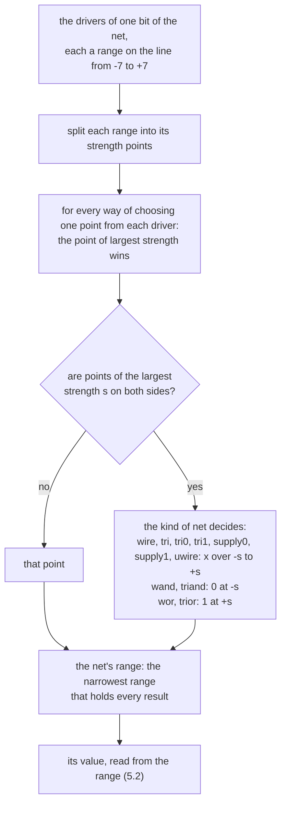

# VALUE_SEMANTICS: the semantics of values

[日本語](VALUE_SEMANTICS.ja.md) · This English text is the main version; the Japanese version follows it, and where they differ, this text holds.

**Revision (2026-10-24):** old P2→P3, old P3→P4 and old P4→P5; new P2 (SIR v1) is inserted, with tier numbers unchanged ([mapping](../notes/phase-renumbering.md)).

Priority: P0. Status: **approved (amendment approved 2026-10-15)**. The points of an independent review were applied to the version approved on 2026-10-14. Section 7 (concatenation, conversion, reals, strings, enumerated types) was written in P1 and approved on 2026-10-15. On 2026-10-16, section 5 (net resolution and drive strength) was rewritten and 3.12 (assignment operators, and increment and decrement operators) added (approved). The same day, the conditional operator on values that are not integral was written in 3.9 (approved). On 2026-10-17, 3.13 (aggregate assignment) and 3.14 (aggregate comparison) were added and the item on streaming operators in 8 rewritten (approved). The same day, the conversion from real to integer in 7.4 was changed to truncation regardless of size, with the handling of NaN and infinities (approved). On 2026-10-18, the conversion of integers with x and z to strings was added to 7.6 (approved). The same day, the section 7.4 cites for `$rtoi` was corrected from SYSTEM_TASKS.md 9 to 8 (approved). The same day, a table of the strength line was added to 5.2, and a diagram and examples of the rule to 5.4 (approved). The same day, the reference results for Verilator in 7.6 were corrected (approved). The same day, the rounding of integers that a real cannot hold exactly (1.5), the value of an assignment operator and of `++` and `--` used in an expression (3.12), and the signedness of `s[i]` (7.6) were written down (approved). The same day, how a `case` on reals or strings compares (4.2) was written down (approved). On 2026-10-19, `--init-values`, `--cond-x` and `--bounds-check` were referred to from 1.4, 3.9, 3.11, 4.1 and 4.2 (approved). The same day, the left-to-right order of evaluating operands and arguments was added to 3.1 (approved). The same day, the order of the two sides of a blocking assignment was added to 3.1 (approved). The same day, unconnected input ports under `` `unconnected_drive `` were added to 5.3 (approved). On 2026-10-28, the leading sign of `atoreal` and the syntax it reads were added to 7.6 (approved). The same day, the clause that 7.6 gives for `realtoa` was corrected from 6.16.13 to 6.16.15 (approved). The same day, `atoi`, `atohex`, `atooct` and `atobin` in 7.6 were changed to read a leading minus and need a digit first, as slang does (approved). The same day, 7.6 was changed back to read an underscore before the first digit in `atoi`, `atohex`, `atooct` and `atobin`, as 6.16.9 says, where slang does not (approved). On 2026-10-31, slices of fixed-size unpacked arrays were added to 3.13 (approved).

This document sets how kirimasim represents values and computes operations. The text of the standard (IEEE 1800-2023) is not copied; it is summarized in this document's own words, with the clause numbers it rests on. Items marked "checked" were checked by reading the relevant clause of the standard. Items marked "interpretation" are not settled by the wording of the standard alone, and this document decides them.

The definition of meaning lives in one place, the reference implementation `valsem`. Fast versions in the execution kernel and generated code always have tests that cross-check them with `valsem`.

## 1. The set of values and their representation

### 1.1 The four values

One bit takes one of 0, 1, x (unknown) and z (high impedance). When a z reaches a gate's input or an expression, it is in most cases treated like x. The exception the standard names, which passes z through, is the MOS primitives (checked: 6.3.1). Besides these, z stays in the result of net resolution (5) and of the conditional operator when both sides have the same value (3.9) (a note of this document; it follows from the rules of those sections).

### 1.2 4-state and 2-state types

- 4-state types: `logic` (= `reg`), `integer`, `time`, and packed types made of them.
- 2-state types: `bit`, `byte`, `shortint`, `int`, `longint`, and packed types made of them.
- Default signedness: `byte`, `shortint`, `int`, `integer` and `longint` are signed. `bit`, `logic`, `reg` and `time` are unsigned (checked: 6.11, 6.11.2, 6.11.3).
- An implicit conversion from 4 states to 2 states makes x and z bits 0 (checked: 6.11.2).

### 1.3 Internal representation

Values are held as pairs of 64-bit words `(a, b)`, as many as the width needs. One bit is encoded as follows (checked: the note on `s_vpi_vecval` in 38.15, and `svLogicVecVal` in H.10.1.2; VPI and DPI use the same encoding).

| Value | a | b |
| --- | --- | --- |
| 0 | 0 | 0 |
| 1 | 1 | 0 |
| z | 0 | 1 |
| x | 1 | 1 |

- VPI and DPI use pairs of 32 bits, with the least significant bit in the least significant bit of the element at index 0 (checked: 38.15, H.10.1.2). kirimasim's internal words are 64 bits, so at the boundary only rearranging is needed. The meaning of the bits is the same, so no conversion bit by bit is needed.
- However, in DPI's canonical representation, the content of unused bits above the width of the last element is not defined, and masking or sign extension is the receiver's responsibility (checked: H.7.7). So when **taking in** values from DPI and VPI (the outputs and return values of import functions, open arrays, `vpi_put_value`), after rearranging, both a and b are masked by the width and the extra bits made 0. When giving values, the extra bits are passed as 0. The cross-check tests of the boundary (widths 1, 31, 32, 33, 63, 64, 65, 127, 128, 129) include inputs with random values in the unused bits.
- Extra bits above the width are always 0 in both a and b (rule of this document; checked by the verifier).
- 2-state types, and slots proved never to receive X, hold only a.

### 1.4 Default initial values

A variable with no initial value starts as: all bits x for 4-state integral types, 0 for 2-state integral types, 0.0 for reals, empty for strings, and null for classes, interface classes, chandles and virtual interfaces. **An `event` starts not as null but as a new event (synchronization object).** Enumerated types follow the default of their base type (checked: 6.8, Table 6-7).

- `--init-values` (CLI.md 2.2; approved 2026-10-19) can start the 4-state variables and memories that have no initial value as 0, 1 or random bits instead of x, to find resets that x hides. It is not the standard's rule, so a run with it says so at its start (CLI.md 4). Nets and 2-state variables are not affected.

### 1.5 Reals

- `real` is the same as C's `double`, and `shortreal` as C's `float`. `realtime` is the same as `real` (checked: 6.12).
- Conversion from real to integer rounds to the nearest integer. A fraction of exactly 0.5 rounds away from zero (checked: 6.12.1; also checked with Icarus 13.0 that -1.5 becomes -2 and 2.5 becomes 3).
- Conversion from integer to real takes x and z bits as 0 (checked: 6.12.1; checked with Icarus 13.0 that `...1x` becomes 2.0).
- An integer that a `real` or `shortreal` cannot hold exactly becomes the nearest value it can hold; a value exactly halfway goes to the one whose last bit is 0 (interpretation; 6.12.1 does not say; this is the default rounding of IEEE 754, which C's conversion uses). For reference (checked 2026-10-18): Icarus 13.0 gives the same, for example 2\*\*53 + 1 becomes 2\*\*53, and a 100-bit 2\*\*64 + 2\*\*11 becomes 2\*\*64.
- Operations and constructs that cannot be used on reals (waiting for edges, bit- and part-selects and so on) are errors of elaboration. slang decides these (checked: 6.12, 11.3.1).

## 2. Types and widths of expressions

- The width and signedness of an expression follow slang's typing; kirimasim does not compute them again (11.6, 11.7, 11.8.1, 11.8.2 of the standard).
- Widening a signed value fills with the sign bit. If the sign bit is x it fills with x, if z with z (checked: 11.8.4; checked with Icarus 13.0 that widening `4'sbz111` to 8 bits gives `zzzzz111`).
- The results of bit- and part-selects, concatenation, comparison and reduction are always unsigned (checked: 11.8.1).

## 3. Operations

### 3.1 Common rules

- An operation mixing 2-state and 4-state values is computed taking everything as 4-state. If every input is 2-state, the result normally stays within 2 states. The exceptions are operations that make x from 2-state inputs, such as division by 0 (checked: 11.3.4). When the result is put in a 2-state type, the conversion of 1.2 makes x 0.
- Only `&&`, `||`, `->` and `?:` short-circuit. Every other operator always evaluates all its operands. The side effects (function calls and the like) and run-time errors of operands not evaluated because of short-circuiting do not happen (checked: 11.3.5). `<->` does not short-circuit and evaluates each side exactly once (checked: 11.4.7).
- Optimizations that change the number or order of calls are done only when they are proved free of side effects (the standard allows skipping evaluation if the results and side effects are as the rules say; 11.3.5).
- **Order of evaluation (rule of this document; approved 2026-10-19):** where the standard does not set an order (11.3.5, 11.4.2), the operands of an operator, the arguments of a call (of subroutines, system tasks and system functions) and the elements of a concatenation or replication are evaluated left to right, and their side effects happen in that order. Short-circuiting still skips the operands it skips. Between the two sides of an assignment, the order for nonblocking assignments is SCHEDULER_SPEC.md 13. A blocking assignment with `=` evaluates its right side first, then the indices and the other parts of its left side: the standard leaves this order open when there is no intra-assignment timing control, and with one the left side is evaluated after the control (checked: 10.4.1), so both cases take the same order (rule of this document; approved 2026-10-19). An assignment operator such as `+=` reads its left side as an operand, so it evaluates the left side first, once (checked for once: 11.4.1). Icarus Verilog 14.0 (devel) and Verilator 5.052 take both orders.

### 3.2 Arithmetic (`+ - * / % **`, unary `+ -`)

- If any bit of any operand is x or z, every bit of the result is x (checked: 11.4.3).
- Integer division truncates toward zero. For `/` and `%`, a divisor of 0 makes every bit of the result x. The sign of the result of `%` follows the sign of the dividend (the left operand) (checked: 11.4.3).
- Rules of integer power (checked: 11.4.3, Table 11-4):
  - If the exponent is 0, the result is 1 whatever the base (0 to the 0 is 1 too).
  - If the base is 0 and the exponent negative, every bit of the result is x.
  - If the base is 1, the result is 1. If the base is -1, the result is 1 for an even exponent and -1 for an odd one.
  - If the absolute value of the base is 2 or more and the exponent negative, the result is 0.
  - The exponent is evaluated in a self-determined context and does not affect the type of the result.
- For real power, the standard does not set the result when the base is 0 and the exponent negative, or when the base is negative and the exponent not an integer (checked: 11.4.3). kirimasim returns the result of C's `pow` (interpretation; treated like the exception of math functions in NFR-2).
- Signed operations are computed in two's complement. Conversion between signed and unsigned keeps the bit pattern and changes only the interpretation (checked: 11.4.3.1).
- The 64-bit fast paths of generated code cause no undefined behaviour of C++. Signed addition, subtraction and multiplication are computed unsigned and converted back; `INT64_MIN / -1` and division by 0 are split off by conditions (rule of this document).

### 3.3 Relational (`< > <= >=`)

- The result is 1 bit. If either operand has even one x or z bit, the result is x, even when the known bits alone would decide the order (checked: 11.4.4; checked with Icarus 13.0 that `2'b1x > 2'b00` is x).
- If either is unsigned the comparison is unsigned; if both are signed it is signed. If either is real it is a real comparison (checked: 11.4.4).

### 3.4 Equality (`== != === !==`) and wildcard equality (`==? !=?`)

- `==` and `!=` compare bit by bit. The result is x only when x or z leaves it undecided. If known bits differ, the result is 0 (1 for `!=`) even if other bits are x (checked: 11.4.5; checked with Icarus 13.0 that `2'b1x == 2'b0x` is 0).
- `===` and `!==` compare x and z as values too. The result is always 0 or 1 (checked: 11.4.5).
- `==?` and `!=?` treat only the x and z bits of **the right operand** as bits that "match any value". An x or z on the left is compared as a value, not as a wildcard. The other bits are compared by the same rule as `==`; if undecided, x (checked: 11.4.6).
- Comparisons of class handles, chandles and null compare the values of the handles (checked: 11.4.5, 11.4.6).

### 3.5 Logical operations (`! && || -> <->`)

- The truth of an operand is decided as follows (interpretation; grounds below):
  - If any bit is 1, true.
  - If every bit is 0, false.
  - If no bit is 1 and some bit is x or z, unknown.
  - Grounds: 12.4 gives false as "a value of 0, or a value of x or z", and makes `if (expr)` mean the same as `if (expr != 0)`. 12.7.1 too decides the truth of a `for` condition in the sense of 12.4, taking an unknown or high-impedance condition as 0 (here too the range of "unknown value" is not settled by the wording). By the rules of 3.4, the result of `!= 0` is 1 if some bit is 1, 0 if all are 0, and x otherwise. 11.4.7 gives 1 for true, 0 for false, and x when undecided. Icarus 13.0's result (`!(2'b0x)` is x) agrees with this interpretation too.
- `!` makes true 0, false 1, and unknown x (checked: 11.4.7).
- `&&` and `||` are the 3-valued (true, false, unknown) AND and OR. `a -> b` means the same as `!a || b`, and `a <-> b` the same as `(a -> b) && (b -> a)` (checked: 11.4.7).
- Short-circuiting: `&&` and `->` do not evaluate the right side if the left is false. `||` does not evaluate the right side if the left is true. If the left is unknown, the right is evaluated (checked: 11.4.7).

### 3.6 Bitwise operations (`& | ^ ~^ ~`)

Computed bit by bit by these rules (checked: 11.4.8, Tables 11-11 to 11-15). z in an input is treated like x, and no z comes out.

| Operation | Rule |
| --- | --- |
| `&` | 0 if either is 0. 1 if both are 1. Otherwise x |
| `\|` | 1 if either is 1. 0 if both are 0. Otherwise x |
| `^` | Exclusive OR if both are known (0 or 1). Otherwise x |
| `~^`, `^~` | The negation of exclusive OR if both are known. Otherwise x |
| `~` | Swaps 0 and 1. x and z give x |

- When widths differ, operands are extended with zeros if either is unsigned, and with the sign if both are signed (checked: 11.4.8).
- Signed values with x or z: 11.8.4 says that if a signed value has x or z bits, every bit of the result of a "non-logical operation" is x. Whether bitwise operations are among those "non-logical operations" is not settled by the wording. kirimasim computes bitwise operations and reductions bit by bit, and makes every bit x for arithmetic and comparison (interpretation; approved 2026-10-14; Icarus 13.0 too computed `4'sb10x1 & 4'sb1111` bit by bit as `10x1`).
- Reference implementation: `valsem::logicAnd` (one bit of `&`). Fast version: `kernel::and4` (64 bits). Cross-checked on all 16 cases and random words (`tests/unit/and4_test.cpp`). Other operators are added in the same form.

### 3.7 Reduction (`& ~& | ~| ^ ~^`)

The rule of 3.6 is applied to the first 2 bits, then the same rule to that result and the next bit, and so on. `~&`, `~|` and `~^` invert the results of `&`, `|` and `^` (checked: 11.4.9). The result is 1 bit, unsigned.

### 3.8 Shifts (`<< >> <<< >>>`)

- Both kinds of left shift fill the bottom with 0. `>>` fills the top with 0. `>>>` repeats the left operand's top bit at the top when the result type is signed, and puts 0 there when it is unsigned (checked: 11.4.10).
- The shift amount (the right operand) is read as an unsigned number whatever its type, and plays no part in the signedness of the result (checked: 11.4.10).
- If the shift amount has x or z, the result is unknown. kirimasim makes every bit x (checked: 11.4.10; reading "unknown" as all bits x is interpretation; Icarus 13.0 also gave all bits x).
- A shift by the width or more gives all bits 0 for left shifts and `>>`, and all bits equal to the sign bit for a signed `>>>` (rule of this document; generated code splits this off by a condition to avoid undefined behaviour of C++).

### 3.9 Conditional operator (`?:`)

- If the condition is true, only the first expression is evaluated and returned; if false, only the second (checked: 11.4.11).
- If the condition is unknown (x or z), both expressions are evaluated. If the two are equal by `==` (the result is 1), that value is returned. Otherwise, for integral types, both are widened to the same width and combined bit by bit: 0 if both are 0, 1 if both are 1, x otherwise. **A bit that is z on both sides becomes x too** (checked: 11.4.11, Table 11-20).
- Types that are not integral (checked: 11.4.11). Approved 2026-10-16:
  - The result type: real with real, shortreal or integral gives real, the side that is not real converted to real; shortreal with integral gives shortreal, the integral side converted to shortreal; integral with a type that converts implicitly to integral gives integral. Classes and interface classes follow a to e of 11.4.11 (P4). Otherwise the two types must be equivalent (6.22.2) (slang checks).
  - When the condition is unknown and the two values are not equal by `==` (11.4.5): arrays with the same number of elements (associative arrays excepted) are combined element by element, equal elements keeping their value and differing ones taking the value of Table 7-1. Other types take the value of Table 7-1 for the result type: 0.0 for reals, the empty string for strings, null for class handles and the like.
  - Reals and strings are implemented in P1. Arrays and handles are implemented in the stages that implement them.
  - Icarus 13.0 hits an internal error on `?:` of strings with an x condition (checked). Expected values follow the standard.
- Difference from Icarus 13.0: for `1'bx ? 2'bz1 : 2'bz0`, Icarus 13.0 gave `zx`. In Table 11-20 of the standard, z and z give x, so the result by the standard is `xx`. Expected values follow the standard (`oracle: spec`).
- `--cond-x` (CLI.md 2.2; approved 2026-10-19) reports a condition that had x or z bits. It changes no result.

### 3.10 Set membership (`inside`)

- The left expression is compared with each element of the list on the right, and the result is 1 if it matches any. Integral elements are compared with `==?`, so x and z on the element's side are bits that "match any value". x and z of the left expression are not wildcards. Elements that are not integral are compared with `==` (checked: 11.4.13).
- If nothing matches and any of the comparisons is x, the result is x. The whole is the same as the OR of the results of all comparisons (checked: 11.4.13).
- A range `[lo:hi]` is compared with `>=` and `<=`. `$` is the smallest or largest value of the left expression's type. A range with lo greater than hi is empty (checked: 11.4.13). The rules of 3.3 apply to comparisons with ranges, so if the left expression has x or z, the comparison with the range is x (interpretation).
- There are tolerance forms `[A +/- B]` (an absolute tolerance) and `[A +%- B]` (a tolerance as a percentage of A). Whatever the signs of A and B, the two bounds are swapped if needed to make [low:high]. The type of the range is A's type. For an integral A, the tolerance is truncated, not rounded (checked: 11.4.13; whether this was in 1800-2017 is not confirmed).
- An unpacked array in the list stands for all of its elements, down to single values, each compared in turn (checked: 11.4.13; dynamic arrays in P4).
- The order of evaluating elements is not set by the standard (checked: 11.4.13). kirimasim evaluates them in the order written (rule of this document).
- Icarus 13.0 does not support `inside` (checked by running it).

### 3.11 Bit- and part-selects

- When a bit-select of a packed value has an index out of range or containing x or z bits, the read gives x (0 for a 2-state value) (checked: 11.5.1).
- When a part-select is entirely out of range, or its position has x or z, the value read is x (for 2-state types, 0 by the conversion of 1.2). A write does nothing (checked: 11.5.1).
- When a part-select is only partly out of range, the bits out of range read as x, and a write goes only to the bits in range (checked: 11.5.1; checked with Icarus 13.0 that `[6 +: 4]` of `8'hA5` is `xx10`).
- Reading an unpacked array with an invalid index (out of range, or containing x or z) returns the default value of the element type: x for 4-state integral types, 0 for 2-state, 0.0 for reals, empty for strings, null for handles (checked: 7.4.5, Table 7-1). Writing through an invalid index changes nothing. Two writes are not covered by this: one at `[$+1]` of a queue, which appends, and one that creates a new element of an associative array (checked: 7.4.5).
- `--bounds-check` (CLI.md 2.2; approved 2026-10-19) reports, once per place, an index or position out of range at run time, or with x or z bits. It changes no value read or written.

Implementation status (2026-10-23): tier 1 supports `--bounds-check=off|warn`
for packed selects and fixed unpacked arrays, including wide values, frames,
refs and NBA writes. `kernel::fullyInside` uses the same clipping rule as the
value operations. The VM reports each source position once and counts invalid
read/write accesses at the end; compound updates can contribute both a read and
a write. The check does not change values, index evaluation or event counters.
See the [usage example](../P1_FEATURES.md) and
[CLI matrix](../../tools/gen_bounds_check_matrix.py).

### 3.12 Assignment operators, and increment and decrement operators

Approved 2026-10-16.

- `a op= b` is the same as `a = a op (b)`, except that the index expressions of `a` are evaluated only once (checked: 11.4.1).
- The order of evaluation is: the indices and position of `a`, the present value of `a`, `b`, the operation, the write (rule of this document; the standard does not set the order of assignments within expressions: 11.4.2).
- `++` and `--` too take the operand as one target and evaluate its index expressions only once (interpretation; 11.4.2 says only that they "behave like a blocking assignment" and does not give the number of evaluations of the indices; a reading that evaluates twice an expression written once in the source is not taken). Reals change by exactly 1.0 (checked: 11.4.2).
  - Controls: Icarus 13.0 calls f once for `a[f()]++`. Verilator 5.052 calls it 3 times for `y = a[f()]--` and twice for `m[f()-1][7:4] -= 1` (the latter breaks 11.4.1 too).
- The methods that change a string (`putc`, `itoa`, `hextoa`, `octtoa`, `bintoa`, `realtoa`) and `s[i] = c` also treat the string as one target and evaluate its index only once.
- The value of an assignment operator, or of `++` or `--`, used in an expression is the value written: the result of the operation in the type of the target, as 11.3.6 gives for an assignment within an expression. Prefix `++` and `--` give it, postfix ones the value before (C's meaning, which 11.4.2 takes). It is that value also where the write changes nothing, such as a string's character past its end, where `++s[i]` gives 1 (interpretation; the standard does not say it for a target that keeps its value). For reference (checked 2026-10-18): Icarus 13.0 and Verilator 5.052 do not take `++` on a string's character.

### 3.13 Aggregate assignment (unpacked arrays and structures)

Approved 2026-10-17.

- Every value of the right side is computed before any element or member of the left side is written. Even if the right side reads elements or members of the left side, it reads the values before the assignment. Grounds: the standard takes the right side of an assignment as "the value to be assigned to the left side" (checked: 10.4.1), and treats assignment patterns of unpacked arrays and structures as expressions that build a value (aggregate expressions) (checked: 11.2.2, 10.9.1, 10.9.2). Packed assignment patterns and concatenations too compute the value before writing.
- The expressions of elements and members are evaluated in element order: arrays from the left bound, multidimensional ones with the rightmost dimension changing fastest; structures in declaration order (rule of this document; the standard does not set it).
- `default:`, type keys and replication expressions are evaluated once for each element and member they fill (rule of this document; the standard says it does not set the number of evaluations of expressions with side effects: 10.9.1).
- Nonblocking assignments (`<=`) too compute the value when the statement runs (checked: 10.4.2).
- **Slices (added 2026-10-31, approved):** a slice of a fixed-size unpacked array (`a[l:r]`, `a[b+:w]`, `a[b-:w]`; 7.4.6) is the unpacked array of the elements it selects, in the order of the array's own dimension. It can be the right side or the left side of an aggregate assignment, with or without a delay, and an operand of an aggregate comparison (3.14), its elements matched with the other side's by position from the left end (7.6). A position decided at run time is evaluated once, where the slice is read or written. An element of a slice outside the array reads the default value of its type and is not written, as an element with an invalid index (3.11) (rule of this document; what the standard says of a slice partly outside the array is not confirmed: 7.4.6 is the place to check).
- The opening of 10.9 of the standard also says that "an assignment pattern expresses a kind of assignment to structure fields and array elements", which leaves room to read it as assignment element by element. This document reads it, on the grounds of 10.4.1 and 11.2.2, as "build the value, then assign". For reference (checked 2026-10-17): with `a` equal to `'{10, 11, 12}`, Icarus 13.0, Icarus's development version and Verilator 5.052 print `11 12 11` for `a = '{a[1], a[2], a[0]}` (they write the elements one at a time). By this document it is `11 12 10`.

### 3.14 Aggregate comparison

Approved 2026-10-17.

`==`, `!=`, `===` and `!==` on unpacked arrays and structures (checked: 11.2.2, 7.4.6; the two types must be equivalent: 6.22.2, which slang checks):

- Corresponding elements, and corresponding members, are compared with the same operator of their type. Nested aggregates use the same rule.
- `==`: 0 if any is 0. Otherwise x if any is x. 1 if all are 1. `!=` is its negation (x stays x).
- `===`: 1 if all are 1, otherwise 0. `!==` is its negation.
- Grounds: the standard makes `==` x only when x and z leave the relation undecided (checked: 11.4.5). For packed vectors, the result is 0 if some bit surely differs. For aggregates too, the relation is decided if some element or member surely differs (rule of this document; the standard does not describe x in aggregate comparison).
- For reference (checked 2026-10-17): Icarus 13.0 and its development version do not accept unpacked structures. Verilator 5.052 is 2-state, and in comparisons without x gave the same results as this rule.

## 4. Values in control constructs

### 4.1 The condition of `if`

- The first statement runs only when the condition is true. False and unknown are both taken as "not true", and the else side runs (checked: 12.4; how truth is decided follows the interpretation of 3.5).
- Example: `if (2'b1x)` is true (there is a 1 bit), `if (2'b0x)` is false (since it is unknown). The same results were checked with Icarus 13.0.
- 12.4 takes a known value other than 0 as true, and 0, x or z as false. Read strictly, `2'b1x` is not a known value because of its x, and so could be taken as false. kirimasim gives priority to the equivalence with `if (expr != 0)` that 12.4 itself states (interpretation).
- `--cond-x` (CLI.md 2.2; approved 2026-10-19) reports a condition that had x or z bits. It changes no result.

### 4.2 `case`, `casez`, `casex`

- `case` compares the expression with each item for an exact match with 0, 1, x and z as values (the same as `===`). All expressions are brought to the width of the longest. If any is unsigned, all are treated as unsigned (checked: 12.5).
- The expression is evaluated once, before the items. The items are then tried from the first written, and the first match decides which statement runs (checked: 12.5).
- **A `case` on reals or strings (approved 2026-10-18):** the expression and the items take one common type, as for a comparison: `real` if any is `real` or `realtime`, `shortreal` if any is `shortreal` and none `real`, and `string` when the expression is a string (checked: 12.5 gives the common width and signedness of integral ones; 11.3.1 the rule for reals; slang gives this type). When that type is `real`, `shortreal` or `string`, an item matches when it is equal to the expression by `==` in that type: reals are not rounded to integers, `-0.0` equals `0.0`, an integral item is converted to real first (x and z as 0, 1.5), and a `shortreal` compared with a `real` is widened first, so `shortreal` 1.1 does not match `real` 1.1 (interpretation; 12.5 describes the match of integral values bit by bit only). For reference (checked 2026-10-18): Icarus 13.0 and Verilator 5.052 give the same except for that last case, as they keep a `shortreal` as a `real`. `casez` and `casex` take integral values only (slang checks).
- `casez` treats z bits, and `casex` x and z bits, as bits not compared. **They are ignored on both the expression's side and the item's side** (checked: 12.5.1). This differs from `==?`, which ignores only x and z of the right operand.
- `?` in a number is the same as z (checked: 12.5.1).
- `case ... inside` compares each item with `inside`. A result of 1 is a match; 0 or x is not (checked: 12.5.4).
- When violations of `unique`, `unique0` and `priority` are reported is set in SCHEDULER_SPEC.
- `--cond-x` (CLI.md 2.2; approved 2026-10-19) reports a `case` expression that had x or z bits. It changes no result.

### 4.3 Edges (`posedge`, `negedge`, `edge`)

- Changes that are posedge: from 0 to 1, x or z; from x or z to 1.
- Changes that are negedge: from 1 to 0, x or z; from x or z to 0.
- edge: either posedge or negedge.
- A change that is none of the above (including changes between x and z) is not an edge.
- Edges are decided on the least significant bit of the expression only. A wait with no edge wakes when the value of the expression changes. It does not wake if operands change but the expression's value does not (checked: 9.4.2, Table 9-2).
- Edges are decided by one function of `valsem` only, and other implementations are cross-checked with it.

## 5. Net resolution

Rewritten and approved 2026-10-16.

### 5.1 Scope in P1

- Covered: drive strengths of continuous assignments and net declaration assignments (10.3.4), output strengths of built-in gates and user-defined primitives (28.3.2, chapter 29; 5.8, 5.9), `pullup` and `pulldown` (28.10), strengths of `tri0`, `tri1`, `supply0` and `supply1` (28.15), resolution of `wand`, `triand`, `wor` and `trior` (6.6.3, 28.12.4).
- Not covered (reported as unsupported if used): MOS switches and bidirectional switches, and the reduction of strength through them (28.7 to 28.9, 28.13, 28.14; P5, phase 4 of the design specification before the 2026-10-24 renumbering), `trireg` (5.7), user-defined nettypes (6.6.7).
- Display with `%v` follows SYSTEM_TASKS.md 3.10 (P5; a provisional display until then).

### 5.2 The strength scale and signals

- Strength has 8 levels, from 0 (highz) to 7 (supply), with a 0 side and a 1 side (checked: 28.11, Table 28-7, Figure 28-2).
- The signal of one bit of a net is represented by a contiguous range on the scale. In this document it is the pair of ends [lo, hi] on a number line from −7 to +7, where strength s on the 0 side is −s, strength s on the 1 side is +s, and highz is 0 (checked: 28.11, 28.12).
- The value is decided from the range (checked: 28.11, 28.12.2):

| Range | Value |
| --- | --- |
| lo = hi = 0 | z |
| hi < 0 | 0 |
| hi = 0 and lo < 0 | L |
| lo > 0 | 1 |
| lo = 0 and hi > 0 | H |
| lo < 0 < hi | x |

- When read as a 4-state value, L and H are x (interpretation; L and H are defined as ranges of strength (28.12.2) and are not among the 4-state values; Icarus 13.0 too reads them as x).
- Vector nets are resolved bit by bit.

The strength line, with the names `%v` prints for each point (21.2.1.4):

| Point | −7 | −6 | −5 | −4 | −3 | −2 | −1 | 0 | +1 | +2 | +3 | +4 | +5 | +6 | +7 |
| --- | --- | --- | --- | --- | --- | --- | --- | --- | --- | --- | --- | --- | --- | --- | --- |
| Name | Su0 | St0 | Pu0 | La0 | We0 | Me0 | Sm0 | HiZ | Sm1 | Me1 | We1 | La1 | Pu1 | St1 | Su1 |
| Strength | supply | strong | pull | large | weak | medium | small | highz | small | medium | weak | large | pull | strong | supply |

### 5.3 Signals of drivers

The output of one bit of one driver is decided by its value, its 0 strength s0 and its 1 strength s1 (checked: 10.3.4, 28.12.2, Figure 28-6): 0 is [−s0, −s0], 1 is [+s1, +s1], x is [−s0, +s1], z is [0, 0]. If s0 is highz (0), 0 becomes z and x becomes H. Likewise for s1.

| Driver | (s1, s0) | Grounds |
| --- | --- | --- |
| Continuous assignments, net declaration assignments | As specified. If unspecified, (strong1, strong0). (highz1, highz0) and (highz0, highz1) are errors (slang reports them) | 10.3.4 |
| Built-in gates | As specified. If unspecified, (strong1, strong0) | 28.3.2 |
| `pullup`, `pulldown` | As specified. If unspecified, pull. A strength0 given to `pullup` and a strength1 given to `pulldown` are ignored | 28.10 |
| `tri0`, `tri1` | Taken as the net with one more driver of pull0 or pull1 | 28.15.1 |
| `supply0`, `supply1` | Taken as the net with one more driver of supply0 or supply1 | 28.15.3 |
| Ports connected to variables, and ports connected to expressions | Implicit continuous assignments, so (strong1, strong0) | 4.9.6 |
| Unconnected input ports under `` `unconnected_drive `` | Taken as the port's net with one more driver, a `pullup` for `pull1` or a `pulldown` for `pull0`, on every bit | 22.9, 28.10 |

- A strength specification applies to every bit of a vector net (interpretation; 10.3.4 limits strengths to assignments to scalar nets, but slang accepts a specification on vectors, and Icarus 13.0 too applies it bit by bit).
- A port connecting a net to a net collapses both sides into one net, and the drivers of both sides are resolved together (checked: 23.3.3.7; the inout of 4.9.6 is a connection that does not change strength). output and input ports with drivers on both sides are changed to inout by slang (23.3.3.1). Connections that cannot be collapsed (SIR_SPEC.md 3.5) are implicit continuous assignments as in the table above.
- **Unconnected input ports under `` `unconnected_drive `` (approved 2026-10-19):** an input port of a module, interface or program declared where `` `unconnected_drive pull1`` (or `pull0`) is in effect, and left unconnected in an instance, gets one more driver on its net: 1 (or 0) at pull strength on every bit, as a `pullup` (or `pulldown`) on that net would give. It is resolved with the net's other drivers by 5.4. inout and output ports do not change. The direction is the declared one, also where slang reports the port as coerced to inout (23.3.3.1).
  - Interpretation: 22.9 says that such ports are pulled up or down, but names no strength. Pull strength is that of `pullup` and `pulldown` (28.10), and the property of a module definition that records the directive in VPI (`vpiUnconnDrive`, 37.10) takes values named for pull drives (Annex K). Icarus 13.0 too gives Pu1 on every bit (checked 2026-10-19).
  - A variable input port is not pulled (UNSPECIFIED_BEHAVIOR.md N10).
  - Where the directive applies, an unconnected port whose entry in the port list is an expression (`.a({x, y})`), or whose net is an unpacked array, is reported as unsupported, as it is when connected.
- **Initial value of drivers (approved 2026-10-17):** each driver (continuous assignments, net declaration assignments, ports, gates, UDPs, `pullup` and `pulldown`) drives x on the bits it writes until it first writes. Its strength is that driver's (s1, s0). On bits it does not write it drives nothing (z; 6.6).
  - Interpretation: 6.6 and 6.7.1 say the value of a net with drivers is decided by the drivers' outputs, but do not say what a driver not yet evaluated outputs. Icarus 13.0 too gives x (checked 2026-10-17). Whether an older edition (IEEE 1364) had a sentence like "the default output of a driver is x" is not confirmed.
  - This is visible between time 0 and the first write of a driver with a delay, and when the net is read at time 0 before its driver is first evaluated. The latter depends on the order of processes at time 0, which the standard does not set (4.7; SCHEDULER_SPEC.md 6.1).
  - The last item of 5.4 (nets with no driver at all) does not change. Bits a driver does not write are treated the same as having no driver.

### 5.4 Rules of resolution

The range of one bit of a net is decided from all the drivers of the net (including the implicit drivers of 5.3) as follows.

1. Split each driver's range into the points of strength it contains (integers from −7 to +7).
2. For every way of choosing one point from each driver, combine the chosen points. The point of largest strength (absolute value) wins. When points of the largest strength s are on both sides, the kind of net decides:
   - `wire`, `tri`, `tri0`, `tri1`, `supply0`, `supply1`, `uwire`: x. The range is [−s, +s] (checked: 28.12.2; opposite values of the same strength give an x with both strengths and every weaker strength).
   - `wand`, `triand`: 0. The range is [−s, −s] (checked: 28.12.4).
   - `wor`, `trior`: 1. The range is [+s, +s] (likewise).
3. The narrowest range that contains every result of 2 is the net's range.

The same steps as a diagram (where it differs from the steps, the steps hold):

- This rule reproduces the following rules and examples of the standard, and does not depend on the order of drivers: of signals with different strengths, the stronger wins (28.12.1); rules a to c for combining a signal of ambiguous strength with one of unambiguous strength (28.12.3); wired logic on signals of ambiguous strength (28.12.4, the table of Figure 28-25).
- For combining signals of ambiguous strength with each other, the standard says "the result is a range containing both strengths" (28.12.2). This rule takes not the literal "narrowest range containing both ranges" but "the narrowest range containing the results the combination can give" (interpretation). In the standard's examples (Figures 28-9 to 28-19) the two agree. They disagree when one is always stronger than the other (for example the range [St0, Su0] and the range [Pu1, We1]: x literally, 0 by this rule), and it is this rule that fits "the stronger wins" of 28.12.1.
- Rule b of 28.12.3 says "points at or below the strength of the unambiguous signal disappear", but a point of the opposite value at the same strength becomes a range of x by the rule of 28.12.2, "opposite values of the same strength give x" (interpretation; Icarus 13.0 too gave StX from StL and St1). With this reading, rules a to c and the rule of this section agreed on 20000 random cases.
- Wired logic acts only when the largest strengths are equal (checked: the text of 28.12.4, and "the or of St0 and Pu1 is St0" in the table of Figure 28-25). **Difference from Icarus 13.0:** Icarus 13.0 applies wired logic even when strengths differ (it gave St0 from We0 and St1 on `wand`, and St1 from Pu1 and St0 on `wor`). Expected values follow the standard (`:oracle: spec`).
- A net with no driver at all has the default initial value of 1.4 (z for `wire` and so on).

Examples of the rule (where they differ from the rules above, the rules hold):

| # | Net | Drivers (ranges) | Result range | Value | Why |
| --- | --- | --- | --- | --- | --- |
| 1 | `wire` | St0 [−6, −6], Pu1 [+5, +5] | [−6, −6] | 0 (St0) | The stronger point wins |
| 2 | `wire` | St0 [−6, −6], St1 [+6, +6] | [−6, +6] | x (StX) | Opposite values of equal strength give x over both |
| 3 | `wand` | St0 [−6, −6], St1 [+6, +6] | [−6, −6] | 0 (St0) | Wired AND at equal strength |
| 4 | `wand` | We0 [−3, −3], St1 [+6, +6] | [+6, +6] | 1 (St1) | Wired logic acts only at equal strength |
| 5 | `wire` | H of a strong `bufif1` with data 1 and control x [0, +6], St1 [+6, +6] | [+6, +6] | 1 (St1) | Every choice gives +6 |
| 6 | `wire` | H [0, +6], We0 [−3, −3] | [−3, +6] | x | Points 0 to +2 of H lose to −3, +3 ties into [−3, +3], +4 to +6 win |
| 7 | `wire` | [−7, −6] (Su0 to St0), [+3, +5] (We1 to Pu1) | [−7, −6] | 0 | The 0 side is always stronger (the reading of 28.12.2 above) |

Examples 6 and 7 on the strength line (■ marks the points in a range):

| Range | −7 | −6 | −5 | −4 | −3 | −2 | −1 | 0 | +1 | +2 | +3 | +4 | +5 | +6 | +7 |
| --- | --- | --- | --- | --- | --- | --- | --- | --- | --- | --- | --- | --- | --- | --- | --- |
| 6: H |   |   |   |   |   |   |   | ■ | ■ | ■ | ■ | ■ | ■ | ■ |   |
| 6: We0 |   |   |   |   | ■ |   |   |   |   |   |   |   |   |   |   |
| 6: result, x |   |   |   |   | ■ | ■ | ■ | ■ | ■ | ■ | ■ | ■ | ■ | ■ |   |
| 7: Su0 to St0 | ■ | ■ |   |   |   |   |   |   |   |   |   |   |   |   |   |
| 7: We1 to Pu1 |   |   |   |   |   |   |   |   |   |   | ■ | ■ | ■ |   |   |
| 7: result, 0 | ■ | ■ |   |   |   |   |   |   |   |   |   |   |   |   |   |

### 5.5 Nets that need resolution

Only these nets hold a value per driver and are resolved by the rules of 5.4. The value of any other net is the value of its single driver (or the default initial value if it has none), with no strength.

- Nets with two or more drivers (including those gathered by collapsing ports in 5.3).
- `tri0`, `tri1`, `supply0` and `supply1` with one or more drivers.

Connecting two or more drivers to a `uwire` is an error (reported by slang's analysis stage; checked: 6.6.2).

### 5.6 When resolution happens

When a driver's value changes, the net's value is computed again and updated in the Active region of the same time (as continuous assignments, SCHEDULER_SPEC.md 5 and 12). Only when the net's value changes are the processes waiting on the net woken.

### 5.7 `trireg`

Holding and decay of charge are a mechanism separate from 4-state resolution, so it is out of scope for now, and reported as an unsupported construct if used (a rule of the design specification).

### 5.8 Built-in gates

Approved 2026-10-17.

- P1 covers `and`, `nand`, `or`, `nor`, `xor`, `xnor`, `buf`, `not`, `bufif0`, `bufif1`, `notif0`, `notif1`, `pullup` and `pulldown`. MOS and switches are P5 (5.1).
- The output of a logic gate is the same as combining its inputs in order with the bitwise operations of 3.6 (`&`, `|`, `^` and their negations). A z input is treated like x (checked: 28.4). `buf` and `not` take their last terminal as the input and drive the same value on every other terminal (checked: 28.5).
- Outputs of three-state gates (checked: 28.6): when the control enables the output, the data (its negation for `notif`; x and z of the data give x); when it disables, z. When the control is x or z: L if the data is 0, H if 1 (the reverse for `notif`), x if x or z.
- L and H are represented as an x with one side of the driver's strength made highz: L is an x with (s1, s0) made (highz, s0), and H an x with (s1, highz) (by 5.3, x is [−s0, +s1]). When resolved with other drivers, they are resolved with this range (5.4); when read as a 4-state value, they are x (5.2).
  - Checked 2026-10-17: with Icarus 13.0, resolving H (data 1, control x on `bufif1`) with a strong 1 gives 1, H alone gives x (`%v` is `StH`), and H with a weak 0 gives x. The same as this rule. Treating L and H simply as x would give x, not 1, when resolved with a strong 1.
- `pullup` drives 1 and `pulldown` 0 on every net of their terminals. The strength is as in the table of 5.3 (checked: 28.10).
- Gate terminals are 1 bit. An array of gates (28.3.6), like an array of instances, is one gate per element, and the splitting of connections follows slang's result.
- Gate delays follow SCHEDULER_SPEC.md 12.

### 5.9 User-defined primitives (UDPs)

Approved 2026-10-17.

- The output is one of 0, 1 and x. A z input is treated as x (checked: 29.2, 29.3.5).
- Combinational UDPs: the output of the row matching the input values. If no row matches, x (checked: 29.4).
- Sequential UDPs: they hold an internal state (the same value as the output). When an input changes, the state becomes the next state of the row matching that input's change (edge), the values of the other inputs and the present state. `-` keeps it. If no row matches, x (checked: 29.5, 29.6). When both an edge row and a level row match with different results, the level row decides (checked: 29.9).
- The meanings of the symbols (`0`, `1`, `x`, `?`, `b`, `-`, `(vw)`, `r`, `f`, `p`, `n`, `*`) are as in Table 29-1 (checked: 29.3.6).
- Initial value: the value of the `initial` statement if there is one, otherwise x. This initial value is set at the start of time 0 whatever the instance's delay (checked: 29.7).
- When two or more inputs changed at the same time within one activation, the changed inputs are processed one at a time in the order of the UDP's terminals, each evaluated with values that reflect the changes processed before it (rule of this document; no text found in chapter 29; checked on 2026-10-17 by searching for "simultaneous", "at the same time" and "more than one input").
  - **Difference from Icarus 13.0:** in a UDP with the data terminal before the clock (a D flip-flop capturing on the rising edge), when one assignment makes data and clock 1 at once, Icarus 13.0 evaluated the clock's edge with the previous value of the data (checked 2026-10-17). By this rule the data is processed first, so the new value is captured. Tests that depend on simultaneous changes are made `:nondeterministic: yes`.
- The drive strength and resolution of the output are the same as gates (5.3, 5.8). Delays follow SCHEDULER_SPEC.md 12.
- The meaning of table matching is set in one place, the reference implementation in `valsem`, and the kernel's implementation is cross-checked with it.

## 6. Points where checking the standard showed the design specification was different

The following points were applied to the design specification (v0.6) with a human's approval.

1. **`casez` and `casex` ignore z and x on the expression's side too** (12.5.1). The design specification's table reads as if only the pattern's side were ignored. The 2-state version has no x or z on the expression's side and is not affected, but the masks of the 4-state version must be made from both the expression and the item.
2. **In the conditional operator, a bit that is z on both sides becomes x** (11.4.11, Table 11-20). The design specification's "make the differing bits X" alone does not decide the case of z and z.
3. **`->` short-circuits too, and `<->` does not** (11.3.5, 11.4.7). The design specification treats the logical operations together.
4. **Relational operators (`<` and the like) give x if there is x or z, even when known bits decide the result** (11.4.4). The rule differs from `==`.
5. **The truth of the condition of `if`** (12.4): the design specification's explanation is the same as this document's interpretation (3.5), but the wording of the standard leaves room for another reading. It is recorded as an interpretation.

## 7. Concatenation, conversion, reals, strings, enumerated types

This section was written in P1 (approved 2026-10-15).

### 7.1 Concatenation (`{a, b, ...}`)

- The result is a packed vector with the operands' bits placed from the left toward the top, unsigned. Its width is the sum of the operands' widths (checked: 11.4.12, 11.8.1).
- Each operand is evaluated in a self-determined context. Unsized constants cannot be written in a concatenation (checked: 11.4.12; slang decides).
- If any operand is 4-state, the result is 4-state. x and z bits are placed as they are (a note of this document; concatenation only places bits and does not change values).
- Bits or parts can be selected and read from the result of a concatenation (`{a, b}[3:0]` and so on), but that cannot be a target of a write (checked: 11.4.12).
- When a concatenation is written as the left side of an assignment, the value of the right side is brought to the width of the left side (10.7), and then given to the elements from the left, starting from the top bits (checked: the example of 11.4.12).

### 7.2 Replication (`{n{...}}`)

- The multiplier is a constant expression that is not negative and not x or z (checked: 11.4.12.1; slang decides). The result is the inner concatenation placed multiplier times.
- A multiplier of 0 is ignored as width 0, but can only be written inside a concatenation that has an operand of positive width (checked: 11.4.12.1).
- An expression containing a replication cannot be the left side of an assignment, or be connected to an output or inout port (checked: 11.4.12.1).

### 7.3 Concatenation and replication of strings

- One operand of string type makes the whole concatenation a string concatenation; string literals among the operands become strings first. If all are string literals, it is the same as an integral concatenation (checked: 11.4.12.2, Table 6-9 of 6.16).
- In a replication of strings, the multiplier need not be constant. 0 gives the empty string (checked: Table 6-9). The result when the multiplier is negative, or contains x or z, is not settled by the wording of the standard (Table 6-9 only requires "an expression that is not negative and not x or z"). kirimasim makes it the empty string and gives one warning at run time (rule of this document).
- The resulting string is not truncated (checked: 11.4.12.2).

### 7.4 Type conversion

- **Static cast (`T'(e)`):** if assignment-compatible, the same value as assigning e to a variable of type T (checked: 6.24.1). Casts to enumerated types without compatibility follow 6.19.4, and to bit-stream types 6.24.3.
- **Width adjustment in assignment:** if the right side is narrower, it is extended with the sign bit if signed and with 0 if unsigned. If wider, the top bits are dropped (checked: 10.7, 6.11). If the sign bit is x or z, it extends with that value (2; 11.8.4). Even if the top bit of an unsigned value is x or z, the extension is 0 (checked: 6.11 extends unsigned conversions with 0).
- **Width cast (`n'(e)`):** e is integral. It returns the value assigned to a packed array with the single dimension `[n-1:0]`. Signedness stays as e's self-determined signedness. The elements are `bit` if e is 2-state and `logic` if 4-state (checked: 6.24.1).
- **Sign casts (`signed'(e)`, `unsigned'(e)`, `$signed`, `$unsigned`):** they keep the bits and change only the interpretation (checked: 6.24.1, 11.4.3.1).
- **4-state to 2-state:** x and z bits become 0 (1.2).
- **Integer to real:** x and z bits are taken as 0, and a signed value is converted as signed (1.5).
- **Real to integer (changed and approved 2026-10-17):** round to the nearest integer, exactly 0.5 away from zero (1.5). That integer is put in as two's complement in the width of the destination, dropping the top bits. The size of the integer has no limit, and values over 64 bits are treated the same (interpretation; the truncation of 10.7 applied to the rounded integer; for reference, on 2026-10-17 Icarus 14.0 devel and Verilator 5.053 devel were checked to give this result both for constants and at run time; slang's constant evaluation does the same). The result for NaN and infinities is not settled by the wording of the standard. kirimasim makes every bit x for a 4-state destination, and 0 for a 2-state destination (rule of this document; for reference, Icarus gave x, and Verilator, a 2-state simulator, gave 0). `$rtoi` is treated separately in SYSTEM_TASKS.md 8.
- **Between `real` and `shortreal`:** the same as conversion between C's `double` and `float` (6.12).
- **Casts to enumerated types:** the value is kept as it is even if it is not a member of the enumeration (checked: 6.19.4).
- **Bit-stream casts (6.24.3):** P1 covers only casts between packed types of equal width (the bit pattern stays as it is). Those involving unpacked types are P4.

### 7.5 Real operations

- The operations usable on reals are as in Table 11-1. The results of logical operators, relational operators and `inside` are 1 bit. For the other operators, a `real` operand makes the result `real`, and failing that a `shortreal` operand makes it `shortreal`; the condition of `?:` does not count (checked: 11.3.1).
- In an operation mixing integers and reals, the integer operands are converted to real by the rules of 7.4 before computing (checked: 11.3.1; the conversion rule is 1.5).
- `real` operations are done in the precision of C's `double`, and `shortreal` operations in that of C's `float` (interpretation; from 6.12 making them the same as the C types). Division by 0, overflow and NaN give C's (IEEE 754's) results as they are (rule of this document).
- The truth of a real (`if`, `!`, `&&` and so on) is false for 0.0 and true otherwise. NaN is true (interpretation; the same as C's `x != 0`).
- Real power is as in 3.2.

### 7.6 String operations

- `==` and `!=` return 1 or 0 by whether the strings are equal (never x). Relational operators decide by the lexical order of the `compare` method (checked: Table 6-9). If both are string literals, they are the same as the integral operators (likewise).
- `s[i]` returns the byte of the i-th character; 0 if out of range (checked: Table 6-9). It is a `byte`, which is signed, so a character from 128 to 255 reads as a negative number (checked: Table 6-9 and 6.16.3, where `getc` returns `byte`; 6.11). For reference (checked 2026-10-18): Icarus 13.0 and Verilator 5.052 read it as unsigned. A write `s[i] = 0` (`"\0"`) is ignored (checked: 6.16).
- Strings do not contain the character `"\0"`. Conversion from an integer to a string drops the value's zero bytes (checked: 6.16).
- **Conversion of integers with x and z bits to strings (approved 2026-10-18):** x and z bits are read as 0 (the same as the conversion to 2 states of 1.2), then zero bytes are dropped (rule of this document; the standard does not describe conversion of 4-state values; for reference, checked 2026-10-18, Icarus 14.0 devel gave the same result. Verilator 5.053 devel did too for x bits, but as a 2-state simulator it makes a variable assigned a value with z bits all 0 when it is assigned, and it stops with an internal error on the conversion of a constant with x bits).
- The methods (`len`, `putc`, `getc`, `toupper`, `tolower`, `compare`, `icompare`, `substr`, `atoi` and so on) are as in 6.16.1 to 6.16.15. This document's rules where the standard does not decide:
  - **`atoi`, `atohex`, `atooct` and `atobin` (amended and approved 2026-10-28):** they read one leading `-`, then the digits of their base and underscores, and stop at the first other character; underscores are skipped wherever they stand, at the start too (checked: 6.16.9 scans the leading digits and underscores). They give 0 when they read no digit, so a `+`, white space or any other character first gives 0. The result is the low 32 bits of the number, negated after the minus (interpretation for the minus: 6.16.9 says it does not parse the full syntax of integer literals, among whose parts it names the sign; slang's constant evaluation reads a minus, and its maintainer takes that sign to be the `s` of a signed based literal and points to `itoa`, which 6.16.11 calls the inverse (slang issue #1987). This document reads the minus as slang does, so that a constant that slang computes agrees with the value at run time. slang also needs a digit first, which 6.16.9 does not say, so in slang's constants a string whose scan starts with an underscore (`"_5"`, `"-_5"`) gives 0; front computes these conversions at run time (SIR_SPEC.md 6), and only a parameter value keeps slang's. Until 2026-10-28 this document read no sign. For reference, checked 2026-10-28: Verilator 5.052 reads a minus too, but also a `+` and leading white space; Icarus 13.0 and 14.0 devel read no sign; Icarus 13.0 and 14.0 devel and Verilator 5.052 read a leading underscore as this document does).
  - **The leading sign of `atoreal` (approved 2026-10-28):** `atoreal` reads one `+` or `-` at the start of the string, then a real constant as 5.7.2 writes it: a run of digits and underscores that starts with a digit; then, if there is one, a point followed by such a run; then, if there is one, an exponent `e` or `E` with its own optional sign followed by such a run. Underscores are dropped. It stops at the first character that does not fit and gives 0 when it has read no digit, so a sign not followed at once by a digit (`"-.5"`, `"- 2.5"`, `"--2.5"`, `"-_1"`) gives 0, as do leading white space and a leading point (interpretation: 6.16.10 converts by the syntax of real constants, which has no sign before the number, while it calls the result the number of the decimal text, and 6.16.15 calls `realtoa` its inverse; the sign is read so that a negative number written by `realtoa` reads back. `atoi` and the others above read a minus but not a plus. For reference, checked 2026-10-28: Icarus 13.0 and 14.0 devel, Verilator 5.052 and 5.053 devel, and slang's constant evaluation (e2d1021) read the sign too, so the value of a parameter that slang computes agrees with the run-time value. Unlike this rule, Icarus and Verilator read `"-.5"` as -0.5).
  - The letters of `hextoa` are lower case (rule of this document; the same as the hexadecimal letters of SYSTEM_TASKS.md 3.2).
  - The return value of `compare` and `icompare` is only set to be negative, 0 or positive (6.16.6). kirimasim returns -1, 0 and 1 (rule of this document).
  - How `realtoa` writes is not set by the standard (6.16.15). kirimasim makes it the same as `$sformatf("%g")` (rule of this document; not confirmed: compare with Icarus 13.0).

### 7.7 Enumerated types

- A value of an enumerated type is held as a value of the base type. The table of names and values is in SIR's type table (SIR_SPEC.md).
- `first()` and `last()` are the first and last members. `next(N)` and `prev(N)` are the members N after and before, wrapping around to the other end at the ends. If the present value is not a member, they return the default initial value of the enumerated type (the default of the base type; Table 6-7) (checked: 6.19.5.1 to 6.19.5.4).
- `num()` is the number of members. `name()` is the name of the value, or the empty string if it is not a member (checked: 6.19.5.5, 6.19.5.6).

Implementation status (2026-10-23): `next(N)` and `prev(N)` accept runtime
counts. slang converts N to 32-bit `int unsigned`; front lowers stepping into
SIR selections and arithmetic, evaluating the receiver and count once each,
left to right. See the [usage example](../P1_FEATURES.md) and
[enum stepping matrix](../../tools/gen_enum_step_matrix.py).

### 7.8 chandle

Approved 2026-10-17.

- Until DPI (P4) puts a value in, it holds only null (checked: 6.14 makes the initial value null and limits its use to assignment and comparison).
- Assignment is from another chandle or null.
- Comparison is with `==`, `!=`, `===` and `!==` (all with the same meaning), against another chandle or null.
- As a truth value, null is 0 and anything else 1.
- In P1, 0 of the handle space is null (SIR_SPEC.md 3.2.1).

### 7.9 Runtime array methods (approved 2026-10-25)

The [reduction/ordering contract](../notes/array-methods-proposal.md) and
[extrema contract](../notes/array-extrema-proposal.md) are normative here.
Reductions visit increasing cardinality order, initializing a nonempty fold
with its first value (including X/Z). A `with` expression supplies value and
result type. Empty sum/or/xor return zero, product one and integral and all
ones; no empty-input key is evaluated. These approved project choices also
govern runtime-folded constant expressions; parameter forms not lowered by
that exception remain an explicit limitation (SIR_SPEC 6).

Reverse/sort/rsort exchange values in existing element cells, retaining refs
at each index; nested owned values move without copying their cells. Sorting
is stable: only a definitely true shared relational comparison moves a value
past its neighbour, so X/Z/NaN do not define a new total order. Capture the
receiver binding before keys; evaluate pure `with` keys once per element,
in increasing cardinality order, before moving values. Effectful ordering
keys remain an explicitly diagnosed initial limitation.

Min/max return an independent unbounded queue containing zero elements for
empty input and exactly one source element otherwise. Traverse fixed arrays
from declared left to right and dynamic arrays/queues from zero upward;
nested arrays remain elements. The first candidate survives equal or
unknown/unordered comparisons; replace it only for a definitely true shared
less/greater comparison. Evaluate the receiver once and snapshot it before
evaluating each key exactly once, including the first. Effectful keys follow
that order but cannot change the snapshot; empty input evaluates none.
Return the element, not its key, with existing independent-value copy rules.
These deterministic traversal, tie, unknown and effectful-key rules are
approved project choices. Front emits common typed operations; VM only
transports them. Unsupported source representations remain P1 work.

## 8. Not confirmed, to be written later

- Reduction of strength through switches (MOS and bidirectional), and bidirectional resolution (28.7 to 28.9, 28.13, 28.14; P5; 5.1).
- Streaming operators (11.4.14; approved 2026-10-17):
  - Operands of packed types are as in 11.4.14 (left alignment and zero filling on the right were checked in a review of the test repository).
  - Operands that are fixed-size unpacked arrays and unpacked structures are covered in P1 too. Elements and members are placed in foreach order for arrays (from the left bound, the rightmost dimension changing fastest) and in declaration order for structures (checked: 11.4.14.1). As targets, they are taken out in the same order.
  - `<<` as a target (unpacking) is the inverse of packing: after `{<< k {t}} = v`, the value of `{<< k {t}}` equals the top bits of `v` of the same width. When the last block is short (the width is not a multiple of k), v is cut from its left end into k bits each, and that sequence reversed is put in t (rule of this document; the standard says only "the reverse operation": 11.4.14.3). For reference (checked 2026-10-17): Verilator 5.052 applies the same cutting as packing when unpacking a short block, and packing again does not give back the original value. Icarus 13.0 and its development version do not accept streaming.
  - Those involving dynamic arrays, queues, associative arrays and classes, and `with`, are P4.
  - Implementation status (2026-10-23): streaming assignment targets wider than 64 bits are supported, including fixed unpacked arrays and structures, blocking assignments and nonblocking assignments to static targets. The [wide unpacking matrix](../../tools/gen_wide_unpack_matrix.py) covers widths around word boundaries, short slices, X/Z, automatic/ref targets and nonblocking value capture. See the [usage example](../P1_FEATURES.md) for current limits.
- How the values of assignment patterns (10.9) are decided is expressed in SIR by unfolding them into assignments element by element. Assignment patterns of unpacked arrays and structures are written together with how arrays and structures are laid out in SIR_SPEC.md.
- Operations on class handles (P4).
- Compare the "not confirmed" items of 7.3, 7.4 and 7.6 with Icarus 13.0's results.

## Approved P1 execution amendments (2026-10-25)

The following operative contracts are normative amendments to the sections
identified in each contract. They supersede earlier incomplete or excluded
forms only as explicitly specified. Evidence sections retain their original
provenance and do not claim implementation. The
[approval record](../notes/p1-execution-contracts-2026-10-25.md) fixes scope and
preserves existing expectations and external ABI versions.

- [Fixed array ports and element-wise resolution, sections 1–6](../notes/fixed-array-ports-proposal.md).
- [Delayed three-state side propagation: the Proposed amendments section](../notes/delayed-gate-side-proposal.md).
- [Full-strength MOS and passive networks, sections 1–9](../notes/mos-switch-proposal.md).
- [Class identity, initialization, ownership and execution, sections 1–10](../notes/class-runtime-proposal.md).
